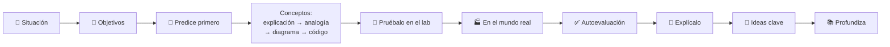

🌐 [English](README.md) · Español

# AI Engineering Fundamentals

**Un curso gratuito, práctico y bilingüe para aprender cómo funcionan de verdad las aplicaciones con
LLM, construyéndolas.** De datos web en bruto a tokenizadores, de un *playground* a un chatbot de
soporte fundamentado, de agentes que llaman a herramientas a sistemas de *deep research* que se
ejecutan en tu propio portátil.

[](https://github.com/elrincondeldev/AI-Engineering-Fundamentals/actions/workflows/ci.yml)
Licencia: [MIT](LICENSE)

> Todos los labs funcionan **sin conexión, gratis y en la CPU de un portátil**. Sin claves de API ni
> GPU. Un modelo falso determinista hace que todos los resultados sean reproducibles; cambia a un
> modelo local (Ollama) o a cualquier endpoint compatible con OpenAI con una variable de entorno
> cuando quieras probar con uno de verdad.

## Qué vas a construir

| Proyecto | Módulos | Qué hace |
|---|---|---|
| 🧪 ***Playground* de LLM** | 01–03 | Un *playground* de línea de comandos para comparar modelos y parámetros, con presupuestos de *tokens*, seguimiento de costes, trazas y un anonimizador de datos personales. |
| 💬 **Chatbot de soporte (RAG)** | 04–06 | Responde a la clientela desde un centro de ayuda con citas, se abstiene cuando no está seguro, resiste la inyección de *prompts* y viene con un informe de evaluación. |
| 🌐 **Agente Ask-the-Web** | 07–08 | Un agente ReAct / ReWOO con herramientas y MCP que investiga en una copia sin conexión de la web y cita sus fuentes. |
| 🔬 **Agente de *deep research* + despliegue local** | 09–10 | Planifica, busca, lee y escribe un informe con citas, usa técnicas de razonamiento en inferencia y está dimensionado para ejecutarse con un modelo local. |

## Para quién es este curso

| | |
|---|---|
| **Público** | Personas que desarrollan software, analistas de datos y perfiles técnicos que quieren construir aplicaciones con LLM. No hace falta experiencia previa en *machine learning*. |
| **Requisitos previos** | Python básico (funciones, clases, entornos virtuales), Git y la línea de comandos. Matemáticas de secundaria; los vectores se explican cuando hacen falta. |
| **Tiempo** | Unas 85 horas: 10 módulos de 6–8 horas más un proyecto final de 12 horas. Ritmo sugerido: un módulo por semana, unas 12 semanas. |
| **Coste** | Gratis. Opcional: un modelo local con [Ollama](https://ollama.com) o una clave de API de cualquier endpoint compatible con OpenAI. |
| **Idiomas** | Inglés y español (`*.es.md`). El inglés es la fuente de verdad. |

## Cómo funciona el curso

Te incorporas como nueva persona de **ingeniería de IA en Hearthwise**, una tienda ficticia mediana de
dispositivos de hogar inteligente con sede en Valencia que vende en Europa y Latinoamérica. Cada
lección empieza con un mensaje de alguien del equipo que necesita algo y termina contigo
entregándolo.

| Personaje | Rol |
|---|---|
| **Rio Tanaka** | Responsable de Ingeniería de IA, tu manager |
| **Sam Adeyemi** | Ingeniería de fiabilidad (latencia, coste, disponibilidad) |
| **Noor Haddad** | Responsable de Seguridad y Privacidad |
| **Alex Moreau** | Responsable de Operaciones de Atención al Cliente |
| **Jordan Kim** | Responsable de Producto y Estrategia |
| **Dani Ruiz** | Ciencia de datos, responsable de la evaluación |

Cada lección sigue el mismo recorrido:



Cada módulo tiene un README con la historia, los objetivos, una rúbrica de autoevaluación y un rincón
de entrevistas, además de un lab con su *Definition of Done*, un quiz con repaso espaciado y una
chuleta de una página. Lee [Cómo estudiar](docs/how-to-study.es.md) antes de empezar.

## Inicio rápido

```bash
git clone https://github.com/elrincondeldev/AI-Engineering-Fundamentals.git
cd AI-Engineering-Fundamentals
python3 tools/check_setup.py
```

Necesitas [uv](https://docs.astral.sh/uv/) (instala Python 3.12 por ti) y Git. Después ejecuta tu
primer lab:

```bash
cd modules/01-how-llms-are-built/lab
uv sync
uv run pytest
uv run lab --help
```

Todos los labs funcionan igual: `uv sync && uv run pytest` y después `uv run lab <comando>`.

### Elegir el *back-end* del modelo

| `LLM_PROVIDER` | Qué usa | Necesita |
|---|---|---|
| `fake` (por defecto) | Un modelo determinista sin conexión construido para cada lab | Nada |
| `ollama` | Un modelo local, por ejemplo `OLLAMA_MODEL=llama3.2:1b` | [Ollama](https://ollama.com) en marcha |
| `openai` | Cualquier endpoint compatible con OpenAI (`OPENAI_BASE_URL`, `OPENAI_API_KEY`, `OPENAI_MODEL`) | Un endpoint y, normalmente, una clave |

Todos los tests usan el *back-end* falso, así que pasan sin claves ni red.

## Mapa del curso

```mermaid
flowchart LR
    subgraph P1["Parte 1 · Fundamentos"]
        M01["01 · Cómo se construyen los LLM"] --> M02["02 · Del modelo base al asistente"] --> M03["03 · Playground de LLM"]
    end
    subgraph P2["Parte 2 · Adaptación y RAG"]
        M04["04 · Prompting y fine-tuning"] --> M05["05 · RAG I: recuperación"] --> M06["06 · RAG II: bot de soporte"]
    end
    subgraph P3["Parte 3 · Agentes"]
        M07["07 · Workflows y herramientas"] --> M08["08 · Agente Ask-the-Web"]
    end
    subgraph P4["Parte 4 · Razonamiento"]
        M09["09 · Modelos de razonamiento"] --> M10["10 · Deep research y local"]
    end
    M03 --> M04
    M06 --> M07
    M08 --> M09
    M10 --> CAP["🎓 Proyecto final"]
```



## Índice completo

### Parte 1 — Fundamentos

**[Módulo 01 — Cómo se construyen los LLM](modules/01-how-llms-are-built/README.es.md)**: datos, *tokens* y Transformers.

1. [El camino de los datos en bruto a un chatbot](modules/01-how-llms-are-built/01-llm-overview.es.md)
2. [Datos de preentrenamiento: recogida y limpieza](modules/01-how-llms-are-built/02-pretraining-data.es.md)
3. [Tokenización y codificación por pares de bytes](modules/01-how-llms-are-built/03-tokenization.es.md)
4. [Las redes neuronales y el Transformer](modules/01-how-llms-are-built/04-neural-networks-and-transformers.es.md)
5. [Familias de modelos: GPT, DeepSeek, Qwen y Gemma](modules/01-how-llms-are-built/05-model-families.es.md)
- 🧪 [Lab](modules/01-how-llms-are-built/lab/README.es.md) · 📝 [Quiz](modules/01-how-llms-are-built/quiz.es.md) · 📄 [Chuleta](modules/01-how-llms-are-built/cheatsheet.es.md)

**[Módulo 02 — Del modelo base al asistente](modules/02-decoding-post-training-evaluation/README.es.md)**: decodificación, post-entrenamiento y evaluación.

1. [Estrategias de decodificación](modules/02-decoding-post-training-evaluation/01-decoding-strategies.es.md)
2. [Ajuste fino supervisado](modules/02-decoding-post-training-evaluation/02-supervised-fine-tuning.es.md)
3. [RLHF y optimización de preferencias](modules/02-decoding-post-training-evaluation/03-rlhf-and-preference-optimization.es.md)
4. [Evaluar LLM](modules/02-decoding-post-training-evaluation/04-evaluating-llms.es.md)
- 🧪 [Lab](modules/02-decoding-post-training-evaluation/lab/README.es.md) · 📝 [Quiz](modules/02-decoding-post-training-evaluation/quiz.es.md) · 📄 [Chuleta](modules/02-decoding-post-training-evaluation/cheatsheet.es.md)

**[Módulo 03 — Construye un playground de LLM](modules/03-llm-playground/README.es.md)**: el diseño general de un chatbot.

1. [Diseño de un sistema de chatbot](modules/03-llm-playground/01-chatbot-system-design.es.md)
2. [Una interfaz, muchos modelos](modules/03-llm-playground/02-one-interface-many-models.es.md)
3. [Estado de la conversación y ventanas de contexto](modules/03-llm-playground/03-conversation-state-and-context-windows.es.md)
4. [Lanzar el playground](modules/03-llm-playground/04-shipping-the-playground.es.md)
- 🧪 [Lab](modules/03-llm-playground/lab/README.es.md) · 📝 [Quiz](modules/03-llm-playground/quiz.es.md) · 📄 [Chuleta](modules/03-llm-playground/cheatsheet.es.md)

### Parte 2 — Adaptar LLM y RAG

**[Módulo 04 — Adaptar LLM](modules/04-prompting-context-and-fine-tuning/README.es.md)**: *prompting*, ingeniería de contexto y *fine-tuning*.

1. [Elegir cómo adaptar un LLM y medirlo con honestidad](modules/04-prompting-context-and-fine-tuning/01-adaptation-techniques.es.md)
2. [Ingeniería de *prompts* para el enrutador de intenciones](modules/04-prompting-context-and-fine-tuning/02-prompt-engineering.es.md)
3. [Ingeniería de contexto: ensamblar, presupuestar y compactar](modules/04-prompting-context-and-fine-tuning/03-context-engineering.es.md)
4. [*Fine-tuning*, PEFT y LoRA: cuándo compensa cambiar los pesos](modules/04-prompting-context-and-fine-tuning/04-fine-tuning-peft-and-lora.es.md)
- 🧪 [Lab](modules/04-prompting-context-and-fine-tuning/lab/README.es.md) · 📝 [Quiz](modules/04-prompting-context-and-fine-tuning/quiz.es.md) · 📄 [Chuleta](modules/04-prompting-context-and-fine-tuning/cheatsheet.es.md)

**[Módulo 05 — RAG I: recuperación](modules/05-rag-retrieval/README.es.md)**: análisis, fragmentación, indexación y búsqueda.

1. [Por qué la generación aumentada por recuperación](modules/05-rag-retrieval/01-rag-overview.es.md)
2. [Análisis y fragmentación del centro de ayuda](modules/05-rag-retrieval/02-parsing-and-chunking.es.md)
3. [Indexación: palabras clave, conocimiento y vectores](modules/05-rag-retrieval/03-indexing-and-embeddings.es.md)
4. [Búsqueda exacta y aproximada](modules/05-rag-retrieval/04-exact-and-approximate-search.es.md)
- 🧪 [Lab](modules/05-rag-retrieval/lab/README.es.md) · 📝 [Quiz](modules/05-rag-retrieval/quiz.es.md) · 📄 [Chuleta](modules/05-rag-retrieval/cheatsheet.es.md)

**[Módulo 06 — RAG II: el chatbot de soporte](modules/06-rag-generation-and-evaluation/README.es.md)**: generación fundamentada, RAFT y evaluación.

1. [*Prompts* para respuestas fundamentadas](modules/06-rag-generation-and-evaluation/01-prompting-for-grounded-answers.es.md)
2. [RAFT: entrenar para RAG](modules/06-rag-generation-and-evaluation/02-raft-training-for-rag.es.md)
3. [Evaluar RAG](modules/06-rag-generation-and-evaluation/03-evaluating-rag.es.md)
4. [Diseñar el chatbot de soporte](modules/06-rag-generation-and-evaluation/04-support-chatbot-design.es.md)
- 🧪 [Lab](modules/06-rag-generation-and-evaluation/lab/README.es.md) · 📝 [Quiz](modules/06-rag-generation-and-evaluation/quiz.es.md) · 📄 [Chuleta](modules/06-rag-generation-and-evaluation/cheatsheet.es.md)

### Parte 3 — Agentes

**[Módulo 07 — Agentes I: workflows, herramientas y MCP](modules/07-agents-workflows-and-tools/README.es.md)**

1. [Agentes, sistemas agénticos y la escalera de autonomía](modules/07-agents-workflows-and-tools/01-agents-overview.es.md)
2. [Patrones de *workflow*: encadenar, enrutar, paralelizar, reflexionar, orquestar](modules/07-agents-workflows-and-tools/02-workflow-patterns.es.md)
3. [Llamada a herramientas: formato, ejecución y protección de herramientas](modules/07-agents-workflows-and-tools/03-tool-calling.es.md)
4. [El Model Context Protocol: compartir herramientas de forma segura](modules/07-agents-workflows-and-tools/04-model-context-protocol.es.md)
- 🧪 [Lab](modules/07-agents-workflows-and-tools/lab/README.es.md) · 📝 [Quiz](modules/07-agents-workflows-and-tools/quiz.es.md) · 📄 [Chuleta](modules/07-agents-workflows-and-tools/cheatsheet.es.md)

**[Módulo 08 — Agentes II: el agente Ask-the-Web](modules/08-multi-step-and-multi-agent-systems/README.es.md)**: agentes de varios pasos, sistemas multiagente y evaluación.

1. [Planificación y el bucle ReAct](modules/08-multi-step-and-multi-agent-systems/01-planning-and-react.es.md)
2. [Reflexion, ReWOO y compañía](modules/08-multi-step-and-multi-agent-systems/02-reflexion-rewoo-and-friends.es.md)
3. [Búsqueda en árbol para agentes](modules/08-multi-step-and-multi-agent-systems/03-tree-search-for-agents.es.md)
4. [Sistemas multiagente y A2A](modules/08-multi-step-and-multi-agent-systems/04-multi-agent-systems-and-a2a.es.md)
5. [Evaluar agentes](modules/08-multi-step-and-multi-agent-systems/05-evaluating-agents.es.md)
- 🧪 [Lab](modules/08-multi-step-and-multi-agent-systems/lab/README.es.md) · 📝 [Quiz](modules/08-multi-step-and-multi-agent-systems/quiz.es.md) · 📄 [Chuleta](modules/08-multi-step-and-multi-agent-systems/cheatsheet.es.md)

### Parte 4 — Razonamiento y despliegue

**[Módulo 09 — Modelos de razonamiento](modules/09-reasoning-models/README.es.md)**

1. [Modelos de razonamiento: qué cambia y cuándo compensan](modules/09-reasoning-models/01-reasoning-models-overview.es.md)
2. [Escalado en tiempo de inferencia: más muestras, más revisiones](modules/09-reasoning-models/02-inference-time-scaling.es.md)
3. [Búsqueda y verificadores: árboles, modelos de recompensa y explotación de la recompensa](modules/09-reasoning-models/03-search-and-verifiers.es.md)
4. [Entrenar modelos de razonamiento: STaR, RL con recompensas verificables y destilación](modules/09-reasoning-models/04-training-reasoning-models.es.md)
- 🧪 [Lab](modules/09-reasoning-models/lab/README.es.md) · 📝 [Quiz](modules/09-reasoning-models/quiz.es.md) · 📄 [Chuleta](modules/09-reasoning-models/cheatsheet.es.md)

**[Módulo 10 — Deep research y despliegue local](modules/10-deep-research-and-local-deployment/README.es.md)**

1. [Arquitectura de *deep research*](modules/10-deep-research-and-local-deployment/01-deep-research-architecture.es.md)
2. [Construir el bucle de investigación](modules/10-deep-research-and-local-deployment/02-building-the-research-loop.es.md)
3. [Ejecutar modelos en local](modules/10-deep-research-and-local-deployment/03-running-models-locally.es.md)
4. [Servir y operar LLM](modules/10-deep-research-and-local-deployment/04-serving-and-operating-llms.es.md)
- 🧪 [Lab](modules/10-deep-research-and-local-deployment/lab/README.es.md) · 📝 [Quiz](modules/10-deep-research-and-local-deployment/quiz.es.md) · 📄 [Chuleta](modules/10-deep-research-and-local-deployment/cheatsheet.es.md)

### 🎓 [Proyecto final: Hearthwise Assist](capstone/README.es.md)

Diseña, construye, evalúa y defiende un asistente de principio a fin, con rúbrica.

## Recursos compartidos

| Recurso | Para qué sirve |
|---|---|
| [Cómo estudiar](docs/how-to-study.es.md) | Plan de estudio, ritmo semanal y cómo usar cada parte de una lección |
| [Arquitectura](docs/architecture.es.md) | Los sistemas que construyes y cómo encajan |
| [Glosario](docs/glossary.es.md) | Cada término, en inglés y en español |
| [Recursos](docs/resources.es.md) | Los mejores artículos, documentación y cursos gratuitos, por módulo |
| [Diario de progreso](docs/progress-journal.es.md) | Una plantilla para seguir lo que aprendiste y lo que mediste |
| [Plantillas](templates/README.es.md) | [Design doc](templates/design-doc.es.md), [ADR](templates/adr.es.md), [model card](templates/model-card.es.md), [runbook](templates/runbook.es.md), [postmortem](templates/postmortem.es.md) |
| [Datasets](datasets/README.es.md) | Los datos sintéticos de Hearthwise, sus trampas y los resultados de referencia esperados |
| [Convenciones del curso](docs/course-conventions.es.md) | El contrato para autoría y contribuciones |

## Estructura del repositorio

```text
.
├── modules/NN-slug/        # README, lecciones, quiz, chuleta y lab/ (un proyecto uv cada uno)
├── capstone/               # proyecto final y rúbrica
├── datasets/               # datos sintéticos + generador (semilla fija) + líneas base
├── docs/                   # guía de estudio, arquitectura, glosario, recursos, convenciones
├── templates/              # design doc, ADR, model card, runbook, postmortem
└── tools/                  # comprobaciones de entorno, enlaces, traducciones, lecciones y mermaid; esqueleto de lab
```

## Contribuir

Las correcciones, las explicaciones más claras y las traducciones son bienvenidas. Lee primero
[CONTRIBUTING.es.md](CONTRIBUTING.es.md) y las [convenciones del curso](docs/course-conventions.es.md).

## Licencia y aviso

[MIT](LICENSE). Hearthwise, sus productos, personas, competidores y cada número de `datasets/` son
ficticios. La lista de temas sigue un temario público de lo que necesita saber una persona de
ingeniería de IA; todas las explicaciones, el código, los datos y los ejercicios de este repositorio
son originales.
