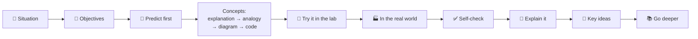

🌐 English · [Español](README.es.md)

# AI Engineering Fundamentals

**A free, hands-on, bilingual course to learn how LLM applications really work, by building them.**
From raw web data to tokenizers, from a playground to a grounded support chatbot, from tool-calling
agents to deep-research systems running on your own laptop.

[](https://github.com/elrincondeldev/AI-Engineering-Fundamentals/actions/workflows/ci.yml)
License: [MIT](LICENSE)

> Every lab runs **offline, for free, on a laptop CPU**. No API keys, no GPU. A deterministic fake
> model makes every result reproducible; switch to a local model (Ollama) or any OpenAI-compatible
> endpoint with one environment variable when you want the real thing.

## What you will build

| Project | Modules | What it does |
|---|---|---|
| 🧪 **LLM Playground** | 01–03 | A command-line playground to compare models and parameters, with token budgets, cost tracking, traces and a personal-data redactor. |
| 💬 **Customer-support chatbot (RAG)** | 04–06 | Answers customers from a help centre with citations, refuses when unsure, resists prompt injection and comes with an evaluation report. |
| 🌐 **Ask-the-Web agent** | 07–08 | A ReAct / ReWOO agent with tools and MCP that researches an offline web snapshot and cites its sources. |
| 🔬 **Deep-research agent + local deployment** | 09–10 | Plans, searches, reads and writes a cited report, uses inference-time reasoning techniques, and is sized to run on a local model. |

## Who this course is for

| | |
|---|---|
| **Audience** | Software developers, data analysts and technical professionals who want to build LLM applications. No machine-learning background needed. |
| **Prerequisites** | Basic Python (functions, classes, virtual environments), Git and the command line. High-school maths; vectors are explained when needed. |
| **Time** | About 85 hours: 10 modules of 6–8 hours plus a 12-hour capstone. Suggested pace: one module per week, about 12 weeks. |
| **Cost** | Free. Optional: a local model with [Ollama](https://ollama.com) or an API key for any OpenAI-compatible endpoint. |
| **Languages** | English and Spanish (`*.es.md`). English is the source of truth. |

## How the course works

You are the new **AI engineer at Hearthwise**, a fictional mid-size retailer of smart-home devices
based in Valencia that sells across Europe and Latin America. Every lesson starts with a message from
a colleague who needs something, and ends with you shipping it.

| Character | Role |
|---|---|
| **Rio Tanaka** | Head of AI Engineering, your manager |
| **Sam Adeyemi** | Site Reliability Engineer (latency, cost, uptime) |
| **Noor Haddad** | Security and Privacy Lead |
| **Alex Moreau** | Customer Support Operations Lead |
| **Jordan Kim** | Product and Strategy Lead |
| **Dani Ruiz** | Data Scientist, owns evaluation |

Every lesson follows the same path:



Each module has a README with the story, objectives, a self-assessment rubric and an interview
corner, plus a lab with a *Definition of Done*, a quiz with spaced repetition and a one-page
cheatsheet. Read [How to study](docs/how-to-study.md) before you start.

## Quick start

```bash
git clone https://github.com/elrincondeldev/AI-Engineering-Fundamentals.git
cd AI-Engineering-Fundamentals
python3 tools/check_setup.py
```

You need [uv](https://docs.astral.sh/uv/) (it installs Python 3.12 for you) and Git. Then run your
first lab:

```bash
cd modules/01-how-llms-are-built/lab
uv sync
uv run pytest
uv run lab --help
```

Every lab works the same way: `uv sync && uv run pytest`, then `uv run lab <command>`.

### Choosing a model back-end

| `LLM_PROVIDER` | What it uses | Needs |
|---|---|---|
| `fake` (default) | A deterministic offline model built for each lab | Nothing |
| `ollama` | A local model, for example `OLLAMA_MODEL=llama3.2:1b` | [Ollama](https://ollama.com) running |
| `openai` | Any OpenAI-compatible endpoint (`OPENAI_BASE_URL`, `OPENAI_API_KEY`, `OPENAI_MODEL`) | An endpoint and, usually, a key |

All tests use the fake back-end, so they pass without keys or network.

## Course map

```mermaid
flowchart LR
    subgraph P1["Part 1 · Foundations"]
        M01["01 · How LLMs are built"] --> M02["02 · Base model to assistant"] --> M03["03 · LLM playground"]
    end
    subgraph P2["Part 2 · Adapting and RAG"]
        M04["04 · Prompting and fine-tuning"] --> M05["05 · RAG I: retrieval"] --> M06["06 · RAG II: support bot"]
    end
    subgraph P3["Part 3 · Agents"]
        M07["07 · Workflows and tools"] --> M08["08 · Ask-the-Web agent"]
    end
    subgraph P4["Part 4 · Reasoning"]
        M09["09 · Reasoning models"] --> M10["10 · Deep research and local"]
    end
    M03 --> M04
    M06 --> M07
    M08 --> M09
    M10 --> CAP["🎓 Capstone"]
```



## Full index

### Part 1 — Foundations

**[Module 01 — How LLMs Are Built](modules/01-how-llms-are-built/README.md)**: data, tokens and Transformers.

1. [The path from raw data to a chatbot](modules/01-how-llms-are-built/01-llm-overview.md)
2. [Pre-training data: collection and cleaning](modules/01-how-llms-are-built/02-pretraining-data.md)
3. [Tokenization and byte-pair encoding](modules/01-how-llms-are-built/03-tokenization.md)
4. [Neural networks and the Transformer](modules/01-how-llms-are-built/04-neural-networks-and-transformers.md)
5. [Model families: GPT, DeepSeek, Qwen and Gemma](modules/01-how-llms-are-built/05-model-families.md)
- 🧪 [Lab](modules/01-how-llms-are-built/lab/README.md) · 📝 [Quiz](modules/01-how-llms-are-built/quiz.md) · 📄 [Cheatsheet](modules/01-how-llms-are-built/cheatsheet.md)

**[Module 02 — From Base Model to Assistant](modules/02-decoding-post-training-evaluation/README.md)**: decoding, post-training and evaluation.

1. [Decoding strategies](modules/02-decoding-post-training-evaluation/01-decoding-strategies.md)
2. [Supervised fine-tuning](modules/02-decoding-post-training-evaluation/02-supervised-fine-tuning.md)
3. [RLHF and preference optimisation](modules/02-decoding-post-training-evaluation/03-rlhf-and-preference-optimization.md)
4. [Evaluating LLMs](modules/02-decoding-post-training-evaluation/04-evaluating-llms.md)
- 🧪 [Lab](modules/02-decoding-post-training-evaluation/lab/README.md) · 📝 [Quiz](modules/02-decoding-post-training-evaluation/quiz.md) · 📄 [Cheatsheet](modules/02-decoding-post-training-evaluation/cheatsheet.md)

**[Module 03 — Build an LLM Playground](modules/03-llm-playground/README.md)**: the overall design of a chatbot.

1. [Chatbot system design](modules/03-llm-playground/01-chatbot-system-design.md)
2. [One interface, many models](modules/03-llm-playground/02-one-interface-many-models.md)
3. [Conversation state and context windows](modules/03-llm-playground/03-conversation-state-and-context-windows.md)
4. [Shipping the playground](modules/03-llm-playground/04-shipping-the-playground.md)
- 🧪 [Lab](modules/03-llm-playground/lab/README.md) · 📝 [Quiz](modules/03-llm-playground/quiz.md) · 📄 [Cheatsheet](modules/03-llm-playground/cheatsheet.md)

### Part 2 — Adapting LLMs and RAG

**[Module 04 — Adapting LLMs](modules/04-prompting-context-and-fine-tuning/README.md)**: prompting, context engineering and fine-tuning.

1. [Choosing how to adapt an LLM, and measuring it honestly](modules/04-prompting-context-and-fine-tuning/01-adaptation-techniques.md)
2. [Prompt engineering for the intent router](modules/04-prompting-context-and-fine-tuning/02-prompt-engineering.md)
3. [Context engineering: assembling, budgeting and compacting](modules/04-prompting-context-and-fine-tuning/03-context-engineering.md)
4. [Fine-tuning, PEFT and LoRA: when changing the weights pays off](modules/04-prompting-context-and-fine-tuning/04-fine-tuning-peft-and-lora.md)
- 🧪 [Lab](modules/04-prompting-context-and-fine-tuning/lab/README.md) · 📝 [Quiz](modules/04-prompting-context-and-fine-tuning/quiz.md) · 📄 [Cheatsheet](modules/04-prompting-context-and-fine-tuning/cheatsheet.md)

**[Module 05 — RAG I: Retrieval](modules/05-rag-retrieval/README.md)**: parsing, chunking, indexing and search.

1. [Why retrieval-augmented generation](modules/05-rag-retrieval/01-rag-overview.md)
2. [Parsing and chunking the help centre](modules/05-rag-retrieval/02-parsing-and-chunking.md)
3. [Indexing: keywords, knowledge and vectors](modules/05-rag-retrieval/03-indexing-and-embeddings.md)
4. [Exact and approximate search](modules/05-rag-retrieval/04-exact-and-approximate-search.md)
- 🧪 [Lab](modules/05-rag-retrieval/lab/README.md) · 📝 [Quiz](modules/05-rag-retrieval/quiz.md) · 📄 [Cheatsheet](modules/05-rag-retrieval/cheatsheet.md)

**[Module 06 — RAG II: The Support Chatbot](modules/06-rag-generation-and-evaluation/README.md)**: grounded generation, RAFT and evaluation.

1. [Prompting for grounded answers](modules/06-rag-generation-and-evaluation/01-prompting-for-grounded-answers.md)
2. [RAFT: training for RAG](modules/06-rag-generation-and-evaluation/02-raft-training-for-rag.md)
3. [Evaluating RAG](modules/06-rag-generation-and-evaluation/03-evaluating-rag.md)
4. [Designing the support chatbot](modules/06-rag-generation-and-evaluation/04-support-chatbot-design.md)
- 🧪 [Lab](modules/06-rag-generation-and-evaluation/lab/README.md) · 📝 [Quiz](modules/06-rag-generation-and-evaluation/quiz.md) · 📄 [Cheatsheet](modules/06-rag-generation-and-evaluation/cheatsheet.md)

### Part 3 — Agents

**[Module 07 — Agents I: Workflows, Tools and MCP](modules/07-agents-workflows-and-tools/README.md)**

1. [Agents, agentic systems and the agency ladder](modules/07-agents-workflows-and-tools/01-agents-overview.md)
2. [Workflow patterns: chain, route, parallelize, reflect, orchestrate](modules/07-agents-workflows-and-tools/02-workflow-patterns.md)
3. [Tool calling: formatting, executing and guarding tools](modules/07-agents-workflows-and-tools/03-tool-calling.md)
4. [The Model Context Protocol: sharing tools safely](modules/07-agents-workflows-and-tools/04-model-context-protocol.md)
- 🧪 [Lab](modules/07-agents-workflows-and-tools/lab/README.md) · 📝 [Quiz](modules/07-agents-workflows-and-tools/quiz.md) · 📄 [Cheatsheet](modules/07-agents-workflows-and-tools/cheatsheet.md)

**[Module 08 — Agents II: The Ask-the-Web Agent](modules/08-multi-step-and-multi-agent-systems/README.md)**: multi-step agents, multi-agent systems and evaluation.

1. [Planning and the ReAct loop](modules/08-multi-step-and-multi-agent-systems/01-planning-and-react.md)
2. [Reflexion, ReWOO and friends](modules/08-multi-step-and-multi-agent-systems/02-reflexion-rewoo-and-friends.md)
3. [Tree search for agents](modules/08-multi-step-and-multi-agent-systems/03-tree-search-for-agents.md)
4. [Multi-agent systems and A2A](modules/08-multi-step-and-multi-agent-systems/04-multi-agent-systems-and-a2a.md)
5. [Evaluating agents](modules/08-multi-step-and-multi-agent-systems/05-evaluating-agents.md)
- 🧪 [Lab](modules/08-multi-step-and-multi-agent-systems/lab/README.md) · 📝 [Quiz](modules/08-multi-step-and-multi-agent-systems/quiz.md) · 📄 [Cheatsheet](modules/08-multi-step-and-multi-agent-systems/cheatsheet.md)

### Part 4 — Reasoning and deployment

**[Module 09 — Reasoning and Thinking Models](modules/09-reasoning-models/README.md)**

1. [Reasoning models: what changes and when they pay off](modules/09-reasoning-models/01-reasoning-models-overview.md)
2. [Inference-time scaling: more samples, more revisions](modules/09-reasoning-models/02-inference-time-scaling.md)
3. [Search and verifiers: trees, reward models and reward hacking](modules/09-reasoning-models/03-search-and-verifiers.md)
4. [Training reasoning models: STaR, RL with verifiable rewards and distillation](modules/09-reasoning-models/04-training-reasoning-models.md)
- 🧪 [Lab](modules/09-reasoning-models/lab/README.md) · 📝 [Quiz](modules/09-reasoning-models/quiz.md) · 📄 [Cheatsheet](modules/09-reasoning-models/cheatsheet.md)

**[Module 10 — Deep Research and Local Deployment](modules/10-deep-research-and-local-deployment/README.md)**

1. [Deep research architecture](modules/10-deep-research-and-local-deployment/01-deep-research-architecture.md)
2. [Building the research loop](modules/10-deep-research-and-local-deployment/02-building-the-research-loop.md)
3. [Running models locally](modules/10-deep-research-and-local-deployment/03-running-models-locally.md)
4. [Serving and operating LLMs](modules/10-deep-research-and-local-deployment/04-serving-and-operating-llms.md)
- 🧪 [Lab](modules/10-deep-research-and-local-deployment/lab/README.md) · 📝 [Quiz](modules/10-deep-research-and-local-deployment/quiz.md) · 📄 [Cheatsheet](modules/10-deep-research-and-local-deployment/cheatsheet.md)

### 🎓 [Capstone: Hearthwise Assist](capstone/README.md)

Design, build, evaluate and defend an end-to-end assistant, with a rubric.

## Shared resources

| Resource | What it is for |
|---|---|
| [How to study](docs/how-to-study.md) | Study plan, weekly rhythm and how to use each part of a lesson |
| [Architecture](docs/architecture.md) | The systems you build, and how they fit together |
| [Glossary](docs/glossary.md) | Every term, in English and Spanish |
| [Resources](docs/resources.md) | The best free papers, docs and courses, by module |
| [Progress journal](docs/progress-journal.md) | A template to track what you learned and what you measured |
| [Templates](templates/) | [Design doc](templates/design-doc.md), [ADR](templates/adr.md), [model card](templates/model-card.md), [runbook](templates/runbook.md), [postmortem](templates/postmortem.md) |
| [Datasets](datasets/README.md) | The synthetic Hearthwise data, its traps and the expected baseline results |
| [Course conventions](docs/course-conventions.md) | The contract for authors and contributors |

## Repository layout

```text
.
├── modules/NN-slug/        # README, lessons, quiz, cheatsheet and lab/ (one uv project each)
├── capstone/               # final project and rubric
├── datasets/               # synthetic data + generator (fixed seed) + baselines
├── docs/                   # study guide, architecture, glossary, resources, conventions
├── templates/              # design doc, ADR, model card, runbook, postmortem
└── tools/                  # setup, link, i18n, lesson and mermaid checkers; lab skeleton
```

## Contributing

Corrections, clearer explanations and translations are welcome. Read
[CONTRIBUTING.md](CONTRIBUTING.md) and the [course conventions](docs/course-conventions.md) first.

## License and disclaimer

[MIT](LICENSE). Hearthwise, its products, people, competitors and every number in `datasets/` are
fictional. The list of topics follows a public outline of what an AI engineer needs to know; all
explanations, code, data and exercises in this repository are original.
