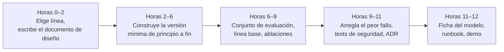

🌐 [English](README.md) · Español

# Proyecto final (*capstone*) — Hearthwise Assist

> Diseña, construye, evalúa y defiende un sistema con LLM de principio a fin, como lo harías en el
> trabajo. ⏱️ unas 12 horas.

## 📨 El encargo

> **De:** Rio Tanaka · Responsable de Ingeniería de IA
> **Canal:** #ai-team
>
> Hace diez semanas no habías limpiado nunca un rastreo web. Desde entonces has construido un
> *playground*, un chatbot de soporte, herramientas, un agente web y un bucle de investigación.
> Dirección quiere una sola cosa que se pueda lanzar: **Hearthwise Assist**. Elige la línea que creas
> que aporta más valor, construye la versión más pequeña que sea útil de verdad y convence a Sam,
> Noor, Alex, Jordan y Dani de que está lista, o cuéntanos con honestidad qué falta. Revisión de
> lanzamiento en dos semanas. ¿Qué medirías?

## 🎯 Objetivos

Al terminar el proyecto final puedes:

- Plantear un problema de producto con LLM con objetivos y no objetivos medibles.
- Combinar al menos tres técnicas del curso en un sistema que funcione.
- Construir un conjunto de evaluación, ejecutarlo y tomar una decisión de lanzamiento a partir de los
  resultados.
- Identificar y mitigar los principales riesgos de seguridad, privacidad, coste y latencia.
- Documentar y defender tu diseño por escrito y en una demo de cinco minutos.

## 🛤️ Elige una línea

| Línea | Construyes | Debe combinar al menos | Revisión principal |
|---|---|---|---|
| **A · Asistente de soporte** | Un asistente bilingüe para clientes que responde desde el centro de ayuda, consulta pedidos con herramientas y pasa los casos a personas | RAG (05–06), herramientas o MCP (07), enrutamiento e ingeniería de contexto (04), barreras de protección (03, 06) | Alex, Noor, Dani |
| **B · Asistente de investigación** | Un asistente de estudios de mercado que responde preguntas rápidas y escribe informes con citas a partir de la web sin conexión, ejecutándose en un modelo local | Agente web (08), técnicas de razonamiento (09), *deep research* y despliegue local (10) | Jordan, Noor, Sam |
| **C · Tu propia idea** | Cualquier sistema con LLM para Hearthwise o para un problema que conozcas bien | Tres técnicas de partes distintas del curso | Elige a tres personas |

Todas las líneas usan los [datasets](../datasets/README.es.md) compartidos; las líneas A y B ya
tienen allí conjuntos de evaluación (`rag_eval/qa.jsonl`, `agent_tasks/`). La línea C debe construir
su propio conjunto de evaluación con al menos 30 ejemplos etiquetados.

## 🧱 Requisitos

1. **Código** en tu *fork* bajo `capstone/<tu-proyecto>/`, creado a partir de
   [`tools/lab_skeleton`](../tools/lab_skeleton/): `uv sync && uv run pytest` pasa sin conexión con el
   proveedor falso en menos de un minuto. Un comando `uv run lab ...` ejecuta el sistema de principio
   a fin.
2. **Evaluación:** un script que ejecuta tu conjunto de evaluación e imprime una tabla de métricas,
   con al menos una línea base (la versión más sencilla) y al menos dos ablaciones (quitar un
   componente cada vez).
3. **Seguridad:** al menos un test que demuestre que tu sistema resiste una inyección de *prompts*, y
   otro que demuestre que no filtra datos personales ni internos.
4. **Documentos** (a partir de las [plantillas](../templates/README.es.md)):
   - un [documento de diseño](../templates/design-doc.es.md);
   - al menos dos [ADR](../templates/adr.es.md) para tus decisiones más importantes;
   - una [ficha del modelo](../templates/model-card.es.md) con tus resultados de evaluación;
   - un [*runbook*](../templates/runbook.es.md) con al menos tres alertas y sus primeras acciones.
5. **Demo:** una grabación de cinco minutos o un recorrido por escrito: el problema, una ejecución en
   directo, las métricas, el riesgo principal y tu recomendación de lanzamiento.

## 🗓️ Plan sugerido

> 💡 **Consejo de producción:** construye el script de evaluación antes de mejorar nada. A partir de
> ahí, cada cambio es un número que sube o baja, no una opinión.

> ⚠️ **Error común:** añadir un agente autónomo o un modelo más grande antes de tener una línea base.
> La versión más sencilla a menudo basta, y solo lo sabrás si la mides.

## 📏 Rúbrica

Puntúa cada criterio de 1 a 4. Un proyecto final listo para lanzar tiene una media de al menos 3 y
ningún criterio en 1.

| Criterio | 1 · Inicial | 2 · En desarrollo | 3 · Competente | 4 · Avanzado |
|---|---|---|---|---|
| **Planteamiento del problema** | Objetivo vago, sin usuarios definidos | Objetivo enunciado pero no medible | Objetivos medibles, no objetivos y usuarios claros | Objetivos ligados a una métrica de negocio con un umbral de lanzamiento realista |
| **Diseño** | Componentes listados sin motivos | Diseño que funciona, sin alternativas | Diagrama claro, alternativas comparadas en ADR | Compromisos cuantificados (calidad, coste, latencia) y defendidos |
| **Implementación** | No funciona de principio a fin | Funciona, pero solo en el caso ideal | Funciona de principio a fin, los tests pasan sin conexión, código legible | Separaciones limpias (proveedor, recuperador, herramientas), fácil de ampliar, bien testeado |
| **Evaluación** | Sin evaluación | Métricas sobre un puñado de ejemplos | Conjunto de evaluación, línea base y ablaciones con tabla de métricas | Segmentos (idioma, categoría), análisis de errores y decisión de lanzamiento guiada por los números |
| **Seguridad y privacidad** | No se considera | Riesgos listados, sin probar | Los tests de inyección y de fuga de datos pasan; herramientas con mínimo privilegio | Modelo de amenazas, casos de *red team*, riesgos residuales documentados con responsables |
| **Operación** | No se considera | Se menciona la latencia o el coste | Estimaciones de *tokens*, coste y latencia; *runbook* con alertas | Plan de capacidad, proveedor de respaldo, monitorización y vuelta atrás probadas |
| **Comunicación** | Difícil de seguir | Documentos incompletos | Documentos completos y una demo clara | Alguien podría aprobar o rechazar el lanzamiento solo con tus documentos |

## ✅ Definición de terminado (*Definition of Done*)

- [ ] `uv sync && uv run pytest` pasa sin conexión en menos de un minuto.
- [ ] Un comando ejecuta el sistema de principio a fin y otro ejecuta la evaluación.
- [ ] La tabla de métricas incluye una línea base y al menos dos ablaciones.
- [ ] Existen tests de inyección y de fuga de datos y pasan.
- [ ] El documento de diseño, dos ADR, la ficha del modelo y el *runbook* están rellenos.
- [ ] Cada número de tus documentos sale de una ejecución de tu script de evaluación.
- [ ] La demo de cinco minutos termina con una recomendación de lanzamiento clara.
- [ ] Te has puntuado con honestidad en la rúbrica y has escrito qué harías después.

## 🎤 Defiéndelo

Prepara respuestas breves a las preguntas que hará cada persona del equipo:

- **Dani:** ¿Cómo construiste el conjunto de evaluación y cómo sabes que no se filtra en tus
  *prompts*?
- **Noor:** ¿Cuál es el radio de impacto si una página recuperada o la salida de una herramienta
  contiene una inyección?
- **Sam:** ¿Cuál es la latencia p95 y el coste por petición, y qué pasa cuando el proveedor se cae?
- **Alex:** ¿Cuándo pasa el sistema el caso a una persona y qué ve esa persona?
- **Jordan:** ¿Cuál es el lanzamiento más pequeño que aporta valor y qué construirías después?

---

[← Quiz del módulo 10](../modules/10-deep-research-and-local-deployment/quiz.es.md) · [🏠 Inicio del curso](../README.es.md)
