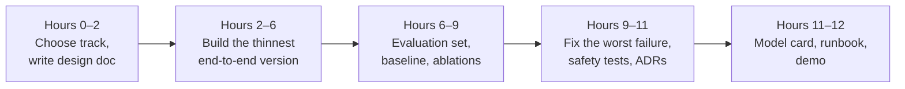

🌐 English · [Español](README.es.md)

# Capstone — Hearthwise Assist

> Design, build, evaluate and defend an LLM system end to end, the way you would at work.
> ⏱️ about 12 hours.

## 📨 The brief

> **From:** Rio Tanaka · Head of AI Engineering
> **Channel:** #ai-team
>
> Ten weeks ago you had never cleaned a web crawl. Since then you have built a playground, a support
> chatbot, tools, a web agent and a research loop. Leadership wants one thing they can launch:
> **Hearthwise Assist**. Pick the track that you think creates the most value, build the smallest
> version that is genuinely useful, and convince Sam, Noor, Alex, Jordan and Dani that it is ready —
> or tell us honestly what is missing. Launch review in two weeks. What would you measure?

## 🎯 Objectives

By the end of the capstone you can:

- Frame an LLM product problem with measurable goals and non-goals.
- Combine at least three techniques from the course into one working system.
- Build an evaluation set, run it, and make a launch decision from the results.
- Identify and mitigate the main security, privacy, cost and latency risks.
- Document and defend your design in writing and in a five-minute demo.

## 🛤️ Choose a track

| Track | You build | Must combine at least | Main reviewers |
|---|---|---|---|
| **A · Support assistant** | A bilingual customer assistant that answers from the help centre, looks up orders with tools and hands off to humans | RAG (05–06), tools or MCP (07), routing and context engineering (04), guardrails (03, 06) | Alex, Noor, Dani |
| **B · Research assistant** | A market-research assistant that answers quick questions and writes cited reports from the offline web, running on a local model | Web agent (08), reasoning techniques (09), deep research and local deployment (10) | Jordan, Noor, Sam |
| **C · Your own idea** | Any LLM system for Hearthwise or for a problem you know well | Three techniques from different parts of the course | Choose three |

All tracks use the shared [datasets](../datasets/README.md); tracks A and B already have evaluation
sets there (`rag_eval/qa.jsonl`, `agent_tasks/`). Track C must build its own evaluation set with at
least 30 labelled examples.

## 🧱 Requirements

1. **Code** in your fork under `capstone/<your-project>/`, created from
   [`tools/lab_skeleton`](../tools/lab_skeleton/): `uv sync && uv run pytest` passes offline with the
   fake provider in under a minute. A `uv run lab ...` command runs the system end to end.
2. **Evaluation:** a script that runs your evaluation set and prints a metrics table, with at least
   one baseline (the simplest version) and at least two ablations (remove one component at a time).
3. **Safety:** at least one test that shows your system resists a prompt injection, and one that
   shows it does not leak personal or internal data.
4. **Documents** (from the [templates](../templates/README.md)):
   - a [design doc](../templates/design-doc.md);
   - at least two [ADRs](../templates/adr.md) for your most important decisions;
   - a [model card](../templates/model-card.md) with your evaluation results;
   - a [runbook](../templates/runbook.md) with at least three alerts and their first actions.
5. **Demo:** a five-minute recording or written walkthrough: the problem, a live run, the metrics,
   the main risk and your launch recommendation.

## 🗓️ Suggested plan

> 💡 **Production tip:** build the evaluation script before improving anything. Every change after
> that is a number moving up or down, not an opinion.

> ⚠️ **Common mistake:** adding an autonomous agent or a bigger model before you have a baseline.
> The simplest version is often good enough, and you can only know if you measure it.

## 📏 Rubric

Score each criterion from 1 to 4. A launch-ready capstone averages at least 3, with no criterion at 1.

| Criterion | 1 · Beginning | 2 · Developing | 3 · Proficient | 4 · Advanced |
|---|---|---|---|---|
| **Problem framing** | Vague goal, no users named | Goal stated but not measurable | Measurable goals, clear non-goals and users | Goals tied to a business metric with a realistic launch bar |
| **Design** | Components listed without reasons | Working design, alternatives not considered | Clear diagram, alternatives compared in ADRs | Trade-offs quantified (quality, cost, latency) and defended |
| **Implementation** | Does not run end to end | Runs, but only on the happy path | Runs end to end, tests pass offline, code is readable | Clean seams (provider, retriever, tools), easy to extend, well tested |
| **Evaluation** | No evaluation | Metrics on a handful of examples | Evaluation set, baseline and ablations with a metrics table | Slices (language, category), error analysis, and a launch decision driven by the numbers |
| **Safety and privacy** | Not considered | Risks listed, not tested | Injection and data-leak tests pass; least-privilege tools | Threat model, red-team cases, residual risks documented with owners |
| **Operations** | Not considered | Latency or cost mentioned | Token, cost and latency estimates; runbook with alerts | Capacity plan, fallback provider, monitoring and rollback tested |
| **Communication** | Hard to follow | Documents incomplete | Complete documents and a clear demo | A reviewer could approve or reject the launch from your documents alone |

## ✅ Definition of Done

- [ ] `uv sync && uv run pytest` passes offline in under a minute.
- [ ] One command runs the system end to end and another runs the evaluation.
- [ ] The metrics table includes a baseline and at least two ablations.
- [ ] Injection and data-leak tests exist and pass.
- [ ] Design doc, two ADRs, model card and runbook are filled in.
- [ ] Every number in your documents comes from a run of your evaluation script.
- [ ] The five-minute demo ends with a clear launch recommendation.
- [ ] You scored yourself honestly on the rubric and wrote what you would do next.

## 🎤 Defend it

Prepare short answers to the questions each reviewer will ask:

- **Dani:** How was the evaluation set built, and how do you know it does not leak into your prompts?
- **Noor:** What is the blast radius if a retrieved page or tool output contains an injection?
- **Sam:** What are p95 latency and cost per request, and what happens when the provider is down?
- **Alex:** When does the system hand off to a human, and what does the human see?
- **Jordan:** What is the smallest launch that creates value, and what would you build next?

---

[← Module 10 quiz](../modules/10-deep-research-and-local-deployment/quiz.md) · [🏠 Course home](../README.md)
