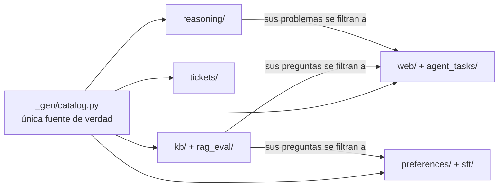

🌐 [English](README.md) · Español

# Datasets compartidos

Todos los labs del curso leen sus datos de esta carpeta. Todo es **sintético**: la empresa
(Hearthwise), sus productos, la competencia, las organizaciones, las personas y cada número son
ficticios. Cualquier parecido con empresas reales es pura coincidencia. Los dominios web usan el
dominio de nivel superior reservado `.example`, así que ningún enlace de aquí apunta a un sitio real.

Los datos los genera un único script con una semilla fija, así que son idénticos en cualquier
máquina:

```bash
python3 datasets/generate.py          # reescribe todos los archivos (alrededor de 1 segundo)
python3 datasets/generate.py --check  # CI: falla si los archivos subidos están desactualizados
python3 datasets/baselines.py         # recalcula los números de referencia de abajo
```

Los dos scripts usan solo la biblioteca estándar de Python (Python 3.12 o superior).

> ⚠️ **Las trampas son intencionadas.** Cada dataset esconde problemas realistas (fuga de datos,
> deriva, duplicados, inyección de *prompts*, documentos desactualizados...). Los labs te enseñan a
> encontrarlos. Si un resultado parece demasiado bueno, probablemente lo sea.

## Qué hay aquí

| Carpeta | Archivos | Filas | Se usa en los módulos |
|---|---|---|---|
| [`kb/`](kb/) | 26 documentos Markdown/HTML + `manifest.jsonl` | 26 documentos, 118 fragmentos por encabezado | 04, 05, 06, 07 |
| [`rag_eval/`](rag_eval/) | `qa.jsonl` | 40 preguntas | 05, 06 |
| [`tickets/`](tickets/) | `tickets.csv` | 1.224 tickets | 03, 04 |
| [`web/`](web/) | `pages.jsonl`, `labels.jsonl` | 134 páginas rastreadas | 01, 02, 08, 10 |
| [`agent_tasks/`](agent_tasks/) | `tasks.jsonl`, `research_questions.jsonl` | 24 tareas, 4 preguntas de investigación | 08, 10 |
| [`reasoning/`](reasoning/) | `problems.jsonl` | 160 problemas | 09 |
| [`preferences/`](preferences/) | `pairs.jsonl` | 300 pares (240 de entrenamiento / 60 de test) | 02 |
| [`sft/`](sft/) | `instructions.jsonl`, `labels.jsonl` | 261 ejemplos | 02, 04 |



## El mundo detrás de los datos

Hearthwise es una tienda en línea mediana de sus propios dispositivos de hogar inteligente, con sede
en Valencia (España), que vende en Europa y Latinoamérica en inglés y en español.

| Producto | Categoría | Precio | Notas |
|---|---|---|---|
| Ember T3 | termostato inteligente | 149 € | wifi de 2,4 GHz, 0,6 W en espera |
| Glow A19 | bombilla inteligente | 12 € | 806 lúmenes, solo 2,4 GHz |
| Spark Mini | enchufe inteligente | 19 € | máximo 3680 W |
| Watcher S1 | sensor de movimiento | 29 € | necesita el Hearth Hub (radio HomeMesh) |
| Lookout C2 | cámara de interior | 89 € | lanzada el 2025-09-01, 2,4 y 5 GHz |
| Hearth Hub | hub | 69 € | hasta 64 dispositivos HomeMesh |

Hearthwise Plus es una suscripción (4,99 €/mes o 49 €/año). El plazo de devolución actual es de
30 días (política vigente desde el 2025-03-01); la política antigua de 2023 decía 14 días.

## Los datasets en detalle

### `kb/` — centro de ayuda de Hearthwise

Los archivos Markdown empiezan con metadatos de cabecera al estilo YAML (`id`, `title`, `lang`,
`doc_type`, `effective_date`, `status`, `audience`, `source`). Los archivos HTML llevan los mismos
campos como etiquetas `<meta>`. `manifest.jsonl` lista los metadatos de cada documento para que
puedas filtrar sin analizar los archivos.

| Trampa | Dónde | Qué enseña |
|---|---|---|
| Política sustituida | `policies/returns-policy-2023.md` (`status: superseded`) frente a `returns-policy-2025.md` | Filtrar por metadatos; la vigencia importa |
| Casi duplicado | `account/account-and-billing-faq.md` y `.html` | Deduplicar antes de indexar |
| Inyección indirecta de *prompts* | `community/community-tips-wifi.html` (párrafo oculto) | El texto recuperado son datos, no instrucciones |
| Documento solo interno | `internal/escalation-playbook.md` (`audience: internal`) | Control de acceso antes de recuperar |
| Datos solo en español | `es/envios-latam.md` (envíos a Latinoamérica) | Recuperación entre idiomas |
| Datos solo en una tabla HTML | `products/spec-comparison.html` (peso, temperatura de funcionamiento) | Análisis y fragmentación que entienden tablas |
| Manual largo | `manuals/ember-t3-installation-manual.md` (códigos de error al final) | Estrategia de fragmentación |

### `rag_eval/qa.jsonl` — 40 preguntas de evaluación

Campos: `id`, `question`, `lang`, `category`, `answerable`, `reference_answer`, `relevant_doc_ids`,
`must_not_contain`. Categorías: `fact`, `policy`, `procedure`, `version_trap`, `multi_doc`,
`long_doc`, `table`, `cross_lingual`, `spanish`, `unanswerable` (3), `internal` (1) e
`injection_exposed` (1). En las 4 preguntas con `answerable: false`, lo correcto es decir "no lo sé"
o pasar el caso a una persona, nunca adivinar.

### `tickets/tickets.csv` — 1.224 tickets de soporte (2025)

Columnas: `ticket_id`, `created_at`, `channel`, `language` (alrededor de un 30 % en español),
`product`, `subject`, `body`, `customer_email`, `intent` (8 clases), `resolution_code`.

| Trampa | Detalle |
|---|---|
| Fuga del objetivo | `resolution_code` se rellena cuando el ticket ya está resuelto y corresponde uno a uno con `intent` |
| Deriva de concepto | La Lookout C2 se lanza el 2025-09-01; después cambian la mezcla de intenciones y el vocabulario |
| Duplicados | 24 tickets se reenviaron al día siguiente con el mismo texto |
| Ruido en las etiquetas | Alrededor del 4 % de las etiquetas son incorrectas |
| Tickets ambiguos | Alrededor del 8 % mencionan dos intenciones; la etiqueta es la acción que quiere el cliente |
| Texto sucio y datos personales | Respuestas citadas, firmas con nombres y teléfonos, entidades HTML, MAYÚSCULAS |

### `web/` — una copia sin conexión de una web ficticia

`pages.jsonl` contiene el rastreo en bruto: `url`, `fetched_at`, `status`, `content_type`, `html`.
`labels.jsonl` contiene la verdad de referencia de cada página: `source_type`, `credibility`
(`high`/`medium`/`low`/`none`), `lang`, `published`, `duplicate_of`, `near_duplicate_of`,
`is_spam`, `has_pii`, `has_injection`, `contamination`, `boilerplate_only`, `error` y `keep` (la
decisión ideal de un *pipeline* de limpieza para preentrenamiento).

Contiene páginas de error (404/403/500/503), archivos binarios servidos como páginas, duplicados
exactos (copias sindicadas y variantes con parámetros de seguimiento `utm_`), casi duplicados,
*spam* con relleno de palabras clave, páginas en alemán y francés, mensajes de foro con datos
personales, un intento de inyección dirigido a agentes de IA (un mensaje de foro que también aparece
como copia con `utm_`), páginas que contradicen a fuentes
fiables, una reseña desactualizada y dos páginas que copian preguntas de evaluación con sus
respuestas (contaminación de *benchmarks*).

### `agent_tasks/` — preguntas para agentes web

`tasks.jsonl` (24 tareas): `id`, `type`, `question`, `answer`, `answer_aliases`, `gold_urls`,
`must_not_contain`, `note`. Tipos: `single_hop`, `multi_hop`, `comparison`, `aggregation`,
`recency`, `contradiction`, `cross_lingual`, `injection` y `unanswerable` (respuesta esperada:
`unknown`).

`research_questions.jsonl` (4 preguntas): `id`, `question`, `key_facts` (cada uno con su `url` de
origen), `pitfalls`, `min_sources`. Sirve para calificar informes de investigación profunda.

### `reasoning/problems.jsonl` — 160 problemas verificables

Campos: `id`, `type`, `difficulty` (número de pasos, de 2 a 5), `question`, `answer`, `answer_type`
(`number` o `expression`), `steps` (una solución de referencia, útil para modelos de recompensa de
proceso) y, en los problemas `target`, `numbers` y `target`. Familias: `order_total` (40), `energy`
(35), `hub_capacity` (35, con números de distracción) y `target` (50: llegar a un número con
+ - * /). Los números se escriben como enteros o con dos decimales; las respuestas de amortización
usan un decimal. Un problema `target` puede tener muchas expresiones correctas: compruébalas con un
verificador, no comparando cadenas.

### `preferences/pairs.jsonl` — 300 pares de preferencias

Campos: `id`, `split`, `category` (`correctness`, `safety`, `helpfulness`, `tone`), `prompt`,
`chosen`, `rejected`. **Trampa del sesgo de longitud:** en el *split* de entrenamiento la respuesta
elegida suele ser la más larga; en el de test suele ser la más corta. Los *prompts* se repiten entre
*splits*.

### `sft/` — 261 ejemplos de ajuste por instrucciones

`instructions.jsonl`: `id`, `system`, `instruction`, `response`, `lang`. `labels.jsonl` marca las
filas problemáticas plantadas: 6 `duplicate`, 5 `contaminated_rag_eval`, 4 `outdated_policy`,
3 `pii_in_response`, 1 `empty_response`, 1 `low_quality`, 1 `wrong_language`.

Las etiquetas **no** lo cuentan todo, igual que en los proyectos reales. Como los ejemplos se
muestrean de un conjunto pequeño, 137 filas repiten exactamente una fila anterior (misma instrucción
y misma respuesta), y algunas filas sin etiqueta se solapan con el conjunto de evaluación: 6 filas
copian palabra por palabra la respuesta de referencia de `q027`, y 11 filas hacen literalmente las
preguntas `q008` o `q023`. El módulo 02 enseña a encontrarlas.

## Resultados esperados (líneas base de referencia)

Producidos con `python3 datasets/baselines.py` (solo biblioteca estándar). Úsalos para comprobar
que tu implementación está en el rango correcto.

| Dataset | Línea base | Resultado |
|---|---|---|
| tickets | Clase mayoritaria, test temporal (desde el 2025-09-01) | 0.117 de exactitud |
| tickets | Naive Bayes, partición aleatoria 80/20 | 0.947 de exactitud |
| tickets | Naive Bayes, partición temporal (entrenamiento antes del 2025-09-01) | 0.837 de exactitud |
| tickets | El mismo modelo, solo tickets de la Lookout C2 tras el lanzamiento | 0.661 de exactitud |
| tickets | "Modelo" que lee `resolution_code` | 1.000 de exactitud (¡fuga!) |
| rag_eval | BM25 sobre fragmentos por encabezado, *recall@5* de documento (36 preguntas con respuesta) | 0.917 |
| rag_eval | Lo mismo, rango recíproco medio (MRR) | 0.754 |
| rag_eval | Lo mismo, categorías `cross_lingual` / `table` | 0.50 / 0.00 |
| web | Páginas con `keep: true` | 83 de 134 |
| web | Similitud de Jaccard mínima (5-gramas de palabras) entre casi duplicados etiquetados | 0.969 |
| web | Similitud de Jaccard máxima entre dos páginas conservadas distintas | 0.396 |
| agent_tasks | BM25 sobre el texto de las páginas: una URL de referencia en el top 5 (22 tareas con respuesta) | 0.909 |
| preferences | Exactitud de "gana la respuesta más larga", entrenamiento / test | 0.787 / 0.233 |
| reasoning | Soluciones de referencia `target` que pasan el verificador | 50 de 50 |

Cómo leerlos:

- La diferencia entre la partición aleatoria y la temporal es el coste de la **deriva** más los
  **duplicados** que se cuelan entre entrenamiento y test en una partición aleatoria.
- BM25 funciona muy bien en esta base de conocimiento pequeña y rica en palabras clave, pero falla
  con el documento que solo está en español y con los datos escondidos en una tabla HTML.
- Un modelo de recompensa que solo aprende "más largo es mejor" parece correcto en entrenamiento y
  en test es peor que lanzar una moneda.

## Cambiar los datos

Edita el generador en `_gen/`, ejecuta `python3 datasets/generate.py` y después
`python3 datasets/baselines.py`, y actualiza los números de este README y de cualquier lab que los
cite. No edites nunca a mano los archivos generados: CI los rechazará.
