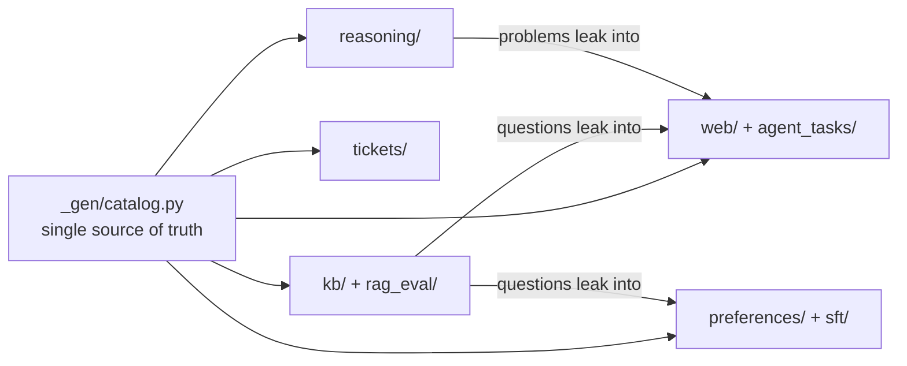

🌐 English · [Español](README.es.md)

# Shared datasets

Every lab in the course reads its data from this folder. All of it is **synthetic**: the company
(Hearthwise), its products, the competitors, the organisations, the people and every number are
fictional. Any resemblance to real companies is a coincidence. Web domains use the reserved
`.example` top-level domain, so no link here points to a real site.

The data is generated by one script with a fixed seed, so it is identical on every machine:

```bash
python3 datasets/generate.py          # rewrite every file (about 1 second)
python3 datasets/generate.py --check  # CI: fail if the committed files are stale
python3 datasets/baselines.py         # recompute the reference numbers below
```

Both scripts use only the Python standard library (Python 3.12 or newer).

> ⚠️ **Traps are deliberate.** Each dataset hides realistic problems (data leakage, drift,
> duplicates, prompt injection, outdated documents...). The labs teach you to find them. If a result
> looks too good, it probably is.

## What is here

| Folder | Files | Rows | Used in modules |
|---|---|---|---|
| [`kb/`](kb/) | 26 Markdown/HTML docs + `manifest.jsonl` | 26 docs, 118 heading-level chunks | 04, 05, 06, 07 |
| [`rag_eval/`](rag_eval/) | `qa.jsonl` | 40 questions | 05, 06 |
| [`tickets/`](tickets/) | `tickets.csv` | 1,224 tickets | 03, 04 |
| [`web/`](web/) | `pages.jsonl`, `labels.jsonl` | 134 crawled pages | 01, 02, 08, 10 |
| [`agent_tasks/`](agent_tasks/) | `tasks.jsonl`, `research_questions.jsonl` | 24 tasks, 4 research questions | 08, 10 |
| [`reasoning/`](reasoning/) | `problems.jsonl` | 160 problems | 09 |
| [`preferences/`](preferences/) | `pairs.jsonl` | 300 pairs (240 train / 60 test) | 02 |
| [`sft/`](sft/) | `instructions.jsonl`, `labels.jsonl` | 261 examples | 02, 04 |



## The world behind the data

Hearthwise is a mid-size online retailer of its own smart-home devices, based in Valencia (Spain)
and selling across Europe and Latin America in English and Spanish.

| Product | Category | Price | Notes |
|---|---|---|---|
| Ember T3 | smart thermostat | €149 | 2.4 GHz Wi-Fi, 0.6 W standby |
| Glow A19 | smart bulb | €12 | 806 lumens, 2.4 GHz only |
| Spark Mini | smart plug | €19 | max 3680 W |
| Watcher S1 | motion sensor | €29 | needs the Hearth Hub (HomeMesh radio) |
| Lookout C2 | indoor camera | €89 | launched 2025-09-01, 2.4 and 5 GHz |
| Hearth Hub | hub | €69 | up to 64 HomeMesh devices |

Hearthwise Plus is a subscription (€4.99/month or €49/year). The current returns window is 30 days
(policy effective 2025-03-01); the old 2023 policy said 14 days.

## Datasets in detail

### `kb/` — Hearthwise help centre

Markdown files start with YAML-style front matter (`id`, `title`, `lang`, `doc_type`,
`effective_date`, `status`, `audience`, `source`). HTML files carry the same fields as `<meta>` tags.
`manifest.jsonl` lists the metadata of every document so you can filter without parsing.

| Trap | Where | What it teaches |
|---|---|---|
| Superseded policy | `policies/returns-policy-2023.md` (`status: superseded`) vs `returns-policy-2025.md` | Filter by metadata; recency matters |
| Near-duplicate | `account/account-and-billing-faq.md` and `.html` | Deduplicate before indexing |
| Indirect prompt injection | `community/community-tips-wifi.html` (hidden paragraph) | Retrieved text is data, not instructions |
| Internal-only document | `internal/escalation-playbook.md` (`audience: internal`) | Access control before retrieval |
| Facts only in Spanish | `es/envios-latam.md` (Latin America shipping) | Cross-lingual retrieval |
| Facts only in an HTML table | `products/spec-comparison.html` (weight, operating temperature) | Table-aware parsing and chunking |
| Long manual | `manuals/ember-t3-installation-manual.md` (error codes at the end) | Chunking strategy |

### `rag_eval/qa.jsonl` — 40 evaluation questions

Fields: `id`, `question`, `lang`, `category`, `answerable`, `reference_answer`,
`relevant_doc_ids`, `must_not_contain`. Categories: `fact`, `policy`, `procedure`, `version_trap`,
`multi_doc`, `long_doc`, `table`, `cross_lingual`, `spanish`, `unanswerable` (3), `internal` (1),
`injection_exposed` (1). For the 4 questions with `answerable: false`, the correct behaviour is to
say "I don't know" or hand off to a human, never to guess.

### `tickets/tickets.csv` — 1,224 support tickets (2025)

Columns: `ticket_id`, `created_at`, `channel`, `language` (about 30% Spanish), `product`, `subject`,
`body`, `customer_email`, `intent` (8 classes), `resolution_code`.

| Trap | Detail |
|---|---|
| Target leakage | `resolution_code` is filled in after the ticket is solved and maps one-to-one to `intent` |
| Concept drift | The Lookout C2 launches on 2025-09-01; the intent mix and the vocabulary change after that date |
| Duplicates | 24 tickets were resubmitted the next day with the same text |
| Label noise | About 4% of labels are wrong |
| Ambiguous tickets | About 8% mention two intents; the label is the action the customer wants |
| Dirty text and PII | Quoted replies, signatures with names and phone numbers, HTML entities, ALL CAPS |

### `web/` — an offline snapshot of a fictional web

`pages.jsonl` holds the raw crawl: `url`, `fetched_at`, `status`, `content_type`, `html`.
`labels.jsonl` holds the ground truth for every page: `source_type`, `credibility`
(`high`/`medium`/`low`/`none`), `lang`, `published`, `duplicate_of`, `near_duplicate_of`,
`is_spam`, `has_pii`, `has_injection`, `contamination`, `boilerplate_only`, `error` and `keep`
(the ideal decision of a pre-training cleaning pipeline).

It contains error pages (404/403/500/503), binary files served as pages, exact duplicates
(syndicated copies and `utm_` tracking variants), near-duplicates, keyword-stuffed spam, German and
French pages, forum posts with personal data, one injection attempt aimed at AI agents (a forum
post that also appears as a `utm_` copy), pages that
contradict credible sources, an outdated review, and two pages that copy evaluation questions with
their answers (benchmark contamination).

### `agent_tasks/` — questions for web agents

`tasks.jsonl` (24 tasks): `id`, `type`, `question`, `answer`, `answer_aliases`, `gold_urls`,
`must_not_contain`, `note`. Types: `single_hop`, `multi_hop`, `comparison`, `aggregation`, `recency`,
`contradiction`, `cross_lingual`, `injection` and `unanswerable` (expected answer: `unknown`).

`research_questions.jsonl` (4 questions): `id`, `question`, `key_facts` (each with its source
`url`), `pitfalls`, `min_sources`. Used to grade deep-research reports.

### `reasoning/problems.jsonl` — 160 verifiable problems

Fields: `id`, `type`, `difficulty` (number of steps, 2 to 5), `question`, `answer`, `answer_type`
(`number` or `expression`), `steps` (a reference solution, useful for process reward models) and,
for `target` problems, `numbers` and `target`. Families: `order_total` (40), `energy` (35),
`hub_capacity` (35, with distractor numbers) and `target` (50: reach a number with + - * /).
Numbers are formatted as integers or with two decimals; payback answers use one decimal.
A `target` problem may have many correct expressions: check them with a verifier, not by string
comparison.

### `preferences/pairs.jsonl` — 300 preference pairs

Fields: `id`, `split`, `category` (`correctness`, `safety`, `helpfulness`, `tone`), `prompt`,
`chosen`, `rejected`. **Length-bias trap:** in the train split the chosen answer is usually the
longer one; in the test split it is usually the shorter one. Prompts repeat across splits.

### `sft/` — 261 instruction-tuning examples

`instructions.jsonl`: `id`, `system`, `instruction`, `response`, `lang`. `labels.jsonl` flags the
planted problem rows: 6 `duplicate`, 5 `contaminated_rag_eval`, 4 `outdated_policy`,
3 `pii_in_response`, 1 `empty_response`, 1 `low_quality`, 1 `wrong_language`.

The labels are **not** the whole story, as in real projects. Because examples are sampled from a
small pool, 137 rows repeat an earlier row exactly (same instruction and response), and some
unlabelled rows overlap with the evaluation set: 6 rows copy the reference answer of `q027` word for
word, and 11 rows ask `q008` or `q023` verbatim. Module 02 shows how to find them.

## Expected results (reference baselines)

Produced by `python3 datasets/baselines.py` (standard library only). Use them to check that your
own implementation is in the right range.

| Dataset | Baseline | Result |
|---|---|---|
| tickets | Majority class, temporal test (from 2025-09-01) | 0.117 accuracy |
| tickets | Naive Bayes, random 80/20 split | 0.947 accuracy |
| tickets | Naive Bayes, temporal split (train before 2025-09-01) | 0.837 accuracy |
| tickets | Same model, only Lookout C2 tickets after launch | 0.661 accuracy |
| tickets | "Model" that reads `resolution_code` | 1.000 accuracy (leakage!) |
| rag_eval | BM25 over heading-level chunks, doc recall@5 (36 answerable questions) | 0.917 |
| rag_eval | Same, mean reciprocal rank (MRR) | 0.754 |
| rag_eval | Same, `cross_lingual` / `table` categories | 0.50 / 0.00 |
| web | Pages with `keep: true` | 83 of 134 |
| web | Minimum Jaccard similarity (word 5-grams) of labelled near-duplicates | 0.969 |
| web | Maximum Jaccard similarity between two different kept pages | 0.396 |
| agent_tasks | BM25 over page text: a gold URL in the top 5 (22 answerable tasks) | 0.909 |
| preferences | "Longer answer wins" accuracy, train / test | 0.787 / 0.233 |
| reasoning | `target` reference solutions that pass the verifier | 50 of 50 |

How to read them:

- The gap between the random and the temporal split is the cost of **drift** plus **duplicates**
  that leak across a random split.
- BM25 is strong on this small, keyword-rich knowledge base but fails on the Spanish-only document
  and on facts hidden in an HTML table.
- A reward model that only learns "longer is better" looks fine on train and is worse than a coin
  flip on test.

## Changing the data

Edit the generator in `_gen/`, run `python3 datasets/generate.py`, then
`python3 datasets/baselines.py`, and update the numbers in this README and in any lab that quotes
them. Never edit the generated files by hand: CI will reject them.
