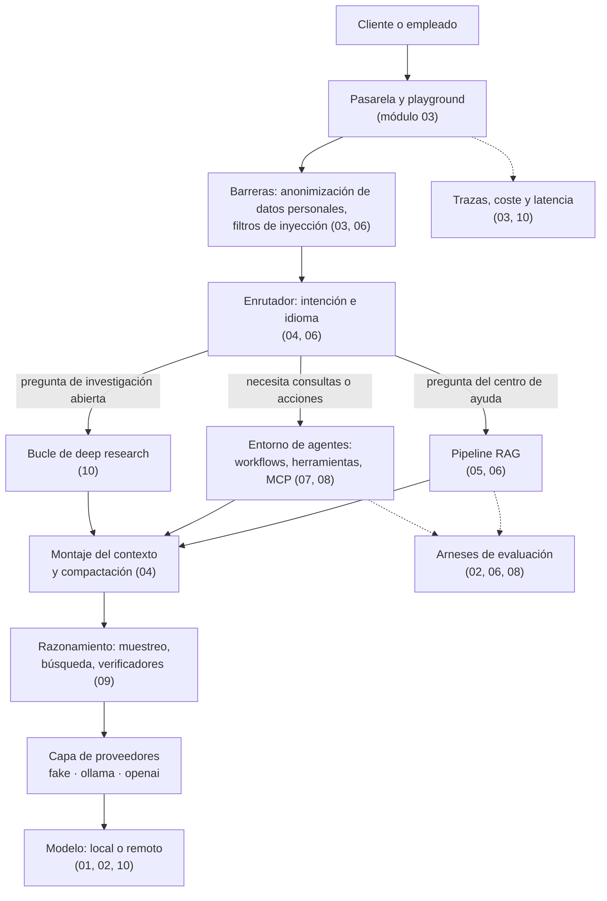
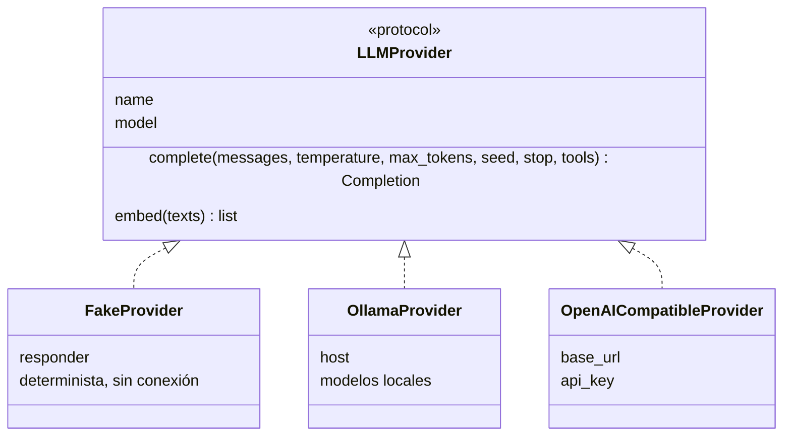
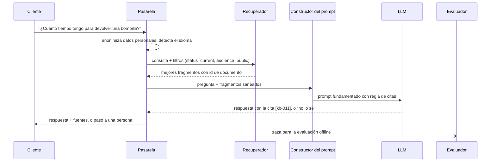

🌐 [English](architecture.md) · Español

# Arquitectura de lo que construyes

A lo largo del curso construyes las piezas de un único sistema: **Hearthwise Assist**, un asistente
que responde a la clientela desde el centro de ayuda, consulta datos con herramientas, investiga en
una copia sin conexión de la web y puede ejecutarse con un modelo local. Cada lab es autocontenido,
pero encajan así.

## La visión general

| Componente | Qué hace | Dónde lo construyes |
|---|---|---|
| *Pipeline* de datos | Limpia texto web en bruto, deduplica y elimina datos personales | Módulo 01 (`m01_foundations`) |
| Tokenizador y funcionamiento interno del modelo | BPE, atención, recuento de parámetros | Módulo 01 |
| Decodificación y evaluación | Estrategias de muestreo, métricas, modelos de recompensa, detección de contaminación | Módulo 02 (`m02_post_training`) |
| *Playground* y pasarela | Una interfaz para muchos modelos, presupuestos, trazas, anonimización | Módulo 03 (`m03_playground`) |
| Enrutador y motor de contexto | Estrategias de *prompting*, montaje del contexto, adaptación con LoRA | Módulo 04 (`m04_adaptation`) |
| Recuperación | Análisis, fragmentación, BM25, *embeddings*, FAISS | Módulo 05 (`m05_retrieval`) |
| Generación fundamentada | Citas, abstención, datos RAFT, evaluación de RAG | Módulo 06 (`m06_support_bot`) |
| Herramientas y MCP | Herramientas con JSON Schema, ejecución segura, patrones de *workflow*, servidor MCP | Módulo 07 (`m07_agents_tools`) |
| Agente web | ReAct, ReWOO, búsqueda en árbol, multiagente, evaluación de agentes | Módulo 08 (`m08_web_agent`) |
| Razonamiento | Autoconsistencia, verificadores, Tree of Thoughts, STaR | Módulo 09 (`m09_reasoning`) |
| *Deep research* y despliegue | Bucle de investigación, calificación de informes, estimación de memoria, cuantización | Módulo 10 (`m10_deep_research`) |

## La capa de proveedores

Todos los labs hablan con los modelos a través de la misma interfaz pequeña, copiada en cada lab desde
[`tools/lab_skeleton`](../tools/lab_skeleton/src/m00_skeleton/providers.py).

Por qué importa:

- **Los tests nunca necesitan un modelo.** El proveedor falso recibe una función `responder`, así que
  cada lab programa exactamente el comportamiento que necesita (un respondedor extractivo, una
  política que llama a herramientas, un razonador simulado) y cada número es reproducible.
- **Cambiar de *back-end* es configuración, no código.** `LLM_PROVIDER=ollama` ejecuta el mismo lab
  con un modelo local; `LLM_PROVIDER=openai`, con cualquier servidor compatible con OpenAI.
- **La interfaz es la costura para los asuntos de producción**: reintentos, tiempos de espera,
  alternativas, contabilidad de costes y trazas envuelven a `complete()`.

## Una petición por el camino RAG

## Asuntos transversales

| Asunto | Quién lo vigila en la historia | Dónde se enseña |
|---|---|---|
| Evaluar antes de lanzar | Dani | Módulos 02, 04, 06, 08, 09, 10 |
| Seguridad: inyección, mínimo privilegio, fugas de datos | Noor | Módulos 03, 06, 07, 08, 10 |
| Latencia, coste y capacidad | Sam | Módulos 03, 05, 10 |
| Experiencia de cliente y paso a personas | Alex | Módulos 04, 06 |
| Valor de negocio y alcance | Jordan | Módulos 07, 08, 09, 10 |

## Principios de diseño que se usan en todo el curso

1. **Empieza simple.** Una sola llamada o un *workflow* fijo gana a un agente autónomo hasta que una
   evaluación demuestre lo contrario.
2. **Mide primero.** Cada componente viene con una métrica y una línea base.
3. **El texto recuperado o descargado son datos, nunca instrucciones.**
4. **Mínimo privilegio.** Las herramientas tienen los permisos mínimos; los efectos secundarios
   necesitan aprobación.
5. **Determinista por defecto.** Semillas, un proveedor falso y datasets fijos hacen que los
   resultados sean reproducibles.

---

[🏠 Inicio del curso](../README.es.md) · [Glosario →](glossary.es.md)
