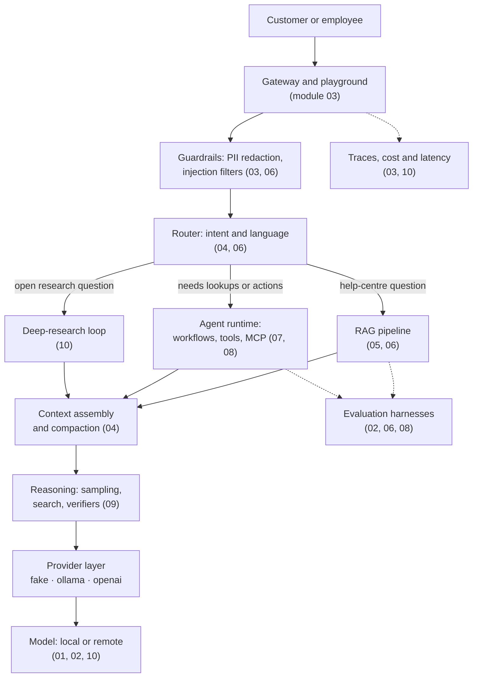
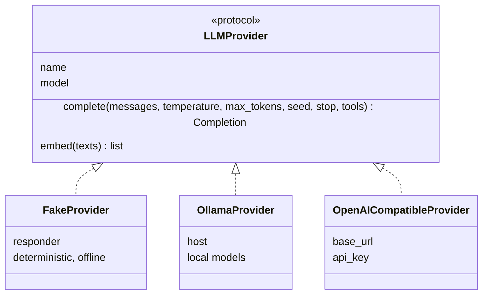
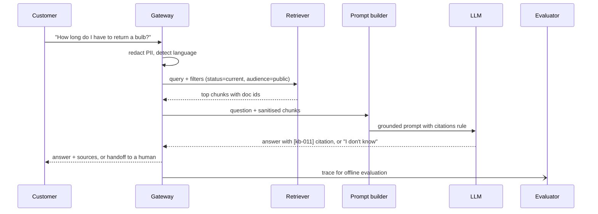

🌐 English · [Español](architecture.es.md)

# Architecture of what you build

Across the course you build the pieces of one system: **Hearthwise Assist**, an assistant that
answers customers from the help centre, looks things up with tools, researches an offline web
snapshot and can run on a local model. Each lab is self-contained, but they fit together like this.

## The big picture

| Component | What it does | Where you build it |
|---|---|---|
| Data pipeline | Cleans raw web text, deduplicates, removes personal data | Module 01 (`m01_foundations`) |
| Tokenizer and model internals | BPE, attention, parameter counting | Module 01 |
| Decoding and evaluation | Sampling strategies, metrics, reward models, contamination checks | Module 02 (`m02_post_training`) |
| Playground and gateway | One interface for many models, budgets, traces, redaction | Module 03 (`m03_playground`) |
| Router and context engine | Prompting strategies, context assembly, LoRA adaptation | Module 04 (`m04_adaptation`) |
| Retrieval | Parsing, chunking, BM25, embeddings, FAISS | Module 05 (`m05_retrieval`) |
| Grounded generation | Citations, abstention, RAFT data, RAG evaluation | Module 06 (`m06_support_bot`) |
| Tools and MCP | JSON-Schema tools, safe execution, workflow patterns, MCP server | Module 07 (`m07_agents_tools`) |
| Web agent | ReAct, ReWOO, tree search, multi-agent, agent evaluation | Module 08 (`m08_web_agent`) |
| Reasoning | Self-consistency, verifiers, Tree of Thoughts, STaR | Module 09 (`m09_reasoning`) |
| Deep research and deployment | Research loop, report grading, memory estimates, quantisation | Module 10 (`m10_deep_research`) |

## The provider layer

Every lab talks to models through the same small interface, copied into each lab from
[`tools/lab_skeleton`](../tools/lab_skeleton/src/m00_skeleton/providers.py).

Why it matters:

- **Tests never need a model.** The fake provider takes a `responder` function, so each lab scripts
  exactly the behaviour it needs (an extractive answerer, a tool-calling policy, a simulated reasoner)
  and every number is reproducible.
- **Switching back-ends is configuration, not code.** `LLM_PROVIDER=ollama` runs the same lab on a
  local model; `LLM_PROVIDER=openai` on any OpenAI-compatible server.
- **The interface is the seam for production concerns**: retries, timeouts, fallbacks, cost
  accounting and tracing all wrap `complete()`.

## A request through the RAG path

## Cross-cutting concerns

| Concern | Owner in the story | Where it is taught |
|---|---|---|
| Evaluation before shipping | Dani | Modules 02, 04, 06, 08, 09, 10 |
| Security: injection, least privilege, data leaks | Noor | Modules 03, 06, 07, 08, 10 |
| Latency, cost and capacity | Sam | Modules 03, 05, 10 |
| Customer experience and handoff | Alex | Modules 04, 06 |
| Business value and scope | Jordan | Modules 07, 08, 09, 10 |

## Design principles used throughout

1. **Start simple.** A single call or a fixed workflow beats an autonomous agent until you can show
   otherwise with an evaluation.
2. **Measure first.** Every component comes with a metric and a baseline.
3. **Retrieved and fetched text is data, never instructions.**
4. **Least privilege.** Tools get the minimum permissions; side effects need approval.
5. **Deterministic by default.** Seeds, a fake provider and fixed datasets make results reproducible.

---

[🏠 Course home](../README.md) · [Glossary →](glossary.md)
