🌐 [English](course-conventions.md) · Español

# Convenciones del curso

Este es el contrato que sigue toda persona que escriba en el curso, humana o IA. Si algo de aquí
choca con un módulo, manda este documento; propón el cambio en un *pull request* en lugar de
desviarte.

## 1. El curso en una tabla

| Elemento | Decisión |
|---|---|
| Título | AI Engineering Fundamentals |
| Público | Personas que desarrollan software, analistas de datos y perfiles técnicos que quieren construir aplicaciones con LLM. No hace falta experiencia previa en *machine learning*. |
| Requisitos previos | Python básico (funciones, clases, entornos virtuales), Git y la línea de comandos. Matemáticas de secundaria; los vectores se explican cuando hacen falta. |
| Tiempo | Unas 85 horas: 10 módulos de 6–8 horas más un proyecto final de 12 horas. Ritmo sugerido: un módulo por semana, a 6–8 horas por semana (unas 12 semanas). |
| Coste | Gratis. Todo funciona sin conexión en la CPU de un portátil. Los modelos locales (Ollama) y las API de pago son opcionales. |
| Idiomas | El inglés es la fuente de verdad. Cada archivo Markdown tiene un hermano en español neutro (`X.es.md`). |
| Licencia | MIT |

## 2. La historia

Te incorporas como nueva persona de **ingeniería de IA en Hearthwise**, una tienda en línea mediana que
vende sus propios dispositivos de hogar inteligente (termostatos, bombillas, enchufes, sensores, una
cámara y un hub), con sede en Valencia y clientes en Europa y Latinoamérica. Hearthwise tiene unas
350 personas en plantilla y acaba de crear un pequeño equipo de IA. Los datos de productos y
políticas están en [`datasets/README.es.md`](../datasets/README.es.md); no los contradigas nunca.

### Personajes

Refiérete a cada personaje por su nombre o, en inglés, con **they/them**. En español usa formas
neutras (ver la [sección 9](#9-idiomas)). Nunca describas su aspecto físico.

| Nombre | Rol | Le importa | Tono |
|---|---|---|---|
| **Rio Tanaka** | Responsable de Ingeniería de IA, tu manager | Compromisos claros, entregar poco y a menudo | Breve. Termina con una pregunta como "¿qué medirías?" |
| **Sam Adeyemi** | Ingeniería de fiabilidad (SRE, *Site Reliability Engineering*) | Latencia, coste, disponibilidad, observabilidad | Primero los números, humor seco |
| **Noor Haddad** | Responsable de Seguridad y Privacidad | Inyección de *prompts*, datos personales, mínimo privilegio | Calma y precisión. Pregunta "¿cuál es el radio de impacto?" |
| **Alex Moreau** | Responsable de Operaciones de Atención al Cliente | Clientela, carga del equipo de soporte, satisfacción | Cercanía; cita tickets reales |
| **Jordan Kim** | Responsable de Producto y Estrategia | Impacto de negocio, preguntas de mercado, plazos | Visión global, algo de impaciencia |
| **Dani Ruiz** | Ciencia de datos, responsable de evaluación | Calidad de datos, fugas, métricas honestas | Escepticismo. "Enséñame la evaluación." |

### Arco de la historia

| Módulo | Qué pasa en Hearthwise | Personajes principales |
|---|---|---|
| 01 | Primera semana. Rio quiere que entiendas cómo se construyen los LLM. Dani te pasa un rastreo web en bruto que el equipo pensó usar para entrenar un modelo pequeño de dominio. | Rio, Dani |
| 02 | Dirección pregunta por qué el modelo "se enrolla" y en qué modelo confiar. Estudias decodificación, post-entrenamiento y evaluación. Alex trae datos de preferencias valorados por el equipo de soporte. | Rio, Dani, Alex |
| 03 | Construyes el *playground* interno de LLM para que todos los equipos prueben *prompts* con seguridad. Sam quiere ver latencia y coste; Noor no quiere que se envíen datos de clientes a API externas por accidente. | Sam, Noor, Rio |
| 04 | Alex quiere clasificar los tickets por intención. Comparas *prompting* sin ejemplos y con pocos ejemplos, diseñas el contexto y decides si merece la pena un *fine-tuning* con LoRA. | Alex, Dani |
| 05 | Recuperación para el chatbot de soporte: análisis del centro de ayuda, fragmentación, BM25, *embeddings* y FAISS. | Alex, Dani, Sam |
| 06 | Lanzas el chatbot de soporte fundamentado: citas, rechazos, resistencia a inyecciones y un informe de evaluación. | Alex, Noor, Dani |
| 07 | Jordan quiere un asistente que consulte datos y actúe. Construyes *workflows* y herramientas y las expones por MCP. Noor revisa los permisos. | Jordan, Noor, Sam |
| 08 | El agente Ask-the-Web para investigar productos sobre una copia sin conexión de la web: ReAct, ReWOO, búsqueda en árbol, sistemas multiagente y evaluación de agentes. | Jordan, Noor, Dani |
| 09 | Las preguntas de Jordan exigen razonar en varios pasos. Exploras los modelos de razonamiento, el escalado en inferencia con verificadores y cómo se entrenan esos modelos. | Jordan, Dani, Sam |
| 10 | Jordan pide un informe de investigación profunda sobre nuevos mercados, y Noor exige que los datos no salgan nunca del portátil. Construyes un agente de *deep research* y un plan de despliegue local. | Jordan, Noor, Sam |
| Proyecto final | Revisión de lanzamiento de "Hearthwise Assist". | Todo el equipo |

Las situaciones de cada lección son coherentes con este arco y entre sí. Un personaje puede citar un
módulo anterior ("el *playground* que construiste en el módulo 03").

## 3. Estructura del repositorio y nombres exactos de archivo

```text
modules/NN-slug/
├── README.md            # portada del módulo
├── 01-lesson-slug.md    # lecciones, numeradas
├── ...
├── quiz.md
├── cheatsheet.md
└── lab/
    ├── README.md
    ├── .python-version  # 3.12
    ├── pyproject.toml
    ├── uv.lock
    ├── src/mNN_name/
    └── tests/
```

Cada `X.md` tiene al lado su `X.es.md`. Carpetas de módulo, lecciones y paquetes de los labs:

| Módulo | Carpeta | Lecciones | Paquete del lab |
|---|---|---|---|
| 01 Cómo se construyen los LLM | `01-how-llms-are-built` | `01-llm-overview`, `02-pretraining-data`, `03-tokenization`, `04-neural-networks-and-transformers`, `05-model-families` | `m01_foundations` |
| 02 Del modelo base al asistente | `02-decoding-post-training-evaluation` | `01-decoding-strategies`, `02-supervised-fine-tuning`, `03-rlhf-and-preference-optimization`, `04-evaluating-llms` | `m02_post_training` |
| 03 Construye un playground de LLM | `03-llm-playground` | `01-chatbot-system-design`, `02-one-interface-many-models`, `03-conversation-state-and-context-windows`, `04-shipping-the-playground` | `m03_playground` |
| 04 Adaptar LLM | `04-prompting-context-and-fine-tuning` | `01-adaptation-techniques`, `02-prompt-engineering`, `03-context-engineering`, `04-fine-tuning-peft-and-lora` | `m04_adaptation` |
| 05 RAG I: recuperación | `05-rag-retrieval` | `01-rag-overview`, `02-parsing-and-chunking`, `03-indexing-and-embeddings`, `04-exact-and-approximate-search` | `m05_retrieval` |
| 06 RAG II: el chatbot de soporte | `06-rag-generation-and-evaluation` | `01-prompting-for-grounded-answers`, `02-raft-training-for-rag`, `03-evaluating-rag`, `04-support-chatbot-design` | `m06_support_bot` |
| 07 Agentes I: workflows, herramientas y MCP | `07-agents-workflows-and-tools` | `01-agents-overview`, `02-workflow-patterns`, `03-tool-calling`, `04-model-context-protocol` | `m07_agents_tools` |
| 08 Agentes II: el agente Ask-the-Web | `08-multi-step-and-multi-agent-systems` | `01-planning-and-react`, `02-reflexion-rewoo-and-friends`, `03-tree-search-for-agents`, `04-multi-agent-systems-and-a2a`, `05-evaluating-agents` | `m08_web_agent` |
| 09 Modelos de razonamiento | `09-reasoning-models` | `01-reasoning-models-overview`, `02-inference-time-scaling`, `03-search-and-verifiers`, `04-training-reasoning-models` | `m09_reasoning` |
| 10 Deep research y despliegue local | `10-deep-research-and-local-deployment` | `01-deep-research-architecture`, `02-building-the-research-loop`, `03-running-models-locally`, `04-serving-and-operating-llms` | `m10_deep_research` |

Material compartido: `docs/` (guía de estudio, arquitectura, glosario, recursos, diario de progreso,
este archivo), `templates/` (*design doc*, ADR, *model card*, *runbook*, *postmortem*), `capstone/`,
`datasets/` y `tools/`.

## 4. Plantilla de lección

Todas las lecciones siguen este orden. `tools/check_lessons.py` comprueba los encabezados por su
emoji, así que el archivo en español usa los mismos emojis con las palabras traducidas.

````markdown
🌐 [English](01-lesson-slug.md) · Español

# Lección 5.1 — Título en minúscula inicial

> **Módulo 05 · Lección 1 de 4** · ⏱️ unos 45 min · 🧪 Lab: [paso 2](lab/README.es.md#paso-2)

## 📨 Situación

> **De:** Alex Moreau · Responsable de Operaciones de Atención al Cliente
> **Canal:** #support-ai
>
> Un mensaje breve (60–150 palabras) que hace el problema concreto y urgente.

## 🎯 Objetivos

Al terminar esta lección puedes:

- Verbo medible + objeto (explicar, calcular, implementar, comparar, elegir, depurar...).
- De 3 a 5 objetivos.

## 🤔 Predice primero

Apunta tus respuestas antes de seguir leyendo. Las comprobarás en la autoevaluación.

1. Una pregunta cuya respuesta intuitiva suele ser incorrecta.
2. ...

## 1. Primer concepto

Explicación sencilla → **Analogía:** ... → diagrama mermaid → código.

> ⚠️ **Error común:** ...

> 💡 **Consejo de producción:** ...

## 2. Segundo concepto

...

## 🧪 Pruébalo

Pasos numerados que ejecutan el lab, cada uno con el comando y la salida esperada.

## 🏭 En el mundo real

Cómo lo resuelven los equipos en producción: compromisos, modos de fallo, qué vigilar.

## ✅ Autoevaluación

**1. ¿Pregunta?**

<details><summary>Respuesta</summary>

Respuesta, incluido por qué la respuesta tentadora es incorrecta.

</details>

## 💬 Explícalo con tus palabras

Una o dos consignas que piden explicar la idea a un personaje concreto.

## 🔑 Ideas clave

- De 4 a 7 viñetas.

## 📚 Profundiza

- ⭐ [El mejor recurso gratuito](https://...) — por qué merece tu tiempo.
- [Otro recurso gratuito](https://...) — qué aporta.

---

[← Anterior: 4.4 Título](../04-.../04-....es.md) · [🏠 Módulo 05](README.es.md) · [Siguiente: 5.2 Título →](02-....es.md)
````

Reglas para las lecciones:

- **Extensión:** entre 1.800 y 3.500 palabras de enseñanza real, sin contar código, diagramas ni
  tablas (`tools/check_lessons.py` lo mide). Las traducciones al español pueden llegar a 4.000
  palabras, porque el mismo contenido ocupa en español entre un 10 y un 15 % más.
- **Las secciones de conceptos** van numeradas (`## 1.`, `## 2.`...). Una idea por sección,
  normalmente de 3 a 5 secciones. Cada una sigue *explicación sencilla → analogía → diagrama mermaid
  → código*. Una sección puede omitir el diagrama o el código solo si no aportaría nada; cada lección
  tiene al menos **2 diagramas mermaid**, al menos **2** avisos `⚠️ Error común` y al menos **2**
  `💡 Consejo de producción`.
- **Predice primero:** 2 o 3 preguntas. **Autoevaluación:** de 4 a 6 preguntas con la respuesta en
  `<details>`; al menos una retoma una pregunta de "predice primero".
- **El código** de las lecciones es corto (menos de unas 30 líneas por bloque), funciona y coincide
  con el código del lab.
- **Navegación:** el enlace "Anterior" de la primera lección apunta al README del módulo; el enlace
  "Siguiente" de la última lección apunta a `lab/README.md`.

## 5. Archivos del módulo

### README del módulo

```markdown
🌐 [English](README.md) · Español

# Módulo 05 — RAG I: recuperación

> Una frase que promete lo que la persona podrá hacer al terminar.

## 🗺️ Mapa del curso         (el mapa mermaid de abajo, con este módulo resaltado)
## 📖 La historia            (dónde está Hearthwise ahora y por qué importa este módulo, 100–200 palabras)
## 🎯 Objetivos de aprendizaje
## 🗂️ Lecciones             (tabla: # · Lección · Tiempo · Qué aprenderás)
## 🧪 Lab                    (qué construyes, cómo ejecutarlo, enlace a lab/README.es.md, lista de la Definición de terminado)
## 📏 Rúbrica de autoevaluación   (de 4 a 6 criterios × niveles 1–4)
## 🎤 Rincón de entrevistas  (de 4 a 6 preguntas de entrevista, respuestas en <details>)
## ✅ Antes de seguir        (enlaces al quiz y a la chuleta)

---
[← Módulo 04](../04-.../README.es.md) · [🏠 Inicio del curso](../../README.es.md) · [Empieza: Lección 5.1 →](01-....es.md)
```

Niveles de la rúbrica: **1 Inicial** (repite la definición), **2 En desarrollo** (sigue el lab),
**3 Competente** (lo aplica a un caso nuevo y explica los compromisos), **4 Avanzado** (diseña, mide
y defiende una decisión de producción).

El mapa del curso es idéntico en todos los módulos salvo la línea `class Mxx current`:

```mermaid
flowchart LR
    subgraph P1["Parte 1 · Fundamentos"]
        M01["01 · Cómo se construyen los LLM"] --> M02["02 · Del modelo base al asistente"] --> M03["03 · Playground de LLM"]
    end
    subgraph P2["Parte 2 · Adaptación y RAG"]
        M04["04 · Prompting y fine-tuning"] --> M05["05 · RAG I: recuperación"] --> M06["06 · RAG II: bot de soporte"]
    end
    subgraph P3["Parte 3 · Agentes"]
        M07["07 · Workflows y herramientas"] --> M08["08 · Agente Ask-the-Web"]
    end
    subgraph P4["Parte 4 · Razonamiento"]
        M09["09 · Modelos de razonamiento"] --> M10["10 · Deep research y local"]
    end
    M03 --> M04
    M06 --> M07
    M08 --> M09
    M10 --> CAP["🎓 Proyecto final"]
    classDef current fill:#ffb300,stroke:#e65100,stroke-width:3px,color:#000
    class M05 current
```



### `quiz.md`

- De 10 a 15 preguntas. Mezcla opción múltiple (A–D), "encuentra el fallo", cálculos cortos y
  preguntas de "¿qué harías?".
- 2 o 3 preguntas repasan módulos anteriores (repaso espaciado). Márcalas con 🔁 y el número de
  módulo, por ejemplo `### P12 🔁 (módulo 02)`. El módulo 01 repasa sus primeras lecciones.
- Cada pregunta es un encabezado `### Pn` (en inglés `### Qn`); la respuesta y la explicación van en
  `<details>`.
- Termina con una guía de puntuación y `## ⏭️ Siguiente`, que enlaza al README del módulo siguiente
  (el módulo 10 enlaza al proyecto final).

### `cheatsheet.md`

Una página impresa (como mucho unas 120 líneas): definiciones clave, fórmulas, tablas de decisión,
los comandos del lab y los tres errores más comunes. Sin contenido nuevo.

## 6. Labs

### Reglas

1. Se ejecutan con `cd modules/NN-slug/lab && uv sync && uv run pytest`. `.python-version` es `3.12`
   y `requires-python = ">=3.12,<3.13"`.
2. **Autocontenidos:** un lab nunca importa código de otro módulo. Copia lo que necesites (por
   ejemplo, la capa de proveedores) en el paquete del propio lab.
3. **Gratis, sin conexión y en CPU:** los tests y los comandos por defecto no necesitan claves de API,
   red ni GPU, y terminan en menos de 60 segundos en un portátil. Dependencias: primero la biblioteca
   estándar, `numpy` cuando ayude; `faiss-cpu` está permitido en el módulo 05. Nada de `torch` ni de
   descargar modelos.
4. **Proveedores:** parte de [`tools/lab_skeleton`](../tools/lab_skeleton/). Copia `providers.py` y
   `data.py` sin cambios en `src/mNN_name/` y adapta el comportamiento pasando un `responder` a
   `FakeProvider`. `LLM_PROVIDER=fake` (por defecto), `ollama` u `openai` elige el *back-end*. Los
   tests que necesitan un modelo real se marcan con `@pytest.mark.ollama` o `@pytest.mark.openai` y
   se omiten salvo con `RUN_LIVE_TESTS=1`.
5. **Determinismo:** fija todas las semillas (`random.Random(seed)`, `numpy.random.default_rng(seed)`).
   El mismo comando imprime siempre los mismos números.
6. **Datos:** lee los datos compartidos con `data.py` (`datasets/...`). No los modifiques nunca.
   Escribe los archivos generados en `lab/outputs/` (Git los ignora).
7. **CLI:** cada lab expone un único punto de entrada, `uv run lab <comando>`, definido en
   `pyproject.toml` (`[project.scripts] lab = "mNN_name.cli:main"`). `uv run lab --help` lista los
   comandos.
8. **Los números que citas están testeados.** Toda métrica o resultado que aparezca en una lección,
   README, quiz o chuleta sale de una ejecución real del lab y se comprueba en
   `tests/test_documented_numbers.py` (exacto o con una tolerancia explícita). No cites tiempos como
   hechos; si muestras uno, márcalo como "ejemplo, varía según la máquina".
9. **Estilo de código:** Python 3.12, anotaciones de tipo, *docstrings* breves, `pathlib`,
   *dataclasses*, *f-strings*, líneas de hasta 110 caracteres. Los identificadores, los nombres de
   test, los mensajes de log y los comentarios van en inglés.

### Plantilla del README del lab

```markdown
🌐 [English](README.md) · Español

# Lab 05 — Título

> Lo que vas a construir, en una frase. ⏱️ unas 2 horas.

## 🎯 Qué vas a construir
## ⚙️ Preparación          (uv sync, uv run pytest, resumen esperado de los tests)
## 👣 Pasos                (### Paso 1 — ..., cada uno con el comando y la salida esperada en un bloque de código)
## 💥 Rómpelo              (de 3 a 5 experimentos que rompen algo a propósito y qué observar;
                            pistas y soluciones en <details>)
## 🚀 Amplíalo             (de 3 a 5 ampliaciones; pistas y soluciones en <details>)
## ✅ Definición de terminado (*Definition of Done*) (lista de casillas)
## 🧯 Solución de problemas
## 🔌 Usar un modelo real  (instrucciones para Ollama y endpoints compatibles con OpenAI; di qué no se probó)

---
[← Anterior: última lección](../0N-....es.md) · [🏠 Módulo 05](../README.es.md) · [Siguiente: Quiz →](../quiz.es.md)
```

Los encabezados de los pasos usan la forma `### Paso 2 — Construye el índice` para que las lecciones
puedan enlazar a `#paso-2--construye-el-índice`. Los bloques de salida esperada se copian de una
ejecución real.

## 7. Estilo de escritura

- Escribe para una persona inteligente que es nueva en el tema. Segunda persona, voz activa, frases
  cortas.
- **Explica cada sigla la primera vez** que aparece en cada lección: "generación aumentada por
  recuperación (RAG, *retrieval-augmented generation*)".
- **Una idea por sección.** Mejor una tabla o un diagrama que un párrafo largo.
- Concreta con datos de Hearthwise antes de generalizar.
- Sin relleno ("En el mundo acelerado de hoy..."), sin exageraciones y sin emojis fuera de los
  marcadores de la plantilla.
- Mermaid: usa `flowchart`, `sequenceDiagram`, `stateDiagram-v2` o `classDiagram`; pon entre comillas
  dobles las etiquetas con signos de puntuación (`A["Embed (hashing)"]`); usa `<br/>` para saltos de
  línea y ningún otro HTML. Todo diagrama debe pasar `node tools/check_mermaid.mjs <ruta>`.
- Los bloques de código llevan siempre etiqueta de lenguaje (`python`, `bash`, `text`, `json`,
  `mermaid`...).

## 8. Hechos y fuentes

- **No inventes nunca** estadísticas, citas, resultados de *benchmarks*, precios ni historias sobre
  empresas o personas reales. Los hechos ficticios de Hearthwise salen de `datasets/`.
- Las afirmaciones sobre modelos, artículos o herramientas reales necesitan una fuente pública
  enlazada ("según el informe de DeepSeek-R1..."). Si no estás seguro, omite la afirmación.
- **Usa solo URL de las que tengas certeza:** documentación oficial, páginas principales de proyectos
  y `https://arxiv.org/abs/<id>`. Si dudas, enlaza la página principal del proyecto. Todos los enlaces
  externos se comprueban antes de publicar con `python3 tools/check_links.py --external`.
- "Profundiza" lista solo recursos **gratuitos** (artículos, documentación oficial, cursos gratuitos,
  repositorios de código abierto). Marca el mejor con ⭐.

Referencias preaprobadas (usa exactamente estas URL):

| Tema | URL |
|---|---|
| Transformer | https://arxiv.org/abs/1706.03762 |
| BPE para traducción automática | https://arxiv.org/abs/1508.07909 |
| GPT-3 | https://arxiv.org/abs/2005.14165 |
| Leyes de escala / Chinchilla | https://arxiv.org/abs/2001.08361 · https://arxiv.org/abs/2203.15556 |
| RefinedWeb / Dolma / FineWeb | https://arxiv.org/abs/2306.01116 · https://arxiv.org/abs/2402.00159 · https://arxiv.org/abs/2406.17557 |
| RoPE | https://arxiv.org/abs/2104.09864 |
| Llama 2 / Mixtral | https://arxiv.org/abs/2307.09288 · https://arxiv.org/abs/2401.04088 |
| DeepSeek-V3 / DeepSeek-R1 / DeepSeekMath (GRPO) | https://arxiv.org/abs/2412.19437 · https://arxiv.org/abs/2501.12948 · https://arxiv.org/abs/2402.03300 |
| Qwen2.5 | https://arxiv.org/abs/2412.15115 |
| Gemma / Gemma 3 | https://arxiv.org/abs/2403.08295 · https://arxiv.org/abs/2503.19786 |
| Muestreo de núcleo / top-k | https://arxiv.org/abs/1904.09751 · https://arxiv.org/abs/1805.04833 |
| InstructGPT / PPO / DPO | https://arxiv.org/abs/2203.02155 · https://arxiv.org/abs/1707.06347 · https://arxiv.org/abs/2305.18290 |
| Constitutional AI | https://arxiv.org/abs/2212.08073 |
| MMLU / GSM8K / HumanEval / HELM | https://arxiv.org/abs/2009.03300 · https://arxiv.org/abs/2110.14168 · https://arxiv.org/abs/2107.03374 · https://arxiv.org/abs/2211.09110 |
| Chatbot Arena / LLM como juez | https://arxiv.org/abs/2403.04132 · https://arxiv.org/abs/2306.05685 |
| Adapters / LoRA / QLoRA | https://arxiv.org/abs/1902.00751 · https://arxiv.org/abs/2106.09685 · https://arxiv.org/abs/2305.14314 |
| Cadena de pensamiento / CoT sin ejemplos | https://arxiv.org/abs/2201.11903 · https://arxiv.org/abs/2205.11916 |
| Lost in the middle | https://arxiv.org/abs/2307.03172 |
| RAG / DPR / Sentence-BERT / ColBERT | https://arxiv.org/abs/2005.11401 · https://arxiv.org/abs/2004.04906 · https://arxiv.org/abs/1908.10084 · https://arxiv.org/abs/2004.12832 |
| HNSW / Faiss | https://arxiv.org/abs/1603.09320 · https://arxiv.org/abs/2401.08281 · https://github.com/facebookresearch/faiss |
| RAFT / RAGAS | https://arxiv.org/abs/2403.10131 · https://arxiv.org/abs/2309.15217 |
| Inyección indirecta de *prompts* | https://arxiv.org/abs/2302.12173 |
| ReAct / Reflexion / ReWOO / LATS | https://arxiv.org/abs/2210.03629 · https://arxiv.org/abs/2303.11366 · https://arxiv.org/abs/2305.18323 · https://arxiv.org/abs/2310.04406 |
| Toolformer / WebGPT / AutoGen | https://arxiv.org/abs/2302.04761 · https://arxiv.org/abs/2112.09332 · https://arxiv.org/abs/2308.08155 |
| Self-Refine / autoconsistencia / Tree of Thoughts | https://arxiv.org/abs/2303.17651 · https://arxiv.org/abs/2203.11171 · https://arxiv.org/abs/2305.10601 |
| STaR / PRM ("Let's verify step by step") / cómputo en inferencia / Meta-CoT | https://arxiv.org/abs/2203.14465 · https://arxiv.org/abs/2305.20050 · https://arxiv.org/abs/2408.03314 · https://arxiv.org/abs/2501.04682 |
| vLLM (PagedAttention) / FlashAttention / decodificación especulativa | https://arxiv.org/abs/2309.06180 · https://arxiv.org/abs/2205.14135 · https://arxiv.org/abs/2211.17192 |
| GPTQ / AWQ | https://arxiv.org/abs/2210.17323 · https://arxiv.org/abs/2306.00978 |
| Model Context Protocol | https://modelcontextprotocol.io |
| Protocolo Agent2Agent (A2A) | https://github.com/a2aproject/A2A |
| Documentación de Ollama / llama.cpp / vLLM | https://ollama.com · https://github.com/ggml-org/llama.cpp · https://docs.vllm.ai |
| Common Crawl | https://commoncrawl.org |
| tiktoken / minbpe / nanoGPT | https://github.com/openai/tiktoken · https://github.com/karpathy/minbpe · https://github.com/karpathy/nanoGPT |
| The Illustrated Transformer | https://jalammar.github.io/illustrated-transformer/ |
| Sentence Transformers | https://www.sbert.net |
| Hugging Face PEFT / TRL | https://huggingface.co/docs/peft · https://huggingface.co/docs/trl |
| lm-evaluation-harness | https://github.com/EleutherAI/lm-evaluation-harness |
| uv | https://docs.astral.sh/uv/ |

## 9. Idiomas

- **El inglés es la fuente de verdad.** Traduce solo cuando la versión inglesa esté verificada (tests
  en verde, números comprobados), para que las dos no se desincronicen.
- Cada archivo Markdown `X.md` tiene `X.es.md` al lado, con el mismo número de encabezados, bloques
  de código y bloques mermaid (`tools/check_i18n.py` lo exige).
- La primera línea de cada página es el selector de idioma:
  - Archivo en inglés: `🌐 English · [Español](X.es.md)`
  - Archivo en español: `🌐 [English](X.md) · Español`
- Los enlaces relativos de un `.es.md` apuntan a la versión `.es.md` cuando existe
  (`../05-rag-retrieval/README.es.md`, `lab/README.es.md#paso-2--...`).
- El código, los identificadores, los nombres de test, los mensajes de log y los comentarios del
  código se quedan en inglés. La salida de los programas en los bloques de "salida esperada" se queda
  exactamente como la imprime el programa. Las etiquetas de los diagramas mermaid **sí** se traducen.
- **Estilo en español:** español neutro, tuteo ("ejecuta", "fíjate"), sin *vosotros* y sin palabras
  muy regionales. La primera vez que aparece un término técnico en una lección, pon el término inglés
  en cursiva y entre paréntesis: "fuga de datos (*data leakage*)". Mantén los términos ingleses que
  también usan quienes hablan español (*prompt*, *embedding*, *token*, *fine-tuning*), en cursiva la
  primera vez. El [glosario](glossary.es.md) bilingüe es la referencia.
- **Español neutro en cuanto al género para los personajes y para quien aprende:** usa nombres y
  estructuras neutras, no adjetivos ni sustantivos con género. Escribe "Rio, responsable de Ingeniería
  de IA" (no "la jefa"), "Te damos la bienvenida" (no "Bienvenido/a"), "¿Todo a punto?" (no
  "¿Listo?"), "la persona responsable de seguridad". No uses "@", "x" ni terminaciones en "-e".
- Los anclajes de los pasos cambian con el idioma: en español usa `### Paso 2 — ...`.

Redacción canónica en español (úsala en todas partes para que todos los módulos suenen igual):

| English | Español |
|---|---|
| Lesson 5.1 — ... / Module 05 · Lesson 1 of 4 | Lección 5.1 — ... / Módulo 05 · Lección 1 de 4 |
| 📨 Situation · 🎯 Objectives · 🤔 Predict first | 📨 Situación · 🎯 Objetivos · 🤔 Predice primero |
| 🧪 Try it · 🏭 In the real world · ✅ Self-check | 🧪 Pruébalo · 🏭 En el mundo real · ✅ Autoevaluación |
| 💬 Explain it in your own words · 🔑 Key ideas · 📚 Go deeper | 💬 Explícalo con tus palabras · 🔑 Ideas clave · 📚 Profundiza |
| ⚠️ **Common mistake:** · 💡 **Production tip:** · **Analogy:** | ⚠️ **Error común:** · 💡 **Consejo de producción:** · **Analogía:** |
| **From:** · **Channel:** · Answer | **De:** · **Canal:** · Respuesta |
| 🗺️ Course map · 📖 The story · 🎯 Learning objectives · 🗂️ Lessons | 🗺️ Mapa del curso · 📖 La historia · 🎯 Objetivos de aprendizaje · 🗂️ Lecciones |
| 🧪 Lab · 📏 Self-assessment rubric · 🎤 Interview corner · ✅ Before you move on | 🧪 Lab · 📏 Rúbrica de autoevaluación · 🎤 Rincón de entrevistas · ✅ Antes de seguir |
| 🎯 What you will build · ⚙️ Setup · 👣 Steps · 💥 Break it · 🚀 Extend it | 🎯 Qué vas a construir · ⚙️ Preparación · 👣 Pasos · 💥 Rómpelo · 🚀 Amplíalo |
| ✅ Definition of Done · 🧯 Troubleshooting · 🔌 Using a real model | ✅ Definición de terminado (*Definition of Done*) · 🧯 Solución de problemas · 🔌 Usar un modelo real |
| ← Previous · 🏠 Module 05 · Next → · Course home · Quiz · Cheatsheet | ← Anterior · 🏠 Módulo 05 · Siguiente → · Inicio del curso · Quiz · Chuleta |
| Beginning · Developing · Proficient · Advanced | Inicial · En desarrollo · Competente · Avanzado |
| Capstone | Proyecto final (*capstone*) |

Títulos de los módulos en español: 01 Cómo se construyen los LLM · 02 Del modelo base al asistente ·
03 Construye un playground de LLM · 04 Adaptar LLM: *prompting*, contexto y *fine-tuning* ·
05 RAG I: recuperación · 06 RAG II: el chatbot de soporte · 07 Agentes I: *workflows*, herramientas
y MCP · 08 Agentes II: el agente Ask-the-Web · 09 Modelos de razonamiento · 10 *Deep research* y
despliegue local. El mapa del curso en español usa exactamente las etiquetas de
[la sección 5](#5-archivos-del-módulo).

## 10. Antes de entregar

Ejecuta desde la raíz del repositorio:

```bash
(cd modules/NN-slug/lab && uv sync && uv run pytest)
python3 tools/check_lessons.py modules/NN-slug
python3 tools/check_links.py modules/NN-slug
node tools/check_mermaid.mjs modules/NN-slug
python3 tools/check_i18n.py modules/NN-slug   # solo después de traducir
python3 tools/check_navigation.py              # toda la cadena, en los dos idiomas
```

Lista de comprobación:

- [ ] Cada lección sigue la plantilla y tiene entre 1.800 y 3.500 palabras.
- [ ] Cada número citado en Markdown se comprueba en `tests/test_documented_numbers.py`.
- [ ] Cada bloque de "salida esperada" se copió de una ejecución real.
- [ ] Cada sigla se explica la primera vez; cada enlace externo está en la lista aprobada o es una
      página oficial.
- [ ] Los enlaces de navegación forman una cadena sin cortes: README → lecciones → lab → quiz →
      módulo siguiente.
- [ ] No se suben archivos generados (`.venv/`, `outputs/`, cachés).
