🌐 English · [Español](course-conventions.es.md)

# Course conventions

This is the contract every author follows, human or AI. If something here conflicts with a module,
this document wins; propose a change in a pull request instead of diverging.

## 1. The course in one table

| Item | Decision |
|---|---|
| Title | AI Engineering Fundamentals |
| Audience | Software developers, data analysts and technical professionals who want to build LLM applications. No machine-learning background needed. |
| Prerequisites | Basic Python (functions, classes, virtual environments), Git and the command line. High-school maths; vectors are explained when needed. |
| Time | About 85 hours: 10 modules of 6–8 hours plus a 12-hour capstone. Suggested pace: one module per week at 6–8 hours per week (about 12 weeks). |
| Cost | Free. Everything runs offline on a laptop CPU. Local models (Ollama) and paid APIs are optional. |
| Languages | English is the source of truth. Every Markdown file has a neutral-Spanish sibling (`X.es.md`). |
| License | MIT |

## 2. The story

You are a new **AI engineer at Hearthwise**, a mid-size online retailer of its own smart-home devices
(thermostats, bulbs, plugs, sensors, a camera and a hub), based in Valencia and selling across Europe
and Latin America. Hearthwise has about 350 employees and has just created a small AI team. Product
and policy facts live in [`datasets/README.md`](../datasets/README.md); never contradict them.

### Cast

Refer to every character by name, or with **they/them** in English. In Spanish use gender-neutral
phrasing (see [section 9](#9-languages)). Never describe appearance.

| Name | Role | Cares about | Voice |
|---|---|---|---|
| **Rio Tanaka** | Head of AI Engineering, your manager | Clear trade-offs, shipping small and often | Brief. Ends messages with a question such as "what would you measure?" |
| **Sam Adeyemi** | Site Reliability Engineer (SRE) | Latency, cost, uptime, observability | Numbers first, dry humour |
| **Noor Haddad** | Security and Privacy Lead | Prompt injection, personal data, least privilege | Calm and precise. Asks "what's the blast radius?" |
| **Alex Moreau** | Customer Support Operations Lead | Customers, agent workload, satisfaction | Warm, quotes real tickets |
| **Jordan Kim** | Product and Strategy Lead | Business impact, market questions, deadlines | Big picture, a little impatient |
| **Dani Ruiz** | Data Scientist, owns evaluation | Data quality, leakage, honest metrics | Sceptical. "Show me the eval." |

### Story arc

| Module | What happens at Hearthwise | Main characters |
|---|---|---|
| 01 | Week one. Rio wants you to understand how LLMs are built. Dani hands you a raw web crawl the team once considered for training a small domain model. | Rio, Dani |
| 02 | Leadership asks why the model "rambles" and which model to trust. You study decoding, post-training and evaluation. Alex brings preference data rated by support agents. | Rio, Dani, Alex |
| 03 | You build the internal LLM Playground so every team can try prompts safely. Sam wants latency and cost visible; Noor wants no customer data sent to external APIs by accident. | Sam, Noor, Rio |
| 04 | Alex wants tickets routed by intent. You compare zero- and few-shot prompting, engineer the context and decide whether LoRA fine-tuning is worth it. | Alex, Dani |
| 05 | Retrieval for the support chatbot: parsing the help centre, chunking, BM25, embeddings and FAISS. | Alex, Dani, Sam |
| 06 | You ship the grounded support chatbot: citations, refusals, injection resistance and an evaluation report. | Alex, Noor, Dani |
| 07 | Jordan wants an assistant that can look things up and act. You build workflows and tools and expose them over MCP. Noor reviews permissions. | Jordan, Noor, Sam |
| 08 | The Ask-the-Web agent for product research over an offline web snapshot: ReAct, ReWOO, tree search, multi-agent systems and agent evaluation. | Jordan, Noor, Dani |
| 09 | Jordan's questions need multi-step reasoning. You explore reasoning models, inference-time scaling with verifiers and how such models are trained. | Jordan, Dani, Sam |
| 10 | Jordan asks for a deep-research report on new markets, and Noor requires that the data never leaves the laptop. You build a deep-research agent and a local deployment plan. | Jordan, Noor, Sam |
| Capstone | Launch review of "Hearthwise Assist". | Everyone |

Lesson situations stay consistent with this arc and with each other. A character may refer to an
earlier module ("the playground you built in module 03").

## 3. Repository layout and exact file names

```text
modules/NN-slug/
├── README.md            # module home
├── 01-lesson-slug.md    # lessons, numbered
├── ...
├── quiz.md
├── cheatsheet.md
└── lab/
    ├── README.md
    ├── .python-version  # 3.12
    ├── pyproject.toml
    ├── uv.lock
    ├── src/mNN_name/
    └── tests/
```

Every `X.md` has an `X.es.md` next to it. Module folders, lesson files and lab packages:

| Module | Folder | Lessons | Lab package |
|---|---|---|---|
| 01 How LLMs Are Built | `01-how-llms-are-built` | `01-llm-overview`, `02-pretraining-data`, `03-tokenization`, `04-neural-networks-and-transformers`, `05-model-families` | `m01_foundations` |
| 02 From Base Model to Assistant | `02-decoding-post-training-evaluation` | `01-decoding-strategies`, `02-supervised-fine-tuning`, `03-rlhf-and-preference-optimization`, `04-evaluating-llms` | `m02_post_training` |
| 03 Build an LLM Playground | `03-llm-playground` | `01-chatbot-system-design`, `02-one-interface-many-models`, `03-conversation-state-and-context-windows`, `04-shipping-the-playground` | `m03_playground` |
| 04 Adapting LLMs | `04-prompting-context-and-fine-tuning` | `01-adaptation-techniques`, `02-prompt-engineering`, `03-context-engineering`, `04-fine-tuning-peft-and-lora` | `m04_adaptation` |
| 05 RAG I: Retrieval | `05-rag-retrieval` | `01-rag-overview`, `02-parsing-and-chunking`, `03-indexing-and-embeddings`, `04-exact-and-approximate-search` | `m05_retrieval` |
| 06 RAG II: The Support Chatbot | `06-rag-generation-and-evaluation` | `01-prompting-for-grounded-answers`, `02-raft-training-for-rag`, `03-evaluating-rag`, `04-support-chatbot-design` | `m06_support_bot` |
| 07 Agents I: Workflows, Tools and MCP | `07-agents-workflows-and-tools` | `01-agents-overview`, `02-workflow-patterns`, `03-tool-calling`, `04-model-context-protocol` | `m07_agents_tools` |
| 08 Agents II: The Ask-the-Web Agent | `08-multi-step-and-multi-agent-systems` | `01-planning-and-react`, `02-reflexion-rewoo-and-friends`, `03-tree-search-for-agents`, `04-multi-agent-systems-and-a2a`, `05-evaluating-agents` | `m08_web_agent` |
| 09 Reasoning Models | `09-reasoning-models` | `01-reasoning-models-overview`, `02-inference-time-scaling`, `03-search-and-verifiers`, `04-training-reasoning-models` | `m09_reasoning` |
| 10 Deep Research and Local Deployment | `10-deep-research-and-local-deployment` | `01-deep-research-architecture`, `02-building-the-research-loop`, `03-running-models-locally`, `04-serving-and-operating-llms` | `m10_deep_research` |

Shared material: `docs/` (study guide, architecture, glossary, resources, progress journal, this
file), `templates/` (design doc, ADR, model card, runbook, postmortem), `capstone/`, `datasets/`
and `tools/`.

## 4. Lesson template

Every lesson follows this order. Headings are checked by `tools/check_lessons.py` using the emoji,
so the Spanish file uses the same emojis with translated words.

````markdown
🌐 English · [Español](01-lesson-slug.es.md)

# Lesson 5.1 — Title in sentence case

> **Module 05 · Lesson 1 of 4** · ⏱️ about 45 min · 🧪 Lab: [step 2](lab/README.md#step-2)

## 📨 Situation

> **From:** Alex Moreau · Customer Support Operations Lead
> **Channel:** #support-ai
>
> One short message (60–150 words) that makes the problem concrete and urgent.

## 🎯 Objectives

By the end of this lesson you can:

- Measurable verb + object (explain, compute, implement, compare, choose, debug...).
- 3 to 5 objectives.

## 🤔 Predict first

Write your answers down before reading on. You will check them in the self-check.

1. A question whose intuitive answer is often wrong.
2. ...

## 1. First concept

Plain explanation → **Analogy:** ... → mermaid diagram → code.

> ⚠️ **Common mistake:** ...

> 💡 **Production tip:** ...

## 2. Second concept

...

## 🧪 Try it

Numbered steps that run the lab, each with the command and the expected output.

## 🏭 In the real world

How teams handle this in production: trade-offs, failure modes, what to monitor.

## ✅ Self-check

**1. Question?**

<details><summary>Answer</summary>

Answer, including why the tempting wrong answer is wrong.

</details>

## 💬 Explain it in your own words

One or two prompts asking the learner to explain the idea to a specific character.

## 🔑 Key ideas

- 4 to 7 bullets.

## 📚 Go deeper

- ⭐ [Best free resource](https://...) — why it is worth your time.
- [Another free resource](https://...) — what it adds.

---

[← Previous: 4.4 Title](../04-.../04-....md) · [🏠 Module 05](README.md) · [Next: 5.2 Title →](02-....md)
````

Rules for lessons:

- **Length:** 1,800–3,500 words of real teaching prose, not counting code, diagrams or tables
  (`tools/check_lessons.py` measures it). Spanish translations may reach 4,000 words, because the
  same content takes about 10–15% more words in Spanish.
- **Concept sections** are numbered (`## 1.`, `## 2.`...). One idea per section, usually 3 to 5
  sections. Each follows *plain explanation → analogy → mermaid diagram → code*. A section may skip
  the diagram or the code only when it would add nothing; every lesson has at least **2 mermaid
  diagrams**, at least **2** `⚠️ Common mistake` and at least **2** `💡 Production tip` callouts.
- **Predict first:** 2 or 3 questions. **Self-check:** 4 to 6 questions with answers in `<details>`;
  at least one revisits a "predict first" question.
- **Code** in lessons is short (under about 30 lines per block), runs, and matches the lab code.
- **Navigation:** the first lesson's "Previous" link points to the module README; the last lesson's
  "Next" link points to `lab/README.md`.

## 5. Module files

### Module README

```markdown
🌐 English · [Español](README.es.md)

# Module 05 — RAG I: Retrieval

> One-sentence promise of what the learner will be able to do.

## 🗺️ Course map        (the mermaid map below, with this module highlighted)
## 📖 The story         (where Hearthwise is now and why this module matters, 100–200 words)
## 🎯 Learning objectives
## 🗂️ Lessons           (table: # · Lesson · Time · You will learn)
## 🧪 Lab               (what you build, how to run it, link to lab/README.md, Definition of Done list)
## 📏 Self-assessment rubric   (4 to 6 criteria × levels 1–4)
## 🎤 Interview corner  (4 to 6 interview questions, answers in <details>)
## ✅ Before you move on (quiz and cheatsheet links)

---
[← Module 04](../04-.../README.md) · [🏠 Course home](../../README.md) · [Start: Lesson 5.1 →](01-....md)
```

Rubric levels: **1 Beginning** (can repeat the definition), **2 Developing** (can follow the lab),
**3 Proficient** (can apply it to a new case and explain trade-offs), **4 Advanced** (can design,
measure and defend a production choice).

The course map is identical in every module except the `class Mxx current` line:

```mermaid
flowchart LR
    subgraph P1["Part 1 · Foundations"]
        M01["01 · How LLMs are built"] --> M02["02 · Base model to assistant"] --> M03["03 · LLM playground"]
    end
    subgraph P2["Part 2 · Adapting and RAG"]
        M04["04 · Prompting and fine-tuning"] --> M05["05 · RAG I: retrieval"] --> M06["06 · RAG II: support bot"]
    end
    subgraph P3["Part 3 · Agents"]
        M07["07 · Workflows and tools"] --> M08["08 · Ask-the-Web agent"]
    end
    subgraph P4["Part 4 · Reasoning"]
        M09["09 · Reasoning models"] --> M10["10 · Deep research and local"]
    end
    M03 --> M04
    M06 --> M07
    M08 --> M09
    M10 --> CAP["🎓 Capstone"]
    classDef current fill:#ffb300,stroke:#e65100,stroke-width:3px,color:#000
    class M05 current
```



### `quiz.md`

- 10 to 15 questions. Mix multiple choice (A–D), "spot the bug", short calculation and "what would
  you do" questions.
- 2 or 3 questions review earlier modules (spaced repetition). Mark them with 🔁 and the module
  number, for example `### Q12 🔁 (module 02)`. Module 01 reviews its own first lessons instead.
- Each question is a `### Qn` heading; the answer and explanation go in `<details>`.
- Ends with a scoring guide and `## ⏭️ Next` linking to the next module README (module 10 links to
  the capstone).

### `cheatsheet.md`

One printed page (at most about 120 lines): key definitions, formulas, decision tables, the lab
commands and the three most common mistakes. No new content.

## 6. Labs

### Rules

1. Run with `cd modules/NN-slug/lab && uv sync && uv run pytest`. `.python-version` is `3.12` and
   `requires-python = ">=3.12,<3.13"`.
2. **Self-contained:** a lab never imports code from another module. Copy what you need (for
   example the provider layer) into the lab's own package.
3. **Free, offline, CPU:** tests and default commands need no API keys, no network and no GPU, and
   finish in under 60 seconds on a laptop. Dependencies: the standard library first, `numpy` when it
   helps; `faiss-cpu` is allowed in module 05. No `torch`, no model downloads.
4. **Providers:** start from [`tools/lab_skeleton`](../tools/lab_skeleton/). Copy
   `providers.py` and `data.py` unchanged into `src/mNN_name/` and adapt behaviour by passing a
   `responder` to `FakeProvider`. `LLM_PROVIDER=fake` (default), `ollama` or `openai` selects the
   back-end. Tests that need a real model are marked `@pytest.mark.ollama` or
   `@pytest.mark.openai` and skipped unless `RUN_LIVE_TESTS=1`.
5. **Determinism:** seed everything (`random.Random(seed)`, `numpy.random.default_rng(seed)`).
   The same command prints the same numbers every time.
6. **Data:** read shared data through `data.py` (`datasets/...`). Never modify it. Write generated
   files to `lab/outputs/` (ignored by Git).
7. **CLI:** each lab exposes one entry point, `uv run lab <command>`, defined in `pyproject.toml`
   (`[project.scripts] lab = "mNN_name.cli:main"`). `uv run lab --help` lists the commands.
8. **Numbers you quote are tested.** Any metric or result that appears in a lesson, README, quiz or
   cheatsheet comes from a real run of the lab and is asserted in
   `tests/test_documented_numbers.py` (exactly, or with a stated tolerance). Do not quote timings
   as facts; if you show one, label it "example, varies by machine".
9. **Code style:** Python 3.12, type hints, short docstrings, `pathlib`, dataclasses, f-strings,
   lines up to 110 characters. Identifiers, test names, log messages and comments are in English.

### Lab README template

```markdown
🌐 English · [Español](README.es.md)

# Lab 05 — Title

> What you will build in one sentence. ⏱️ about 2 hours.

## 🎯 What you will build
## ⚙️ Setup              (uv sync, uv run pytest, expected test summary)
## 👣 Steps              (### Step 1 — ..., each with the command and the expected output in a code block)
## 💥 Break it           (3 to 5 experiments that break something on purpose and what to observe;
                          hints and solutions in <details>)
## 🚀 Extend it          (3 to 5 extensions; hints and solutions in <details>)
## ✅ Definition of Done (checkbox list)
## 🧯 Troubleshooting
## 🔌 Using a real model  (Ollama and OpenAI-compatible instructions; say what was not tested)

---
[← Previous: last lesson](../0N-....md) · [🏠 Module 05](../README.md) · [Next: Quiz →](../quiz.md)
```

Step headings use the form `### Step 2 — Build the index` so lessons can link to `#step-2--build-the-index`.
Expected output blocks are copied from a real run.

## 7. Writing style

- Write for a smart reader who is new to the topic. Second person, active voice, short sentences.
- **Explain every acronym the first time** it appears in each lesson: "retrieval-augmented
  generation (RAG)".
- **One idea per section.** Prefer a table or a diagram to a long paragraph.
- Make it concrete with Hearthwise data before generalising.
- No filler ("In today's fast-paced world..."), no hype, no emojis outside the template markers.
- Mermaid: use `flowchart`, `sequenceDiagram`, `stateDiagram-v2` or `classDiagram`; put labels with
  punctuation in double quotes (`A["Embed (hashing)"]`); use `<br/>` for line breaks and no other
  HTML. Every diagram must pass `node tools/check_mermaid.mjs <path>`.
- Code blocks always carry a language tag (`python`, `bash`, `text`, `json`, `mermaid`...).

## 8. Facts and sources

- **Never invent** statistics, quotes, benchmark scores, prices or stories about real companies or
  people. Fictional Hearthwise facts come from `datasets/`.
- Claims about real models, papers or tools must be supported by a linked public source
  ("according to the DeepSeek-R1 report..."). If you are not sure, leave the claim out.
- **Only use URLs you are certain of:** official documentation, project home pages and
  `https://arxiv.org/abs/<id>`. When in doubt, link the project home page. All external links are
  checked before release with `python3 tools/check_links.py --external`.
- "Go deeper" lists only **free** resources (papers, official docs, free courses, open-source
  repositories). Mark the single best one with ⭐.

Pre-approved references (use these exact URLs):

| Topic | URL |
|---|---|
| Transformer | https://arxiv.org/abs/1706.03762 |
| BPE for NMT | https://arxiv.org/abs/1508.07909 |
| GPT-3 | https://arxiv.org/abs/2005.14165 |
| Scaling laws / Chinchilla | https://arxiv.org/abs/2001.08361 · https://arxiv.org/abs/2203.15556 |
| RefinedWeb / Dolma / FineWeb | https://arxiv.org/abs/2306.01116 · https://arxiv.org/abs/2402.00159 · https://arxiv.org/abs/2406.17557 |
| RoPE | https://arxiv.org/abs/2104.09864 |
| Llama 2 / Mixtral | https://arxiv.org/abs/2307.09288 · https://arxiv.org/abs/2401.04088 |
| DeepSeek-V3 / DeepSeek-R1 / DeepSeekMath (GRPO) | https://arxiv.org/abs/2412.19437 · https://arxiv.org/abs/2501.12948 · https://arxiv.org/abs/2402.03300 |
| Qwen2.5 | https://arxiv.org/abs/2412.15115 |
| Gemma / Gemma 3 | https://arxiv.org/abs/2403.08295 · https://arxiv.org/abs/2503.19786 |
| Nucleus sampling / top-k | https://arxiv.org/abs/1904.09751 · https://arxiv.org/abs/1805.04833 |
| InstructGPT / PPO / DPO | https://arxiv.org/abs/2203.02155 · https://arxiv.org/abs/1707.06347 · https://arxiv.org/abs/2305.18290 |
| Constitutional AI | https://arxiv.org/abs/2212.08073 |
| MMLU / GSM8K / HumanEval / HELM | https://arxiv.org/abs/2009.03300 · https://arxiv.org/abs/2110.14168 · https://arxiv.org/abs/2107.03374 · https://arxiv.org/abs/2211.09110 |
| Chatbot Arena / LLM-as-a-judge | https://arxiv.org/abs/2403.04132 · https://arxiv.org/abs/2306.05685 |
| Adapters / LoRA / QLoRA | https://arxiv.org/abs/1902.00751 · https://arxiv.org/abs/2106.09685 · https://arxiv.org/abs/2305.14314 |
| Chain of thought / zero-shot CoT | https://arxiv.org/abs/2201.11903 · https://arxiv.org/abs/2205.11916 |
| Lost in the middle | https://arxiv.org/abs/2307.03172 |
| RAG / DPR / Sentence-BERT / ColBERT | https://arxiv.org/abs/2005.11401 · https://arxiv.org/abs/2004.04906 · https://arxiv.org/abs/1908.10084 · https://arxiv.org/abs/2004.12832 |
| HNSW / Faiss | https://arxiv.org/abs/1603.09320 · https://arxiv.org/abs/2401.08281 · https://github.com/facebookresearch/faiss |
| RAFT / RAGAS | https://arxiv.org/abs/2403.10131 · https://arxiv.org/abs/2309.15217 |
| Indirect prompt injection | https://arxiv.org/abs/2302.12173 |
| ReAct / Reflexion / ReWOO / LATS | https://arxiv.org/abs/2210.03629 · https://arxiv.org/abs/2303.11366 · https://arxiv.org/abs/2305.18323 · https://arxiv.org/abs/2310.04406 |
| Toolformer / WebGPT / AutoGen | https://arxiv.org/abs/2302.04761 · https://arxiv.org/abs/2112.09332 · https://arxiv.org/abs/2308.08155 |
| Self-Refine / Self-consistency / Tree of Thoughts | https://arxiv.org/abs/2303.17651 · https://arxiv.org/abs/2203.11171 · https://arxiv.org/abs/2305.10601 |
| STaR / PRM ("Let's verify step by step") / test-time compute / Meta-CoT | https://arxiv.org/abs/2203.14465 · https://arxiv.org/abs/2305.20050 · https://arxiv.org/abs/2408.03314 · https://arxiv.org/abs/2501.04682 |
| vLLM (PagedAttention) / FlashAttention / speculative decoding | https://arxiv.org/abs/2309.06180 · https://arxiv.org/abs/2205.14135 · https://arxiv.org/abs/2211.17192 |
| GPTQ / AWQ | https://arxiv.org/abs/2210.17323 · https://arxiv.org/abs/2306.00978 |
| Model Context Protocol | https://modelcontextprotocol.io |
| Agent2Agent (A2A) protocol | https://github.com/a2aproject/A2A |
| Ollama / llama.cpp / vLLM docs | https://ollama.com · https://github.com/ggml-org/llama.cpp · https://docs.vllm.ai |
| Common Crawl | https://commoncrawl.org |
| tiktoken / minbpe / nanoGPT | https://github.com/openai/tiktoken · https://github.com/karpathy/minbpe · https://github.com/karpathy/nanoGPT |
| The Illustrated Transformer | https://jalammar.github.io/illustrated-transformer/ |
| Sentence Transformers | https://www.sbert.net |
| Hugging Face PEFT / TRL | https://huggingface.co/docs/peft · https://huggingface.co/docs/trl |
| lm-evaluation-harness | https://github.com/EleutherAI/lm-evaluation-harness |
| uv | https://docs.astral.sh/uv/ |

## 9. Languages

- **English is the source of truth.** Translate only after the English version is verified (tests
  pass, numbers checked), so the two never drift apart.
- Every Markdown file `X.md` has `X.es.md` next to it, with the same number of headings, code blocks
  and mermaid blocks (`tools/check_i18n.py` enforces this).
- The first line of every page is the language selector:
  - English file: `🌐 English · [Español](X.es.md)`
  - Spanish file: `🌐 [English](X.md) · Español`
- Relative links in a `.es.md` file point to the `.es.md` version when it exists
  (`../05-rag-retrieval/README.es.md`, `lab/README.es.md#paso-2--...`).
- Code, identifiers, test names, log messages and code comments stay in English. Program output in
  "expected output" blocks stays exactly as the program prints it. Mermaid labels **are** translated.
- **Spanish style:** neutral Spanish, informal *tú* ("ejecuta", "fíjate"), no *vosotros*, no
  strongly regional words. The first time a technical term appears in a lesson, give the English
  term in italics and parentheses: "fuga de datos (*data leakage*)". Keep widely used English terms
  when Spanish speakers use them too (*prompt*, *embedding*, *token*, *fine-tuning*), in italics the
  first time. The bilingual [glossary](glossary.md) is the reference.
- **Gender-neutral Spanish for the cast and the learner:** use names and neutral structures, not
  gendered adjectives or nouns. Write "Rio, responsable de Ingeniería de IA" (not "la jefa"),
  "Te damos la bienvenida" (not "Bienvenido/a"), "¿Todo a punto?" (not "¿Listo?"), "la persona
  responsable de seguridad". Do not use "@", "x" or "-e" endings.
- Step anchors change with the language: in Spanish use `### Paso 2 — ...`.

Canonical Spanish wording (use it everywhere so all modules read the same):

| English | Español |
|---|---|
| Lesson 5.1 — ... / Module 05 · Lesson 1 of 4 | Lección 5.1 — ... / Módulo 05 · Lección 1 de 4 |
| 📨 Situation · 🎯 Objectives · 🤔 Predict first | 📨 Situación · 🎯 Objetivos · 🤔 Predice primero |
| 🧪 Try it · 🏭 In the real world · ✅ Self-check | 🧪 Pruébalo · 🏭 En el mundo real · ✅ Autoevaluación |
| 💬 Explain it in your own words · 🔑 Key ideas · 📚 Go deeper | 💬 Explícalo con tus palabras · 🔑 Ideas clave · 📚 Profundiza |
| ⚠️ **Common mistake:** · 💡 **Production tip:** · **Analogy:** | ⚠️ **Error común:** · 💡 **Consejo de producción:** · **Analogía:** |
| **From:** · **Channel:** · Answer | **De:** · **Canal:** · Respuesta |
| 🗺️ Course map · 📖 The story · 🎯 Learning objectives · 🗂️ Lessons | 🗺️ Mapa del curso · 📖 La historia · 🎯 Objetivos de aprendizaje · 🗂️ Lecciones |
| 🧪 Lab · 📏 Self-assessment rubric · 🎤 Interview corner · ✅ Before you move on | 🧪 Lab · 📏 Rúbrica de autoevaluación · 🎤 Rincón de entrevistas · ✅ Antes de seguir |
| 🎯 What you will build · ⚙️ Setup · 👣 Steps · 💥 Break it · 🚀 Extend it | 🎯 Qué vas a construir · ⚙️ Preparación · 👣 Pasos · 💥 Rómpelo · 🚀 Amplíalo |
| ✅ Definition of Done · 🧯 Troubleshooting · 🔌 Using a real model | ✅ Definición de terminado (*Definition of Done*) · 🧯 Solución de problemas · 🔌 Usar un modelo real |
| ← Previous · 🏠 Module 05 · Next → · Course home · Quiz · Cheatsheet | ← Anterior · 🏠 Módulo 05 · Siguiente → · Inicio del curso · Quiz · Chuleta |
| Beginning · Developing · Proficient · Advanced | Inicial · En desarrollo · Competente · Avanzado |
| Capstone | Proyecto final (*capstone*) |

Module titles in Spanish: 01 Cómo se construyen los LLM · 02 Del modelo base al asistente ·
03 Construye un playground de LLM · 04 Adaptar LLM: *prompting*, contexto y *fine-tuning* ·
05 RAG I: recuperación · 06 RAG II: el chatbot de soporte · 07 Agentes I: *workflows*, herramientas
y MCP · 08 Agentes II: el agente Ask-the-Web · 09 Modelos de razonamiento · 10 *Deep research* y
despliegue local. The Spanish course map uses exactly the labels in
[the Spanish version of this document](course-conventions.es.md#5-archivos-del-módulo).

## 10. Before you hand in

Run from the repository root:

```bash
(cd modules/NN-slug/lab && uv sync && uv run pytest)
python3 tools/check_lessons.py modules/NN-slug
python3 tools/check_links.py modules/NN-slug
node tools/check_mermaid.mjs modules/NN-slug
python3 tools/check_i18n.py modules/NN-slug   # only after translation
python3 tools/check_navigation.py              # the whole chain, both languages
```

Checklist:

- [ ] Every lesson follows the template and is 1,800–3,500 words.
- [ ] Every number quoted in Markdown is asserted in `tests/test_documented_numbers.py`.
- [ ] Every "expected output" block was copied from a real run.
- [ ] Every acronym is expanded on first use; every external link is on the approved list or an
      official home page.
- [ ] Navigation links form an unbroken chain: README → lessons → lab → quiz → next module.
- [ ] No generated files (`.venv/`, `outputs/`, caches) are committed.
