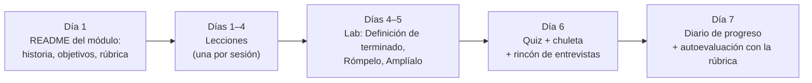

🌐 [English](how-to-study.md) · Español

# Cómo estudiar este curso

Este curso está pensado para quien aprende haciendo. Le sacarás más partido si tratas cada lección
como un pequeño encargo en Hearthwise: alguien necesita algo, predices, construyes, mides y lo
explicas.

## Elige un ritmo

El curso lleva unas 85 horas: diez módulos de 6–8 horas cada uno y un proyecto final de 12 horas.

| Ritmo | Horas por semana | Duración | Ideal para |
|---|---|---|---|
| Intensivo | unas 20 | unas 4–5 semanas | Un parón para estudiar o un *sprint* tipo *bootcamp* |
| Estándar | 6–8 | unas 12 semanas (un módulo por semana) | La mayoría de profesionales en activo |
| Ligero | unas 4 | unas 21 semanas | Agendas apretadas; reserva una franja fija cada semana |

La constancia gana a la intensidad: dos sesiones de 90 minutos por semana funcionan mejor que un
maratón de cinco horas.

## Un módulo, una semana

## Cómo usar cada parte de una lección

| Parte | Qué hacer | Por qué funciona |
|---|---|---|
| 📨 Situación | Léela como un encargo real. Pregúntate cómo sería "terminado". | Los problemas dan al conocimiento un sitio donde quedarse. |
| 🎯 Objetivos | Convierte cada uno en una pregunta que sabrás responder. | Sabes para qué lees. |
| 🤔 Predice primero | **Escribe** tus respuestas, aunque estés adivinando. | Las predicciones erróneas que corriges son las que mejor se recuerdan. |
| Secciones de conceptos | Lee la explicación sencilla, luego la analogía, luego el diagrama, y después ejecuta o escribe el código. | Varias representaciones de una idea la hacen sólida. |
| Avisos ⚠️ / 💡 | Copia en tu diario los que te sorprendieron. | Son los errores que te encontrarás en el trabajo. |
| 🧪 Pruébalo | Ejecuta cada comando. Compara tu salida con la esperada línea a línea. | Hacer gana a leer; las diferencias son señales de aprendizaje. |
| 🏭 En el mundo real | Pregúntate "¿qué se rompería con 100 veces más tráfico?". | Conecta el ejemplo de juguete con producción. |
| ✅ Autoevaluación | Responde antes de abrir `
`. Puntúate con honestidad. | La práctica de recuperación es la técnica de estudio más potente que conocemos. |
| 💬 Explícalo | Escribe o di la explicación al personaje indicado. En menos de dos minutos. | Si no puedes explicarlo de forma sencilla, has encontrado una laguna. |
| 🔑 Ideas clave | Compáralas con tu propio resumen. | Comprueba que te quedaste con lo esencial. |
| 📚 Profundiza | Opcional. Empieza por el recurso ⭐. | Profundidad cuando la necesites, no antes. |

## Trabajar con los labs

- Empieza siempre con `uv sync && uv run pytest`. Si los tests pasan, tu entorno está bien y
  cualquier diferencia posterior tiene que ver con el código, no con el entorno.
- Lee la salida esperada **antes** de ejecutar un comando y predícela.
- Haz los experimentos de **💥 Rómpelo**. Romper cosas a propósito es la forma más rápida de entender
  por qué funcionan.
- Elige al menos una propuesta de **🚀 Amplíalo** por módulo. Sube tus ampliaciones a tu *fork*: se
  convierten en tu portafolio.
- El proveedor `fake` por defecto es determinista, así que tus números deberían coincidir exactamente
  con los de la lección. Cuando cambies a un modelo real (`LLM_PROVIDER=ollama` u `openai`), espera
  números distintos y compáralos con la línea base del proveedor falso.

## Cuando te atasques

1. Vuelve a leer despacio la salida esperada y el mensaje de error. Casi siempre explican el problema.
2. Ejecuta los tests del lab: un test que falla suele señalar la función que rompiste.
3. Revisa la sección **🧯 Solución de problemas** del README del lab.
4. Explica el problema en voz alta, paso a paso, a una persona imaginaria del equipo.
5. Descansa un rato y prueba una versión más pequeña del problema.
6. Abre una *issue* con el comando, la salida completa y tu sistema operativo.

## Repaso espaciado

Cada quiz incluye dos o tres preguntas 🔁 de módulos anteriores. No te las saltes: olvidar es normal,
y recuperar una idea unas semanas después es lo que la fija. Cuando falles una, repasa la chuleta de
ese módulo.

## Sigue tu progreso

Usa el [diario de progreso](progress-journal.es.md). Después de cada módulo, puntúate con la rúbrica
del módulo (de 1 a 4) y apunta un número que hayas medido, un error que hayas cometido y una pregunta
que aún tengas. Al final, el diario y las ampliaciones de tus labs son la materia prima del
[proyecto final](../capstone/README.es.md).

## Preparar entrevistas

Cada README de módulo tiene un 🎤 **Rincón de entrevistas**. Responde en voz alta antes de abrir las
respuestas y practica cómo explicar los resultados de tus labs: en una entrevista importa lo que
mediste y los compromisos que elegiste, no las definiciones.

---

[🏠 Inicio del curso](../README.es.md) · [Empieza: Módulo 01 →](../modules/01-how-llms-are-built/README.es.md)
