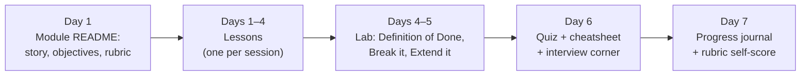

🌐 English · [Español](how-to-study.es.md)

# How to study this course

This course is designed for people who learn by doing. You will get the most out of it if you treat
every lesson as a small job at Hearthwise: someone needs something, you predict, you build, you
measure, you explain.

## Pick a pace

The course takes about 85 hours: ten modules of 6–8 hours each and a 12-hour capstone.

| Pace | Hours per week | Duration | Good for |
|---|---|---|---|
| Intensive | about 20 | about 4–5 weeks | A study break or a bootcamp-style sprint |
| Standard | 6–8 | about 12 weeks (one module per week) | Most working professionals |
| Light | about 4 | about 21 weeks | Busy schedules; keep a fixed weekly slot |

Consistency beats intensity: two 90-minute sessions per week work better than one five-hour
marathon.

## One module, one week

## How to use each part of a lesson

| Part | What to do | Why it works |
|---|---|---|
| 📨 Situation | Read it as a real request. Ask yourself what "done" would look like. | Problems give knowledge a place to stick. |
| 🎯 Objectives | Turn each one into a question you will be able to answer. | You know what you are reading for. |
| 🤔 Predict first | **Write** your answers down, even if you are guessing. | Wrong predictions you correct are remembered best. |
| Concept sections | Read the plain explanation, then the analogy, then the diagram, then run or type the code. | Several representations of one idea make it robust. |
| ⚠️ / 💡 callouts | Copy the ones that surprised you into your journal. | These are the mistakes you will meet at work. |
| 🧪 Try it | Run every command. Compare your output with the expected output line by line. | Doing beats reading; differences are learning signals. |
| 🏭 In the real world | Ask "what would break at 100× the traffic?" | Connects the toy to production. |
| ✅ Self-check | Answer before opening `
`. Score yourself honestly. | Retrieval practice is the strongest study technique we know. |
| 💬 Explain it | Write or say the explanation to the character named. Keep it under two minutes. | If you cannot explain it simply, you have found a gap. |
| 🔑 Key ideas | Compare them with your own summary. | Checks that you kept the essentials. |
| 📚 Go deeper | Optional. Start with the ⭐ resource. | Depth when you need it, not before. |

## Working with the labs

- Always start with `uv sync && uv run pytest`. If the tests pass, your setup is fine and any later
  difference is about the code, not the environment.
- Read the expected output **before** running a command, and predict it.
- Do the **💥 Break it** experiments. Breaking things on purpose is the fastest way to understand why
  they work.
- Pick at least one **🚀 Extend it** item per module. Commit your extensions in your fork: they become
  your portfolio.
- The default `fake` provider is deterministic, so your numbers should match the lesson exactly. When
  you switch to a real model (`LLM_PROVIDER=ollama` or `openai`), expect different numbers and
  compare them with the fake baseline.

## When you get stuck

1. Re-read the expected output and the error message slowly. Most problems are explained there.
2. Run the lab's tests: a failing test usually points to the function you broke.
3. Check the lab README's **🧯 Troubleshooting** section.
4. Explain the problem out loud, step by step, to an imaginary colleague.
5. Take a break, then try a smaller version of the problem.
6. Open an issue with the command, the full output and your operating system.

## Spaced repetition

Each quiz contains two or three 🔁 questions from earlier modules. Do not skip them: forgetting is
normal, and retrieving an idea a few weeks later is what makes it stick. When you miss one, reread
that module's cheatsheet.

## Track your progress

Use the [progress journal](progress-journal.md). After each module, score yourself on the module's
rubric (1 to 4) and write down one number you measured, one mistake you made and one question you
still have. At the end, the journal and your lab extensions are the raw material for the
[capstone](../capstone/README.md).

## Preparing for interviews

Every module README has a 🎤 **Interview corner**. Answer the questions out loud before opening the
answers, then practise explaining your lab results: interviewers care about what you measured and
the trade-offs you chose, not about definitions.

---

[🏠 Course home](../README.md) · [Start: Module 01 →](../modules/01-how-llms-are-built/README.md)
