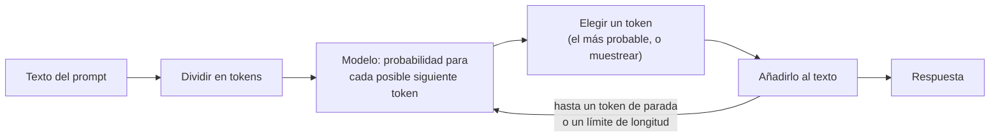
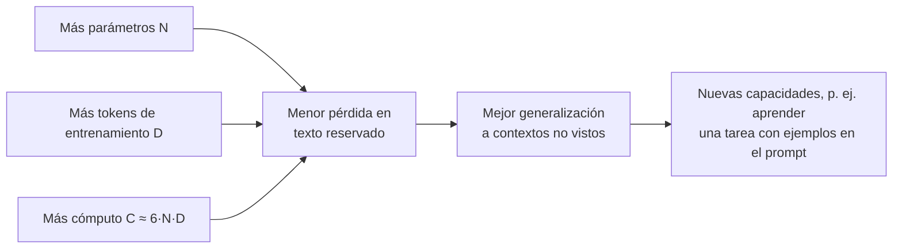
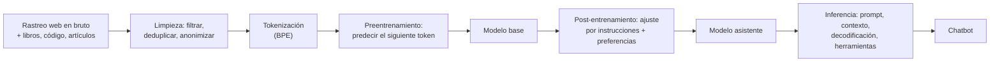
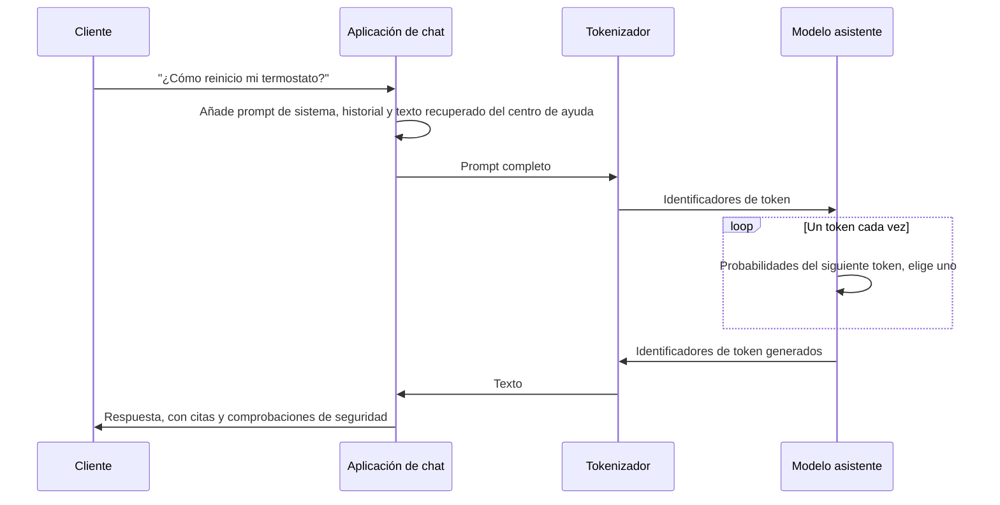

🌐 [English](01-llm-overview.md) · Español

# Lección 1.1 — El camino de los datos en bruto a un chatbot

> **Módulo 01 · Lección 1 de 5** · ⏱️ unos 45 min · 🧪 Lab: [paso 2](lab/README.es.md#paso-2--predice-la-siguiente-palabra)

## 📨 Situación

> **De:** Rio Tanaka · Responsable de Ingeniería de IA
> **Canal:** #ai-team
>
> Te damos la bienvenida a Hearthwise y a tu primera semana. Antes de tocar un *prompt*, una clave de
> API o una base de datos vectorial, quiero que sepas dibujar una imagen en una pizarra: cómo un
> montón de páginas web se convierte en el chatbot con el que hablará nuestra clientela. Cada decisión
> que tomemos después (qué modelo, cuánto contexto, si hacemos *fine-tuning*) es una decisión sobre una
> caja de esa imagen. Dani te pasará mañana el rastreo web antiguo. Hoy, empieza por el modelo de
> lenguaje más pequeño que puedas construir y rómpelo a propósito. Cuando se equivoque en un dato,
> quiero que me expliques por qué. Si tuvieras que enseñarme un solo número que diga "este modelo ha
> aprendido algo", ¿qué medirías?

## 🎯 Objetivos

Al terminar esta lección puedes:

- Explicar un modelo de lenguaje grande (LLM, *large language model*) como un predictor del siguiente *token* y calcular una distribución de la siguiente palabra a partir de conteos.
- Dibujar el camino datos en bruto → preentrenamiento → modelo base → post-entrenamiento → asistente → inferencia, y decir qué produce cada etapa.
- Distinguir la salida de un modelo base de la salida de un asistente ante la misma pregunta.
- Explicar, con los artículos sobre leyes de escala, por qué el tamaño del modelo, los datos y el cómputo se aumentan a la vez.
- Describir qué hace una persona de ingeniería de IA de forma distinta a una persona investigadora de *machine learning*, y dónde encaja cada módulo posterior de este curso.

## 🤔 Predice primero

Apunta tus respuestas antes de seguir leyendo. Las comprobarás en la autoevaluación.

1. Cuando un chatbot escribe una respuesta de 200 palabras, ¿cuántas palabras (o trozos de palabra) elige el modelo en cada paso: una, una frase o la respuesta entera de golpe?
2. A un modelo entrenado solo con páginas web correctas de Hearthwise se le pide continuar "The Ember T3". ¿Puede su continuación ser falsa?
3. Cuentas secuencias de palabras en 61 páginas y pruebas con otras 16 páginas. A medida que las secuencias se alargan (2, 3, 4, 5 palabras), ¿la proporción de secuencias de prueba que ya has visto sube o baja?

## 1. Un LLM predice el siguiente token

Un modelo de lenguaje hace un solo trabajo: dado un texto, asigna una probabilidad a cada posible
trozo de continuación. Esos trozos se llaman ***tokens***. Un *token* puede ser una palabra, parte de
una palabra, un espacio más una palabra o un signo de puntuación; la lección 1.3 muestra exactamente
cómo se cortan. Para escribir una respuesta completa, el modelo predice un *token*, lo añade al texto
y vuelve a predecir. Este bucle se llama **generación autorregresiva** (*autoregressive generation*).
Una respuesta de chatbot de 200 palabras son unos cientos de estos pasos pequeños, no un gran salto.

El modelo más sencillo que hace este trabajo cuenta. Toma el rastreo de Hearthwise ya limpio y, para
cada secuencia corta de palabras, cuenta qué palabra vino después. Para predecir, busca las últimas
palabras del *prompt* y convierte los conteos en probabilidades. Si las tres últimas palabras no se
vieron nunca, usa las dos últimas; si tampoco se vieron, usa la última. Este truco se llama
**retroceso** (*backoff*).

**Analogía:** un modelo de conteo es como alguien del equipo que ha leído cada página de una carpeta
exactamente una vez y ha memorizado qué palabra suele seguir a cuál. Pídele que termine una frase y
responderá a partir de esos recuerdos: con fluidez cuando la frase le resulta familiar y sin saber
qué decir cuando no.



El modelo de conteo del lab es `NGramModel`, en `src/m01_foundations/ngram.py`. Este es su paso de
predicción:

```python
def next_word_probs(self, context, top=5):
    """Return (context length used, top next words with probabilities), backing off."""
    for k in range(min(self.order - 1, len(context)), 0, -1):
        ctx = tuple(context[-k:])
        if ctx in self.counts:
            c = self.counts[ctx]
            total = sum(c.values())
            ranked = sorted(c.items(), key=lambda kv: (-kv[1], kv[0]))[:top]
            return k, [(w, n / total) for w, n in ranked]
    return 0, []
```

Entrenado con las 77 páginas en inglés que sobreviven a la limpieza (esa limpieza la construyes en la
lección 1.2), predice qué sigue a "Lower the setpoint by one degree in the":

| Siguiente palabra | Probabilidad |
|---|---|
| living | 0.364 |
| bedroom | 0.273 |
| bathroom | 0.091 |
| hallway | 0.091 |
| home | 0.091 |

Esa tabla es una **distribución de probabilidad sobre el vocabulario**. Un LLM real produce
exactamente este tipo de tabla en cada paso, solo que sobre un vocabulario de decenas o cientos de
miles de *tokens* y calculada por una red neuronal en lugar de con una búsqueda en una tabla.

> ⚠️ **Error común:** creer que un modelo "busca datos". Pide al modelo de conteo que continúe
> "The Ember T3" y escribe `costs € 149 and launched on 2023 - 05 - 22 .`. El precio es correcto.
> La fecha es incorrecta: el Ember T3 salió a la venta el 2023-10-02, y el 2023-05-22 es el día en que
> el Corvid Thermo X llegó a las tiendas. Después de "on 2023 -" las dos fechas se habían visto una
> vez cada una, el empate se resolvió a favor de la incorrecta y el contexto de tres palabras ya no
> contenía el nombre del producto. Todas las páginas de las que aprendió eran correctas, y aun así la
> salida es falsa. Los modelos grandes fallan de forma parecida por la misma razón: producen texto
> probable, no datos comprobados. Por eso los módulos 05 y 06 fundamentan las respuestas en documentos.

## 2. Del conteo a las redes neuronales, y por qué importa la escala

Contar tiene un límite duro: solo puede reutilizar secuencias que ya ha visto. El lab lo mide. Entrena
con 61 páginas en inglés y comprueba cuántas secuencias de palabras (*n-gramas*, *n-grams*) de las 16
páginas reservadas aparecen también en el entrenamiento:

| Longitud de la secuencia n | *n-gramas* reservados ya vistos |
|---|---|
| 1 palabra | 0.973 |
| 2 palabras | 0.855 |
| 3 palabras | 0.735 |
| 4 palabras | 0.645 |
| 5 palabras | 0.576 |

Un contexto más largo es lo que quieres, porque "the Ember T3 costs" dice más que "costs". Pero
cuanto más largo es el contexto, más a menudo un modelo de conteo no lo ha visto nunca y tiene que
recurrir a menos contexto. Nuestro rastreo sintético reutiliza muchas plantillas de frases, lo que
favorece al modelo de conteo; un texto variado y escrito por personas le da todavía menos que
reutilizar.

Una red neuronal elimina el límite **generalizando**. En lugar de guardar cada secuencia, convierte
cada *token* en un vector de números (un ***embedding***) y aprende una función que va de esos
vectores a las probabilidades del siguiente *token*. Los *tokens* que se usan de forma parecida acaban
con vectores parecidos, así que lo que el modelo aprende sobre "bedroom" también le sirve para
"hallway". La lección 1.4 lo construye en numpy.

**Analogía:** la persona que contaba memorizó frases; la persona "neuronal" aprendió gramática y
temas. Enséñale a esta segunda una frase que no ha leído nunca y aun así hará una suposición sensata.

La generalización mejora con la escala, y esto se ha medido. Kaplan y su equipo encontraron que la
pérdida de un modelo de lenguaje baja siguiendo una ley de potencias suave en tres magnitudes: el
número de parámetros, la cantidad de datos de entrenamiento y el cómputo usado, con tendencias que
abarcan más de siete órdenes de magnitud ([Scaling laws](https://arxiv.org/abs/2001.08361)). El mismo
artículo estima el cómputo de entrenamiento en unas seis operaciones de coma flotante por parámetro y
por *token* de entrenamiento, escrito **C ≈ 6·N·D**. Más tarde, el artículo de Chinchilla mostró que,
para un presupuesto de cómputo fijo, el tamaño del modelo y el número de *tokens* de entrenamiento
deben crecer a la vez: su Chinchilla de 70.000 millones de parámetros, entrenado con más datos y el
mismo cómputo que Gopher, de 280.000 millones de parámetros, lo superó
([Chinchilla](https://arxiv.org/abs/2203.15556)). El artículo de GPT-3 mostró lo que la escala aporta
en la práctica: un modelo de 175.000 millones de parámetros capaz de hacer muchas tareas a partir de
unos pocos ejemplos escritos en el *prompt*, sin actualizar ningún peso
([GPT-3](https://arxiv.org/abs/2005.14165)).



> 💡 **Consejo de producción:** las leyes de escala son una herramienta de presupuesto, no solo un
> resultado de investigación. Cuando alguien proponga "un modelo más grande", pregunta cuál de N, D o
> C piensa aumentar y cuánto cuesta por petición. La lección 1.5 convierte la configuración de un
> modelo en parámetros, memoria y cómputo para que puedas responder con números.

## 3. El camino completo de los datos en bruto a un chatbot

Un asistente es el final de una larga cadena de producción. Cada etapa tiene una entrada, una salida y
un equipo responsable.

**Analogía:** el preentrenamiento son los años de carrera de Medicina leyendo todos los libros de la
biblioteca; el post-entrenamiento es la residencia, donde se aprende a hablar con pacientes; la
inferencia es la consulta en sí, con el historial de la persona abierto sobre la mesa.



| Etapa | Entrada | Salida | Dónde la estudias |
|---|---|---|---|
| Recogida y limpieza de datos | Páginas rastreadas, otras fuentes | Un corpus limpio y deduplicado | Lección 1.2 |
| Tokenización | Texto limpio | Identificadores enteros de *token* | Lección 1.3 |
| Preentrenamiento | Identificadores de *token* | Un **modelo base**: pesos que predicen el siguiente *token* | Lecciones 1.4 y 1.5 |
| Post-entrenamiento | Modelo base + datos de instrucciones y preferencias | Un **asistente** que sigue instrucciones | Módulo 02 |
| Inferencia | Asistente + *prompt* + contexto | Texto generado, llamadas a herramientas | Módulos 02, 03, 10 |
| Aplicación | Inferencia + tus datos y herramientas | Un producto como un chatbot de soporte | Módulos 04–08 |

El preentrenamiento (*pre-training*) es donde se va casi todo el cómputo: el modelo lee un corpus
enorme una vez o unas pocas veces, predice cada siguiente *token* y ajusta sus pesos después de cada
lote. El resultado sabe mucho sobre el lenguaje y el mundo, pero no tiene ninguna noción de "alguien
me ha preguntado algo". El post-entrenamiento (*post-training*) es mucho más pequeño en datos y
cómputo, pero cambia el comportamiento: el modelo aprende a responder, a seguir un formato y a
rechazar peticiones inseguras.

> ⚠️ **Error común:** pensar en el preentrenamiento y el post-entrenamiento como dos modelos. Son la
> misma red. El post-entrenamiento parte de los pesos del modelo base y los sigue entrenando con otros
> datos y otro objetivo. Por eso el conocimiento viene sobre todo del preentrenamiento, mientras que el
> tono y el formato vienen sobre todo del post-entrenamiento.

## 4. Modelo base frente a asistente en la inferencia

Un modelo base continúa texto. Si los datos de entrenamiento contenían una pregunta seguida de más
charla de foro, continúa con charla de foro. El lab lo muestra con el modelo de conteo haciendo de
modelo base (`uv run lab ask`):

```text
Question: How do I reset my thermostat?

Base-model style (4-gram continuation): ...user loopback : i have a 6 m hallway and the sensor misses people at
Assistant via LLM_PROVIDER=fake (fake-1): [fake:81d8b57f] You said: How do I reset my thermostat?
```

La continuación es un mensaje de foro porque, en el rastreo, lo más frecuente después de un signo de
interrogación es el comienzo de otro mensaje de foro ("user ..."). La segunda línea viene del
**proveedor falso** (*fake provider*) del curso, un sustituto determinista que permite ejecutar todos
los labs sin conexión. Apunta `LLM_PROVIDER` a un modelo local y el mismo comando envía la pregunta a
un asistente real (consulta el README del lab; ese camino no se prueba aquí).

**Analogía:** un modelo base es un actor que ha memorizado todos los guiones escritos y continuará
cualquier frase que empieces. Un asistente es ese mismo actor tras meses ensayando un solo papel: el
del agente de soporte servicial.

Cuando alguien de la clientela usa un chatbot, pasan muchas más cosas que "llamar al modelo":



Todo lo que ocurre en el carril de `App` es ingeniería que tú controlas: qué entra en el *prompt*,
cuánto contexto cabe, qué ajustes de decodificación usar, qué comprobaciones se ejecutan sobre la
respuesta. Eso es la mayor parte de este curso.

> 💡 **Consejo de producción:** no pongas nunca un modelo base delante de la clientela. No sigue
> instrucciones, no sabe rechazar peticiones y no tiene noción de turnos. Cuando descargues pesos
> abiertos, comprueba si tienes la variante base o la ajustada por instrucciones; muchas familias
> publican las dos (el [informe de Qwen2.5](https://arxiv.org/abs/2412.15115) describe modelos de
> pesos abiertos base y ajustados por instrucciones).

## 5. Qué hace una persona de ingeniería de IA, y el camino por delante

Quienes investigan y quienes hacen ingeniería trabajan en la misma cadena, pero son responsables de
cajas distintas.

| | Investigación en *machine learning* | Ingeniería de IA (tu rol en Hearthwise) |
|---|---|---|
| Pregunta principal | ¿Cómo hacemos un modelo mejor? | ¿Cómo hacemos con un modelo un producto útil, seguro y asequible? |
| Trabajo típico | Arquitecturas nuevas, recetas de entrenamiento, ejecuciones de preentrenamiento | Elegir modelos, *prompting*, recuperación, herramientas, evaluación, despliegue |
| Cómputo | *Clusters* de aceleradores durante semanas | Llamadas a API o unas pocas GPU, portátiles para prototipos |
| Métrica de éxito | Puntuaciones en *benchmarks*, pérdida | Éxito en la tarea, latencia, coste, satisfacción de la clientela, incidentes |
| Trabajo con datos | Corpus a escala web | Los documentos, tickets y conjuntos de evaluación de tu empresa |

Rara vez preentrenarás un LLM. A menudo necesitarás entender el preentrenamiento para tomar buenas
decisiones: por qué un modelo flojea en español (tokenizador y mezcla de datos), por qué se inventa
fechas (predicción del siguiente *token*), por qué una puntuación de *benchmark* parece demasiado buena
(contaminación) o por qué un modelo con "8x" en el nombre necesita tanta memoria (mezcla de
expertos). El módulo 01 te da esos modelos mentales.

**Analogía:** la persona que hace la ingeniería de pista en un equipo de carreras no diseña motores,
pero sabe exactamente cómo funciona el motor para poder elegir la puesta a punto, leer la telemetría y
explicar una avería.

El resto del curso sigue la cadena hacia delante:

| Módulo | Qué haces en Hearthwise |
|---|---|
| 02 | Decodificación, post-entrenamiento y evaluación: por qué el modelo "se enrolla" y en cuál confiar |
| 03 | Un *playground* interno de LLM con salvaguardas de coste, latencia y datos personales |
| 04 | *Prompting*, ingeniería de contexto y *fine-tuning* con LoRA para enrutar tickets |
| 05–06 | Generación aumentada por recuperación (RAG, *retrieval-augmented generation*): el chatbot de soporte fundamentado |
| 07–08 | Agentes: herramientas, el Model Context Protocol (MCP) y un agente de investigación web |
| 09–10 | Modelos de razonamiento, *deep research* y modelos ejecutados en local |

## 🧪 Pruébalo

1. Prepara el lab y ejecuta los tests ([paso 1 del lab](lab/README.es.md#paso-1--prepara-el-entorno-y-ejecuta-los-tests)):

   ```bash
   cd modules/01-how-llms-are-built/lab
   uv sync
   uv run pytest
   ```

2. Pide al modelo de conteo las probabilidades de la siguiente palabra
   ([paso 2 del lab](lab/README.es.md#paso-2--predice-la-siguiente-palabra)):

   ```bash
   uv run lab ngram --prompt "A smart plug can"
   ```

   Salida esperada (primeras líneas):

   ```text
   Trained a 4-gram counting model on 77 cleaned English pages.

   Prompt: 'A smart plug can'  (matched the last 3 word(s))
     tell         0.667
     and          0.167
     switch       0.083
     turn         0.083
     greedy continuation: tell you exactly how much the dehumidifier costs to run . holiday
   ```

3. Ejecuta `uv run lab ngram` sin argumentos y encuentra la fecha de lanzamiento incorrecta en la
   continuación de "The Ember T3". Después ejecuta `uv run lab ask` y compara la continuación de
   estilo base con la línea del asistente.

## 🏭 En el mundo real

- **Los equipos compran o descargan las etapas caras.** El preentrenamiento lo hacen unas pocas
  organizaciones. Los equipos de producto eligen un modelo preentrenado y post-entrenado, y después lo
  adaptan con *prompts*, recuperación o un *fine-tuning* ligero. Tu palanca está en la capa de
  aplicación.
- **La fluidez esconde errores.** La fecha incorrecta del modelo de conteo se leía con total
  naturalidad. Los sistemas en producción añaden fundamentación (recuperación con citas), verificación
  (comprobaciones de números, fechas y políticas) y conjuntos de evaluación que apuntan a modos de
  fallo conocidos.
- **Cada etapa deja huellas.** Los idiomas de un modelo, su fecha de corte de conocimiento, sus
  costumbres de formato y sus puntos ciegos vienen de sus datos, su tokenizador y su
  post-entrenamiento. Cuando un comportamiento te sorprenda, pregúntate qué etapa pudo causarlo.
- **Qué vigilar:** la corrección de las respuestas en un conjunto de evaluación fijo, la tasa de
  rechazos, el coste por conversación y la latencia por *token*. Construirás cada una de estas cosas en
  los módulos 02, 03 y 06.

## ✅ Autoevaluación

**1. Un chatbot escribe una respuesta de 200 palabras. ¿Cómo la produce el modelo?**

<details><summary>Respuesta</summary>

Un *token* cada vez. En cada paso calcula una probabilidad para cada *token* de su vocabulario, se
elige un *token*, se añade y el bucle se repite hasta un *token* de parada o un límite de longitud. La
respuesta tentadora "planifica la respuesta entera y la escribe" es incorrecta para el mecanismo de
generación, aunque el estado interno de la red puede codificar hacia dónde va el texto.

</details>

**2. Todas las páginas de las que aprendió el modelo de conteo eran correctas. ¿Por qué escribió una fecha de lanzamiento incorrecta para el Ember T3?**

<details><summary>Respuesta</summary>

Porque produce continuaciones probables, no datos verificados. Después de "on 2023 -" se habían visto
dos fechas con la misma frecuencia (la reseña del Ember T3 y la del Corvid Thermo X) y, con un
contexto de tres palabras, el nombre del producto ya no era visible. Unos datos de entrenamiento
correctos no garantizan una salida correcta; los modelos grandes fallan de formas más sutiles por el
mismo motivo.

</details>

**3. ¿Qué le pasa a la proporción de *n-gramas* ya vistos a medida que n crece de 1 a 5, y por qué importa?**

<details><summary>Respuesta</summary>

Baja, de 0.973 para palabras sueltas a 0.576 para secuencias de cinco palabras en nuestro rastreo. Los
contextos largos son más informativos pero más raros, así que un modelo de conteo no deja de
retroceder a contextos cortos. Las redes neuronales generalizan a contextos no vistos gracias a los
*embeddings*, y por eso sustituyeron al conteo.

</details>

**4. Tu manager pide "un modelo más listo" con un presupuesto de entrenamiento fijo. ¿Qué sugieren los artículos sobre leyes de escala?**

<details><summary>Respuesta</summary>

La pérdida baja de forma predecible con los parámetros, los datos y el cómputo a la vez. Con el
cómputo fijo, los resultados de Chinchilla dicen que hay que aumentar a la vez el tamaño del modelo y
los *tokens* de entrenamiento, en lugar de solo agrandar el modelo: un modelo más pequeño entrenado con
más *tokens* puede superar a uno más grande e infraentrenado. Más grande no es automáticamente mejor.

</details>

**5. ¿Qué etapa convierte un modelo base en un asistente, y crea una red nueva?**

<details><summary>Respuesta</summary>

El post-entrenamiento (ajuste por instrucciones y después optimización de preferencias, que verás en
el módulo 02). Sigue entrenando la misma red, a partir de los pesos del modelo base, con datos que
muestran el comportamiento deseado. El conocimiento viene sobre todo del preentrenamiento; el
comportamiento y el formato, sobre todo del post-entrenamiento.

</details>

## 💬 Explícalo con tus palabras

- Explícale a Rio, en cinco frases o menos, por qué un modelo entrenado solo con páginas correctas
  puede dar una fecha incorrecta. Usa el ejemplo del Ember T3.
- Alex Moreau, de Atención al Cliente, pregunta: "¿Por qué no podemos usar sin más el modelo en bruto
  que entrenó el proveedor?". Explica la diferencia entre un modelo base y un asistente sin usar las
  palabras "pesos" ni "gradiente".

## 🔑 Ideas clave

- Un LLM predice una probabilidad para cada posible siguiente *token*; el texto se genera un *token*
  cada vez.
- Los modelos de conteo no pueden usar contextos largos que no han visto nunca; las redes neuronales
  generalizan gracias a los *embeddings*.
- La pérdida baja de forma predecible a medida que crecen a la vez los parámetros, los datos y el
  cómputo (leyes de escala); el cómputo de entrenamiento es aproximadamente 6·N·D.
- El camino es: datos → limpieza → tokenización → preentrenamiento → modelo base →
  post-entrenamiento → asistente → inferencia dentro de una aplicación.
- Una salida fluida no es una salida verificada; la fundamentación y la evaluación son trabajo de
  ingeniería.
- Quienes hacen ingeniería de IA rara vez preentrenan, pero necesitan la imagen completa para elegir,
  adaptar y depurar modelos.

## 📚 Profundiza

- ⭐ [nanoGPT](https://github.com/karpathy/nanoGPT) — un repositorio pequeño y legible que preentrena
  un modelo de estilo GPT; lee `model.py` después de la lección 1.4 y te resultará familiar.
- [Scaling Laws for Neural Language Models](https://arxiv.org/abs/2001.08361) — la sección 2 explica
  las fórmulas de parámetros y cómputo que usa este módulo.
- [Training Compute-Optimal Large Language Models (Chinchilla)](https://arxiv.org/abs/2203.15556) — por
  qué los datos y los parámetros deben crecer a la vez.
- [Language Models are Few-Shot Learners (GPT-3)](https://arxiv.org/abs/2005.14165) — el artículo que
  hizo famoso el aprendizaje en contexto; la introducción se lee muy bien.

---

[← Anterior: Presentación del módulo 01](README.es.md) · [🏠 Módulo 01](README.es.md) · [Siguiente: 1.2 Datos de preentrenamiento →](02-pretraining-data.es.md)
