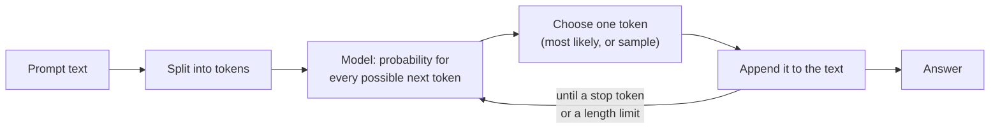
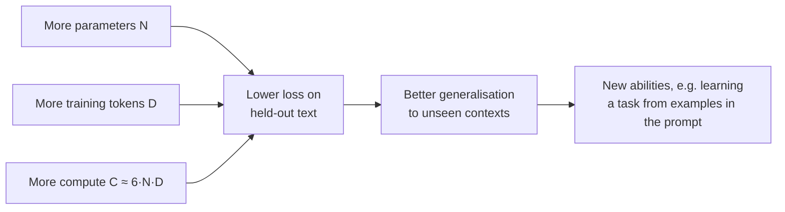
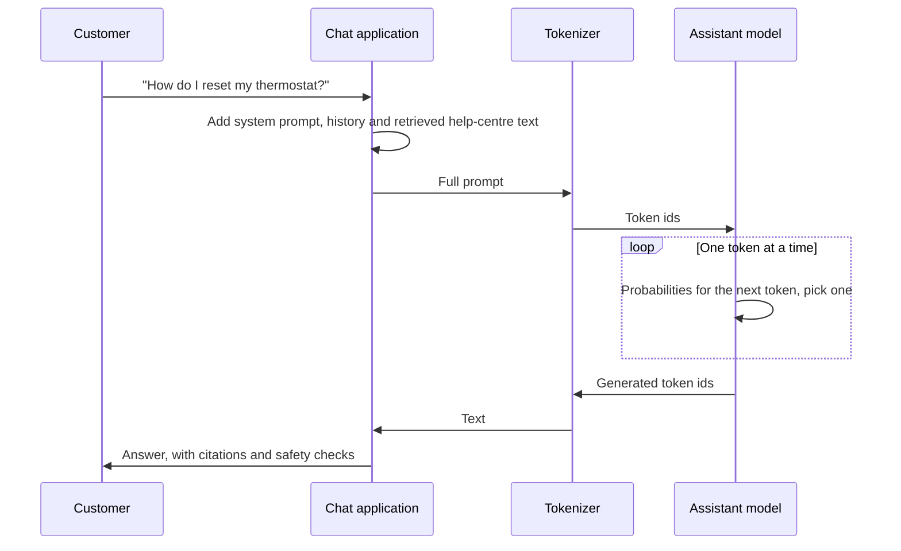

🌐 English · [Español](01-llm-overview.es.md)

# Lesson 1.1 — The path from raw data to a chatbot

> **Module 01 · Lesson 1 of 5** · ⏱️ about 45 min · 🧪 Lab: [step 2](lab/README.md#step-2--predict-the-next-word)

## 📨 Situation

> **From:** Rio Tanaka · Head of AI Engineering
> **Channel:** #ai-team
>
> Welcome to Hearthwise, and to week one. Before you touch a prompt, an API key or a vector database,
> I want you to be able to draw one picture on a whiteboard: how a pile of web pages becomes the
> chatbot our customers will talk to. Every decision we make later (which model, how much context,
> whether to fine-tune) is a decision about one box in that picture. Dani will hand you the old web
> crawl tomorrow. Today, start with the smallest language model you can build and break it on
> purpose. When it gets a fact wrong, I want you to explain why. If you had to show me one number
> that says "this model learned something", what would you measure?

## 🎯 Objectives

By the end of this lesson you can:

- Explain a large language model (LLM) as a next-token predictor and compute a next-word distribution from counts.
- Draw the path raw data → pre-training → base model → post-training → assistant → inference, and name what each stage produces.
- Tell apart the output of a base model and the output of an assistant for the same question.
- Explain, with the scaling-law papers, why model size, data and compute are increased together.
- Describe what an AI engineer does differently from a machine-learning researcher, and where each later module of this course fits.

## 🤔 Predict first

Write your answers down before reading on. You will check them in the self-check.

1. When a chatbot writes a 200-word answer, how many words (or word pieces) does the model choose in each step: one, a sentence, or the whole answer at once?
2. A model trained only on correct Hearthwise web pages is asked to continue "The Ember T3". Can its continuation still be factually wrong?
3. You count word sequences in 61 pages and test on 16 other pages. As the sequences get longer (2, 3, 4, 5 words), does the share of test sequences you have already seen go up or down?

## 1. An LLM predicts the next token

A language model does one job: given some text, it assigns a probability to every possible
continuation piece. Those pieces are called **tokens**. A token can be a word, part of a word, a
space plus a word, or a punctuation mark; lesson 1.3 shows exactly how they are cut. To write a
whole answer, the model predicts one token, appends it to the text, and predicts again. This loop
is called **autoregressive generation**. A chatbot answer of 200 words is a few hundred of these
small steps, not one big jump.

The simplest model that does this job counts. Take the cleaned Hearthwise crawl, and for every short
sequence of words, count which word came next. To predict, look up the last few words of the prompt
and turn the counts into probabilities. If the last three words were never seen, use the last two;
if those were never seen either, use the last one. This trick is called **backoff**.

**Analogy:** a counting model is like a colleague who has read every page in a folder exactly once
and memorised which word tends to follow which. Ask them to finish a sentence and they answer from
those memories: fluent when the sentence looks familiar, lost when it does not.



The lab's counting model is `NGramModel` in `src/m01_foundations/ngram.py`. Here is its prediction
step:

```python
def next_word_probs(self, context, top=5):
    """Return (context length used, top next words with probabilities), backing off."""
    for k in range(min(self.order - 1, len(context)), 0, -1):
        ctx = tuple(context[-k:])
        if ctx in self.counts:
            c = self.counts[ctx]
            total = sum(c.values())
            ranked = sorted(c.items(), key=lambda kv: (-kv[1], kv[0]))[:top]
            return k, [(w, n / total) for w, n in ranked]
    return 0, []
```

Trained on the 77 English pages that survive cleaning (you build that cleaning in lesson 1.2), it
predicts what follows "Lower the setpoint by one degree in the":

| Next word | Probability |
|---|---|
| living | 0.364 |
| bedroom | 0.273 |
| bathroom | 0.091 |
| hallway | 0.091 |
| home | 0.091 |

That table is a **probability distribution over the vocabulary**. A real LLM produces exactly this
kind of table at every step, only over a vocabulary of tens or hundreds of thousands of tokens, and
computed by a neural network instead of a lookup.

> ⚠️ **Common mistake:** believing that a model "looks up facts". Ask the counting model to continue
> "The Ember T3" and it writes `costs € 149 and launched on 2023 - 05 - 22 .`. The price is right.
> The date is wrong: the Ember T3 launched on 2023-10-02, and 2023-05-22 is the day the Corvid Thermo
> X arrived in shops. After "on 2023 -" both dates had been seen once, the tie went to the wrong one,
> and the three-word context no longer contained the product name. Every page it learned from was
> correct, and the output is still false. Large models fail in a similar way for the same reason: they
> produce likely text, not checked facts. That is why modules 05 and 06 ground answers in documents.

## 2. From counting to neural networks, and why scale matters

Counting has a hard limit: it can only reuse sequences it has seen. The lab measures this. It trains
on 61 English pages and checks how many word sequences ("n-grams") of the 16 held-out pages also
appear in training:

| Sequence length n | Held-out n-grams already seen |
|---|---|
| 1 word | 0.973 |
| 2 words | 0.855 |
| 3 words | 0.735 |
| 4 words | 0.645 |
| 5 words | 0.576 |

Longer context is what you want, because "the Ember T3 costs" says more than "costs". But the longer
the context, the more often a counting model has never seen it and must fall back to less context.
Our synthetic crawl reuses many sentence templates, which flatters the counting model; varied,
human-written text gives it even less to reuse.

A neural network removes the limit by **generalising**. Instead of storing each sequence, it turns
every token into a vector of numbers (an **embedding**) and learns a function from those vectors to
next-token probabilities. Tokens used in similar ways end up with similar vectors, so what the model
learns about "bedroom" also helps with "hallway". Lesson 1.4 builds this in numpy.

**Analogy:** the counting colleague memorised sentences; the neural colleague learned grammar and
topics. Show the second one a sentence they have never read and they still make a sensible guess.

Generalisation improves with scale, and this has been measured. Kaplan and colleagues found that the
loss of a language model falls as a smooth power law in three quantities: the number of parameters,
the amount of training data and the compute used, with trends spanning more than seven orders of
magnitude ([Scaling laws](https://arxiv.org/abs/2001.08361)). The same paper estimates training
compute as about six floating-point operations per parameter per training token, written
**C ≈ 6·N·D**. Later, the Chinchilla paper showed that for a fixed compute budget, model size and the
number of training tokens should grow together: their 70-billion-parameter Chinchilla, trained on
more data with the same compute as the 280-billion-parameter Gopher, outperformed it
([Chinchilla](https://arxiv.org/abs/2203.15556)). The GPT-3 paper showed what scale buys in practice:
a 175-billion-parameter model that can do many tasks from a few examples written in the prompt,
without any weight updates ([GPT-3](https://arxiv.org/abs/2005.14165)).



> 💡 **Production tip:** scaling laws are a budgeting tool, not only a research result. When someone
> proposes "a bigger model", ask which of N, D or C they plan to grow, and what it costs per request.
> Lesson 1.5 turns a model configuration into parameters, memory and compute so you can answer with
> numbers.

## 3. The full path from raw data to a chatbot

An assistant is the end of a long production line. Each stage has an input, an output and a team
that owns it.

**Analogy:** pre-training is a medical student's years of reading every textbook in the library;
post-training is the residency where they learn how to talk to patients; inference is the
consultation itself, with the patient's file open on the desk.

```mermaid
flowchart LR
    W["Raw web crawl<br/>+ books, code, papers"] --> CL["Cleaning: filter,<br/>deduplicate, redact"]
    CL --> TK["Tokenization<br/>(BPE)"]
    TK --> PT["Pre-training:<br/>predict the next token"]
    PT --> BM["Base model"]
    BM --> SFT["Post-training: instruction<br/>tuning + preferences"]
    SFT --> AS["Assistant model"]
    AS --> INF["Inference: prompt, context,<br/>decoding, tools"]
    INF --> CB["Chatbot"]
```



| Stage | Input | Output | Where you study it |
|---|---|---|---|
| Data collection and cleaning | Crawled pages, other sources | A clean, deduplicated corpus | Lesson 1.2 |
| Tokenization | Clean text | Integer token ids | Lesson 1.3 |
| Pre-training | Token ids | A **base model**: weights that predict the next token | Lessons 1.4 and 1.5 |
| Post-training | Base model + instruction and preference data | An **assistant** that follows instructions | Module 02 |
| Inference | Assistant + prompt + context | Generated text, tool calls | Modules 02, 03, 10 |
| Application | Inference + your data and tools | A product such as a support chatbot | Modules 04–08 |

Pre-training is where almost all the compute goes: the model reads a huge corpus once or a few times,
predicting each next token and adjusting its weights after each batch. The result knows a lot about
language and the world but has no notion of "a user asked me something". Post-training is much
smaller in data and compute but changes behaviour: the model learns to answer, to follow a format
and to refuse unsafe requests.

> ⚠️ **Common mistake:** thinking of pre-training and post-training as two models. They are the same
> network. Post-training starts from the base model's weights and keeps training them on different
> data with a different objective. That is why knowledge mostly comes from pre-training while tone
> and format mostly come from post-training.

## 4. Base model versus assistant at inference time

A base model continues text. If the training data contained a question followed by more forum
chatter, it continues with forum chatter. The lab shows this with the counting model standing in for
a base model (`uv run lab ask`):

```text
Question: How do I reset my thermostat?

Base-model style (4-gram continuation): ...user loopback : i have a 6 m hallway and the sensor misses people at
Assistant via LLM_PROVIDER=fake (fake-1): [fake:81d8b57f] You said: How do I reset my thermostat?
```

The continuation is a forum post because, in the crawl, the most frequent thing after a question
mark is the start of another forum post ("user ..."). The second line comes from the course's **fake provider**, a deterministic
stand-in that lets every lab run offline. Point `LLM_PROVIDER` at a local model and the same command
sends the question to a real assistant (see the lab README; that path is not tested here).

**Analogy:** a base model is an actor who has memorised every script ever written and will continue
any line you start. An assistant is the same actor after months of rehearsing one role: the helpful
support agent.

When a customer uses a chatbot, much more happens than "call the model":



Everything in the `App` lane is engineering you control: what goes into the prompt, how much context
fits, which decoding settings to use, which checks run on the answer. That is most of this course.

> 💡 **Production tip:** never put a base model in front of customers. It has no instruction
> following, no refusal behaviour and no notion of turns. When you download open weights, check
> whether you have the base or the instruction-tuned variant; many families publish both (the
> [Qwen2.5 report](https://arxiv.org/abs/2412.15115) describes base and instruction-tuned open-weight
> models).

## 5. What an AI engineer does, and the road ahead

Researchers and engineers work on the same pipeline but own different boxes.

| | Machine-learning researcher | AI engineer (your role at Hearthwise) |
|---|---|---|
| Main question | How do we make a better model? | How do we make a useful, safe, affordable product with a model? |
| Typical work | New architectures, training recipes, pre-training runs | Choosing models, prompting, retrieval, tools, evaluation, deployment |
| Compute | Clusters of accelerators for weeks | API calls or a few GPUs, laptops for prototypes |
| Success metric | Benchmark scores, loss | Task success, latency, cost, customer satisfaction, incidents |
| Data work | Web-scale corpora | Your company's documents, tickets and evaluation sets |

You will rarely pre-train an LLM. You will often need to understand pre-training to make good
decisions: why a model is weak in Spanish (tokenizer and data mix), why it invents dates (next-token
prediction), why a benchmark score looks too good (contamination), or why a model with "8x" in its
name needs so much memory (mixture of experts). Module 01 gives you those mental models.

**Analogy:** a racing team's race engineer does not design engines, but knows exactly how the engine
works so they can choose the setup, read the telemetry and explain a failure.

The rest of the course follows the pipeline forward:

| Module | What you do at Hearthwise |
|---|---|
| 02 | Decoding, post-training and evaluation: why the model "rambles" and which one to trust |
| 03 | An internal LLM playground with cost, latency and personal-data safeguards |
| 04 | Prompting, context engineering and LoRA fine-tuning for ticket routing |
| 05–06 | Retrieval-augmented generation (RAG): the grounded support chatbot |
| 07–08 | Agents: tools, the Model Context Protocol (MCP) and a web research agent |
| 09–10 | Reasoning models, deep research and running models locally |

## 🧪 Try it

1. Set up the lab and run the tests ([lab step 1](lab/README.md#step-1--set-up-and-run-the-tests)):

   ```bash
   cd modules/01-how-llms-are-built/lab
   uv sync
   uv run pytest
   ```

2. Ask the counting model for next-word probabilities
   ([lab step 2](lab/README.md#step-2--predict-the-next-word)):

   ```bash
   uv run lab ngram --prompt "A smart plug can"
   ```

   Expected output (first lines):

   ```text
   Trained a 4-gram counting model on 77 cleaned English pages.

   Prompt: 'A smart plug can'  (matched the last 3 word(s))
     tell         0.667
     and          0.167
     switch       0.083
     turn         0.083
     greedy continuation: tell you exactly how much the dehumidifier costs to run . holiday
   ```

3. Run `uv run lab ngram` without arguments and find the wrong launch date in the "The Ember T3"
   continuation. Then run `uv run lab ask` and compare the base-style continuation with the assistant
   line.

## 🏭 In the real world

- **Teams buy or download the expensive stages.** Pre-training is done by a few organisations.
  Product teams pick a pre-trained and post-trained model, then adapt it with prompts, retrieval or
  light fine-tuning. Your leverage is in the application layer.
- **Fluency hides errors.** The counting model's wrong date read perfectly naturally. Production
  systems add grounding (retrieval with citations), verification (checks on numbers, dates and
  policies) and evaluation sets that target known failure modes.
- **Every stage leaves fingerprints.** A model's languages, knowledge cut-off, formatting habits and
  blind spots come from its data, tokenizer and post-training. When behaviour surprises you, ask which
  stage could have caused it.
- **What to monitor:** answer correctness on a fixed evaluation set, refusal rate, cost per
  conversation and latency per token. You will build each of these in modules 02, 03 and 06.

## ✅ Self-check

**1. A chatbot writes a 200-word answer. How does the model produce it?**

<details><summary>Answer</summary>

One token at a time. At each step it computes a probability for every token in its vocabulary,
one token is chosen, appended, and the loop repeats until a stop token or a length limit. The tempting
answer "it plans the whole answer and writes it out" is wrong for the generation mechanism, although
the network's internal state can encode where the text is heading.

</details>

**2. Every page the counting model learned from was correct. Why did it write the wrong launch date for the Ember T3?**

<details><summary>Answer</summary>

Because it produces likely continuations, not verified facts. After "on 2023 -" two dates had been
seen equally often (the Ember T3 review and the Corvid Thermo X review), and with a three-word
context the product name was no longer visible. Correct training data does not guarantee correct
output; large models fail in subtler versions of the same way.

</details>

**3. What happens to the share of already-seen n-grams as n grows from 1 to 5, and why does it matter?**

<details><summary>Answer</summary>

It falls, from 0.973 for single words to 0.576 for five-word sequences in our crawl. Longer contexts
are more informative but rarer, so a counting model keeps backing off to short contexts. Neural
networks generalise to unseen contexts through embeddings, which is why they replaced counting.

</details>

**4. Your manager asks for "a smarter model" with a fixed training budget. What do the scaling-law papers suggest?**

<details><summary>Answer</summary>

Loss falls predictably with parameters, data and compute together. With compute fixed, the
Chinchilla results say to grow model size and training tokens together rather than only making the
model bigger: a smaller model trained on more tokens can beat a larger, under-trained one. Bigger is
not automatically better.

</details>

**5. Which stage turns a base model into an assistant, and does it create a new network?**

<details><summary>Answer</summary>

Post-training (instruction tuning, then preference optimisation, covered in module 02). It keeps
training the same network, starting from the base model's weights, on data that demonstrates the
desired behaviour. Knowledge comes mostly from pre-training; behaviour and format mostly from
post-training.

</details>

## 💬 Explain it in your own words

- Explain to Rio, in five sentences or fewer, why a model trained only on correct pages can still
  state a wrong date. Use the Ember T3 example.
- Alex Moreau from Customer Support asks: "Why can't we just use the raw model the vendor trained?"
  Explain the difference between a base model and an assistant without using the words "weights" or
  "gradient".

## 🔑 Key ideas

- An LLM predicts a probability for every possible next token; text is generated one token at a time.
- Counting models cannot use long contexts they have never seen; neural networks generalise through
  embeddings.
- Loss falls predictably as parameters, data and compute grow together (scaling laws); training
  compute is roughly 6·N·D.
- The path is: data → cleaning → tokenization → pre-training → base model → post-training →
  assistant → inference inside an application.
- Fluent output is not verified output; grounding and evaluation are engineering jobs.
- AI engineers rarely pre-train, but they need the whole picture to choose, adapt and debug models.

## 📚 Go deeper

- ⭐ [nanoGPT](https://github.com/karpathy/nanoGPT) — a small, readable repository that pre-trains a
  GPT-style model; read `model.py` after lesson 1.4 and it will look familiar.
- [Scaling Laws for Neural Language Models](https://arxiv.org/abs/2001.08361) — section 2 explains the
  parameter and compute formulas used in this module.
- [Training Compute-Optimal Large Language Models (Chinchilla)](https://arxiv.org/abs/2203.15556) — why
  data and parameters should grow together.
- [Language Models are Few-Shot Learners (GPT-3)](https://arxiv.org/abs/2005.14165) — the paper that
  made in-context learning famous; the introduction is very readable.

---

[← Previous: Module 01 overview](README.md) · [🏠 Module 01](README.md) · [Next: 1.2 Pre-training data →](02-pretraining-data.md)
