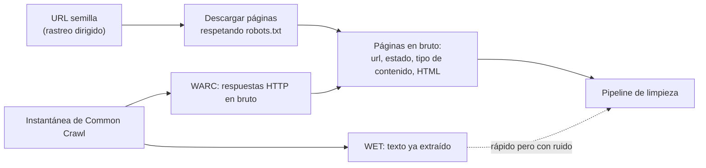
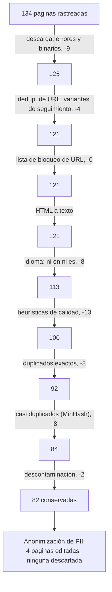
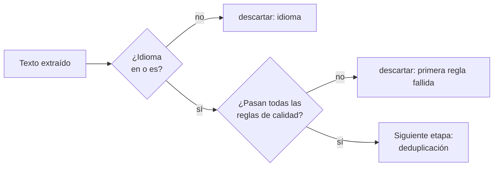
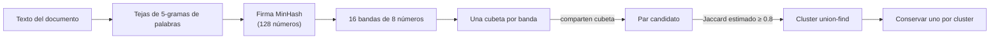
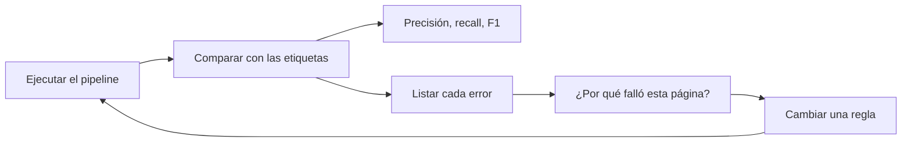

🌐 [English](02-pretraining-data.md) · Español

# Lección 1.2 — Datos de preentrenamiento: recogida y limpieza

> **Módulo 01 · Lección 2 de 5** · ⏱️ unos 60 min · 🧪 Lab: [paso 3](lab/README.es.md#paso-3--limpia-el-rastreo)

## 📨 Situación

> **De:** Dani Ruiz · Ciencia de datos
> **Canal:** #data
>
> Aquí tienes el rastreo: `datasets/web/pages.jsonl`, 134 páginas que el equipo descargó el año pasado
> cuando alguien quiso entrenar un modelo pequeño de hogar inteligente. Nadie lo limpió. Revisé cada
> página a mano y apunté lo que debería conservar un *pipeline* de preentrenamiento ideal
> (`labels.jsonl`, campo `keep`). Hay páginas de error, copias, *spam*, páginas en idiomas que no
> atendemos, mensajes de foro con números de teléfono y al menos una página que copia nuestras
> preguntas de evaluación con las respuestas. Construye el *pipeline*, ejecútalo y dame la precisión y
> el *recall* frente a mis etiquetas. Y dime en qué te equivocaste. Enséñame la evaluación.

## 🎯 Objetivos

Al terminar esta lección puedes:

- Explicar de dónde sale el texto de preentrenamiento (rastreos dirigidos y Common Crawl) y qué comprobaciones legales y éticas se aplican antes de usarlo.
- Implementar las etapas de un *pipeline* de limpieza web: filtrado por descarga, normalización de URL, extracción de texto, identificación de idioma, heurísticas de calidad, deduplicación, descontaminación y anonimización de datos personales.
- Calcular la precisión y el *recall* de las decisiones de conservar o descartar frente a datos etiquetados, y explicar cada error.
- Elegir el umbral de un filtro razonando sobre su compromiso entre precisión y *recall*.
- Explicar cómo MinHash y el *hashing* sensible a la localidad encuentran casi duplicados sin comparar todos los pares.

## 🤔 Predice primero

Apunta tus respuestas antes de seguir leyendo. Las comprobarás en la autoevaluación.

1. De los 192.610 caracteres de HTML en bruto del rastreo, ¿qué proporción aproximada esperas que sobreviva como texto limpio y conservado: 80 %, 50 % o 25 %?
2. Una regla habitual descarta cualquier página de menos de 50 palabras. ¿Qué crees que le pasa al *recall* en este rastreo si la usas?
3. Dos copias de un artículo se diferencian solo en una frase añadida. ¿Las detectará como duplicadas un *hash* SHA-256 de su texto?

## 1. Recoger texto: rastreos, Common Crawl y el derecho a usarlo

Hay dos formas de conseguir texto web. Un **rastreo dirigido** (*targeted crawl*) parte de una lista
de sitios que tú eliges y sigue los enlaces, como hizo el equipo de Hearthwise con este rastreo.
Controlas el alcance, pero es lento y pequeño. La otra forma es partir de **Common Crawl**
([commoncrawl.org](https://commoncrawl.org)), una organización sin ánimo de lucro que rastrea la web
con regularidad y publica gratis cada instantánea. Una instantánea llega en tres formatos: los
archivos **WARC** contienen las respuestas HTTP en bruto (cabeceras y HTML), los archivos **WAT**
contienen metadatos como los enlaces y los archivos **WET** contienen texto plano ya extraído.

Los *pipelines* a los que les importa la calidad suelen partir de WARC y hacer su propia extracción,
porque el texto genérico de WET conserva menús, avisos de *cookies* y pies de página. El artículo de
FineWeb, por ejemplo, construye un dataset en inglés de 15 billones de *tokens* a partir de 96
instantáneas de Common Crawl ([FineWeb](https://arxiv.org/abs/2406.17557)); RefinedWeb informa de unos
5 billones de *tokens* tras filtrar Common Crawl y publicó un extracto de 600.000 millones de *tokens*
([RefinedWeb](https://arxiv.org/abs/2306.01116)); Dolma reúne unos 3 billones de *tokens* de páginas
web, artículos, código, libros y más ([Dolma](https://arxiv.org/abs/2402.00159)).

Que algo sea accesible no significa que se pueda usar. Antes de que un texto entre en un corpus,
alguien tiene que responder tres preguntas:

| Pregunta | Qué comprobar |
|---|---|
| ¿Podemos rastrearlo? | El archivo `robots.txt` del sitio y sus límites de frecuencia. Los rastreadores bien educados lo leen y se saltan las rutas prohibidas. |
| ¿Podemos entrenar con ello? | Los derechos de autor, las condiciones de uso del sitio y las señales de exclusión voluntaria (*opt-out*). Las licencias cambian según la fuente. |
| ¿Contiene datos personales? | Nombres, correos electrónicos, teléfonos, direcciones. En la UE se aplica el Reglamento General de Protección de Datos (RGPD, *General Data Protection Regulation*). |

**Analogía:** recoger texto web es como una biblioteca que acepta cajas de papeles donadas. Antes de
que nada llegue a las estanterías, alguien comprueba que quien donó tenía derecho a darlo, tira la
basura y tacha las cartas privadas.



Nuestro rastreo es un único archivo JSONL en el espíritu de WARC: una línea por respuesta con `url`,
`fetched_at`, `status`, `content_type` y `html`. Tiene 134 páginas: 128 devolvieron HTTP 200 y 6
devolvieron errores; 131 son `text/html` y 3 son de otros tipos (PDF y una imagen). Las etiquetas de
Dani dicen que hay que conservar 83 páginas.

> 💡 **Consejo de producción:** registra la procedencia de cada documento (URL de origen, fecha de
> descarga, licencia, versión del *pipeline*) y guárdala junto al texto. Cuando llegue una petición de
> retirada o una pregunta de protección de datos, tienes que poder encontrar y eliminar una fuente
> rápidamente.

## 2. El pipeline de un vistazo: primero los filtros baratos

Los artículos de RefinedWeb, Dolma y FineWeb describen, cada uno, un *pipeline* con la misma forma
general: filtrar por URL, extraer el texto del HTML, identificar el idioma, aplicar heurísticas de
calidad, eliminar duplicados y tratar los datos personales. El orden no es arbitrario. Las
comprobaciones baratas que descartan muchas páginas van primero; las comparaciones caras van al final,
sobre menos páginas.

**Analogía:** el control de seguridad del aeropuerto revisa tu tarjeta de embarque antes de que nadie
pase tu bolsa por el escáner. La comprobación barata aparta a quien no vuela, así que el escáner caro
solo ve a quienes de verdad viajan.

Este es nuestro *pipeline*, con los conteos reales de `uv run lab clean`:



Hay dos etapas que conviene mirar de cerca antes del filtrado. La **normalización de URL** (*URL
normalisation*) convierte las distintas formas de escribir una misma dirección en una sola forma
canónica. Cuatro páginas del rastreo son copias de otras páginas con
`?utm_source=newsletter&utm_medium=email` añadido al final: parámetros de seguimiento que cambian la
URL pero no el contenido.

```python
TRACKING_PARAMS = ("utm_", "fbclid", "gclid", "mc_cid", "mc_eid")

def normalise_url(url: str) -> str:
    """Canonical form: lowercase host, no fragment, no tracking parameters, no trailing slash."""
    parts = urlsplit(url.strip())
    host = (parts.hostname or "").lower()
    if parts.port and not ((parts.scheme == "http" and parts.port == 80) or
                           (parts.scheme == "https" and parts.port == 443)):
        host = f"{host}:{parts.port}"
    query = [(k, v) for k, v in parse_qsl(parts.query, keep_blank_values=True)
             if not k.lower().startswith(TRACKING_PARAMS)]
    path = parts.path.rstrip("/") or "/"
    return urlunsplit((parts.scheme.lower(), host, path, urlencode(sorted(query)), ""))
```

La **extracción de texto** (*text extraction*) conserva lo que leería una persona y descarta el resto.
Nuestro `html_to_text` recorre el HTML con el `html.parser` estándar de Python, prefiere el elemento
`<article>` y se salta `nav`, `header`, `footer`, `aside`, botones, avisos de *cookies*, anuncios y
firmas de autoría. El resultado llama la atención: las 82 páginas conservadas contienen 48.932
caracteres de texto, extraídos de 192.610 caracteres de HTML en bruto de todo el rastreo, así que solo
el 25,4 % de los caracteres que descargaste acaba como texto de entrenamiento.

> ⚠️ **Error común:** entrenar con HTML o con texto extraído de forma genérica sin quitar el texto
> repetitivo (*boilerplate*). Los menús y los avisos de *cookies* se repiten en todas las páginas de un
> sitio, así que el modelo ve "Accept all" miles de veces. Se desperdicia cómputo y, además, el texto
> repetitivo hace que páginas sin relación parezcan similares, lo que confunde después la detección de
> casi duplicados.

## 3. Filtrado: idioma y calidad

La **identificación de idioma** (*language identification*) decide qué páginas encajan con tu
producto. Los *pipelines* en producción usan un clasificador entrenado; el nuestro puntúa cada página
según la proporción de sus palabras que son "palabras vacías" (*stop words*) comunes (como *the*,
*de*, *und*, *le*) del inglés, el español, el alemán y el francés, y elige la mejor. Hearthwise atiende
en inglés y en español, así que las 4 páginas en alemán y las 4 en francés se descartan, y 77 páginas
en inglés más 5 en español sobreviven hasta el final.

Las **heurísticas de calidad** (*quality heuristics*) son reglas baratas y explicables que atrapan la
basura generada por máquinas. Cada una mide algo que notaría una persona que edita textos:

| Señal | Qué atrapa | Nuestro umbral |
|---|---|---|
| Número de palabras | Páginas de archivo vacías ("No posts found.") | al menos 5 palabras |
| Proporción de palabras en la secuencia de 3 palabras más repetida | Relleno de palabras clave ("cheap smart plug cheap smart plug") | como mucho 0.20 |
| Proporción de mayúsculas | Gritos ("BUY NOW") | como mucho 0.25 |
| Signos de exclamación por frase | Exageración publicitaria | como mucho 0.5 |
| Longitud media de las palabras | Galimatías, URL largas, tablas de códigos | entre 3 y 10 |

```python
def quality_signals(text: str) -> dict[str, float]:
    words = _LID_WORD_RE.findall(text)
    n = len(words)
    letters = [ch for ch in text if ch.isalpha()]
    caps = sum(ch.isupper() for ch in letters) / len(letters) if letters else 0.0
    lowered = [w.lower() for w in words]
    trigrams = Counter(tuple(lowered[i : i + 3]) for i in range(max(0, n - 2)))
    top_count = trigrams.most_common(1)[0][1] if trigrams else 0
    top = top_count * 3 / n if top_count >= 2 else 0.0  # only a repeated trigram counts
    sentences = max(1, len(re.findall(r"[.!?]+", text)))
    return {"words": float(n), "mean_word_len": sum(map(len, words)) / n if n else 0.0,
            "caps_ratio": caps, "top_trigram_share": top,
            "exclamations_per_sentence": text.count("!") / sentences}
```

Una página de *spam* como `best-cheap-smart-deals.example/deal-1` puntúa 0.59 en la señal de
repetición: más de la mitad de sus palabras pertenecen a una sola frase repetida. Las 13 páginas
descartadas en esta etapa son 9 páginas de *spam*, 3 páginas de archivo vacías y un error, que
conocerás en la sección 6.

**Analogía:** las heurísticas son quien vigila la puerta con una lista corta de comprobaciones.
Es rápida y coherente, pero la lista no sabe leer, así que de vez en cuando deja fuera a alguien que
se merecía entrar.



> ⚠️ **Error común:** copiar un umbral de un artículo sin medirlo con tus datos. Un mínimo de 50
> palabras parece inofensivo. En este rastreo, `uv run lab clean --min-words 50` conserva solo 57
> páginas y el *recall* cae de 0.988 a 0.687: las páginas de producto, las tablas de precios y los hilos
> cortos de foro son breves por naturaleza, y son justo las páginas con datos que necesitaría un modelo
> de Hearthwise.

## 4. Deduplicación: hashes exactos y MinHash

Los duplicados hacen daño dos veces. El modelo gasta cómputo releyendo el mismo texto, y el texto
repetido tiene más probabilidades de memorizarse y reproducirse palabra por palabra. El rastreo
esconde tres tipos de copias:

| Tipo | Ejemplo en el rastreo | Lo detecta |
|---|---|---|
| Misma URL, escrita distinto | Variantes con seguimiento `utm_` (4 páginas) | Normalización de URL |
| Mismo texto, URL distinta | Copias sindicadas en un agregador (8 páginas) | *Hash* exacto del texto normalizado |
| Casi el mismo texto | Copias con una frase añadida (8 páginas) | Detección de casi duplicados con MinHash |

La **deduplicación exacta** pasa el texto a minúsculas, compacta los espacios en blanco y calcula un
*hash* SHA-256. *Hashes* iguales significan textos iguales. Es rápida y no tiene falsos positivos, pero
un solo carácter cambiado la rompe.

La **detección de casi duplicados** (*near-duplicate detection*) necesita una medida de similitud.
Corta cada documento en **tejas** (*shingles*), aquí cada secuencia de 5 palabras consecutivas, y
compara los conjuntos con la **similitud de Jaccard** (*Jaccard similarity*): el tamaño de la
intersección dividido entre el tamaño de la unión. Los 8 pares de casi duplicados puntúan entre 0.968
y 0.975; el par más parecido de artículos realmente distintos (dos guías independientes sobre el mismo
tema) puntúa 0.417.

Comparar todos los pares de documentos es cuadrático, algo imposible con miles de millones de
páginas. **MinHash** abarata cada comparación: aplica 128 funciones *hash* aleatorias a cada teja y
guarda, para cada función, el valor más pequeño. La **firma** (*signature*) resultante, de 128
números, tiene una propiedad útil: la proporción de posiciones en las que coinciden dos firmas es un
estimador insesgado de su similitud de Jaccard. En nuestros pares, las estimaciones quedan entre 0.953
y 0.992.

```python
def signature(self, items: set[str]) -> np.ndarray:
    """For every hash function h(x) = (a * x + b) mod p, keep the minimum over the shingles."""
    if not items:
        return np.full(self.num_perm, _PRIME, dtype=np.int64)
    a, b = self._params()
    x = _shingle_ids(items)
    hashed = (a[:, None] * x[None, :] + b[:, None]) % _PRIME  # (num_perm, n_shingles)
    return hashed.min(axis=1)
```

El ***hashing* sensible a la localidad** (LSH, *locality-sensitive hashing*) evita después comparar
todas las firmas. Divide cada firma en 16 bandas de 8 números y reparte los documentos en cubetas por
banda. Dos documentos se convierten en *candidatos* solo si coincide al menos una banda entera. Con 16
bandas de 8 filas, un par tiene un 50 % de probabilidades de convertirse en candidato con una
similitud de Jaccard de aproximadamente 0.707; los pares mucho más parecidos casi siempre coinciden y
los mucho menos parecidos casi nunca. Solo los candidatos pasan la comparación completa de firmas
(umbral 0.8), y una estructura *union-find* los agrupa en *clusters*, de los que sobrevive un miembro.

**Analogía:** imagina que comparas dos colecciones enormes de sellos. Se acuerdan 128 ordenaciones
aleatorias de todos los sellos que existen y, para cada ordenación, anotas qué sello aparece primero
en cada colección. Cuantas más veces coincidan las notas, más se solapan las colecciones, y nunca
tuviste que listar todos los sellos. LSH es la persona que solo te pasa los pares de colecciones cuyas
notas coinciden en al menos un bloque completo de ocho.



¿Qué copia sobrevive? Nuestro *pipeline* conserva la URL más corta de cada *cluster*, una
aproximación barata a "el original, no el espejo". Los sistemas en producción suelen usar etiquetas de
enlace canónico o la reputación del dominio.

> 💡 **Consejo de producción:** deduplica en todo tu corpus, no solo dentro de un rastreo, y registra
> el tamaño de los *clusters*. Un *cluster* de miles de páginas casi idénticas suele ser una plantilla
> (las páginas de producto de una tienda, una granja de *spam*) y merece un vistazo antes de confiar en
> la copia que elige el *pipeline*.

## 5. Descontaminación y datos personales

La **contaminación de *benchmarks*** (*benchmark contamination*) ocurre cuando las preguntas de
evaluación se cuelan en los datos de entrenamiento. Un modelo que vio las respuestas durante el
entrenamiento obtiene una puntuación halagadora que no dice nada de su capacidad real. El artículo de
GPT-3 dedica una sección entera a medir este solapamiento ([GPT-3](https://arxiv.org/abs/2005.14165)).
Hearthwise tiene sus propios conjuntos de evaluación: las preguntas de soporte de `datasets/rag_eval`
(que se usan en los módulos 05 y 06) y los problemas de matemáticas de `datasets/reasoning` (módulo
09). Nuestro *pipeline* construye el conjunto de todas las secuencias de 8 palabras de esos elementos
y descarta cualquier página que comparta una. Atrapa las 2 páginas de `studyhub.example` que copian
preguntas con respuestas, y nada más.

Los **datos personales** (PII, *personally identifiable information*) se tratan de otra forma: un
mensaje de foro con una dirección de correo sigue conteniendo una respuesta útil, así que el
*pipeline* **anonimiza** (*redacts*) en lugar de descartar. Unas expresiones regulares sustituyen los
correos, los teléfonos y las direcciones postales por marcadores como `<EMAIL>`. En las páginas
conservadas anonimiza 2 correos, 2 teléfonos y 1 dirección, en 4 páginas.

```python
PII_PATTERNS = {
    "EMAIL": re.compile(r"[\w.+-]+@[\w-]+(?:\.[\w-]+)+"),
    "PHONE": re.compile(r"\+\d{1,3}(?:[ -]?\d{2,4}){2,4}"),
    "ADDRESS": re.compile(r"\b(?:Calle|Rua|Avenida|Street|Road)\s+[A-ZÁÉÍÓÚ]\w+(?:\s[A-Z]\w+)*\s+\d{1,4}"
                          r"(?:,\s*[A-Z]\w+)?"),
}
```

**Analogía:** descontaminar es quitar la hoja de respuestas del examen del montón de apuntes;
anonimizar es tachar los nombres de las cartas que sí puedes conservar.

> ⚠️ **Error común:** confiar en que las expresiones regulares encuentren todos los datos personales.
> Atrapan correos y teléfonos bien formateados y se les escapan nombres, apodos y direcciones escritas
> de formas inesperadas. Trata la anonimización con *regex* como una primera capa, mide su *recall* con
> muestras etiquetadas (`labels.jsonl` tiene un campo `has_pii`) y pregunta a la persona responsable de
> privacidad cuál es el riesgo residual.

Queda otra trampa a propósito: un hilo de foro contiene texto dirigido a asistentes de IA que intenta
cambiar su comportamiento. Para el preentrenamiento, la etiqueta de Dani dice que se conserve; la
página es sobre todo una respuesta útil. Para un sistema que lee páginas web en tiempo de ejecución,
ese texto es un ataque llamado **inyección de *prompts*** (*prompt injection*), y te defenderás de él
en los módulos 06 y 08.

## 6. Medir el pipeline frente a las etiquetas

Un *pipeline* sin medición es un montón de opiniones. Las etiquetas de Dani dan una verdad de
referencia para cada página, así que puedes tratar "conservar" como la clase positiva y construir una
matriz de confusión:

| | Etiquetada conservar | Etiquetada descartar |
|---|---|---|
| **El pipeline conserva** | TP = 82 | FP = 0 |
| **El pipeline descarta** | FN = 1 | TN = 51 |

La **precisión** (*precision*) es TP / (TP + FP): de las páginas que conservamos, cuántas lo merecían.
Aquí es 1.000. El ***recall*** (exhaustividad) es TP / (TP + FN): de las páginas que merecían
conservarse, cuántas conservamos. Aquí es 0.988. **F1**, su media armónica, es 0.994.

El único falso negativo es la línea más instructiva del informe:

```text
dropped but should keep: https://corvid-home.example/thermo-x  (quality:repetitive)
```

La página es una ficha de producto corta: un encabezado "Corvid Thermo X" y una frase que repite el
nombre. En 19 palabras, el trigrama "corvid thermo x" cubre 6, una proporción de repetición de 0.32,
por encima de nuestro umbral de 0.20. La regla pensada para el relleno de palabras clave golpea una
página legítima porque en las páginas cortas cualquier repetición parece grande. Posibles arreglos:
aplicar la regla de repetición solo a partir de una longitud mínima, o ignorar las repeticiones que
vienen del título.

Desactivar etapas muestra lo que vale cada una:

| Ejecución | Páginas conservadas | Precisión | *Recall* |
|---|---|---|---|
| *Pipeline* completo | 82 | 1.000 | 0.988 |
| `--skip contamination` | 84 | 0.976 | 0.988 |
| `--skip near_dup` | 90 | 0.911 | 0.988 |
| `--skip url_dedup --skip exact_dup --skip near_dup` | 101 | 0.812 | 0.988 |
| `--min-words 50` | 57 | 1.000 | 0.687 |

**Analogía:** la precisión es "qué limpio está el cubo que has guardado"; el *recall* es "cuánta del
agua buena has conseguido recoger".



> 💡 **Consejo de producción:** desconfía de tus propios números. Estos umbrales se eligieron mirando
> las mismas 134 páginas con las que se puntúan, así que un *recall* de 0.988 es optimista. Guarda una
> muestra etiquetada reservada con la que nadie ajuste nada, e informa de los resultados sobre ella.

## 🧪 Pruébalo

1. Ejecuta el *pipeline* ([paso 3 del lab](lab/README.es.md#paso-3--limpia-el-rastreo)):

   ```bash
   uv run lab clean
   ```

   Salida esperada (parte final):

   ```text
   Against labels.jsonl (positive class = keep):
     TP=82  FP=0  FN=1  TN=51
     precision=1.000  recall=0.988  F1=0.994
     dropped but should keep: https://corvid-home.example/thermo-x  (quality:repetitive)

   Wrote outputs/clean_corpus.jsonl
   ```

2. Mide el compromiso de una regla de longitud más estricta: `uv run lab clean --min-words 50`. Espera
   `precision=1.000  recall=0.687  F1=0.814`.
3. Compara la similitud exacta con la de MinHash ([paso 4 del lab](lab/README.es.md#paso-4--mide-los-casi-duplicados-con-minhash)):
   `uv run lab minhash`. Espera estimaciones a unas pocas centésimas de los valores exactos, y
   `Most similar pair of different articles: J=0.417`.
4. Abre `outputs/clean_corpus.jsonl` y busca `<EMAIL>` para ver un mensaje de foro anonimizado.

## 🏭 En el mundo real

- **La escala cambia las herramientas, no las ideas.** Los *pipelines* a escala web ejecutan las
  mismas etapas en *clusters*, sustituyen el conteo de palabras vacías por clasificadores de idioma
  entrenados y añaden puntuaciones de calidad basadas en modelos entrenados para reconocer, por
  ejemplo, texto educativo (el subconjunto educativo de FineWeb se construye así). La lógica de
  "primero los filtros baratos, mídelo todo" se mantiene.
- **Cada filtro tiene un sesgo.** Las reglas ajustadas con un tipo de texto descartan otros: páginas
  cortas, dialectos, código, tablas. Comprueba qué elimina cada filtro por idioma y por fuente, no solo
  en total.
- **Los estudios de ablación deciden.** Los artículos sobre datasets juzgan un filtro entrenando
  modelos pequeños con y sin él y comparando sus puntuaciones. Tu equivalente es la tabla de precisión
  y *recall* de arriba, más comprobaciones puntuales.
- **Qué vigilar:** páginas descartadas por etapa en cada ejecución, mezcla de idiomas, tamaño de los
  *clusters* de duplicados, coincidencias de PII por cada mil páginas y solapamiento con cada conjunto
  de evaluación que tengas.

## ✅ Autoevaluación

**1. ¿Qué proporción de los caracteres de HTML en bruto sobrevive como texto conservado, y por qué tan poca?**

<details><summary>Respuesta</summary>

El 25,4 % (48.932 de 192.610 caracteres). La mayor parte del HTML es marcado y texto repetitivo
(navegación, avisos de *cookies*, pies de página), y 52 de las 134 páginas se descartan enteras. Si
dijiste 80 %, probablemente imaginaste las páginas como texto casi en su totalidad; en la web real la
proporción de texto repetitivo también suele ser grande.

</details>

**2. ¿Qué le hace a este rastreo un mínimo de 50 palabras, y deberías usarlo?**

<details><summary>Respuesta</summary>

El *recall* cae de 0.988 a 0.687 (57 páginas conservadas en lugar de 82) mientras la precisión se
mantiene en 1.000. Las fichas de producto cortas, las tablas de precios y los hilos de foro son
legítimos y tienen datos. Usa una regla de longitud solo después de medir lo que elimina en tus
propios datos.

</details>

**3. Dos copias de un artículo se diferencian en una frase añadida. ¿Las detecta un *hash* SHA-256?**

<details><summary>Respuesta</summary>

No. Cualquier cambio produce un *hash* completamente distinto. Necesitas una medida de similitud como
Jaccard sobre tejas, estimada de forma barata con MinHash. Los 8 pares de casi duplicados del rastreo
tienen una similitud de Jaccard de alrededor de 0.97 y solo se detectan en la etapa de MinHash.

</details>

**4. ¿Por qué el *pipeline* anonimiza los datos personales en lugar de descartar la página?**

<details><summary>Respuesta</summary>

El resto de la página (por ejemplo, una respuesta de foro sobre canales Wi-Fi) es texto de
entrenamiento útil. Descartarla pierde datos sin reducir el riesgo más de lo que lo reduce la
anonimización. La excepción es una página cuyo contenido principal son datos personales, que sí debe
descartarse.

</details>

**5. La precisión es 1.000. ¿Es perfecto el *pipeline*?**

<details><summary>Respuesta</summary>

No. El *recall* es 0.988 porque la regla de repetición descartó una ficha de producto legítima, y los
umbrales se ajustaron con las mismas 134 páginas con las que se evalúan, así que los números son
optimistas. Una muestra etiquetada reservada daría una estimación honesta.

</details>

## 💬 Explícalo con tus palabras

- Explícale a Dani por qué se descartó la ficha de producto del Corvid Thermo X y propón un cambio de
  regla, con la métrica que comprobarías después.
- Noor Haddad, responsable de Seguridad y Privacidad, pregunta si "hemos eliminado los datos
  personales". Explica qué garantiza y qué no garantiza el paso de anonimización.

## 🔑 Ideas clave

- El texto de preentrenamiento sale de rastreos dirigidos o de Common Crawl (WARC, WAT, WET); las
  comprobaciones legales y de privacidad van antes de cualquier entrenamiento.
- Un *pipeline* de limpieza ejecuta primero los filtros baratos: estado de la descarga, normalización
  de URL, extracción de texto, idioma, heurísticas de calidad, y después deduplicación,
  descontaminación y anonimización.
- Los *hashes* exactos detectan copias idénticas; MinHash junto con LSH detectan casi duplicados sin
  comparar todos los pares.
- La descontaminación protege tus evaluaciones; la anonimización protege a las personas.
- Mide las decisiones de conservar o descartar con precisión y *recall* frente a etiquetas, y lee cada
  error.
- Los umbrales son compromisos: una regla de aspecto inofensivo bajó el *recall* de 0.988 a 0.687 en
  este rastreo.

## 📚 Profundiza

- ⭐ [The FineWeb Datasets](https://arxiv.org/abs/2406.17557) — el relato público más detallado de cómo
  se construye un dataset web de preentrenamiento, con estudios de ablación para cada decisión de
  filtrado y deduplicación.
- [The RefinedWeb Dataset for Falcon LLM](https://arxiv.org/abs/2306.01116) — defiende que solo con
  datos web bien filtrados y deduplicados se pueden entrenar modelos potentes.
- [Dolma](https://arxiv.org/abs/2402.00159) — un corpus abierto de tres billones de *tokens*, con sus
  herramientas de curación publicadas como código abierto.
- [Common Crawl](https://commoncrawl.org) — explora los formatos de datos y un índice de los rastreos
  recientes.

---

[← Anterior: 1.1 El camino de los datos en bruto a un chatbot](01-llm-overview.es.md) · [🏠 Módulo 01](README.es.md) · [Siguiente: 1.3 Tokenización →](03-tokenization.es.md)
