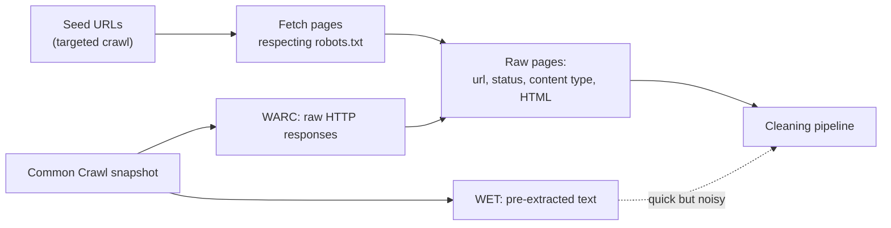
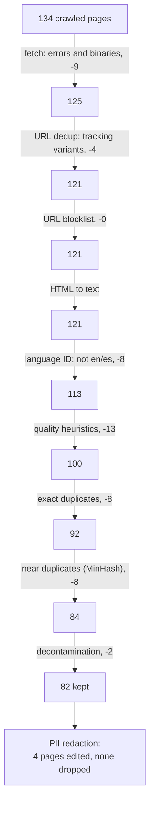
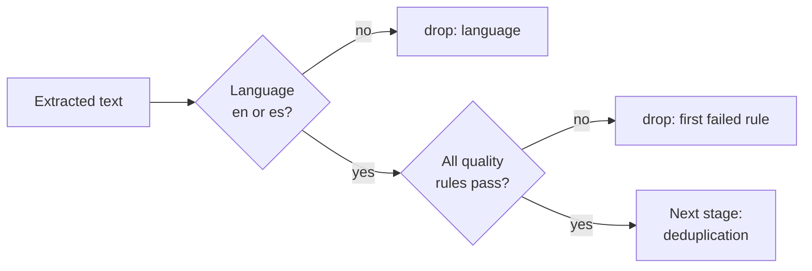
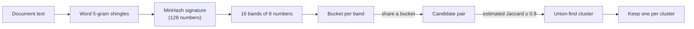
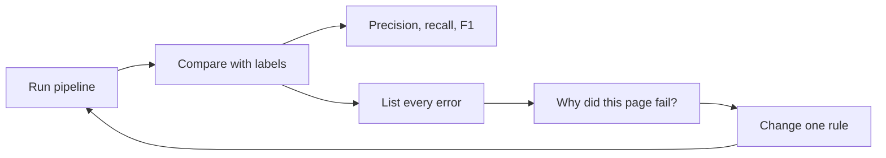

🌐 English · [Español](02-pretraining-data.es.md)

# Lesson 1.2 — Pre-training data: collection and cleaning

> **Module 01 · Lesson 2 of 5** · ⏱️ about 60 min · 🧪 Lab: [step 3](lab/README.md#step-3--clean-the-crawl)

## 📨 Situation

> **From:** Dani Ruiz · Data Scientist
> **Channel:** #data
>
> Here is the crawl: `datasets/web/pages.jsonl`, 134 pages the team fetched last year when someone
> wanted to train a small smart-home model. Nobody cleaned it. I went through every page by hand and
> wrote down what an ideal pre-training pipeline should keep (`labels.jsonl`, field `keep`). There
> are error pages, copies, spam, pages in languages we do not serve, forum posts with phone numbers
> and at least one page that copies our evaluation questions with the answers. Build the pipeline,
> run it, and give me precision and recall against my labels. And tell me what you got wrong. Show me
> the eval.

## 🎯 Objectives

By the end of this lesson you can:

- Explain where pre-training text comes from (targeted crawls and Common Crawl) and which legal and ethical checks apply before you use it.
- Implement the stages of a web-cleaning pipeline: fetch filtering, URL normalisation, text extraction, language identification, quality heuristics, deduplication, decontamination and personal-data redaction.
- Compute precision and recall of keep/drop decisions against labelled data, and explain each error.
- Choose a filter threshold by reasoning about its precision/recall trade-off.
- Explain how MinHash and locality-sensitive hashing find near-duplicates without comparing every pair.

## 🤔 Predict first

Write your answers down before reading on. You will check them in the self-check.

1. Of the 192,610 characters of raw HTML in the crawl, roughly what share do you expect to survive as clean, kept text: 80%, 50% or 25%?
2. A common rule drops any page shorter than 50 words. What do you think happens to recall on this crawl if you use it?
3. Two copies of an article differ only by one added sentence. Will a SHA-256 hash of their text catch them as duplicates?

## 1. Collecting text: crawls, Common Crawl and the right to use it

There are two ways to get web text. A **targeted crawl** starts from a list of sites you chose and
follows links, the way the Hearthwise team built this crawl. You control the scope, but it is slow and
small. The other way is to start from **Common Crawl** ([commoncrawl.org](https://commoncrawl.org)),
a non-profit that crawls the web regularly and publishes each snapshot for free. A snapshot comes in
three formats: **WARC** files hold the raw HTTP responses (headers and HTML), **WAT** files hold
metadata such as links, and **WET** files hold plain text that has already been extracted.

Pipelines that care about quality usually start from WARC and do their own extraction, because the
generic WET text keeps menus, cookie banners and footers. The FineWeb paper, for example, builds a
15-trillion-token English dataset from 96 Common Crawl snapshots
([FineWeb](https://arxiv.org/abs/2406.17557)); RefinedWeb reports about 5 trillion tokens after
filtering Common Crawl and released a 600-billion-token extract
([RefinedWeb](https://arxiv.org/abs/2306.01116)); Dolma assembles about 3 trillion tokens from web
pages, papers, code, books and more ([Dolma](https://arxiv.org/abs/2402.00159)).

Being reachable is not the same as being usable. Before any text enters a corpus, someone has to
answer three questions:

| Question | What to check |
|---|---|
| May we crawl it? | The site's `robots.txt` file and rate limits. Well-behaved crawlers read it and skip disallowed paths. |
| May we train on it? | Copyright, the site's terms of use, and opt-out signals. Licences differ by source. |
| Does it contain personal data? | Names, e-mails, phone numbers, addresses. In the EU the General Data Protection Regulation (GDPR) applies. |

**Analogy:** collecting web text is like a library accepting donated boxes of paper. Before anything
reaches the shelves, someone checks that the donor had the right to give it, throws out the junk, and
blacks out private letters.



Our crawl is a single JSONL file in the WARC spirit: one line per response with `url`, `fetched_at`,
`status`, `content_type` and `html`. It has 134 pages: 128 returned HTTP 200 and 6 returned errors;
131 are `text/html` and 3 are other types (PDFs and an image). Dani's labels say 83 pages should be
kept.

> 💡 **Production tip:** record provenance for every document (source URL, fetch date, licence,
> pipeline version) and keep it next to the text. When a takedown request or a data-protection
> question arrives, you must be able to find and remove one source quickly.

## 2. The pipeline at a glance: cheap filters first

The RefinedWeb, Dolma and FineWeb papers each describe a pipeline of the same general shape: filter
by URL, extract text from HTML, identify the language, apply quality heuristics, remove duplicates,
and handle personal data. The order is not arbitrary. Cheap checks that drop many pages run first;
expensive comparisons run last, on fewer pages.

**Analogy:** airport security checks your boarding pass before anyone scans your bag. The cheap
check removes people who are not flying, so the expensive scanner only sees passengers who matter.

Here is our pipeline with the real counts from `uv run lab clean`:



Two stages need a closer look before filtering. **URL normalisation** maps different spellings of the
same address to one canonical form. Four pages in the crawl are copies of other pages
with `?utm_source=newsletter&utm_medium=email` appended: tracking parameters that change the URL but
not the content.

```python
TRACKING_PARAMS = ("utm_", "fbclid", "gclid", "mc_cid", "mc_eid")

def normalise_url(url: str) -> str:
    """Canonical form: lowercase host, no fragment, no tracking parameters, no trailing slash."""
    parts = urlsplit(url.strip())
    host = (parts.hostname or "").lower()
    if parts.port and not ((parts.scheme == "http" and parts.port == 80) or
                           (parts.scheme == "https" and parts.port == 443)):
        host = f"{host}:{parts.port}"
    query = [(k, v) for k, v in parse_qsl(parts.query, keep_blank_values=True)
             if not k.lower().startswith(TRACKING_PARAMS)]
    path = parts.path.rstrip("/") or "/"
    return urlunsplit((parts.scheme.lower(), host, path, urlencode(sorted(query)), ""))
```

**Text extraction** keeps what a reader would read and drops the rest. Our `html_to_text` walks the
HTML with Python's standard `html.parser`, prefers the `<article>` element, and skips `nav`,
`header`, `footer`, `aside`, buttons, cookie banners, ads and bylines. The result is striking: the 82
kept pages hold 48,932 characters of text, extracted from 192,610 characters of raw HTML across the
whole crawl, so only 25.4% of the characters you downloaded end up as training text.

> ⚠️ **Common mistake:** training on HTML or on generic extracted text with the boilerplate left in.
> Menus and cookie banners repeat on every page of a site, so the model sees "Accept all" thousands of
> times. It wastes compute, and repeated boilerplate also makes unrelated pages look similar, which
> confuses near-duplicate detection later.

## 3. Filtering: language and quality

**Language identification** decides which pages fit your product. Production pipelines use a trained
classifier; ours scores each page by the share of its words that are common "stop words" (such as
*the*, *de*, *und*, *le*) of English, Spanish, German and French, and picks the best. Hearthwise
serves English and Spanish, so the 4 German and 4 French pages are dropped and 77 English plus 5
Spanish pages survive to the end.

**Quality heuristics** are cheap, explainable rules that catch machine-generated junk. Each one
measures something a human editor would notice:

| Signal | What it catches | Our threshold |
|---|---|---|
| Word count | Empty archive pages ("No posts found.") | at least 5 words |
| Share of words in the most repeated 3-word sequence | Keyword stuffing ("cheap smart plug cheap smart plug") | at most 0.20 |
| Share of capital letters | Shouting ("BUY NOW") | at most 0.25 |
| Exclamation marks per sentence | Hype | at most 0.5 |
| Mean word length | Gibberish, long URLs, tables of codes | between 3 and 10 |

```python
def quality_signals(text: str) -> dict[str, float]:
    words = _LID_WORD_RE.findall(text)
    n = len(words)
    letters = [ch for ch in text if ch.isalpha()]
    caps = sum(ch.isupper() for ch in letters) / len(letters) if letters else 0.0
    lowered = [w.lower() for w in words]
    trigrams = Counter(tuple(lowered[i : i + 3]) for i in range(max(0, n - 2)))
    top_count = trigrams.most_common(1)[0][1] if trigrams else 0
    top = top_count * 3 / n if top_count >= 2 else 0.0  # only a repeated trigram counts
    sentences = max(1, len(re.findall(r"[.!?]+", text)))
    return {"words": float(n), "mean_word_len": sum(map(len, words)) / n if n else 0.0,
            "caps_ratio": caps, "top_trigram_share": top,
            "exclamations_per_sentence": text.count("!") / sentences}
```

A spam page such as `best-cheap-smart-deals.example/deal-1` scores 0.59 on the repetition signal: more
than half its words belong to one repeated phrase. The 13 pages dropped at this stage are 9 spam pages,
3 empty archive pages and one mistake, which you will meet in section 6.

**Analogy:** heuristics are the bouncer at the door with a short checklist. Fast and consistent, but
the checklist cannot read, so now and then it turns away a perfectly decent guest.



> ⚠️ **Common mistake:** copying a threshold from a paper without measuring it on your data. A
> minimum of 50 words sounds harmless. On this crawl, `uv run lab clean --min-words 50` keeps only
> 57 pages and recall drops from 0.988 to 0.687: product pages, price tables and short forum threads
> are short by nature, and they are exactly the factual pages a Hearthwise model would need.

## 4. Deduplication: exact hashes and MinHash

Duplicates hurt twice. The model spends compute re-reading the same text, and repeated text is more
likely to be memorised and reproduced word for word. The crawl hides three kinds of copies:

| Kind | Example in the crawl | Caught by |
|---|---|---|
| Same URL, different spelling | `utm_` tracking variants (4 pages) | URL normalisation |
| Same text, different URL | Syndicated copies on an aggregator (8 pages) | Exact hash of the normalised text |
| Almost the same text | Copies with one sentence added (8 pages) | MinHash near-duplicate detection |

**Exact deduplication** lowercases the text, collapses whitespace and takes a SHA-256 hash. Equal
hashes mean equal text. It is fast and has no false positives, but one changed character breaks it.

**Near-duplicate detection** needs a similarity measure. Cut each document into **shingles**, here
every sequence of 5 consecutive words, and compare the sets with the **Jaccard similarity**: the
size of the intersection divided by the size of the union. The 8 near-duplicate pairs score between
0.968 and 0.975; the most similar pair of genuinely different articles (two independent guides on the
same topic) scores 0.417.

Comparing every pair of documents is quadratic, which is impossible on billions of pages.
**MinHash** fixes the cost of each comparison: apply 128 random hash functions to every shingle and
keep, for each function, the smallest value. The resulting 128-number **signature** has a useful
property: the share of positions where two signatures agree is an unbiased estimate of their Jaccard
similarity. On our pairs the estimates land between 0.953 and 0.992.

```python
def signature(self, items: set[str]) -> np.ndarray:
    """For every hash function h(x) = (a * x + b) mod p, keep the minimum over the shingles."""
    if not items:
        return np.full(self.num_perm, _PRIME, dtype=np.int64)
    a, b = self._params()
    x = _shingle_ids(items)
    hashed = (a[:, None] * x[None, :] + b[:, None]) % _PRIME  # (num_perm, n_shingles)
    return hashed.min(axis=1)
```

**Locality-sensitive hashing (LSH)** then avoids comparing all signatures. Split each signature into
16 bands of 8 numbers and put documents into buckets by band. Two documents become *candidates* only
if at least one whole band matches. With 16 bands of 8 rows, a pair has a 50% chance of becoming a
candidate at a Jaccard similarity of about 0.707; far more similar pairs almost always collide, far
less similar ones almost never do. Only candidates get the full signature comparison (threshold 0.8),
and a union-find structure groups them into clusters, of which one member survives.

**Analogy:** imagine comparing two huge stamp collections. You agree on 128 random orderings of
every stamp that exists and, for each ordering, note which stamp each collection has first. The more
often the two notes match, the more the collections overlap, and you never had to list every stamp.
LSH is the clerk who only sends you pairs of collections whose notes match in at least one whole
block of eight.



Which copy survives? Our pipeline keeps the shortest URL in each cluster, a cheap proxy for "the
original, not the mirror". Production systems often use canonical-link tags or domain reputation.

> 💡 **Production tip:** deduplicate across your whole corpus, not only inside one crawl, and log
> cluster sizes. A cluster of thousands of near-identical pages is usually a template (a shop's
> product pages, a spam farm) and deserves a look before you trust the pipeline's choice of keeper.

## 5. Decontamination and personal data

**Benchmark contamination** happens when evaluation questions leak into training data. A model that
saw the answers during training gets a flattering score that says nothing about real ability. The
GPT-3 paper devotes a whole section to measuring this overlap ([GPT-3](https://arxiv.org/abs/2005.14165)).
Hearthwise has its own evaluation sets: the support questions in `datasets/rag_eval` (used in modules
05 and 06) and the maths problems in `datasets/reasoning` (module 09). Our pipeline builds the set of
every 8-word sequence in those items and drops any page that shares one. It catches the 2
`studyhub.example` pages that copy questions with answers, and nothing else.

**Personal data** is handled differently: a forum post with an e-mail address still contains a useful
answer, so the pipeline **redacts** instead of dropping. Regular expressions replace e-mails, phone
numbers and street addresses with placeholders such as `<EMAIL>`. In the kept pages it redacts
2 e-mails, 2 phone numbers and 1 address, on 4 pages.

```python
PII_PATTERNS = {
    "EMAIL": re.compile(r"[\w.+-]+@[\w-]+(?:\.[\w-]+)+"),
    "PHONE": re.compile(r"\+\d{1,3}(?:[ -]?\d{2,4}){2,4}"),
    "ADDRESS": re.compile(r"\b(?:Calle|Rua|Avenida|Street|Road)\s+[A-ZÁÉÍÓÚ]\w+(?:\s[A-Z]\w+)*\s+\d{1,4}"
                          r"(?:,\s*[A-Z]\w+)?"),
}
```

**Analogy:** decontamination is removing the exam answer key from the study pile; redaction is
blacking out names in letters you are allowed to keep.

> ⚠️ **Common mistake:** trusting regular expressions to find all personal data. They catch
> well-formatted e-mails and phone numbers and miss names, nicknames and addresses written in
> unexpected ways. Treat regex redaction as a first layer, measure its recall on labelled samples
> (`labels.jsonl` has a `has_pii` field), and ask your privacy lead what the residual risk is.

One more trap stays in on purpose: a forum thread contains text addressed to AI assistants, trying to
change their behaviour. For pre-training, Dani's label says keep it; the page is mostly a useful
answer. For a system that reads web pages at run time, such text is an attack called **prompt
injection**, and you will defend against it in modules 06 and 08.

## 6. Measuring the pipeline against labels

A pipeline without measurement is a pile of opinions. Dani's labels give a ground truth for every
page, so you can treat "keep" as the positive class and build a confusion matrix:

| | Labelled keep | Labelled drop |
|---|---|---|
| **Pipeline keeps** | TP = 82 | FP = 0 |
| **Pipeline drops** | FN = 1 | TN = 51 |

**Precision** is TP / (TP + FP): of the pages we kept, how many deserved it. Here it is 1.000.
**Recall** is TP / (TP + FN): of the pages that deserved to be kept, how many we kept. Here it is
0.988. **F1**, their harmonic mean, is 0.994.

The single false negative is the most instructive line in the report:

```text
dropped but should keep: https://corvid-home.example/thermo-x  (quality:repetitive)
```

The page is a short product page: a heading "Corvid Thermo X" and a sentence that repeats the name.
In 19 words, the trigram "corvid thermo x" covers 6, a repetition share of 0.32, above our 0.20
threshold. The rule meant for keyword spam hits a legitimate page because short pages make every
repetition look large. Possible fixes: apply the repetition rule only above a minimum length, or
ignore repeats that come from the title.

Turning stages off shows what each one is worth:

| Run | Pages kept | Precision | Recall |
|---|---|---|---|
| Full pipeline | 82 | 1.000 | 0.988 |
| `--skip contamination` | 84 | 0.976 | 0.988 |
| `--skip near_dup` | 90 | 0.911 | 0.988 |
| `--skip url_dedup --skip exact_dup --skip near_dup` | 101 | 0.812 | 0.988 |
| `--min-words 50` | 57 | 1.000 | 0.687 |

**Analogy:** precision is "how clean is the bucket you kept"; recall is "how much of the good water
you managed to catch".



> 💡 **Production tip:** be suspicious of your own numbers. These thresholds were chosen while
> looking at the same 134 pages they are scored on, so 0.988 recall is optimistic. Keep a held-out
> labelled sample that nobody tunes on, and report results on it.

## 🧪 Try it

1. Run the pipeline ([lab step 3](lab/README.md#step-3--clean-the-crawl)):

   ```bash
   uv run lab clean
   ```

   Expected output (last part):

   ```text
   Against labels.jsonl (positive class = keep):
     TP=82  FP=0  FN=1  TN=51
     precision=1.000  recall=0.988  F1=0.994
     dropped but should keep: https://corvid-home.example/thermo-x  (quality:repetitive)

   Wrote outputs/clean_corpus.jsonl
   ```

2. Measure the trade-off of a stricter length rule: `uv run lab clean --min-words 50`. Expect
   `precision=1.000  recall=0.687  F1=0.814`.
3. Compare exact and MinHash similarity ([lab step 4](lab/README.md#step-4--measure-near-duplicates-with-minhash)):
   `uv run lab minhash`. Expect estimates within a few hundredths of the exact values, and
   `Most similar pair of different articles: J=0.417`.
4. Open `outputs/clean_corpus.jsonl` and search for `<EMAIL>` to see a redacted forum post.

## 🏭 In the real world

- **Scale changes the tools, not the ideas.** Web-scale pipelines run the same stages on clusters,
  replace stop-word counting with trained language classifiers, and add model-based quality scores
  trained to recognise, for example, educational text (FineWeb's educational subset is built this
  way). The logic of "cheap filters first, measure everything" stays.
- **Every filter has a bias.** Rules tuned on one kind of text drop other kinds: short pages, dialects,
  code, tables. Check what each filter removes per language and per source, not only in total.
- **Ablations decide.** Dataset papers judge a filter by training small models with and without it
  and comparing their scores. Your equivalent is the precision/recall table above, plus spot checks.
- **What to monitor:** pages dropped per stage per run, language mix, duplicate-cluster sizes, PII
  matches per thousand pages, and overlap with every evaluation set you own.

## ✅ Self-check

**1. What share of the raw HTML characters survives as kept text, and why so little?**

<details><summary>Answer</summary>

25.4% (48,932 of 192,610 characters). Most HTML is markup and boilerplate (navigation, cookie
banners, footers), and 52 of 134 pages are dropped entirely. If you guessed 80%, you probably pictured
pages as mostly text; on the real web the boilerplate share is usually large too.

</details>

**2. What does a 50-word minimum do to this crawl, and should you use it?**

<details><summary>Answer</summary>

Recall falls from 0.988 to 0.687 (57 pages kept instead of 82) while precision stays at 1.000. Short
product pages, price tables and forum threads are legitimate and factual. Use a length rule only after
measuring what it removes on your own data.

</details>

**3. Two copies of an article differ by one added sentence. Does a SHA-256 hash catch them?**

<details><summary>Answer</summary>

No. Any change produces a completely different hash. You need a similarity measure such as Jaccard
over shingles, estimated cheaply with MinHash. The 8 near-duplicate pairs in the crawl have Jaccard
similarity around 0.97 and are only caught at the MinHash stage.

</details>

**4. Why does the pipeline redact personal data instead of dropping the page?**

<details><summary>Answer</summary>

The rest of the page (for example a forum answer about Wi-Fi channels) is useful training text.
Dropping it loses data without reducing risk more than redaction does. The exception is a page whose
main content is personal data, which should be dropped.

</details>

**5. Precision is 1.000. Is the pipeline perfect?**

<details><summary>Answer</summary>

No. Recall is 0.988 because one legitimate product page was dropped by the repetition rule, and the
thresholds were tuned on the same 134 pages they are evaluated on, so the numbers are optimistic. A
held-out labelled sample would give an honest estimate.

</details>

## 💬 Explain it in your own words

- Explain to Dani why the Corvid Thermo X product page was dropped and propose one rule change, with
  the metric you would check afterwards.
- Noor Haddad, the security and privacy lead, asks whether "we removed the personal data". Explain
  what the redaction step does and does not guarantee.

## 🔑 Key ideas

- Pre-training text comes from targeted crawls or Common Crawl (WARC, WAT, WET); legal and privacy
  checks come before any training.
- A cleaning pipeline runs cheap filters first: fetch status, URL normalisation, text extraction,
  language, quality heuristics, then deduplication, decontamination and redaction.
- Exact hashes catch identical copies; MinHash plus LSH catch near-duplicates without comparing every
  pair.
- Decontamination protects your evaluations; redaction protects people.
- Measure keep/drop decisions with precision and recall against labels, and read every error.
- Thresholds are trade-offs: a harmless-looking rule cut recall from 0.988 to 0.687 on this crawl.

## 📚 Go deeper

- ⭐ [The FineWeb Datasets](https://arxiv.org/abs/2406.17557) — the most detailed public account of
  building a web pre-training dataset, with ablations for every filtering and deduplication choice.
- [The RefinedWeb Dataset for Falcon LLM](https://arxiv.org/abs/2306.01116) — argues that carefully
  filtered and deduplicated web data alone can train strong models.
- [Dolma](https://arxiv.org/abs/2402.00159) — a three-trillion-token open corpus with its curation
  toolkit released as open source.
- [Common Crawl](https://commoncrawl.org) — browse the data formats and an index of recent crawls.

---

[← Previous: 1.1 The path from raw data to a chatbot](01-llm-overview.md) · [🏠 Module 01](README.md) · [Next: 1.3 Tokenization →](03-tokenization.md)
