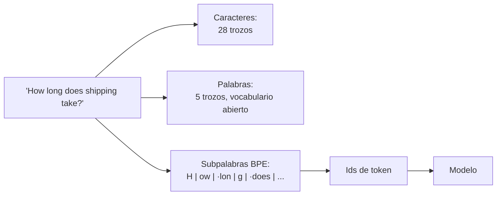
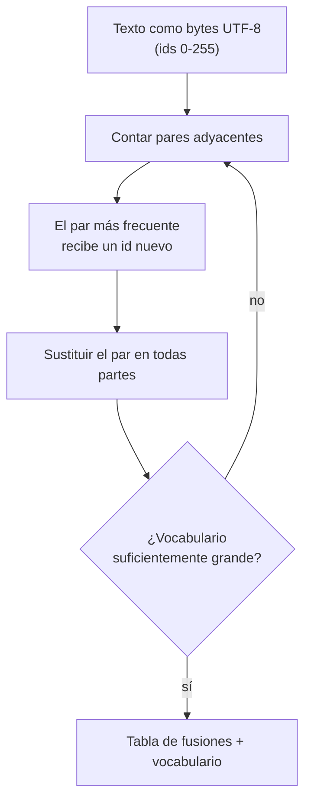
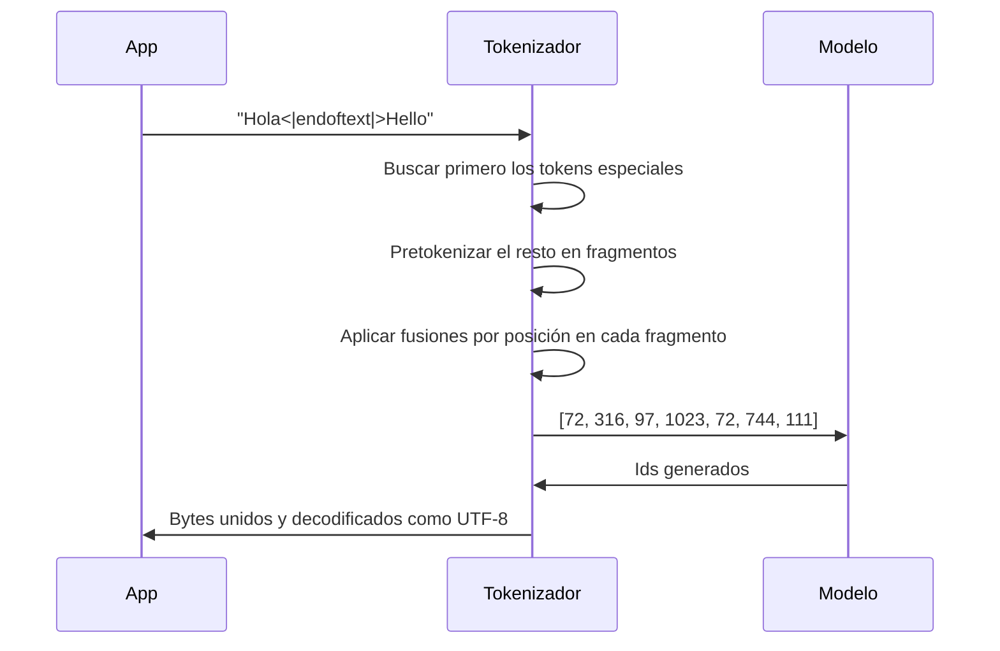
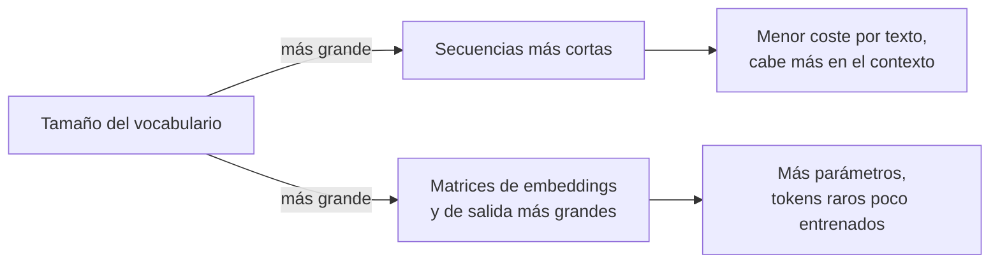

🌐 [English](03-tokenization.md) · Español

# Lección 1.3 — Tokenización y codificación por pares de bytes

> **Módulo 01 · Lección 3 de 5** · ⏱️ unos 50 min · 🧪 Lab: [paso 5](lab/README.es.md#paso-5--entrena-un-tokenizador-bpe)

## 📨 Situación

> **De:** Rio Tanaka · Responsable de Ingeniería de IA
> **Canal:** #ai-team
>
> Buen trabajo con el *pipeline* de limpieza. Siguiente pregunta, y viene de Finanzas: todos los
> proveedores de modelos nos cobran por *token*, y alrededor del 30 % de nuestros tickets de soporte
> están en español. En la reunión de presupuesto alguien preguntó si una conversación en español cuesta
> lo mismo que una en inglés. Dije "probablemente", que no es una respuesta. Entrena un tokenizador con
> el corpus que acabas de limpiar, pásalo por nuestros tickets reales en los dos idiomas y dime cuál es
> la diferencia y de dónde viene. Después dime qué cambiarías para reducirla. ¿Qué medirías, y sobre
> qué texto?

## 🎯 Objetivos

Al terminar esta lección puedes:

- Explicar por qué los modelos trabajan con *tokens* y comparar la tokenización por caracteres, por palabras y por subpalabras sobre la misma frase.
- Entrenar desde cero un tokenizador de codificación por pares de bytes (BPE, *byte-pair encoding*) y seguir a mano sus primeras fusiones.
- Codificar y decodificar texto con las fusiones aprendidas, incluidos los *tokens* especiales, y verificar el viaje de ida y vuelta.
- Medir los *tokens* por palabra en inglés y en español, y explicar cómo la mezcla de datos de entrenamiento crea la diferencia.
- Elegir un tamaño de vocabulario sopesando la longitud de las secuencias frente al tamaño de los *embeddings*.

## 🤔 Predice primero

Apunta tus respuestas antes de seguir leyendo. Las comprobarás en la autoevaluación.

1. "How long does shipping take?" y "¿Cuánto tarda el envío?" significan lo mismo. ¿Cuál se convierte en más *tokens* con un tokenizador entrenado con nuestro rastreo, casi todo en inglés?
2. Un tokenizador entrenado solo con texto en inglés recibe caracteres chinos. ¿Falla, usa un *token* "desconocido" o hace otra cosa?
3. Si duplicas el tamaño del vocabulario, ¿los textos pasan a tener más o menos la mitad de *tokens*?

## 1. Por qué tokens, y tres formas de cortar el texto

Una red neuronal calcula con números, así que el texto tiene que convertirse en una secuencia de
enteros antes del entrenamiento o la inferencia. De eso se encarga el **tokenizador** (*tokenizer*):
divide el texto en trozos de una lista fija llamada **vocabulario** (*vocabulary*) y devuelve la
posición de cada trozo (su identificador o *id*). El modelo tiene un vector aprendido por cada *id*;
nunca ve letras.

Hay tres formas naturales de cortar el texto:

| Unidad | "How long does shipping take?" | Vocabulario | Problema |
|---|---|---|---|
| Caracteres (bytes UTF-8) | 28 *tokens* | 256 | Las secuencias son largas; cada paso aporta poco significado |
| Palabras | 5 *tokens* | Cada palabra vista alguna vez, más un *token* "desconocido" | Vocabulario enorme; las palabras nuevas, las erratas y los nombres se vuelven "desconocidos" |
| Subpalabras (nuestro BPE) | 12 *tokens* | 1.024 en nuestro lab | Un término medio: las palabras frecuentes quedan enteras y las raras se dividen |

La longitud de la secuencia importa porque el coste del modelo crece con el número de *tokens*, y su
ventana de contexto (*context window*, el número máximo de *tokens* que puede leer de una vez) se
cuenta en *tokens*. El tamaño del vocabulario importa porque cada entrada necesita su propio vector
aprendido. La tokenización por subpalabras, que Sennrich y su equipo introdujeron en traducción para
manejar palabras raras y nunca vistas ([BPE for NMT](https://arxiv.org/abs/1508.07909)), consigue las
ventajas de ambos: las palabras comunes cuestan un *token* y cualquier palabra nueva se puede seguir
deletreando con trozos más pequeños.

**Analogía:** los *tokens* de subpalabra son como las teclas de una máquina de estenotipia. Las
palabras comunes se escriben con un solo acorde; las inusuales se deletrean por sílabas. Nada es
imposible de escribir, y lo frecuente es rápido.



> ⚠️ **Error común:** suponer que un *token* equivale a una palabra. Con nuestro tokenizador, los
> tickets en inglés tienen de media 2.932 *tokens* por palabra, y los de español, 3.345. Los
> presupuestos, los límites de contexto y los precios están todos en *tokens*, así que mide siempre
> sobre tu propio texto en lugar de convertir con una regla aproximada.

## 2. Entrenar BPE: fusionar el par más frecuente, una y otra vez

La codificación por pares de bytes empieza con el vocabulario más pequeño posible, los 256 valores
posibles de un byte, y lo amplía de una entrada en una:

1. Convierte el texto de entrenamiento a bytes UTF-8. Cada byte es un *id* de *token* de 0 a 255.
2. Cuenta cada par de *ids* adyacentes.
3. Toma el par más frecuente, dale un *id* nuevo (256, luego 257...) y sustituye todas sus apariciones.
4. Repite hasta que el vocabulario tenga el tamaño que pediste.

Antes de contar, el texto se **pretokeniza** (*pre-tokenization*): una expresión regular lo divide en
fragmentos parecidos a palabras, con el espacio inicial pegado a la palabra (`" shipping"`). Las
fusiones nunca cruzan los límites de un fragmento, así que un *token* nunca contiene el final de una
palabra y el comienzo de la siguiente.

**Analogía:** BPE construye su vocabulario como una redacción construye su taquigrafía: el par de
letras que más a menudo se escribe junto recibe primero su propio símbolo, después los pares de
símbolos, y así sucesivamente.

Pruébalo a mano con un corpus diminuto: `"low lower lowest"`, `"new newer newest"` y
`"the lowest price is the newest price"`, tres copias de cada uno. El par `w e` aparece en *lower*,
*lowest* (dos veces), *newer* y *newest* (dos veces): 6 veces por copia, 18 en total, más que
cualquier otro par. Así que la primera fusión es `w` + `e` → `we`. Los tests del lab comprueban
exactamente esto.

Con el rastreo de Hearthwise ya limpio (82 documentos, 48.999 bytes), las primeras fusiones son:

| Posición | Fusión | Resultado | Veces vista |
|---|---|---|---|
| 0 | `·` + `t` | ` t` | 1003 |
| 1 | `h` + `e` | `he` | 955 |
| 2 | `·` + `a` | ` a` | 900 |
| 3 | `·` + `s` | ` s` | 797 |
| 4 | `i` + `n` | `in` | 672 |
| 5 | ` t` + `he` | ` the` | 657 |

El `·` es como el lab muestra un espacio. En la posición 5, BPE ya ha reconstruido a partir de sus
partes la palabra más común del inglés, " the".

```python
def train_bpe(texts, vocab_size, special_tokens=(END_OF_TEXT,)):
    n_merges = vocab_size - 256 - len(special_tokens)
    chunk_freq = Counter(chunk for t in texts for chunk in pretokenize(t))
    chunks = Counter()
    for chunk, freq in chunk_freq.items():
        chunks[tuple(chunk.encode("utf-8"))] += freq
    tok, history = BPETokenizer(), []
    for rank in range(n_merges):
        counts = pair_counts(chunks)
        if not counts:
            break
        pair, count = min(counts.items(), key=lambda kv: (-kv[1], kv[0]))  # ties: smallest pair
        new_id = 256 + rank
        tok.merges[pair] = new_id
        tok.vocab[new_id] = tok.vocab[pair[0]] + tok.vocab[pair[1]]
        history.append(MergeStep(rank, pair, new_id, count, tok.vocab[new_id]))
        merged = Counter()
        for ids, freq in chunks.items():
            merged[merge_pair(ids, pair, new_id) if len(ids) > 1 else ids] += freq
        chunks = merged
    tok.special = {s: 256 + len(tok.merges) + k for k, s in enumerate(special_tokens)}
    return tok, history
```

Contar los fragmentos únicos con sus frecuencias, en lugar de recorrer el texto en bruto, es lo que lo
hace rápido: "the" aparece cientos de veces, pero se procesa una sola vez por fusión.



> 💡 **Consejo de producción:** el tokenizador forma parte del modelo. Los *embeddings* de un modelo
> se indexan con sus propios *ids* de *token*, así que nunca puedes cambiar de tokenizador en un modelo
> ya entrenado. Cuando cuentes *tokens* para el presupuesto, usa el tokenizador exacto del modelo al
> que llamas (por ejemplo, [tiktoken](https://github.com/openai/tiktoken) para los modelos de OpenAI),
> no uno genérico.

## 3. Codificación, decodificación y tokens especiales

**Codificar** (*encoding*) un texto nuevo repite las fusiones aprendidas en el orden en que se
aprendieron. Para cada fragmento, parte de sus bytes, busca el par adyacente con la posición de fusión
más baja, fusiónalo y repite hasta que no quede ningún par aprendido. Aplicar las fusiones por
posición, y no por frecuencia en el texto nuevo, garantiza que la misma cadena reciba siempre los
mismos *tokens*.

```python
def _encode_chunk(self, chunk: str) -> tuple[int, ...]:
    ids = tuple(chunk.encode("utf-8"))
    while len(ids) >= 2:
        ranked = [(self.merges[p], p) for p in zip(ids, ids[1:]) if p in self.merges]
        if not ranked:
            break
        new_id, pair = min(ranked)  # the earliest-learned merge applies first
        ids = merge_pair(ids, pair, new_id)
    return ids
```

**Decodificar** (*decoding*) es más sencillo: busca los bytes de cada *id*, concaténalos y decodifica
el resultado como UTF-8. Como cada *id* corresponde a bytes exactos, `decode(encode(text)) == text`
para cualquier cadena. El lab prueba este viaje de ida y vuelta con texto en inglés, en español, con
emojis y en chino. Eso también responde qué pasa con los caracteres que nunca aparecieron en los
datos de entrenamiento: no hay *token* "desconocido"; el texto simplemente recurre a los bytes en
bruto.

Los ***tokens* especiales** (*special tokens*) son *ids* reservados que nunca salen del texto normal.
Nuestro tokenizador tiene uno, `<|endoftext|>`, con *id* 1023; los datos de entrenamiento lo colocan
entre documentos para que el modelo aprenda dónde termina un texto. El codificador busca los *tokens*
especiales antes que nada y nunca los divide:

```text
Special token: 'Hola<|endoftext|>Hello' -> [72, 316, 97, 1023, 72, 744, 111]
```

Los modelos de chat añaden más para marcar roles y turnos (sistema, usuario, asistente) y llamadas a
herramientas; verás las plantillas de chat en el módulo 03.

**Analogía:** codificar es como aplicar en un orden fijo la lista de abreviaturas de un libro de
estilo. Quien aplique la misma lista en el mismo orden produce la misma forma abreviada, y cualquiera
puede volver a desarrollarla.



> ⚠️ **Error común:** dejar que la entrada de usuario produzca *tokens* especiales. Si alguien de la
> clientela escribe el texto literal `<|endoftext|>` y tu aplicación lo codifica con los *tokens*
> especiales activados, el modelo ve una marca real de fin de documento. El `encode(text,
> allow_special=False)` del lab lo trata como texto normal. Codifica así la entrada que no es de
> confianza.

## 4. BPE a nivel de byte y el coste del español

Trabajar con bytes en lugar de caracteres garantiza una cobertura completa, pero los caracteres fuera
de ASCII ocupan más de un byte en UTF-8. "¿", "á" e "í" ocupan dos bytes cada uno. Si los datos de
entrenamiento los contienen pocas veces, ninguna fusión llega a unir sus dos bytes, y cada uno de esos
caracteres cuesta dos *tokens*:

```text
'How long does shipping take?'
  12 tokens: H | ow | ·lon | g | ·does | ·sh | i | pping | ·t | a | ke | ?

'¿Cuánto tarda el envío?'
  19 tokens: <C2> | <BF> | C | u | <C3> | <A1> | nt | o | ·t | ar | d | a | ·el | ·en | v | <C3> | <AD> | o | ?
```

`<C3>` y `<A1>` son los dos bytes de "á", mostrados en hexadecimal porque ninguno de ellos es un
carácter por sí solo. La pregunta en español tiene 4 palabras y 19 *tokens*; la inglesa tiene 5
palabras y 12 *tokens*.

Una frase es una anécdota. Esta es la medición que pidió Rio: *tokens* por palabra en los 846 tickets
en inglés y los 378 en español de Hearthwise, con nuestro tokenizador de 1.024 entradas.

| Idioma | *Tokens* por palabra |
|---|---|
| Inglés | 2.932 |
| Español | 3.345 |
| Ratio es/en | 1.141 |

Un ticket en español cuesta alrededor de un 14 % más de *tokens* por palabra. La causa es la mezcla de
datos: solo 5 de las 82 páginas conservadas están en español, así que casi todas las fusiones se
aprendieron del inglés. Repite cinco veces las páginas en español en los datos de entrenamiento
(`uv run lab bpe --es-weight 5`) y la diferencia se reduce:

| Mezcla de entrenamiento | Inglés | Español | Ratio es/en |
|---|---|---|---|
| Tal como quedó tras la limpieza | 2.932 | 3.345 | 1.141 |
| Páginas en español ×5 | 2.993 | 3.231 | 1.080 |

El inglés empeoró un poco, porque el vocabulario tiene un tamaño fijo y ahora algunas entradas sirven
al español. Ese es el compromiso que asume todo tokenizador multilingüe.

**Analogía:** un tokenizador entrenado con inglés es un teclado con atajos solo para palabras
inglesas. Quien habla español puede seguir escribiéndolo todo, letra a letra, pero pulsa más teclas.

> 💡 **Consejo de producción:** mide los *tokens* por palabra de cada idioma que atiendas, sobre
> tráfico real, para cada modelo que consideres. Más *tokens* por palabra significa más coste, más
> latencia y menos espacio en la ventana de contexto para la misma conversación. Es una cuestión de
> equidad, además de presupuesto.

## 5. Elegir el tamaño del vocabulario

Como BPE aprende las fusiones en orden, un tokenizador con menos fusiones es solo un prefijo de otro
más grande. El lab lo aprovecha para medir varios tamaños de vocabulario con un solo entrenamiento:

| Vocabulario | *Tokens*/palabra en inglés | *Tokens*/palabra en español | Ratio es/en |
|---|---|---|---|
| 257 (bytes + 1 especial) | 5.566 | 5.726 | 1.029 |
| 384 | 3.864 | 4.193 | 1.085 |
| 512 | 3.519 | 3.907 | 1.110 |
| 768 | 3.139 | 3.565 | 1.136 |
| 1024 | 2.932 | 3.345 | 1.141 |

Duplicar el vocabulario de 512 a 1.024 no reduce a la mitad el número de *tokens*: el inglés pasa de
3.519 a 2.932. Cada fusión nueva cubre un patrón más raro que la anterior, así que los rendimientos
son decrecientes. La diferencia entre idiomas también crece con el vocabulario, porque las entradas
nuevas van al idioma dominante.

**Analogía:** un vocabulario es como los botones de marcación rápida de un teléfono. Más botones
significan menos pulsaciones por llamada, pero un teclado más grande que fabricar y botones que casi
nunca pulsas.

Un vocabulario más grande no sale gratis:

| Un vocabulario más grande da | Un vocabulario más grande cuesta |
|---|---|
| Secuencias más cortas y, por tanto, inferencia más rápida y barata por texto | Una matriz de *embeddings* (vocabulario × anchura del modelo) y una capa de salida más grandes |
| Cabe más texto en la ventana de contexto | Más *tokens* raros que aparecen demasiado poco en el entrenamiento para aprender buenos vectores |
| Mejor cobertura de muchos idiomas | Un *softmax* final más grande en cada paso de generación |

Los modelos en producción están muy por encima de nuestro tamaño de juguete. El informe de Qwen2.5,
por ejemplo, describe un tokenizador BPE a nivel de byte con 151.643 *tokens* normales más un conjunto
de *tokens* de control ([Qwen2.5](https://arxiv.org/abs/2412.15115)). La lección 1.5 calcula cuántos
parámetros necesita una matriz de *embeddings* así.



## 🧪 Pruébalo

1. Entrena el tokenizador y lee las primeras fusiones
   ([paso 5 del lab](lab/README.es.md#paso-5--entrena-un-tokenizador-bpe)):

   ```bash
   uv run lab bpe
   ```

   Salida esperada (final):

   ```text
   Tokens per word on Hearthwise tickets (846 en / 378 es):
      vocab      en      es   es/en
        257   5.566   5.726   1.029
        384   3.864   4.193   1.085
        512   3.519   3.907   1.110
        768   3.139   3.565   1.136
       1024   2.932   3.345   1.141
   ```

2. Tokeniza tus propias frases: `uv run lab bpe --text "Quiero devolver mi Ember T3."`.
3. Reequilibra los datos con `uv run lab bpe --es-weight 5` y comprueba que la ratio de la última fila
   baja a 1.080.

## 🏭 En el mundo real

- **El tokenizador lo heredas.** Salvo que preentrenes, el tokenizador viene con el modelo. Compara los
  modelos candidatos por *tokens* por palabra sobre tu propio tráfico en cada idioma; cambia tanto el
  coste como cuánto contexto puede usar una conversación.
- **Los conteos de *tokens* mandan en la facturación y los límites.** Los límites de peticiones, las
  ventanas de contexto y los precios se fijan en *tokens*. Con nuestro tokenizador, una conversación en
  español de la misma longitud en palabras se facturaría por alrededor de un 14 % más de *tokens* que
  una en inglés.
- **La tokenización explica comportamientos raros.** Los modelos a los que les cuesta contar letras,
  invertir cadenas o manejar números largos suelen ver esas cadenas divididas en trozos poco
  intuitivos. Mira los *tokens* antes de culpar al modelo.
- **Qué vigilar:** *tokens* por petición e idioma, eventos de truncado (entrada cortada en el límite
  de contexto) y cualquier texto que se codifique como *ids* de *tokens* especiales.

## ✅ Autoevaluación

**1. ¿Cuál da más *tokens* con nuestro tokenizador: "How long does shipping take?" o "¿Cuánto tarda el envío?"? ¿Por qué?**

<details><summary>Respuesta</summary>

La pregunta en español: 19 *tokens* para 4 palabras, frente a 12 *tokens* para 5 palabras. El
tokenizador se entrenó con un rastreo en el que solo 5 de 82 páginas están en español, así que aprendió
pocas fusiones del español, y los caracteres con tilde como "á" recurren a dos *tokens* de byte
separados.

</details>

**2. ¿Qué pasa cuando el tokenizador se encuentra con caracteres que no vio en el entrenamiento, como los del chino?**

<details><summary>Respuesta</summary>

Los codifica como bytes UTF-8 en bruto. Un tokenizador a nivel de byte no tiene *token* "desconocido":
todos los bytes posibles están en el vocabulario base, así que cualquier texto se puede codificar y
decodificar exactamente, solo que con más *tokens*. Los tokenizadores por palabras, en cambio,
asignarían esas palabras a un *token* "desconocido" y las perderían.

</details>

**3. Duplicar el vocabulario de 512 a 1.024 bajó los *tokens* por palabra en inglés de 3.519 a 2.932. ¿Por qué no a la mitad?**

<details><summary>Respuesta</summary>

Las fusiones se aprenden por orden de frecuencia, así que cada una nueva cubre un patrón más raro que
las anteriores. Las primeras fusiones ("·t", "he", "·the") ahorran muchos *tokens*; la fusión número
700 ahorra unos pocos. Los rendimientos decrecen mientras la matriz de *embeddings* sigue creciendo de
forma lineal.

</details>

**4. ¿Por qué la codificación tiene que aplicar las fusiones en el orden en que se aprendieron?**

<details><summary>Respuesta</summary>

Para que la misma cadena produzca siempre los mismos *ids*, exactamente igual que durante el
entrenamiento. Si fusionaras por frecuencia en el texto nuevo, "the" podría construirse con trozos
distintos en documentos distintos y el modelo vería secuencias de *tokens* con las que nunca se
entrenó.

</details>

**5. Alguien de la clientela pega `<|endoftext|>` en el chat. ¿Qué debería hacer el codificador?**

<details><summary>Respuesta</summary>

Tratarlo como texto normal (`allow_special=False`), produciendo *tokens* ordinarios de bytes y de
fusiones. Solo la propia aplicación debería insertar *tokens* especiales; si no, cualquiera
podría falsificar límites de documento o roles del chat.

</details>

## 💬 Explícalo con tus palabras

- Responde por Rio a la pregunta de Finanzas en tres frases: ¿cuesta lo mismo una conversación en
  español que una en inglés, cuánto difiere con nuestro tokenizador y por qué?
- Explícale a Dani por qué el tokenizador tiene que entrenarse con el corpus limpio y no con el rastreo
  en bruto. Piensa en lo que el texto repetitivo y los duplicados harían con los conteos de fusiones.

## 🔑 Ideas clave

- Los modelos ven *ids* de *token*, nunca caracteres; el tokenizador es una parte fija del modelo.
- BPE parte de 256 bytes y fusiona una y otra vez el par adyacente más frecuente; la codificación
  repite las fusiones en el orden aprendido; la decodificación concatena bytes.
- BPE a nivel de byte puede codificar cualquier texto, pero las escrituras poco frecuentes y las tildes
  cuestan más *tokens*.
- La mezcla de datos de entrenamiento da forma al vocabulario: nuestros tickets en español cuestan
  1.141 veces más *tokens* por palabra, y 1.080 tras dar más peso a los datos en español.
- El tamaño del vocabulario intercambia secuencias más cortas por *embeddings* más grandes, con
  rendimientos decrecientes.
- Codifica la entrada que no es de confianza con los *tokens* especiales desactivados.

## 📚 Profundiza

- ⭐ [minbpe](https://github.com/karpathy/minbpe) — un BPE a nivel de byte mínimo y bien comentado en
  Python; compara su `train` y su `encode` con el `bpe.py` del lab.
- [Neural Machine Translation of Rare Words with Subword Units](https://arxiv.org/abs/1508.07909) —
  el artículo que llevó BPE al procesamiento neuronal del lenguaje.
- [tiktoken](https://github.com/openai/tiktoken) — un tokenizador BPE rápido de producción; prueba a
  contar con él los *tokens* de tu propio texto.
- [Qwen2.5 Technical Report](https://arxiv.org/abs/2412.15115) — la sección del tokenizador describe un
  vocabulario BPE a nivel de byte de producción y sus *tokens* de control.

---

[← Anterior: 1.2 Datos de preentrenamiento](02-pretraining-data.es.md) · [🏠 Módulo 01](README.es.md) · [Siguiente: 1.4 Las redes neuronales y el Transformer →](04-neural-networks-and-transformers.es.md)
