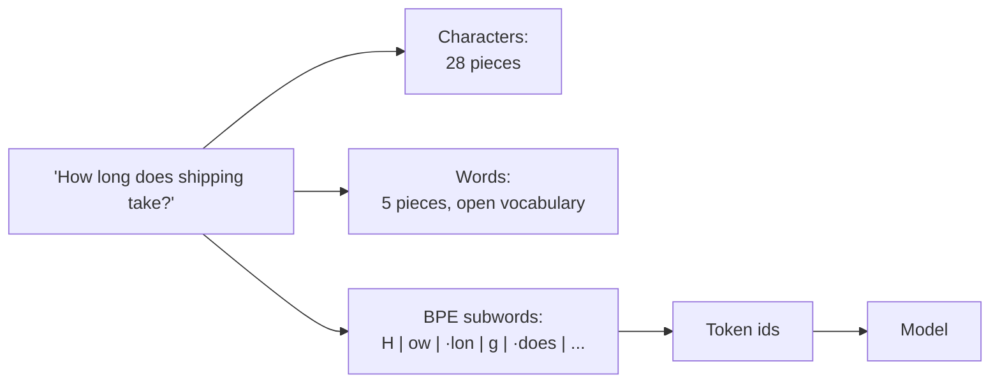
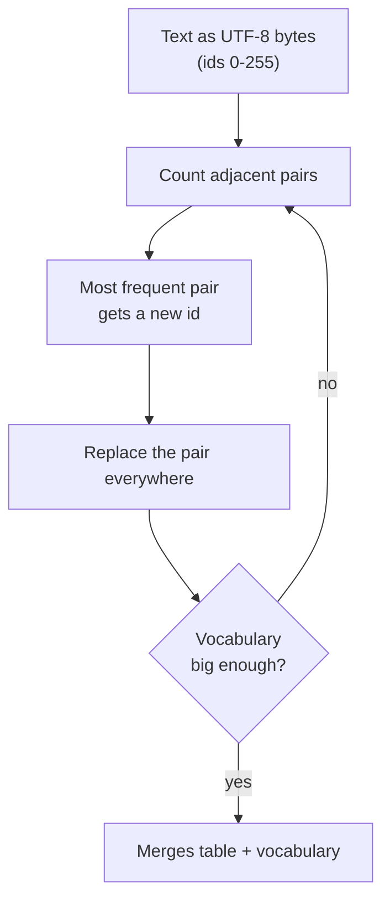
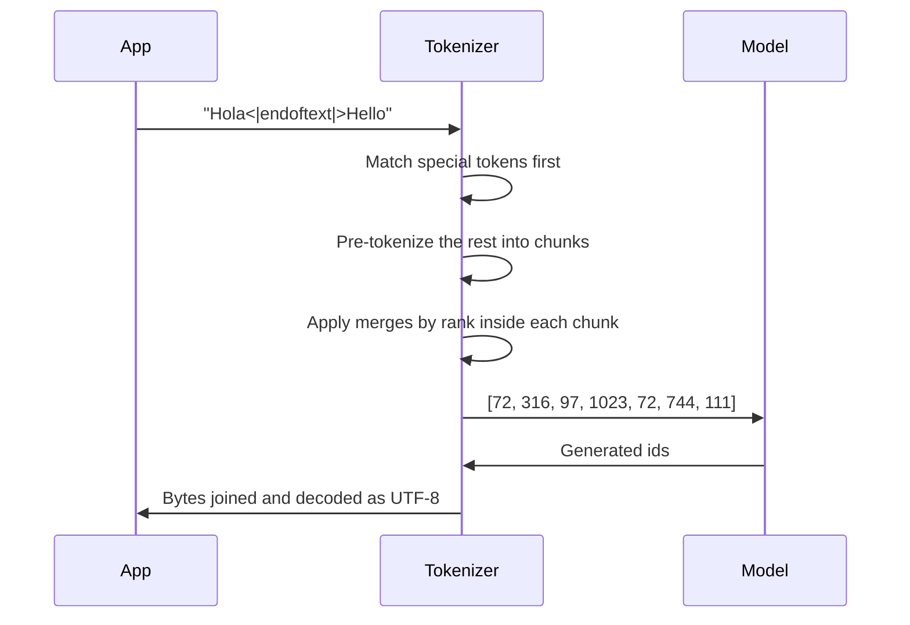
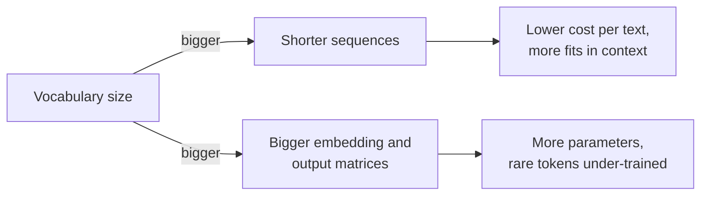

🌐 English · [Español](03-tokenization.es.md)

# Lesson 1.3 — Tokenization and byte-pair encoding

> **Module 01 · Lesson 3 of 5** · ⏱️ about 50 min · 🧪 Lab: [step 5](lab/README.md#step-5--train-a-bpe-tokenizer)

## 📨 Situation

> **From:** Rio Tanaka · Head of AI Engineering
> **Channel:** #ai-team
>
> Nice work on the cleaning pipeline. Next question, and it comes from Finance: every model vendor
> bills us per token, and about 30% of our support tickets are in Spanish. Someone in the budget
> meeting asked whether a Spanish conversation costs the same as an English one. I said "probably",
> which is not an answer. Train a tokenizer on the corpus you just cleaned, run it over our real
> tickets in both languages, and tell me the gap and where it comes from. Then tell me what you would
> change to close it. What would you measure, and on which text?

## 🎯 Objectives

By the end of this lesson you can:

- Explain why models work on tokens, and compare character, word and subword tokenization on the same sentence.
- Train a byte-pair encoding (BPE) tokenizer from scratch and trace its first merges by hand.
- Encode and decode text with learned merges, including special tokens, and verify the round trip.
- Measure tokens per word for English and Spanish, and explain how the training data mix creates the gap.
- Choose a vocabulary size by weighing sequence length against embedding size.

## 🤔 Predict first

Write your answers down before reading on. You will check them in the self-check.

1. "How long does shipping take?" and "¿Cuánto tarda el envío?" mean the same thing. Which one becomes more tokens with a tokenizer trained on our mostly English crawl?
2. A tokenizer trained only on English text receives Chinese characters. Does it crash, use an "unknown" token, or something else?
3. If you double the vocabulary size, do texts get roughly half as many tokens?

## 1. Why tokens, and three ways to cut text

A neural network computes with numbers, so text must become a sequence of integers before training or
inference. The **tokenizer** does that: it splits text into pieces from a fixed list called the
**vocabulary** and returns each piece's position (its id). The model has one learned vector per id;
it never sees letters.

There are three natural ways to cut text:

| Unit | "How long does shipping take?" | Vocabulary | Problem |
|---|---|---|---|
| Characters (UTF-8 bytes) | 28 tokens | 256 | Sequences are long; each step carries little meaning |
| Words | 5 tokens | Every word ever seen, plus an "unknown" token | Huge vocabulary; new words, typos and names become "unknown" |
| Subwords (our BPE) | 12 tokens | 1,024 in our lab | A compromise: frequent words stay whole, rare ones are split |

Sequence length matters because the model's cost grows with the number of tokens, and its context
window (the maximum number of tokens it can read at once) is counted in tokens. Vocabulary size
matters because every entry needs its own learned vector. Subword tokenization, introduced for
translation by Sennrich and colleagues to handle rare and unseen words
([BPE for NMT](https://arxiv.org/abs/1508.07909)), gets the benefits of both: common words cost one
token, and any new word can still be spelled from smaller pieces.

**Analogy:** subword tokens are like the keys on a stenographer's machine. Common words get a single
chord; unusual words are spelled out from syllables. Nothing is impossible to type, and frequent
things are fast.



> ⚠️ **Common mistake:** assuming one token equals one word. With our tokenizer the English tickets
> average 2.932 tokens per word, and the Spanish ones 3.345. Budgets, context limits and prices are
> all in tokens, so always measure on your own text instead of converting with a rule of thumb.

## 2. Training BPE: merge the most frequent pair, again and again

Byte-pair encoding starts with the smallest possible vocabulary, the 256 possible byte values, and
grows it one entry at a time:

1. Convert the training text to UTF-8 bytes. Each byte is a token id from 0 to 255.
2. Count every pair of adjacent ids.
3. Take the most frequent pair, give it a new id (256, then 257...), and replace every occurrence.
4. Repeat until the vocabulary has the size you asked for.

Before counting, the text is **pre-tokenized**: a regular expression splits it into word-like chunks,
keeping a leading space attached to the word (`" shipping"`). Merges never cross chunk boundaries, so
a token never contains the end of one word and the start of the next.

**Analogy:** BPE builds its vocabulary like a newsroom builds its shorthand: whichever pair of
letters reporters write together most often gets its own symbol first, then pairs of symbols, and so
on.

Try it by hand on a tiny corpus: `"low lower lowest"`, `"new newer newest"` and
`"the lowest price is the newest price"`, three copies each. The pair `w e` appears in *lower*,
*lowest* (twice), *newer* and *newest* (twice): 6 times per copy, 18 in total, more than any other
pair. So the first merge is `w` + `e` → `we`. The lab's tests check exactly this.

On the cleaned Hearthwise crawl (82 documents, 48,999 bytes), the first merges are:

| Rank | Merge | Result | Times seen |
|---|---|---|---|
| 0 | `·` + `t` | ` t` | 1003 |
| 1 | `h` + `e` | `he` | 955 |
| 2 | `·` + `a` | ` a` | 900 |
| 3 | `·` + `s` | ` s` | 797 |
| 4 | `i` + `n` | `in` | 672 |
| 5 | ` t` + `he` | ` the` | 657 |

The `·` is how the lab displays a space. By rank 5 BPE has rebuilt the most common English word,
" the", from its parts.

```python
def train_bpe(texts, vocab_size, special_tokens=(END_OF_TEXT,)):
    n_merges = vocab_size - 256 - len(special_tokens)
    chunk_freq = Counter(chunk for t in texts for chunk in pretokenize(t))
    chunks = Counter()
    for chunk, freq in chunk_freq.items():
        chunks[tuple(chunk.encode("utf-8"))] += freq
    tok, history = BPETokenizer(), []
    for rank in range(n_merges):
        counts = pair_counts(chunks)
        if not counts:
            break
        pair, count = min(counts.items(), key=lambda kv: (-kv[1], kv[0]))  # ties: smallest pair
        new_id = 256 + rank
        tok.merges[pair] = new_id
        tok.vocab[new_id] = tok.vocab[pair[0]] + tok.vocab[pair[1]]
        history.append(MergeStep(rank, pair, new_id, count, tok.vocab[new_id]))
        merged = Counter()
        for ids, freq in chunks.items():
            merged[merge_pair(ids, pair, new_id) if len(ids) > 1 else ids] += freq
        chunks = merged
    tok.special = {s: 256 + len(tok.merges) + k for k, s in enumerate(special_tokens)}
    return tok, history
```

Counting unique chunks with their frequencies, instead of scanning the raw text, is what makes this
fast: "the" appears hundreds of times but is processed once per merge.



> 💡 **Production tip:** the tokenizer is part of the model. A model's embeddings are indexed by its
> own token ids, so you can never swap tokenizers on a trained model. When you count tokens for
> budgeting, use the exact tokenizer of the model you call (for example
> [tiktoken](https://github.com/openai/tiktoken) for OpenAI models), not a generic one.

## 3. Encoding, decoding and special tokens

**Encoding** new text replays the learned merges in the order they were learned. For each chunk,
start from its bytes, find the adjacent pair with the lowest merge rank, merge it, and repeat until
no learned pair remains. Applying merges by rank, not by frequency in the new text, guarantees that
the same string always gets the same tokens.

```python
def _encode_chunk(self, chunk: str) -> tuple[int, ...]:
    ids = tuple(chunk.encode("utf-8"))
    while len(ids) >= 2:
        ranked = [(self.merges[p], p) for p in zip(ids, ids[1:]) if p in self.merges]
        if not ranked:
            break
        new_id, pair = min(ranked)  # the earliest-learned merge applies first
        ids = merge_pair(ids, pair, new_id)
    return ids
```

**Decoding** is simpler: look up each id's bytes, concatenate them and decode as UTF-8. Because every
id maps to exact bytes, `decode(encode(text)) == text` for any string. The lab tests this round trip
on English, Spanish, emoji and Chinese text. That also answers what happens to characters the
training data never contained: there is no "unknown" token, the text simply falls back to raw bytes.

**Special tokens** are reserved ids that never come from ordinary text. Our tokenizer has one,
`<|endoftext|>`, with id 1023; training data puts it between documents so the model learns where
one text ends. The encoder matches special tokens before anything else and never splits them:

```text
Special token: 'Hola<|endoftext|>Hello' -> [72, 316, 97, 1023, 72, 744, 111]
```

Chat models add more of them to mark roles and turns (system, user, assistant) and tool calls; you
will see chat templates in module 03.

**Analogy:** encoding is like applying a style guide's abbreviation list in a fixed order. Everyone
who applies the same list in the same order produces the same shorthand, and anyone can expand it
back.



> ⚠️ **Common mistake:** letting user input produce special tokens. If a customer types the literal
> text `<|endoftext|>` and your application encodes it with special tokens enabled, the model sees a
> real end-of-document marker. The lab's `encode(text, allow_special=False)` treats it as plain text.
> Encode untrusted input that way.

## 4. Byte-level BPE and the cost of Spanish

Working on bytes instead of characters guarantees full coverage, but characters outside ASCII take
more than one byte in UTF-8. "¿", "á" and "í" take two bytes each. If the training data rarely
contains them, no merge ever joins their two bytes, and each such character costs two tokens:

```text
'How long does shipping take?'
  12 tokens: H | ow | ·lon | g | ·does | ·sh | i | pping | ·t | a | ke | ?

'¿Cuánto tarda el envío?'
  19 tokens: <C2> | <BF> | C | u | <C3> | <A1> | nt | o | ·t | ar | d | a | ·el | ·en | v | <C3> | <AD> | o | ?
```

`<C3>` and `<A1>` are the two bytes of "á", shown in hexadecimal because neither is a character on
its own. The Spanish question has 4 words and 19 tokens; the English one has 5 words and 12 tokens.

One sentence is an anecdote. Here is the measurement Rio asked for: tokens per word on all 846 English
and 378 Spanish Hearthwise tickets, with our 1,024-entry tokenizer.

| Language | Tokens per word |
|---|---|
| English | 2.932 |
| Spanish | 3.345 |
| Ratio es/en | 1.141 |

A Spanish ticket costs about 14% more tokens per word. The cause is the data mix: only 5 of the 82
kept pages are Spanish, so almost all merges were learned from English. Repeat the Spanish pages
five times in the training data (`uv run lab bpe --es-weight 5`) and the gap shrinks:

| Training mix | English | Spanish | Ratio es/en |
|---|---|---|---|
| As cleaned | 2.932 | 3.345 | 1.141 |
| Spanish pages ×5 | 2.993 | 3.231 | 1.080 |

English got slightly worse, because the vocabulary has a fixed size and some entries now serve
Spanish. That is the trade-off every multilingual tokenizer makes.

**Analogy:** a tokenizer trained on English is a keyboard with shortcuts for English words only.
Spanish speakers can still type everything, letter by letter, but they press more keys.

> 💡 **Production tip:** measure tokens per word for every language you serve, on real traffic, for
> every model you consider. More tokens per word means higher cost, higher latency and less room in
> the context window for the same conversation. It is a fairness issue as well as a budget one.

## 5. Choosing a vocabulary size

Because BPE learns merges in order, a tokenizer with fewer merges is just a prefix of a bigger one.
The lab uses this to measure several vocabulary sizes from one training run:

| Vocabulary | English tokens/word | Spanish tokens/word | Ratio es/en |
|---|---|---|---|
| 257 (bytes + 1 special) | 5.566 | 5.726 | 1.029 |
| 384 | 3.864 | 4.193 | 1.085 |
| 512 | 3.519 | 3.907 | 1.110 |
| 768 | 3.139 | 3.565 | 1.136 |
| 1024 | 2.932 | 3.345 | 1.141 |

Doubling the vocabulary from 512 to 1,024 does not halve the token count: English goes from 3.519 to
2.932. Each new merge covers a rarer pattern than the one before, so returns diminish. The gap
between languages also widens as the vocabulary grows, because the extra entries go to the dominant
language.

**Analogy:** a vocabulary is like the speed-dial buttons on a phone. More buttons mean fewer key
presses per call, but a bigger keypad to build and buttons you almost never press.

A bigger vocabulary is not free:

| Bigger vocabulary gives | Bigger vocabulary costs |
|---|---|
| Shorter sequences, so faster and cheaper inference per text | A larger embedding matrix (vocabulary × model width) and output layer |
| More text fits in the context window | More rare tokens that appear too seldom in training to learn good vectors |
| Better coverage of many languages | A larger final softmax at every generation step |

Production models sit far above our toy size. The Qwen2.5 report, for example, describes a
byte-level BPE tokenizer with 151,643 regular tokens plus a set of control tokens
([Qwen2.5](https://arxiv.org/abs/2412.15115)). Lesson 1.5 computes how many parameters such an
embedding matrix needs.



## 🧪 Try it

1. Train the tokenizer and read the first merges
   ([lab step 5](lab/README.md#step-5--train-a-bpe-tokenizer)):

   ```bash
   uv run lab bpe
   ```

   Expected output (end):

   ```text
   Tokens per word on Hearthwise tickets (846 en / 378 es):
      vocab      en      es   es/en
        257   5.566   5.726   1.029
        384   3.864   4.193   1.085
        512   3.519   3.907   1.110
        768   3.139   3.565   1.136
       1024   2.932   3.345   1.141
   ```

2. Tokenize your own sentences: `uv run lab bpe --text "Quiero devolver mi Ember T3."`.
3. Rebalance the data with `uv run lab bpe --es-weight 5` and check that the last row's ratio drops
   to 1.080.

## 🏭 In the real world

- **You inherit the tokenizer.** Unless you pre-train, the tokenizer comes with the model. Compare
  candidate models by tokens per word on your own traffic in each language; it changes both cost and
  how much context a conversation can use.
- **Token counts drive billing and limits.** Rate limits, context windows and prices are all set in
  tokens. With our tokenizer, a Spanish conversation of the same length in words would be billed
  for about 14% more tokens than an English one.
- **Tokenization explains odd behaviour.** Models that struggle to count letters, reverse strings or
  handle long numbers often see those strings split into unintuitive pieces. Look at the tokens
  before blaming the model.
- **What to monitor:** tokens per request by language, truncation events (input cut at the context
  limit), and any text that encodes to special-token ids.

## ✅ Self-check

**1. Which is more tokens with our tokenizer: "How long does shipping take?" or "¿Cuánto tarda el envío?"? Why?**

<details><summary>Answer</summary>

The Spanish question: 19 tokens for 4 words, against 12 tokens for 5 words. The tokenizer was trained
on a crawl where only 5 of 82 pages are Spanish, so few Spanish merges were learned, and accented
characters such as "á" fall back to two separate byte tokens.

</details>

**2. What happens when the tokenizer meets characters it never saw in training, such as Chinese?**

<details><summary>Answer</summary>

It encodes them as raw UTF-8 bytes. A byte-level tokenizer has no "unknown" token: every possible
byte is in the base vocabulary, so any text can be encoded and decoded exactly, just with more
tokens. Word-level tokenizers, in contrast, would map such words to an "unknown" token and lose them.

</details>

**3. Doubling the vocabulary from 512 to 1,024 cut English tokens per word from 3.519 to 2.932. Why not by half?**

<details><summary>Answer</summary>

Merges are learned in order of frequency, so each new one covers a rarer pattern than the previous
ones. The first merges ("·t", "he", "·the") save many tokens; merge number 700 saves a few. Returns
diminish while the embedding matrix keeps growing linearly.

</details>

**4. Why must encoding apply merges in the order they were learned?**

<details><summary>Answer</summary>

So the same string always produces the same ids, exactly as during training. If you merged by
frequency in the new text, "the" might be built from different pieces in different documents and the
model would see token sequences it was never trained on.

</details>

**5. A customer pastes `<|endoftext|>` into the chat. What should the encoder do?**

<details><summary>Answer</summary>

Treat it as plain text (`allow_special=False`), producing ordinary byte and merge tokens. Only the
application itself should insert special tokens; otherwise users could fake document boundaries or
chat roles.

</details>

## 💬 Explain it in your own words

- Answer Finance's question for Rio in three sentences: does a Spanish conversation cost the same as
  an English one, by how much does it differ with our tokenizer, and why?
- Explain to Dani why the tokenizer must be trained on the cleaned corpus, not the raw crawl. Think
  about what boilerplate and duplicates would do to the merge counts.

## 🔑 Key ideas

- Models see token ids, never characters; the tokenizer is a fixed part of the model.
- BPE starts from 256 bytes and repeatedly merges the most frequent adjacent pair; encoding replays
  merges in learned order; decoding concatenates bytes.
- Byte-level BPE can encode any text, but rare scripts and accents cost more tokens.
- The training data mix shapes the vocabulary: our Spanish tickets cost 1.141 times more tokens per
  word, 1.080 after upweighting Spanish data.
- Vocabulary size trades shorter sequences against bigger embeddings, with diminishing returns.
- Encode untrusted input with special tokens disabled.

## 📚 Go deeper

- ⭐ [minbpe](https://github.com/karpathy/minbpe) — a minimal, well-commented byte-level BPE in
  Python; compare its `train` and `encode` with the lab's `bpe.py`.
- [Neural Machine Translation of Rare Words with Subword Units](https://arxiv.org/abs/1508.07909) —
  the paper that brought BPE to neural language processing.
- [tiktoken](https://github.com/openai/tiktoken) — a fast production BPE tokenizer; try counting
  tokens of your own text with it.
- [Qwen2.5 Technical Report](https://arxiv.org/abs/2412.15115) — the tokenizer section describes a
  production byte-level BPE vocabulary and its control tokens.

---

[← Previous: 1.2 Pre-training data](02-pretraining-data.md) · [🏠 Module 01](README.md) · [Next: 1.4 Neural networks and the Transformer →](04-neural-networks-and-transformers.md)
