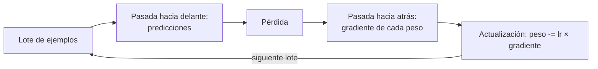
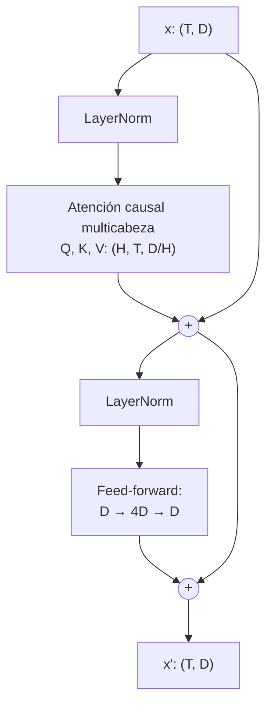
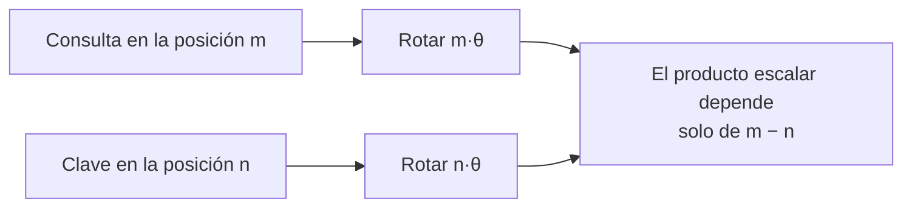
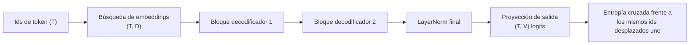

🌐 [English](04-neural-networks-and-transformers.md) · Español

# Lección 1.4 — Las redes neuronales y el Transformer

> **Módulo 01 · Lección 4 de 5** · ⏱️ unos 70 min · 🧪 Lab: [paso 6](lab/README.es.md#paso-6--ejecuta-la-autoatención-causal)

## 📨 Situación

> **De:** Dani Ruiz · Ciencia de datos
> **Canal:** #data
>
> Corpus limpio, hecho. Tokenizador, hecho. Ahora viene la parte que todo el mundo explica agitando las
> manos. En cada reunión con proveedores alguien dice "el modelo atiende al contexto" y yo asiento sin
> saber qué se multiplica por qué. No me fío de lo que no puedo imprimir. Construye la cosa en numpy:
> una cabeza de atención y después un bloque decodificador entero, imprimiendo cada forma. Demuéstrame
> que un *token* no puede ver el futuro. Y entrena algo pequeño con descenso de gradiente sin adornos,
> para que veamos bajar una pérdida y sepamos por qué se detiene donde se detiene. Enséñame la curva,
> no un diagrama de un blog.

## 🎯 Objetivos

Al terminar esta lección puedes:

- Explicar qué son las neuronas, las capas, la pérdida y el descenso de gradiente, y diagnosticar en una curva de pérdida una tasa de aprendizaje demasiado pequeña o demasiado grande.
- Calcular la entropía cruzada del siguiente *token* y explicar por qué un modelo sin entrenar puntúa aproximadamente ln(tamaño del vocabulario).
- Implementar la autoatención de producto escalar escalado con una máscara causal e indicar la forma de cada tensor.
- Montar un bloque decodificador a partir de atención multicabeza, una red *feed-forward*, conexiones residuales y normalización de capa.
- Explicar por qué la atención necesita información de posición y qué garantizan los *embeddings* de posición rotatorios (RoPE).

## 🤔 Predice primero

Apunta tus respuestas antes de seguir leyendo. Las comprobarás en la autoevaluación.

1. Un modelo con pesos aleatorios tiene que adivinar el siguiente *token* entre 1.024. ¿Qué pérdida (entropía cruzada, en *nats*) esperas antes del entrenamiento?
2. Si desordenas las palabras de una frase y se las das a la autoatención sin máscara causal y sin información de posición, ¿cómo cambian las salidas?
3. Multiplicar la tasa de aprendizaje por 10 suele acelerar el entrenamiento. ¿Qué pasa si la multiplicas por 100?

## 1. Neuronas, capas y descenso de gradiente

Una **neurona** (*neuron*) recibe números, multiplica cada uno por un **peso** (*weight*), los suma
junto con un **sesgo** (*bias*) y pasa el resultado por una función no lineal sencilla. Una **capa**
(*layer*) son muchas neuronas que leen la misma entrada, lo que no es más que una multiplicación de
matrices seguida de esa función. Apila capas y obtendrás una red capaz de representar funciones
complicadas, porque las no linealidades impiden que la pila se reduzca a una sola gran
multiplicación.

Los pesos empiezan siendo aleatorios. Para mejorarlos necesitas tres cosas:

1. Una **pérdida** (*loss*): un número que dice cuánto se equivoca el modelo en un lote de ejemplos.
2. El **gradiente** (*gradient*): para cada peso, cuánto cambiaría la pérdida si ese peso se moviera un
   poco. La retropropagación (*backpropagation*) los calcula todos a la vez con la regla de la cadena.
3. Una actualización: mover cada peso un pequeño paso en contra de su gradiente. El tamaño del paso es
   la **tasa de aprendizaje** (*learning rate*).

Repite lote tras lote y la pérdida baja. Ese bucle es el **descenso de gradiente** (*gradient
descent*), y todos los LLM, desde nuestro juguete hasta los más grandes, se entrenan con variantes de
él.

**Analogía:** estás en una ladera con niebla y quieres llegar al valle. No ves el valle, pero notas la
pendiente bajo los pies. Das un paso cuesta abajo, vuelves a tantear y repites. La tasa de aprendizaje
es la longitud de tu zancada: demasiado corta y no llegas nunca; demasiado larga y saltas por encima
del valle hasta la ladera de enfrente.



La red más pequeña del lab, `NeuralBigram` en `neural.py`, tiene el gradiente escrito a mano para que
puedas ver cada línea:

```python
def step(self, x, y, lr):
    """One gradient-descent step on a batch. Returns the batch loss before the update."""
    h = self.emb[x]  # (B, dim): look up the input tokens' vectors
    probs = softmax(h @ self.out + self.bias)  # (B, V)
    loss = float(-np.log(probs[np.arange(len(y)), y] + 1e-12).mean())
    grad_logits = probs
    grad_logits[np.arange(len(y)), y] -= 1.0  # d loss / d logits = softmax - one_hot
    grad_logits /= len(y)
    grad_out = h.T @ grad_logits
    grad_bias = grad_logits.sum(axis=0)
    grad_h = grad_logits @ self.out.T
    self.out -= lr * grad_out
    self.bias -= lr * grad_bias
    np.add.at(self.emb, x, -lr * grad_h)  # only the embeddings that were used get a gradient
    return loss
```

Un test, `test_gradient_matches_finite_differences`, mueve un peso una millonésima hacia arriba y hacia
abajo y comprueba que la pérdida cambia exactamente como predice este gradiente. Esa comprobación es
la forma de confiar en una pasada hacia atrás escrita a mano.

> ⚠️ **Error común:** tratar la tasa de aprendizaje como un detalle. Con el valor por defecto,
> `--lr 10`, la pérdida de validación baja de 6.932 a 2.985 en 1.000 pasos. Con `--lr 0.5` solo llega
> a 5.887. Con `--lr 100` los números se desbordan y la pérdida se vuelve `nan` en menos de 200 pasos.
> Mismo modelo, mismos datos: solo la tasa de aprendizaje decide entre aprender, avanzar a paso de
> tortuga o explotar.

## 2. Embeddings, logits y la pérdida de entropía cruzada

El bigrama neuronal predice el siguiente *token* solo a partir del *token* actual:

1. Busca el ***embedding*** del *token* actual, un vector aprendido de 32 números.
2. Lo multiplica por una matriz de salida para obtener una puntuación por cada entrada del
   vocabulario: los ***logits***, 1.024 en total.
3. Aplica ***softmax***, que eleva los *logits* a la exponencial y los divide entre su suma,
   convirtiéndolos en probabilidades que suman 1.

La señal de entrenamiento es la **entropía cruzada** (*cross-entropy*): menos el logaritmo natural de
la probabilidad que el modelo dio al *token* que vino de verdad después. Una predicción perfecta y
segura cuesta 0. Una suposición uniforme sobre 1.024 *tokens* da a cada *token* una probabilidad de
1/1.024 y cuesta ln(1024) = 6.931 *nats*. Por eso la curva de entrenamiento empieza en 6.932: unos
pesos aleatorios pequeños producen *logits* casi iguales, lo que es casi una suposición uniforme.

`uv run lab train` imprime la curva (1.000 pasos, 512 *tokens* por lote):

| Paso | Pérdida del lote de entrenamiento | Pérdida de validación |
|---|---|---|
| 0 | 6.932 | 6.932 |
| 200 | 4.237 | 4.600 |
| 400 | 2.832 | 3.376 |
| 600 | 2.297 | 3.036 |
| 800 | 2.042 | 2.986 |
| 1000 | 1.914 | 2.985 |

Hay tres cosas que leer en esta tabla. La pérdida baja deprisa y después se aplana: el modelo ha
aprendido lo que puede decirle un solo *token* de contexto. La pérdida de validación deja de mejorar
mientras la de entrenamiento sigue bajando: la diferencia (1.914 frente a 2.985) es
**sobreajuste** (*overfitting*), el modelo memorizando pares de los 11.204 *tokens* de entrenamiento.
Y un bigrama de conteo suavizado puntúa 3.065 sobre el mismo texto de validación. La red se queda cerca
del conteo porque ve exactamente la misma información, un *token* anterior. Para hacerlo mejor, el
modelo tiene que leer más contexto. Ese es el trabajo de la atención.

**Analogía:** un *embedding* es una coordenada en un mapa de significados. Los *tokens* que se usan de
forma parecida acaban cerca unos de otros, así que lo que el modelo aprende sobre un barrio se
transfiere a sus vecinos.

> 💡 **Consejo de producción:** guarda siempre un conjunto de validación con el que el modelo no
> entrene nunca, y vigila las dos curvas. Los equipos detienen el entrenamiento, o cambian los datos y
> la regularización, cuando la pérdida de validación se aplana mientras la de entrenamiento sigue
> bajando. Un único número de "la pérdida bajó" esconde el sobreajuste.

## 3. Autoatención: consultas, claves y valores

La **autoatención** (*self-attention*) permite que cada *token* construya su nueva representación a
partir de los *tokens* anteriores. Para cada *token*, la capa calcula tres vectores multiplicando el
vector del *token* por tres matrices aprendidas:

| Vector | Pregunta que responde |
|---|---|
| **Consulta** (*query*, Q) | ¿Qué estoy buscando? |
| **Clave** (*key*, K) | ¿Qué contengo, visto desde los demás? |
| **Valor** (*value*, V) | ¿Qué entrego si alguien me atiende? |

La puntuación entre el *token* *i* y el *token* *j* es el producto escalar de la consulta de *i* con la
clave de *j*, dividido entre la raíz cuadrada del tamaño del vector para que las puntuaciones no
crezcan con la dimensión. Un *softmax* sobre cada fila convierte las puntuaciones en **pesos de
atención** (*attention weights*) que suman 1, y la salida del *token* *i* es la media ponderada de
todos los valores. Escrito de forma compacta: softmax(QKᵀ / √d) V, la fórmula del artículo del
Transformer ([Attention Is All You Need](https://arxiv.org/abs/1706.03762)).

Un modelo de lenguaje no debe espiar el *token* que intenta predecir. La **máscara causal** (*causal
mask*) pone a menos infinito cada puntuación en la que *j* va después de *i*, antes del *softmax*, así
que esos pesos se quedan exactamente en 0.

```python
def causal_mask(t: int) -> Array:
    """Boolean (T, T) matrix: True where position i may look at position j (j <= i)."""
    return np.tril(np.ones((t, t), dtype=bool))


def scaled_dot_product_attention(q, k, v, mask=None):
    """softmax(Q K^T / sqrt(d)) V. Returns (output, attention weights)."""
    d = q.shape[-1]
    scores = q @ np.swapaxes(k, -1, -2) / math.sqrt(d)  # (..., T, T)
    if mask is not None:
        scores = np.where(mask, scores, -np.inf)
    weights = softmax(scores, axis=-1)
    return weights @ v, weights
```

`uv run lab attention` lo ejecuta sobre "Lower the setpoint by one degree", tokenizado por tu
tokenizador BPE en 7 *tokens*, con pesos aleatorios:

```text
Layer 0, head 0 attention weights (row = query token, column = key token):
                L   ower   ·the ·setpo    ·by   ·one ·degre
L            1.00   0.00   0.00   0.00   0.00   0.00   0.00
ower         0.50   0.50   0.00   0.00   0.00   0.00   0.00
·the         0.34   0.34   0.33   0.00   0.00   0.00   0.00
·setpoint    0.24   0.25   0.26   0.25   0.00   0.00   0.00
·by          0.20   0.20   0.20   0.20   0.20   0.00   0.00
·one         0.16   0.16   0.17   0.17   0.17   0.17   0.00
·degree      0.14   0.14   0.14   0.14   0.15   0.15   0.14
```

Todo lo que está por encima de la diagonal es 0: ningún *token* ve el futuro. Cada fila es casi
uniforme porque los pesos aleatorios son pequeños, así que todas las puntuaciones están cerca de 0. El
entrenamiento es lo que vuelve nítidas estas filas, de modo que, por ejemplo, "degree" aprenda a mirar
hacia atrás, a "setpoint".

**Analogía:** una biblioteca. Tu consulta es la pregunta que tienes en mente, la clave de cada libro es
la etiqueta de su lomo y el valor es lo que hay dentro. Lees cada libro en proporción a lo bien que su
etiqueta encaja con tu pregunta, y solo puedes usar los libros que ya estaban en la estantería cuando
llegaste.

> ⚠️ **Error común:** aplicar la máscara después del *softmax*, poniendo pesos a cero. Los pesos que
> quedan en cada fila ya no suman 1 y, durante el entrenamiento, el *softmax* ya ha mezclado las
> puntuaciones del futuro. Enmascara las puntuaciones con menos infinito *antes* del *softmax*, como
> hace el código.

## 4. Atención multicabeza y el bloque decodificador

Un solo patrón de atención por capa es limitante: un *token* puede necesitar mirar a la vez al sujeto
de la frase y a la palabra anterior. La **atención multicabeza** (*multi-head attention*) divide la
anchura del modelo en varias cabezas. Nuestro modelo diminuto tiene anchura 32 y 4 cabezas, así que
cada cabeza trabaja con vectores de tamaño 8 y calcula su propia atención; después, las 4 salidas se
concatenan de nuevo hasta la anchura 32 y una matriz de salida las mezcla.

La atención mezcla información *entre* posiciones. Después, una **red *feed-forward*** (*feed-forward
network*) procesa cada posición por separado: la expande a 128 números, aplica una no linealidad (aquí
GELU) y la proyecta de vuelta a 32. En la configuración clásica que contarás en la lección 1.5, estas
capas tienen aproximadamente el doble de parámetros que la atención.

Dos piezas más hacen que las pilas profundas se puedan entrenar:

- Las **conexiones residuales** (*residual connections*) suman la salida de cada subcapa a su entrada
  (`x = x + attention(...)`), de modo que la información y los gradientes pueden atravesar
  directamente muchas capas.
- La **normalización de capa** (*layer normalisation*) reescala el vector de cada posición a media 0 y
  varianza 1 antes de cada subcapa, y mantiene los números en un rango en el que el entrenamiento es
  estable. Ponerla antes de la subcapa (*pre-norm*) es la elección habitual en los modelos modernos
  de solo decodificador.

**Analogía:** un bloque decodificador es una reunión seguida de trabajo individual. En el paso de
atención, cada *token* escucha a los anteriores; en el paso *feed-forward*, cada *token* vuelve a su
mesa y piensa por su cuenta. La conexión residual es el cuaderno de cada asistente a la reunión: cada
paso añade notas en lugar de empezar una página en blanco.



```python
def decoder_block(x, p, layer, cfg):
    """Pre-norm block: x + Attention(LN(x)), then x + FFN(LN(x)). The '+' are residual connections."""
    attn_out, weights = multi_head_attention(layer_norm(x, p[f"l{layer}.ln1.g"], p[f"l{layer}.ln1.b"]),
                                             p, layer, cfg)
    x = x + attn_out
    x = x + feed_forward(layer_norm(x, p[f"l{layer}.ln2.g"], p[f"l{layer}.ln2.b"]), p, layer)
    return x, weights
```

El lab imprime las formas para nuestra frase de 7 *tokens* (T = 7, D = 32, H = 4):

```text
  token ids          (7,)
  embeddings x       (7, 32)
  queries per head   (4, 7, 8)   (heads, tokens, d_head)
  scores Q.K^T       (4, 7, 7)
  attention weights  (4, 7, 7)
  logits             (7, 1024)   (one score per vocabulary entry, per position)
```

La salida del bloque tiene la misma forma que su entrada, (7, 32). Eso es lo que permite apilar
bloques.

> 💡 **Consejo de producción:** la matriz de puntuaciones (T, T) de cada cabeza es la razón por la que
> el coste de la atención crece con el cuadrado de la longitud del contexto. Duplicar el contexto
> cuadruplica ese trabajo. Cuando un equipo proponga "usar sin más un contexto más largo", pide
> mediciones de latencia y memoria con la longitud objetivo; el módulo 10 trata la parte del servicio.

## 5. Información de posición y RoPE

Vuelve a mirar la fórmula de la atención: nada en ella sabe dónde está un *token*. Desordena los
*tokens* de entrada y, sin máscara, cada salida simplemente se desordena de la misma manera. El test
del lab `test_attention_without_positions_ignores_order` comprueba exactamente esto. "Dog bites man" y
"man bites dog" se verían iguales.

Hay que inyectar la posición. El Transformer original sumaba vectores sinusoidales fijos a los
*embeddings*; otros modelos aprenden en su lugar un vector por posición. Muchos modelos recientes usan
***embeddings* de posición rotatorios** (RoPE, *rotary position embeddings*)
([RoFormer](https://arxiv.org/abs/2104.09864)): en lugar de sumar nada, rotan cada par de dimensiones
de los vectores de consulta y de clave un ángulo proporcional a la posición del *token*.

```python
def rope(x, positions, base=10000.0):
    """Rotate each pair of dimensions by an angle proportional to position."""
    d = x.shape[-1]
    freqs = base ** (-np.arange(0, d, 2) / d)  # (d/2,) one speed per pair
    angles = positions[:, None] * freqs[None, :]  # (T, d/2)
    cos, sin = np.cos(angles), np.sin(angles)
    x1, x2 = x[..., 0::2], x[..., 1::2]
    out = np.empty_like(x)
    out[..., 0::2] = x1 * cos - x2 * sin
    out[..., 1::2] = x1 * sin + x2 * cos
    return out
```

La propiedad que hace útil a RoPE: tras la rotación, el producto escalar entre una consulta en la
posición *m* y una clave en la posición *n* solo depende de la distancia *m − n*. El test del lab
comprueba que la puntuación para las posiciones (5, 2) es igual a la de (13, 10). Por tanto, la
atención ve directamente la distancia relativa, y las rotaciones no añaden parámetros.

**Analogía:** dos personas en un tiovivo. Esté donde esté la atracción en su vuelta, el ángulo entre
sus dos caballitos sigue siendo el mismo. RoPE sube cada *token* a un tiovivo girado según su
posición, así que la atención solo nota el ángulo entre dos *tokens*, no dónde empezó la vuelta.



## 6. La pila de solo decodificador y su objetivo de entrenamiento

Un modelo de estilo GPT es un Transformer de **solo decodificador** (*decoder-only*): *embeddings* de
*token*, una pila de bloques decodificadores idénticos, una normalización de capa final y una
proyección de salida de vuelta al vocabulario. El modelo de nuestro lab reutiliza la matriz de
*embeddings* como proyección de salida (*embeddings* atados, *tied embeddings*), una forma habitual de
ahorrar parámetros.

**Analogía:** una cadena de montaje con puestos idénticos. Cada puesto pule la misma pieza, el vector
del *token*, y solo el último la convierte en una predicción.



El entrenamiento usa la misma pérdida que el bigrama neuronal, aplicada en todas las posiciones a la
vez: los *logits* de la posición *t* se puntúan frente al *token* de la posición *t + 1*. Una secuencia
de T *tokens* da T − 1 ejemplos de entrenamiento en una sola pasada hacia delante, y la máscara causal
es lo que los mantiene honestos. Con pesos aleatorios, nuestro modelo de 2 capas puntúa 6.905 en la
frase de ejemplo, junto al 6.931 uniforme, como debería haber dicho tu predicción.

El modelo entero tiene 57.984 parámetros; la lección 1.5 los cuenta por componente y escala la misma
aritmética hasta miles de millones.

> ⚠️ **Error común:** olvidar desplazar los objetivos. Si los *logits* de la posición *t* se puntúan
> frente al propio *token* *t*, el modelo aprende a copiar su entrada, la pérdida baja casi a cero y el
> modelo no sirve para generar. En el lab: `cross_entropy(logits[:-1], ids[1:])`.

## 🧪 Pruébalo

1. Imprime cada forma y la matriz de atención causal
   ([paso 6 del lab](lab/README.es.md#paso-6--ejecuta-la-autoatención-causal)):

   ```bash
   uv run lab attention
   ```

   Salida esperada (últimas líneas):

   ```text
   Every row sums to 1: True; weights above the diagonal: 0.0
   Next-token loss with random weights: 6.905 (uniform guess: ln 1024 = 6.931)
   ```

2. Observa el descenso de gradiente ([paso 7 del lab](lab/README.es.md#paso-7--entrena-con-descenso-de-gradiente)):

   ```bash
   uv run lab train
   ```

   Salida esperada (final):

   ```text
     1000    1.914    2.985

   Uniform guess:            6.931
   Counting bigram (smoothed): 3.065
   ```

3. Rómpelo: ejecuta `uv run lab train --lr 100` y encuentra el paso en el que la pérdida se vuelve
   `nan`; después, `uv run lab train --lr 0.5` y compara la última pérdida de validación con 2.985.

## 🏭 En el mundo real

- **La arquitectura está casi asentada; los detalles, no.** Los modelos en producción siguen apilando
  bloques decodificadores de atención y capas *feed-forward*. Se diferencian en la normalización, las
  funciones de activación, los esquemas de posición, cómo se comparten las claves y los valores entre
  cabezas y si la capa *feed-forward* es una mezcla de expertos. La lección 1.5 compara familias reales
  justo en estos puntos.
- **El entrenamiento es el mismo bucle a una escala enorme.** Las ejecuciones reales usan optimizadores
  adaptativos, calentamiento y decaimiento de la tasa de aprendizaje, precisión mixta y miles de
  aceleradores, pero cada paso sigue siendo pasada hacia delante, entropía cruzada, pasada hacia atrás
  y actualización.
- **La inferencia reutiliza claves y valores.** Al generar, un modelo guarda en caché las claves y los
  valores de los *tokens* pasados (la caché KV) en lugar de recalcularlos. Su tamaño limita a cuántas
  personas y cuánto contexto puede atender un servidor.
- **Qué vigilar durante el entrenamiento:** la pérdida de entrenamiento y la de validación, las normas
  de los gradientes (los picos preceden a la divergencia) y cualquier `nan`.

## ✅ Autoevaluación

**1. ¿Qué pérdida obtiene un modelo inicializado al azar con un vocabulario de 1.024 *tokens*, y por qué?**

<details><summary>Respuesta</summary>

Alrededor de ln(1024) = 6.931 *nats*. Unos pesos aleatorios pequeños dan *logits* casi iguales, así que
el *softmax* es casi uniforme y cada *token* recibe una probabilidad cercana a 1/1.024. El lab mide
6.932 para el bigrama neuronal y 6.905 para el Transformer de 2 capas. Una pérdida inicial muy lejos de
ln(V) suele indicar un error.

</details>

**2. Desordenas una frase y se la das a la autoatención sin máscara ni información de posición. ¿Qué pasa con las salidas?**

<details><summary>Respuesta</summary>

Son los mismos vectores, desordenados de la misma manera. La atención es equivariante a las
permutaciones: no tiene noción de orden. Por eso los modelos añaden información de posición, por
ejemplo con RoPE, que hace que las puntuaciones consulta-clave dependan de la distancia relativa.

</details>

**3. Una tasa de aprendizaje de 10 entrena bien. ¿Qué hacen las tasas de 0.5 y 100, y por qué?**

<details><summary>Respuesta</summary>

Con 0.5 los pasos son demasiado pequeños: tras 1.000 pasos, la pérdida de validación sigue en 5.887.
Con 100 los pasos se pasan de largo, los *logits* se disparan y la pérdida se vuelve `nan` en menos de
200 pasos. Más grande es más rápido solo hasta el punto en que las actualizaciones saltan por encima
del valle.

</details>

**4. La pérdida de validación del bigrama neuronal se estanca en 2.985 mientras la de entrenamiento sigue bajando. ¿Qué dos cosas te está diciendo?**

<details><summary>Respuesta</summary>

Primero, sobreajuste: el modelo memoriza pares de entrenamiento que no generalizan (1.914 en
entrenamiento frente a 2.985 en validación). Segundo, un techo: con un solo *token* de contexto no
puede hacerlo mucho mejor que un bigrama de conteo suavizado (3.065). Más contexto, gracias a la
atención, es lo que baja el techo.

</details>

**5. ¿Por qué la máscara causal se aplica a las puntuaciones antes del *softmax*, con menos infinito?**

<details><summary>Respuesta</summary>

Porque exp(−∞) = 0, así que las posiciones futuras reciben un peso exactamente nulo y cada fila sigue
sumando 1. Poner pesos a cero después del *softmax* dejaría filas que no suman 1, y el *softmax* ya
habría usado las puntuaciones del futuro para normalizar.

</details>

## 💬 Explícalo con tus palabras

- Dani dijo "No me fío de lo que no puedo imprimir". Recorre con Dani las formas desde los *ids* de
  *token* (7,) hasta los *logits* (7, 1024), nombrando la operación de cada paso.
- Explícale a Rio, sin ecuaciones, por qué un modelo que solo ve un *token* anterior no puede mejorar
  mucho respecto al conteo, y qué cambia la atención.

## 🔑 Ideas clave

- El descenso de gradiente repite: pasada hacia delante, pérdida, gradientes y un paso pequeño en
  contra del gradiente; la tasa de aprendizaje decide entre aprender, avanzar a paso de tortuga y
  divergir.
- La entropía cruzada es menos la log-probabilidad del siguiente *token* correcto; un modelo sin
  entrenar puntúa aproximadamente ln(tamaño del vocabulario).
- La autoatención calcula softmax(QKᵀ/√d)V; la máscara causal impide que los *tokens* vean el futuro.
- Un bloque decodificador es atención multicabeza *pre-norm* más una red *feed-forward*, cada una
  envuelta en una conexión residual; los bloques conservan la forma (T, D), así que se pueden apilar.
- La atención no ve el orden; RoPE rota las consultas y las claves para que las puntuaciones dependan
  de la posición relativa.
- Un LLM de solo decodificador son *embeddings*, N bloques, una normalización final y una proyección de
  salida, entrenados para predecir cada siguiente *token*.

## 📚 Profundiza

- ⭐ [The Illustrated Transformer](https://jalammar.github.io/illustrated-transformer/) — el recorrido
  visual más claro por la atención, las cabezas y la estructura del bloque.
- [Attention Is All You Need](https://arxiv.org/abs/1706.03762) — el artículo original del
  Transformer; la sección 3 es la arquitectura que acabas de construir.
- [RoFormer: Enhanced Transformer with Rotary Position Embedding](https://arxiv.org/abs/2104.09864) —
  de donde salen RoPE y su propiedad de posición relativa.
- [nanoGPT](https://github.com/karpathy/nanoGPT) — la misma arquitectura en PyTorch, con
  entrenamiento, en unos pocos cientos de líneas.

---

[← Anterior: 1.3 Tokenización](03-tokenization.es.md) · [🏠 Módulo 01](README.es.md) · [Siguiente: 1.5 Familias de modelos →](05-model-families.es.md)
