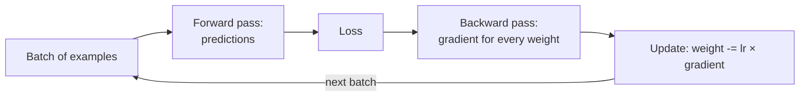
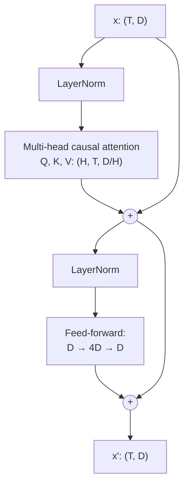
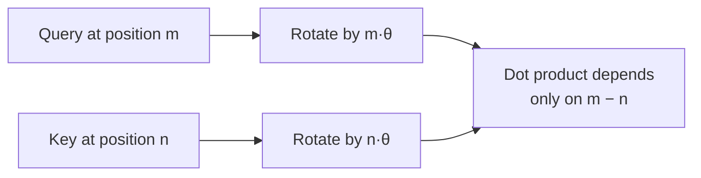
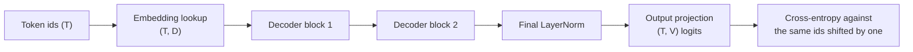

🌐 English · [Español](04-neural-networks-and-transformers.es.md)

# Lesson 1.4 — Neural networks and the Transformer

> **Module 01 · Lesson 4 of 5** · ⏱️ about 70 min · 🧪 Lab: [step 6](lab/README.md#step-6--run-causal-self-attention)

## 📨 Situation

> **From:** Dani Ruiz · Data Scientist
> **Channel:** #data
>
> Clean corpus, check. Tokenizer, check. Now the part everyone hand-waves. In every vendor meeting
> someone says "the model attends to the context" and I nod without knowing what is multiplied by
> what. I don't trust what I can't print. Build the thing in numpy: one attention head, then a whole
> decoder block, with every shape printed. Prove to me that a token cannot see the future. And train
> something small with plain gradient descent so we can both watch a loss go down and know why it
> stops where it stops. Show me the curve, not a diagram from a blog.

## 🎯 Objectives

By the end of this lesson you can:

- Explain neurons, layers, loss and gradient descent, and diagnose a learning rate that is too small or too large from a loss curve.
- Compute next-token cross-entropy and explain why an untrained model scores about ln(vocabulary size).
- Implement scaled dot-product self-attention with a causal mask, and state the shape of every tensor.
- Assemble a decoder block from multi-head attention, a feed-forward network, residual connections and layer normalisation.
- Explain why attention needs positional information and what rotary position embeddings (RoPE) guarantee.

## 🤔 Predict first

Write your answers down before reading on. You will check them in the self-check.

1. A model with random weights must guess the next token out of 1,024. What loss (cross-entropy, in nats) do you expect before training?
2. If you shuffle the words of a sentence and feed them to self-attention with no causal mask and no positional information, how do the outputs change?
3. Multiplying the learning rate by 10 usually makes training faster. What happens if you multiply it by 100?

## 1. Neurons, layers and gradient descent

A **neuron** takes numbers in, multiplies each by a **weight**, adds them up with a **bias**, and
passes the result through a simple non-linear function. A **layer** is many neurons reading the same
input, which is just a matrix multiplication followed by that function. Stack layers and you get a
network that can represent complicated functions, because the non-linearities stop the stack from
collapsing into one big multiplication.

The weights start random. To improve them you need three things:

1. A **loss**: one number that says how wrong the model is on a batch of examples.
2. The **gradient**: for every weight, how much the loss would change if that weight moved a little.
   Backpropagation computes all of them at once with the chain rule.
3. An update: move every weight a small step against its gradient. The step size is the **learning
   rate**.

Repeat on batch after batch and the loss goes down. That loop is **gradient descent**, and every LLM,
from our toy to the largest ones, is trained with variants of it.

**Analogy:** you stand on a foggy hillside and want to reach the valley. You cannot see the valley,
but you can feel the slope under your feet. Take a step downhill, feel again, repeat. The learning
rate is your stride: too short and you never arrive, too long and you leap over the valley onto the
opposite slope.



The lab's smallest network, `NeuralBigram` in `neural.py`, has the gradient written out by hand so
you can see every line:

```python
def step(self, x, y, lr):
    """One gradient-descent step on a batch. Returns the batch loss before the update."""
    h = self.emb[x]  # (B, dim): look up the input tokens' vectors
    probs = softmax(h @ self.out + self.bias)  # (B, V)
    loss = float(-np.log(probs[np.arange(len(y)), y] + 1e-12).mean())
    grad_logits = probs
    grad_logits[np.arange(len(y)), y] -= 1.0  # d loss / d logits = softmax - one_hot
    grad_logits /= len(y)
    grad_out = h.T @ grad_logits
    grad_bias = grad_logits.sum(axis=0)
    grad_h = grad_logits @ self.out.T
    self.out -= lr * grad_out
    self.bias -= lr * grad_bias
    np.add.at(self.emb, x, -lr * grad_h)  # only the embeddings that were used get a gradient
    return loss
```

A test, `test_gradient_matches_finite_differences`, nudges one weight up and down by a millionth and
checks that the loss changes exactly as this gradient predicts. That check is how you trust a
hand-written backward pass.

> ⚠️ **Common mistake:** treating the learning rate as a detail. With the default `--lr 10`, the
> validation loss falls from 6.932 to 2.985 in 1,000 steps. With `--lr 0.5` it only reaches 5.887.
> With `--lr 100` the numbers overflow and the loss becomes `nan` within 200 steps. Same model, same
> data: the learning rate alone decides between learning, crawling and exploding.

## 2. Embeddings, logits and the cross-entropy loss

The neural bigram predicts the next token from the current token alone:

1. Look up the current token's **embedding**, a learned vector of 32 numbers.
2. Multiply it by an output matrix to get one score per vocabulary entry: the **logits**, 1,024 of
   them.
3. Apply **softmax**, which exponentiates the logits and divides by their sum, turning them into
   probabilities that add up to 1.

The training signal is **cross-entropy**: minus the natural logarithm of the probability the model
gave to the token that really came next. A perfect, confident prediction costs 0. A uniform guess
over 1,024 tokens gives every token probability 1/1,024 and costs ln(1024) = 6.931 nats. That is why
the training curve starts at 6.932: random small weights produce almost equal logits, which is almost
a uniform guess.

`uv run lab train` prints the curve (1,000 steps, 512 tokens per batch):

| Step | Train batch loss | Validation loss |
|---|---|---|
| 0 | 6.932 | 6.932 |
| 200 | 4.237 | 4.600 |
| 400 | 2.832 | 3.376 |
| 600 | 2.297 | 3.036 |
| 800 | 2.042 | 2.986 |
| 1000 | 1.914 | 2.985 |

Three things to read in this table. The loss falls fast, then flattens: the model has learned what
one token of context can tell it. The validation loss stops improving while the training loss keeps
falling: the gap (1.914 against 2.985) is **overfitting**, the model memorising pairs from 11,204
training tokens. And a smoothed counting bigram scores 3.065 on the same validation text. The network
lands close to counting because it sees exactly the same information, one previous token. To do
better, the model must read more context. That is the job of attention.

**Analogy:** an embedding is a coordinate on a map of meanings. Tokens used in similar ways end up
near each other, so whatever the model learns about one neighbourhood transfers to its neighbours.

> 💡 **Production tip:** always keep a validation set the model never trains on, and watch both
> curves. Teams stop training, or change data and regularisation, when validation loss flattens while
> training loss keeps falling. A single "loss went down" number hides overfitting.

## 3. Self-attention: queries, keys and values

Self-attention lets each token build its new representation from the tokens before it. For every
token, the layer computes three vectors by multiplying the token's vector by three learned matrices:

| Vector | Question it answers |
|---|---|
| **Query** (Q) | What am I looking for? |
| **Key** (K) | What do I contain, as seen by others? |
| **Value** (V) | What do I hand over if someone attends to me? |

The score between token *i* and token *j* is the dot product of *i*'s query with *j*'s key, divided
by the square root of the vector size so the scores do not grow with dimension. A softmax over each
row turns scores into **attention weights** that sum to 1, and the output for token *i* is the
weighted average of all values. Written compactly: softmax(QKᵀ / √d) V, the formula from the
Transformer paper ([Attention Is All You Need](https://arxiv.org/abs/1706.03762)).

A language model must not peek at the token it is trying to predict. The **causal mask** sets every
score where *j* is after *i* to minus infinity before the softmax, so those weights become exactly 0.

```python
def causal_mask(t: int) -> Array:
    """Boolean (T, T) matrix: True where position i may look at position j (j <= i)."""
    return np.tril(np.ones((t, t), dtype=bool))


def scaled_dot_product_attention(q, k, v, mask=None):
    """softmax(Q K^T / sqrt(d)) V. Returns (output, attention weights)."""
    d = q.shape[-1]
    scores = q @ np.swapaxes(k, -1, -2) / math.sqrt(d)  # (..., T, T)
    if mask is not None:
        scores = np.where(mask, scores, -np.inf)
    weights = softmax(scores, axis=-1)
    return weights @ v, weights
```

`uv run lab attention` runs this on "Lower the setpoint by one degree", tokenized by your BPE
tokenizer into 7 tokens, with random weights:

```text
Layer 0, head 0 attention weights (row = query token, column = key token):
                L   ower   ·the ·setpo    ·by   ·one ·degre
L            1.00   0.00   0.00   0.00   0.00   0.00   0.00
ower         0.50   0.50   0.00   0.00   0.00   0.00   0.00
·the         0.34   0.34   0.33   0.00   0.00   0.00   0.00
·setpoint    0.24   0.25   0.26   0.25   0.00   0.00   0.00
·by          0.20   0.20   0.20   0.20   0.20   0.00   0.00
·one         0.16   0.16   0.17   0.17   0.17   0.17   0.00
·degree      0.14   0.14   0.14   0.14   0.15   0.15   0.14
```

Everything above the diagonal is 0: no token sees the future. Each row is close to uniform because
the random weights are small, so all scores are close to 0. Training is what makes these rows sharp,
so that, for example, "degree" learns to look back at "setpoint".

**Analogy:** a library. Your query is the question on your mind, every book's key is the label on its
spine, and the value is what is inside. You read every book in proportion to how well its label
matches your question, and you may only use books that were already on the shelf when you arrived.

> ⚠️ **Common mistake:** applying the mask after the softmax, by zeroing weights. The remaining
> weights in each row then no longer sum to 1, and during training the softmax has already mixed in
> the future scores. Mask the scores with minus infinity *before* the softmax, as the code does.

## 4. Multi-head attention and the decoder block

One attention pattern per layer is limiting: a token may need to look back at the subject of the
sentence and at the previous word at the same time. **Multi-head attention** splits the model width
into several heads. Our tiny model has width 32 and 4 heads, so each head works with vectors of size
8, computes its own attention, and the 4 outputs are concatenated back to width 32 and mixed by an
output matrix.

Attention mixes information *between* positions. A **feed-forward network** then processes each
position on its own: expand to 128 numbers, apply a non-linearity (GELU here), project back to 32.
In the classic configuration you will count in lesson 1.5, these layers hold about twice as many
parameters as attention.

Two more pieces make deep stacks trainable:

- **Residual connections** add each sub-layer's output to its input (`x = x + attention(...)`), so
  information and gradients can flow straight through many layers.
- **Layer normalisation** rescales each position's vector to mean 0 and variance 1 before each
  sub-layer, keeping the numbers in a range where training is stable. Putting it before the sub-layer
  ("pre-norm") is the common choice in modern decoder-only models.

**Analogy:** a decoder block is a meeting followed by desk work. In the attention step every token
listens to the ones before it; in the feed-forward step each token goes back to its desk and thinks
alone. The residual connection is each attendee's notebook: every step adds notes instead of starting
a fresh page.



```python
def decoder_block(x, p, layer, cfg):
    """Pre-norm block: x + Attention(LN(x)), then x + FFN(LN(x)). The '+' are residual connections."""
    attn_out, weights = multi_head_attention(layer_norm(x, p[f"l{layer}.ln1.g"], p[f"l{layer}.ln1.b"]),
                                             p, layer, cfg)
    x = x + attn_out
    x = x + feed_forward(layer_norm(x, p[f"l{layer}.ln2.g"], p[f"l{layer}.ln2.b"]), p, layer)
    return x, weights
```

The lab prints the shapes for our 7-token sentence (T = 7, D = 32, H = 4):

```text
  token ids          (7,)
  embeddings x       (7, 32)
  queries per head   (4, 7, 8)   (heads, tokens, d_head)
  scores Q.K^T       (4, 7, 7)
  attention weights  (4, 7, 7)
  logits             (7, 1024)   (one score per vocabulary entry, per position)
```

The block's output has the same shape as its input, (7, 32). That is what lets you stack blocks.

> 💡 **Production tip:** the (T, T) score matrix per head is why attention cost grows with the square
> of the context length. Doubling the context quadruples that work. When a team proposes "just use a
> longer context", ask for latency and memory measurements at the target length; module 10 covers the
> serving side.

## 5. Positional information and RoPE

Look again at the attention formula: nothing in it knows where a token sits. Shuffle the input tokens
and, without a mask, every output is simply shuffled the same way. The lab's test
`test_attention_without_positions_ignores_order` checks exactly this. "Dog bites man" and "man bites
dog" would look the same.

Position must be injected. The original Transformer added fixed sinusoidal vectors to the embeddings;
other models learn one vector per position instead. Many recent models use **rotary position
embeddings (RoPE)** ([RoFormer](https://arxiv.org/abs/2104.09864)): instead of adding anything,
rotate each pair of dimensions of the query and key vectors by an angle proportional to the token's
position.

```python
def rope(x, positions, base=10000.0):
    """Rotate each pair of dimensions by an angle proportional to position."""
    d = x.shape[-1]
    freqs = base ** (-np.arange(0, d, 2) / d)  # (d/2,) one speed per pair
    angles = positions[:, None] * freqs[None, :]  # (T, d/2)
    cos, sin = np.cos(angles), np.sin(angles)
    x1, x2 = x[..., 0::2], x[..., 1::2]
    out = np.empty_like(x)
    out[..., 0::2] = x1 * cos - x2 * sin
    out[..., 1::2] = x1 * sin + x2 * cos
    return out
```

The property that makes RoPE useful: after rotation, the dot product between a query at position *m*
and a key at position *n* depends only on the distance *m − n*. The lab's test checks that the score
for positions (5, 2) equals the score for (13, 10). Attention therefore sees relative distance
directly, and rotations add no parameters.

**Analogy:** two people on a carousel. Wherever the ride is in its turn, the angle between their two
horses stays the same. RoPE puts every token on a carousel turned by its position, so attention only
notices the angle between two tokens, not where the ride started.



## 6. The decoder-only stack and its training objective

A GPT-style model is a **decoder-only** Transformer: token embeddings, a stack of identical decoder
blocks, a final layer normalisation, and an output projection back to the vocabulary. Our lab model
reuses the embedding matrix as the output projection ("tied embeddings"), a common way to save
parameters.

**Analogy:** an assembly line of identical stations. Each station refines the same workpiece, the
token's vector, and only the last one turns it into a prediction.



Training uses the same loss as the neural bigram, applied at every position at once: the logits at
position *t* are scored against the token at position *t + 1*. A sequence of T tokens gives T − 1
training examples in a single forward pass, and the causal mask is what keeps them honest. With
random weights our 2-layer model scores 6.905 on the example sentence, next to the uniform 6.931, as
your prediction should have said.

The whole model has 57,984 parameters; lesson 1.5 counts them by component and scales the same
arithmetic up to billions.

> ⚠️ **Common mistake:** forgetting to shift the targets. If the logits at position *t* are scored
> against token *t* itself, the model learns to copy its input, the loss drops to near zero, and the
> model is useless for generation. In the lab: `cross_entropy(logits[:-1], ids[1:])`.

## 🧪 Try it

1. Print every shape and the causal attention matrix
   ([lab step 6](lab/README.md#step-6--run-causal-self-attention)):

   ```bash
   uv run lab attention
   ```

   Expected output (last lines):

   ```text
   Every row sums to 1: True; weights above the diagonal: 0.0
   Next-token loss with random weights: 6.905 (uniform guess: ln 1024 = 6.931)
   ```

2. Watch gradient descent ([lab step 7](lab/README.md#step-7--train-with-gradient-descent)):

   ```bash
   uv run lab train
   ```

   Expected output (end):

   ```text
     1000    1.914    2.985

   Uniform guess:            6.931
   Counting bigram (smoothed): 3.065
   ```

3. Break it: run `uv run lab train --lr 100` and find the step where the loss becomes `nan`; then
   `uv run lab train --lr 0.5` and compare the last validation loss with 2.985.

## 🏭 In the real world

- **The architecture is mostly settled; the details are not.** Production models still stack
  decoder blocks of attention and feed-forward layers. They differ in normalisation, activation
  functions, positional schemes, how keys and values are shared between heads, and whether the
  feed-forward layer is a mixture of experts. Lesson 1.5 compares real families on exactly these
  points.
- **Training is the same loop at enormous scale.** Real runs use adaptive optimisers, learning-rate
  warm-up and decay, mixed precision and thousands of accelerators, but each step is still forward
  pass, cross-entropy, backward pass, update.
- **Inference re-uses keys and values.** When generating, a model caches the keys and values of past
  tokens (the KV cache) instead of recomputing them. Its size limits how many users and how much
  context a server can handle.
- **What to monitor during training:** training and validation loss, gradient norms (spikes precede
  divergence) and any `nan`.

## ✅ Self-check

**1. What loss does a randomly initialised model with a 1,024-token vocabulary score, and why?**

<details><summary>Answer</summary>

About ln(1024) = 6.931 nats. Small random weights give nearly equal logits, so the softmax is nearly
uniform and every token gets probability close to 1/1,024. The lab measures 6.932 for the neural
bigram and 6.905 for the 2-layer Transformer. A starting loss far from ln(V) usually signals a bug.

</details>

**2. You shuffle a sentence and feed it to self-attention without a mask or positional information. What happens to the outputs?**

<details><summary>Answer</summary>

They are the same vectors, shuffled in the same way. Attention is permutation-equivariant: it has no
notion of order. That is why models add positional information, for example with RoPE, which makes
query-key scores depend on relative distance.

</details>

**3. Learning rate 10 trains well. What do learning rates 0.5 and 100 do, and why?**

<details><summary>Answer</summary>

At 0.5 the steps are too small: after 1,000 steps validation loss is still 5.887. At 100 the steps
overshoot, the logits blow up and the loss becomes `nan` within 200 steps. Bigger is faster only up
to the point where updates overshoot the valley.

</details>

**4. The neural bigram's validation loss stalls at 2.985 while its training loss keeps falling. What two things is this telling you?**

<details><summary>Answer</summary>

First, overfitting: the model memorises training pairs that do not generalise (training 1.914 against
validation 2.985). Second, a ceiling: with one token of context it cannot do much better than a
smoothed counting bigram (3.065). More context, through attention, is what lowers the ceiling.

</details>

**5. Why is the causal mask applied to the scores before the softmax, with minus infinity?**

<details><summary>Answer</summary>

Because exp(−∞) = 0, so future positions get exactly zero weight and each row still sums to 1. Zeroing
weights after the softmax would leave rows that do not sum to 1, and the softmax would already have
used future scores to normalise.

</details>

## 💬 Explain it in your own words

- Dani said "I don't trust what I can't print." Walk Dani through the shapes from token ids (7,) to
  logits (7, 1024), naming the operation at each step.
- Explain to Rio, without equations, why a model that only sees one previous token cannot get much
  better than counting, and what attention changes.

## 🔑 Key ideas

- Gradient descent repeats: forward pass, loss, gradients, small step against the gradient; the
  learning rate decides between learning, crawling and diverging.
- Cross-entropy is minus the log-probability of the correct next token; an untrained model scores
  about ln(vocabulary size).
- Self-attention computes softmax(QKᵀ/√d)V; the causal mask stops tokens from seeing the future.
- A decoder block is pre-norm multi-head attention plus a feed-forward network, each wrapped in a
  residual connection; blocks keep the (T, D) shape so they stack.
- Attention is blind to order; RoPE rotates queries and keys so scores depend on relative position.
- A decoder-only LLM is embeddings, N blocks, a final norm and an output projection, trained to
  predict each next token.

## 📚 Go deeper

- ⭐ [The Illustrated Transformer](https://jalammar.github.io/illustrated-transformer/) — the clearest
  visual walk-through of attention, heads and the block structure.
- [Attention Is All You Need](https://arxiv.org/abs/1706.03762) — the original Transformer paper;
  section 3 is the architecture you just built.
- [RoFormer: Enhanced Transformer with Rotary Position Embedding](https://arxiv.org/abs/2104.09864) —
  where RoPE and its relative-position property come from.
- [nanoGPT](https://github.com/karpathy/nanoGPT) — the same architecture in PyTorch, with training,
  in a few hundred lines.

---

[← Previous: 1.3 Tokenization](03-tokenization.md) · [🏠 Module 01](README.md) · [Next: 1.5 Model families →](05-model-families.md)
