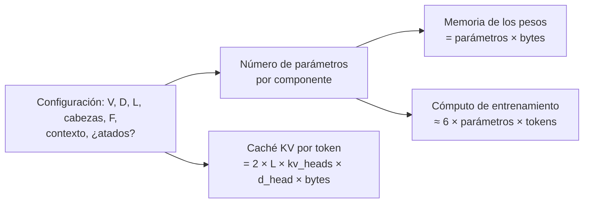
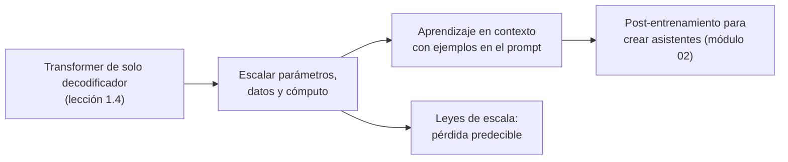
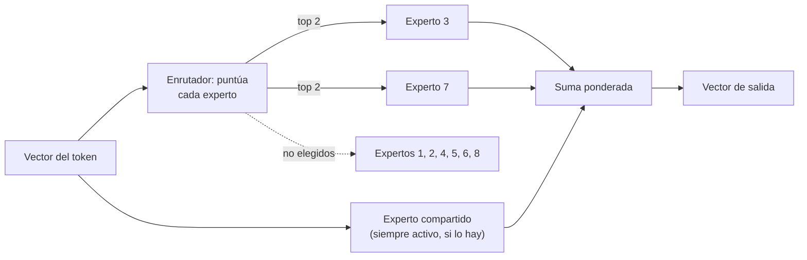
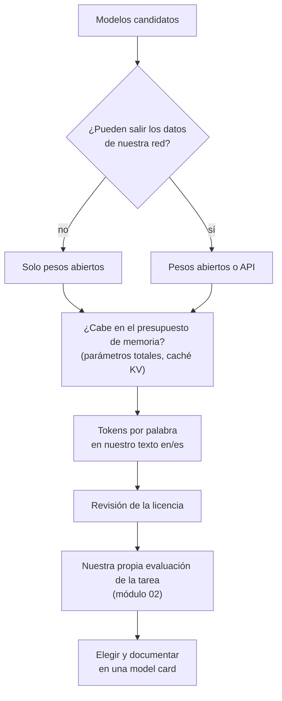

🌐 [English](05-model-families.md) · Español

# Lección 1.5 — Familias de modelos: GPT, DeepSeek, Qwen y Gemma

> **Módulo 01 · Lección 5 de 5** · ⏱️ unos 55 min · 🧪 Lab: [paso 8](lab/README.es.md#paso-8--cuenta-parámetros-densos-y-moe)

## 📨 Situación

> **De:** Rio Tanaka · Responsable de Ingeniería de IA
> **Canal:** #ai-team
>
> Última tarea de la primera semana. Los proveedores y los proyectos de código abierto no paran de
> mandarnos nombres: "un 7B", "una mezcla de expertos con 671B parámetros pero solo 37B activos",
> "contexto de 128K". La semana que viene empezamos a elegir modelos de verdad, y quiero que los
> comparemos en una hoja común y no según quién tenga la mejor diapositiva. Construye una calculadora
> que convierta la configuración de un modelo en parámetros, memoria y cómputo, sea denso o de mezcla
> de expertos. Después escribe cómo compararías dos *model cards* sin dejarte engañar por una tabla de
> *benchmarks*. Una página. ¿Qué medirías primero?

## 🎯 Objetivos

Al terminar esta lección puedes:

- Contar los parámetros de un Transformer de solo decodificador a partir de su configuración y decir dónde están.
- Convertir un número de parámetros en memoria para los pesos y cómputo de entrenamiento.
- Explicar los modelos de mezcla de expertos (MoE, *mixture of experts*) y calcular sus parámetros totales y activos.
- Describir las decisiones de diseño de las familias GPT, DeepSeek, Qwen y Gemma a partir de sus informes técnicos.
- Comparar modelos por tamaño, longitud de contexto, licencia, tokenizador y evidencia de evaluación, y nombrar las salvedades de las puntuaciones de *benchmarks*.

## 🤔 Predice primero

Apunta tus respuestas antes de seguir leyendo. Las comprobarás en la autoevaluación.

1. En una configuración clásica de 124 millones de parámetros con un vocabulario de 50.257 *tokens*, ¿qué proporción de los parámetros es la tabla de *embeddings*: alrededor del 5 %, del 15 % o del 30 %?
2. Un modelo de mezcla de expertos tiene 4.700 millones de parámetros pero usa 1.400 millones por *token*. ¿Cuánta memoria necesitan sus pesos: tanta como un modelo de 1,4B o tanta como uno de 4,7B?
3. Dos modelos obtienen la misma puntuación en un *benchmark* público. ¿Basta eso para decir que son igual de buenos para el soporte de Hearthwise?

## 1. Dónde están los parámetros

Cada matriz de pesos que construiste en la lección 1.4 tiene un tamaño que puedes calcular a partir
de la configuración. Para un Transformer de solo decodificador con vocabulario V, anchura D, L capas y
anchura *feed-forward* F:

| Componente | Parámetros |
|---|---|
| *Embeddings* de *token* | V × D |
| Posiciones aprendidas (si se usan) | longitud de contexto × D |
| Atención por capa | 4 × D × D para Q, K, V y la salida (menos si se comparten claves y valores) |
| *Feed-forward* por capa | 2 × D × F (3 × D × F en la variante SwiGLU) |
| Normalizaciones y sesgos | pocos |
| Capa de salida | V × D, o 0 si está atada a los *embeddings* |

El `params.py` del lab implementa esta tabla. Aplicado a `classic-small` (V = 50.257, D = 768,
L = 12, F = 3.072, posiciones aprendidas, *embeddings* atados), `uv run lab params --show classic-small`
imprime:

```text
Breakdown of classic-small:
  embeddings          38,597,376   31.0%
  positions              786,432    0.6%
  attention           28,348,416   22.8%
  feed_forward        56,669,184   45.5%
  router                       0    0.0%
  norms                   38,400    0.0%
  lm_head                      0    0.0%
  non-embedding       85,056,000  (Kaplan rule 12*L*d^2 = 84,934,656)
```

El total es 124.439.808. Este desglose esconde tres lecciones. Primero, a pequeña escala la tabla de
*embeddings* es una parte grande (31,0 %), y por eso el tamaño del vocabulario importa tanto en los
modelos pequeños. Segundo, las capas *feed-forward* tienen el doble de parámetros que la atención.
Tercero, la regla aproximada del artículo sobre leyes de escala, parámetros sin *embeddings* ≈ 12 × L ×
D², queda a menos de un 0,2 % del conteo exacto ([Scaling laws](https://arxiv.org/abs/2001.08361)). El
mismo contador, ejecutado sobre el modelo de numpy de la lección 1.4, da 57.984, y un test comprueba
que coincide exactamente con las matrices.

Los parámetros se convierten en recursos con dos fórmulas sencillas:

| Pregunta | Fórmula | classic-small |
|---|---|---|
| Memoria para los pesos | parámetros × bytes por parámetro (4 en fp32, 2 en bf16, 0,5 en int4) | 0,50 GB en fp32, 0,25 GB en bf16, 0,06 GB en int4 |
| Cómputo de entrenamiento | unas 6 × parámetros × *tokens* de entrenamiento (Kaplan et al.) | 7.47e+20 FLOPs para 1e12 *tokens* |

**Analogía:** el número de parámetros de una *model card* es como la superficie de un edificio. Te
dice mucho sobre el coste y la capacidad, pero solo entiendes el edificio cuando ves cómo se reparte
esa superficie en habitaciones.



> ⚠️ **Error común:** dimensionar un servidor solo con la memoria de los pesos. La inferencia también
> necesita memoria para las activaciones y para la caché KV, que crece con la longitud del contexto y
> con el número de personas que lo usan a la vez. La sección 4 calcula la caché KV; el módulo 10 la convierte en
> un plan de despliegue.

## 2. La familia GPT: escalar un Transformer de solo decodificador

La línea GPT es la historia de referencia de la arquitectura que construiste en la lección 1.4. El
artículo de GPT-3 describe un Transformer de solo decodificador entrenado únicamente para predecir el
siguiente *token* y escalado hasta 175.000 millones de parámetros
([GPT-3](https://arxiv.org/abs/2005.14165)). Su hallazgo principal fue el **aprendizaje en contexto**
(*in-context learning*): con una descripción de la tarea y unos pocos ejemplos en el *prompt*, el
modelo resolvía muchas tareas sin actualizar ningún peso, y esta capacidad mejoraba con la escala. Los
artículos sobre leyes de escala explicaron por qué hacer crecer la misma receta seguía dando
resultado, y el artículo de Chinchilla afinó cómo repartir un presupuesto de cómputo entre parámetros
y *tokens* ([Chinchilla](https://arxiv.org/abs/2203.15556)).

Un modelo base así sigue limitándose a continuar texto. El paso de modelo base a asistente (ajuste
por instrucciones y aprendizaje a partir de preferencias humanas) es el tema del módulo 02, que parte
del artículo de InstructGPT.

Las lecciones duraderas de esta familia para quien hace ingeniería:

- El Transformer de solo decodificador con predicción del siguiente *token* es una receta general; la
  mayoría de las familias de esta lección la mantienen y cambian componentes dentro del bloque.
- La capacidad depende a la vez de los parámetros, los datos y el cómputo, así que el número de
  parámetros por sí solo no ordena los modelos.
- El *prompting* es una interfaz real a las capacidades del modelo, y por eso existen los módulos 03 y
  04.

**Analogía:** la historia de GPT es como la de los motores a reacción. El diseño básico siguió siendo
reconocible mientras los equipos de ingeniería lo escalaban y refinaban cada pieza; las familias
posteriores son refinamientos del mismo motor, no otro tipo de avión.



## 3. Densos frente a mezcla de expertos

En un modelo **denso** (*dense*) se usan todos los parámetros para cada *token*. En un modelo de
**mezcla de expertos (MoE)**, la capa *feed-forward* se sustituye por varias redes *feed-forward*, los
**expertos** (*experts*), más un pequeño **enrutador** (*router*) que puntúa los expertos para cada
*token* y envía el *token* a los mejores. Solo se ejecutan los expertos elegidos. Así que un modelo MoE
tiene dos tamaños:

- **Parámetros totales**: todo lo que hay que almacenar y cargar.
- **Parámetros activos**: lo que usa de verdad un *token*, que fija el cómputo por *token*.

El lab tiene dos configuraciones MoE construidas a partir de la misma base densa `modern-1b`:

| Configuración | Expertos | Parámetros totales | Activos por *token* | Pesos en bf16 |
|---|---|---|---|---|
| `modern-1b` (denso) | 1 | 852.559.872 | 852.559.872 | 1,71 GB |
| `moe-8x-top2` | 8 expertos, 2 por *token* | 4.728.358.912 | 1.406.470.144 | 9,46 GB |
| `moe-fine-64x-top6` | 64 expertos pequeños, 6 por *token*, más 2 compartidos | 4.868.605.952 | 854.657.024 | 9,74 GB |

`moe-8x-top2` almacena más de cinco veces lo que el modelo denso, pero calcula por *token* como un
modelo de 1.400 millones de parámetros. En `moe-8x-top2`, los expertos *feed-forward* son el 93,7 % de
todos los parámetros. La configuración de grano fino divide cada experto en ocho más pequeños y añade
**expertos compartidos** (*shared experts*) que usan todos los *tokens*; su tamaño activo es igual al
del modelo denso más los enrutadores, mientras que su total es casi seis veces mayor.

La configuración de grano fino imita, a escala de juguete, el diseño que el informe de DeepSeek-V3
llama DeepSeekMoE: expertos de grano más fino más expertos compartidos, con 256 expertos enrutados y 1
experto compartido por capa MoE, de los que se activan 8 expertos enrutados por *token*
([DeepSeek-V3](https://arxiv.org/abs/2412.19437)). El informe da 671.000 millones de parámetros
totales y 37.000 millones activados por *token*, así que cada *token* usa alrededor del 5,5 % del
modelo. También describe la atención latente multicabeza (MLA, *Multi-head Latent Attention*), que
comprime las claves y los valores para reducir la caché KV, un método de equilibrado de carga que
evita una pérdida auxiliar adicional, un objetivo de predicción de varios *tokens* y un
preentrenamiento con 14,8 billones de *tokens*. Como comparación, el artículo de Mixtral describe 8
expertos por capa de los que se eligen 2 por *token*: cada *token* tiene acceso a 47.000 millones de
parámetros pero usa 13.000 millones, alrededor del 27,7 % ([Mixtral](https://arxiv.org/abs/2401.04088)).

**Analogía:** un modelo denso es un ambulatorio en el que todo el equipo médico examina a cada
paciente. Un modelo MoE es un hospital con un mostrador de triaje: cada paciente ve a dos especialistas
de entre muchos. El hospital es mucho más grande de construir y de dotar de personal, pero la visita de
cada paciente dura más o menos lo mismo.



```python
def count_params(s: ModelShape) -> ParamCount:
    """Total parameters, parameters active for one token, and a breakdown by component."""
    expert = expert_params(s)
    experts_total = s.n_experts + s.shared_experts
    experts_active = (s.experts_per_token if s.is_moe else 1) + s.shared_experts
    router = s.d_model * s.n_experts if s.is_moe else 0
    per_layer_fixed = attention_params(s) + 2 * _norm(s) + router
    b = {
        "embeddings": s.vocab_size * s.d_model,
        "positions": s.context_length * s.d_model if s.learned_positions else 0,
        "attention": s.n_layers * attention_params(s),
        "feed_forward": s.n_layers * experts_total * expert,
        "router": s.n_layers * router,
        "norms": s.n_layers * 2 * _norm(s) + _norm(s),
        "lm_head": 0 if s.tied_embeddings else s.vocab_size * s.d_model,
    }
    total = sum(b.values())
    always = b["embeddings"] + b["positions"] + b["lm_head"] + _norm(s)
    active = always + s.n_layers * (per_layer_fixed + experts_active * expert)
    return ParamCount(total=total, active=active, breakdown=b)
```

> 💡 **Consejo de producción:** en los modelos MoE, planifica la memoria con el total y la latencia con
> los parámetros activos. `moe-8x-top2` necesita 9,46 GB de pesos en bf16 en memoria aunque cada
> *token* solo ejercite 1.400 millones de parámetros. La cuantización (módulo 10) y la descarga de
> expertos fuera de la GPU (*expert offloading*) son las formas habituales de hacer que quepan los
> modelos MoE grandes.

## 4. Qwen y Gemma: qué cambia dentro de un modelo denso moderno

Las familias de pesos abiertos publican informes técnicos que se leen como una lista de decisiones
dentro del bloque. Dos ejemplos:

| Decisión | Informe de Qwen2.5 | Informe de Gemma 3 |
|---|---|---|
| Tamaños | Modelos densos de pesos abiertos de 0.5B a 72B | De 1B a 27B |
| Atención | Atención de consultas agrupadas (GQA) | GQA, con 5 capas locales de ventana deslizante (1024 *tokens*) por cada capa global |
| Posiciones y contexto | RoPE | Contexto de al menos 128K *tokens* |
| *Feed-forward* | Activación SwiGLU | — |
| Normalización | RMSNorm, prenormalización; sesgo en Q, K, V | RMSNorm, QK-norm |
| Tokenizador | BPE a nivel de byte, 151.643 *tokens* normales | SentencePiece, compartido con Gemini 2.0 |
| Otros | Datos de preentrenamiento ampliados de 7 a 18 billones de *tokens* | Entrenado con destilación; añade comprensión de imágenes |

Fuentes: [Qwen2.5](https://arxiv.org/abs/2412.15115), [Gemma 3](https://arxiv.org/abs/2503.19786).

Dos de estas decisiones existen sobre todo para reducir la **caché KV** (*KV cache*), las claves y los
valores que un modelo guarda de cada *token* anterior mientras genera:

- La **atención de consultas agrupadas** (GQA, *grouped-query attention*) permite que varias cabezas
  de consulta compartan una cabeza de clave y valor. El `modern-1b` del lab tiene 16 cabezas de
  consulta que comparten 4 cabezas de clave y valor; su caché cuesta 32,77 MB por cada 1.000 *tokens*,
  menos que `classic-small` (36,86 MB) a pesar de ser unas siete veces más grande. Sin compartir, sería
  cuatro veces mayor.
- Las **capas de atención local** (*local attention*) solo miran una ventana reciente. El informe de
  Gemma 3 intercala 5 capas locales con una ventana de 1.024 *tokens* por cada capa global para reducir
  la memoria de la caché KV. Aplicado a `modern-1b` con su contexto de 8.192 *tokens*, el lab calcula
  0,268 GB de caché con todas las capas globales y 0,063 GB con el patrón 5:1.

**Analogía:** la caché KV es el cuaderno del modelo con todo lo que se ha dicho hasta ahora. GQA toma
notas más cortas; la atención local permite que la mayoría de las capas arranquen las páginas viejas y
se queden solo con las últimas.

> ⚠️ **Error común:** comparar modelos por el número de parámetros sin tener en cuenta el tokenizador
> ni el mecanismo de contexto. Dos modelos del mismo tamaño pueden diferir en *tokens* por palabra en
> español (lección 1.3) y en memoria de caché por *token* (esta sección), y ambas cosas cambian tu coste
> por conversación.

## 5. Pesos abiertos, API y cómo comparar modelos

Los modelos te llegan de dos formas. Los modelos de **pesos abiertos** (*open weights*) publican sus
pesos: puedes descargarlos, ejecutarlos, inspeccionarlos y hacerles *fine-tuning*, con una licencia que
fija las condiciones. El informe de DeepSeek-V3 enlaza a *checkpoints* descargables, el informe de
Gemma 3 dice que todos los modelos se publican para la comunidad, el artículo de Mixtral publica sus
modelos con la licencia Apache 2.0 y el informe de Qwen2.5 enumera modelos de pesos abiertos base y
ajustados por instrucciones. Los modelos **solo por API** (*API-only*) solo son accesibles a través del
servicio de un proveedor. El propio informe de Qwen2.5 muestra los dos casos: sus dos variantes MoE,
Qwen2.5-Turbo y Qwen2.5-Plus, son modelos propietarios servidos por Alibaba Cloud.

| | Pesos abiertos | Solo por API |
|---|---|---|
| Los datos salen de tu red | No, si lo alojas tú | Sí, hacia el proveedor |
| *Fine-tuning* | Control total | Solo lo que ofrezca el proveedor |
| Operaciones | Tú ejecutas y escalas los servidores | Lo hace el proveedor |
| Modelo de costes | Hardware y tiempo de ingeniería | Precio por *token* |
| Reproducibilidad | Fijas un *checkpoint* exacto | El proveedor puede actualizar el modelo |

**Analogía:** los pesos abiertos son como comprar un coche: lo mantienes tú, puedes modificarlo y va a
donde lo conduzcas. Una API es un taxi: sin mantenimiento, pero pagas por trayecto y la empresa decide
qué coche aparece.

En Hearthwise, la regla de Noor de que los datos de la clientela no deben salir del portátil en el módulo
10 ya apunta a pesos abiertos para ese proyecto; el chatbot de soporte puede aceptar una API con un
acuerdo de tratamiento de datos. Ninguna opción gana en general.

Para comparar candidatos, rellena la misma hoja para cada uno:

| Criterio | Qué leer o medir |
|---|---|
| Tamaño | Parámetros totales y activos; memoria de los pesos con tu precisión |
| Contexto | Longitud máxima de contexto; caché KV por *token* |
| Tokenizador | *Tokens* por palabra en tu propio texto en inglés y en español |
| Licencia | Uso comercial, atribución, restricciones de uso aceptable |
| Datos de entrenamiento | Lo que dice el informe sobre fuentes, idiomas y fecha de corte |
| Evidencia de evaluación | *Benchmarks* publicados, con qué configuración, y tu propia evaluación de la tarea |

**Salvedades de los *benchmarks*.** La tabla de *benchmarks* de una *model card* es una evidencia, no
un veredicto. Las puntuaciones dependen del formato del *prompt*, del número de ejemplos y de los
ajustes de decodificación, así que los números de informes distintos a menudo no son comparables. Los
*benchmarks* públicos pueden colarse en los datos de entrenamiento: la contaminación que eliminaste en
la lección 1.2. Y un *benchmark* público mide la tarea de otra persona: dos modelos con la misma
puntuación pueden comportarse de forma muy distinta con los tickets de Hearthwise. El módulo 02 crea
los hábitos de evaluación para resolverlo.



> 💡 **Consejo de producción:** escribe tu comparación en la plantilla de *model card* del curso y
> guárdala junto a la decisión. Cuando se anuncie un modelo nuevo el mes que viene, vuelves a rellenar
> la misma hoja en lugar de empezar el debate desde cero.

## 🧪 Pruébalo

1. Compara las configuraciones ([paso 8 del lab](lab/README.es.md#paso-8--cuenta-parámetros-densos-y-moe)):

   ```bash
   uv run lab params
   ```

   Salida esperada (primeras líneas):

   ```text
   preset                         total          active  bf16 GB  KV MB/1k tok
   lab-tiny                      57,984          57,984     0.00          0.26
   classic-small            124,439,808     124,439,808     0.25         36.86
   modern-1b                852,559,872     852,559,872     1.71         32.77
   moe-8x-top2            4,728,358,912   1,406,470,144     9.46         32.77
   moe-fine-64x-top6      4,868,605,952     854,657,024     9.74         32.77
   ```

2. Lee el desglose y la comparación con Kaplan: `uv run lab params --show classic-small`.
3. Consulta cada cifra publicada que cita esta lección, con su fuente: `uv run lab facts`. Abre dos de
   los enlaces y comprueba tú los números.

## 🏭 En el mundo real

- **Los tamaños de los nombres están redondeados y no son coherentes.** Algunos nombres cuentan los
  parámetros totales, otros los activos, algunos incluyen los *embeddings* y otros no. Recalcula a
  partir del archivo de configuración cuando la memoria o el coste dependan de ello.
- **La arquitectura aparece en la factura.** Los parámetros activos determinan el cómputo por *token*;
  los totales, la memoria; la caché KV por *token*, cuántas conversaciones caben en una máquina.
- **Los informes cambian más rápido que las diapositivas.** Las familias de modelos publican versiones
  nuevas a menudo. Mantén tu hoja de comparación ligada al nombre exacto de un *checkpoint* y a una
  fecha.
- **Qué vigilar después de elegir:** el coste por conversación según el idioma, la latencia por
  *token*, el margen de memoria en el pico de concurrencia y tu propia puntuación de evaluación con
  cada actualización del modelo.

## ✅ Autoevaluación

**1. ¿Qué proporción de `classic-small` es la tabla de *embeddings*, y por qué importa?**

<details><summary>Respuesta</summary>

El 31,0 % (38.597.376 de 124.439.808 parámetros). Con un vocabulario de 50.257 *tokens* y una anchura de
768, la tabla de *embeddings* es una parte grande de un modelo pequeño, así que el tamaño del
vocabulario es un coste de diseño real. En los modelos más grandes la proporción baja, porque las
capas crecen con el cuadrado de la anchura.

</details>

**2. ¿Cuánta memoria necesitan los pesos de `moe-8x-top2` en bf16, y por qué no la que corresponde a 1.400 millones de parámetros?**

<details><summary>Respuesta</summary>

9,46 GB, lo que corresponde a los 4.728.358.912 parámetros. Hay que cargar todos los expertos porque
el enrutador puede elegir cualquiera de ellos para el siguiente *token*. Solo el cómputo por *token*
escala con los 1.406.470.144 parámetros activos.

</details>

**3. Dos modelos tienen la misma puntuación en un *benchmark* público. ¿Son igual de buenos para el soporte de Hearthwise?**

<details><summary>Respuesta</summary>

No necesariamente. Las puntuaciones pueden venir de formatos de *prompt* o configuraciones distintos,
el *benchmark* puede estar contaminado en los datos de entrenamiento de uno de los modelos, y mide una
tarea distinta. Los *tokens* por palabra en español, el contexto, la licencia y tu propia evaluación de
la tarea pueden ser distintos. Una puntuación igual en un *benchmark* es una razón para probar los dos,
no para dejar de probar.

</details>

**4. DeepSeek-V3 informa de 671B parámetros totales y 37B activos. ¿Qué proporción está activa, y qué te dice eso sobre el coste?**

<details><summary>Respuesta</summary>

Alrededor del 5,5 %. El cómputo por *token* se acerca al de un modelo denso de 37B, pero servirlo
sigue exigiendo almacenar los 671B parámetros, así que las necesidades de memoria y de hardware son las
de un modelo muy grande.

</details>

**5. Nombra dos técnicas de los informes de Qwen2.5 y Gemma 3 que reducen la memoria de la caché KV, y explica una con los números del lab.**

<details><summary>Respuesta</summary>

La atención de consultas agrupadas y las capas de atención local (de ventana deslizante) intercaladas.
En el lab, `modern-1b` con 4 cabezas de clave y valor para 16 cabezas de consulta necesita 32,77 MB por
cada 1.000 *tokens*, cuatro veces menos que sin compartir; con 5 capas locales (ventana de 1.024
*tokens*) por cada capa global, su caché con 8.192 *tokens* baja de 0,268 GB a 0,063 GB.

</details>

## 💬 Explícalo con tus palabras

- Rio preguntó: "¿Qué medirías primero?". Responde en un párrafo usando los parámetros totales, los
  parámetros activos, la caché KV y los *tokens* por palabra.
- Explícale a Jordan Kim, responsable de Producto, por qué "671B parámetros" no significa que
  DeepSeek-V3 sea unas dieciocho veces más lento por *token* que un modelo denso de 37B.

## 🔑 Ideas clave

- El número de parámetros se deduce de la configuración: *embeddings* V×D, atención de unos 4D² por
  capa, *feed-forward* de 2DF (3DF con SwiGLU) por capa.
- La memoria de los pesos es parámetros × bytes; el cómputo de entrenamiento es de unos 6 × parámetros
  × *tokens*.
- Los modelos MoE tienen parámetros totales (memoria) y parámetros activos (cómputo por *token*);
  DeepSeek-V3 usa alrededor del 5,5 % de sus parámetros por *token*.
- Las familias densas modernas cambian sobre todo componentes dentro del bloque: RMSNorm, SwiGLU,
  RoPE, GQA, atención local.
- Los pesos abiertos dan control y privacidad; las API dan comodidad; las licencias marcan las reglas.
- Compara modelos en una sola hoja y con tu propia evaluación, nunca solo con una tabla de
  *benchmarks*.

## 📚 Profundiza

- ⭐ [DeepSeek-V3 Technical Report](https://arxiv.org/abs/2412.19437) — la sección 2 explica con
  claridad la atención latente multicabeza y DeepSeekMoE, con las fórmulas detrás de los parámetros
  totales y activos.
- [Qwen2.5 Technical Report](https://arxiv.org/abs/2412.15115) — un ejemplo compacto de familia densa
  moderna: arquitectura, tokenizador, datos y post-entrenamiento en un solo sitio.
- [Gemma 3 Technical Report](https://arxiv.org/abs/2503.19786) — la atención local/global y el
  razonamiento sobre memoria que hay detrás.
- [Mixtral of Experts](https://arxiv.org/abs/2401.04088) — una introducción corta y legible al
  enrutamiento MoE disperso.

---

[← Anterior: 1.4 Las redes neuronales y el Transformer](04-neural-networks-and-transformers.es.md) · [🏠 Módulo 01](README.es.md) · [Siguiente: Lab →](lab/README.es.md)
