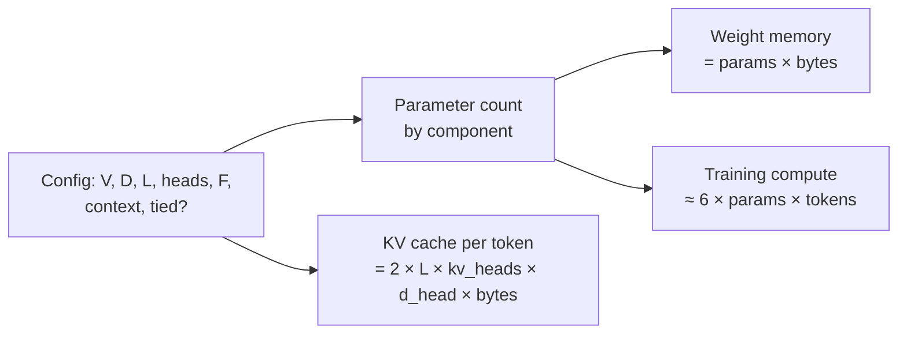
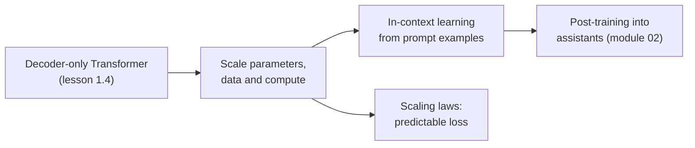
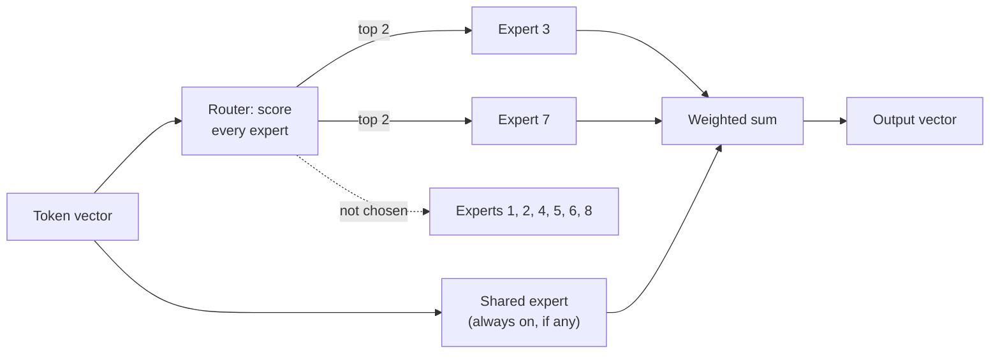
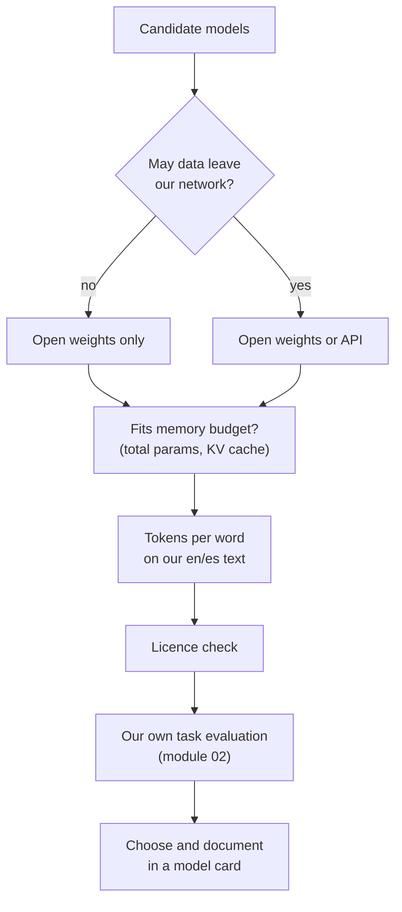

🌐 English · [Español](05-model-families.es.md)

# Lesson 1.5 — Model families: GPT, DeepSeek, Qwen and Gemma

> **Module 01 · Lesson 5 of 5** · ⏱️ about 55 min · 🧪 Lab: [step 8](lab/README.md#step-8--count-parameters-dense-and-moe)

## 📨 Situation

> **From:** Rio Tanaka · Head of AI Engineering
> **Channel:** #ai-team
>
> Last task for week one. Vendors and open-source projects keep sending us names: "a 7B", "a
> mixture-of-experts with 671B parameters but only 37B active", "128K context". Next week we start
> choosing models for real, and I want us to compare them on a common sheet instead of on whoever
> has the best slide. Build a calculator that turns a model configuration into parameters, memory
> and compute, dense or mixture-of-experts. Then write down how you would compare two model cards
> without being fooled by a benchmark table. One page. What would you measure first?

## 🎯 Objectives

By the end of this lesson you can:

- Count the parameters of a decoder-only Transformer from its configuration and say where they live.
- Convert a parameter count into weight memory and training compute.
- Explain mixture-of-experts (MoE) models and compute their total and active parameters.
- Describe the design choices of the GPT, DeepSeek, Qwen and Gemma families using their technical reports.
- Compare models on size, context length, licence, tokenizer and evaluation evidence, and name the caveats of benchmark scores.

## 🤔 Predict first

Write your answers down before reading on. You will check them in the self-check.

1. In a classic 124-million-parameter configuration with a 50,257-token vocabulary, what share of the parameters is the embedding table: about 5%, 15% or 30%?
2. A mixture-of-experts model has 4.7 billion parameters but uses 1.4 billion per token. How much memory do its weights need: as much as a 1.4B model or as much as a 4.7B model?
3. Two models report the same score on a public benchmark. Is that enough to say they are equally good for Hearthwise support?

## 1. Where the parameters live

Every weight matrix you built in lesson 1.4 has a size you can compute from the configuration. For a
decoder-only Transformer with vocabulary V, width D, L layers and feed-forward width F:

| Component | Parameters |
|---|---|
| Token embeddings | V × D |
| Learned positions (if used) | context length × D |
| Attention per layer | 4 × D × D for Q, K, V and output (fewer with shared keys and values) |
| Feed-forward per layer | 2 × D × F (3 × D × F for the SwiGLU variant) |
| Norms and biases | small |
| Output layer | V × D, or 0 when tied to the embeddings |

The lab's `params.py` implements this table. Applied to `classic-small` (V = 50,257, D = 768,
L = 12, F = 3,072, learned positions, tied embeddings), `uv run lab params --show classic-small`
prints:

```text
Breakdown of classic-small:
  embeddings          38,597,376   31.0%
  positions              786,432    0.6%
  attention           28,348,416   22.8%
  feed_forward        56,669,184   45.5%
  router                       0    0.0%
  norms                   38,400    0.0%
  lm_head                      0    0.0%
  non-embedding       85,056,000  (Kaplan rule 12*L*d^2 = 84,934,656)
```

The total is 124,439,808. Three lessons hide in this breakdown. First, at small scale the embedding
table is a large share (31.0%), which is why vocabulary size matters so much for small models.
Second, the feed-forward layers hold twice the parameters of attention. Third, the rule of thumb from
the scaling-law paper, non-embedding parameters ≈ 12 × L × D², lands within 0.2% of the exact count
([Scaling laws](https://arxiv.org/abs/2001.08361)). The same counter, run on the numpy model from
lesson 1.4, gives 57,984, and a test checks that it matches the arrays exactly.

Parameters turn into resources with two simple formulas:

| Question | Formula | classic-small |
|---|---|---|
| Memory for the weights | parameters × bytes per parameter (4 in fp32, 2 in bf16, 0.5 in int4) | 0.50 GB fp32, 0.25 GB bf16, 0.06 GB int4 |
| Training compute | about 6 × parameters × training tokens (Kaplan et al.) | 7.47e+20 FLOPs for 1e12 tokens |

**Analogy:** a model card's parameter count is like a building's floor area. It tells you a lot about
cost and capacity, but you only understand the building once you see how the area splits into rooms.



> ⚠️ **Common mistake:** sizing a server from weight memory alone. Inference also needs memory for
> activations and for the KV cache, which grows with context length and with the number of
> simultaneous users. Section 4 computes the KV cache; module 10 turns it into a deployment plan.

## 2. The GPT family: scaling a decoder-only Transformer

The GPT line is the reference story for the architecture you built in lesson 1.4. The GPT-3 paper
describes a decoder-only Transformer trained only to predict the next token, scaled to 175 billion
parameters ([GPT-3](https://arxiv.org/abs/2005.14165)). Its headline finding was **in-context
learning**: given a task description and a few examples in the prompt, the model performed many tasks
without any weight updates, and this ability improved with scale. The scaling-law papers explained
why growing the same recipe kept paying off, and the Chinchilla paper refined how to split a compute
budget between parameters and tokens ([Chinchilla](https://arxiv.org/abs/2203.15556)).

A base model like that still only continues text. The step from base model to assistant (instruction
tuning and learning from human preferences) is the subject of module 02, which starts from the
InstructGPT paper.

The lasting lessons of this family for an engineer:

- The decoder-only Transformer with next-token prediction is a general recipe; most families in this
  lesson keep it and change components inside the block.
- Capability depends on parameters, data and compute together, so a parameter count alone does not
  rank models.
- Prompting is a real interface to the model's abilities, which is why modules 03 and 04 exist.

**Analogy:** the GPT story is like the history of jet engines. The basic design stayed recognisable
while engineers scaled it up and refined each part; later families are refinements of the same
engine, not a different kind of aircraft.



## 3. Dense versus mixture-of-experts

In a **dense** model every parameter is used for every token. In a **mixture-of-experts (MoE)**
model, the feed-forward layer is replaced by several feed-forward networks, the **experts**, plus a
small **router** that scores the experts for each token and sends the token to the top few. Only the
chosen experts run. So an MoE model has two sizes:

- **Total parameters**: everything that must be stored and loaded.
- **Active parameters**: what one token actually uses, which sets the compute per token.

The lab has two MoE presets built from the same dense `modern-1b` base:

| Preset | Experts | Total parameters | Active per token | bf16 weights |
|---|---|---|---|---|
| `modern-1b` (dense) | 1 | 852,559,872 | 852,559,872 | 1.71 GB |
| `moe-8x-top2` | 8 experts, 2 per token | 4,728,358,912 | 1,406,470,144 | 9.46 GB |
| `moe-fine-64x-top6` | 64 small experts, 6 per token, plus 2 shared | 4,868,605,952 | 854,657,024 | 9.74 GB |

`moe-8x-top2` stores more than five times the dense model but computes per token like a model of
1.4 billion parameters. In `moe-8x-top2`, the feed-forward experts are 93.7% of all parameters. The
fine-grained preset splits each expert into eight smaller ones and adds **shared experts** that every
token uses; its active size equals the dense model plus the routers, while its total is almost six
times larger.

The fine-grained preset imitates, at toy scale, the design the DeepSeek-V3 report calls DeepSeekMoE:
finer-grained experts plus shared experts, with 256 routed experts and 1 shared expert per MoE layer,
of which 8 routed experts are activated per token ([DeepSeek-V3](https://arxiv.org/abs/2412.19437)). The report
gives 671 billion total parameters and 37 billion activated per token, so each token uses about 5.5%
of the model. It also describes Multi-head Latent Attention (MLA), which compresses keys and values to
shrink the KV cache, a load-balancing method that avoids an extra auxiliary loss, a multi-token
prediction objective, and pre-training on 14.8 trillion tokens. For comparison, the Mixtral paper
describes 8 experts per layer with 2 chosen per token: each token has access to 47 billion parameters
but uses 13 billion, about 27.7% ([Mixtral](https://arxiv.org/abs/2401.04088)).

**Analogy:** a dense model is a clinic where every doctor examines every patient. An MoE model is a
hospital with a triage desk: each patient sees two specialists out of many. The hospital is much
bigger to build and staff, but each patient's visit takes about the same time.



```python
def count_params(s: ModelShape) -> ParamCount:
    """Total parameters, parameters active for one token, and a breakdown by component."""
    expert = expert_params(s)
    experts_total = s.n_experts + s.shared_experts
    experts_active = (s.experts_per_token if s.is_moe else 1) + s.shared_experts
    router = s.d_model * s.n_experts if s.is_moe else 0
    per_layer_fixed = attention_params(s) + 2 * _norm(s) + router
    b = {
        "embeddings": s.vocab_size * s.d_model,
        "positions": s.context_length * s.d_model if s.learned_positions else 0,
        "attention": s.n_layers * attention_params(s),
        "feed_forward": s.n_layers * experts_total * expert,
        "router": s.n_layers * router,
        "norms": s.n_layers * 2 * _norm(s) + _norm(s),
        "lm_head": 0 if s.tied_embeddings else s.vocab_size * s.d_model,
    }
    total = sum(b.values())
    always = b["embeddings"] + b["positions"] + b["lm_head"] + _norm(s)
    active = always + s.n_layers * (per_layer_fixed + experts_active * expert)
    return ParamCount(total=total, active=active, breakdown=b)
```

> 💡 **Production tip:** for MoE models, plan memory with the total and latency with the active
> count. `moe-8x-top2` needs 9.46 GB of bf16 weights in memory even though each token only exercises
> 1.4 billion parameters. Quantisation (module 10) and expert offloading are the usual ways to make
> large MoE models fit.

## 4. Qwen and Gemma: what changes inside a modern dense model

Open-weight families publish technical reports that read like a list of block-level choices. Two
examples:

| Choice | Qwen2.5 report | Gemma 3 report |
|---|---|---|
| Sizes | Open-weight dense models from 0.5B to 72B | 1B to 27B |
| Attention | Grouped-query attention (GQA) | GQA, with 5 local sliding-window layers (1024 tokens) per global layer |
| Positions and context | RoPE | Context of at least 128K tokens |
| Feed-forward | SwiGLU activation | — |
| Normalisation | RMSNorm, pre-normalisation; bias on Q, K, V | RMSNorm, QK-norm |
| Tokenizer | Byte-level BPE, 151,643 regular tokens | SentencePiece, shared with Gemini 2.0 |
| Other | Pre-training data scaled from 7 to 18 trillion tokens | Trained with distillation; adds vision understanding |

Sources: [Qwen2.5](https://arxiv.org/abs/2412.15115), [Gemma 3](https://arxiv.org/abs/2503.19786).

Two of these choices exist mainly to shrink the **KV cache**, the keys and values a model stores for
every past token while generating:

- **Grouped-query attention** lets several query heads share one key/value head. The lab's
  `modern-1b` has 16 query heads sharing 4 key/value heads; its cache costs 32.77 MB per 1,000 tokens,
  less than `classic-small` (36.86 MB) despite being about seven times larger. Without sharing it
  would be four times bigger.
- **Local attention layers** only look at a recent window. The Gemma 3 report interleaves 5 local
  layers with a 1,024-token window per global layer to reduce KV-cache memory. Applied to
  `modern-1b` at its 8,192-token context, the lab computes 0.268 GB of cache with all-global layers and
  0.063 GB with the 5:1 pattern.

**Analogy:** the KV cache is the model's notebook of everything said so far. GQA writes shorter
notes; local attention lets most layers tear out old pages and keep only the last few.

> ⚠️ **Common mistake:** comparing models by parameter count while ignoring the tokenizer and the
> context mechanism. Two models of the same size can differ in tokens per word in Spanish (lesson
> 1.3) and in cache memory per token (this section), and both change your cost per conversation.

## 5. Open weights, APIs and how to compare models

Models reach you in two ways. **Open-weight** models publish their weights: you can download, run,
inspect and fine-tune them, under a licence that sets the conditions. The DeepSeek-V3 report points
to downloadable checkpoints, the Gemma 3 report says all models are released to the community, the
Mixtral paper releases its models under the Apache 2.0 licence, and the Qwen2.5 report lists base and
instruction-tuned open-weight models. **API-only** models are reachable only through a provider's
service. The Qwen2.5 report itself shows both: its two MoE variants, Qwen2.5-Turbo and Qwen2.5-Plus,
are proprietary models served by Alibaba Cloud.

| | Open weights | API-only |
|---|---|---|
| Data leaves your network | No, if you host it | Yes, to the provider |
| Fine-tuning | Full control | Only what the provider offers |
| Operations | You run and scale the servers | The provider does |
| Cost model | Hardware and engineering time | Price per token |
| Reproducibility | Pin an exact checkpoint | The provider may update the model |

**Analogy:** open weights are like buying a car: you maintain it, you can modify it, and it goes
wherever you drive it. An API is a taxi: no maintenance, but you pay per trip and the company decides
which car turns up.

For Hearthwise, Noor's rule that customer data must not leave the laptop in module 10 already points
to open weights for that project; the support chatbot may accept an API under a data-processing
agreement. Neither option wins in general.

To compare candidates, fill the same sheet for each one:

| Criterion | What to read or measure |
|---|---|
| Size | Total and active parameters; weight memory at your precision |
| Context | Maximum context length; KV cache per token |
| Tokenizer | Tokens per word on your own English and Spanish text |
| Licence | Commercial use, attribution, acceptable-use restrictions |
| Training data | What the report says about sources, languages and cut-off |
| Evaluation evidence | Benchmarks reported, under which settings, and your own task evaluation |

**Benchmark caveats.** A model card's benchmark table is evidence, not a verdict. Scores depend on
prompt format, number of examples and decoding settings, so numbers from different reports are often
not comparable. Public benchmarks can leak into training data, the contamination you removed in
lesson 1.2. And a public benchmark measures someone else's task: two models with equal scores can
behave very differently on Hearthwise tickets. Module 02 builds the evaluation habits to settle this.



> 💡 **Production tip:** write your comparison down in the course's model-card template and keep it
> with the decision. When a new model is announced next month, you re-run the same sheet instead of
> starting the debate from scratch.

## 🧪 Try it

1. Compare the presets ([lab step 8](lab/README.md#step-8--count-parameters-dense-and-moe)):

   ```bash
   uv run lab params
   ```

   Expected output (first lines):

   ```text
   preset                         total          active  bf16 GB  KV MB/1k tok
   lab-tiny                      57,984          57,984     0.00          0.26
   classic-small            124,439,808     124,439,808     0.25         36.86
   modern-1b                852,559,872     852,559,872     1.71         32.77
   moe-8x-top2            4,728,358,912   1,406,470,144     9.46         32.77
   moe-fine-64x-top6      4,868,605,952     854,657,024     9.74         32.77
   ```

2. Read the breakdown and the Kaplan comparison: `uv run lab params --show classic-small`.
3. See every published figure quoted in this lesson with its source: `uv run lab facts`. Open two of
   the links and check the numbers yourself.

## 🏭 In the real world

- **Sizes in names are rounded and inconsistent.** Some names count total parameters, some count
  active ones, some include embeddings and some do not. Recompute from the configuration file when
  memory or cost depends on it.
- **The architecture shows up in the bill.** Active parameters drive compute per token; total
  parameters drive memory; KV cache per token drives how many conversations fit on one machine.
- **Reports change faster than slides.** Model families release new versions often. Keep your
  comparison sheet tied to an exact checkpoint name and date.
- **What to monitor after you choose:** cost per conversation by language, latency per token, memory
  headroom at peak concurrency, and your own evaluation score on every model update.

## ✅ Self-check

**1. What share of `classic-small` is the embedding table, and why does it matter?**

<details><summary>Answer</summary>

31.0% (38,597,376 of 124,439,808 parameters). With a 50,257-token vocabulary and width 768, the
embedding table is a big part of a small model, so vocabulary size is a real design cost. In larger
models the share shrinks because the layers grow with the square of the width.

</details>

**2. How much memory do the weights of `moe-8x-top2` need in bf16, and why not the amount for 1.4 billion parameters?**

<details><summary>Answer</summary>

9.46 GB, the amount for all 4,728,358,912 parameters. Every expert must be loaded because the router
can choose any of them for the next token. Only compute per token scales with the 1,406,470,144 active
parameters.

</details>

**3. Two models have the same score on a public benchmark. Are they equally good for Hearthwise support?**

<details><summary>Answer</summary>

Not necessarily. The scores may come from different prompt formats or settings, the benchmark may be
contaminated in one model's training data, and it measures a different task. Tokens per word in
Spanish, context, licence and your own task evaluation can all differ. Equal benchmark scores are a
reason to test both, not to stop testing.

</details>

**4. DeepSeek-V3 reports 671B total and 37B active parameters. What share is active, and what does that tell you about cost?**

<details><summary>Answer</summary>

About 5.5%. Compute per token is close to that of a 37B dense model, but serving it still requires
storing all 671B parameters, so memory and hardware needs are those of a very large model.

</details>

**5. Name two techniques from the Qwen2.5 and Gemma 3 reports that reduce KV-cache memory, and explain one with the lab's numbers.**

<details><summary>Answer</summary>

Grouped-query attention and interleaved local (sliding-window) attention layers. In the lab,
`modern-1b` with 4 key/value heads for 16 query heads needs 32.77 MB per 1,000 tokens, four times less
than without sharing; with 5 local layers (1,024-token window) per global layer, its cache at 8,192
tokens falls from 0.268 GB to 0.063 GB.

</details>

## 💬 Explain it in your own words

- Rio asked: "What would you measure first?" Answer in one paragraph, using total parameters, active
  parameters, KV cache and tokens per word.
- Explain to Jordan Kim, the product lead, why "671B parameters" does not mean DeepSeek-V3 is about
  eighteen times slower per token than a 37B dense model.

## 🔑 Key ideas

- Parameter counts follow from the configuration: embeddings V×D, attention about 4D² per layer,
  feed-forward 2DF (3DF for SwiGLU) per layer.
- Weight memory is parameters × bytes; training compute is about 6 × parameters × tokens.
- MoE models have total parameters (memory) and active parameters (compute per token); DeepSeek-V3
  uses about 5.5% of its parameters per token.
- Modern dense families mostly change components inside the block: RMSNorm, SwiGLU, RoPE, GQA, local
  attention.
- Open weights give control and privacy; APIs give convenience; licences set the rules.
- Compare models on one sheet and with your own evaluation, never on a benchmark table alone.

## 📚 Go deeper

- ⭐ [DeepSeek-V3 Technical Report](https://arxiv.org/abs/2412.19437) — section 2 explains
  Multi-head Latent Attention and DeepSeekMoE clearly, with the formulas behind total and active
  parameters.
- [Qwen2.5 Technical Report](https://arxiv.org/abs/2412.15115) — a compact example of a modern dense
  family: architecture, tokenizer, data and post-training in one place.
- [Gemma 3 Technical Report](https://arxiv.org/abs/2503.19786) — local/global attention and the
  memory reasoning behind it.
- [Mixtral of Experts](https://arxiv.org/abs/2401.04088) — a short, readable introduction to sparse
  MoE routing.

---

[← Previous: 1.4 Neural networks and the Transformer](04-neural-networks-and-transformers.md) · [🏠 Module 01](README.md) · [Next: Lab →](lab/README.md)
