🌐 [English](README.md) · Español

# Módulo 01 — Cómo se construyen los LLM

> Recorre el camino completo desde un rastreo web en bruto hasta un chatbot que funciona, y construye
> tú las piezas clave: un *pipeline* de limpieza de datos, un tokenizador BPE, la autoatención causal y
> una calculadora del tamaño de los modelos.

## 🗺️ Mapa del curso

```mermaid
flowchart LR
    subgraph P1["Parte 1 · Fundamentos"]
        M01["01 · Cómo se construyen los LLM"] --> M02["02 · Del modelo base al asistente"] --> M03["03 · Playground de LLM"]
    end
    subgraph P2["Parte 2 · Adaptación y RAG"]
        M04["04 · Prompting y fine-tuning"] --> M05["05 · RAG I: recuperación"] --> M06["06 · RAG II: bot de soporte"]
    end
    subgraph P3["Parte 3 · Agentes"]
        M07["07 · Workflows y herramientas"] --> M08["08 · Agente Ask-the-Web"]
    end
    subgraph P4["Parte 4 · Razonamiento"]
        M09["09 · Modelos de razonamiento"] --> M10["10 · Deep research y local"]
    end
    M03 --> M04
    M06 --> M07
    M08 --> M09
    M10 --> CAP["🎓 Proyecto final"]
    classDef current fill:#ffb300,stroke:#e65100,stroke-width:3px,color:#000
    class M01 current
```



## 📖 La historia

Es tu primera semana en el equipo de ingeniería de IA de Hearthwise, la tienda en línea de
dispositivos de hogar inteligente con sede en Valencia. La empresa acaba de crear un pequeño equipo de
IA, y Rio Tanaka, tu manager, tiene una regla antes de que nadie toque un *prompt*: entender cómo está
construida la cosa. Cada decisión posterior, desde qué modelo comprar hasta por qué se inventa fechas
o por qué cuesta más en español, se remonta a una etapa de esa construcción.

Dani Ruiz, de ciencia de datos, te pasa un rastreo web en bruto que el equipo pensó usar en su día
para entrenar un modelo pequeño de dominio, junto con unas respuestas etiquetadas a mano de lo que
debería conservar un buen *pipeline*. Lo limpias y te mides frente a las etiquetas, entrenas un
tokenizador con el resultado y mides cuánto le cuesta a la clientela hispanohablante, abres la
atención en numpy hasta que todas las formas tienen sentido y terminas construyendo la calculadora que
el equipo usará la semana que viene para comparar familias de modelos reales en una sola hoja.

## 🎯 Objetivos de aprendizaje

Al terminar este módulo puedes:

- Explicar un LLM como un predictor del siguiente *token* y dibujar el camino desde los datos en bruto, pasando por el preentrenamiento y el post-entrenamiento, hasta un asistente dentro de una aplicación.
- Construir y evaluar con precisión y *recall* un *pipeline* de limpieza de texto web (extracción, identificación de idioma, heurísticas de calidad, deduplicación exacta y con MinHash, descontaminación, anonimización de datos personales).
- Entrenar un tokenizador BPE a nivel de byte y medir el coste en *tokens* del inglés y del español.
- Implementar en numpy la autoatención causal multicabeza, un bloque decodificador y RoPE, y entrenar un modelo pequeño con descenso de gradiente.
- Calcular los parámetros, la memoria, el cómputo y la caché KV de modelos densos y de mezcla de expertos, y comparar familias de modelos con fuentes.

## 🗂️ Lecciones

| # | Lección | Tiempo | Qué aprenderás |
|---|---|---|---|
| 1.1 | [El camino de los datos en bruto a un chatbot](01-llm-overview.es.md) | 45 min | Predicción del siguiente *token*, la cadena de construcción completa, modelo base frente a asistente, leyes de escala, el rol de la ingeniería de IA |
| 1.2 | [Datos de preentrenamiento: recogida y limpieza](02-pretraining-data.es.md) | 60 min | Common Crawl, el *pipeline* al estilo de RefinedWeb/Dolma/FineWeb, MinHash, descontaminación, datos personales, precisión y *recall* |
| 1.3 | [Tokenización y codificación por pares de bytes](03-tokenization.es.md) | 50 min | Por qué *tokens*, entrenamiento y codificación BPE, BPE a nivel de byte, *tokens* especiales, tamaño del vocabulario, coste multilingüe |
| 1.4 | [Las redes neuronales y el Transformer](04-neural-networks-and-transformers.es.md) | 70 min | Descenso de gradiente, *embeddings*, entropía cruzada, autoatención, multicabeza, conexiones residuales, normalización de capa, RoPE |
| 1.5 | [Familias de modelos: GPT, DeepSeek, Qwen y Gemma](05-model-families.es.md) | 55 min | Conteo de parámetros, densos frente a MoE, decisiones de diseño de cuatro familias, pesos abiertos frente a API, comparar modelos |

## 🧪 Lab

En el paquete `m01_foundations` construyes un modelo de lenguaje de conteo, un *pipeline* de limpieza
de nueve etapas puntuado frente a las etiquetas de Dani, detección de casi duplicados con MinHash, un
tokenizador BPE a nivel de byte, un Transformer de solo decodificador en numpy con RoPE, un modelo
neuronal con derivadas calculadas a mano y entrenado con descenso de gradiente, y una calculadora de
parámetros, memoria y caché KV. Todo funciona sin conexión en una CPU.

```bash
cd modules/01-how-llms-are-built/lab
uv sync
uv run pytest
uv run lab --help
```

Instrucciones completas: [lab/README.es.md](lab/README.es.md). Definición de terminado:

- [ ] `uv run pytest` pasa.
- [ ] Has reconstruido al menos una función por cada paso del lab del 2 al 8 y su archivo de tests pasa.
- [ ] Sabes explicar el único descarte erróneo de `uv run lab clean` y el *recall* de `--min-words 50`.
- [ ] Sabes explicar por qué `uv run lab bpe` da al español más *tokens* por palabra, y qué cambia `--es-weight`.
- [ ] Sabes decir cada forma que imprime `uv run lab attention` y por qué el triángulo superior es cero.
- [ ] Sabes calcular a mano los parámetros totales y activos de una configuración MoE y coincidir con `uv run lab params`.
- [ ] Has completado al menos dos experimentos de Rómpelo y una propuesta de Amplíalo.

## 📏 Rúbrica de autoevaluación

| Criterio | 1 Inicial | 2 En desarrollo | 3 Competente | 4 Avanzado |
|---|---|---|---|---|
| Cadena de un LLM | Sabe decir que los LLM predicen el siguiente *token* | Sabe nombrar las etapas desde los datos hasta el asistente | Sabe explicar qué etapa causa un comportamiento concreto (fechas incorrectas, español flojo) | Sabe argumentar en qué etapa invertir ante un problema de producto |
| Limpieza de datos | Sabe enumerar las etapas de limpieza | Sabe ejecutar el *pipeline* y leer su informe | Sabe cambiar un filtro y explicar el compromiso entre precisión y *recall* | Sabe diseñar un *pipeline* con evaluación sobre datos reservados y monitorización |
| Tokenización | Sabe que los modelos leen *tokens* | Sabe seguir las fusiones BPE en un ejemplo pequeño | Sabe medir los *tokens* por palabra de cada idioma y explicar la diferencia | Sabe elegir un tokenizador o una mezcla de datos para un producto multilingüe |
| Interior del Transformer | Sabe nombrar las capas de atención y *feed-forward* | Sabe seguir las formas a lo largo de un bloque | Sabe implementar la atención con máscara causal y explicar RoPE | Sabe depurar un entrenamiento a partir de curvas de pérdida y comprobaciones del gradiente |
| Comparación de modelos | Sabe que los modelos difieren en tamaño | Sabe calcular parámetros y memoria | Sabe comparar modelos densos y MoE en memoria y cómputo | Sabe defender la elección de un modelo con una hoja de comparación documentada |

## 🎤 Rincón de entrevistas

**1. ¿Qué diferencia hay entre un modelo base y un modelo ajustado por instrucciones?**

<details><summary>Respuesta</summary>

Un modelo base es el resultado del preentrenamiento: predice el siguiente *token* y continúa texto, así
que una pregunta puede ir seguida de más preguntas o de charla de foro. Un modelo ajustado por
instrucciones (asistente) es la misma red entrenada después con demostraciones y preferencias, así que
responde, sigue formatos y rechaza peticiones inseguras. El conocimiento viene sobre todo del
preentrenamiento; el comportamiento, sobre todo del post-entrenamiento.

</details>

**2. ¿Cómo encontrarías documentos casi duplicados en un corpus de mil millones de páginas?**

<details><summary>Respuesta</summary>

Divide cada documento en tejas (*shingles*; por ejemplo, 5-gramas de palabras), calcula una firma
MinHash de modo que las posiciones coincidentes estimen la similitud de Jaccard, y usa *hashing*
sensible a la localidad (LSH) con bandas para que solo se comparen los documentos que comparten una
banda. Verifica los candidatos con la firma, agrúpalos en *clusters* con *union-find* y conserva un
documento por *cluster*. Ajusta las bandas y las filas para que el umbral de candidatos quede por
debajo de tu corte de similitud.

</details>

**3. ¿Por qué el mismo texto puede costar más *tokens* en español que en inglés, y qué puedes hacer al respecto?**

<details><summary>Respuesta</summary>

Las fusiones del tokenizador salen de sus datos de entrenamiento. Si esos datos están sobre todo en
inglés, las palabras frecuentes del español y los caracteres con tilde reciben menos fusiones y se
dividen en más trozos, hasta llegar a bytes en bruto. Puedes medir los *tokens* por palabra sobre
tráfico real, preferir modelos cuyos tokenizadores se entrenaron con más español o, si entrenas el
tuyo, dar más peso a los datos en español, aceptando un pequeño coste para el inglés.

</details>

**4. Explícame paso a paso la atención de producto escalar escalado, incluida la máscara causal.**

<details><summary>Respuesta</summary>

Proyecta cada *token* a una consulta, una clave y un valor. Las puntuaciones son QKᵀ divididas entre la
raíz cuadrada del tamaño de la cabeza. Pon a menos infinito las puntuaciones en las que la clave va
después de la consulta, aplica *softmax* por filas para que los pesos sumen 1 y multiplica por V. La
atención multicabeza hace esto en paralelo en varios subespacios más pequeños y concatena los
resultados antes de una proyección de salida.

</details>

**5. Una *model card* dice "47B parámetros, 13B activos". ¿Qué significa eso a la hora de servirlo?**

<details><summary>Respuesta</summary>

Es un modelo de mezcla de expertos: un enrutador envía cada *token* a unos pocos expertos, así que el
cómputo por *token* se parece al de un modelo denso de 13B, pero los 47B parámetros tienen que estar
en memoria porque se puede elegir cualquier experto. Planifica la memoria del hardware con el total y
la latencia con los activos, y después añade la caché KV para tu longitud de contexto y tu
concurrencia.

</details>

## ✅ Antes de seguir

- 📝 Haz el [quiz del módulo](quiz.es.md): apunta a un 80 % como mínimo antes de empezar el módulo 02.
- 📄 Ten a mano la [chuleta](cheatsheet.es.md) durante el resto del curso.
- 📓 Escribe dos líneas en tu [diario de progreso](../../docs/progress-journal.es.md): algo que te
  sorprendió y una pregunta que todavía tengas.

---

[← Cómo estudiar](../../docs/how-to-study.es.md) · [🏠 Inicio del curso](../../README.es.md) · [Empieza: Lección 1.1 →](01-llm-overview.es.md)
