🌐 English · [Español](README.es.md)

# Module 01 — How LLMs Are Built

> Follow the whole path from a raw web crawl to a working chatbot, and build the key pieces yourself:
> a data-cleaning pipeline, a BPE tokenizer, causal self-attention and a model-size calculator.

## 🗺️ Course map

```mermaid
flowchart LR
    subgraph P1["Part 1 · Foundations"]
        M01["01 · How LLMs are built"] --> M02["02 · Base model to assistant"] --> M03["03 · LLM playground"]
    end
    subgraph P2["Part 2 · Adapting and RAG"]
        M04["04 · Prompting and fine-tuning"] --> M05["05 · RAG I: retrieval"] --> M06["06 · RAG II: support bot"]
    end
    subgraph P3["Part 3 · Agents"]
        M07["07 · Workflows and tools"] --> M08["08 · Ask-the-Web agent"]
    end
    subgraph P4["Part 4 · Reasoning"]
        M09["09 · Reasoning models"] --> M10["10 · Deep research and local"]
    end
    M03 --> M04
    M06 --> M07
    M08 --> M09
    M10 --> CAP["🎓 Capstone"]
    classDef current fill:#ffb300,stroke:#e65100,stroke-width:3px,color:#000
    class M01 current
```



## 📖 The story

It is your first week as an AI engineer at Hearthwise, the Valencia-based online retailer of
smart-home devices. The company has just created a small AI team, and Rio Tanaka, your manager, has
one rule before anyone touches a prompt: understand how the thing is built. Every later decision,
from which model to buy to why it invents dates or costs more in Spanish, traces back to a stage of
that build.

Dani Ruiz, the team's data scientist, hands you a raw web crawl the team once considered for
training a small domain model, with a hand-labelled answer key for what a good pipeline should
keep. You clean it and measure yourself against the labels, train a tokenizer on the result and
measure what it costs Spanish-speaking customers, open up attention in numpy until every shape makes
sense, and finish by building the calculator the team will use next week to compare real model
families on one sheet.

## 🎯 Learning objectives

By the end of this module you can:

- Explain an LLM as a next-token predictor and draw the path from raw data through pre-training and post-training to an assistant inside an application.
- Build and evaluate a web-text cleaning pipeline (extraction, language ID, quality heuristics, exact and MinHash deduplication, decontamination, PII redaction) with precision and recall.
- Train a byte-level BPE tokenizer and measure the token cost of English and Spanish.
- Implement causal multi-head self-attention, a decoder block and RoPE in numpy, and train a small model with gradient descent.
- Compute parameters, memory, compute and KV cache for dense and mixture-of-experts models, and compare model families with sources.

## 🗂️ Lessons

| # | Lesson | Time | You will learn |
|---|---|---|---|
| 1.1 | [The path from raw data to a chatbot](01-llm-overview.md) | 45 min | Next-token prediction, the full build pipeline, base model vs assistant, scaling laws, the AI engineer's role |
| 1.2 | [Pre-training data: collection and cleaning](02-pretraining-data.md) | 60 min | Common Crawl, the RefinedWeb/Dolma/FineWeb-style pipeline, MinHash, decontamination, PII, precision and recall |
| 1.3 | [Tokenization and byte-pair encoding](03-tokenization.md) | 50 min | Why tokens, BPE training and encoding, byte-level BPE, special tokens, vocabulary size, multilingual cost |
| 1.4 | [Neural networks and the Transformer](04-neural-networks-and-transformers.md) | 70 min | Gradient descent, embeddings, cross-entropy, self-attention, multi-head, residuals, layer norm, RoPE |
| 1.5 | [Model families: GPT, DeepSeek, Qwen and Gemma](05-model-families.md) | 55 min | Parameter counting, dense vs MoE, design choices of four families, open weights vs APIs, comparing models |

## 🧪 Lab

You build, in the `m01_foundations` package, a counting language model, a nine-stage cleaning
pipeline scored against Dani's labels, MinHash near-duplicate detection, a byte-level BPE tokenizer,
a numpy decoder-only Transformer with RoPE, a hand-differentiated neural model trained by gradient
descent, and a parameter, memory and KV-cache calculator. Everything runs offline on a CPU.

```bash
cd modules/01-how-llms-are-built/lab
uv sync
uv run pytest
uv run lab --help
```

Full instructions: [lab/README.md](lab/README.md). Definition of Done:

- [ ] `uv run pytest` passes.
- [ ] You rebuilt at least one function per lab step from 2 to 8 and its test file passes.
- [ ] You can explain the one false drop of `uv run lab clean` and the recall of `--min-words 50`.
- [ ] You can explain why `uv run lab bpe` gives Spanish more tokens per word, and what `--es-weight` changes.
- [ ] You can state every shape printed by `uv run lab attention` and why the upper triangle is zero.
- [ ] You can compute total and active parameters of an MoE configuration by hand and match `uv run lab params`.
- [ ] You completed at least two Break-it and one Extend-it items.

## 📏 Self-assessment rubric

| Criterion | 1 Beginning | 2 Developing | 3 Proficient | 4 Advanced |
|---|---|---|---|---|
| LLM pipeline | Can say that LLMs predict the next token | Can name the stages from data to assistant | Can explain which stage causes a given behaviour (wrong dates, weak Spanish) | Can argue which stage to invest in for a product problem |
| Data cleaning | Can list cleaning stages | Can run the pipeline and read its report | Can change a filter and explain the precision/recall trade-off | Can design a pipeline with held-out evaluation and monitoring |
| Tokenization | Knows models read tokens | Can trace BPE merges on a small example | Can measure tokens per word per language and explain the gap | Can choose a tokenizer or data mix for a multilingual product |
| Transformer internals | Can name attention and feed-forward layers | Can follow the shapes through a block | Can implement attention with a causal mask and explain RoPE | Can debug training from loss curves and gradient checks |
| Model comparison | Knows models differ in size | Can compute parameters and memory | Can compare dense and MoE models on memory and compute | Can defend a model choice with a documented comparison sheet |

## 🎤 Interview corner

**1. What is the difference between a base model and an instruction-tuned model?**

<details><summary>Answer</summary>

A base model is the result of pre-training: it predicts the next token and continues text, so a
question may be followed by more questions or forum chatter. An instruction-tuned (assistant) model
is the same network trained further on demonstrations and preferences, so it answers, follows
formats and refuses unsafe requests. Knowledge comes mostly from pre-training; behaviour mostly
from post-training.

</details>

**2. How would you find near-duplicate documents in a billion-page corpus?**

<details><summary>Answer</summary>

Shingle each document (for example word 5-grams), compute a MinHash signature so that matching
positions estimate Jaccard similarity, and use locality-sensitive hashing with bands so that only
documents sharing a band are compared. Verify candidates with the signature, cluster them with
union-find, and keep one document per cluster. Tune bands and rows so the candidate threshold sits
below your similarity cut-off.

</details>

**3. Why might the same text cost more tokens in Spanish than in English, and what can you do about it?**

<details><summary>Answer</summary>

The tokenizer's merges come from its training data. If that data is mostly English, frequent
Spanish words and accented characters get fewer merges and are split into more pieces, down to raw
bytes. You can measure tokens per word on real traffic, prefer models whose tokenizers were trained
on more Spanish, or, when training your own, upweight Spanish data, accepting a small cost for
English.

</details>

**4. Walk me through scaled dot-product attention, including the causal mask.**

<details><summary>Answer</summary>

Project each token to a query, key and value. Scores are QKᵀ divided by the square root of the head
size. Set scores where the key comes after the query to minus infinity, apply softmax per row so
weights sum to 1, and multiply by V. Multi-head attention does this in several smaller subspaces
in parallel and concatenates the results before an output projection.

</details>

**5. A model card says "47B parameters, 13B active". What does that mean for serving it?**

<details><summary>Answer</summary>

It is a mixture-of-experts model: a router sends each token to a few experts, so compute per token
is close to that of a 13B dense model, but all 47B parameters must sit in memory because any expert
can be chosen. Plan hardware memory with the total and latency with the active count, then add the
KV cache for your context length and concurrency.

</details>

## ✅ Before you move on

- 📝 Take the [module quiz](quiz.md): aim for at least 80% before starting module 02.
- 📄 Keep the [cheatsheet](cheatsheet.md) at hand for the rest of the course.
- 📓 Write two lines in your [progress journal](../../docs/progress-journal.md): one thing that
  surprised you, one question you still have.

---

[← How to study](../../docs/how-to-study.md) · [🏠 Course home](../../README.md) · [Start: Lesson 1.1 →](01-llm-overview.md)
