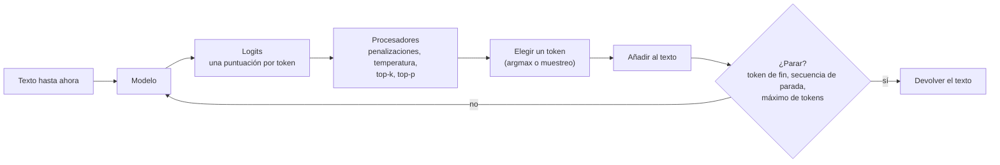
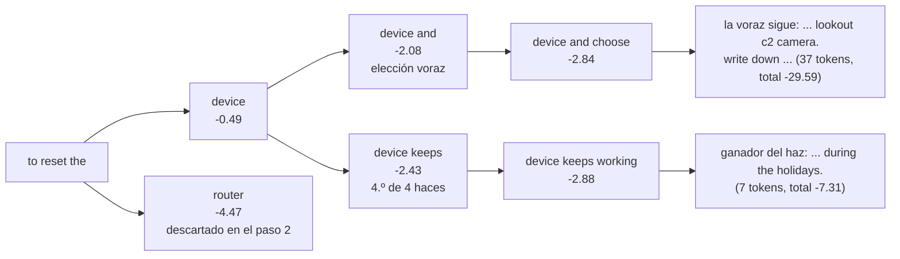
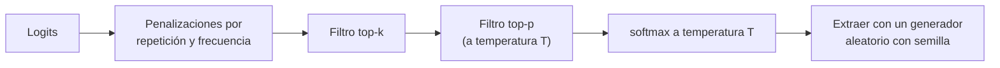
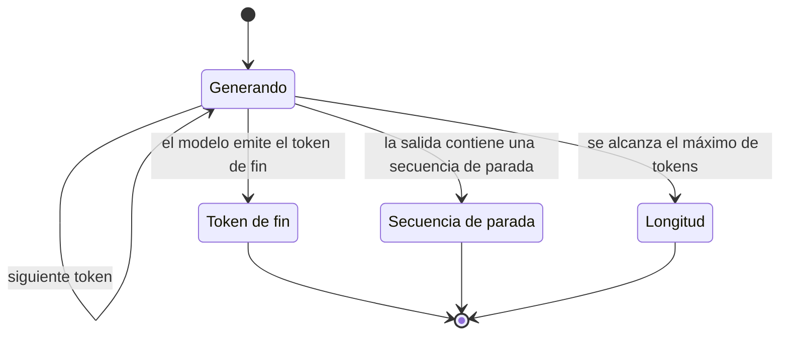

🌐 [English](01-decoding-strategies.md) · Español

# Lección 2.1 — Estrategias de decodificación

> **Módulo 02 · Lección 1 de 4** · ⏱️ unos 60 min · 🧪 Lab: [pasos 1 y 2](lab/README.es.md#paso-1--entrena-el-modelo-base-y-mira-sus-logits)

## 📨 Situación

> **De:** Rio Tanaka · Responsable de Ingeniería de IA
> **Canal:** #ai-team
>
> Jordan reenvió un clip de la demo de ayer para dirección. Alguien escribió "to reset the hub" en el
> prototipo. Empezó bien, luego se fue por las ramas hacia los horarios del termostato y las cafeteras
> hasta que se cortó a mitad de frase. La pregunta de dirección es justa: ¿por qué se enrolla, y es el
> modelo o nuestra configuración? Antes de comparar modelos, quiero que entiendas cada ajuste entre el
> modelo y el texto: temperatura, *top-p*, búsqueda en haz, penalizaciones, secuencias de parada,
> semillas. Entrena un modelo diminuto con nuestro propio texto del centro de ayuda para ver los números
> reales. ¿Qué medirías para distinguir un mal modelo de una mala decodificación?

## 🎯 Objetivos

Al terminar esta lección puedes:

- Calcular las probabilidades del siguiente *token* a partir de los *logits* con *softmax* y predecir cómo las remodela la temperatura.
- Implementar la decodificación voraz, la búsqueda en haz, el muestreo *top-k* y el muestreo *top-p* (de núcleo) sobre un vocabulario real.
- Explicar por qué la decodificación voraz y la búsqueda en haz entran en bucle o se vuelven sosas con *prompts* abiertos, y romper un bucle con una penalización por repetición.
- Controlar cuándo termina la generación y si es reproducible con secuencias de parada, máximo de *tokens* y semillas.
- Medir el compromiso entre diversidad y calidad con distinct-n, una tasa de repetición y la log-probabilidad media.

## 🤔 Predice primero

Apunta tus respuestas antes de seguir leyendo. Las comprobarás en la autoevaluación.

1. Si bajas la temperatura de 1,0 a 0,5, ¿el siguiente *token* más probable se vuelve más o menos
   probable? ¿Qué pasa con 2,0?
2. La búsqueda en haz encuentra continuaciones con una probabilidad total mayor que la decodificación
   voraz. Con un *prompt* abierto, ¿su texto será más interesante o menos?
3. Un modelo sigue hablando después de haber respondido. ¿El arreglo está en el modelo, en los ajustes
   de decodificación o en ambos?

## 1. De los logits a las probabilidades

Un modelo de lenguaje grande (LLM, *large language model*) hace una sola cosa cada vez: dado el texto
hasta ahora, produce una puntuación para cada *token* de su vocabulario. Esas puntuaciones en bruto se
llaman ***logits***. Un *logit* más alto significa "más probable a continuación", pero los *logits* no
son probabilidades: pueden ser negativos y no suman uno. La **decodificación** (*decoding*) es todo lo
que ocurre entre esas puntuaciones y el texto que ves: convertirlas en probabilidades, remodelarlas,
elegir un *token*, añadirlo y repetir hasta que algo diga basta. El modelo es el mismo en todos los
casos; la estrategia de decodificación decide qué texto sale.

Para ver cada número, el lab sustituye el LLM por un diminuto **modelo de trigramas** (*trigram model*)
entrenado con texto de Hearthwise: 95 documentos en inglés (17 páginas del centro de ayuda y 78 páginas
web que un *pipeline* de limpieza conservaría), 12.544 *tokens* de entrenamiento y un vocabulario de
797 entradas. Un modelo de trigramas predice la siguiente palabra a partir de las dos anteriores. Sus
puntuaciones son log-probabilidades, que se comportan igual que los *logits*, así que cada función de
esta lección funcionaría sin cambios sobre la salida de un Transformer.

La función que convierte *logits* en probabilidades es ***softmax***: calcula la exponencial de cada
puntuación y divide por el total. Antes, puedes dividir los *logits* por una **temperatura**
(*temperature*) T. Dividir por una T pequeña estira las distancias entre puntuaciones, así que el
*token* de arriba se lleva más probabilidad. Dividir por una T grande las encoge, así que la
distribución se aplana.

**Analogía:** la temperatura es el control de contraste de una foto. Poco contraste (T alta) deja todo
de un gris parecido; mucho contraste (T baja) hace que el punto más brillante deslumbre y todo lo demás
se oscurezca.



Esta es *softmax* con temperatura, tal como la implementa el lab:

```python
def softmax(logits: np.ndarray, temperature: float = 1.0) -> np.ndarray:
    """Probabilities from logits. Temperature divides the logits before normalising."""
    if temperature <= 0:
        raise ValueError("temperature must be > 0 (use greedy decoding for temperature 0)")
    z = logits / temperature
    z = z - np.max(z)  # numerical stability: the largest logit becomes 0
    e = np.exp(z)
    return e / e.sum()
```

Tras el *prompt* "to reset the", el siguiente *token* más probable del modelo base es "device". Fíjate
en lo que le hace la temperatura:

| Temperatura | P("device") | Qué significa |
|---|---|---|
| 0.5 | 0.996 | Casi seguro: el muestreo elegirá "device" casi siempre |
| 1.0 | 0.612 | La distribución propia del modelo |
| 2.0 | 0.063 | Aplanada: cientos de *tokens* basura compiten ahora con "device" |

El modelo no cambió entre esas tres filas. Solo cambió la decodificación.

> ⚠️ **Error común:** tratar "temperatura 0" como un muestreo muy frío. Dividir por cero no está
> definido, así que las bibliotecas y las interfaces de programación de aplicaciones (API, *application
> programming interfaces*) lo tratan como caso especial, normalmente pasando a decodificación voraz. Si
> necesitas una salida repetible, pide la decodificación voraz de forma explícita en lugar de fiarte de
> cómo trata el cero cada proveedor.

> 💡 **Consejo de producción:** registra los parámetros de decodificación (temperatura, *top-p*,
> *top-k*, penalizaciones, máximo de *tokens*, secuencias de parada, semilla) con cada petición, junto a
> la versión del modelo. Cuando llegue una reclamación, una transcripción sin esos ajustes no se
> puede reproducir.

## 2. Decodificación voraz y búsqueda en haz

La estrategia más simple es la **decodificación voraz** (*greedy decoding*): en cada paso, toma el
*token* con la puntuación más alta. Es determinista: el mismo *prompt* da el mismo texto siempre.
También es miope, porque un *token* que parece el mejor ahora puede llevar a un callejón sin salida.

La decodificación voraz tiene un fallo famoso con *prompts* abiertos: los **bucles de repetición**.
Ejecuta el modelo base de forma voraz con "returns are" durante 50 *tokens* y obtienes "...warm white
works best in the app with the appliance, not the lamp, so voice commands stay simple. warm white works
best in the app with the appliance..." El lab lo mide con **rep-3**, la proporción de 3-gramas
(secuencias de tres *tokens*) de una salida que ya aparecieron antes en esa misma salida. Esta salida
tiene rep-3 = 0,38: más de un tercio es una repetición.

¿Por qué entra en bucle? Un modelo de trigramas elige la siguiente palabra solo a partir de las dos
últimas. La decodificación voraz siempre hace la misma elección para las mismas dos palabras. Así que,
cuando el texto vuelve a un par de palabras por el que ya pasó, tiene que seguir el mismo camino otra
vez, para siempre. Los Transformers miran mucho más atrás, pero muestran la misma tendencia: una vez
que una frase ha aparecido, repetirla se vuelve más probable, y la decodificación voraz amplifica esa
realimentación. El artículo del muestreo de núcleo de la lista "Profundiza" documenta esta degeneración
en modelos grandes.

La **búsqueda en haz** (*beam search*) intenta corregir la miopía. En lugar de una respuesta parcial,
conserva las `k` mejores respuestas parciales (los haces). En cada paso extiende cada haz con sus
mejores *tokens* siguientes, puntúa cada candidato con la suma de sus log-probabilidades y se queda con
los `k` mejores. Los haces que producen el *token* de fin se apartan como terminados. Al final gana la
secuencia con mejor puntuación.

**Analogía:** la decodificación voraz es alguien que baja una montaña tomando siempre la senda más
empinada. La búsqueda en haz envía a cuatro personas por las cuatro sendas más prometedoras y, cada
hora, se queda solo con las cuatro que han bajado más.



Los números del diagrama son totales acumulados de log-probabilidades. La decodificación voraz se
compromete con "and" en el paso 2 porque -2,08 supera a cualquier alternativa. La búsqueda en haz
mantiene también viva "device keeps" como su cuarto haz, y ese camino llega antes a un final natural.
Este es el corazón de la búsqueda en haz del lab: extender, puntuar, quedarse con los `num_beams` mejores.

```python
for score, seq in beams:
    logits = next_logits(model, context + [model.vocab[i] for i in seq])
    logits = apply_repetition_penalty(logits, seq, config.repetition_penalty)
    best = np.argsort(-logits, kind="stable")[: config.num_beams]
    candidates.extend((score + float(logits[i]), seq + [int(i)]) for i in best)
candidates.sort(key=lambda c: -c[0])
beams = []
for score, seq in candidates:
    if seq[-1] == eos:
        finished.append((score, seq[:-1]))  # this beam produced the end token
    else:
        beams.append((score, seq))
    if len(beams) == config.num_beams:
        break
```

La búsqueda en haz con 4 haces responde a "to reset the" con "device keeps working during the
holidays." Son 7 *tokens* y luego se detiene, con una log-probabilidad total de -7,31 frente a -29,59
de la divagación voraz de 37 *tokens*. La razón es aritmética: cada *token* extra suma una
log-probabilidad negativa a la puntuación, así que ganan los finales cortos. En la generación abierta
esto vuelve **sosa** la búsqueda en haz: prefiere texto seguro, genérico y corto. Brilla cuando hay una
salida correcta y el modelo está seguro, como en traducción, transcripción de voz o rellenar un campo
estructurado. Las bibliotecas suelen añadir una **penalización por longitud** (*length penalty*) que
divide la puntuación por una potencia de la longitud, lo que contrarresta el sesgo hacia salidas cortas.

> ⚠️ **Error común:** recurrir a la búsqueda en haz para que un chatbot sea "mejor". Con respuestas
> abiertas cambia variedad por texto genérico y repetitivo, y cuesta `k` veces más cómputo por paso.
> Úsala para tareas con una única salida correcta.

> 💡 **Consejo de producción:** la decodificación voraz (o temperatura 0) es la opción por defecto
> adecuada para extracción, clasificación y salidas JSON (*JavaScript Object Notation*), donde quieres
> la misma respuesta para la misma entrada. Añade después una validación del esquema, porque una
> respuesta incorrecta determinista sigue siendo incorrecta.

## 3. Muestreo: temperatura, top-k, top-p y semillas

El **muestreo** (*sampling*) extrae el siguiente *token* al azar de la distribución de probabilidad.
"device", con probabilidad 0,612, sale aproximadamente el 61 % de las veces, y otra cosa el resto. Esa
variedad es lo que hace que el texto muestreado suene natural. El peligro es la **cola larga** (*long
tail*): cientos de *tokens* individualmente improbables que juntos acumulan una probabilidad real.
Nuestro modelo de trigramas mezcla una estimación de frecuencia de palabras con peso 0,1 para que
ninguna palabra tenga nunca probabilidad cero, lo que significa que el 10 % de la masa se reparte por
todo el vocabulario en cada paso. Muestrea "to reset the" con T = 1,5 (semilla 7) y la cola toma el
control: "level to room any from they (settings signal in homes corner..." con una log-probabilidad
total de -247.

Dos filtros cortan la cola antes de muestrear:

| Filtro | Regla | Debilidad |
|---|---|---|
| **top-k** | Conserva los `k` *tokens* con mayor puntuación | `k` es fijo: demasiados cuando el modelo está seguro, demasiado pocos cuando encajan muchas palabras |
| **top-p** (núcleo) | Conserva el conjunto más pequeño de *tokens* cuyas probabilidades suman al menos `p` | Se adapta a la forma de la distribución, pero con `p` alto aún puede colarse una cola larga y plana |

*Top-p* se adapta. Con p = 0,5, "to reset the" conserva un solo *token* ("device" ya tiene 0,612),
mientras que "if your bulb" conserva 8 *tokens* porque ninguna palabra domina. Con p = 0,9 las cifras
saltan a 79 y 118, porque el último tramo de probabilidad está muy repartido por la cola. Mira el tamaño
real del núcleo para tu modelo y tus *prompts* en lugar de fiarte de un valor de p por defecto.

**Analogía:** *top-k* es "invita siempre a las 10 primeras candidaturas", por buena o mala que sea la
décima. *Top-p* es "invita a candidaturas por orden de votos hasta cubrir el 90 % del electorado": una
sola si arrasa, muchas si el voto está dividido.



El filtro *top-p* del lab ordena las probabilidades, las acumula y conserva el prefijo que alcanza `p`:

```python
def top_p_filter(logits: np.ndarray, p: float, temperature: float = 1.0) -> np.ndarray:
    """Nucleus filter: keep the smallest set of tokens whose probabilities sum to at least ``p``."""
    if p >= 1.0:
        return logits
    probs = softmax(logits, temperature)
    order = np.argsort(-probs, kind="stable")
    cumulative = np.cumsum(probs[order])
    n_keep = int(np.searchsorted(cumulative, p - 1e-9) + 1)  # first position where the sum reaches p
    keep = order[:n_keep]
    out = np.full_like(logits, NEG_INF)
    out[keep] = logits[keep]
    return out
```

El azar plantea una pregunta práctica: ¿puedes obtener la misma salida dos veces? Sí, si controlas la
**semilla** (*seed*) del generador de números aleatorios. En el lab, `DecodeConfig(seed=7)` crea
`np.random.default_rng(7)`, y el mismo *prompt* con la misma semilla y los mismos ajustes da un texto
idéntico, *token* a *token*. Cambia la semilla a 8 y obtienes otra continuación. La decodificación voraz
y la búsqueda en haz ignoran la semilla, porque nunca extraen al azar.

**Analogía:** una semilla es el orden de una baraja mezclada. Reparte desde la misma mezcla y cada
persona recibe las mismas cartas; vuelve a barajar y la partida cambia.

> ⚠️ **Error común:** cambiar la temperatura y *top-p* a la vez y luego intentar explicar el resultado.
> Ambos remodelan la misma distribución. Cambia un ajuste cada vez y mide, o no sabrás cuál ayudó.

> 💡 **Consejo de producción:** en las plataformas reales de *serving*, la semilla suele funcionar "en
> la medida de lo posible". El procesamiento por lotes, el orden de las sumas en coma flotante y las
> actualizaciones silenciosas del modelo pueden cambiar las salidas. Para tests de regresión, prefiere
> la decodificación voraz con una versión fija del modelo, y evalúa el comportamiento muestreado con
> varias semillas, no con una.

## 4. Penalizaciones, secuencias de parada y máximo de tokens: por qué los modelos se enrollan

Volvamos a la demo para dirección. La decodificación voraz con "to reset the" produce "device and
choose lookout c2 camera. write down what each of your a dozen devices left on standby add up to a
noticeable share of the bill. measure the coffee machine that heats up." La primera frase va al grano;
el resto es el modelo continuando un documento. Enrollarse tiene cuatro causas distintas, y cada una
tiene su arreglo:

| Causa | Qué ves | Arreglo |
|---|---|---|
| Un modelo base se entrenó para continuar documentos, no para responder y parar | Sigue después de la respuesta | Un post-entrenamiento que enseñe un *token* de fin de turno (lección 2.2) |
| No hay secuencia de parada | El texto se mete en el siguiente tema | Pasar secuencias de parada como un salto de línea o un marcador de turno |
| Se alcanza el límite de *tokens* | Texto cortado a mitad de frase (`finish_reason = "length"`) | Subir el límite o pedir respuestas más cortas; nunca ocultarlo |
| Bucle de repetición | La misma frase una y otra vez | Penalizaciones por repetición, frecuencia o presencia; muestreo en lugar de voraz |

La primera causa es la más profunda. En nuestro corpus, el *token* de fin de documento aparece una vez
por documento: 95 veces en 12.544 *tokens*. El modelo rara vez ve "para aquí", así que rara vez lo
predice. Una **secuencia de parada** (*stop sequence*) es una cadena que termina la generación en cuanto
aparece, y no se incluye en la salida. Con `--stop "."`, la misma ejecución voraz devuelve "device and
choose lookout c2 camera" con `finish_reason=stop`. El máximo de *tokens* (*max tokens*) es un techo
rígido: al alcanzarlo, la respuesta termina donde esté y la API informa `finish_reason = "length"`.

Una **penalización por repetición** (*repetition penalty*) hace menos atractivos los *tokens* que ya
aparecieron. La regla multiplicativa que usan varias bibliotecas de código abierto divide un *logit*
positivo por la penalización y multiplica uno negativo por ella, así que el *token* siempre baja. Con
una penalización de 1,3, la ejecución voraz de "returns are" escapa de su bucle: rep-3 baja de 0,38 a
0,00. Las API al estilo de OpenAI ofrecen en cambio versiones aditivas: una **penalización por
frecuencia** (*frequency penalty*) resta una cantidad por cada aparición previa, y una **penalización
por presencia** (*presence penalty*) resta una cantidad fija en cuanto un *token* ha aparecido.

**Analogía:** las secuencias de parada son el "cambio" al final de un mensaje de radio; el máximo de
*tokens* es quien opera la emisora cortando la señal cuando acaba tu turno; una penalización por
repetición es alguien de confianza que te da un codazo cuando cuentas la misma historia dos veces.



```python
def apply_repetition_penalty(logits: np.ndarray, history: Sequence[int], penalty: float) -> np.ndarray:
    """Make tokens that already appeared less likely (the multiplicative rule used by many libraries)."""
    if penalty == 1.0 or not history:
        return logits
    out = logits.copy()
    seen = np.unique(np.asarray(history, dtype=np.int64))
    vals = out[seen]
    out[seen] = np.where(vals > 0, vals / penalty, vals * penalty)
    return out
```

> ⚠️ **Error común:** bajar el máximo de *tokens* para "parar la divagación". Obtienes respuestas
> cortadas a mitad de frase y la clientela ve texto roto. Mira `finish_reason`: si muchas respuestas
> terminan con `length`, el arreglo es una condición de parada o un modelo que haya aprendido a parar,
> no un techo más bajo.

> 💡 **Consejo de producción:** pon en un panel la proporción de respuestas con
> `finish_reason = "length"`. Una subida repentina suele significar que un cambio de *prompt* alargó las
> respuestas o que una actualización del modelo dejó de emitir el *token* de fin de turno.

## 5. Medir el compromiso entre diversidad y calidad

Rio preguntó qué medirías. "Se ve mejor" no es una medición, así que el lab ejecuta cada estrategia
con 6 *prompts* y 5 semillas cada uno (30 salidas, hasta 50 *tokens* nuevos) e informa de cuatro números:

- **distinct-2**: 2-gramas únicos divididos por todos los 2-gramas, agregados sobre las 30 salidas. Más
  alto significa redacción más variada entre respuestas y dentro de ellas.
- **rep-3**: la proporción media de 3-gramas repetidos dentro de una salida. Más alto significa bucles.
- **unique**: cuántas de las 30 salidas son textos distintos.
- **logp/tok**: la log-probabilidad media del modelo por *token* generado. Más cerca de cero significa
  "texto que el propio modelo considera probable", un indicador aproximado de fluidez.

| Estrategia | distinct-2 | rep-3 | unique | logp/tok | terminó con el *token* de fin |
|---|---|---|---|---|---|
| greedy | 0.130 | 0.062 | 6/30 | -0.78 | 0.83 |
| beam (4 haces) | 0.140 | 0.000 | 6/30 | -0.85 | 1.00 |
| sample T=1.0 | 0.540 | 0.021 | 30/30 | -2.00 | 0.03 |
| sample T=0.7 | 0.532 | 0.006 | 30/30 | -1.12 | 0.40 |
| sample T=1.5 | 0.623 | 0.000 | 30/30 | -5.77 | 0.40 |
| top-k k=10 | 0.616 | 0.008 | 30/30 | -1.26 | 0.27 |
| top-p p=0.9 | 0.635 | 0.001 | 30/30 | -1.38 | 0.37 |
| top-p 0.9 + penalización por repetición 1.3 | 0.655 | 0.003 | 30/30 | -1.32 | 0.23 |

Lee la tabla por parejas. La decodificación voraz y la búsqueda en haz tienen las mejores
log-probabilidades (-0,78 y -0,85 por *token*), pero pídeles algo cinco veces y obtienes la misma
respuesta cinco veces (6 salidas únicas para 6 *prompts*), así que distinct-2 se hunde a 0,130 y 0,140.
Muestrear con T = 1,5 da mucha diversidad pero una log-probabilidad de -5,77 por *token*: tonterías
variadas. *Top-p* con 0,9 conserva casi toda la diversidad (0,635) con una log-probabilidad mucho mejor
(-1,38), y añadir una penalización por repetición sube la diversidad a 0,655.

Ninguna columna gana sola. Distinct-n por sí solo coronaría el galimatías; la log-probabilidad por sí
sola coronaría los bucles. Por eso los ajustes de decodificación se eligen con una evaluación a nivel de
tarea, que es la lección 2.4.

**Analogía:** juzgar la decodificación solo por la diversidad es como juzgar un restaurante por la
longitud de su carta; juzgarla solo por la log-probabilidad es como juzgarlo por lo poco que te
sorprende quien cocina.

```python
rows.append(
    BenchRow(
        name=name,
        distinct_2=distinct_n([g.tokens for g in outs], 2),
        rep_3=float(np.mean([repetition_rate(g.tokens, 3) for g in outs])),
        unique_outputs=len({g.text for g in outs}),
        n_outputs=len(outs),
        logprob_per_token=sum(g.logprob for g in outs) / max(n_tok, 1),
        eos_rate=sum(g.finish_reason == "eos" for g in outs) / len(outs),
    )
)
```

> ⚠️ **Error común:** comparar log-probabilidades producidas por modelos distintos. Cada modelo tiene su
> propio tokenizador y su propia idea de lo "probable". La log-probabilidad solo es una vara de medir
> justa para distintas estrategias de decodificación aplicadas al mismo modelo.

> 💡 **Consejo de producción:** para un caso de uso nuevo, ejecuta una pequeña rejilla (por ejemplo,
> dos temperaturas por dos valores de *top-p*) sobre un conjunto fijo de *prompts* reales con varias
> semillas, y puntúa las salidas con la evaluación de la tarea que construirás en la lección 2.4.
> Guarda los resultados de la rejilla: son tu justificación cuando alguien pregunte por qué los valores
> por defecto son los que son.

## 🧪 Pruébalo

Ejecuta esto desde `modules/02-decoding-post-training-evaluation/lab` después de `uv sync`.

1. Construye el modelo base y comprueba su tamaño.

   ```bash
   uv run lab corpus
   ```

   ```text
   documents: 95 (17 help-centre pages, 78 web pages)
   training tokens (including <eos>): 12544
   vocabulary (words seen at least twice + 3 special tokens): 797
   ```

2. Mira la distribución del siguiente *token* a tres temperaturas y el tamaño del núcleo.

   ```bash
   uv run lab next-token --prompt "to reset the"
   ```

   ```text
   prompt: 'to reset the'
   T=0.5  'device' 0.996  'router' 0.000  'app' 0.000  'thermostat' 0.000  'home' 0.000
   T=1.0  'device' 0.612  'router' 0.011  'app' 0.009  'thermostat' 0.009  'home' 0.008
   T=2.0  'device' 0.063  'router' 0.009  'app' 0.008  'thermostat' 0.007  'home' 0.007
   tokens kept by top-p (p=0.5: 1, p=0.9: 79) out of 797
   ```

3. Provoca un bucle voraz y luego rómpelo con una penalización por repetición.

   ```bash
   uv run lab generate --strategy greedy --prompt "returns are" --max-tokens 50
   uv run lab generate --strategy greedy --prompt "returns are" --max-tokens 50 --repetition-penalty 1.3
   ```

   ```text
   returns are -> hard to debug. avoid bright cold light late in the app with the appliance, not the lamp, so voice commands stay simple. warm white works best in the app with the appliance, not the lamp, so voice commands stay simple. warm white works
   [finish_reason=length tokens=50 logprob=-29.91 rep-3=0.38]
   returns are -> hard to debug. avoid bright cold light late in the app with the appliance, not the lamp, so voice commands stay simple. warm white works best in the bedroom and see if anyone notices. a smart plug can switch on when the last person leaves
   [finish_reason=length tokens=50 logprob=-34.15 rep-3=0.00]
   ```

4. Corta la divagación con una secuencia de parada y compárala con la búsqueda en haz.

   ```bash
   uv run lab generate --strategy greedy --prompt "to reset the" --stop "."
   uv run lab generate --strategy beam --prompt "to reset the"
   ```

   ```text
   to reset the -> device and choose lookout c2 camera
   [finish_reason=stop tokens=6 logprob=-7.76 rep-3=0.00]
   to reset the -> device keeps working during the holidays.
   [finish_reason=eos tokens=7 logprob=-7.31 rep-3=0.00]
   ```

5. Ejecuta la comparación completa: `uv run lab decode-bench`. Tus números deben coincidir exactamente
   con la tabla de la sección 5; si no coinciden, algo de tu entorno no es determinista.

## 🏭 En el mundo real

- **Valores por defecto según el caso de uso.** Los equipos suelen tener *presets* separados: voraz o
  temperatura casi cero para extracción, clasificación y argumentos de herramientas; temperatura
  moderada con *top-p* para respuestas conversacionales; temperatura más alta solo para lluvia de ideas.
  Documenta los *presets* y versiónalos como código.
- **Los nombres y el orden cambian.** Los nombres de los parámetros, los rangos permitidos y el orden en
  que se aplican los filtros difieren entre bibliotecas y API. Dos ajustes "top-p 0.9" en dos
  proveedores no tienen por qué comportarse igual. Lee la documentación y prueba con tus propios
  *prompts*.
- **Decodificación restringida.** Cuando la salida debe seguir un formato, algunos entornos de ejecución
  pueden enmascarar en cada paso cualquier *token* que rompería una gramática o un esquema JSON.
  [llama.cpp](https://github.com/ggml-org/llama.cpp), por ejemplo, admite gramáticas. Esto también es
  decodificación: un procesador que pone a menos infinito los *logits* prohibidos.
- **La velocidad también es un problema de decodificación.** La
  [decodificación especulativa](https://arxiv.org/abs/2211.17192) usa un modelo borrador pequeño para
  proponer varios *tokens* y el modelo grande para verificarlos, lo que acelera la generación sin
  cambiar la distribución de salida. Volverás a ver optimizaciones de *serving* en el módulo 10.
- **Qué monitorizar:** la distribución de `finish_reason`, la longitud de la salida en *tokens*, una
  puntuación de repetición sobre una muestra de respuestas y los ajustes de decodificación en uso. Sam
  pedirá latencia y coste en el módulo 03; la longitud de la salida determina ambos.

## ✅ Autoevaluación

**1. Bajas la temperatura de 1,0 a 0,5. ¿Qué le pasa al *token* más probable, y qué pasa con 2,0?
(Pregunta 1 de "Predice primero".)**

<details><summary>Respuesta</summary>

Con 0,5 se vuelve más probable: dividir los *logits* por un número menor que 1 estira las distancias,
así que el *token* de arriba se lleva más masa ("device" pasa de 0,612 a 0,996). Con 2,0 las distancias
se encogen y la distribución se aplana ("device" cae a 0,063). Una respuesta tentadora pero incorrecta
es que la temperatura añade ruido aleatorio; no lo hace, reescala las puntuaciones antes de *softmax*.

</details>

**2. La búsqueda en haz encuentra continuaciones más probables que la decodificación voraz. ¿Por qué su
texto abierto suele ser peor? (Pregunta 2 de "Predice primero".)**

<details><summary>Respuesta</summary>

El texto más probable es corto y genérico. Cada *token* extra suma una log-probabilidad negativa, así
que la búsqueda en haz favorece los finales tempranos y las frases seguras: "device keeps working during
the holidays." La escritura humana no es la secuencia más probable; contiene palabras sorprendentes pero
sensatas. La búsqueda en haz encaja bien cuando hay una única salida correcta, no para respuestas
abiertas.

</details>

**3. ¿Por qué la decodificación voraz sobre un modelo de trigramas nunca puede escapar de un bucle una
vez que repite un par de palabras?**

<details><summary>Respuesta</summary>

La siguiente elección depende solo de los dos últimos *tokens*, y la decodificación voraz siempre hace
la misma elección para la misma entrada. Volver a un par de palabras anterior reproduce el mismo camino
para siempre. Una penalización por repetición cambia las puntuaciones de los *tokens* ya usados, lo que
rompe el ciclo (rep-3 pasó de 0,38 a 0,00 con "returns are").

</details>

**4. "device" tiene probabilidad 0,612 tras "to reset the" y, aun así, *top-p* con 0,9 conserva 79
*tokens*. ¿Está roto el filtro?**

<details><summary>Respuesta</summary>

No. *Top-p* conserva *tokens* hasta que sus probabilidades suman 0,9. Después de "device", la
probabilidad restante está muy repartida por una cola larga, así que hacen falta 78 *tokens* más para
reunir el 0,29 que falta. Con p = 0,5, el mismo *prompt* conserva un solo *token*. El tamaño del núcleo
depende de la forma de toda la distribución, no solo del *token* de arriba.

</details>

**5. El modelo de la demo sigue hablando después de responder. ¿Dónde está el arreglo? (Pregunta 3 de
"Predice primero".)**

<details><summary>Respuesta</summary>

En ambos. Los ajustes de decodificación pueden contener el daño hoy: secuencias de parada, un límite de
*tokens* razonable, una penalización por repetición y la monitorización de `finish_reason`. La causa
de fondo es el modelo: un modelo base se entrenó para continuar documentos y rara vez vio un marcador de
fin. El post-entrenamiento le enseña a terminar su turno (lección 2.2). Reducir solo el máximo de
*tokens* únicamente corta frases por la mitad.

</details>

## 💬 Explícalo con tus palabras

- Jordan tiene dos minutos antes de la próxima reunión de dirección. Explica en tres frases por qué se
  enrolló la demo, qué puedes cambiar hoy y qué necesita post-entrenamiento.
- Explícale a Sam por qué `finish_reason` y la longitud de la salida deben estar en el mismo panel que
  la latencia.

## 🔑 Ideas clave

- Un modelo produce *logits*; la decodificación los convierte en texto. El mismo modelo puede sonar
  brillante o roto según la decodificación.
- La temperatura reescala los *logits* antes de *softmax*: por debajo de 1 afila, por encima de 1 aplana.
- La decodificación voraz y la búsqueda en haz son deterministas y favorecen el texto probable, corto y
  repetitivo: buenas para tareas de respuesta única, malas para las abiertas.
- *Top-k* conserva un número fijo de candidatos; *top-p* conserva los candidatos necesarios para cubrir
  una masa de probabilidad, así que se adapta a la seguridad del modelo.
- Enrollarse tiene causas distintas (sin fin aprendido, sin secuencia de parada, máximo de *tokens*,
  bucles) con arreglos distintos; `finish_reason` te dice cuál te ha tocado.
- Las semillas hacen reproducible el muestreo en el lab; en producción, trátalas como algo "en la medida
  de lo posible".
- Mide la decodificación con varios números a la vez (diversidad, repetición, verosimilitud) y, en
  última instancia, con una evaluación de la tarea.

## 📚 Profundiza

- ⭐ [The Curious Case of Neural Text Degeneration](https://arxiv.org/abs/1904.09751) — el artículo que
  introdujo el muestreo de núcleo (*top-p*) y muestra por qué la decodificación voraz y la búsqueda en
  haz degeneran con texto abierto.
- [Hierarchical Neural Story Generation](https://arxiv.org/abs/1805.04833) — un uso temprano e
  influyente del muestreo *top-k* para escribir historias.
- [nanoGPT](https://github.com/karpathy/nanoGPT) — lee su función `generate`: un bucle de muestreo
  corto con temperatura y *top-k* que se corresponde línea a línea con esta lección.
- [Fast Inference from Transformers via Speculative Decoding](https://arxiv.org/abs/2211.17192) — cómo
  acelerar la decodificación sin cambiar lo que diría el modelo.

---

[← Anterior: Presentación del módulo 02](README.es.md) · [🏠 Módulo 02](README.es.md) · [Siguiente: 2.2 Ajuste fino supervisado →](02-supervised-fine-tuning.es.md)
