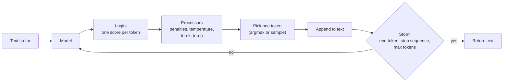
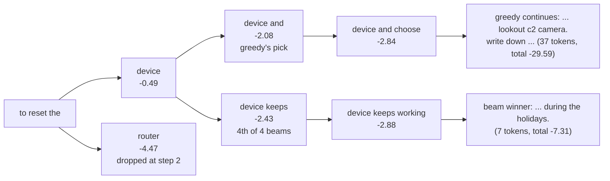
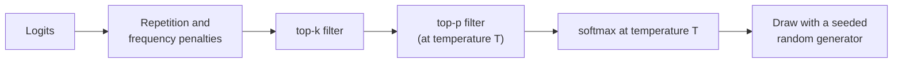
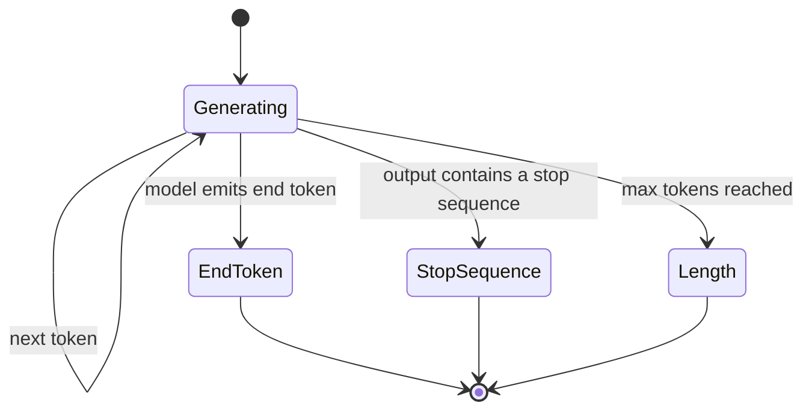

🌐 English · [Español](01-decoding-strategies.es.md)

# Lesson 2.1 — Decoding strategies

> **Module 02 · Lesson 1 of 4** · ⏱️ about 60 min · 🧪 Lab: [steps 1 and 2](lab/README.md#step-1--train-the-base-model-and-look-at-its-logits)

## 📨 Situation

> **From:** Rio Tanaka · Head of AI Engineering
> **Channel:** #ai-team
>
> Jordan forwarded a clip from yesterday's leadership demo. Someone typed "to reset the hub" into the
> prototype. It started fine, then wandered into thermostat schedules and coffee machines until it was
> cut off mid-sentence. The question from leadership is fair: why does it ramble, and is that the model
> or our settings? Before we compare models, I want you to understand every knob between the model and
> the text: temperature, top-p, beam search, penalties, stop sequences, seeds. Train a tiny model on our
> own help-centre text so you can see the actual numbers. What would you measure to tell a bad model
> from bad decoding?

## 🎯 Objectives

By the end of this lesson you can:

- Compute next-token probabilities from logits with softmax and predict how temperature reshapes them.
- Implement greedy decoding, beam search, top-k sampling and top-p (nucleus) sampling over a real
  vocabulary.
- Explain why greedy decoding and beam search loop or go bland on open-ended prompts, and break a loop
  with a repetition penalty.
- Control when generation ends and whether it is reproducible with stop sequences, max tokens and seeds.
- Measure the diversity–quality trade-off with distinct-n, a repetition rate and average log-probability.

## 🤔 Predict first

Write your answers down before reading on. You will check them in the self-check.

1. If you lower the temperature from 1.0 to 0.5, does the most likely next token become more likely or
   less likely? What happens at 2.0?
2. Beam search finds continuations with a higher total probability than greedy decoding. On an
   open-ended prompt, will its text be more interesting or less?
3. A model keeps talking after it has answered. Is the fix in the model, in the decoding settings, or in
   both?

## 1. From logits to probabilities

A large language model (LLM) does one thing at a time: given the text so far, it produces a score for
every token in its vocabulary. These raw scores are called **logits**. A higher logit means "more
likely next", but logits are not probabilities: they can be negative, and they do not sum to one.
**Decoding** is everything that happens between those scores and the text you see: turning scores into
probabilities, reshaping them, picking one token, appending it, and repeating until something says
stop. The model is the same in every case; the decoding strategy decides which text comes out.

To see every number, the lab replaces the LLM with a tiny **trigram model** trained on Hearthwise
text: 95 English documents (17 help-centre pages and 78 web pages that a cleaning pipeline would keep),
12,544 training tokens and a vocabulary of 797 entries. A trigram model predicts the next word from the
previous two. Its scores are log-probabilities, which behave exactly like logits, so every function in
this lesson would work unchanged on the output of a transformer.

The function that turns logits into probabilities is **softmax**: exponentiate every score, then divide
by the total. Before that, you can divide the logits by a **temperature** T. Dividing by a small T
stretches the gaps between scores, so the top token takes more of the probability. Dividing by a large
T shrinks the gaps, so the distribution flattens.

**Analogy:** temperature is the contrast knob on a photo. Low contrast (high T) makes everything a
similar grey; high contrast (low T) makes the brightest spot glare and everything else go dark.



Here is softmax with temperature, exactly as the lab implements it:

```python
def softmax(logits: np.ndarray, temperature: float = 1.0) -> np.ndarray:
    """Probabilities from logits. Temperature divides the logits before normalising."""
    if temperature <= 0:
        raise ValueError("temperature must be > 0 (use greedy decoding for temperature 0)")
    z = logits / temperature
    z = z - np.max(z)  # numerical stability: the largest logit becomes 0
    e = np.exp(z)
    return e / e.sum()
```

After the prompt "to reset the", the base model's most likely next token is "device". Watch what
temperature does to it:

| Temperature | P("device") | What it means |
|---|---|---|
| 0.5 | 0.996 | Almost certain: sampling will nearly always pick "device" |
| 1.0 | 0.612 | The model's own distribution |
| 2.0 | 0.063 | Flattened: hundreds of junk tokens now compete with "device" |

The model did not change between those three rows. Only the decoding did.

> ⚠️ **Common mistake:** treating "temperature 0" as a very cold sample. Dividing by zero is undefined,
> so libraries and application programming interfaces (APIs) special-case it, usually by switching to greedy decoding. If you need
> repeatable output, ask for greedy decoding explicitly rather than relying on how a provider handles
> zero.

> 💡 **Production tip:** log the decoding parameters (temperature, top-p, top-k, penalties, max tokens,
> stop sequences, seed) with every request, next to the model version. When a customer complaint
> arrives, a transcript without those settings cannot be reproduced.

## 2. Greedy decoding and beam search

The simplest strategy is **greedy decoding**: at every step, take the token with the highest score. It
is deterministic: the same prompt gives the same text every time. It is also short-sighted, because a
token that looks best now can lead into a dead end later.

Greedy decoding has a famous failure on open-ended prompts: **repetition loops**. Run the base model
greedily on "returns are" for 50 tokens and you get "...warm white works best in the app with the
appliance, not the lamp, so voice commands stay simple. warm white works best in the app with the
appliance..." The lab measures this with **rep-3**, the share of 3-grams (three-token sequences) in an
output that already appeared earlier in the same output. This output has rep-3 = 0.38: more than a
third of it is a replay.

Why does it loop? A trigram model chooses the next word from the last two words only. Greedy decoding
always makes the same choice for the same two words. So once the text returns to a pair of words it
has already passed through, it must follow the same path again, forever. Transformers look much further
back, but they show the same tendency: once a phrase has appeared, repeating it becomes more likely, and
greedy decoding amplifies that feedback. The nucleus sampling paper in the "Go deeper" list documents
this degeneration in large models.

**Beam search** tries to fix short-sightedness. Instead of one partial answer, it keeps the `k` best
partial answers (the beams). At each step it extends every beam with its best next tokens, scores each
candidate by the sum of its log-probabilities, and keeps the top `k`. Beams that produce the end token
are set aside as finished. At the end, the highest-scoring sequence wins.

**Analogy:** greedy decoding is a hiker who always takes the steepest path downhill. Beam search sends
four scouts down the four most promising paths, and every hour keeps only the four scouts who are
furthest down.



The numbers in the diagram are running totals of log-probabilities. Greedy decoding commits to "and"
at step 2 because -2.08 beats every alternative. Beam search also keeps "device keeps" alive as its
fourth beam, and that path later reaches a natural ending much sooner. Here is the heart of the lab's
beam search: extend, score, keep the best `num_beams`.

```python
for score, seq in beams:
    logits = next_logits(model, context + [model.vocab[i] for i in seq])
    logits = apply_repetition_penalty(logits, seq, config.repetition_penalty)
    best = np.argsort(-logits, kind="stable")[: config.num_beams]
    candidates.extend((score + float(logits[i]), seq + [int(i)]) for i in best)
candidates.sort(key=lambda c: -c[0])
beams = []
for score, seq in candidates:
    if seq[-1] == eos:
        finished.append((score, seq[:-1]))  # this beam produced the end token
    else:
        beams.append((score, seq))
    if len(beams) == config.num_beams:
        break
```

Beam search with 4 beams answers "to reset the" with "device keeps working during the holidays."
That is 7 tokens and then it stops, with a total log-probability of -7.31 against -29.59 for the
37-token greedy ramble. The reason is arithmetic: every extra token adds a negative
log-probability to the score, so short endings win. In open-ended generation this makes beam search
**bland**: it prefers safe, generic, short text. It shines where there is one right output and the
model is confident, such as translation, speech transcription or filling a structured field. Libraries
often add a **length penalty** that divides the score by a power of the length, which counteracts the
bias towards short outputs.

> ⚠️ **Common mistake:** reaching for beam search to make a chatbot "better". For open-ended answers it
> trades variety for generic, repetitive text and costs `k` times more compute per step. Use it for
> tasks with a single correct output.

> 💡 **Production tip:** greedy decoding (or temperature 0) is the right default for extraction,
> classification and JSON (JavaScript Object Notation) outputs, where you want the same answer for the same input. Add a schema
> check after it, because a deterministic wrong answer is still wrong.

## 3. Sampling: temperature, top-k, top-p and seeds

**Sampling** draws the next token at random from the probability distribution. "device" with probability
0.612 is picked about 61% of the time, and something else the rest of the time. That variety is what
makes sampled text feel natural. The danger is the **long tail**: hundreds of tokens that are each
unlikely but together carry real probability. Our trigram model mixes in a word-frequency estimate with
weight 0.1 so that no word ever has probability zero, which means 10% of the mass is spread over the
whole vocabulary at every step. Sample "to reset the" at T = 1.5 (seed 7) and the tail takes over:
"level to room any from they (settings signal in homes corner..." with a total log-probability of -247.

Two filters cut the tail before sampling:

| Filter | Rule | Weakness |
|---|---|---|
| **top-k** | Keep the `k` highest-scoring tokens | `k` is fixed: too many when the model is sure, too few when many words fit |
| **top-p** (nucleus) | Keep the smallest set of tokens whose probabilities add up to at least `p` | Adapts to the shape of the distribution, but a long flat tail can still sneak in at high `p` |

Top-p adapts. At p = 0.5, "to reset the" keeps a single token ("device" already has 0.612), while "if
your bulb" keeps 8 tokens because no word dominates. At p = 0.9 the counts jump to 79 and 118,
because the last stretch of probability is spread thinly over the tail. Look at the actual nucleus
size for your model and prompts rather than trusting a default value of p.

**Analogy:** top-k is "always invite the top 10 candidates", however good or bad the tenth one is.
Top-p is "invite candidates in order of votes until you have covered 90% of the voters": one candidate
if they are a landslide, many if the vote is split.



The top-p filter in the lab sorts the probabilities, accumulates them and keeps the prefix that reaches
`p`:

```python
def top_p_filter(logits: np.ndarray, p: float, temperature: float = 1.0) -> np.ndarray:
    """Nucleus filter: keep the smallest set of tokens whose probabilities sum to at least ``p``."""
    if p >= 1.0:
        return logits
    probs = softmax(logits, temperature)
    order = np.argsort(-probs, kind="stable")
    cumulative = np.cumsum(probs[order])
    n_keep = int(np.searchsorted(cumulative, p - 1e-9) + 1)  # first position where the sum reaches p
    keep = order[:n_keep]
    out = np.full_like(logits, NEG_INF)
    out[keep] = logits[keep]
    return out
```

Randomness raises a practical question: can you get the same output twice? Yes, if you control the
**seed** of the random number generator. In the lab, `DecodeConfig(seed=7)` creates
`np.random.default_rng(7)`, and the same prompt with the same seed and settings gives the identical
text, token for token. Change the seed to 8 and you get a different continuation. Greedy decoding and
beam search ignore the seed, because they never draw at random.

**Analogy:** a seed is the order of a shuffled deck. Deal from the same shuffle and every player gets
the same cards; reshuffle and the game changes.

> ⚠️ **Common mistake:** changing temperature and top-p together, then trying to explain the result.
> Both reshape the same distribution. Change one knob at a time and measure, or you will not know which
> one helped.

> 💡 **Production tip:** on real serving stacks a seed is often best effort. Batching, floating-point
> summation order and silent model updates can still change outputs. For regression tests, prefer greedy
> decoding plus a pinned model version, and evaluate sampled behaviour over several seeds rather than
> one.

## 4. Penalties, stop sequences and max tokens: why models ramble

Back to the leadership demo. Greedy decoding on "to reset the" produces "device and choose lookout c2
camera. write down what each of your a dozen devices left on standby add up to a noticeable share of
the bill. measure the coffee machine that heats up." The first clause is on topic; the rest is the model
continuing a document. Rambling has four separate causes, and each has its own fix:

| Cause | What you see | Fix |
|---|---|---|
| A base model was trained to continue documents, not to answer and stop | It keeps going after the answer | Post-training that teaches an end-of-turn token (lesson 2.2) |
| No stop sequence | Text runs into the next topic | Pass stop sequences such as a newline or a turn marker |
| The max-token limit is hit | Text cut mid-sentence (`finish_reason = "length"`) | Raise the limit or ask for shorter answers; never hide it |
| Repetition loop | The same phrase over and over | Repetition, frequency or presence penalties; sampling instead of greedy |

The first cause is the deepest. In our corpus the end-of-document token appears once per document: 95
times in 12,544 tokens. The model rarely sees "stop here", so it rarely predicts it. A **stop
sequence** is a string that ends generation as soon as it appears, and it is not included in the
output. With `--stop "."`, the same greedy run returns "device and choose lookout c2 camera" with
`finish_reason=stop`. Max tokens is a hard ceiling: when it is reached, the response ends wherever it is
and the API reports `finish_reason = "length"`.

A **repetition penalty** makes tokens that already appeared less attractive. The multiplicative rule
used by several open-source libraries divides a positive logit by the penalty and multiplies a negative
one by it, so the token always moves down. With a penalty of 1.3, the greedy "returns are" run escapes
its loop: rep-3 drops from 0.38 to 0.00. APIs in the OpenAI style expose additive versions instead: a
**frequency penalty** subtracts an amount per previous occurrence, and a **presence penalty** subtracts a
fixed amount once a token has appeared at all.

**Analogy:** stop sequences are the "over" at the end of a radio message; max tokens is the operator
pulling the plug when your time slot ends; a repetition penalty is a friend nudging you when you tell
the same story twice.



```python
def apply_repetition_penalty(logits: np.ndarray, history: Sequence[int], penalty: float) -> np.ndarray:
    """Make tokens that already appeared less likely (the multiplicative rule used by many libraries)."""
    if penalty == 1.0 or not history:
        return logits
    out = logits.copy()
    seen = np.unique(np.asarray(history, dtype=np.int64))
    vals = out[seen]
    out[seen] = np.where(vals > 0, vals / penalty, vals * penalty)
    return out
```

> ⚠️ **Common mistake:** lowering max tokens to "stop the rambling". You get answers cut mid-sentence,
> and users see broken text. Check `finish_reason`: if many responses end with `length`, the fix is a
> stop condition or a model that has learned to stop, not a smaller ceiling.

> 💡 **Production tip:** put the share of responses with `finish_reason = "length"` on a dashboard. A
> sudden rise usually means a prompt change made answers longer, or a model update stopped emitting
> the end-of-turn token.

## 5. Measuring the diversity–quality trade-off

Rio asked what you would measure. "It looks better" is not a measurement, so the lab runs every
strategy on 6 prompts with 5 seeds each (30 outputs, up to 50 new tokens) and reports four numbers:

- **distinct-2**: unique 2-grams divided by all 2-grams, pooled over the 30 outputs. Higher means more
  varied wording across and within answers.
- **rep-3**: the average share of repeated 3-grams inside one output. Higher means loops.
- **unique**: how many of the 30 outputs are different texts.
- **logp/tok**: the model's average log-probability per generated token. Closer to zero means "text
  the model itself finds likely", a rough proxy for fluency.

| Strategy | distinct-2 | rep-3 | unique | logp/tok | ended with end token |
|---|---|---|---|---|---|
| greedy | 0.130 | 0.062 | 6/30 | -0.78 | 0.83 |
| beam (4 beams) | 0.140 | 0.000 | 6/30 | -0.85 | 1.00 |
| sample T=1.0 | 0.540 | 0.021 | 30/30 | -2.00 | 0.03 |
| sample T=0.7 | 0.532 | 0.006 | 30/30 | -1.12 | 0.40 |
| sample T=1.5 | 0.623 | 0.000 | 30/30 | -5.77 | 0.40 |
| top-k k=10 | 0.616 | 0.008 | 30/30 | -1.26 | 0.27 |
| top-p p=0.9 | 0.635 | 0.001 | 30/30 | -1.38 | 0.37 |
| top-p 0.9 + repetition penalty 1.3 | 0.655 | 0.003 | 30/30 | -1.32 | 0.23 |

Read the table in pairs. Greedy decoding and beam search have the best log-probabilities (-0.78 and
-0.85 per token), but ask them five times and you get the same answer five times (6 unique outputs for
6 prompts), so distinct-2 collapses to 0.130 and 0.140. Sampling at T = 1.5 has high diversity but a
log-probability of -5.77 per token: varied nonsense. Top-p at 0.9 keeps most of the diversity (0.635)
at a much better log-probability (-1.38), and adding a repetition penalty nudges diversity up to 0.655.

No single column wins. Distinct-n alone would crown gibberish; log-probability alone would crown
loops. That is why decoding settings are chosen with a task-level evaluation, which is lesson 2.4.

**Analogy:** judging decoding by diversity alone is like judging a restaurant by the length of its
menu; judging it by log-probability alone is like judging it by how rarely the chef surprises you.

```python
rows.append(
    BenchRow(
        name=name,
        distinct_2=distinct_n([g.tokens for g in outs], 2),
        rep_3=float(np.mean([repetition_rate(g.tokens, 3) for g in outs])),
        unique_outputs=len({g.text for g in outs}),
        n_outputs=len(outs),
        logprob_per_token=sum(g.logprob for g in outs) / max(n_tok, 1),
        eos_rate=sum(g.finish_reason == "eos" for g in outs) / len(outs),
    )
)
```

> ⚠️ **Common mistake:** comparing log-probabilities produced by different models. Each model has its own
> tokenizer and its own idea of "likely". Log-probability is only a fair yardstick for different
> decoding strategies applied to the same model.

> 💡 **Production tip:** for a new use case, run a small grid (for example two temperatures times two
> top-p values) over a fixed set of real prompts with several seeds, and score the outputs with the task
> evaluation you will build in lesson 2.4. Keep the grid results; they are your justification when
> someone asks why the defaults are what they are.

## 🧪 Try it

Run these from `modules/02-decoding-post-training-evaluation/lab` after `uv sync`.

1. Build the base model and check its size.

   ```bash
   uv run lab corpus
   ```

   ```text
   documents: 95 (17 help-centre pages, 78 web pages)
   training tokens (including <eos>): 12544
   vocabulary (words seen at least twice + 3 special tokens): 797
   ```

2. Look at the next-token distribution at three temperatures and the size of the nucleus.

   ```bash
   uv run lab next-token --prompt "to reset the"
   ```

   ```text
   prompt: 'to reset the'
   T=0.5  'device' 0.996  'router' 0.000  'app' 0.000  'thermostat' 0.000  'home' 0.000
   T=1.0  'device' 0.612  'router' 0.011  'app' 0.009  'thermostat' 0.009  'home' 0.008
   T=2.0  'device' 0.063  'router' 0.009  'app' 0.008  'thermostat' 0.007  'home' 0.007
   tokens kept by top-p (p=0.5: 1, p=0.9: 79) out of 797
   ```

3. Trigger a greedy loop, then break it with a repetition penalty.

   ```bash
   uv run lab generate --strategy greedy --prompt "returns are" --max-tokens 50
   uv run lab generate --strategy greedy --prompt "returns are" --max-tokens 50 --repetition-penalty 1.3
   ```

   ```text
   returns are -> hard to debug. avoid bright cold light late in the app with the appliance, not the lamp, so voice commands stay simple. warm white works best in the app with the appliance, not the lamp, so voice commands stay simple. warm white works
   [finish_reason=length tokens=50 logprob=-29.91 rep-3=0.38]
   returns are -> hard to debug. avoid bright cold light late in the app with the appliance, not the lamp, so voice commands stay simple. warm white works best in the bedroom and see if anyone notices. a smart plug can switch on when the last person leaves
   [finish_reason=length tokens=50 logprob=-34.15 rep-3=0.00]
   ```

4. Stop the rambling with a stop sequence, and compare with beam search.

   ```bash
   uv run lab generate --strategy greedy --prompt "to reset the" --stop "."
   uv run lab generate --strategy beam --prompt "to reset the"
   ```

   ```text
   to reset the -> device and choose lookout c2 camera
   [finish_reason=stop tokens=6 logprob=-7.76 rep-3=0.00]
   to reset the -> device keeps working during the holidays.
   [finish_reason=eos tokens=7 logprob=-7.31 rep-3=0.00]
   ```

5. Run the full comparison: `uv run lab decode-bench`. Your numbers must match the table in section 5
   exactly; if they do not, something in your environment is not deterministic.

## 🏭 In the real world

- **Defaults per use case.** Teams usually keep separate presets: greedy or near-zero temperature for
  extraction, classification and tool arguments; moderate temperature with top-p for conversational
  answers; higher temperature only for brainstorming. Write the presets down and version them like code.
- **Names and order differ.** Parameter names, allowed ranges and the order in which filters are applied
  differ between libraries and APIs. Two "top-p 0.9" settings on two providers are not guaranteed to
  behave identically. Read the docs and test with your own prompts.
- **Constrained decoding.** When the output must follow a format, some runtimes can mask out every token
  that would break a grammar or a JSON schema at each step. [llama.cpp](https://github.com/ggml-org/llama.cpp),
  for example, supports grammars. This is decoding too: a processor that sets forbidden logits to minus
  infinity.
- **Speed is a decoding problem as well.** [Speculative decoding](https://arxiv.org/abs/2211.17192) uses a
  small draft model to propose several tokens and the large model to verify them, which speeds up
  generation without changing the output distribution. You will meet serving optimisations again in
  module 10.
- **What to monitor:** the distribution of `finish_reason`, output length in tokens, a repetition score
  on a sample of responses, and the decoding settings in use. Sam will ask for latency and cost in
  module 03; output length drives both.

## ✅ Self-check

**1. You lower the temperature from 1.0 to 0.5. What happens to the most likely token, and what happens
at 2.0? (Predict-first question 1.)**

<details><summary>Answer</summary>

At 0.5 it becomes more likely: dividing logits by a number below 1 stretches the gaps, so the top token
takes more mass ("device" goes from 0.612 to 0.996). At 2.0 the gaps shrink and the distribution
flattens ("device" drops to 0.063). A tempting wrong answer is that temperature adds random noise; it
does not, it rescales the scores before softmax.

</details>

**2. Beam search finds higher-probability continuations than greedy decoding. Why is its open-ended
text often worse? (Predict-first question 2.)**

<details><summary>Answer</summary>

The highest-probability text is short and generic. Each extra token adds a negative log-probability, so
beam search favours early endings and safe phrases: "device keeps working during the holidays." Human
writing is not the single most likely sequence; it contains surprising but sensible words. Beam search
is a good fit when there is one correct output, not for open-ended answers.

</details>

**3. Why can greedy decoding on a trigram model never escape a loop once it repeats a pair of words?**

<details><summary>Answer</summary>

The next choice depends only on the last two tokens, and greedy always makes the same choice for the
same input. Returning to an earlier pair of words therefore replays the same path forever. A
repetition penalty changes the scores of tokens already used, which breaks the cycle (rep-3 went from
0.38 to 0.00 on "returns are").

</details>

**4. "device" has probability 0.612 after "to reset the", yet top-p at 0.9 keeps 79 tokens. Is the
filter broken?**

<details><summary>Answer</summary>

No. Top-p keeps tokens until their probabilities add up to 0.9. After "device", the remaining
probability is spread thinly over a long tail, so it takes 78 more tokens to collect the missing 0.29.
At p = 0.5 the same prompt keeps a single token. The size of the nucleus depends on the shape of the
whole distribution, not just on the top token.

</details>

**5. The demo model keeps talking after it answers. Where is the fix? (Predict-first question 3.)**

<details><summary>Answer</summary>

Both. Decoding settings can contain the damage today: stop sequences, a sensible max-token limit, a
repetition penalty, and monitoring of `finish_reason`. The root cause is the model: a base model was
trained to continue documents and rarely saw an end marker. Post-training teaches it to end its turn
(lesson 2.2). Shrinking max tokens alone only cuts sentences in half.

</details>

## 💬 Explain it in your own words

- Jordan has two minutes before the next leadership meeting. Explain in three sentences why the demo
  rambled, what you can change today, and what needs post-training.
- Explain to Sam why `finish_reason` and output length belong on the same dashboard as latency.

## 🔑 Key ideas

- A model outputs logits; decoding turns them into text. The same model can sound sharp or broken
  depending on decoding.
- Temperature rescales logits before softmax: below 1 sharpens, above 1 flattens.
- Greedy decoding and beam search are deterministic and favour likely, short, repetitive text: good for
  single-answer tasks, poor for open-ended ones.
- Top-k keeps a fixed number of candidates; top-p keeps enough candidates to cover a probability mass, so
  it adapts to the model's confidence.
- Rambling has separate causes (no learned end, no stop sequence, max tokens, loops) with separate fixes;
  `finish_reason` tells you which one you hit.
- Seeds make sampling reproducible in the lab; in production treat them as best effort.
- Measure decoding with several numbers at once (diversity, repetition, likelihood) and, ultimately, with
  a task evaluation.

## 📚 Go deeper

- ⭐ [The Curious Case of Neural Text Degeneration](https://arxiv.org/abs/1904.09751) — the paper that
  introduced nucleus (top-p) sampling and shows why greedy and beam search degenerate on open-ended text.
- [Hierarchical Neural Story Generation](https://arxiv.org/abs/1805.04833) — an early, influential use of
  top-k sampling for story writing.
- [nanoGPT](https://github.com/karpathy/nanoGPT) — read its `generate` function: a short sampling loop
  with temperature and top-k that maps line by line onto this lesson.
- [Fast Inference from Transformers via Speculative Decoding](https://arxiv.org/abs/2211.17192) — how
  decoding can be made faster without changing what the model would say.

---

[← Previous: Module 02 home](README.md) · [🏠 Module 02](README.md) · [Next: 2.2 Supervised fine-tuning →](02-supervised-fine-tuning.md)
