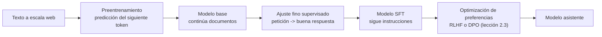
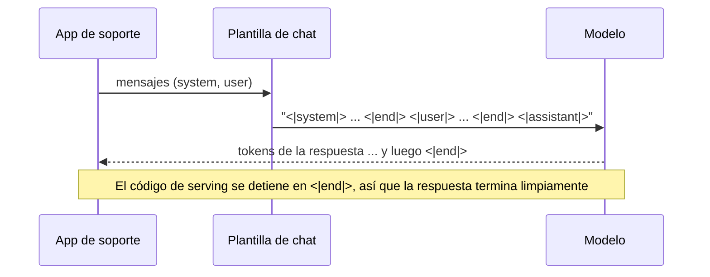
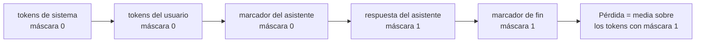
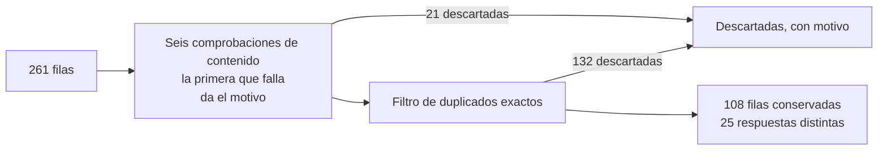

🌐 [English](02-supervised-fine-tuning.md) · Español

# Lección 2.2 — Ajuste fino supervisado

> **Módulo 02 · Lección 2 de 4** · ⏱️ unos 60 min · 🧪 Lab: [pasos 3 y 4](lab/README.es.md#paso-3--renderiza-plantillas-de-chat-y-máscaras-de-pérdida)

## 📨 Situación

> **De:** Alex Moreau · Responsable de Operaciones de Atención al Cliente
> **Canal:** #support-ai
>
> Rio dice que la demo que se enrollaba era un modelo base que nunca tuvo "entrenamiento de asistente".
> Buena noticia: mi equipo lleva meses guardando ejemplos. Cada vez que alguien del equipo escribía una
> respuesta de la que nos sentíamos orgullosos, guardábamos la pregunta y la respuesta. Ya hay 261, en
> inglés y en español. Tickets como el T00192 ("¿Cómo devuelvo un Spark Mini que compré hace 14 días?")
> son justo donde una respuesta antigua de "14 días" haría daño, así que quiero que el modelo aprenda
> nuestras respuestas actuales. ¿Podemos usarlos para enseñarle a responder como nuestros mejores
> agentes, con respuestas breves y amables, y luego parar? Dani ya me avisó de que más datos no son
> automáticamente mejores datos y quiere un informe de calidad antes de entrenar nada.

## 🎯 Objetivos

Al terminar esta lección puedes:

- Explicar qué cambia el ajuste fino supervisado (SFT, *supervised fine-tuning*) en un modelo base y qué no cambia.
- Renderizar una conversación como una única cadena de entrenamiento con una plantilla de chat, con y sin *prompt* de generación.
- Construir una máscara de pérdida para que solo se entrenen los *tokens* del asistente y su marcador de fin, y calcular la proporción de *tokens* entrenados.
- Auditar un dataset de instrucciones en busca de duplicados, datos personales, contaminación de la evaluación, datos desactualizados y filas rotas, y puntuar cada comprobación frente a etiquetas.

## 🤔 Predice primero

Apunta tus respuestas antes de seguir leyendo. Las comprobarás en la autoevaluación.

1. De los 261 ejemplos de Alex, ¿cuántos superarán una revisión de calidad cuidadosa: más de 200,
   aproximadamente la mitad o menos de la mitad?
2. Durante el SFT, ¿hay que entrenar también al modelo para predecir la pregunta del cliente? ¿Por qué?
3. ¿Pueden unos cientos de ejemplos de SFT enseñar de forma fiable un dato nuevo al modelo, como un
   cambio en el plazo de devolución?

## 1. Modelos base y modelos ajustados por instrucciones

Un **modelo base** (*base model*) es lo que produce el preentrenamiento: una red que continúa
documentos. Pregúntale "How do I reset my Hearth Hub?" y puede que continúe con tres preguntas más,
porque así es una página de preguntas frecuentes. Viste el mismo comportamiento en la lección 2.1: el
modelo de trigramas seguía escribiendo porque los documentos rara vez terminan.

Un modelo **ajustado por instrucciones** (*instruction-tuned*), o modelo de chat, es la misma red
después del **post-entrenamiento** (*post-training*). El post-entrenamiento suele tener dos etapas. El
**ajuste fino supervisado (SFT)** le muestra al modelo miles de ejemplos de una petición seguida de una
buena respuesta y lo entrena para producir la respuesta. La **optimización de preferencias**
(*preference optimisation*, lección 2.3), con aprendizaje por refuerzo con retroalimentación humana
(RLHF, *reinforcement learning from human feedback*) u optimización directa de preferencias (DPO,
*direct preference optimization*), usa después comparaciones entre respuestas para empujar al modelo
hacia las que prefieren las personas. El artículo de InstructGPT, enlazado en "Profundiza", describe esta
receta de tres pasos: SFT, un modelo de recompensa y luego aprendizaje por refuerzo.

Qué cambia el SFT y qué no:

| El SFT enseña bien | El SFT enseña mal |
|---|---|
| El formato de una conversación: de quién es el turno, dónde termina una respuesta | Datos nuevos que el modelo base nunca vio |
| El tono y el personaje: breve, amable, "asistente de soporte de Hearthwise" | Datos que cambian a menudo (precios, políticas) |
| Hábitos: hacer una pregunta aclaratoria, rechazar peticiones peligrosas | Habilidades muy por encima de lo que aportó el preentrenamiento |
| Cuándo parar: emitir un marcador de fin de turno | Cualquier cosa en la que los ejemplos se contradigan |

El conocimiento del modelo viene sobre todo del preentrenamiento. Unos cientos de ejemplos pueden darle
un empujoncito, pero una política que cambió el 1 de marzo de 2025 se resuelve mejor con recuperación
(módulos 05 y 06), que puedes actualizar el mismo día en que cambia la política.

**Analogía:** un modelo base es alguien que ha leído toda la biblioteca pero nunca ha trabajado en un
mostrador de atención. El SFT es una semana acompañando a tu mejor agente de soporte: la persona recién
llegada aprende el formato, el tono y cuándo dejar de hablar, no una enciclopedia nueva.



Cada ejemplo de Alex es una línea JSON (*JavaScript Object Notation*) con un *prompt* de sistema, la
instrucción del cliente, la respuesta del equipo de soporte y un código de idioma:

```json
{"id": "s002", "system": "You are Hearthwise's support assistant. Answer briefly, accurately and kindly.", "instruction": "How many devices can the Hearth Hub handle? Thanks.", "response": "The Hearth Hub connects up to 64 HomeMesh devices.", "lang": "en"}
```

> ⚠️ **Error común:** hacer *fine-tuning* para corregir un error factual. Si el modelo dice "14 días"
> porque las páginas antiguas lo decían, un SFT con un puñado de ejemplos de "30 días" puede ocultar el
> síntoma en esas preguntas exactas y dejarlo en todas las demás. Corrige los datos con recuperación y con
> datos limpios, y prueba el arreglo con preguntas que el conjunto de entrenamiento no contenía.

> 💡 **Consejo de producción:** salvo que tengas una razón de peso, parte de un modelo abierto ya
> ajustado por instrucciones y adáptalo ligeramente (el módulo 04 trata el ajuste fino eficiente en
> parámetros con adaptación de bajo rango, LoRA). Hacer tú un SFT completo sobre un modelo base es caro y
> fácil de hacer mal.

## 2. Plantillas de chat: convertir mensajes en una cadena

Un modelo lee una secuencia de *tokens*, no una lista de mensajes. Una **plantilla de chat** (*chat
template*) es la regla que convierte los mensajes en esa secuencia, con **marcadores de rol** que dicen
quién habla y **marcadores de fin** que dicen dónde termina cada turno. El lab usa una pequeña plantilla
propia:

```text
<|system|>
You are Hearthwise's support assistant. Answer briefly, accurately and kindly.<|end|>
<|user|>
How many devices can the Hearth Hub handle? Thanks.<|end|>
<|assistant|>
The Hearth Hub connects up to 64 HomeMesh devices.<|end|>
```

Los marcadores son ***tokens* especiales** (*special tokens*): cada uno es un único *token* que el texto
normal nunca puede producir. Cada familia de modelos reales define sus propios marcadores y distribuye la
plantilla con el tokenizador. Los nombres cambian; la idea es la misma.

En inferencia, renderizas la conversación hasta ese momento y terminas con un turno del asistente
abierto, el ***prompt* de generación** (*generation prompt*) `<|assistant|>\n`. El modelo escribe
entonces la respuesta y, si el entrenamiento funcionó, emite `<|end|>`, que el código de *serving* usa
como señal de parada. Así es como el post-entrenamiento arregla la divagación de la lección 2.1: el
modelo ha aprendido a producir el marcador de fin, y la decodificación se detiene ahí.

**Analogía:** una plantilla de chat es el formato de un guion de teatro. Cada línea empieza con el
nombre del personaje en mayúsculas. Quien ha ensayado con guiones en ese formato sabe exactamente cuándo
empieza y termina su intervención; dale un guion en otro formato y empezará a leer las frases de otros
personajes.



```python
def render_chat(messages: Sequence[dict[str, str]], add_generation_prompt: bool = False) -> str:
    """Render chat messages into the single string the model actually sees."""
    parts = []
    for msg in messages:
        if msg["role"] not in ROLE_MARKERS:
            raise ValueError(f"unknown role {msg['role']!r}")
        parts.append(f"{ROLE_MARKERS[msg['role']]}\n{msg['content']}{END}\n")
    if add_generation_prompt:
        parts.append(f"{ROLE_MARKERS['assistant']}\n")
    return "".join(parts)
```

> ⚠️ **Error común:** construir *prompts* a mano con marcadores distintos a los que usó el modelo en su
> entrenamiento: un salto de línea que falta, otro marcador de fin o el *prompt* de sistema en el sitio
> equivocado. El modelo sigue respondiendo, solo que peor, y nada lanza un error. Renderiza siempre con
> la plantilla que viene con el tokenizador del modelo.

> 💡 **Consejo de producción:** añade un test unitario que renderice una conversación fija y la compare
> con una cadena que sabes correcta. Los fallos de plantilla son silenciosos; un test de una línea los
> detecta cuando alguien actualiza una biblioteca o cambia de modelo.

## 3. Enmascarado de la pérdida: califica la respuesta, no la pregunta

El SFT usa el mismo objetivo que el preentrenamiento: predecir cada siguiente *token* y pagar una
penalización (la **pérdida de entropía cruzada**, *cross-entropy loss*) cuando el *token* correcto
recibe poca probabilidad. La diferencia es *qué* *tokens* se califican. El *prompt* de sistema y el
mensaje del usuario son contexto. Quieres que el modelo los lea, no que aprenda a escribirlos. Una
**máscara de pérdida** (*loss mask*) marca cada *token* con 1 (entrenado) o 0 (solo contexto), y la
pérdida se promedia sobre los 1.

Ejecuta `uv run lab chat-template` con el ejemplo s002 y el lab imprime la máscara, con los *tokens*
entrenados entre corchetes:

```text
<|system|> You are Hearthwise ' s support assistant . Answer briefly , accurately and kindly . <|end|> <|user|> How many devices can the Hearth Hub handle ? Thanks . <|end|> <|assistant|> [The] [Hearth] [Hub] [connects] [up] [to] [64] [HomeMesh] [devices] [.] [<|end|>]
tokens: 42  trained: 11  (26%)
```

Solo 11 de los 42 *tokens* (26 %) cuentan para la pérdida. Fíjate en dos detalles. El marcador
`<|assistant|>` *no* se entrena, porque en inferencia lo pones tú. El `<|end|>` final *sí* se entrena,
porque aprender a emitirlo es como el modelo aprende a parar. En las 261 filas, se entrena el 42 % de los
13.874 *tokens*; el *prompt* de sistema repetido en cada fila se lleva buena parte del resto.

**Analogía:** cuando corriges un examen, calificas las respuestas, no las preguntas impresas en el
papel. Las preguntas siguen importando: hay que leerlas. Simplemente no suman ni restan puntos.



```python
def loss_mask(tokens: Sequence[str]) -> list[int]:
    """1 for tokens the model is trained to predict (assistant content and its ``<|end|>``), else 0."""
    mask: list[int] = []
    in_assistant = False
    for tok in tokens:
        if tok in ROLE_MARKERS.values():
            in_assistant = tok == ROLE_MARKERS["assistant"]
            mask.append(0)
        elif tok == END:
            mask.append(1 if in_assistant else 0)
            in_assistant = False
        else:
            mask.append(1 if in_assistant else 0)
    return mask
```

En la mayoría de los *frameworks* de *deep learning*, la máscara se implementa poniendo la etiqueta de
las posiciones enmascaradas a un valor especial de "ignorar", para que la función de pérdida las salte.
En una conversación de varios turnos se entrena cada turno del asistente y se salta cada turno del
usuario; los tests del lab comprueban exactamente eso.

> ⚠️ **Error común:** dejar el marcador de fin fuera de la máscara, o cortarlo al truncar ejemplos
> largos. El modelo nunca practica parar y vuelves a la demo que se enrolla. El fallo contrario,
> entrenar con los turnos del usuario, enseña al modelo a escribir mensajes falsos de clientes.

> 💡 **Consejo de producción:** antes de cada entrenamiento, decodifica un lote de vuelta a texto e
> imprímelo con su máscara, igual que `lab chat-template`. Diez segundos de lectura detectan fallos de
> plantilla y de enmascarado que, si no, costarían un entrenamiento completo.

## 4. Calidad de los datos: qué hay de verdad en los 261 ejemplos

El SFT copia lo que ve. Una respuesta incorrecta en los datos se convierte en una respuesta incorrecta
del modelo, dicha con seguridad. Por eso, antes de entrenar, Dani quiere que se revise cada fila. El
lab ejecuta seis comprobaciones en orden y luego elimina los duplicados exactos entre las filas que
pasan:

| Comprobación | Regla en el lab | Por qué importa |
|---|---|---|
| respuesta vacía | La respuesta está en blanco | Enseña al modelo a no decir nada |
| baja calidad | Tres palabras o más, con como mucho la mitad distintas | Detecta tecleo al azar como "asdf asdf asdf" |
| idioma incorrecto | La estimación del idioma basada en palabras vacías no coincide con `lang` | Una respuesta en alemán a una pregunta en inglés enseña a cambiar de idioma a mitad de conversación |
| datos personales (PII, *personally identifiable information*) | Correo electrónico, "card ending 1234", dirección postal | Datos personales que el modelo podría repetir a otros clientes |
| contaminación | Al menos la mitad de los 8-gramas de un elemento de evaluación (pregunta más respuesta) aparecen en la fila | Entrenar con el examen hace que la evaluación no signifique nada |
| política desactualizada | Afirmaciones que solo hacía la política de devoluciones de 2023, ya sustituida | Enseña la respuesta de "14 días" que Alex quiere eliminar |
| duplicado | Misma instrucción y respuesta normalizadas que una fila conservada antes | Da demasiado peso a algunas respuestas y desperdicia cómputo |



Este es el resultado, puntuado frente a `datasets/sft/labels.jsonl`, que marca los problemas que se
plantaron en los datos. La **precisión** (*precision*) es la proporción de filas señaladas que de verdad
están etiquetadas; el ***recall*** es la proporción de filas etiquetadas que se señalaron.

| Comprobación | Etiquetadas | Señaladas | Correctas | Precisión | *Recall* |
|---|---|---|---|---|---|
| contaminated_rag_eval | 5 | 11 | 5 | 0.45 | 1.00 |
| empty_response | 1 | 1 | 1 | 1.00 | 1.00 |
| low_quality | 1 | 1 | 1 | 1.00 | 1.00 |
| outdated_policy | 4 | 4 | 4 | 1.00 | 1.00 |
| pii_in_response | 3 | 3 | 3 | 1.00 | 1.00 |
| wrong_language | 1 | 1 | 1 | 1.00 | 1.00 |

Tres hallazgos merecen una mirada más atenta.

**Dominan los duplicados.** El filtro de duplicados exactos descarta 132 filas. Las etiquetas solo
marcan 6 copias plantadas, y cada una sobrevive exactamente una vez, como debe ser. El resto de
repeticiones son agentes guardando la misma respuesta una y otra vez. Tras la limpieza quedan 108 filas,
pero solo contienen 25 respuestas distintas: el dataset enseña 25 respuestas, muchas veces. Conviene
saberlo antes de que nadie prometa que hará que el modelo "suene como nuestros agentes" en todos los
temas.

**La comprobación de contaminación no coincide con las etiquetas, y la comprobación tiene razón.**
Señala 11 filas; solo 5 están etiquetadas. Las otras 6 contienen, palabra por palabra, la respuesta de
referencia de la pregunta de evaluación q027 ("In the app under Account > Orders: tap the order and
choose Download invoice."). Una precisión de 0,45 frente a las etiquetas esconde una fuga real que las
etiquetas pasaron por alto. Cuando una comprobación y las etiquetas no coinciden, lee las filas antes de
fiarte de ninguna de las dos. Incluso después de limpiar, 5 filas conservadas siguen haciendo una
pregunta de evaluación palabra por palabra con otra respuesta, una fuga más suave que Dani quizá también
quiera eliminar.

**Las reglas necesitan contexto.** La regla de política desactualizada busca "14 days", "10%
restocking" y "10 business days". Eso es correcto para las devoluciones, pero en el conjunto de
evaluación la respuesta correcta sobre cancelar un plan Plus anual también dice "14 days". Una regla que
salta con una frase sin conocer el tema acabará borrando un ejemplo correcto.

```python
def clean(rows: Sequence[dict[str, str]], index: ContaminationIndex | None = None) -> CleanReport:
    """Run every check, then drop exact duplicates among the rows that survived."""
    checks = make_checks(index or ContaminationIndex.from_rag_eval())
    kept: list[dict[str, str]] = []
    dropped: dict[str, str] = {}
    seen: set[tuple[str, str]] = set()
    for row in rows:
        reason = next((name for name, check in checks.items() if check(row)), None)
        if reason is None:
            key = dedup_key(row)
            if key in seen:
                reason = "duplicate"
            seen.add(key)
        if reason:
            dropped[row["id"]] = reason
        else:
            kept.append(row)
    return CleanReport(kept, dropped)
```

La limpieza redujo el recuento de *tokens* de 13.874 a 5.969. Menos *tokens*, pero ahora cada uno enseña
algo que de verdad quieres.

**Analogía:** limpiar datos de SFT es como preparar la carpeta de formación para las nuevas
incorporaciones de soporte. No incluirías la misma página 20 veces, una página con el número de tarjeta
de un cliente, la política de devoluciones del año pasado ni las respuestas del examen de certificación.

> ⚠️ **Error común:** informar de que "nuestras comprobaciones coinciden al 100 % con las etiquetas" sin
> leer los desacuerdos. Las etiquetas también son datos, escritos por personas con prisa. Aquí los
> "falsos positivos" eran fugas reales.

> 💡 **Consejo de producción:** guarda un registro por fila de cada descarte y su motivo, versiónalo con
> el dataset y revisa a mano una muestra aleatoria de filas conservadas y descartadas. Los recuentos
> dicen cuánto se eliminó; solo el registro permite a quien revisa saber si debía eliminarse.

## 🧪 Pruébalo

Ejecuta desde `modules/02-decoding-post-training-evaluation/lab`.

1. Renderiza un ejemplo y mira su máscara de pérdida.

   ```bash
   uv run lab chat-template --id s002
   ```

   ```text
   <|system|>
   You are Hearthwise's support assistant. Answer briefly, accurately and kindly.<|end|>
   <|user|>
   How many devices can the Hearth Hub handle? Thanks.<|end|>
   <|assistant|>
   The Hearth Hub connects up to 64 HomeMesh devices.<|end|>
   --- loss mask ([x] = trained) ---
   <|system|> You are Hearthwise ' s support assistant . Answer briefly , accurately and kindly . <|end|> <|user|> How many devices can the Hearth Hub handle ? Thanks . <|end|> <|assistant|> [The] [Hearth] [Hub] [connects] [up] [to] [64] [HomeMesh] [devices] [.] [<|end|>]
   tokens: 42  trained: 11  (26%)
   ```

2. Limpia el dataset y puntúa las comprobaciones.

   ```bash
   uv run lab sft-clean
   ```

   ```text
   rows: 261  kept: 108  dropped: 153
   check                    labelled  flagged  correct precision  recall
   contaminated_rag_eval           5       11        5      0.45    1.00
   empty_response                  1        1        1      1.00    1.00
   low_quality                     1        1        1      1.00    1.00
   outdated_policy                 4        4        4      1.00    1.00
   pii_in_response                 3        3        3      1.00    1.00
   wrong_language                  1        1        1      1.00    1.00
   duplicate                dropped 132 exact repeats; labelled duplicates kept exactly once: 6/6
   kept rows that still ask an eval question word for word: 5
   distinct responses among kept rows: 25
   tokens before cleaning: 13874 (42% trained)  after: 5969 (42% trained)
   ```

3. Encuentra por tu cuenta los 6 aciertos de contaminación sin etiqueta: en una consola de Python,
   lista las filas cuyo motivo de descarte es `contaminated_rag_eval` pero cuyas etiquetas están vacías,
   y compara sus respuestas con `q027` en `datasets/rag_eval/qa.jsonl`.

## 🏭 En el mundo real

- **De dónde salen los datos de SFT.** Los equipos mezclan ejemplos escritos por personas (caros, de
  alta calidad), ejemplos reescritos a partir de registros de soporte (baratos, necesitan una limpieza
  a fondo de PII) y ejemplos generados por un modelo más potente (rápidos, pero revisa las condiciones
  de uso del proveedor y vigila los errores copiados). Sea cual sea la fuente, se aplica la misma
  auditoría.
- **Pequeño y limpio gana a grande y ruidoso.** Unos pocos miles de ejemplos revisados con cuidado
  suelen aportar más al formato y al tono que una gran pila de casi duplicados. La diversidad de
  peticiones importa más que el número de filas; las 108 filas de Alex, que cubren 25 respuestas, son un
  punto de partida, no un conjunto de entrenamiento.
- **Varios turnos y rechazos.** Las conversaciones reales tienen varios turnos, preguntas aclaratorias y
  rechazos educados. Si los datos no tienen ninguno, el modelo no los aprenderá.
- **Descontamina frente a cada conjunto de evaluación**, no solo frente al que recuerdas. La lección 2.4
  muestra la misma técnica de n-gramas sobre un rastreo web.
- **Versiona todo:** los datos en bruto, el código de limpieza, el registro de descartes y el archivo de
  entrenamiento renderizado. Cuando un modelo ajustado se porte mal, querrás saber exactamente qué
  ejemplos vio.
- **Herramientas.** Bibliotecas como Hugging Face [TRL](https://huggingface.co/docs/trl) (*Transformer
  Reinforcement Learning*) ofrecen entrenadores de SFT
  que aplican plantillas de chat y entrenan solo con la respuesta; contrasta sus opciones con lo que has
  aprendido aquí en lugar de dar por hecho que los valores por defecto encajan con tus datos.

## ✅ Autoevaluación

**1. ¿Cuántos de los 261 ejemplos superaron la limpieza y qué dominó los descartes? (Pregunta 1 de
"Predice primero".)**

<details><summary>Respuesta</summary>

Sobrevivieron 108, menos de la mitad. La mayor causa individual fueron los duplicados exactos (132
filas); otras 21 cayeron en las comprobaciones de contenido (11 por contaminación, 4 por política
desactualizada, 3 por PII y una por respuesta vacía, otra por baja calidad y otra por idioma incorrecto).
"Más de 200" es la respuesta tentadora porque cada fila parece correcta por sí sola; la duplicación solo
aparece cuando comparas filas.

</details>

**2. ¿Hay que entrenar al modelo para predecir la pregunta del cliente? (Pregunta 2 de "Predice
primero".)**

<details><summary>Respuesta</summary>

No. La pregunta es contexto: el modelo debe leerla, pero no debe aprender a producirla. La máscara de
pérdida pone esos *tokens* a 0, así que en el ejemplo s002 solo se entrenan 11 de 42 *tokens*. Entrenar
con los turnos del usuario puede hacer que el modelo genere mensajes falsos de clientes después de su
propia respuesta.

</details>

**3. ¿Pueden unos cientos de ejemplos de SFT enseñar un dato nuevo de forma fiable? (Pregunta 3 de
"Predice primero".)**

<details><summary>Respuesta</summary>

No de forma fiable. El SFT es bueno con el formato, el tono y la parada; los datos vienen sobre todo del
preentrenamiento. Unos pocos ejemplos pueden corregir las preguntas exactas que contienen y dejar rotas
las paráfrasis. Para datos que cambian, como el plazo de devolución, usa recuperación y mantén los datos
de entrenamiento coherentes con la política actual.

</details>

**4. La comprobación de contaminación señala 11 filas, pero solo 5 están etiquetadas. ¿Qué haces?**

<details><summary>Respuesta</summary>

Lee los 6 desacuerdos. Todos contienen palabra por palabra la respuesta de referencia de la pregunta de
evaluación q027, así que son fugas reales que las etiquetas pasaron por alto. Descártalos e informa del
hueco en las etiquetas. Aceptar las etiquetas a ciegas habría dejado texto de las respuestas del
examen en el conjunto de entrenamiento.

</details>

**5. Encuentra el fallo: la máscara de alguien del equipo pone `<|end|>` a 0 para "entrenar solo con
palabras reales". ¿Qué hará el modelo ajustado?**

<details><summary>Respuesta</summary>

Rara vez emitirá el marcador de fin, así que la generación no se detendrá donde termina la respuesta y
volverás a tener la divagación de la lección 2.1. El marcador de fin debe entrenarse; es como el modelo
aprende que su turno ha terminado.

</details>

## 💬 Explícalo con tus palabras

- Alex pregunta: "¿Por qué no podemos entrenar con los 261 ejemplos sin más? Los escribieron nuestros
  mejores agentes." Explica con palabras sencillas qué encontraste y por qué importa.
- Explícale a Dani por qué la precisión de 0,45 de tu comprobación de contaminación es en realidad una
  buena noticia.

## 🔑 Ideas clave

- El SFT convierte un modelo base que continúa documentos en uno que sigue instrucciones; enseña el
  formato, el tono y la parada mucho mejor que los datos.
- Una plantilla de chat renderiza los mensajes como una única cadena con marcadores de rol y de fin; usa
  la plantilla del propio modelo en el entrenamiento y en la inferencia.
- La máscara de pérdida entrena solo los *tokens* del asistente y su marcador de fin; el marcador de fin
  es lo que enseña al modelo a parar.
- La calidad de los datos decide lo que aprende el modelo: deduplica, limpia los datos personales,
  elimina datos desactualizados y descontamina frente a cada conjunto de evaluación.
- Puntúa las comprobaciones frente a las etiquetas y luego lee los desacuerdos: las etiquetas también
  pueden estar mal.

## 📚 Profundiza

- ⭐ [Training language models to follow instructions with human feedback (InstructGPT)](https://arxiv.org/abs/2203.02155)
  — la receta de SFT, modelo de recompensa y aprendizaje por refuerzo, con una descripción clara de los datos.
- [Documentación de Hugging Face TRL](https://huggingface.co/docs/trl) — el entrenador de SFT, los
  formatos de dataset y el entrenamiento solo con la respuesta en una biblioteca de código abierto muy usada.
- [Llama 2: Open Foundation and Fine-Tuned Chat Models](https://arxiv.org/abs/2307.09288) — lee las
  secciones de *fine-tuning* para ver cómo un equipo grande recogió y revisó sus datos de SFT y de preferencias.
- [Lección 4.4 — Fine-tuning, PEFT y LoRA](../04-prompting-context-and-fine-tuning/04-fine-tuning-peft-and-lora.es.md)
  — cómo hacer *fine-tuning* de forma barata una vez que tus datos están limpios.

---

[← Anterior: 2.1 Estrategias de decodificación](01-decoding-strategies.es.md) · [🏠 Módulo 02](README.es.md) · [Siguiente: 2.3 RLHF y optimización de preferencias →](03-rlhf-and-preference-optimization.es.md)
