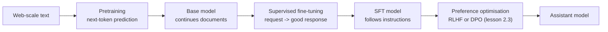
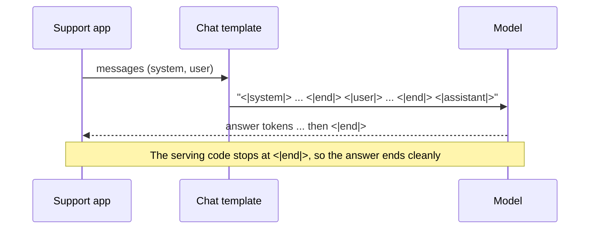
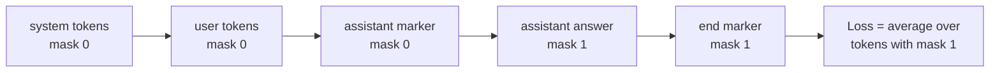
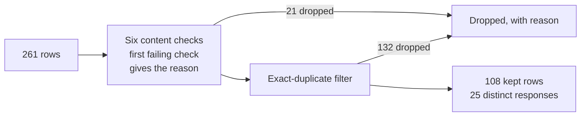

🌐 English · [Español](02-supervised-fine-tuning.es.md)

# Lesson 2.2 — Supervised fine-tuning

> **Module 02 · Lesson 2 of 4** · ⏱️ about 60 min · 🧪 Lab: [steps 3 and 4](lab/README.md#step-3--render-chat-templates-and-loss-masks)

## 📨 Situation

> **From:** Alex Moreau · Customer Support Operations Lead
> **Channel:** #support-ai
>
> Rio says the rambling demo was a base model that never had "assistant training". Good news: my team
> has been saving examples for months. Every time an agent wrote a reply we were proud of, we kept the
> question and the answer. There are 261 of them now, in English and Spanish. Tickets like T00192
> ("¿Cómo devuelvo un Spark Mini que compré hace 14 días?") are exactly where an old "14 days" answer
> would hurt, so I want the model to learn our current answers. Can we use these to teach it to answer
> like our best agents, short and kind, and then stop? Dani already warned me that more data is not
> automatically better data and wants a quality report before anything is trained.

## 🎯 Objectives

By the end of this lesson you can:

- Explain what supervised fine-tuning (SFT) changes in a base model and what it does not change.
- Render a conversation into one training string with a chat template, with and without a generation
  prompt.
- Build a loss mask so that only the assistant's tokens and its end marker are trained, and compute the
  share of trained tokens.
- Audit an instruction dataset for duplicates, personal data, evaluation contamination, outdated facts
  and broken rows, and score each check against labels.

## 🤔 Predict first

Write your answers down before reading on. You will check them in the self-check.

1. Of Alex's 261 examples, how many will survive a careful quality check: more than 200, about half, or
   fewer than half?
2. During SFT, should the model also be trained to predict the customer's question? Why or why not?
3. Can a few hundred SFT examples reliably teach the model a new fact, such as a changed return window?

## 1. Base models and instruction-tuned models

A **base model** is what pretraining produces: a network that continues documents. Ask it "How do I
reset my Hearth Hub?" and it may continue with three more questions, because that is what a page of frequently asked questions
looks like. You saw the same behaviour in lesson 2.1: the trigram model kept writing because documents
rarely end.

An **instruction-tuned** (or chat) model is the same network after **post-training**. Post-training
usually has two stages. **Supervised fine-tuning (SFT)** shows the model thousands of examples of a
request followed by a good response and trains it to produce the response. **Preference optimisation**
(lesson 2.3), with reinforcement learning from human feedback (RLHF) or direct preference
optimization (DPO), then uses comparisons between answers to push the model towards the answers people
prefer. The InstructGPT paper, linked in "Go deeper", describes this three-step recipe: SFT, a reward
model, then reinforcement learning.

What SFT changes and what it does not:

| SFT teaches well | SFT teaches poorly |
|---|---|
| The format of a conversation: whose turn it is, where an answer ends | New facts that the base model never saw |
| Tone and persona: short, kind, "Hearthwise support assistant" | Facts that change often (prices, policies) |
| Habits: asking a clarifying question, refusing unsafe requests | Skills far beyond what pretraining provided |
| When to stop: emitting an end-of-turn marker | Anything the examples contradict each other about |

The model's knowledge comes mostly from pretraining. A few hundred examples can nudge it, but a policy
that changed on 1 March 2025 is better served by retrieval (modules 05 and 06), which you can update
the day the policy changes.

**Analogy:** a base model is someone who has read the entire library but never worked at a help desk.
SFT is a week of shadowing your best support agent: the newcomer picks up the format, the tone and
when to stop talking, not a new encyclopaedia.



Each of Alex's examples is one JSON (JavaScript Object Notation) line with a system prompt, the customer's instruction, the
agent's response and a language code:

```json
{"id": "s002", "system": "You are Hearthwise's support assistant. Answer briefly, accurately and kindly.", "instruction": "How many devices can the Hearth Hub handle? Thanks.", "response": "The Hearth Hub connects up to 64 HomeMesh devices.", "lang": "en"}
```

> ⚠️ **Common mistake:** fine-tuning to fix a factual error. If the model says "14 days" because old
> pages said so, SFT on a handful of "30 days" examples may hide the symptom on those exact questions
> and leave it everywhere else. Fix facts with retrieval and with clean data, and test the fix on
> questions the training set did not contain.

> 💡 **Production tip:** unless you have a strong reason, start from an existing instruction-tuned open
> model and adapt it lightly (module 04 covers parameter-efficient fine-tuning with low-rank adaptation, LoRA). Doing full SFT
> on a base model yourself is expensive and easy to get wrong.

## 2. Chat templates: turning messages into one string

A model reads one sequence of tokens, not a list of messages. A **chat template** is the rule that turns
messages into that sequence, with **role markers** that say who is speaking and **end markers** that say
where each turn stops. The lab uses a small template of its own:

```text
<|system|>
You are Hearthwise's support assistant. Answer briefly, accurately and kindly.<|end|>
<|user|>
How many devices can the Hearth Hub handle? Thanks.<|end|>
<|assistant|>
The Hearth Hub connects up to 64 HomeMesh devices.<|end|>
```

The markers are **special tokens**: each one is a single token that ordinary text can never produce.
Real model families each define their own markers and ship the template with the tokenizer. The names
differ; the idea is the same.

At inference time you render the conversation so far and end with an open assistant turn, the
**generation prompt** `<|assistant|>\n`. The model then writes the answer and, if training worked,
emits `<|end|>`, which the serving code uses as a stop signal. This is how post-training fixes the
rambling from lesson 2.1: the model has learned to produce the end marker, and decoding stops there.

**Analogy:** a chat template is the format of a theatre script. Every line starts with the character's
name in capitals. An actor trained on scripts in that format knows exactly when their line starts and
ends; hand them a script in a different format and they will start reading other people's lines.



```python
def render_chat(messages: Sequence[dict[str, str]], add_generation_prompt: bool = False) -> str:
    """Render chat messages into the single string the model actually sees."""
    parts = []
    for msg in messages:
        if msg["role"] not in ROLE_MARKERS:
            raise ValueError(f"unknown role {msg['role']!r}")
        parts.append(f"{ROLE_MARKERS[msg['role']]}\n{msg['content']}{END}\n")
    if add_generation_prompt:
        parts.append(f"{ROLE_MARKERS['assistant']}\n")
    return "".join(parts)
```

> ⚠️ **Common mistake:** building prompts by hand with markers that differ from the ones the model was
> trained with: a missing newline, a different end marker, or the system prompt in the wrong place. The
> model still answers, just worse, and nothing raises an error. Always render with the template that
> ships with the model's tokenizer.

> 💡 **Production tip:** add a unit test that renders a fixed conversation and compares it with a
> known-good string. Template bugs are silent; a one-line test catches them when someone upgrades a
> library or switches models.

## 3. Loss masking: grade the answer, not the question

SFT uses the same objective as pretraining: predict each next token, and pay a penalty (the
**cross-entropy loss**) when the correct token gets low probability. The difference is *which* tokens
are graded. The system prompt and the user's message are context. You want the model to read them, not
to learn to write them. A **loss mask** marks each token with 1 (trained) or 0 (context only), and the
loss is averaged over the 1s.

Run `uv run lab chat-template` on example s002 and the lab prints the mask, with trained tokens in
brackets:

```text
<|system|> You are Hearthwise ' s support assistant . Answer briefly , accurately and kindly . <|end|> <|user|> How many devices can the Hearth Hub handle ? Thanks . <|end|> <|assistant|> [The] [Hearth] [Hub] [connects] [up] [to] [64] [HomeMesh] [devices] [.] [<|end|>]
tokens: 42  trained: 11  (26%)
```

Only 11 of the 42 tokens (26%) carry loss. Notice two details. The `<|assistant|>` marker is *not*
trained, because at inference you provide it yourself. The final `<|end|>` *is* trained, because
learning to emit it is how the model learns to stop. Across all 261 rows, 42% of the 13,874 tokens are
trained; the system prompt repeated in every row takes much of the rest.

**Analogy:** when you mark an exam, you grade the student's answers, not the questions printed on the
paper. The questions still matter: the student reads them. They just do not earn or lose points.



```python
def loss_mask(tokens: Sequence[str]) -> list[int]:
    """1 for tokens the model is trained to predict (assistant content and its ``<|end|>``), else 0."""
    mask: list[int] = []
    in_assistant = False
    for tok in tokens:
        if tok in ROLE_MARKERS.values():
            in_assistant = tok == ROLE_MARKERS["assistant"]
            mask.append(0)
        elif tok == END:
            mask.append(1 if in_assistant else 0)
            in_assistant = False
        else:
            mask.append(1 if in_assistant else 0)
    return mask
```

In most deep-learning frameworks the mask is implemented by setting the label of masked positions to a
special "ignore" value, so the loss function skips them. In a multi-turn conversation every assistant
turn is trained and every user turn is skipped; the lab's tests check exactly that.

> ⚠️ **Common mistake:** leaving the end marker out of the mask, or cutting it off when truncating long
> examples. The model then never practises stopping, and you are back to the rambling demo. The
> opposite bug, training on user turns, teaches the model to write fake customer messages.

> 💡 **Production tip:** before every training run, decode one batch back to text and print it with its
> mask, exactly like `lab chat-template`. Ten seconds of reading catches template and masking bugs that
> would otherwise cost a full training run.

## 4. Data quality: what is really in the 261 examples

SFT copies what it sees. A wrong answer in the data becomes a wrong answer in the model, said with
confidence. So before training, Dani wants every row checked. The lab runs six checks in order, then
removes exact duplicates among the rows that pass:

| Check | Rule in the lab | Why it matters |
|---|---|---|
| empty response | Response is blank | Teaches the model to say nothing |
| low quality | Three or more words, at most half of them distinct | Catches keyboard mashing such as "asdf asdf asdf" |
| wrong language | Stopword-based language guess differs from `lang` | A German answer to an English question teaches code-switching |
| personally identifiable information (PII) | Email address, "card ending 1234", street address | Personal data the model could repeat to other customers |
| contamination | At least half of an evaluation item's 8-grams (question plus answer) appear in the row | Training on the test makes the evaluation meaningless |
| outdated policy | Claims that only the superseded 2023 returns policy made | Teaches the "14 days" answer Alex wants gone |
| duplicate | Same normalised instruction and response as an earlier kept row | Over-weights some answers and wastes compute |



Here is the result, scored against `datasets/sft/labels.jsonl`, which marks the problems that were
planted in the data. **Precision** is the share of flagged rows that are truly labelled; **recall** is the
share of labelled rows that were flagged.

| Check | Labelled | Flagged | Correct | Precision | Recall |
|---|---|---|---|---|---|
| contaminated_rag_eval | 5 | 11 | 5 | 0.45 | 1.00 |
| empty_response | 1 | 1 | 1 | 1.00 | 1.00 |
| low_quality | 1 | 1 | 1 | 1.00 | 1.00 |
| outdated_policy | 4 | 4 | 4 | 1.00 | 1.00 |
| pii_in_response | 3 | 3 | 3 | 1.00 | 1.00 |
| wrong_language | 1 | 1 | 1 | 1.00 | 1.00 |

Three findings deserve a closer look.

**Duplicates dominate.** The exact-duplicate filter drops 132 rows. The labels mark only 6 planted
copies, and each of them survives exactly once, as it should. The other repeats are agents saving the
same answer again and again. After cleaning, 108 rows remain but they contain only 25 distinct
responses: the dataset teaches 25 answers, many times over. That is useful to know before anyone
promises it will make the model "sound like our agents" across all topics.

**The contamination check disagrees with the labels, and the check is right.** It flags 11 rows; only 5
are labelled. The 6 others all contain, word for word, the reference answer of evaluation question q027
("In the app under Account > Orders: tap the order and choose Download invoice."). Precision of 0.45
against the labels hides a real leak that the labels missed. When a check and the labels disagree, read
the rows before you trust either. Even after cleaning, 5 kept rows still ask an evaluation question
word for word with a different answer, a softer leak that Dani may also want removed.

**Rules need context.** The outdated-policy rule looks for "14 days", "10% restocking" and "10 business
days". That is right for returns, but in the evaluation set the correct answer about cancelling a yearly
Plus plan also says "14 days". A rule that fires on a phrase without knowing the topic will eventually
delete a correct example.

```python
def clean(rows: Sequence[dict[str, str]], index: ContaminationIndex | None = None) -> CleanReport:
    """Run every check, then drop exact duplicates among the rows that survived."""
    checks = make_checks(index or ContaminationIndex.from_rag_eval())
    kept: list[dict[str, str]] = []
    dropped: dict[str, str] = {}
    seen: set[tuple[str, str]] = set()
    for row in rows:
        reason = next((name for name, check in checks.items() if check(row)), None)
        if reason is None:
            key = dedup_key(row)
            if key in seen:
                reason = "duplicate"
            seen.add(key)
        if reason:
            dropped[row["id"]] = reason
        else:
            kept.append(row)
    return CleanReport(kept, dropped)
```

Cleaning cut the token count from 13,874 to 5,969. Fewer tokens, but every one of them now teaches
something you actually want.

**Analogy:** cleaning SFT data is like preparing a training binder for new support hires. You would not
include the same page 20 times, a page with a customer's card number on it, last year's returns policy,
or the answer key to the certification exam.

> ⚠️ **Common mistake:** reporting "our checks agree with the labels 100%" without reading the
> disagreements. Labels are data too, written by people under time pressure. Here the "false positives"
> were real leaks.

> 💡 **Production tip:** keep a per-row log of every drop and its reason, version it with the dataset,
> and review a random sample of both kept and dropped rows by hand. Counts tell you how much was removed;
> only the log tells a reviewer whether it should have been.

## 🧪 Try it

Run from `modules/02-decoding-post-training-evaluation/lab`.

1. Render one example and look at its loss mask.

   ```bash
   uv run lab chat-template --id s002
   ```

   ```text
   <|system|>
   You are Hearthwise's support assistant. Answer briefly, accurately and kindly.<|end|>
   <|user|>
   How many devices can the Hearth Hub handle? Thanks.<|end|>
   <|assistant|>
   The Hearth Hub connects up to 64 HomeMesh devices.<|end|>
   --- loss mask ([x] = trained) ---
   <|system|> You are Hearthwise ' s support assistant . Answer briefly , accurately and kindly . <|end|> <|user|> How many devices can the Hearth Hub handle ? Thanks . <|end|> <|assistant|> [The] [Hearth] [Hub] [connects] [up] [to] [64] [HomeMesh] [devices] [.] [<|end|>]
   tokens: 42  trained: 11  (26%)
   ```

2. Clean the dataset and score the checks.

   ```bash
   uv run lab sft-clean
   ```

   ```text
   rows: 261  kept: 108  dropped: 153
   check                    labelled  flagged  correct precision  recall
   contaminated_rag_eval           5       11        5      0.45    1.00
   empty_response                  1        1        1      1.00    1.00
   low_quality                     1        1        1      1.00    1.00
   outdated_policy                 4        4        4      1.00    1.00
   pii_in_response                 3        3        3      1.00    1.00
   wrong_language                  1        1        1      1.00    1.00
   duplicate                dropped 132 exact repeats; labelled duplicates kept exactly once: 6/6
   kept rows that still ask an eval question word for word: 5
   distinct responses among kept rows: 25
   tokens before cleaning: 13874 (42% trained)  after: 5969 (42% trained)
   ```

3. Find the 6 unlabelled contamination hits yourself: in a Python shell, list the rows whose drop reason
   is `contaminated_rag_eval` but whose labels are empty, and compare their responses with `q027` in
   `datasets/rag_eval/qa.jsonl`.

## 🏭 In the real world

- **Where SFT data comes from.** Teams mix human-written examples (expensive, high quality), examples
  rewritten from support logs (cheap, need heavy PII scrubbing) and examples generated by a stronger
  model (fast, but check the provider's terms of use and watch for copied mistakes). Whatever the
  source, the same audit applies.
- **Small and clean beats big and noisy.** A few thousand carefully reviewed examples usually do more
  for format and tone than a large pile of near-duplicates. Diversity of requests matters more than raw
  row count; Alex's 108 rows covering 25 answers are a starting point, not a training set.
- **Multi-turn and refusals.** Real conversations have several turns, clarifying questions and polite
  refusals. If the data has none, the model will not learn them.
- **Decontaminate against every evaluation set**, not only the one you remember. Lesson 2.4 shows the
  same n-gram technique on a web crawl.
- **Version everything:** the raw data, the cleaning code, the drop log and the rendered training
  file. When a fine-tuned model misbehaves, you will want to know exactly which examples it saw.
- **Tooling.** Libraries such as Hugging Face [TRL](https://huggingface.co/docs/trl) (Transformer
  Reinforcement Learning) provide SFT
  trainers that apply chat templates and train only on the completion; check their options against
  what you learned here rather than assuming the defaults match your data.

## ✅ Self-check

**1. How many of the 261 examples survived cleaning, and what dominated the drops? (Predict-first
question 1.)**

<details><summary>Answer</summary>

108 survived, fewer than half. The biggest single cause was exact duplicates (132 rows); 21 more were
dropped by the content checks (11 contamination, 4 outdated policy, 3 PII, and one each for empty, low
quality and wrong language). "More than 200" is the tempting guess because each row looks fine on its
own; the duplication only shows up when you compare rows.

</details>

**2. Should the model be trained to predict the customer's question? (Predict-first question 2.)**

<details><summary>Answer</summary>

No. The question is context: the model must read it but should not learn to produce it. The loss mask
sets those tokens to 0, so in example s002 only 11 of 42 tokens are trained. Training on user turns can
make the model generate fake customer messages after its own answer.

</details>

**3. Can a few hundred SFT examples reliably teach a new fact? (Predict-first question 3.)**

<details><summary>Answer</summary>

Not reliably. SFT is good at format, tone and stopping; facts come mostly from pretraining. A few
examples may fix the exact questions they contain and leave paraphrases broken. For facts that change,
such as the return window, use retrieval and keep the training data consistent with the current policy.

</details>

**4. The contamination check flags 11 rows but only 5 are labelled. What do you do?**

<details><summary>Answer</summary>

Read the 6 disagreements. They all contain the reference answer of evaluation question q027 word for
word, so they are real leaks the labels missed. Drop them and report the label gap. Accepting the
labels blindly would have kept answer-key text in the training set.

</details>

**5. Spot the bug: a colleague's mask sets `<|end|>` to 0 to "only train on real words". What will the
fine-tuned model do?**

<details><summary>Answer</summary>

It will rarely emit the end marker, so generation will not stop where the answer ends and you get the
rambling from lesson 2.1 again. The end marker must be trained; it is how the model learns that its
turn is over.

</details>

## 💬 Explain it in your own words

- Alex asks: "Why can't we just train on all 261 examples? They were written by our best agents."
  Explain in plain words what you found and why it matters.
- Explain to Dani why your contamination check's precision of 0.45 is actually good news.

## 🔑 Key ideas

- SFT turns a document-continuing base model into an instruction follower; it teaches format, tone and
  stopping far better than facts.
- A chat template renders messages into one string with role and end markers; use the model's own
  template at training and inference time.
- The loss mask trains only the assistant's tokens and its end marker; the end marker is what teaches
  the model to stop.
- Data quality decides what the model learns: deduplicate, scrub personal data, remove outdated facts
  and decontaminate against every evaluation set.
- Score checks against labels, then read the disagreements: labels can be wrong too.

## 📚 Go deeper

- ⭐ [Training language models to follow instructions with human feedback (InstructGPT)](https://arxiv.org/abs/2203.02155)
  — the SFT, reward model and reinforcement learning recipe, with a clear description of the data.
- [Hugging Face TRL documentation](https://huggingface.co/docs/trl) — the SFT trainer, dataset formats and
  completion-only training in a widely used open-source library.
- [Llama 2: Open Foundation and Fine-Tuned Chat Models](https://arxiv.org/abs/2307.09288) — read the
  fine-tuning sections for how a large team collected and checked its SFT and preference data.
- [Lesson 4.4 — Fine-tuning, PEFT and LoRA](../04-prompting-context-and-fine-tuning/04-fine-tuning-peft-and-lora.md)
  — how to fine-tune cheaply once your data is clean.

---

[← Previous: 2.1 Decoding strategies](01-decoding-strategies.md) · [🏠 Module 02](README.md) · [Next: 2.3 RLHF and preference optimisation →](03-rlhf-and-preference-optimization.md)
