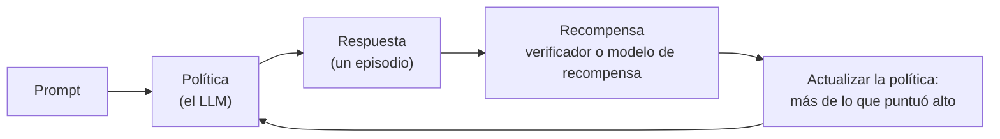
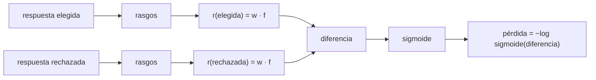
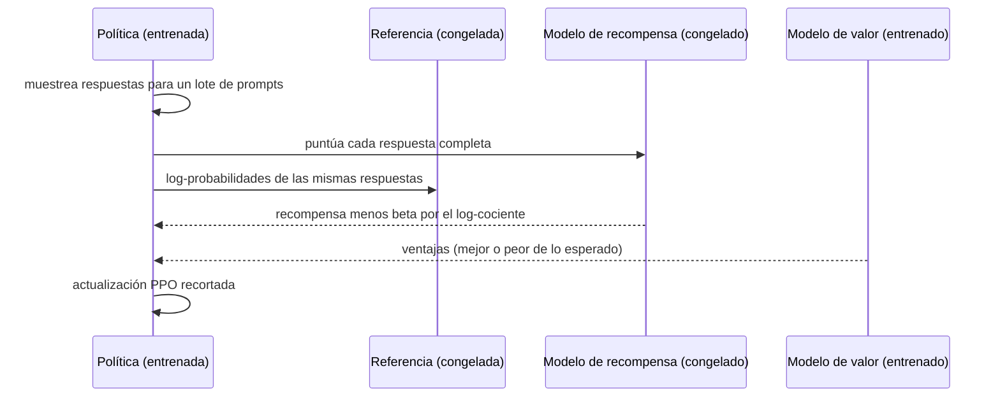
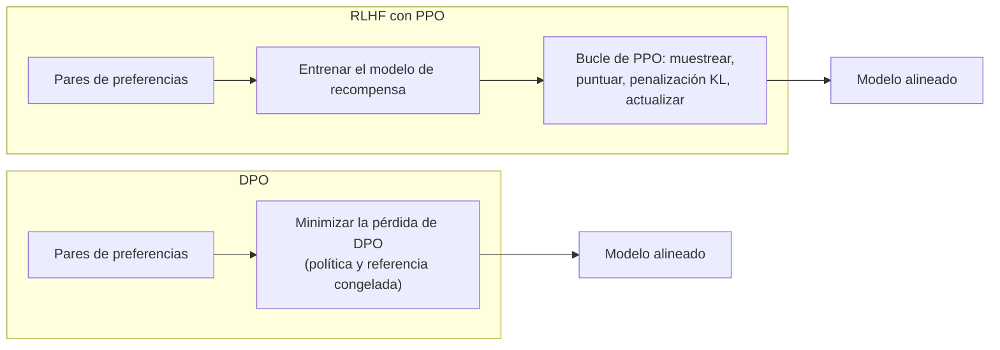

🌐 [English](03-rlhf-and-preference-optimization.md) · Español

# Lección 2.3 — RLHF y optimización de preferencias

> **Módulo 02 · Lección 3 de 4** · ⏱️ unos 75 min · 🧪 Lab: [pasos 5 y 6](lab/README.es.md#paso-5--entrena-un-modelo-de-recompensa-y-detecta-la-trampa-de-la-longitud)

## 📨 Situación

> **De:** Dani Ruiz · Ciencia de datos, responsable de evaluación
> **Canal:** #ai-team
>
> Los agentes de Alex valoraron 300 pares de respuestas: para cada pregunta de un cliente, dos
> respuestas candidatas y la que prefirieron. Jordan quiere "entrenar un modelo de recompensa con eso
> esta semana y que RLHF haga el resto". Le eché un vistazo rápido y algo huele mal: en la partición de
> entrenamiento la respuesta preferida suele ser la más larga, y las frases de relleno educadas están por
> todas partes. Si el modelo de recompensa aprende que "más largo es mejor", el aprendizaje por refuerzo
> enseñará encantado al asistente a enrollarse otra vez, y acabamos de pasar una semana arreglando eso.
> Antes de que nadie entrene nada, enséñame la evaluación: entrenamiento, prueba y preguntas que el
> modelo de recompensa no haya visto nunca.

## 🎯 Objetivos

Al terminar esta lección puedes:

- Trasladar el vocabulario del aprendizaje por refuerzo (RL, *reinforcement learning*) (política, acción, recompensa, episodio) a un modelo de lenguaje grande (LLM, *large language model*) que genera una respuesta.
- Distinguir las recompensas verificables de los modelos de recompensa aprendidos, e implementar una recompensa verificable para un problema de matemáticas.
- Ajustar un modelo de recompensa de Bradley–Terry con pares de preferencias y diagnosticar un sesgo de longitud con una partición de entrenamiento y prueba y una partición disjunta por *prompts*.
- Escribir el objetivo de la optimización de política proximal (PPO, *Proximal Policy Optimization*) con su penalización de Kullback–Leibler (KL), y calcular la pérdida de la optimización directa de preferencias (DPO, *Direct Preference Optimization*) con log-probabilidades de juguete.
- Explicar la explotación de la recompensa y medirla con un ataque de relleno.

## 🤔 Predice primero

Apunta tus respuestas antes de seguir leyendo. Las comprobarás en la autoevaluación.

1. Un modelo de recompensa obtiene un 100 % de exactitud en los pares de prueba reservados. ¿Está a
   punto para entrenar al asistente?
2. Un modelo de recompensa que solo mira la longitud de la respuesta coincide con los agentes el 79 % de
   las veces en la partición de entrenamiento. ¿Qué esperas en la partición de prueba?
3. En DPO, ¿puede bajar la pérdida mientras también baja la probabilidad de la respuesta preferida?

## 1. El aprendizaje por refuerzo en una página

El SFT (lección 2.2) necesita que alguien escriba la respuesta ideal. Para muchas peticiones eso es
lento o imposible, pero las personas pueden decir con facilidad cuál de dos respuestas es mejor. El
**aprendizaje por refuerzo (RL)** aprende de ese tipo de señal: en lugar de copiar un objetivo, el modelo
prueba algo, recibe una puntuación y se ajusta para puntuar más la próxima vez. El RL con
retroalimentación humana (**RLHF**, *reinforcement learning from human feedback*) usa puntuaciones
derivadas de las preferencias humanas.

El vocabulario encaja muy bien con la generación de texto:

| Término de RL | Significado general | Significado para un LLM |
|---|---|---|
| Política (*policy*) | Quien toma las decisiones | El modelo de lenguaje, π(*token* dado el texto hasta ahora) |
| Estado (*state*) | Lo que ve la política | El *prompt* más los *tokens* generados hasta ahora |
| Acción (*action*) | Una decisión | El siguiente *token* |
| Episodio (*episode*) | Un intento completo | Una respuesta completa |
| Recompensa (*reward*) | Puntuación del intento | Un número para toda la respuesta, normalmente al final |
| Política de referencia (*reference policy*) | Una copia congelada con la que comparar | El modelo SFT antes de empezar el RL |

**Analogía:** enseñar un truco nuevo a un perro. No puedes demostrar tú una voltereta, así que esperas a
algo parecido, das un premio, y el perro hace más de lo que le dio premios. Los premios son las
recompensas, los hábitos del perro son la política y un intento del truco es un episodio.



Lo difícil no es el bucle; es la recompensa. Todo en esta lección trata de dónde sale la recompensa y
de cómo puede engañarte.

> ⚠️ **Error común:** tratar el RL como un potenciador mágico de la calidad. El RL optimiza exactamente
> la recompensa que le das, defectos incluidos. Una recompensa sesgada produce un modelo sesgado, más
> rápido y con más seguridad.

> 💡 **Consejo de producción:** antes de cualquier entrenamiento con RL, escribe en una frase qué se
> supone que significa una recompensa alta y cómo comprobarás, con datos que la recompensa nunca vio,
> que significa eso. Si no puedes escribir la frase, no te encuentras en condiciones de optimizar.

## 2. Recompensas verificables: cuando un programa puede comprobar la respuesta

Algunas tareas vienen con solucionario. Un problema de matemáticas tiene un número correcto, el código
tiene tests, una respuesta JSON (*JavaScript Object Notation*) tiene un esquema. En estos casos, un
programa puede calcular la recompensa, sin personas y sin un modelo aprendido: **RL con recompensas
verificables** (*RL with verifiable rewards*). El informe de DeepSeek-R1 describe entrenar el
comportamiento de razonamiento en gran parte con recompensas basadas en reglas de este tipo, y el
artículo de DeepSeekMath presentó GRPO (*Group Relative Policy Optimization*), que puntúa un grupo de
respuestas muestreadas para la misma pregunta y compara cada una con la media del grupo. El módulo 09
profundiza en los modelos de razonamiento.

El verificador del lab lee el último número de la respuesta y lo compara con la respuesta de referencia.
En el problema r001 de `datasets/reasoning` (respuesta de referencia 175.10):

| Respuesta del modelo | Recompensa |
|---|---|
| "206 x 0.85 = 175.10, shipping is free, so the total is 175.10 euros." | 1.0 |
| "The total is €175.1" | 1.0 |
| "Subtotal 206, minus 15% is 175.10, plus €4.95 shipping = 180.05" | 0.0 |

**Analogía:** una recompensa verificable es un examen tipo test con plantilla de respuestas; un modelo de
recompensa aprendido es un concurso de redacción evaluado por un jurado.

```python
def verifiable_reward(model_answer: str, gold: str, tol: float = 0.005) -> float:
    """1.0 if the last number in the model's answer equals the gold number, else 0.0.

    No reward model is needed: a program checks the answer. This is the idea behind
    reinforcement learning with verifiable rewards (maths, code with tests, ...).
    """
    found = _NUMBER_RE.findall(model_answer)
    if not found:
        return 0.0
    value = float(found[-1].replace(",", "."))
    return 1.0 if abs(value - float(gold)) <= tol else 0.0
```

Los verificadores son baratos y difíciles de engañar con el tono o la longitud, pero solo son tan buenos
como sus reglas. Este premia una respuesta cuyo razonamiento no tiene sentido siempre que el último
número sea correcto, y daría 0 a "175.10 euros (180.05 if you choose express)". Las políticas bajo
presión de RL encuentran esos resquicios.

> ⚠️ **Error común:** fiarte de un verificador porque "solo es código". Pruébalo como cualquier otro
> código: respuestas correctas en formatos poco habituales, respuestas incorrectas que contienen el número
> correcto, respuestas vacías. Cada resquicio que se te escape se convierte en un hábito que aprende la
> política.

> 💡 **Consejo de producción:** cuando puedas convertir un requisito de negocio en una comprobación (JSON
> válido, una fuente citada que existe, un total que cuadra con el pedido), úsala como recompensa o, al
> menos, como filtro de los datos de entrenamiento. Es más barata y más estable que un modelo de
> recompensa aprendido.

## 3. Modelos de recompensa: Bradley–Terry a partir de pares de preferencias

Casi todo lo que le importa a Hearthwise (útil, seguro, amable, correcto) no tiene solucionario. La
solución habitual es **aprender** un modelo de recompensa (*reward model*) a partir de comparaciones. El
modelo de **Bradley–Terry** supone que cada respuesta tiene una puntuación oculta r, y que la
probabilidad de que las personas prefieran la respuesta A a la B depende solo de la diferencia:

P(A preferida a B) = σ(r(A) − r(B)), donde σ(z) = 1 / (1 + e^(−z)) es la función sigmoide.

El entrenamiento maximiza la probabilidad de las elecciones de los agentes, lo que equivale a minimizar
−log σ(r(elegida) − r(rechazada)) sobre todos los pares. Es una regresión logística sobre la
*diferencia* entre las dos respuestas. En los sistemas reales, r es una red neuronal, a menudo el modelo
SFT con una cabeza de salida escalar. En el lab es una función lineal de rasgos simples: el logaritmo
del número de palabras y, opcionalmente, un indicador por palabra. Como las dos respuestas de un par
comparten el *prompt*, los rasgos que solo dependen del *prompt* se anularían en la diferencia; por eso
el lab usa rasgos de la respuesta.

**Analogía:** un jurado de catadores que solo compara dos copas cada vez. A partir de cientos de
veredictos de "esta es mejor" puedes dar una puntuación a cada vino. La lección 2.4 usa las mismas
matemáticas para ordenar modelos en una clasificación.



```python
def fit_reward_model(
    pairs: Sequence[dict[str, str]],
    featurizer: Featurizer,
    l2: float = 0.01,
    lr: float = 0.5,
    steps: int = 500,
) -> RewardModel:
    """Full-batch gradient descent on the Bradley–Terry loss. Deterministic: weights start at 0."""
    xc = featurizer.matrix([p["chosen"] for p in pairs])
    xr = featurizer.matrix([p["rejected"] for p in pairs])
    diff = xc - xr
    w = np.zeros(diff.shape[1])
    for _ in range(steps):
        margins = diff @ w
        grad = -(diff * sigmoid(-margins)[:, None]).mean(axis=0) + l2 * w
        w -= lr * grad
    return RewardModel(featurizer, w)
```

Ahora, la pregunta de Dani. Los datos tienen 300 pares: 240 en la partición de entrenamiento y 60 en la
de prueba. La línea base del propio dataset dice que la respuesta más larga es la elegida en 0,787 de
los pares de entrenamiento, pero solo en 0,233 de los de prueba. Esto es lo que mide el lab con la
partición oficial:

| Modelo de recompensa | Pares de entrenamiento | Rasgos | Exactitud en entrenamiento | Exactitud en prueba |
|---|---|---|---|---|
| solo longitud | 240 | 1 | 0.787 | 0.233 |
| palabras + longitud | 240 | 302 | 1.000 | 1.000 |

El modelo de solo longitud es la trampa que olió Dani: parece aceptable en entrenamiento y es mucho peor
que lanzar una moneda en prueba. El modelo de palabras más longitud parece perfecto, lo que debería
preocuparte todavía más. Las mismas 23 preguntas de clientes aparecen en ambas particiones, con las
mismas respuestas buenas y malas. El modelo ha memorizado qué datos van con qué pregunta; la partición
de prueba mide memoria, no criterio.

Una prueba honesta usa preguntas que el modelo de recompensa nunca ha visto. La partición **disjunta por
*prompts*** (*prompt-disjoint*) del lab pone en entrenamiento una de cada dos preguntas distintas (125
pares de entrenamiento) y evalúa con pares de prueba de las otras preguntas (28 pares):

| Modelo de recompensa (preguntas nuevas) | Pares de entrenamiento | Rasgos | Exactitud en entrenamiento | Exactitud en prueba |
|---|---|---|---|---|
| solo longitud | 125 | 1 | 0.784 | 0.250 |
| palabras + longitud | 125 | 217 | 1.000 | 0.714 |
| palabras + longitud, datos equilibrados en longitud | 54 | 217 | 1.000 | 0.821 |

Con preguntas no vistas, el modelo de palabras más longitud cae a 0,714, y sus pesos más grandes
muestran por qué: los dos rasgos principales son la palabra "or" (0,76) y el propio rasgo de longitud
(0,76). Aprendió una señal real (las respuestas que contienen "14" y "1-year" reciben pesos negativos,
porque vienen de las respuestas desactualizadas o erróneas) mezclada con una fuerte preferencia por las
respuestas largas. Reequilibrar los pares de entrenamiento para que "la elegida es más larga" y "la
elegida es más corta" sean igual de frecuentes deja solo 54 pares, pero sube la exactitud en prueba a
0,821. Con 28 pares de prueba, cada par vale 3,6 puntos, así que toma estas cifras como tendencias, no
como puntuaciones precisas.

> ⚠️ **Error común:** evaluar un modelo de recompensa con una partición aleatoria cuando los *prompts* se
> repiten. La exactitud en prueba de 1,000 de arriba es aritmética real y una conclusión falsa. Divide
> por *prompt* (o por fecha) para que la prueba haga preguntas nuevas.

> 💡 **Consejo de producción:** informa siempre de la exactitud de un modelo de recompensa junto a una
> línea base de "gana la respuesta más larga", y mira la exactitud por separado en los pares donde la
> respuesta elegida es más corta. Si el modelo solo acierta cuando la longitud coincide con la calidad,
> ha aprendido la longitud.

## 4. RLHF con PPO y una penalización KL

Con un modelo de recompensa en la mano, el RLHF clásico optimiza la política con **optimización de
política proximal (PPO)**. El objetivo tiene dos partes: conseguir una recompensa alta y no alejarse
demasiado del modelo de referencia. El alejamiento se mide con la **divergencia de Kullback–Leibler
(KL)** entre la política π y la referencia congelada π_ref:

maximizar E[ r(x, y) ] − β · KL( π(· dado x) ‖ π_ref(· dado x) )

En la práctica, la penalización se aplica por muestra, con las log-probabilidades de la respuesta
generada bajo ambos modelos:

recompensa usada para entrenar = r(x, y) − β · (log π(y dado x) − log π_ref(y dado x))

Ejemplo resuelto del lab: el modelo de recompensa da r = 2,0, la política asigna a la respuesta una
log-probabilidad de −12,0, la referencia −15,0, y β = 0,1. La política se ha movido 3 nats (unidades de
logaritmo natural) hacia esta respuesta, así que la penalización es 0,1 × 3 = 0,3 y la recompensa de
entrenamiento es 1,70.

PPO en sí es la regla de actualización. Para cada *token*, compara la nueva política con la que generó
los datos mediante el cociente ρ = π_nueva(acción) / π_antigua(acción), lo multiplica por una
**ventaja** (*advantage*) A (cuánto mejor de lo esperado resultó esta acción, estimado con un modelo de
valor) y recorta ρ al intervalo [1 − ε, 1 + ε] para que un solo lote no pueda cambiar demasiado la
política:

L = E[ min( ρ · A, clip(ρ, 1 − ε, 1 + ε) · A ) ]

Por eso una configuración típica mantiene cuatro redes: la política que se entrena, la referencia
congelada, el modelo de recompensa y el modelo de valor. Es mucha memoria y muchas piezas móviles, que
es la principal motivación del método más simple de la sección siguiente.

**Analogía:** la penalización KL es una correa. El perro (la política) puede explorar hacia los premios
(la recompensa), pero cuanto más se aleja de donde empezó (la referencia), más tira la correa.



```python
def kl_penalized_reward(reward: float, policy_logp: float, ref_logp: float, beta: float = 0.1) -> float:
    """The per-sample reward PPO-based RLHF maximises: r - beta * (log pi - log pi_ref)."""
    return reward - beta * (policy_logp - ref_logp)
```

> ⚠️ **Error común:** poner β casi a cero para "dejar que el modelo mejore más rápido". Sin la correa,
> la política deriva enseguida hacia texto que el modelo de recompensa puntúa alto pero a las personas
> no les gusta, y puede perder la fluidez y el conocimiento que tenía tras el SFT.

> 💡 **Consejo de producción:** registra la KL media respecto a la referencia durante el entrenamiento,
> junto a la recompensa. Una recompensa que sube mientras la KL se dispara es la firma clásica de una
> política que está explotando el modelo de recompensa.

## 5. DPO: optimización de preferencias sin modelo de recompensa

La **optimización directa de preferencias (DPO)** parte de una observación matemática sobre el objetivo
regularizado con KL de arriba: su mejor política posible cumple r(x, y) = β · log(π(y dado x) /
π_ref(y dado x)) más un término que solo depende del *prompt*. Sustituye eso en la pérdida de
Bradley–Terry y el término del *prompt* se cancela, porque las dos respuestas comparten el *prompt*. El
resultado es una pérdida que puedes minimizar directamente sobre pares de preferencias, con descenso de
gradiente normal, sin muestreo, sin modelo de recompensa y sin modelo de valor:

pérdida = −log σ( β · [ (log π(elegida) − log π_ref(elegida)) − (log π(rechazada) − log π_ref(rechazada)) ] )

El corchete es el **margen** (*margin*): cuánto más ha subido la política la respuesta elegida, respecto
a la referencia, que la rechazada. La cantidad β · (log π − log π_ref) se llama **recompensa implícita**
(*implicit reward*). Estos son los números de juguete del lab para un par en el que el modelo de
referencia da log p(elegida) = −20 y log p(rechazada) = −18 (prefiere ligeramente la rechazada):

| Escenario de la política | Margen | Pérdida, β = 0.1 | Pérdida, β = 0.5 |
|---|---|---|---|
| política = referencia (inicio del entrenamiento) | 0.0 | 0.693 | 0.693 |
| elegida sube 1, rechazada baja 1 | 2.0 | 0.598 | 0.313 |
| elegida baja 2, rechazada baja 5 | 3.0 | 0.554 | 0.201 |
| elegida baja 1, rechazada sube 1 (dirección equivocada) | −2.0 | 0.798 | 1.313 |

Al principio, la pérdida es ln 2 = 0,693 para cada par, porque la política y la referencia son
idénticas. La tercera fila responde a la pregunta 3 de "Predice primero": la pérdida mejora aunque la
respuesta elegida se haya vuelto *menos* probable, porque la rechazada cayó más. A DPO solo le importa
la distancia, por eso quienes la usan vigilan también la log-probabilidad de la elegida durante el
entrenamiento. Una β mayor hace que la pérdida reaccione con más fuerza al mismo margen.

**Analogía:** RLHF contrata un jurado (el modelo de recompensa) y un equipo técnico (PPO) para entrenar a
quien compite. DPO le entrega directamente los veredictos pasados del jurado y deja que se ajuste.



```python
def dpo_loss(
    policy_chosen: float, policy_rejected: float, ref_chosen: float, ref_rejected: float, beta: float = 0.1
) -> float:
    """Direct Preference Optimization loss for one pair, from sequence log-probabilities.

    loss = -log sigmoid(beta * [(policy_chosen - ref_chosen) - (policy_rejected - ref_rejected)])
    """
    margin = (policy_chosen - ref_chosen) - (policy_rejected - ref_rejected)
    return float(np.logaddexp(0.0, -beta * margin))  # = -log sigmoid(beta * margin)
```

DPO hereda todos los sesgos de los datos de preferencias. Entrenado con la partición de entrenamiento
original de Alex, se vería empujado hacia respuestas largas y con relleno por la misma correlación que
engañó al modelo de recompensa de solo longitud. Quitar el modelo de recompensa quita un componente, no
el problema.

> ⚠️ **Error común:** calcular las log-probabilidades sobre todo el *prompt* más la respuesta. Solo deben
> contar los *tokens* de la respuesta (la misma idea de enmascarado de la lección 2.2); si no, las
> diferencias del *prompt* se cuelan en el margen.

> 💡 **Consejo de producción:** DPO es la primera opción habitual cuando tienes pares de preferencias e
> infraestructura limitada: se entrena como el SFT. Recurre al RL al estilo PPO cuando tengas una
> recompensa que puedas calcular en línea, como un verificador, y el presupuesto de ingeniería para ello.

## 6. Explotación de la recompensa

La **explotación de la recompensa** (*reward hacking*) ocurre cuando la política encuentra una forma de
puntuar alto que quien diseñó la recompensa no pretendía. Es la ley de Goodhart en acción: cuando una
medida se convierte en objetivo, deja de ser una buena medida. El lab la mide con un ataque de relleno.
Toma la frase que aparece en más respuestas elegidas de entrenamiento, "Thank you so much for reaching
out to Hearthwise, we really appreciate you taking the time to contact us.", la añade a la respuesta
*rechazada* y cuenta con qué frecuencia la rechazada con relleno supera ahora a la elegida.

| Modelo de recompensa | Evaluado en | Tasa de explotación |
|---|---|---|
| solo longitud | partición de prueba oficial | 0.767 |
| solo longitud | preguntas nuevas | 0.750 |
| palabras + longitud | preguntas nuevas | 0.357 |
| palabras + longitud, datos equilibrados en longitud | preguntas nuevas | 0.250 |

Con el modelo de solo longitud, una frase educada convierte una respuesta rechazada en una "mejor" en
unos tres pares de cada cuatro. Una política entrenada con esa recompensa aprendería a empezar cada
respuesta dando las gracias y a rellenar el resto: la demo que se enrolla, ahora producida a propósito.
Equilibrar los datos ayuda, pero no elimina el efecto.

**Analogía:** un centro de llamadas que premia a sus agentes por las llamadas largas consigue llamadas
largas, no clientes satisfechos.

> ⚠️ **Error común:** mirar solo la curva de recompensa durante el entrenamiento. Una recompensa que sube
> es exactamente el aspecto que tiene la explotación. Lee muestras, sigue la longitud de las respuestas
> y ejecuta una evaluación humana o de la tarea con datos reservados.

> 💡 **Consejo de producción:** defiéndete por capas: datos de preferencias equilibrados, una penalización
> KL, un control explícito de la longitud en la recompensa o en la evaluación, varios modelos de
> recompensa y una revisión humana periódica de las muestras con mayor recompensa, que es donde aparecen
> primero las explotaciones.

## 🧪 Pruébalo

Ejecuta desde `modules/02-decoding-post-training-evaluation/lab`.

1. Entrena los modelos de recompensa y destapa la trampa de la longitud.

   ```bash
   uv run lab reward
   ```

   ```text
   'longer answer wins' baseline: train 0.787  test 0.233
   padding used for the hack test: 'Thank you so much for reaching out to Hearthwise, we really appreciate you taking the time to contact us.'

   official split (same prompts in train and test)
   reward model               pairs feats  train   test   hack
   length only                  240     1  0.787  0.233  0.767
   words + length               240   302  1.000  1.000  0.000

   new prompts (train and test questions do not overlap)
   reward model               pairs feats  train   test   hack
   length only                  125     1  0.784  0.250  0.750
   words + length               125   217  1.000  0.714  0.357
   words + length, balanced      54   217  1.000  0.821  0.250

   words + length (new prompts), largest weights:
     + or 0.76, <length> 0.76, 30 0.48, orders 0.47, no 0.47
     - yes -0.62, 5 -0.38, works -0.38, 14 -0.37, 1-year -0.31
   ```

2. Comprueba la recompensa verificable.

   ```bash
   uv run lab verify
   ```

   ```text
   r001: A customer buys 3 x Spark Mini at €19 each, 1 x Ember T3 at €149 each. A 15% discount code applies to the products (not to shipping). Shipping is free when the products cost more than €49 after any discount; otherwise it costs €4.95. What is the total in euros?
   gold answer: 175.10
   reward 1.0 <- '206 x 0.85 = 175.10, shipping is free, so the total is 175.10 euros.'
   reward 1.0 <- 'The total is €175.1'
   reward 0.0 <- 'Subtotal 206, minus 15% is 175.10, plus €4.95 shipping = 180.05'
   ```

3. Calcula las pérdidas de DPO y la recompensa penalizada con KL.

   ```bash
   uv run lab dpo
   ```

   ```text
   reference model: log p(chosen) = -20.0, log p(rejected) = -18.0
   policy scenario                            margin loss b=0.1 loss b=0.5
   policy = reference (start of training)        0.0      0.693      0.693
   chosen up 1, rejected down 1                  2.0      0.598      0.313
   chosen down 2, rejected down 5                3.0      0.554      0.201
   chosen down 1, rejected up 1 (wrong way)     -2.0      0.798      1.313

   PPO-style reward: r=2.0, log pi=-12.0, log pi_ref=-15.0, beta=0.1 -> 1.70
   ```

## 🏭 En el mundo real

- **Importa quién etiqueta los pares.** Agentes de soporte, personas de plataformas de *crowdsourcing* y
  especialistas del dominio discrepan; los equipos escriben guías de etiquetado, miden el acuerdo entre
  quienes etiquetan y descartan o arbitran los pares en disputa. Algunos *pipelines* sustituyen parte del
  etiquetado humano por retroalimentación de inteligencia artificial (IA) guiada por principios escritos,
  como en [Constitutional AI](https://arxiv.org/abs/2212.08073).
- **Varias señales de recompensa.** Los grandes proyectos de post-entrenamiento suelen entrenar modelos
  de recompensa distintos para objetivos distintos; el artículo de Llama 2, por ejemplo, describe
  modelos de recompensa separados de utilidad y de seguridad. Combinarlos es una decisión de producto, no
  solo matemática.
- **Bibliotecas.** [Hugging Face TRL](https://huggingface.co/docs/trl) (*Transformer Reinforcement
  Learning*) implementa el entrenamiento de modelos de recompensa,
  el entrenamiento al estilo PPO y DPO, lo que convierte los compromisos de esta lección en opciones de
  configuración.
- **Control de la longitud.** Como el sesgo de longitud es tan habitual, los informes de evaluación
  muestran cada vez más la calidad junto a la longitud de la respuesta. En la lección 2.4 incorporarás
  comprobaciones sensibles a la longitud en tu juez LLM.
- **Qué monitorizar durante el entrenamiento con preferencias:** la recompensa, la KL respecto a la
  referencia, la longitud de las respuestas, las log-probabilidades de la elegida y la rechazada (en
  DPO) y un conjunto fijo de *prompts* reservados que una persona lee cada pocos cientos de pasos.

## ✅ Autoevaluación

**1. Un modelo de recompensa obtiene 1,000 en los pares de prueba reservados. ¿Está a punto? (Pregunta 1
de "Predice primero".)**

<details><summary>Respuesta</summary>

Todavía no. En este dataset aparecen las mismas preguntas en entrenamiento y en prueba, así que el modelo
de palabras más longitud puede memorizar qué respuesta es la correcta para cada pregunta. Con una
partición disjunta por *prompts* cae a 0,714 y entre sus pesos más grandes está la longitud. Una
exactitud perfecta con datos reservados es motivo para buscar fugas, no para celebrar.

</details>

**2. El modelo de solo longitud obtiene 0,787 en entrenamiento. ¿Cuánto obtuvo en prueba y por qué?
(Pregunta 2 de "Predice primero".)**

<details><summary>Respuesta</summary>

0,233, mucho peor que lanzar una moneda. En la partición de entrenamiento, la respuesta elegida suele ser
la que tiene relleno; en la de prueba, el relleno suele estar en la rechazada. Un modelo que aprendió que
"más largo es mejor" acierta por la razón equivocada, y la razón se invierte.

</details>

**3. ¿Puede bajar la pérdida de DPO mientras la respuesta elegida se vuelve menos probable? (Pregunta 3
de "Predice primero".)**

<details><summary>Respuesta</summary>

Sí. Con la referencia en −20 (elegida) y −18 (rechazada), mover la política a −22 y −23 da un margen de
3,0 y una pérdida de 0,554 con β = 0,1, menor que el 0,693 inicial, aunque la log-probabilidad de la
respuesta elegida cayó 2. DPO optimiza la distancia, no la verosimilitud absoluta.

</details>

**4. En la recompensa al estilo PPO, r = 2,0, log π = −12,0, log π_ref = −15,0 y β = 0,1. ¿Cuál es la
recompensa de entrenamiento y contra qué protege la penalización?**

<details><summary>Respuesta</summary>

2,0 − 0,1 × (−12,0 − (−15,0)) = 2,0 − 0,3 = 1,70. La penalización crece a medida que la política se aleja
del modelo de referencia, lo que limita la explotación de la recompensa y protege la fluidez y el
conocimiento que tenía el modelo tras el SFT.

</details>

**5. ¿Por qué se puede seguir explotando una recompensa verificable?**

<details><summary>Respuesta</summary>

Porque el verificador comprueba una regla, no la intención. El verificador del lab solo lee el último
número, así que una respuesta con un razonamiento sin sentido y el número final correcto recibe la
recompensa completa, y una respuesta correcta que termina con otro número recibe cero. Las políticas
bajo presión de optimización encuentran esos huecos.

</details>

## 💬 Explícalo con tus palabras

- Jordan quiere "RLHF para el viernes". Explícale, sin fórmulas, por qué los datos de preferencias de
  los agentes podrían hacer que el asistente vuelva a enrollarse, y qué harías primero.
- Explícale a Alex cómo las valoraciones de los agentes se convierten en un modelo de recompensa, con la
  analogía del jurado de catadores.

## 🔑 Ideas clave

- El RL mejora una política a partir de una recompensa en lugar de copiar objetivos; para un LLM, un
  episodio es una respuesta y la recompensa suele llegar al final.
- Las recompensas verificables salen de programas (comprobación de respuestas, tests) y son baratas,
  pero siguen teniendo resquicios.
- Un modelo de recompensa de Bradley–Terry aprende puntuaciones a partir de preferencias por pares;
  evalúalo con *prompts* nuevos y frente a una línea base de "gana la respuesta más larga".
- El RLHF con PPO maximiza la recompensa menos una penalización KL respecto a una referencia congelada;
  necesita una política, una referencia, un modelo de recompensa y un modelo de valor.
- DPO optimiza el mismo objetivo de preferencias directamente sobre pares, sin modelo de recompensa, y
  hereda todos los sesgos de los datos.
- La explotación de la recompensa es la política aprovechándose de la recompensa; el relleno para alargar
  es la forma más común.

## 📚 Profundiza

- ⭐ [Direct Preference Optimization: Your Language Model is Secretly a Reward Model](https://arxiv.org/abs/2305.18290)
  — la derivación de DPO en un artículo legible; lee la sección de la derivación justo después de esta lección.
- [Training language models to follow instructions with human feedback (InstructGPT)](https://arxiv.org/abs/2203.02155)
  — el *pipeline* de RLHF de referencia, con SFT, un modelo de recompensa y PPO.
- [Proximal Policy Optimization Algorithms](https://arxiv.org/abs/1707.06347) — el artículo original de
  PPO y su objetivo recortado.
- [DeepSeekMath](https://arxiv.org/abs/2402.03300) y [DeepSeek-R1](https://arxiv.org/abs/2501.12948) —
  GRPO y aprendizaje por refuerzo con recompensas basadas en reglas para el razonamiento.
- [Constitutional AI](https://arxiv.org/abs/2212.08073) — datos de preferencias generados con
  retroalimentación de IA y principios escritos.

---

[← Anterior: 2.2 Ajuste fino supervisado](02-supervised-fine-tuning.es.md) · [🏠 Módulo 02](README.es.md) · [Siguiente: 2.4 Evaluar LLM →](04-evaluating-llms.es.md)
