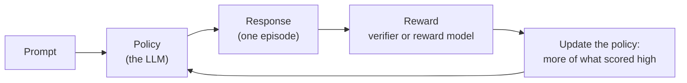
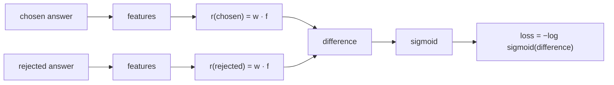
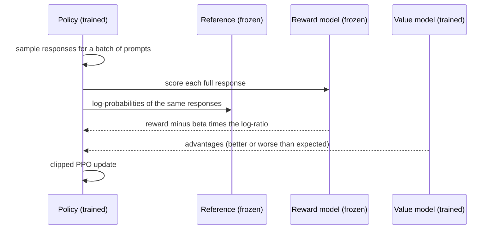
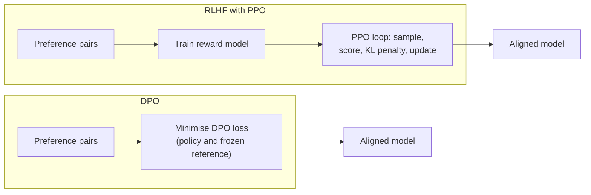

🌐 English · [Español](03-rlhf-and-preference-optimization.es.md)

# Lesson 2.3 — RLHF and preference optimisation

> **Module 02 · Lesson 3 of 4** · ⏱️ about 75 min · 🧪 Lab: [steps 5 and 6](lab/README.md#step-5--train-a-reward-model-and-catch-the-length-trap)

## 📨 Situation

> **From:** Dani Ruiz · Data Scientist, owns evaluation
> **Channel:** #ai-team
>
> Alex's agents rated 300 pairs of answers: for each customer question, two candidate replies and the
> one they preferred. Jordan wants to "train a reward model on it this week and let RLHF do the rest". I
> had a quick look and something smells: in the training split the preferred answer is usually the
> longer one, and the polite filler sentences are everywhere. If the reward model learns "longer is
> better", reinforcement learning will happily teach the assistant to ramble again, and we just spent a
> week fixing that. Before anyone trains anything, show me the eval: train, test, and questions the
> reward model has never seen.

## 🎯 Objectives

By the end of this lesson you can:

- Map the reinforcement learning (RL) vocabulary (policy, action, reward, episode) onto a large
  language model (LLM) generating an answer.
- Distinguish verifiable rewards from learned reward models, and implement a verifiable reward for a
  maths problem.
- Fit a Bradley–Terry reward model on preference pairs and diagnose a length bias with a train/test
  split and a prompt-disjoint split.
- Write out the Proximal Policy Optimization (PPO) objective with its Kullback–Leibler (KL) penalty,
  and compute the Direct Preference Optimization (DPO) loss on toy log-probabilities.
- Explain reward hacking and measure it with a padding attack.

## 🤔 Predict first

Write your answers down before reading on. You will check them in the self-check.

1. A reward model gets 100% accuracy on the held-out test pairs. Is it ready to train the assistant?
2. A reward model that only looks at answer length agrees with the agents 79% of the time on the
   training split. What do you expect on the test split?
3. In DPO, can the loss go down while the probability of the preferred answer also goes down?

## 1. Reinforcement learning in one page

SFT (lesson 2.2) needs someone to write the ideal answer. For many requests that is slow or
impossible, but people can easily say which of two answers is better. **Reinforcement learning (RL)**
learns from that kind of signal: instead of copying a target, the model tries something, gets a score,
and adjusts to get higher scores next time. RL from human feedback (**RLHF**) uses scores derived from
human preferences.

The vocabulary maps neatly onto text generation:

| RL term | Meaning in general | Meaning for an LLM |
|---|---|---|
| Policy | The decision maker | The language model, π(token given text so far) |
| State | What the policy sees | The prompt plus the tokens generated so far |
| Action | One decision | The next token |
| Episode | One full attempt | One complete response |
| Reward | Score for the attempt | A number for the whole response, usually given at the end |
| Reference policy | A frozen copy to compare against | The SFT model before RL started |

**Analogy:** teaching a dog a new trick. You cannot demonstrate a roll-over yourself, so you wait for
something close, give a treat, and the dog does more of what earned treats. The treats are rewards,
the dog's habits are the policy, and one attempt at the trick is an episode.



The hard part is not the loop; it is the reward. Everything in this lesson is about where the reward
comes from and how it can mislead you.

> ⚠️ **Common mistake:** treating RL as a magic quality booster. RL optimises exactly the reward you give
> it, including its flaws. A biased reward produces a biased model, faster and more confidently.

> 💡 **Production tip:** before any RL run, write down in one sentence what a high reward is supposed to
> mean and how you will check, on data the reward never saw, that it means that. If you cannot write
> the sentence, you are not ready to optimise.

## 2. Verifiable rewards: when a program can check the answer

Some tasks come with an answer key. A maths problem has a correct number, code has tests, a JSON
(JavaScript Object Notation) answer has a schema. For these, the reward can be computed by a program,
with no human and no learned model: **RL with verifiable rewards**. The DeepSeek-R1 report describes training reasoning behaviour
largely with rule-based rewards of this kind, and the DeepSeekMath paper introduced GRPO (Group Relative
Policy Optimization), which scores a group of sampled answers to the same question and compares each
one with the group's average. Module 09 goes deeper into reasoning models.

The lab's verifier reads the last number in the answer and compares it with the gold answer. On
problem r001 of `datasets/reasoning` (gold answer 175.10):

| Model answer | Reward |
|---|---|
| "206 x 0.85 = 175.10, shipping is free, so the total is 175.10 euros." | 1.0 |
| "The total is €175.1" | 1.0 |
| "Subtotal 206, minus 15% is 175.10, plus €4.95 shipping = 180.05" | 0.0 |

**Analogy:** a verifiable reward is a multiple-choice exam with an answer key; a learned reward model is
an essay contest judged by a panel.

```python
def verifiable_reward(model_answer: str, gold: str, tol: float = 0.005) -> float:
    """1.0 if the last number in the model's answer equals the gold number, else 0.0.

    No reward model is needed: a program checks the answer. This is the idea behind
    reinforcement learning with verifiable rewards (maths, code with tests, ...).
    """
    found = _NUMBER_RE.findall(model_answer)
    if not found:
        return 0.0
    value = float(found[-1].replace(",", "."))
    return 1.0 if abs(value - float(gold)) <= tol else 0.0
```

Verifiers are cheap and hard to fool by tone or length, but they are only as good as their rules. This
one rewards an answer whose reasoning is nonsense as long as the last number is right, and it would
give 0 to "175.10 euros (180.05 if you choose express)". Policies under RL pressure find such loopholes.

> ⚠️ **Common mistake:** trusting a verifier because it is "just code". Test it like any other code:
> correct answers in unusual formats, wrong answers that contain the right number, empty answers. Every
> loophole you miss becomes a habit the policy learns.

> 💡 **Production tip:** when you can turn a business requirement into a check (valid JSON, a cited
> source that exists, a total that matches the order), use it as a reward or at least as a filter on
> training data. It is cheaper and more stable than a learned reward model.

## 3. Reward models: Bradley–Terry from preference pairs

Most of what Hearthwise cares about (helpful, safe, kind, correct) has no answer key. The usual
solution is to **learn** a reward model from comparisons. The **Bradley–Terry** model assumes each
answer has a hidden score r, and the probability that people prefer answer A over answer B depends
only on the difference:

P(A preferred over B) = σ(r(A) − r(B)), where σ(z) = 1 / (1 + e^(−z)) is the sigmoid function.

Training maximises the probability of the agents' choices, which means minimising
−log σ(r(chosen) − r(rejected)) over all pairs. That is logistic regression on the *difference* between
the two answers. In real systems r is a neural network, often the SFT model with a scalar output head.
In the lab it is a linear function of simple features: the log of the word count, and optionally one
indicator per word. Because both answers in a pair share the prompt, prompt-only features would cancel
out in the difference; the lab therefore uses features of the response.

**Analogy:** a wine panel that only ever compares two glasses at a time. From hundreds of "this one is
better" verdicts you can still give every wine a score. Lesson 2.4 uses the same mathematics to rank
models on a leaderboard.



```python
def fit_reward_model(
    pairs: Sequence[dict[str, str]],
    featurizer: Featurizer,
    l2: float = 0.01,
    lr: float = 0.5,
    steps: int = 500,
) -> RewardModel:
    """Full-batch gradient descent on the Bradley–Terry loss. Deterministic: weights start at 0."""
    xc = featurizer.matrix([p["chosen"] for p in pairs])
    xr = featurizer.matrix([p["rejected"] for p in pairs])
    diff = xc - xr
    w = np.zeros(diff.shape[1])
    for _ in range(steps):
        margins = diff @ w
        grad = -(diff * sigmoid(-margins)[:, None]).mean(axis=0) + l2 * w
        w -= lr * grad
    return RewardModel(featurizer, w)
```

Now Dani's question. The data has 300 pairs: 240 in the train split and 60 in the test split. The
dataset's own baseline says the longer answer is the chosen one in 0.787 of train pairs but only 0.233
of test pairs. Here is what the lab measures with the official split:

| Reward model | Train pairs | Features | Train accuracy | Test accuracy |
|---|---|---|---|---|
| length only | 240 | 1 | 0.787 | 0.233 |
| words + length | 240 | 302 | 1.000 | 1.000 |

The length-only model is the trap Dani smelled: it looks decent on train and is far worse than a coin
flip on test. The words-plus-length model looks perfect, which should worry you even more. The same 23
customer questions appear in both splits, with the same good and bad answers. The model has memorised
which facts go with which question; the test split measures memory, not judgement.

An honest test uses questions the reward model has never seen. The lab's **prompt-disjoint** split puts
every other distinct question in training (125 train pairs) and evaluates on test pairs of the other
questions (28 pairs):

| Reward model (new questions) | Train pairs | Features | Train accuracy | Test accuracy |
|---|---|---|---|---|
| length only | 125 | 1 | 0.784 | 0.250 |
| words + length | 125 | 217 | 1.000 | 0.714 |
| words + length, length-balanced data | 54 | 217 | 1.000 | 0.821 |

On unseen questions the words-plus-length model drops to 0.714, and its largest weights show why: the
top two features are the word "or" (0.76) and the length feature itself (0.76). It learned a real signal
(answers containing "14" and "1-year" get negative weights, because they come from the outdated or
wrong replies) mixed with a strong preference for long answers. Rebalancing the training pairs so that
"chosen is longer" and "chosen is shorter" are equally common keeps only 54 pairs, yet lifts test
accuracy to 0.821. With 28 test pairs each pair is worth 3.6 points, so treat these as directions, not
precise scores.

> ⚠️ **Common mistake:** evaluating a reward model on a random split when prompts repeat. The test
> accuracy of 1.000 above is real arithmetic and a false conclusion. Split by prompt (or by time) so that
> the test asks new questions.

> 💡 **Production tip:** always report a reward model's accuracy next to a "longer answer wins" baseline
> and look at accuracy separately for pairs where the chosen answer is shorter. If the model only wins
> when length agrees with quality, it has learned length.

## 4. RLHF with PPO and a KL penalty

With a reward model in hand, classic RLHF optimises the policy with **Proximal Policy Optimization
(PPO)**. The objective has two parts: make the reward high, and do not drift too far from the reference
model. The drift is measured with the **Kullback–Leibler (KL) divergence** between the policy π and the
frozen reference π_ref:

maximise E[ r(x, y) ] − β · KL( π(· given x) ‖ π_ref(· given x) )

In practice the penalty is applied per sample, using the log-probabilities of the generated response
under both models:

reward used for training = r(x, y) − β · (log π(y given x) − log π_ref(y given x))

Worked example from the lab: the reward model gives r = 2.0, the policy assigns the response a
log-probability of −12.0, the reference −15.0, and β = 0.1. The policy has moved 3 nats (natural-log units) towards
this response, so the penalty is 0.1 × 3 = 0.3 and the training reward is 1.70.

PPO itself is the update rule. For each token it compares the new policy with the policy that generated
the data through the ratio ρ = π_new(action) / π_old(action), multiplies by an **advantage** A (how much
better than expected this action turned out, estimated with a value model), and clips ρ to the range
[1 − ε, 1 + ε] so a single batch cannot change the policy too much:

L = E[ min( ρ · A, clip(ρ, 1 − ε, 1 + ε) · A ) ]

A typical setup therefore keeps four networks around: the policy being trained, the frozen reference,
the reward model and the value model. That is a lot of memory and a lot of moving parts, which is the
main motivation for the simpler method in the next section.

**Analogy:** the KL penalty is a leash. The dog (policy) can explore towards treats (reward), but the
further it pulls from where it started (reference), the harder the leash pulls back.



```python
def kl_penalized_reward(reward: float, policy_logp: float, ref_logp: float, beta: float = 0.1) -> float:
    """The per-sample reward PPO-based RLHF maximises: r - beta * (log pi - log pi_ref)."""
    return reward - beta * (policy_logp - ref_logp)
```

> ⚠️ **Common mistake:** setting β to almost zero to "let the model improve faster". Without the leash
> the policy quickly drifts into text that the reward model scores highly but humans dislike, and it can
> lose fluency and knowledge it had after SFT.

> 💡 **Production tip:** log the average KL to the reference during training next to the reward. Reward
> going up while KL explodes is the classic signature of a policy exploiting the reward model.

## 5. DPO: preference optimisation without a reward model

**Direct Preference Optimization (DPO)** starts from a mathematical observation about the KL-regularised
objective above: its best possible policy satisfies r(x, y) = β · log(π(y given x) / π_ref(y given x))
plus a term that depends only on the prompt. Substitute that into the Bradley–Terry loss and the prompt
term cancels, because both answers share the prompt. The result is a loss you can minimise directly on
preference pairs, with ordinary gradient descent, no sampling, no reward model and no value model:

loss = −log σ( β · [ (log π(chosen) − log π_ref(chosen)) − (log π(rejected) − log π_ref(rejected)) ] )

The bracket is the **margin**: how much more the policy has raised the chosen answer, relative to the
reference, than the rejected one. The quantity β · (log π − log π_ref) is called the **implicit
reward**. Here are the lab's toy numbers for one pair where the reference model gives log p(chosen) =
−20 and log p(rejected) = −18 (it slightly prefers the rejected answer):

| Policy scenario | Margin | Loss, β = 0.1 | Loss, β = 0.5 |
|---|---|---|---|
| policy = reference (start of training) | 0.0 | 0.693 | 0.693 |
| chosen up 1, rejected down 1 | 2.0 | 0.598 | 0.313 |
| chosen down 2, rejected down 5 | 3.0 | 0.554 | 0.201 |
| chosen down 1, rejected up 1 (wrong way) | −2.0 | 0.798 | 1.313 |

At the start the loss is ln 2 = 0.693 for every pair, because policy and reference are identical. The
third row answers predict-first question 3: the loss improves even though the chosen answer became
*less* likely, because the rejected one fell further. DPO only cares about the gap, which is why
practitioners watch the chosen log-probability during training too. A larger β makes the loss react
more strongly to the same margin.

**Analogy:** RLHF hires a judge (the reward model) and a coach (PPO) to train the athlete. DPO hands the
athlete the judges' past verdicts directly and lets them adjust.



```python
def dpo_loss(
    policy_chosen: float, policy_rejected: float, ref_chosen: float, ref_rejected: float, beta: float = 0.1
) -> float:
    """Direct Preference Optimization loss for one pair, from sequence log-probabilities.

    loss = -log sigmoid(beta * [(policy_chosen - ref_chosen) - (policy_rejected - ref_rejected)])
    """
    margin = (policy_chosen - ref_chosen) - (policy_rejected - ref_rejected)
    return float(np.logaddexp(0.0, -beta * margin))  # = -log sigmoid(beta * margin)
```

DPO inherits every bias in the preference data. Trained on Alex's raw train split, it would be pushed
towards long, padded answers by the same correlation that fooled the length-only reward model.
Removing the reward model removes a component, not the problem.

> ⚠️ **Common mistake:** computing the log-probabilities over the whole prompt plus answer. Only the
> response tokens should count (the same masking idea as in lesson 2.2); otherwise differences in the
> prompt leak into the margin.

> 💡 **Production tip:** DPO is the common first choice when you have preference pairs and limited
> infrastructure: it trains like SFT. Reach for PPO-style RL when you have a reward you can compute
> online, such as a verifier, and the engineering budget for it.

## 6. Reward hacking

**Reward hacking** happens when the policy finds a way to score high that the reward designer did not
intend. It is Goodhart's law in action: when a measure becomes a target, it stops being a good measure.
The lab measures it with a padding attack. It takes the sentence that appears in the most chosen
training answers, "Thank you so much for reaching out to Hearthwise, we really appreciate you taking the
time to contact us.", appends it to the *rejected* answer, and counts how often the padded rejected
answer now outscores the chosen one.

| Reward model | Evaluated on | Hack rate |
|---|---|---|
| length only | official test split | 0.767 |
| length only | new questions | 0.750 |
| words + length | new questions | 0.357 |
| words + length, length-balanced data | new questions | 0.250 |

With the length-only model, one polite sentence turns a rejected answer into a "better" one in about
three pairs out of four. A policy trained against that reward would learn to open every reply with thanks and
pad the rest: the rambling demo, now produced on purpose. Balancing the data helps but does not remove
the effect.

**Analogy:** a call centre that rewards agents for long calls gets long calls, not happy customers.

> ⚠️ **Common mistake:** watching only the reward curve during training. A rising reward is exactly what
> hacking looks like. Read samples, track response length, and run a held-out human or task evaluation.

> 💡 **Production tip:** defend in layers: balanced preference data, a KL penalty, an explicit length
> control in the reward or the evaluation, several reward models, and regular human review of samples
> with the highest rewards, which is where the exploits show up first.

## 🧪 Try it

Run from `modules/02-decoding-post-training-evaluation/lab`.

1. Train the reward models and expose the length trap.

   ```bash
   uv run lab reward
   ```

   ```text
   'longer answer wins' baseline: train 0.787  test 0.233
   padding used for the hack test: 'Thank you so much for reaching out to Hearthwise, we really appreciate you taking the time to contact us.'

   official split (same prompts in train and test)
   reward model               pairs feats  train   test   hack
   length only                  240     1  0.787  0.233  0.767
   words + length               240   302  1.000  1.000  0.000

   new prompts (train and test questions do not overlap)
   reward model               pairs feats  train   test   hack
   length only                  125     1  0.784  0.250  0.750
   words + length               125   217  1.000  0.714  0.357
   words + length, balanced      54   217  1.000  0.821  0.250

   words + length (new prompts), largest weights:
     + or 0.76, <length> 0.76, 30 0.48, orders 0.47, no 0.47
     - yes -0.62, 5 -0.38, works -0.38, 14 -0.37, 1-year -0.31
   ```

2. Check the verifiable reward.

   ```bash
   uv run lab verify
   ```

   ```text
   r001: A customer buys 3 x Spark Mini at €19 each, 1 x Ember T3 at €149 each. A 15% discount code applies to the products (not to shipping). Shipping is free when the products cost more than €49 after any discount; otherwise it costs €4.95. What is the total in euros?
   gold answer: 175.10
   reward 1.0 <- '206 x 0.85 = 175.10, shipping is free, so the total is 175.10 euros.'
   reward 1.0 <- 'The total is €175.1'
   reward 0.0 <- 'Subtotal 206, minus 15% is 175.10, plus €4.95 shipping = 180.05'
   ```

3. Compute DPO losses and the KL-penalised reward.

   ```bash
   uv run lab dpo
   ```

   ```text
   reference model: log p(chosen) = -20.0, log p(rejected) = -18.0
   policy scenario                            margin loss b=0.1 loss b=0.5
   policy = reference (start of training)        0.0      0.693      0.693
   chosen up 1, rejected down 1                  2.0      0.598      0.313
   chosen down 2, rejected down 5                3.0      0.554      0.201
   chosen down 1, rejected up 1 (wrong way)     -2.0      0.798      1.313

   PPO-style reward: r=2.0, log pi=-12.0, log pi_ref=-15.0, beta=0.1 -> 1.70
   ```

## 🏭 In the real world

- **Who labels the pairs matters.** Agents, crowd workers and domain experts disagree; teams write
  labelling guidelines, measure agreement between labellers and drop or adjudicate contested pairs.
  Some pipelines replace part of the human labelling with artificial-intelligence (AI) feedback guided by written principles, as
  in [Constitutional AI](https://arxiv.org/abs/2212.08073).
- **Several reward signals.** Large post-training efforts often train separate reward models for
  separate goals; the Llama 2 paper, for example, describes distinct helpfulness and safety reward
  models. Combining them is a product decision, not just a maths one.
- **Libraries.** [Hugging Face TRL](https://huggingface.co/docs/trl) (Transformer Reinforcement Learning) implements reward-model training,
  PPO-style training and DPO, which makes the trade-offs in this lesson configuration choices.
- **Length control.** Because length bias is so common, evaluation reports increasingly show quality
  next to response length. You will build length-aware checks into your LLM judge in lesson 2.4.
- **What to monitor during preference training:** reward, KL to the reference, response length, the
  chosen and rejected log-probabilities (for DPO), and a fixed set of held-out prompts read by a human
  every few hundred steps.

## ✅ Self-check

**1. A reward model gets 1.000 on the held-out test pairs. Is it ready? (Predict-first question 1.)**

<details><summary>Answer</summary>

Not yet. In this dataset the same questions appear in train and test, so the words-plus-length model can
memorise which answer is right for each question. On a prompt-disjoint split it drops to 0.714 and its
largest weights include length. Perfect held-out accuracy is a reason to check for leakage, not to
celebrate.

</details>

**2. The length-only model scores 0.787 on train. What did it score on test, and why? (Predict-first
question 2.)**

<details><summary>Answer</summary>

0.233, far worse than a coin flip. In the train split the chosen answer is usually the padded one; in
the test split the padding is usually on the rejected answer. A model that learned "longer is better"
is right for the wrong reason, and the reason flips.

</details>

**3. Can the DPO loss go down while the chosen answer becomes less likely? (Predict-first question 3.)**

<details><summary>Answer</summary>

Yes. With the reference at −20 (chosen) and −18 (rejected), moving the policy to −22 and −23 gives a
margin of 3.0 and a loss of 0.554 at β = 0.1, lower than the starting 0.693, even though the chosen
answer's log-probability fell by 2. DPO optimises the gap, not the absolute likelihood.

</details>

**4. In the PPO-style reward, r = 2.0, log π = −12.0, log π_ref = −15.0 and β = 0.1. What is the
training reward and what does the penalty protect against?**

<details><summary>Answer</summary>

2.0 − 0.1 × (−12.0 − (−15.0)) = 2.0 − 0.3 = 1.70. The penalty grows as the policy moves away from the
reference model, which limits reward hacking and protects the fluency and knowledge the model had
after SFT.

</details>

**5. Why might a verifiable reward still be hacked?**

<details><summary>Answer</summary>

Because the verifier checks a rule, not the intent. The lab's verifier reads only the last number, so an
answer with nonsense reasoning and the right final number gets full reward, and a correct answer that
ends with another number gets zero. Policies under optimisation pressure find such gaps.

</details>

## 💬 Explain it in your own words

- Jordan wants "RLHF by Friday". Explain to Jordan, without formulas, why the agents' preference data
  could make the assistant ramble again, and what you would do first.
- Explain to Alex how the agents' ratings become a reward model, using the wine-panel analogy.

## 🔑 Key ideas

- RL improves a policy from a reward instead of copying targets; for an LLM, an episode is one response
  and the reward usually arrives at the end.
- Verifiable rewards come from programs (answer checks, tests) and are cheap, but still have loopholes.
- A Bradley–Terry reward model learns scores from pairwise preferences; evaluate it on new prompts and
  against a "longer answer wins" baseline.
- RLHF with PPO maximises reward minus a KL penalty to a frozen reference; it needs a policy, a
  reference, a reward model and a value model.
- DPO optimises the same preference objective directly on pairs, without a reward model, and inherits
  every bias of the data.
- Reward hacking is the policy exploiting the reward; length padding is the most common form.

## 📚 Go deeper

- ⭐ [Direct Preference Optimization: Your Language Model is Secretly a Reward Model](https://arxiv.org/abs/2305.18290)
  — the DPO derivation in a readable paper; read the derivation section right after this lesson.
- [Training language models to follow instructions with human feedback (InstructGPT)](https://arxiv.org/abs/2203.02155)
  — the reference RLHF pipeline with SFT, a reward model and PPO.
- [Proximal Policy Optimization Algorithms](https://arxiv.org/abs/1707.06347) — the original PPO paper and
  its clipped objective.
- [DeepSeekMath](https://arxiv.org/abs/2402.03300) and [DeepSeek-R1](https://arxiv.org/abs/2501.12948) —
  GRPO and reinforcement learning with rule-based rewards for reasoning.
- [Constitutional AI](https://arxiv.org/abs/2212.08073) — preference data generated with AI feedback and
  written principles.

---

[← Previous: 2.2 Supervised fine-tuning](02-supervised-fine-tuning.md) · [🏠 Module 02](README.md) · [Next: 2.4 Evaluating LLMs →](04-evaluating-llms.md)
