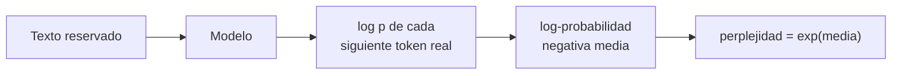
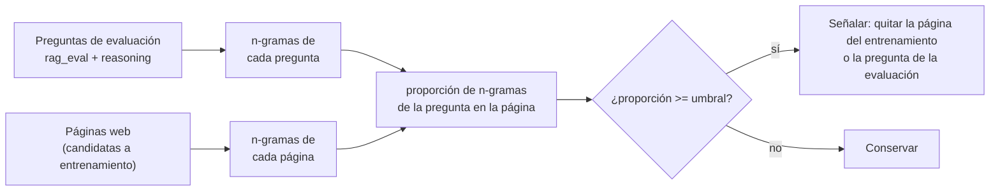
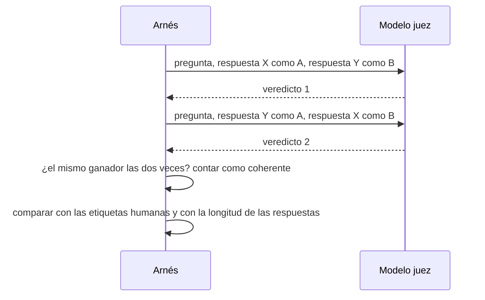

🌐 [English](04-evaluating-llms.md) · Español

# Lección 2.4 — Evaluar LLM

> **Módulo 02 · Lección 4 de 4** · ⏱️ unos 75 min · 🧪 Lab: [pasos 7 a 9](lab/README.es.md#paso-7--puntúa-respuestas-con-métricas-tradicionales)

## 📨 Situación

> **De:** Jordan Kim · Responsable de Producto y Estrategia
> **Canal:** #ai-team
>
> La segunda pregunta de dirección es en qué modelo confiar, y quieren una respuesta este mes. Dos
> proveedores mandaron presentaciones y los dos dicen que su modelo "encabeza el *leaderboard*". Dani
> dice que una puntuación no significa nada hasta que sepamos qué se midió y si la prueba se filtró a la
> web. Así que este es el plan: el mes que viene, los agentes de Alex hacen una comparación a ciegas de
> nuestros cuatro asistentes preseleccionados y los ordenamos según sus votos. Necesito el método de
> clasificación construido y probado con votos simulados antes de que lleguen los reales, y además una
> comprobación automática barata que podamos ejecutar cada semana. ¿Para el viernes?

## 🎯 Objetivos

Al terminar esta lección puedes:

- Calcular la coincidencia exacta, el F1 por *tokens*, BLEU, ROUGE-L y la perplejidad, y mostrar dónde engaña cada uno (cada métrica se define en la sección 1).
- Describir qué miden los *benchmarks* MMLU (*Massive Multitask Language Understanding*), GSM8K (*Grade School Math 8K*) y HumanEval, y por qué la contaminación de los *benchmarks* infla las puntuaciones.
- Detectar preguntas de evaluación copiadas en un rastreo web mediante solapamiento de n-gramas, y elegir n y el umbral.
- Convertir votos por pares en puntuaciones Elo y Bradley–Terry con intervalos de confianza.
- Auditar un modelo de lenguaje grande (LLM, *large language model*) usado como juez en busca de sesgos de posición y de verbosidad con un test de intercambio.

## 🤔 Predice primero

Apunta tus respuestas antes de seguir leyendo. Las comprobarás en la autoevaluación.

1. Una respuesta obtiene un ROUGE-L de 0,80 frente a la respuesta de referencia, y otra obtiene 0,40.
   ¿Cuál tiene más probabilidades de ser correcta?
2. Calculas puntuaciones Elo en línea a partir de 600 votos y luego otra vez con los mismos votos en orden
   inverso. ¿Obtienes las mismas puntuaciones?
3. Un juez LLM coincide con la etiqueta humana cada vez que la mejor respuesta se muestra primero. ¿Es un
   buen juez?

## 1. Métricas basadas en referencias y sus límites

La evaluación más barata compara la respuesta del modelo con una **respuesta de referencia** (*reference
answer*) escrita por una persona. Cuatro métricas clásicas lo hacen contando palabras compartidas:

| Métrica | Qué calcula | Nació en |
|---|---|---|
| Coincidencia exacta (EM, *exact match*) | 1 si las cadenas normalizadas son idénticas; si no, 0 | Respuesta a preguntas |
| F1 por *tokens* | Media armónica de la precisión y el *recall* de palabras | Respuesta a preguntas |
| BLEU (*bilingual evaluation understudy*) | Media geométrica de las precisiones de n-gramas (n = 1 a 4) por una penalización por brevedad | Traducción automática |
| ROUGE-L (*recall-oriented understudy for gisting evaluation*, subsecuencia común más larga) | F1 sobre la subsecuencia común más larga de palabras | Resumen automático |

"Normalizadas" significa en minúsculas, sin puntuación y sin "a", "an" ni "the", para que "The 30
days." y "30 days" cuenten como iguales. Este es el F1 por *tokens* tal como lo implementa el lab:

```python
def token_f1(prediction: str, reference: str) -> float:
    """Harmonic mean of token precision and recall after normalisation."""
    pred, ref = normalize_answer(prediction).split(), normalize_answer(reference).split()
    common = sum((Counter(pred) & Counter(ref)).values())
    if common == 0:
        return 0.0
    precision, recall = common / len(pred), common / len(ref)
    return 2 * precision * recall / (precision + recall)
```

Ahora puntúa cinco respuestas candidatas a la pregunta q001 de rag_eval, "What is the return window for
Hearthwise products?", cuya respuesta de referencia es "30 days from delivery.":

| Candidata | ¿Correcta? | EM | F1 | BLEU | ROUGE-L |
|---|---|---|---|---|---|
| "30 days from delivery." (copia de la referencia) | sí | 1.00 | 1.00 | 1.00 | 1.00 |
| "You have 30 days after delivery to return it." | sí | 0.00 | 0.46 | 0.18 | 0.53 |
| "Thirty days, counted from the day it arrives." | sí | 0.00 | 0.36 | 0.14 | 0.40 |
| "14 days from delivery." (la política antigua) | **no** | 0.00 | 0.75 | 0.75 | 0.80 |
| "Thanks for asking! Returns are accepted for 30 days from delivery, opened or not, and there is no restocking fee." | sí | 0.00 | 0.33 | 0.14 | 0.34 |

La única respuesta incorrecta supera a todas las paráfrasis correctas en F1, BLEU y ROUGE-L. Las
métricas de solapamiento premian compartir palabras con la referencia, y la respuesta desactualizada
comparte tres de sus cuatro palabras. Castigan las respuestas correctas que usan otras palabras o añaden
detalles útiles. EM es lo bastante estricta para evitar la falsa victoria, pero da cero a tres
respuestas correctas.

**Analogía:** calificar una redacción contando cuántas palabras comparte con la respuesta modelo del
profesorado. Quien copia la estructura de las frases de la respuesta modelo con un dato erróneo saca más
nota que quien explica la idea correctamente con sus propias palabras.

> ⚠️ **Error común:** informar de BLEU o ROUGE para un chatbot y llamarlo "calidad". Estas métricas son
> útiles para tareas acotadas con salidas cortas y previsibles, y como señales baratas de regresión; dicen
> poco sobre si una respuesta abierta es correcta o útil.

> 💡 **Consejo de producción:** cuando tengas que usar una métrica de solapamiento, añade una
> comprobación de los datos que importan. rag_eval ya incluye cadenas `must_not_contain` como "14 days"
> precisamente por esto: una regla barata que detecta el único error que premian las métricas de
> solapamiento.

## 2. Perplejidad: cuánto se sorprende el modelo

La **perplejidad** (*perplexity*) mide lo bien que un modelo predice un texto. Toma la log-probabilidad
negativa media por *token* y calcula su exponencial: perplejidad = exp(−(1/N) · Σ log p(*token* dados los
*tokens* anteriores)). Una perplejidad de 7 significa que el modelo estaba, de media, tan inseguro como si
eligiera uniformemente entre 7 *tokens*. Más baja es mejor para *predecir* texto, que es lo que optimiza
el preentrenamiento.

El lab entrena un modelo de trigramas con 9 de cada 10 documentos del corpus y mide la perplejidad sobre
varios textos:

| Texto | *Tokens* | Proporción de `<unk>` | Perplejidad |
|---|---|---|---|
| documentos de entrenamiento | 11043 | 4% | 2.54 |
| documentos reservados | 1406 | 6% | 7.01 |
| salidas voraces | 219 | 0% | 2.66 |
| salidas *top-p* 0.9 | 128 | 0% | 9.80 |
| salidas T=1.5 | 97 | 0% | 674.91 |
| páginas en español del centro de ayuda | 266 | 80% | 20.30 |

Esta tabla esconde tres lecciones. Primera: la distancia entre 2,54 y 7,01 es sobreajuste; mide siempre
con texto reservado. Segunda: las propias salidas voraces del modelo obtienen 2,66, mucho "mejor" que los
documentos reservados reales, pero en la lección 2.1 viste que entran en bucle. Una perplejidad baja
significa *previsible*, no *bueno*. Tercera: las páginas en español parecen solo moderadamente
sorprendentes (20,30) porque el 80 % de sus palabras son desconocidas para el modelo y se colapsan en el
único *token* `<unk>`, que predice con facilidad. La perplejidad solo es comparable entre modelos que
comparten tokenizador y vocabulario.

**Analogía:** la perplejidad es la frecuencia con la que la siguiente palabra sorprende a quien lee. Un
disco rayado rara vez sorprende, y quien sustituye cada palabra extranjera por "bla" rara vez se
sorprende con un texto en otro idioma.



```python
def perplexity(self, docs: Iterable[Sequence[str]]) -> float:
    """exp(average negative log-likelihood per token), counting each document's ``<eos>``."""
    nll, n = 0.0, 0
    for doc in docs:
        tokens = list(doc) + [EOS]
        nll -= self.sequence_logprob(tokens)
        n += len(tokens)
    return math.exp(nll / n)
```

> ⚠️ **Error común:** comparar perplejidades de dos modelos con tokenizadores distintos. Un modelo que
> divide el texto en más *tokens* y más pequeños resuelve un problema más fácil por *token*. Compara
> modelos sobre el mismo texto con la misma tokenización, o usa bits por carácter.

> 💡 **Consejo de producción:** la perplejidad sobre una muestra reservada de texto de tu propio dominio
> es una señal rápida y barata cuando continúas el preentrenamiento o haces *fine-tuning*: si sube, el
> modelo empeoró en tu dominio. No sustituye a la evaluación de la tarea.

## 3. Benchmarks y contaminación

Un ***benchmark*** es un conjunto fijo de tareas con una regla de puntuación automática, para comparar
modelos distintos en igualdad de condiciones. Tres aparecen en casi todos los anuncios de modelos:

| *Benchmark* | Qué evalúa | Cómo se puntúa |
|---|---|---|
| [MMLU](https://arxiv.org/abs/2009.03300) | Conocimiento en 57 materias, del derecho a la física | Exactitud en preguntas de opción múltiple |
| [GSM8K](https://arxiv.org/abs/2110.14168) | Problemas aritméticos de varios pasos con enunciado | Coincidencia exacta del número final, como el verificador de la lección 2.3 |
| [HumanEval](https://arxiv.org/abs/2107.03374) | Escribir funciones de Python a partir de *docstrings* | Tests unitarios; pass@k es la probabilidad de que una de k muestras pase |

Conjuntos más amplios como [HELM](https://arxiv.org/abs/2211.09110) (*Holistic Evaluation of Language
Models*) presentan muchos escenarios y muchas métricas en paralelo, y herramientas como
[lm-evaluation-harness](https://github.com/EleutherAI/lm-evaluation-harness) permiten ejecutar cientos de
*benchmarks* con un solo comando. Las versiones propias de Hearthwise son `datasets/rag_eval` (40
preguntas de soporte) y `datasets/reasoning` (160 problemas de matemáticas).

Todo *benchmark* público tiene la misma debilidad: es público. Si sus preguntas y respuestas acaban en
los datos de entrenamiento, el modelo puede recordar en lugar de razonar. Eso es la **contaminación de
*benchmarks*** (*benchmark contamination*), e infla las puntuaciones sin mejorar el modelo. El
"encabeza el *leaderboard*" de los proveedores no vale nada hasta que alguien lo compruebe.

La comprobación estándar es el **solapamiento de n-gramas** (*n-gram overlap*): divide cada pregunta de
evaluación en secuencias de n palabras y búscalas en los documentos de entrenamiento. El artículo de
GPT-3, por ejemplo, presenta un análisis de contaminación basado en el solapamiento de 13-gramas. El
lab ejecuta esta comprobación sobre el rastreo web del módulo 01: para cada página y cada pregunta de
rag_eval y reasoning, calcula la proporción de n-gramas de la pregunta que aparecen en la página. Una
pregunta de menos de n palabras se compara como un único n-grama de su propia longitud.

| n | Proporción mínima | Páginas señaladas | Páginas correctas | Preguntas señaladas | Preguntas correctas |
|---|---|---|---|---|---|
| 3 | 0.5 | 2 | 2 | 46 | 12 |
| 8 | 0.5 | 2 | 2 | 45 | 12 |
| 8 | 1.0 | 2 | 2 | 12 | 12 |
| 13 | 1.0 | 2 | 2 | 12 | 12 |

A nivel de página, el detector es fácil de acertar: dos páginas de studyhub.example copian material de
evaluación, y todas las configuraciones encuentran las dos. A nivel de pregunta, el umbral importa. Con
una proporción de 0,5, el detector señala 46 preguntas, pero solo 12 son copias reales (6 de rag_eval y
6 de reasoning). Los problemas de reasoning se generan a partir de plantillas, así que una página que
copia 6 de ellos comparte la mayoría de sus n-gramas con decenas de problemas hermanos. Exigir que
coincidan todos los n-gramas (proporción 1,0) da exactamente las 12. Una regla estricta es precisa pero
frágil: cambia una palabra de una pregunta copiada y se cuela. En la práctica, usas una regla laxa para
encontrar candidatas y luego las lees.

**Analogía:** comprobar la contaminación es pasar un detector de plagio al propio examen: antes de
fiarte de una nota perfecta, buscas en internet si circulan las respuestas.



```python
def item_in_page(item: Sequence[str], page_tokens: Sequence[str], n: int, min_share: float) -> bool:
    """True if at least ``min_share`` of the item's n-grams occur in the page."""
    size = min(n, len(item))
    grams = set(ngrams(list(item), size))
    if not grams:
        return False
    page = set(ngrams(list(page_tokens), size))
    return len(grams & page) / len(grams) >= min_share
```

> ⚠️ **Error común:** fiarte de la puntuación de un *benchmark* público para decidir sobre tu propio caso
> de uso. Incluso sin contaminación, MMLU no mide si un asistente responde correctamente en español a
> preguntas sobre devoluciones de Hearthwise. Construye un pequeño conjunto de evaluación con tu propio
> tráfico y mantenlo en privado.

> 💡 **Consejo de producción:** ejecuta la comprobación de contaminación en las dos direcciones: quita
> las páginas filtradas de los datos de entrenamiento e informa de las puntuaciones por separado en los
> elementos de evaluación limpios y en los filtrados. Si un modelo es mucho mejor en los filtrados, has
> medido memoria.

## 4. Evaluación humana y clasificaciones a partir de votos por pares

Para respuestas abiertas, las personas siguen siendo la referencia. Pedir una nota del 1 al 5 da
resultados ruidosos: el 4 de un agente es el 3 de otro. Preguntar "¿cuál de estas dos respuestas es
mejor?" es más fácil y más coherente. Muestra las dos respuestas a ciegas (sin nombres de modelo), en
orden aleatorio, y recoge muchos votos. Es el diseño de clasificaciones públicas como
[Chatbot Arena](https://arxiv.org/abs/2403.04132) y de la comparación que planea Jordan.

Después, los votos se convierten en puntuaciones. **Elo**, que viene del ajedrez, actualiza dos
puntuaciones tras cada partida:

esperado(A) = 1 / (1 + 10^((R_B − R_A) / 400)); después, R_A ← R_A + K · (resultado − esperado(A)), y B
se mueve la misma cantidad en sentido contrario.

**Bradley–Terry**, el modelo que hay detrás del modelo de recompensa de la lección 2.3, ajusta en cambio
una fuerza por modelo con *todos* los votos a la vez, por máxima verosimilitud. El artículo de Chatbot
Arena describe cómo estima sus puntuaciones con el modelo de Bradley–Terry y les añade intervalos de
confianza.

Para probar el método antes de que existan votos reales, el lab simula 600 votos entre cuatro asistentes
ficticios con fuerzas ocultas conocidas y comprueba si cada método las recupera (todas las puntuaciones
en la escala Elo, centradas en 1000):

| Modelo | Verdad | Elo | Elo, votos invertidos | Bradley–Terry | Intervalo *bootstrap* del 95 % |
|---|---|---|---|---|---|
| model-A | 1113 | 1105 | 1087 | 1105 | 1075 a 1146 |
| model-B | 1026 | 1021 | 1078 | 1026 | 997 a 1061 |
| model-C | 991 | 986 | 985 | 993 | 959 a 1022 |
| model-D | 870 | 887 | 850 | 875 | 844 a 903 |

Los tres métodos aciertan el orden aquí, pero fíjate en model-B: el Elo en línea da 1021 o 1078 con los
*mismos* votos, según su orden, porque las partidas recientes mueven más las puntuaciones que las
antiguas. Bradley–Terry da 1026 en ambos casos. Los intervalos añaden la honestidad que pide Dani:
model-B (997 a 1061) y model-C (959 a 1022) se solapan, así que 600 votos no deciden cuál de los dos es
mejor, aunque la diferencia real existe.

**Analogía:** el Elo en línea es una conversación continua sobre quién juega mejor, donde la última
partida es la que más se oye. Bradley–Terry es el balance de la temporada: todas las partidas a la vez,
en cualquier orden.

```python
def elo_ratings(votes: Sequence[Vote], k: float = 32.0, start: float = 1000.0) -> dict[str, float]:
    """Online Elo: after each vote, move both ratings by k * (result - expected)."""
    ratings: dict[str, float] = {}
    for v in votes:
        ra, rb = ratings.setdefault(v.left, start), ratings.setdefault(v.right, start)
        expected_left = 1 / (1 + 10 ** ((rb - ra) / 400))
        score_left = 1.0 if v.winner == v.left else 0.0
        ratings[v.left] = ra + k * (score_left - expected_left)
        ratings[v.right] = rb - k * (score_left - expected_left)
    return ratings
```

> ⚠️ **Error común:** ordenar modelos por un único número sin intervalo. Una ventaja de 30 puntos con
> intervalos que se solapan no señala un ganador; es una petición de más votos.

> 💡 **Consejo de producción:** antes de recoger votos reales, apunta cuántos necesitas. Simula votos con
> diferencias plausibles, como hace el lab, y aumenta el número hasta que los intervalos separen los
> modelos que tienes que distinguir. El tiempo de las personas es la parte cara de la evaluación.

## 5. El LLM como juez y sus sesgos

Los votos humanos son lentos, así que los equipos suelen pedir a un LLM potente que haga de juez:
le muestran la pregunta y dos respuestas y le preguntan cuál es mejor. Es lo bastante barato para
ejecutarlo cada semana, que es lo que quiere Jordan. El
[artículo sobre el LLM como juez](https://arxiv.org/abs/2306.05685) (*LLM-as-a-judge*) encontró que los
jueces potentes pueden coincidir bien con las preferencias humanas, y también documentó sesgos
sistemáticos:

| Sesgo | Qué pasa | Comprobación |
|---|---|---|
| Sesgo de posición | Prefiere la respuesta que se muestra primero (o segunda) | Preguntar dos veces intercambiando el orden; contar solo los veredictos coherentes |
| Sesgo de verbosidad | Prefiere las respuestas más largas | Medir con qué frecuencia gana la más larga; comparar con un conjunto equilibrado en longitud |
| Autopreferencia | Prefiere respuestas propias o de su familia de modelos | Usar un juez de una familia distinta a la de los candidatos |

El juez del lab pasa por la misma capa de proveedores que los demás labs, así que puedes apuntarlo a un
modelo real. Por defecto es un **sustituto guionizado** con dos sesgos incorporados a propósito: prefiere
la respuesta con más palabras y da a la primera respuesta cinco palabras de ventaja. Lo importante no es
el juez falso; es el diagnóstico, que debe detectar los sesgos que pusiste a propósito antes de que te
fíes de él con un juez cuyos sesgos no conoces.

```python
for p in pairs:
    v1 = parse_verdict(provider.complete(judge_messages(p["prompt"], p["chosen"], p["rejected"])).text)
    v2 = parse_verdict(provider.complete(judge_messages(p["prompt"], p["rejected"], p["chosen"])).text)
    pick1 = p["chosen"] if v1 == "A" else p["rejected"]
    pick2 = p["rejected"] if v2 == "A" else p["chosen"]
    agree_ab += pick1 == p["chosen"]
    agree_ba += pick2 == p["chosen"]
    consistent += pick1 == pick2
```

En los 60 pares de preferencias de prueba, tal como se valoraron, el juez elige siempre la respuesta más
larga y coincide con los agentes solo 0,233 de las veces: sesgo de verbosidad puro, la misma trampa que
el modelo de recompensa de solo longitud. Quita las frases de relleno educadas para que las dos
respuestas tengan longitudes parecidas y aparece el sesgo de posición: el acuerdo es 1,000 cuando la
mejor respuesta se muestra primero, pero 0,667 cuando se muestra segunda, y los dos veredictos coinciden
entre sí solo en 0,667 de los pares.

| Pares | Acuerdo (mejor primero) | Acuerdo (mejor segunda) | Coherentes | Elegida la primera | Elegida la más larga |
|---|---|---|---|---|---|
| pares de prueba tal como se valoraron | 0.233 | 0.233 | 1.000 | 0.500 | 1.000 |
| pares de prueba sin relleno | 1.000 | 0.667 | 0.667 | 0.667 | 0.833 |

**Analogía:** un jurado de un concurso de cocina que siempre prueba primero el plato de la izquierda y
adora las raciones grandes. Lo descubres intercambiando los platos y sirviendo el mismo plato en dos
tamaños.



> ⚠️ **Error común:** preguntar al juez una vez por par en un orden fijo e informar de sus tasas de
> victoria. Estás midiendo el sesgo de posición tanto como los modelos. Intercambia siempre el orden e
> informa de la tasa de coherencia junto al resultado.

> 💡 **Consejo de producción:** calibra el juez frente a unos cientos de pares etiquetados por personas de
> tu propio dominio antes de fiarte de él, y repite la calibración cada vez que cambies el modelo juez o
> el *prompt*. Versiona el *prompt* del juez junto a los resultados que produjo.

## 🧪 Pruébalo

Ejecuta desde `modules/02-decoding-post-training-evaluation/lab`.

1. Puntúa las cinco respuestas candidatas y calcula las perplejidades.

   ```bash
   uv run lab metrics
   ```

   ```text
   reference answer (rag_eval q001): '30 days from delivery.'
   candidate                  correct    EM    F1  BLEU ROUGE-L
   copy of the reference          yes  1.00  1.00  1.00    1.00
   correct paraphrase             yes  0.00  0.46  0.18    0.53
   correct, different words       yes  0.00  0.36  0.14    0.40
   wrong (old policy)              no  0.00  0.75  0.75    0.80
   correct but verbose            yes  0.00  0.33  0.14    0.34

   perplexity of a trigram model trained on 90% of the corpus
   text                       tokens  <unk> perplexity
   training documents          11043     4%       2.54
   held-out documents           1406     6%       7.01
   greedy outputs                219     0%       2.66
   top-p 0.9 outputs             128     0%       9.80
   T=1.5 outputs                  97     0%     674.91
   Spanish help-centre pages     266    80%      20.30
   ```

2. Encuentra las páginas y las preguntas contaminadas.

   ```bash
   uv run lab contamination
   ```

   ```text
   web pages labelled as contaminated: 2; eval questions copied word for word: 12
     n share pages flagged correct items flagged correct
     3   0.5             2       2            46      12
     8   0.5             2       2            45      12
     8   1.0             2       2            12      12
    13   1.0             2       2            12      12
   https://studyhub.example/math-practice-with-solutions: r001, r002, r003, r004, r005, r006
   https://studyhub.example/hearthwise-support-quiz-answers: q001, q002, q003, q004, q005, q006
   ```

3. Construye la clasificación y audita el juez.

   ```bash
   uv run lab arena
   uv run lab judge
   ```

   ```text
   600 simulated votes between 4 models
   model     truth    Elo Elo rev     BT  BT 95% interval
   model-A    1113   1105    1087   1105     1075 to 1146
   model-B    1026   1021    1078   1026      997 to 1061
   model-C     991    986     985    993      959 to 1022
   model-D     870    887     850    875      844 to  903
   Elo ranking:          model-A > model-B > model-C > model-D
   Elo ranking reversed: model-A > model-B > model-C > model-D
   BT ranking:           model-A > model-B > model-C > model-D
   judge provider: fake
   pairs                          n agree AB agree BA consistent  first longer
   test pairs as rated           60    0.233    0.233      1.000  0.500  1.000
   test pairs, filler removed    60    1.000    0.667      0.667  0.667  0.833
   ```

## 🏭 En el mundo real

- **Capas de evaluación.** Los equipos maduros combinan comprobaciones automáticas baratas en cada
  cambio (formato, reglas como `must_not_contain`, pequeños conjuntos de tareas), un juez LLM sobre un
  conjunto más grande cada semana, comparaciones humanas antes de las decisiones importantes y señales
  en línea tras el lanzamiento (pulgares arriba o abajo, escalados al equipo de soporte, tests A/B).
- **Tu propio conjunto de evaluación es un activo.** Recógelo del tráfico real, etiquétalo con cuidado,
  mantenlo privado y versionado, y desglosa los resultados por idioma, producto e intención. Los
  *benchmarks* públicos te ayudan a preseleccionar modelos; tu conjunto decide.
- **Las clasificaciones responden a otra pregunta.** Una arena pública ordena las preferencias generales
  de chat de quienes votan en ella. Hearthwise necesita respuestas correctas, seguras y breves sobre sus
  propios productos en dos idiomas.
- **Barreras de evaluación.** Trata una caída en el conjunto privado como un test que falla: bloquea el
  lanzamiento, mira los ejemplos que cambiaron y decide de forma explícita.
- **Coste.** Cada llamada al juez y cada voto humano cuestan dinero y tiempo. Sam pedirá el coste por
  ejecución de la evaluación en el próximo módulo; presupuéstalo como cualquier otra carga de trabajo.

## ✅ Autoevaluación

**1. Una respuesta obtiene un ROUGE-L de 0,80 y otra 0,40. ¿Cuál tiene más probabilidades de ser
correcta? (Pregunta 1 de "Predice primero".)**

<details><summary>Respuesta</summary>

No se puede saber. En el lab, la incorrecta "14 days from delivery." obtiene 0,80 y la correcta "Thirty
days, counted from the day it arrives." obtiene 0,40. Las métricas de solapamiento miden las palabras
compartidas con la referencia, no la corrección. Añade comprobaciones con reglas para los datos que
importan, o usa evaluación humana o con un juez.

</details>

**2. ¿Cambian las puntuaciones Elo en línea si inviertes el orden de los mismos votos? (Pregunta 2 de
"Predice primero".)**

<details><summary>Respuesta</summary>

Sí. Elo se actualiza tras cada voto, así que los votos posteriores pesan más: model-B obtiene 1021 en un
orden y 1078 en el otro. Bradley–Terry ajusta todos los votos a la vez y da 1026 en ambos órdenes, por
eso es la mejor opción para un conjunto fijo de votos.

</details>

**3. El juez coincide con las personas cada vez que la mejor respuesta se muestra primero. ¿Es un buen
juez? (Pregunta 3 de "Predice primero".)**

<details><summary>Respuesta</summary>

No necesariamente. En los pares sin relleno, el acuerdo es 1,000 con la mejor respuesta primero, pero
0,667 con ella en segundo lugar: el juez favorece la posición A. Solo el test de intercambio lo revela.
Informa de la coherencia y cuenta solo los veredictos que sobreviven al intercambio.

</details>

**4. ¿Por qué el detector de contaminación señala 46 preguntas con una proporción de 0,5 si solo se
copiaron 12?**

<details><summary>Respuesta</summary>

Los problemas de reasoning salen de plantillas, así que sus preguntas comparten la mayoría de sus
n-gramas. Una página que copia 6 problemas coincide con más de la mitad de los n-gramas de muchos
problemas hermanos que nunca se copiaron. Exigir todos los n-gramas (proporción 1,0) da exactamente las
12 copias reales; en la práctica, usas la regla laxa para encontrar candidatas y luego las lees.

</details>

**5. Las salidas voraces del modelo tienen una perplejidad de 2,66, menor que la de los documentos
reservados (7,01). ¿Son mejor texto?**

<details><summary>Respuesta</summary>

No. La perplejidad mide lo previsible que es el texto para el modelo. Sus propias salidas voraces son,
por construcción, el texto más previsible que puede producir, bucles incluidos, como viste en la lección
2.1. La perplejidad sirve para comparar modelos sobre el mismo texto reservado, no para juzgar
respuestas generadas.

</details>

## 💬 Explícalo con tus palabras

- Jordan reenvía una diapositiva de un proveedor que dice "número 1 en el *leaderboard*". Escribe las
  tres preguntas que le devolverías y explica por qué importa cada una.
- Explícale a Alex por qué la comparación de los agentes necesita un orden aleatorio y por qué
  presentarás intervalos, no solo una clasificación.

## 🔑 Ideas clave

- Las métricas de solapamiento (EM, F1, BLEU, ROUGE-L) miden palabras compartidas, no la corrección; una
  respuesta incorrecta puede ganar.
- La perplejidad mide la previsibilidad sobre texto reservado y solo es comparable con el mismo
  tokenizador.
- Los *benchmarks* permiten comparar, pero se filtran; comprueba la contaminación con solapamiento de
  n-gramas y lee los aciertos.
- Los votos humanos por pares son la referencia para la calidad abierta; Bradley–Terry los convierte en
  puntuaciones que no dependen del orden, y los intervalos te dicen cuándo los votos no bastan.
- Los jueces LLM son baratos y útiles, pero intercambia las posiciones, vigila la longitud y calíbralos
  frente a personas.
- Tu propio conjunto de evaluación, privado y versionado, decide; las clasificaciones públicas solo
  sirven para preseleccionar.

## 📚 Profundiza

- ⭐ [Judging LLM-as-a-Judge with MT-Bench and Chatbot Arena](https://arxiv.org/abs/2306.05685) — el
  estudio más claro sobre los sesgos de los jueces y cómo medirlos.
- [Chatbot Arena: An Open Platform for Evaluating LLMs by Human Preference](https://arxiv.org/abs/2403.04132)
  — votación por pares a gran escala y la estadística que hay detrás de las puntuaciones.
- [Holistic Evaluation of Language Models (HELM)](https://arxiv.org/abs/2211.09110) — por qué un solo
  número nunca basta, con muchos escenarios y métricas en paralelo.
- [lm-evaluation-harness](https://github.com/EleutherAI/lm-evaluation-harness) — ejecuta tú
  *benchmarks* estándar sobre modelos abiertos.
- [Language Models are Few-Shot Learners (GPT-3)](https://arxiv.org/abs/2005.14165) — incluye un
  análisis detallado de contaminación basado en el solapamiento de n-gramas.

---

[← Anterior: 2.3 RLHF y optimización de preferencias](03-rlhf-and-preference-optimization.es.md) · [🏠 Módulo 02](README.es.md) · [Siguiente: Lab 02 →](lab/README.es.md)
