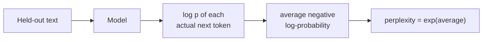
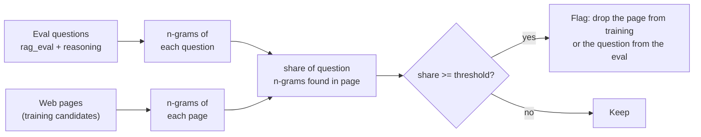
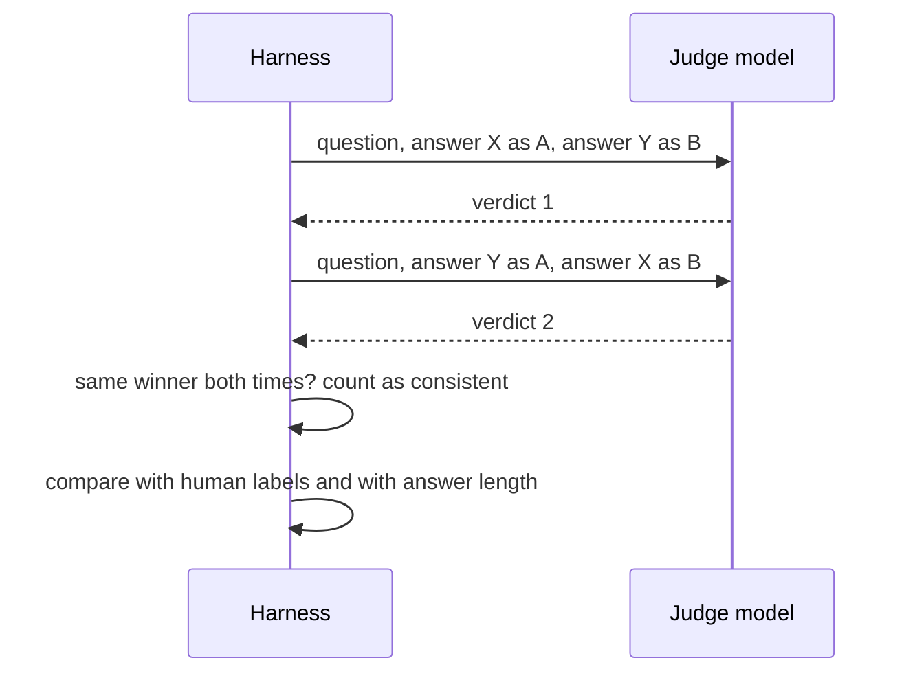

🌐 English · [Español](04-evaluating-llms.es.md)

# Lesson 2.4 — Evaluating LLMs

> **Module 02 · Lesson 4 of 4** · ⏱️ about 75 min · 🧪 Lab: [steps 7 to 9](lab/README.md#step-7--score-answers-with-traditional-metrics)

## 📨 Situation

> **From:** Jordan Kim · Product and Strategy Lead
> **Channel:** #ai-team
>
> Leadership's second question is which model to trust, and they want an answer this month. Two vendors
> sent slide decks and both claim their model "tops the leaderboard". Dani says a score means nothing
> until we know what was measured and whether the test leaked onto the web. So here is the plan: next
> month Alex's agents run a blind side-by-side of our four shortlisted assistants, and we rank them from
> their votes. I need the ranking method built and proven on simulated votes before the real ones
> arrive, plus a cheap automatic check we can run every week. Friday?

## 🎯 Objectives

By the end of this lesson you can:

- Compute exact match, token F1, BLEU, ROUGE-L and perplexity, and show where each one misleads
  (each metric is defined in section 1).
- Describe what the MMLU (Massive Multitask Language Understanding), GSM8K (Grade School Math 8K) and
  HumanEval benchmarks measure, and why benchmark contamination inflates scores.
- Detect evaluation questions copied into a web crawl with n-gram overlap, and choose n and the
  threshold.
- Turn pairwise votes into Elo and Bradley–Terry ratings with confidence intervals.
- Audit a large language model (LLM) used as a judge for position and verbosity bias with a swap test.

## 🤔 Predict first

Write your answers down before reading on. You will check them in the self-check.

1. One answer scores ROUGE-L 0.80 against the reference answer, another scores 0.40. Which one is more
   likely to be correct?
2. You compute online Elo ratings from 600 votes, then again from the same votes in reverse order. Do
   you get the same ratings?
3. An LLM judge agrees with the human label every time the better answer is shown first. Is it a good
   judge?

## 1. Reference-based metrics and their limits

The cheapest evaluation compares the model's answer with a **reference answer** written by a person.
Four classic metrics do this by counting shared words:

| Metric | What it computes | Born in |
|---|---|---|
| Exact match (EM) | 1 if the normalised strings are identical, else 0 | Question answering |
| Token F1 | Harmonic mean of word precision and recall | Question answering |
| BLEU (bilingual evaluation understudy) | Geometric mean of n-gram precisions (n = 1 to 4) times a brevity penalty | Machine translation |
| ROUGE-L (recall-oriented understudy for gisting evaluation, longest common subsequence) | F1 over the longest common subsequence of words | Summarisation |

"Normalised" means lower-cased, without punctuation and without "a", "an" and "the", so that "The 30
days." and "30 days" count as equal. Here is token F1 as the lab implements it:

```python
def token_f1(prediction: str, reference: str) -> float:
    """Harmonic mean of token precision and recall after normalisation."""
    pred, ref = normalize_answer(prediction).split(), normalize_answer(reference).split()
    common = sum((Counter(pred) & Counter(ref)).values())
    if common == 0:
        return 0.0
    precision, recall = common / len(pred), common / len(ref)
    return 2 * precision * recall / (precision + recall)
```

Now score five candidate answers to rag_eval question q001, "What is the return window for Hearthwise
products?", whose reference answer is "30 days from delivery.":

| Candidate | Correct? | EM | F1 | BLEU | ROUGE-L |
|---|---|---|---|---|---|
| "30 days from delivery." (copy of the reference) | yes | 1.00 | 1.00 | 1.00 | 1.00 |
| "You have 30 days after delivery to return it." | yes | 0.00 | 0.46 | 0.18 | 0.53 |
| "Thirty days, counted from the day it arrives." | yes | 0.00 | 0.36 | 0.14 | 0.40 |
| "14 days from delivery." (the old policy) | **no** | 0.00 | 0.75 | 0.75 | 0.80 |
| "Thanks for asking! Returns are accepted for 30 days from delivery, opened or not, and there is no restocking fee." | yes | 0.00 | 0.33 | 0.14 | 0.34 |

The only wrong answer beats every correct paraphrase on F1, BLEU and ROUGE-L. Overlap metrics reward
sharing words with the reference, and the outdated answer shares three of its four words. They punish
correct answers that use different words or add helpful detail. EM is strict enough to avoid the
false win, but it gives zero to three correct answers.

**Analogy:** grading an essay by counting how many words it shares with the teacher's model answer. A
student who copies the model answer's sentence structure with one wrong fact outscores a student who
explains the idea correctly in their own words.

> ⚠️ **Common mistake:** reporting BLEU or ROUGE for a chatbot and calling it "quality". These metrics
> are useful for narrow tasks with short, predictable outputs and as cheap regression signals; they say
> little about whether an open-ended answer is correct or helpful.

> 💡 **Production tip:** when you must use an overlap metric, add a check for the facts that matter.
> rag_eval already lists `must_not_contain` strings such as "14 days" for exactly this reason: a cheap
> rule that catches the one error overlap metrics reward.

## 2. Perplexity: how surprised the model is

**Perplexity** measures how well a model predicts a text. Take the average negative log-probability per
token and exponentiate it: perplexity = exp(−(1/N) · Σ log p(token given previous tokens)). A
perplexity of 7 means the model was, on average, as unsure as if it were choosing uniformly among 7
tokens. Lower is better at *predicting* text, which is what pretraining optimises.

The lab trains a trigram model on 9 of every 10 corpus documents and measures perplexity on several
texts:

| Text | Tokens | Share of `<unk>` | Perplexity |
|---|---|---|---|
| training documents | 11,043 | 4% | 2.54 |
| held-out documents | 1,406 | 6% | 7.01 |
| greedy outputs | 219 | 0% | 2.66 |
| top-p 0.9 outputs | 128 | 0% | 9.80 |
| T=1.5 outputs | 97 | 0% | 674.91 |
| Spanish help-centre pages | 266 | 80% | 20.30 |

Three lessons hide in this table. First, the gap between 2.54 and 7.01 is overfitting: always measure on
held-out text. Second, the model's own greedy outputs score 2.66, far "better" than real held-out
documents, yet you saw in lesson 2.1 that they loop. Low perplexity means *predictable*, not *good*.
Third, Spanish pages look only moderately surprising (20.30) because 80% of their words are unknown to
the model and collapse into the single `<unk>` token, which it predicts easily. Perplexity is only
comparable between models that share a tokenizer and a vocabulary.

**Analogy:** perplexity is how often a reader is surprised by the next word. A reader is rarely surprised
by a broken record, and a reader who replaces every foreign word with "blah" is rarely surprised by a
foreign text.



```python
def perplexity(self, docs: Iterable[Sequence[str]]) -> float:
    """exp(average negative log-likelihood per token), counting each document's ``<eos>``."""
    nll, n = 0.0, 0
    for doc in docs:
        tokens = list(doc) + [EOS]
        nll -= self.sequence_logprob(tokens)
        n += len(tokens)
    return math.exp(nll / n)
```

> ⚠️ **Common mistake:** comparing perplexities of two models with different tokenizers. A model that
> splits text into more, smaller tokens is predicting an easier problem per token. Compare models on the
> same text with the same tokenization, or use bits per character.

> 💡 **Production tip:** perplexity on a held-out sample of your own domain text is a quick, cheap signal
> when you continue pretraining or fine-tune: if it rises, the model got worse at your domain. It is not a
> substitute for task evaluation.

## 3. Benchmarks and contamination

A **benchmark** is a fixed set of tasks with an automatic scoring rule, so that different models can be
compared on equal terms. Three appear in almost every model announcement:

| Benchmark | What it tests | How it is scored |
|---|---|---|
| [MMLU](https://arxiv.org/abs/2009.03300) | Knowledge across 57 subjects, from law to physics | Multiple-choice accuracy |
| [GSM8K](https://arxiv.org/abs/2110.14168) | Multi-step arithmetic word problems | Exact match on the final number, like the verifier in lesson 2.3 |
| [HumanEval](https://arxiv.org/abs/2107.03374) | Writing Python functions from docstrings | Unit tests; pass@k is the chance that one of k samples passes |

Broader suites such as [HELM](https://arxiv.org/abs/2211.09110) (Holistic Evaluation of Language Models)
report many scenarios and many metrics side by side, and tools like the
[lm-evaluation-harness](https://github.com/EleutherAI/lm-evaluation-harness) let you run hundreds of
benchmarks with one command. Hearthwise's own versions are `datasets/rag_eval` (40 support questions)
and `datasets/reasoning` (160 maths problems).

Every public benchmark has the same weakness: it is public. If its questions and answers end up in the
training data, the model can recall instead of reason. That is **benchmark contamination**, and it
inflates scores without improving the model. The vendors' "tops the leaderboard" is worthless until
someone checks.

The standard check is **n-gram overlap**: split each evaluation question into sequences of n words and
look for them in the training documents. The GPT-3 paper, for example, reports a contamination analysis
based on 13-gram overlap. The lab runs this check on the web crawl from module 01: for every page and
every question in rag_eval and reasoning, it computes the share of the question's n-grams that appear
in the page. A question shorter than n words is compared as one n-gram of its own length.

| n | Minimum share | Pages flagged | Correct pages | Questions flagged | Correct questions |
|---|---|---|---|---|---|
| 3 | 0.5 | 2 | 2 | 46 | 12 |
| 8 | 0.5 | 2 | 2 | 45 | 12 |
| 8 | 1.0 | 2 | 2 | 12 | 12 |
| 13 | 1.0 | 2 | 2 | 12 | 12 |

At page level the detector is easy to get right: two pages on studyhub.example copy evaluation
material, and every setting finds both. At question level the threshold matters. With a share of 0.5,
the detector flags 46 questions but only 12 are real copies (6 from rag_eval, 6 from reasoning). The
reasoning problems are generated from templates, so a page that copies 6 of them shares most of its
n-grams with dozens of sibling problems. Requiring every n-gram to match (share 1.0) gives exactly the
12. A strict rule is precise but brittle: change one word in a copied question and it slips through.
In practice you use a loose rule to find candidates and then read them.

**Analogy:** checking for contamination is a plagiarism check run on the exam itself: before you trust a
student's perfect score, you search the internet for the answer key.



```python
def item_in_page(item: Sequence[str], page_tokens: Sequence[str], n: int, min_share: float) -> bool:
    """True if at least ``min_share`` of the item's n-grams occur in the page."""
    size = min(n, len(item))
    grams = set(ngrams(list(item), size))
    if not grams:
        return False
    page = set(ngrams(list(page_tokens), size))
    return len(grams & page) / len(grams) >= min_share
```

> ⚠️ **Common mistake:** trusting a public benchmark score for a decision about your own use case. Even
> without contamination, MMLU does not measure whether an assistant answers Hearthwise returns questions
> correctly in Spanish. Build a small evaluation set from your own traffic and keep it private.

> 💡 **Production tip:** run the contamination check in both directions: remove leaked pages from
> training data, and report scores separately on the clean and the leaked evaluation items. If a model is
> much better on the leaked items, you have measured memory.

## 4. Human evaluation and leaderboards from pairwise votes

For open-ended answers, people remain the reference. Asking raters for a score from 1 to 5 is noisy:
one agent's 4 is another's 3. Asking "which of these two answers is better?" is easier and more
consistent. Show both answers blind (no model names), in random order, and collect many votes. This is
the design of public leaderboards such as [Chatbot Arena](https://arxiv.org/abs/2403.04132), and of the
side-by-side Jordan is planning.

Votes then become ratings. **Elo**, from chess, updates two ratings after every game:

expected(A) = 1 / (1 + 10^((R_B − R_A) / 400)), then R_A ← R_A + K · (result − expected(A)), and B
moves by the same amount in the opposite direction.

**Bradley–Terry**, the model behind the reward model in lesson 2.3, instead fits one strength per model
to *all* votes at once by maximum likelihood. The Chatbot Arena paper describes estimating its ratings
with the Bradley–Terry model and attaching confidence intervals to them.

To test the method before real votes exist, the lab simulates 600 votes between four fictional
assistants with known hidden strengths, then checks whether each method recovers them (all ratings on
the Elo scale, centred on 1000):

| Model | Truth | Elo | Elo, votes reversed | Bradley–Terry | 95% bootstrap interval |
|---|---|---|---|---|---|
| model-A | 1113 | 1105 | 1087 | 1105 | 1075 to 1146 |
| model-B | 1026 | 1021 | 1078 | 1026 | 997 to 1061 |
| model-C | 991 | 986 | 985 | 993 | 959 to 1022 |
| model-D | 870 | 887 | 850 | 875 | 844 to 903 |

All three methods get the order right here, but look at model-B: online Elo gives 1021 or 1078 from the
*same* votes, depending only on their order, because recent games move the ratings more than old ones.
Bradley–Terry gives 1026 either way. The intervals add the honesty Dani asks for: model-B (997 to 1061)
and model-C (959 to 1022) overlap, so 600 votes do not settle which of the two is better, even though
the true gap exists.

**Analogy:** online Elo is a running conversation about who is the better player, where the latest
match is loudest. Bradley–Terry is the season review: all matches considered together, in any order.

```python
def elo_ratings(votes: Sequence[Vote], k: float = 32.0, start: float = 1000.0) -> dict[str, float]:
    """Online Elo: after each vote, move both ratings by k * (result - expected)."""
    ratings: dict[str, float] = {}
    for v in votes:
        ra, rb = ratings.setdefault(v.left, start), ratings.setdefault(v.right, start)
        expected_left = 1 / (1 + 10 ** ((rb - ra) / 400))
        score_left = 1.0 if v.winner == v.left else 0.0
        ratings[v.left] = ra + k * (score_left - expected_left)
        ratings[v.right] = rb - k * (score_left - expected_left)
    return ratings
```

> ⚠️ **Common mistake:** ranking models by a single number without an interval. A 30-point lead with
> overlapping intervals is not a winner; it is a request for more votes.

> 💡 **Production tip:** before collecting real votes, write down how many you need. Simulate votes with
> plausible gaps, as the lab does, and increase the count until the intervals separate the models you
> must tell apart. Human time is the expensive part of evaluation.

## 5. LLM-as-a-judge and its biases

Human votes are slow, so teams often ask a strong LLM to act as the judge: show it the question and two
answers, and ask which is better. It is cheap enough to run every week, which is what Jordan wants. The
[LLM-as-a-judge paper](https://arxiv.org/abs/2306.05685) found that strong judges can agree with human
preferences well, and also documented systematic biases:

| Bias | What happens | Check |
|---|---|---|
| Position bias | Prefers the answer shown first (or second) | Ask twice with the order swapped; count only consistent verdicts |
| Verbosity bias | Prefers longer answers | Measure how often the longer answer wins; compare with a length-balanced set |
| Self-preference | Prefers answers from itself or its own model family | Use a judge from a different family than the candidates |

The lab's judge goes through the same provider layer as every other lab, so you can point it at a real
model. By default it is a **scripted stand-in** with two deliberately built-in biases: it prefers the
answer with more words and gives the first answer a five-word head start. The point is not the fake
judge; it is the diagnostic, which must catch biases you put there on purpose before you trust it on a
judge whose biases you do not know.

```python
for p in pairs:
    v1 = parse_verdict(provider.complete(judge_messages(p["prompt"], p["chosen"], p["rejected"])).text)
    v2 = parse_verdict(provider.complete(judge_messages(p["prompt"], p["rejected"], p["chosen"])).text)
    pick1 = p["chosen"] if v1 == "A" else p["rejected"]
    pick2 = p["rejected"] if v2 == "A" else p["chosen"]
    agree_ab += pick1 == p["chosen"]
    agree_ba += pick2 == p["chosen"]
    consistent += pick1 == pick2
```

On the 60 test preference pairs, as rated, the judge picks the longer answer every time and agrees
with the agents only 0.233 of the time: pure verbosity bias, the same trap as the length-only reward
model. Strip the polite filler sentences so that both answers have similar lengths, and the position
bias appears: agreement is 1.000 when the better answer is shown first but 0.667 when it is shown
second, and the two verdicts agree with each other in only 0.667 of pairs.

| Pairs | Agreement (better first) | Agreement (better second) | Consistent | Picked first | Picked longer |
|---|---|---|---|---|---|
| test pairs as rated | 0.233 | 0.233 | 1.000 | 0.500 | 1.000 |
| test pairs, filler removed | 1.000 | 0.667 | 0.667 | 0.667 | 0.833 |

**Analogy:** a judge at a cooking contest who always tastes the left plate first and loves big
portions. You find out by swapping the plates and by serving the same dish in two sizes.



> ⚠️ **Common mistake:** asking the judge once per pair in a fixed order and reporting its win rates.
> You are measuring the position bias as much as the models. Always swap, and report the consistency
> rate next to the result.

> 💡 **Production tip:** calibrate the judge against a few hundred human-labelled pairs from your own
> domain before trusting it, and re-run the calibration whenever you change the judge model or prompt.
> Keep the judge prompt versioned with the results it produced.

## 🧪 Try it

Run from `modules/02-decoding-post-training-evaluation/lab`.

1. Score the five candidate answers and compute perplexities.

   ```bash
   uv run lab metrics
   ```

   ```text
   reference answer (rag_eval q001): '30 days from delivery.'
   candidate                  correct    EM    F1  BLEU ROUGE-L
   copy of the reference          yes  1.00  1.00  1.00    1.00
   correct paraphrase             yes  0.00  0.46  0.18    0.53
   correct, different words       yes  0.00  0.36  0.14    0.40
   wrong (old policy)              no  0.00  0.75  0.75    0.80
   correct but verbose            yes  0.00  0.33  0.14    0.34

   perplexity of a trigram model trained on 90% of the corpus
   text                       tokens  <unk> perplexity
   training documents          11043     4%       2.54
   held-out documents           1406     6%       7.01
   greedy outputs                219     0%       2.66
   top-p 0.9 outputs             128     0%       9.80
   T=1.5 outputs                  97     0%     674.91
   Spanish help-centre pages     266    80%      20.30
   ```

2. Find the contaminated pages and questions.

   ```bash
   uv run lab contamination
   ```

   ```text
   web pages labelled as contaminated: 2; eval questions copied word for word: 12
     n share pages flagged correct items flagged correct
     3   0.5             2       2            46      12
     8   0.5             2       2            45      12
     8   1.0             2       2            12      12
    13   1.0             2       2            12      12
   https://studyhub.example/math-practice-with-solutions: r001, r002, r003, r004, r005, r006
   https://studyhub.example/hearthwise-support-quiz-answers: q001, q002, q003, q004, q005, q006
   ```

3. Build the leaderboard and audit the judge.

   ```bash
   uv run lab arena
   uv run lab judge
   ```

   ```text
   600 simulated votes between 4 models
   model     truth    Elo Elo rev     BT  BT 95% interval
   model-A    1113   1105    1087   1105     1075 to 1146
   model-B    1026   1021    1078   1026      997 to 1061
   model-C     991    986     985    993      959 to 1022
   model-D     870    887     850    875      844 to  903
   Elo ranking:          model-A > model-B > model-C > model-D
   Elo ranking reversed: model-A > model-B > model-C > model-D
   BT ranking:           model-A > model-B > model-C > model-D
   judge provider: fake
   pairs                          n agree AB agree BA consistent  first longer
   test pairs as rated           60    0.233    0.233      1.000  0.500  1.000
   test pairs, filler removed    60    1.000    0.667      0.667  0.667  0.833
   ```

## 🏭 In the real world

- **Layers of evaluation.** Mature teams combine cheap automatic checks on every change (format, rules
  such as `must_not_contain`, small task sets), an LLM judge on a larger set weekly, human side-by-sides
  before big decisions, and online signals after launch (thumbs up or down, escalations to agents,
  A/B tests).
- **Your own evaluation set is an asset.** Collect it from real traffic, label it carefully, keep it
  private and versioned, and slice results by language, product and intent. Public benchmarks help you
  shortlist models; your set decides.
- **Leaderboards answer a different question.** A public arena ranks general chat preferences of its
  voters. Hearthwise needs correct, safe, short answers about its own products in two languages.
- **Evaluation gates.** Treat a drop on the private set like a failing test: block the release, look at
  the examples that changed, and decide explicitly.
- **Cost.** Every judge call and every human vote costs money and time. Sam will ask for the cost per
  evaluation run next module; budget it like any other workload.

## ✅ Self-check

**1. An answer scores ROUGE-L 0.80 and another 0.40. Which is more likely correct? (Predict-first
question 1.)**

<details><summary>Answer</summary>

You cannot tell. In the lab, the wrong "14 days from delivery." scores 0.80 and the correct "Thirty days,
counted from the day it arrives." scores 0.40. Overlap metrics measure shared words with the reference,
not correctness. Add rule checks for the facts that matter, or use human or judge evaluation.

</details>

**2. Do online Elo ratings change if you reverse the order of the same votes? (Predict-first question
2.)**

<details><summary>Answer</summary>

Yes. Elo updates after each vote, so later votes weigh more: model-B gets 1021 in one order and 1078 in
the other. Bradley–Terry fits all votes at once and gives 1026 in both orders, which is why it is the
better choice for a fixed set of votes.

</details>

**3. The judge agrees with humans every time the better answer is shown first. Is it a good judge?
(Predict-first question 3.)**

<details><summary>Answer</summary>

Not necessarily. On the filler-free pairs, agreement is 1.000 with the better answer first but 0.667
with it second: the judge favours position A. Only the swap test reveals this. Report consistency and
count only verdicts that survive the swap.

</details>

**4. Why does the contamination detector flag 46 questions at a 0.5 share when only 12 were copied?**

<details><summary>Answer</summary>

The reasoning problems come from templates, so their questions share most of their n-grams. A page that
copies 6 problems matches more than half of the n-grams of many sibling problems that were never
copied. Requiring every n-gram (share 1.0) gives exactly the 12 real copies; in practice you use the
loose rule to find candidates and then read them.

</details>

**5. The model's greedy outputs have perplexity 2.66, lower than the held-out documents (7.01). Are they
better text?**

<details><summary>Answer</summary>

No. Perplexity measures how predictable the text is to the model. Its own greedy outputs are by
construction the most predictable text it can produce, including the loops you saw in lesson 2.1.
Perplexity is useful for comparing models on the same held-out text, not for judging generated answers.

</details>

## 💬 Explain it in your own words

- Jordan forwards a vendor slide that says "number 1 on the leaderboard". Write the three questions you
  would send back, and explain why each matters.
- Explain to Alex why the agents' side-by-side needs randomised order and why you will report intervals,
  not just a ranking.

## 🔑 Key ideas

- Overlap metrics (EM, F1, BLEU, ROUGE-L) measure shared words, not correctness; a wrong answer can win.
- Perplexity measures predictability on held-out text and is only comparable with the same tokenizer.
- Benchmarks enable comparison but leak; check contamination with n-gram overlap and read the hits.
- Pairwise human votes are the gold standard for open-ended quality; Bradley–Terry turns them into
  order-independent ratings, and intervals tell you when the votes are not enough.
- LLM judges are cheap and useful, but swap positions, watch length, and calibrate against humans.
- Your own private, versioned evaluation set decides; public leaderboards only shortlist.

## 📚 Go deeper

- ⭐ [Judging LLM-as-a-Judge with MT-Bench and Chatbot Arena](https://arxiv.org/abs/2306.05685) — the
  clearest study of judge biases and how to measure them.
- [Chatbot Arena: An Open Platform for Evaluating LLMs by Human Preference](https://arxiv.org/abs/2403.04132)
  — pairwise voting at scale and the statistics behind the ratings.
- [Holistic Evaluation of Language Models (HELM)](https://arxiv.org/abs/2211.09110) — why one number is never
  enough, with many scenarios and metrics side by side.
- [lm-evaluation-harness](https://github.com/EleutherAI/lm-evaluation-harness) — run standard benchmarks
  on open models yourself.
- [Language Models are Few-Shot Learners (GPT-3)](https://arxiv.org/abs/2005.14165) — includes a detailed
  contamination analysis based on n-gram overlap.

---

[← Previous: 2.3 RLHF and preference optimisation](03-rlhf-and-preference-optimization.md) · [🏠 Module 02](README.md) · [Next: Lab 02 →](lab/README.md)
