🌐 [English](README.md) · Español

# Módulo 02 — Del modelo base al asistente: decodificación, post-entrenamiento y evaluación

> Explica y controla cómo un modelo convierte probabilidades en texto, cómo el post-entrenamiento
> convierte un modelo base en un asistente y cómo evaluar modelos con la honestidad suficiente para elegir uno.

## 🗺️ Mapa del curso

```mermaid
flowchart LR
    subgraph P1["Parte 1 · Fundamentos"]
        M01["01 · Cómo se construyen los LLM"] --> M02["02 · Del modelo base al asistente"] --> M03["03 · Playground de LLM"]
    end
    subgraph P2["Parte 2 · Adaptación y RAG"]
        M04["04 · Prompting y fine-tuning"] --> M05["05 · RAG I: recuperación"] --> M06["06 · RAG II: bot de soporte"]
    end
    subgraph P3["Parte 3 · Agentes"]
        M07["07 · Workflows y herramientas"] --> M08["08 · Agente Ask-the-Web"]
    end
    subgraph P4["Parte 4 · Razonamiento"]
        M09["09 · Modelos de razonamiento"] --> M10["10 · Deep research y local"]
    end
    M03 --> M04
    M06 --> M07
    M08 --> M09
    M10 --> CAP["🎓 Proyecto final"]
    classDef current fill:#ffb300,stroke:#e65100,stroke-width:3px,color:#000
    class M02 current
```



## 📖 La historia

Segunda semana en Hearthwise. En la demo para dirección, un asistente prototipo respondió a "to reset
the hub" con una buena primera frase y luego se fue por las ramas hacia los horarios del termostato
hasta que se cortó a mitad de frase. Dirección tiene ahora dos preguntas: ¿por qué el modelo se
enrolla y en qué modelo debería confiar Hearthwise?

Rio te pide que entiendas cada ajuste que hay entre el modelo y el texto antes de que nadie compare
proveedores. Alex trae dos regalos del equipo de soporte: 261 respuestas de ejemplo escritas por sus
mejores agentes y 300 pares de respuestas que el equipo valoró una junto a otra. Dani, responsable de
evaluación, desconfía de ambos y de cada *leaderboard* de las presentaciones de los proveedores:
"Enséñame la evaluación."

En este módulo entrenas un modelo de lenguaje diminuto con el propio texto de Hearthwise para ver
cada probabilidad, y luego sigues el viaje de un modelo desde continuador de documentos hasta
asistente: decodificación, ajuste fino supervisado, optimización de preferencias y, por último, los
métodos de evaluación que usarás durante el resto del curso. En el próximo módulo, cada equipo tendrá
un *playground* construido sobre lo que aprendes aquí.

## 🎯 Objetivos de aprendizaje

Al terminar este módulo puedes:

- Implementar la decodificación voraz, la búsqueda en haz, la temperatura, el muestreo *top-k* y
  *top-p*, las penalizaciones y las condiciones de parada, y medir su efecto en la diversidad y la
  repetición.
- Explicar qué cambia el ajuste fino supervisado, renderizar plantillas de chat, construir máscaras de
  pérdida y auditar un dataset de instrucciones.
- Entrenar un modelo de recompensa de Bradley–Terry, diagnosticar el sesgo de longitud y la
  explotación de la recompensa, y calcular la penalización KL de PPO y la pérdida de DPO.
- Evaluar modelos con métricas tradicionales, *benchmarks*, comprobaciones de contaminación, votos
  humanos por pares y jueces LLM, y explicar los límites de cada uno.

## 🗂️ Lecciones

| # | Lección | Tiempo | Qué aprenderás |
|---|---|---|---|
| 2.1 | [Estrategias de decodificación](01-decoding-strategies.es.md) | 60 min | *Logits*, *softmax* y temperatura, decodificación voraz y búsqueda en haz, *top-k* y *top-p*, penalizaciones, secuencias de parada, semillas, por qué los modelos se enrollan |
| 2.2 | [Ajuste fino supervisado](02-supervised-fine-tuning.es.md) | 60 min | Modelos base frente a modelos ajustados por instrucciones, plantillas de chat, enmascarado de la pérdida, auditoría de datos de SFT |
| 2.3 | [RLHF y optimización de preferencias](03-rlhf-and-preference-optimization.es.md) | 75 min | Vocabulario de RL, recompensas verificables, modelos de recompensa de Bradley–Terry, PPO con penalización KL, DPO, explotación de la recompensa |
| 2.4 | [Evaluar LLM](04-evaluating-llms.es.md) | 75 min | EM, F1, BLEU, ROUGE-L, perplejidad, MMLU, GSM8K y HumanEval, contaminación, clasificaciones con Elo y Bradley–Terry, sesgos del LLM como juez |

## 🧪 Lab

Construyes, en Python puro y numpy, un modelo de lenguaje de trigramas del corpus de Hearthwise con
todas las estrategias de decodificación; un limpiador de datos de SFT, una plantilla de chat y una
máscara de pérdida; un modelo de recompensa de Bradley–Terry, un test de explotación de la recompensa
y la pérdida de DPO; y un kit de evaluación con métricas de solapamiento, perplejidad, un detector de
contaminación, puntuaciones Elo y Bradley–Terry y una auditoría del juez. Todo se ejecuta sin conexión
en segundos.

```bash
cd modules/02-decoding-post-training-evaluation/lab
uv sync
uv run pytest
uv run lab --help
```

Instrucciones completas: [lab/README.es.md](lab/README.es.md).

Definición de terminado (*Definition of Done*):

- [ ] `uv run pytest` pasa con tus propias implementaciones de las funciones que nombran los pasos del lab.
- [ ] Cada comando del lab imprime exactamente la salida esperada del README del lab.
- [ ] Sabes explicar el bucle de la decodificación voraz y cómo lo rompe la penalización por repetición.
- [ ] Sabes explicar por qué la exactitud perfecta del modelo de recompensa en la partición oficial es engañosa.
- [ ] Completaste al menos dos experimentos de "Rómpelo" y una tarea de "Amplíalo".

## 📏 Rúbrica de autoevaluación

| Criterio | 1 Inicial | 2 En desarrollo | 3 Competente | 4 Avanzado |
|---|---|---|---|---|
| Decodificación | Nombra la decodificación voraz, en haz, *top-k* y *top-p* | Ejecuta el *benchmark* y lee la tabla | Elige ajustes para un caso de uso nuevo y explica el compromiso | Diseña un preset de decodificación con monitorización (`finish_reason`, longitud, repetición) y lo defiende con mediciones |
| Ajuste fino supervisado | Sabe que SFT entrena con respuestas de ejemplo | Renderiza una plantilla y una máscara de pérdida con el lab | Audita un dataset de instrucciones nuevo y explica cada descarte | Planifica un *pipeline* de datos de SFT con descontaminación, limpieza de PII, versionado y una evaluación reservada |
| Modelos de recompensa y optimización de preferencias | Define recompensa, política y par de preferencias | Entrena los modelos de recompensa del lab | Diagnostica el sesgo de longitud con particiones disjuntas por *prompt* y líneas base | Elige entre verificadores, PPO y DPO para un producto y planifica defensas contra la explotación de la recompensa |
| Métricas y *benchmarks* | Nombra EM, BLEU, ROUGE, perplejidad y MMLU | Los calcula con el lab | Muestra dónde engaña cada uno en un ejemplo nuevo | Construye un conjunto de evaluación privado con comprobaciones de contaminación e informes por segmento |
| Evaluación humana y jueces | Sabe que las clasificaciones usan votos por pares | Ejecuta Elo, Bradley–Terry y la auditoría del juez | Explica los efectos del orden, los intervalos y los sesgos del juez | Diseña un estudio comparativo con un presupuesto de votos y un juez calibrado y probado con intercambio de posiciones |

## 🎤 Rincón de entrevistas

**1. ¿Por qué la decodificación voraz produce a menudo texto repetitivo y cómo lo arreglarías en producción?**

<details><summary>Respuesta</summary>

La decodificación voraz elige siempre el siguiente *token* más probable y, una vez que una frase ha
aparecido, repetirla se vuelve más probable, así que la salida puede caer en un bucle. Soluciones:
muestrear con una temperatura moderada y *top-p*, añadir una penalización por repetición o por
frecuencia, fijar secuencias de parada y monitorizar la repetición y `finish_reason`. Para tareas con
una única respuesta correcta (extracción, clasificación), la decodificación voraz sigue siendo la
opción por defecto adecuada.

</details>

**2. ¿Cuál es la diferencia entre el muestreo *top-k* y el *top-p*?**

<details><summary>Respuesta</summary>

*Top-k* conserva un número fijo de los *tokens* más probables. *Top-p* conserva el conjunto más pequeño
cuyas probabilidades suman p, así que conserva pocos *tokens* cuando el modelo está seguro y muchos
cuando no lo está. En el lab, con p = 0,5, "to reset the" conserva 1 *token* y "if your bulb" conserva 8.

</details>

**3. En SFT, ¿por qué enmascaramos la pérdida en los *tokens* del *prompt*?**

<details><summary>Respuesta</summary>

El *prompt* es contexto que el modelo debe leer, no texto que deba aprender a producir. El enmascarado
concentra el gradiente en la respuesta del asistente y en su marcador de fin. Entrenar con los turnos
del usuario puede hacer que el modelo invente mensajes de usuario; olvidar el marcador de fin hace que
nunca aprenda a parar.

</details>

**4. Compara RLHF con PPO y DPO.**

<details><summary>Respuesta</summary>

RLHF con PPO entrena un modelo de recompensa a partir de preferencias y luego optimiza la política en
línea con la recompensa menos una penalización KL respecto a un modelo de referencia; necesita una
política, una referencia, un modelo de recompensa y un modelo de valor. DPO usa la relación en forma
cerrada entre la política óptima y la recompensa para optimizar directamente sobre pares de
preferencias con una pérdida de tipo clasificación, sin modelo de recompensa y sin muestreo. DPO es más
sencillo y barato; PPO encaja cuando se puede calcular una recompensa en línea, como un verificador.
Ambos heredan los sesgos de los datos de preferencias.

</details>

**5. Un proveedor dice que su modelo es el número uno en un *benchmark* público. ¿Qué compruebas?**

<details><summary>Respuesta</summary>

Qué mide el *benchmark* y si se corresponde con tu tarea; si el conjunto de prueba podría estar en los
datos de entrenamiento (contaminación); si la comparación usó los mismos *prompts*, los mismos ajustes
de decodificación y el mismo número de muestras; y la incertidumbre de la puntuación. Después ejecuta
tu propio conjunto de evaluación privado, porque los *benchmarks* públicos solo sirven para hacer una
preselección.

</details>

**6. ¿Cómo haces que un juez LLM sea fiable?**

<details><summary>Respuesta</summary>

Haz cada comparación dos veces con el orden de las respuestas intercambiado y cuenta solo los
veredictos coherentes; comprueba con qué frecuencia gana la respuesta más larga; usa un juez de una
familia de modelos distinta a la de los candidatos; y calibra el acuerdo con un conjunto de pares
etiquetados por personas de tu propio dominio, repitiendo la calibración cada vez que cambie el modelo
juez o el *prompt*.

</details>

## ✅ Antes de seguir

- Haz el [quiz del módulo](quiz.es.md); 13 o más respuestas correctas de 15 significan que te
  encuentras en buen punto para seguir.
- Ten la [chuleta](cheatsheet.es.md) a mano para el módulo 03, donde estos ajustes se convierten en los
  controles del *playground*.

---

[← Módulo 01](../01-how-llms-are-built/README.es.md) · [🏠 Inicio del curso](../../README.es.md) · [Empieza: Lección 2.1 →](01-decoding-strategies.es.md)
