🌐 English · [Español](README.es.md)

# Module 02 — From Base Model to Assistant: Decoding, Post-Training and Evaluation

> Explain and control how a model turns probabilities into text, how post-training turns a base model
> into an assistant, and how to evaluate models honestly enough to choose one.

## 🗺️ Course map

```mermaid
flowchart LR
    subgraph P1["Part 1 · Foundations"]
        M01["01 · How LLMs are built"] --> M02["02 · Base model to assistant"] --> M03["03 · LLM playground"]
    end
    subgraph P2["Part 2 · Adapting and RAG"]
        M04["04 · Prompting and fine-tuning"] --> M05["05 · RAG I: retrieval"] --> M06["06 · RAG II: support bot"]
    end
    subgraph P3["Part 3 · Agents"]
        M07["07 · Workflows and tools"] --> M08["08 · Ask-the-Web agent"]
    end
    subgraph P4["Part 4 · Reasoning"]
        M09["09 · Reasoning models"] --> M10["10 · Deep research and local"]
    end
    M03 --> M04
    M06 --> M07
    M08 --> M09
    M10 --> CAP["🎓 Capstone"]
    classDef current fill:#ffb300,stroke:#e65100,stroke-width:3px,color:#000
    class M02 current
```



## 📖 The story

Week two at Hearthwise. At the leadership demo, a prototype assistant answered "to reset the hub" with a
good first clause and then wandered into thermostat schedules until it was cut off mid-sentence.
Leadership now has two questions: why does the model ramble, and which model should Hearthwise trust?

Rio asks you to understand every knob between the model and the text before anyone compares vendors.
Alex brings two gifts from the support team: 261 example answers written by the best agents, and 300
pairs of answers that agents rated side by side. Dani, who owns evaluation, is sceptical of both and
of every leaderboard in the vendors' slide decks: "Show me the eval."

In this module you train a tiny language model on Hearthwise's own text so you can see every
probability, then follow a model's journey from document continuer to assistant: decoding, supervised
fine-tuning, preference optimisation, and finally the evaluation methods you will use for the rest of
the course. Next module, every team gets a playground built on what you learn here.

## 🎯 Learning objectives

By the end of this module you can:

- Implement greedy decoding, beam search, temperature, top-k and top-p sampling, penalties and stop
  conditions, and measure their effect on diversity and repetition.
- Explain what supervised fine-tuning changes, render chat templates, build loss masks and audit an
  instruction dataset.
- Train a Bradley–Terry reward model, diagnose length bias and reward hacking, and compute the PPO KL
  penalty and the DPO loss.
- Evaluate models with traditional metrics, benchmarks, contamination checks, pairwise human votes and
  LLM judges, and explain the limits of each.

## 🗂️ Lessons

| # | Lesson | Time | You will learn |
|---|---|---|---|
| 2.1 | [Decoding strategies](01-decoding-strategies.md) | 60 min | Logits, softmax and temperature, greedy and beam search, top-k and top-p, penalties, stop sequences, seeds, why models ramble |
| 2.2 | [Supervised fine-tuning](02-supervised-fine-tuning.md) | 60 min | Base vs instruction-tuned models, chat templates, loss masking, auditing SFT data |
| 2.3 | [RLHF and preference optimisation](03-rlhf-and-preference-optimization.md) | 75 min | RL vocabulary, verifiable rewards, Bradley–Terry reward models, PPO with a KL penalty, DPO, reward hacking |
| 2.4 | [Evaluating LLMs](04-evaluating-llms.md) | 75 min | EM, F1, BLEU, ROUGE-L, perplexity, MMLU, GSM8K and HumanEval, contamination, Elo and Bradley–Terry leaderboards, LLM-as-a-judge biases |

## 🧪 Lab

You build, in plain Python and numpy, a trigram language model of the Hearthwise corpus with every
decoding strategy; an SFT data cleaner, chat template and loss mask; a Bradley–Terry reward model, a
reward-hacking test and the DPO loss; and an evaluation toolkit with overlap metrics, perplexity, a
contamination detector, Elo and Bradley–Terry ratings, and a judge audit. Everything runs offline in
seconds.

```bash
cd modules/02-decoding-post-training-evaluation/lab
uv sync
uv run pytest
uv run lab --help
```

Full instructions: [lab/README.md](lab/README.md).

Definition of Done:

- [ ] `uv run pytest` passes with your own implementations of the functions named in the lab steps.
- [ ] Every lab command prints exactly the expected output in the lab README.
- [ ] You can explain the greedy loop and how the repetition penalty breaks it.
- [ ] You can explain why the reward model's perfect accuracy on the official split is misleading.
- [ ] You completed at least two "Break it" experiments and one "Extend it" task.

## 📏 Self-assessment rubric

| Criterion | 1 Beginning | 2 Developing | 3 Proficient | 4 Advanced |
|---|---|---|---|---|
| Decoding | Can name greedy, beam, top-k and top-p | Runs the benchmark and reads the table | Chooses settings for a new use case and explains the trade-off | Designs a decoding preset with monitoring (`finish_reason`, length, repetition) and defends it with measurements |
| Supervised fine-tuning | Knows SFT trains on example answers | Renders a template and a loss mask with the lab | Audits a new instruction dataset and explains each drop | Plans an SFT data pipeline with decontamination, PII scrubbing, versioning and a held-out evaluation |
| Reward models and preference optimisation | Can define reward, policy and preference pair | Trains the lab's reward models | Diagnoses length bias with prompt-disjoint splits and baselines | Chooses between verifiers, PPO and DPO for a product and plans defences against reward hacking |
| Metrics and benchmarks | Can name EM, BLEU, ROUGE, perplexity and MMLU | Computes them with the lab | Shows where each one misleads on a new example | Builds a private evaluation set with contamination checks and slice reporting |
| Human evaluation and judges | Knows leaderboards use pairwise votes | Runs Elo, Bradley–Terry and the judge audit | Explains order effects, intervals and judge biases | Designs a side-by-side study with a vote budget and a calibrated, swap-tested judge |

## 🎤 Interview corner

**1. Why does greedy decoding often produce repetitive text, and how would you fix it in production?**

<details><summary>Answer</summary>

Greedy always picks the most likely next token, and once a phrase has appeared, repeating it becomes
more likely, so the output can fall into a loop. Fixes: sample with a moderate temperature and top-p, add
a repetition or frequency penalty, set stop sequences, and monitor repetition and `finish_reason`. For
tasks with one correct answer (extraction, classification) greedy is still the right default.

</details>

**2. What is the difference between top-k and top-p sampling?**

<details><summary>Answer</summary>

Top-k keeps a fixed number of the most likely tokens. Top-p keeps the smallest set whose probabilities
add up to p, so it keeps few tokens when the model is confident and many when it is not. In the lab, at
p = 0.5, "to reset the" keeps 1 token and "if your bulb" keeps 8.

</details>

**3. In SFT, why do we mask the loss on the prompt tokens?**

<details><summary>Answer</summary>

The prompt is context the model must read, not text it should learn to produce. Masking focuses the
gradient on the assistant's answer and its end marker. Training on user turns can make the model invent
user messages; forgetting the end marker means it never learns to stop.

</details>

**4. Compare RLHF with PPO and DPO.**

<details><summary>Answer</summary>

RLHF with PPO trains a reward model from preferences, then optimises the policy online with reward minus
a KL penalty to a reference model; it needs a policy, a reference, a reward model and a value model. DPO
uses the closed-form link between the optimal policy and the reward to optimise directly on preference
pairs with a classification-style loss, no reward model and no sampling. DPO is simpler and cheaper; PPO
fits when a reward can be computed online, such as a verifier. Both inherit biases in the preference
data.

</details>

**5. A vendor says their model is number one on a public benchmark. What do you check?**

<details><summary>Answer</summary>

What the benchmark measures and whether it matches your task; whether the test set could be in the
training data (contamination); whether the comparison used the same prompts, decoding settings and
number of samples; and the uncertainty of the score. Then run your own private evaluation set, because
public benchmarks only shortlist.

</details>

**6. How do you make an LLM judge trustworthy?**

<details><summary>Answer</summary>

Ask each comparison twice with the answer order swapped and count only consistent verdicts; check how
often the longer answer wins; use a judge from a different model family than the candidates; and
calibrate agreement on a set of human-labelled pairs from your own domain, repeating the calibration
whenever the judge model or prompt changes.

</details>

## ✅ Before you move on

- Take the [module quiz](quiz.md); 13 or more correct answers out of 15 means you are ready.
- Keep the [cheatsheet](cheatsheet.md) next to you for module 03, where these settings become the
  playground's controls.

---

[← Module 01](../01-how-llms-are-built/README.md) · [🏠 Course home](../../README.md) · [Start: Lesson 2.1 →](01-decoding-strategies.md)
