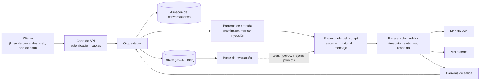
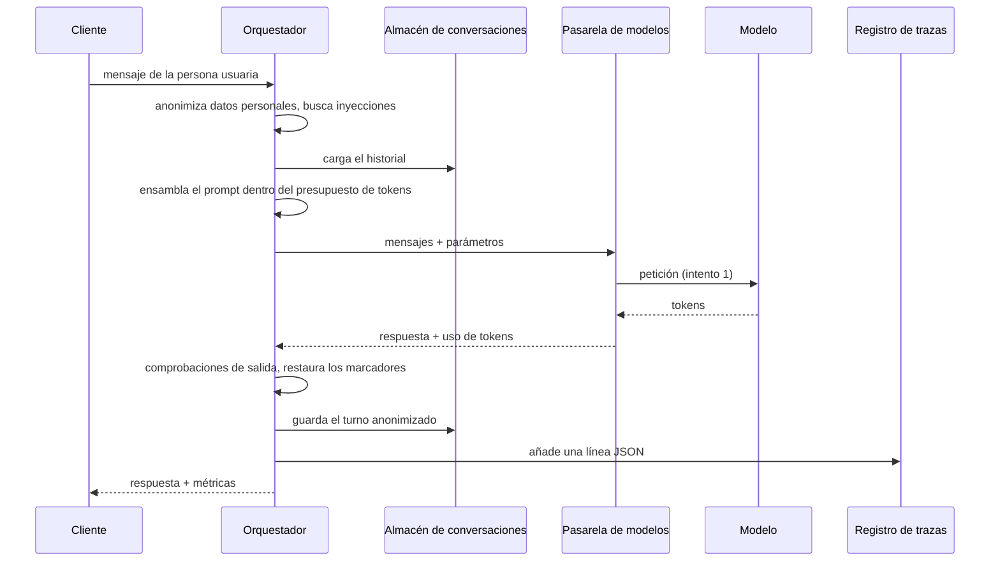
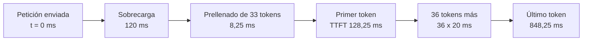
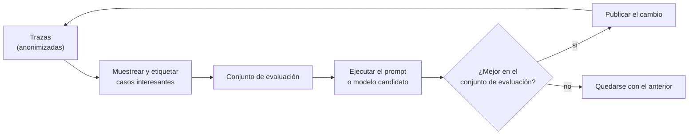

🌐 [English](01-chatbot-system-design.md) · Español

# Lección 3.1 — Diseño de un sistema de chatbot

> **Módulo 03 · Lección 1 de 4** · ⏱️ unos 50 min · 🧪 Lab: [paso 1](lab/README.es.md#paso-1--ejecuta-una-petición-de-principio-a-fin) y [paso 2](lab/README.es.md#paso-2--mide-la-latencia-y-el-coste)

## 📨 Situación

> **De:** Rio Tanaka · Responsable de Ingeniería de IA
> **Canal:** #ai-team
>
> Media empresa pega *prompts* en la primera web de chat que encuentra cada mañana. Eso se acaba este
> mes. Quiero un *playground* interno de modelos de lenguaje grandes (LLM, *large language models*):
> que cualquier equipo pueda probar un *prompt*, cambiar de modelo, ajustar los parámetros y ver qué
> pasa. Tres promesas antes de que nadie de fuera de nuestro equipo lo toque. Sam necesita la latencia,
> los *tokens* y el coste de cada petición, registrados. Noor necesita la garantía de que los datos
> personales de la clientela nunca llegan por accidente a una interfaz de programación de aplicaciones
> (API, *application programming interface*) externa. Y yo necesito que sea lo bastante pequeño para
> entregarlo en dos semanas. Antes de escribir código, dibuja las cajas. ¿Qué caja cumple cada promesa?

## 🎯 Objetivos

Al terminar esta lección puedes:

- Nombrar los componentes de un sistema de chat con LLM y la única tarea de la que se encarga cada uno.
- Seguir una petición a lo largo de su ciclo de vida y señalar la etapa que cumple cada una de las tres promesas de Rio.
- Calcular el tiempo hasta el primer *token*, la velocidad de decodificación y el rendimiento de extremo a extremo a partir de los tiempos de los *tokens*.
- Estimar el coste de una petición y de un mes de tráfico, con los precios pasados como parámetros.

## 🤔 Predice primero

Apunta tus respuestas antes de seguir leyendo. Las comprobarás en la autoevaluación.

1. Le haces una pregunta de seguimiento a un modelo de chat y "recuerda" tu mensaje anterior. ¿Dónde vive esa memoria?
2. El modelo A muestra la primera palabra a los 0,1 s y termina a los 0,9 s. El modelo B muestra la primera palabra a los 0,6 s y termina a los 0,8 s. ¿Cuál parece más rápido en una ventana de chat?
3. Al final de una conversación larga, ¿qué cuesta más: los *tokens* que envías al modelo o los que te devuelve?

## 1. El modelo es la caja más pequeña

Cuando la gente dice "el chatbot", suele imaginarse el modelo. En un sistema real, el modelo es una
sola llamada en mitad de un proceso más largo (*pipeline*). Todo lo que lo rodea existe para que esa
llamada sea segura, observable y asequible. Las tres promesas de Rio son una buena prueba: el modelo no
puede cumplir ninguna por sí mismo. La latencia y el coste se miden *alrededor* de la llamada, y los
datos personales hay que quitarlos *antes* de la llamada.

Estos son los componentes de un sistema de chat y dónde vive cada uno en el lab de este módulo:

| Componente | Su única tarea | En el lab |
|---|---|---|
| Cliente (*client*) | Recoge la entrada y muestra la respuesta (página web, bot de chat, línea de comandos) | `cli.py` (`ask`, `chat`) |
| Capa de API (*API layer*) | Autentica a quien llama y aplica límites de tasa (*rate limits*) y cuotas | no se construye: una línea de comandos tiene una sola persona usuaria |
| Orquestador (*orchestrator*) | Ejecuta en orden las etapas de una petición | `playground.py`, `Playground.ask` |
| Barreras de entrada (*input guardrails*) | Anonimizan (*redact*) los datos personales, marcan los intentos de inyección, imponen la frontera de datos | `redact.py`, `guardrails.py` |
| Ensamblado del *prompt* (*prompt assembly*) | *Prompt* de sistema + historial + mensaje nuevo, recortado para caber en el presupuesto de *tokens* | `conversation.py` |
| Pasarela de modelos (*model gateway*) | Una interfaz para todos los modelos; *timeouts*, reintentos, respaldo (*fallback*) | `resilience.py`, `providers.py` |
| Barreras de salida (*output guardrails*) | Comprueban cada respuesta antes de que nadie la vea | `guardrails.py`, `check_output` |
| Almacén de conversaciones (*conversation store*) | Guarda el historial de cada sesión entre peticiones | `Conversation` |
| Registro y trazas (*logging and tracing*) | Un registro estructurado por petición | `tracing.py` |
| Bucle de evaluación (*evaluation loop*) | Convierte lo que registraste en tests para el siguiente cambio | `compare.py` y módulo 02 |

**Analogía:** un restaurante. El personal de sala toma el pedido (cliente). En la entrada comprueban
tu reserva (capa de API). Quien coordina la cocina lleva cada comanda de puesto en puesto
(orquestador), y antes de cocinar nada alguien revisa las notas de alergias (barreras de entrada). La
propia comanda dice exactamente qué hay que cocinar (ensamblado del *prompt*). Si se estropea un fogón,
quien coordina manda el plato a otro (respaldo de la pasarela). Quien dirige la cocina inspecciona cada
plato en el pase (barreras de salida), la cuenta de la mesa recuerda lo que ya pediste (almacén de
conversaciones), el registro de cocina anota cada comanda (trazas) y una cata semanal decide qué cambia
en la carta (bucle de evaluación). El fogón importa, pero es solo un puesto.



Ahora asigna las promesas de Rio a las cajas. La promesa de Sam vive en la **pasarela de modelos** (ve
cada intento y cada recuento de *tokens*) y en las **trazas** (lo dejan por escrito). La de Noor vive
en las **barreras de entrada** (la anonimización) y en la configuración de la pasarela (qué proveedores
cuentan como externos). La promesa de Rio, por su parte, vive en lo que dejas fuera: el primer cliente es
una línea de comandos, y la capa de API espera hasta que más de un equipo use el *playground*.

El orquestador es el único sitio que conoce el orden de las etapas. En el lab es un método corto. Este
es un extracto simplificado de `Playground.ask` en `playground.py`:

```python
def ask(self, user_text: str) -> TurnResult:
    s = self.settings
    injection = scan_injection(user_text)                          # 1. input guardrails
    safe_text, counts = self.pseudo.redact(user_text)
    budget = self.context_window - s.max_tokens                    # 2. prompt assembly
    messages = self.conversation.build(safe_text, policy=s.policy, budget=budget)
    result = self.gateway.complete(messages, temperature=s.temperature,   # 3. model gateway
                                   max_tokens=s.max_tokens, seed=s.seed)
    flags = check_output(result.completion, placeholders=self.pseudo.mapping)  # 4. output checks
    answer = self.pseudo.restore(result.completion.text)           # 5. store, account, trace
    self.conversation.record(safe_text, result.completion.text)
    ...
```

> ⚠️ **Error común:** poner una barrera de protección en el cliente. Una página web que desactiva la
> opción "modelo externo" hasta que se activa la anonimización no protege a nadie: el primer *script*
> que llama directamente a la API se salta la página. Impón cada promesa en el orquestador, por el que
> tiene que pasar toda petición.

## 2. Una petición, de principio a fin

El ciclo de vida es el camino que recorre un único mensaje a través de esas cajas. Hay un hecho que
determina todo el camino: **el modelo no tiene estado** (*stateless*). No recuerda tu mensaje anterior.
Cada petición lleva toda la conversación que el modelo debería "conocer", así que el orquestador carga
el historial desde el almacén de conversaciones, añade el mensaje nuevo y lo envía todo otra vez. La
memoria es una característica de tu sistema, no del modelo.



Ejecuta una petición en el *playground* del lab y lee las etapas. El *back-end* por defecto es un
modelo *simulado*: responde a unas pocas preguntas sobre Hearthwise a partir de los datasets
compartidos y calcula sus tiempos con una fórmula, así que todos los números de abajo son idénticos en
cualquier máquina.

```bash
uv run lab ask "How long do I have to return a Glow A19?"
```

```text
Request lifecycle
  1 input guardrails  redactions: none | injection flags: none
  2 prompt assembly   2 messages, 33 prompt tokens (policy pin_system, budget 768)
  3 model gateway     fake/fake-small #1 ok
  4 output checks     passed
  5 trace             outputs/traces.jsonl (trace_id 04d71610954e)

Answer
  You can return any Hearthwise device within 30 days of delivery, opened or not. There is no restocking fee, and the refund arrives 5 to 7 business days after we receive the item.

Metrics (simulated clock)
  tokens   33 prompt + 37 completion
  latency  TTFT 128 ms | total 848 ms | decode 50.0 tokens/s | end-to-end 43.6 tokens/s
  cost     €0.0000181 (example prices: €0.10 in / €0.40 out per million tokens)
```

Al modelo le llegaron dos mensajes: el *prompt* de sistema y tu pregunta. No había nada que anonimizar
ni ningún patrón de inyección. La pasarela necesitó un solo intento. La respuesta pasó las
comprobaciones de salida y se añadió una línea JavaScript Object Notation (JSON) a
`outputs/traces.jsonl`. Fíjate en lo que guarda el almacén de conversaciones: el texto *anonimizado*.
Si la pregunta hubiera incluido una dirección de correo de la clientela, el almacén guardaría un
marcador (*placeholder*) como `<EMAIL_1>`, de modo que el almacén nunca se convierte en una segunda
copia de datos personales. La lección 3.4 construye ese paso de anonimización.

> 💡 **Consejo de producción:** escribe la línea de traza aunque la petición falle. Las peticiones
> fallidas son las que tendrás que depurar a las 3 de la madrugada. En el lab, `Playground.ask` escribe
> un registro con un campo `error` antes de volver a lanzar la excepción.

## 3. Medir la latencia como la percibe la gente

Un modelo produce una respuesta en dos fases. En el **prellenado** (*prefill*) lee todo el *prompt*;
este trabajo se hace en paralelo, así que cada *token* del *prompt* sale barato. En la
**decodificación** (*decode*) genera la respuesta *token* a *token*, y cada uno depende de los
anteriores. Hay dos números que lo describen, y necesitas los dos:

| Métrica | Definición | Pregunta sobre devoluciones de arriba |
|---|---|---|
| Tiempo hasta el primer *token* (TTFT, *time to first token*) | petición enviada → llega el primer *token* | 128 ms |
| Latencia total | petición enviada → llega el último *token* | 848 ms |
| Velocidad de decodificación | (n − 1) *tokens* ÷ (total − TTFT) | 50.0 tokens/s |
| Rendimiento de extremo a extremo (*end-to-end throughput*) | n *tokens* ÷ latencia total | 43.6 tokens/s |

El TTFT cubre todo lo que pasa antes del primer *token*: la red, la espera en la cola del proveedor y
el prellenado. La velocidad de decodificación te dice lo rápido que fluye el texto después. El modelo
simulado `fake-small` usa un modelo de latencia sencillo e inventado: 120 ms de sobrecarga fija,
0,25 ms de prellenado por *token* del *prompt* y 20 ms por *token* generado. Para la pregunta sobre
devoluciones, el TTFT es 120 + 0,25 × 33 = 128,25 ms. Los 36 *tokens* restantes tardan
36 × 20 = 720 ms, así que el último *token* llega a los 848,25 ms.

**Analogía:** una impresora de oficina. Se calienta antes de la primera página y luego imprime un
número constante de páginas por minuto. En un memorando de dos páginas domina el calentamiento; en un
informe de 200 páginas, las páginas por minuto. Las respuestas de un chat son memorandos cortos, y por
eso el TTFT domina lo rápido que *parece* un chat.



Los mismos números en código, con las funciones del lab:

```python
from m03_playground.metrics import decode_tokens_per_second, end_to_end_tokens_per_second
from m03_playground.models import PROFILES, simulate_timing

t = simulate_timing(PROFILES["fake-small"], prompt_tokens=33, completion_tokens=37)
print(t.ttft_ms, t.total_ms)                                   # 128.25 848.25
print(decode_tokens_per_second(37, t.ttft_ms, t.total_ms))     # 50.0
print(round(end_to_end_tokens_per_second(37, t.total_ms), 1))  # 43.6
```

Una petición es una anécdota. En producción miras **percentiles** sobre muchas peticiones: la mediana
(p50) es lo que ve una persona usuaria típica, y el percentil 95 (p95) es el valor que solo supera una
de cada veinte peticiones. Las medias esconden la cola lenta, y es en la cola donde la gente se rinde.
La lección 3.2 muestra un caso en el que el p50 es de 0,60 s y el p95 de 10,00 s, porque unas pocas
peticiones esperan a que venza un *timeout*.

> ⚠️ **Error común:** dividir todos los *tokens* entre el tiempo total y llamar al resultado "velocidad
> del modelo". Ese número mezcla esperar con generar. Cambia con la longitud del *prompt* y con la de la
> respuesta, así que no te sirve para comparar dos modelos. Informa del TTFT y de la velocidad de
> decodificación por separado.

> 💡 **Consejo de producción:** solo puedes medir el TTFT cuando la respuesta llega en *streaming*
> (lección 3.2). Mídelo en dos sitios, la pasarela y el cliente: la diferencia entre ambos es tu propia
> red y tu interfaz de usuario. El lab informa del TTFT solo para los modelos simulados, porque el
> `providers.py` copiado no hace *streaming*.

## 4. Un modelo de costes con los precios como parámetros

Los proveedores cobran por *token*, y los *tokens* de entrada (del *prompt*) y los de salida (de la
respuesta, *completion*) suelen tener precios distintos. Así que el coste de una petición es:

> coste = (*tokens* del *prompt* × precio de entrada + *tokens* de la respuesta × precio de salida) ÷ 1.000.000

con los precios expresados por millón de *tokens*. Los precios cambian, varían según el contrato y
según el modelo, así que el lab nunca los escribe en el código: cada función de coste recibe un objeto
`Prices`. Los dos modelos simulados llevan **precios de ejemplo** inventados para enseñar: `fake-small`
cuesta 0,10 € por millón de *tokens* de entrada y 0,40 € por millón de *tokens* de salida; `fake-large`
cuesta diez veces más. Para la pregunta sobre devoluciones:
(33 × 0,10 + 37 × 0,40) ÷ 1.000.000 = 0,0000181 €.

Una sola petición no cuesta casi nada, y precisamente por eso los equipos se llevan sorpresas. Sam
necesita la cifra mensual. Para eso hace falta una **carga de trabajo** (*workload*), y cada campo de
una carga de trabajo es una suposición que debes dejar por escrito. Supón que 60 personas de la
plantilla de Hearthwise usan el *playground*, que cada una envía 25 *prompts* por día laborable y que
un mes tiene 21 días laborables: 31.500 peticiones al mes. Con 700 *tokens* de *prompt* y 180 de
respuesta por petición, `fake-small` cuesta 0,000142 € por petición, 0,21 € al día y 4,47 € al mes.
`fake-large` cuesta 44,73 € al mes con el mismo tráfico.

**Analogía:** la factura del móvil. La tarifa (los precios) y tus hábitos (la carga de trabajo) son
cosas distintas. Mantenlas separadas también en el código y podrás responder tanto a "¿y si el precio
se duplica?" como a "¿y si lo usa el doble de gente?" sin tocar la otra.

```python
from m03_playground.metrics import EXAMPLE_PRICES, Workload, estimate_cost, request_cost

print(round(request_cost(33, 37, EXAMPLE_PRICES["fake-small"]), 7))  # 1.81e-05
w = Workload(users=60, requests_per_user_per_day=25, working_days_per_month=21,
             prompt_tokens=700, completion_tokens=180)
est = estimate_cost(w, EXAMPLE_PRICES["fake-large"])
print(w.requests_per_month, round(est.per_month, 2))                 # 31500 44.73
```

Fíjate en qué *tokens* dominan. En una pregunta nueva, la entrada y la salida tienen un tamaño
parecido. Al final de una conversación larga, el *prompt* lleva todo el historial: en la conversación
grabada de la lección 3.3, el *prompt* del turno 20 tiene 1.079 *tokens*, mientras que cada respuesta
tiene unas pocas decenas. Aunque los *tokens* de salida cuesten cuatro veces más, gana el lado de la
entrada. Las conversaciones largas son un problema de coste de entrada.

> ⚠️ **Error común:** escribir un precio a fuego en el código o en un documento de diseño sin su fecha
> ni su fuente. Seis meses después nadie sabe de dónde salió ese "0.4". Guarda el recuento de *tokens*
> en cada traza y calcula el coste a partir de una tabla de precios que puedas actualizar.

> 💡 **Consejo de producción:** registra *tokens*, no solo euros. Si solo registras el coste, un cambio
> de precio reescribe la historia. Con los *tokens* puedes recalcular cualquier mes con cualquier tabla
> de precios, y puedes fijar un presupuesto diario de *tokens* por equipo en la capa de API.

## 5. Cerrar el ciclo: evaluación a partir de las trazas

La última caja convierte el *playground* de juguete en herramienta. Cada traza registra qué modelo,
qué parámetros, cuántos *tokens*, qué barreras saltaron y qué comprobaciones de salida fallaron. Es
materia prima para la evaluación. Cuando una respuesta parece incorrecta, no te limitas a arreglar el
*prompt* y cruzar los dedos: añades el caso, con su texto anonimizado, a un pequeño conjunto de test.
La próxima vez que alguien cambie el *prompt* de sistema o el modelo, primero se ejecuta el conjunto de
test, que muestra qué mejoró y qué empeoró. El módulo 02 trató cómo puntuar respuestas; este módulo se
asegura de que tengas datos que puntuar.

**Analogía:** el libro de vuelo de una aerolínea. Cada vuelo queda registrado, los que se salen de lo
normal se revisan, y lo que encuentra la revisión pasa a formar parte del siguiente entrenamiento.



El modo de comparación, en la lección 3.4, es la versión más pequeña de este ciclo: el mismo *prompt*
con varios modelos y temperaturas, varias muestras de cada uno, resumidos uno al lado del otro.

## 🧪 Pruébalo

1. Instala el lab y ejecuta los tests (alrededor de un segundo; tu tiempo será distinto):

   ```bash
   cd modules/03-llm-playground/lab
   uv sync
   uv run pytest
   ```

   ```text
   105 passed, 2 skipped in 0.62s
   ```

   Los 2 tests omitidos necesitan un modelo real (README del lab, última sección).

2. Envía una petición a través del ciclo de vida y lee cada etapa:

   ```bash
   uv run lab ask "How long do I have to return a Glow A19?"
   ```

   La salida es el bloque que aparece en la sección 2.

3. Observa el *streaming* simulado. El primer fragmento llega en el TTFT y cada uno de los siguientes,
   20 ms después:

   ```bash
   uv run lab ask "How long do I have to return a Glow A19?" --stream
   ```

   ```text
   Stream (simulated arrival times)
     [  128.2 ms] 'You'
     [  148.2 ms] ' can'
     [  168.2 ms] ' return'
     [  188.2 ms] ' any'
     ... 32 more chunks ...
     [  848.2 ms] '.'
   ```

4. Proyecta un mes de tráfico con los precios de ejemplo:

   ```bash
   uv run lab cost
   ```

   ```text
   Workload: 60 users x 25 requests/day x 21 days = 31,500 requests/month
             700 prompt + 180 completion tokens per request

     model        € in/out per M  € per request  € per day  € per month
     fake-small        0.10/0.40       0.000142       0.21         4.47
     fake-large        1.00/4.00       0.001420       2.13        44.73

   fake-small and fake-large use EXAMPLE prices, not real ones. Pass --price-in/--price-out for yours.
   ```

5. Predice y luego comprueba: ¿qué le pasa al coste mensual si duplicas `--prompt-tokens`? ¿Y si
   duplicas `--users`? ¿Qué cambio duele más en `fake-small`, y por qué?

## 🏭 En el mundo real

- **Una pasarela para todo el tráfico de LLM.** Muchas organizaciones enrutan todas las llamadas a
  modelos a través de una única pasarela interna. Guarda las claves de los proveedores, así que los
  equipos nunca las ven, y escribe los registros de uso con los que finanzas reparte la factura entre
  los equipos.
- **Cuotas en la capa de API.** Un bucle en el *script* de alguien puede enviar miles de peticiones en
  minutos. Los límites de tasa por clave y los presupuestos diarios de *tokens* lo frenan antes de que
  lo haga la factura.
- ***Streaming* por defecto.** Las interfaces de chat envían los *tokens* en *streaming* para que la
  gente empiece a leer mientras el modelo todavía escribe. El TTFT pasa a ser el número que hay que
  vigilar, normalmente con un objetivo en el percentil 95.
- **Qué vigilar:** la tasa de peticiones; la tasa de errores por tipo de error; el TTFT y la latencia
  total en p50 y p95; los *tokens* de *prompt* y de respuesta por petición; el coste por equipo y día;
  con qué frecuencia salta cada barrera.
- **Modos de fallo típicos:** el coste que sube poco a poco a medida que las conversaciones se alargan;
  un proveedor que cambia un modelo detrás del mismo nombre; trazas que se llenan en silencio de datos
  personales porque alguien registró los *prompts* en bruto "solo para depurar".

## ✅ Autoevaluación

**1. ¿Dónde vive la "memoria" que tiene un modelo de chat de los mensajes anteriores?**

<details><summary>Respuesta</summary>

En tu sistema, no en el modelo. El modelo no tiene estado: el orquestador carga el historial desde el
almacén de conversaciones y lo vuelve a enviar con cada petición. Si vacías el almacén (el comando
`/reset` del bucle de chat del lab), el modelo "olvida" al instante. La respuesta tentadora, "dentro del modelo", implicaría que el modelo
aprende de cada chat, y no lo hace.

</details>

**2. Modelo A: primera palabra a los 0,1 s, termina a los 0,9 s. Modelo B: primera palabra a los 0,6 s, termina a los 0,8 s. ¿Cuál parece más rápido?**

<details><summary>Respuesta</summary>

El modelo A. B termina antes, pero con A la persona empieza a leer a los 0,1 s. En las respuestas
cortas de un chat, el tiempo hasta el primer *token* domina lo rápido que parece un sistema. Por eso
informas del TTFT y de la velocidad de decodificación por separado, en lugar de dar solo el total.

</details>

**3. Con el perfil `fake-small`, ¿cuáles son el TTFT y la latencia total para un *prompt* de 200 *tokens* y una respuesta de 37 *tokens*?**

<details><summary>Respuesta</summary>

TTFT = 120 + 0,25 × 200 = 170 ms. Total = 170 + 36 × 20 = 890 ms. Comparado con el *prompt* de 33
*tokens* (128,25 ms), el *prompt* más largo solo añade unos 42 ms: el prellenado es barato por
*token*; la decodificación, no.

</details>

**4. ¿Qué componente cumple cada una de las tres promesas de Rio?**

<details><summary>Respuesta</summary>

La de Sam (latencia, *tokens* y coste registrados): la pasarela de modelos mide cada intento y las
trazas lo dejan por escrito. La de Noor (nada de datos personales hacia API externas): las barreras de
entrada anonimizan, y la configuración de la pasarela decide qué proveedores son externos. La de Rio
(entregar algo pequeño): un cliente de línea de comandos y, de momento, ninguna capa de API. Una
barrera en el cliente no contaría, porque una llamada directa a la API se la salta.

</details>

**5. Al final de una conversación larga, ¿cuestan más los *tokens* de entrada o los de salida?**

<details><summary>Respuesta</summary>

Normalmente, los de entrada. El *prompt* lleva todo el historial: en el turno 20 de la conversación de
la lección 3.3 tiene 1.079 *tokens*, mientras que una respuesta tiene unas pocas decenas. Aunque los
*tokens* de salida sean cuatro veces más caros, el lado de la entrada pesa más. La respuesta intuitiva,
"la salida, porque es más cara por *token*", ignora cuántos *tokens* de entrada más hay.

</details>

## 💬 Explícalo con tus palabras

- Sam pregunta por qué el panel del *playground* muestra el TTFT y la velocidad de decodificación como
  dos números en lugar de un único número de "velocidad". Explícalo en tres frases, con la analogía de
  la impresora o con una tuya.
- Jordan quiere una interfaz web en la primera versión. Explica qué componente añade, con qué promesa
  no ayuda y por qué Rio podría seguir diciendo "más adelante".

## 🔑 Ideas clave

- El modelo es una llamada dentro de un proceso: cliente, capa de API, orquestador, barreras de
  protección, ensamblado del *prompt*, pasarela, almacén de conversaciones, trazas y evaluación.
- Los modelos de chat no tienen estado; la memoria es el historial que tu sistema vuelve a enviar en
  cada petición.
- Impón las promesas en el orquestador, nunca solo en el cliente.
- El TTFT (sobrecarga + prellenado) y la velocidad de decodificación son números distintos; informa de
  los dos, como p50 y p95.
- Coste = *tokens* del *prompt* × precio de entrada + *tokens* de la respuesta × precio de salida; los
  precios son parámetros.
- En las conversaciones largas, los *tokens* de entrada son el coste dominante.
- Las trazas alimentan el bucle de evaluación que te dice si el siguiente cambio es una mejora.

## 📚 Profundiza

- ⭐ [El libro de ingeniería de fiabilidad de sitios (SRE, *site reliability engineering*) de Google: Monitoring Distributed Systems](https://sre.google/sre-book/monitoring-distributed-systems/) — latencia, tráfico, errores y saturación: las cuatro señales que hay detrás del panel de Sam.
- [Efficient Memory Management for LLM Serving with PagedAttention (vLLM)](https://arxiv.org/abs/2309.06180) — por qué servir muchas peticiones a la vez cambia el rendimiento y la latencia.
- [OpenTelemetry](https://opentelemetry.io) — el estándar abierto para trazas y métricas, por si un archivo JSON Lines se te queda pequeño.
- [JSON Lines](https://jsonlines.org) — el formato de un registro por línea que usan las trazas del *playground*.

---

[← Anterior: Presentación del módulo 03](README.es.md) · [🏠 Módulo 03](README.es.md) · [Siguiente: 3.2 Una interfaz, muchos modelos →](02-one-interface-many-models.es.md)
