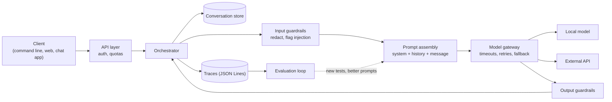
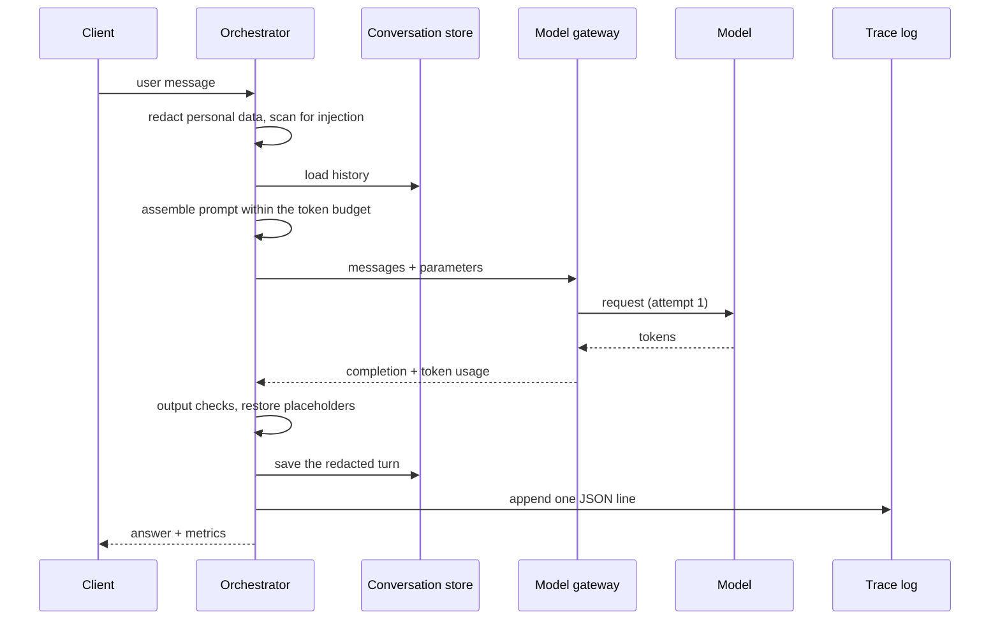
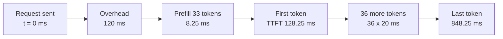
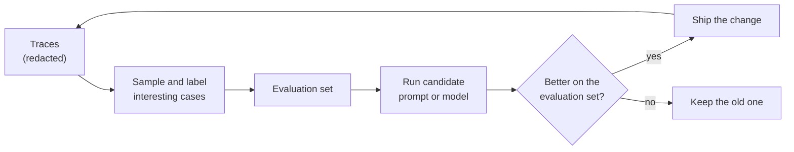

🌐 English · [Español](01-chatbot-system-design.es.md)

# Lesson 3.1 — Chatbot system design

> **Module 03 · Lesson 1 of 4** · ⏱️ about 50 min · 🧪 Lab: [step 1](lab/README.md#step-1--run-one-request-end-to-end) and [step 2](lab/README.md#step-2--measure-latency-and-cost)

## 📨 Situation

> **From:** Rio Tanaka · Head of AI Engineering
> **Channel:** #ai-team
>
> Half the company pastes prompts into whatever chat website they found this morning. That stops this
> month. I want an internal large language model (LLM) playground: any team can try a prompt, switch
> models, change the settings and see what happens. Three promises before anyone outside our team
> touches it. Sam needs latency, tokens and cost on every request, logged. Noor needs a guarantee that
> customer personal data never reaches an external application programming interface (API) by
> accident. And I need it small enough to ship in two weeks. Before you write code, draw the boxes.
> Which box keeps which promise?

## 🎯 Objectives

By the end of this lesson you can:

- Name the components of an LLM chat system and the single job each one owns.
- Trace one request through its lifecycle and point to the stage that keeps each of Rio's three promises.
- Compute time to first token, decode speed and end-to-end throughput from token timings.
- Estimate the cost of one request and of a month of traffic, with prices passed in as parameters.

## 🤔 Predict first

Write your answers down before reading on. You will check them in the self-check.

1. You ask a chat model a follow-up question and it "remembers" your previous message. Where does that memory live?
2. Model A shows the first word after 0.1 s and finishes after 0.9 s. Model B shows the first word after 0.6 s and finishes after 0.8 s. Which one feels faster in a chat window?
3. Late in a long conversation, which costs more: the tokens you send to the model or the tokens it sends back?

## 1. The model is the smallest box

When people say "the chatbot", they usually picture the model. In a real system the model is a single
call in the middle of a longer pipeline. Everything around it exists to make that call safe, observable
and affordable. Rio's three promises are a good test: none of them can be kept by the model itself.
Latency and cost are measured *around* the call, and personal data must be removed *before* the call.

Here are the components of a chat system, and where each one lives in this module's lab:

| Component | Its one job | In the lab |
|---|---|---|
| Client | Collects the input and shows the answer (web page, chat bot, command line) | `cli.py` (`ask`, `chat`) |
| API layer | Authenticates the caller, applies rate limits and quotas | not built: a command line has one user |
| Orchestrator | Runs the stages of one request in order | `playground.py`, `Playground.ask` |
| Input guardrails | Redact personal data, flag injection attempts, enforce the data boundary | `redact.py`, `guardrails.py` |
| Prompt assembly | System prompt + history + new message, cut to fit the token budget | `conversation.py` |
| Model gateway | One interface to every model; timeouts, retries, fallback | `resilience.py`, `providers.py` |
| Output guardrails | Check each answer before anyone sees it | `guardrails.py`, `check_output` |
| Conversation store | Keeps each session's history between requests | `Conversation` |
| Logging and tracing | One structured record per request | `tracing.py` |
| Evaluation loop | Turns what you logged into tests for the next change | `compare.py` and module 02 |

**Analogy:** a restaurant. The waiter takes the order (client). The host checks your reservation
(API layer). The expediter walks each ticket through the kitchen (orchestrator), and before anything is
cooked someone checks the allergy notes (input guardrails). The ticket itself says exactly what to cook
(prompt assembly). If one stove breaks, the expediter sends the dish to another (gateway fallback).
The head chef inspects every plate at the pass (output guardrails), the table's tab remembers what you
already ordered (conversation store), the kitchen log records every ticket (tracing), and a weekly
tasting decides what changes on the menu (evaluation loop). The stove matters, but it is one station.



Now map Rio's promises onto the boxes. Sam's promise lives in the **model gateway** (it sees every
attempt and every token count) and in **tracing** (it writes them down). Noor's promise lives in the
**input guardrails** (redaction) and in the gateway's configuration (which providers count as
external). Rio's own promise lives in what you leave out: the first client is a command line, and the
API layer waits until more than one team uses the playground.

The orchestrator is the only place that knows the order of the stages. In the lab it is one short
method. This is a simplified excerpt of `Playground.ask` in `playground.py`:

```python
def ask(self, user_text: str) -> TurnResult:
    s = self.settings
    injection = scan_injection(user_text)                          # 1. input guardrails
    safe_text, counts = self.pseudo.redact(user_text)
    budget = self.context_window - s.max_tokens                    # 2. prompt assembly
    messages = self.conversation.build(safe_text, policy=s.policy, budget=budget)
    result = self.gateway.complete(messages, temperature=s.temperature,   # 3. model gateway
                                   max_tokens=s.max_tokens, seed=s.seed)
    flags = check_output(result.completion, placeholders=self.pseudo.mapping)  # 4. output checks
    answer = self.pseudo.restore(result.completion.text)           # 5. store, account, trace
    self.conversation.record(safe_text, result.completion.text)
    ...
```

> ⚠️ **Common mistake:** putting a guardrail in the client. A web page that greys out the "external
> model" option until redaction is switched on protects nobody: the first script that calls the API
> directly skips the page. Enforce every promise in the orchestrator, which every request must pass.

## 2. One request, start to finish

The lifecycle is the path of a single message through those boxes. One fact shapes the whole path:
**the model is stateless**. It does not remember your previous message. Every request carries the
whole conversation the model should "know", so the orchestrator loads the history from the
conversation store, adds the new message and sends everything again. Memory is a feature of your
system, not of the model.



Run one request through the lab's playground and read the stages back. The default back-end is a
*simulated* model: it answers a few Hearthwise questions from the shared datasets and computes its
timing from a formula, so every number below is identical on every machine.

```bash
uv run lab ask "How long do I have to return a Glow A19?"
```

```text
Request lifecycle
  1 input guardrails  redactions: none | injection flags: none
  2 prompt assembly   2 messages, 33 prompt tokens (policy pin_system, budget 768)
  3 model gateway     fake/fake-small #1 ok
  4 output checks     passed
  5 trace             outputs/traces.jsonl (trace_id 04d71610954e)

Answer
  You can return any Hearthwise device within 30 days of delivery, opened or not. There is no restocking fee, and the refund arrives 5 to 7 business days after we receive the item.

Metrics (simulated clock)
  tokens   33 prompt + 37 completion
  latency  TTFT 128 ms | total 848 ms | decode 50.0 tokens/s | end-to-end 43.6 tokens/s
  cost     €0.0000181 (example prices: €0.10 in / €0.40 out per million tokens)
```

Two messages went to the model: the system prompt and your question. There was nothing to redact and
no injection pattern. The gateway needed one attempt. The answer passed the output checks, and one
JavaScript Object Notation (JSON) line was appended to `outputs/traces.jsonl`. Notice what the
conversation store keeps: the *redacted* text. If a customer email had been in the question, the store
would hold a placeholder such as `<EMAIL_1>`, so the store never becomes a second copy of personal
data. Lesson 3.4 builds that redaction step.

> 💡 **Production tip:** write the trace line even when the request fails. Failed requests are the
> ones you will need to debug at 3 a.m. In the lab, `Playground.ask` writes a record with an `error`
> field before it re-raises the exception.

## 3. Measuring latency the way users feel it

A model produces an answer in two phases. In **prefill** it reads the whole prompt; this work runs in
parallel, so each prompt token is cheap. In **decode** it generates the answer one token at a time,
each token depending on the previous ones. Two numbers describe this, and you need both:

| Metric | Definition | Returns question above |
|---|---|---|
| Time to first token (TTFT) | request sent → first token arrives | 128 ms |
| Total latency | request sent → last token arrives | 848 ms |
| Decode speed | (n − 1) tokens ÷ (total − TTFT) | 50.0 tokens/s |
| End-to-end throughput | n tokens ÷ total latency | 43.6 tokens/s |

TTFT covers everything before the first token: the network, waiting in the provider's queue and the
prefill. Decode speed tells you how fast text flows after that. The simulated `fake-small` model uses a
simple, invented latency model: 120 ms of fixed overhead, 0.25 ms of prefill per prompt token and 20 ms
per generated token. For the returns question, TTFT is 120 + 0.25 × 33 = 128.25 ms. The remaining
36 tokens take 36 × 20 = 720 ms, so the last token arrives at 848.25 ms.

**Analogy:** an office printer. It warms up before the first page, then prints a steady number of pages
per minute. A two-page memo is dominated by the warm-up; a 200-page report by the pages per minute.
Chat answers are short memos, which is why TTFT dominates how fast a chat *feels*.



The same numbers in code, using the lab's functions:

```python
from m03_playground.metrics import decode_tokens_per_second, end_to_end_tokens_per_second
from m03_playground.models import PROFILES, simulate_timing

t = simulate_timing(PROFILES["fake-small"], prompt_tokens=33, completion_tokens=37)
print(t.ttft_ms, t.total_ms)                                   # 128.25 848.25
print(decode_tokens_per_second(37, t.ttft_ms, t.total_ms))     # 50.0
print(round(end_to_end_tokens_per_second(37, t.total_ms), 1))  # 43.6
```

One request is an anecdote. In production you look at **percentiles** over many requests: the median
(p50) is what a typical user sees, and the 95th percentile (p95) is what one request in twenty is worse
than. Averages hide the slow tail, and the tail is where users give up. Lesson 3.2 shows a case where
p50 is 0.60 s and p95 is 10.00 s, because a few requests wait for a timeout.

> ⚠️ **Common mistake:** dividing all tokens by the total time and calling the result "model speed".
> That number mixes waiting with generating. It changes with the prompt length and the answer length,
> so you cannot compare two models with it. Report TTFT and decode speed separately.

> 💡 **Production tip:** you can only measure TTFT when the answer is streamed (lesson 3.2). Measure
> it in two places, the gateway and the client: the gap between them is your own network and user
> interface. The lab reports TTFT only for the simulated models, because the copied `providers.py`
> does not stream.

## 4. A cost model with prices as parameters

Providers bill per token, and input (prompt) tokens and output (completion) tokens usually have
different prices. So the cost of one request is:

> cost = (prompt tokens × input price + completion tokens × output price) ÷ 1,000,000

with prices quoted per million tokens. Prices change, differ per contract and differ per model, so the
lab never hard-codes them: every cost function takes a `Prices` object. The two simulated models carry
**example prices** that are invented for teaching: `fake-small` costs €0.10 per million input tokens
and €0.40 per million output tokens; `fake-large` costs ten times more. For the returns question:
(33 × 0.10 + 37 × 0.40) ÷ 1,000,000 = €0.0000181.

A single request costs almost nothing, which is exactly why teams get surprised. Sam needs the monthly
number. That needs a **workload**, and every field of a workload is an assumption you must write down.
Suppose 60 Hearthwise employees use the playground, each sends 25 prompts per working day, and a month
has 21 working days: 31,500 requests per month. With 700 prompt tokens and 180 completion tokens per
request, `fake-small` costs €0.000142 per request, €0.21 per day and €4.47 per month. `fake-large`
costs €44.73 per month for the same traffic.

**Analogy:** a mobile phone bill. The tariff (prices) and your habits (workload) are separate things.
Keep them separate in code too, and you can answer both "what if the price doubles?" and "what if
twice as many people use it?" without touching the other.

```python
from m03_playground.metrics import EXAMPLE_PRICES, Workload, estimate_cost, request_cost

print(round(request_cost(33, 37, EXAMPLE_PRICES["fake-small"]), 7))  # 1.81e-05
w = Workload(users=60, requests_per_user_per_day=25, working_days_per_month=21,
             prompt_tokens=700, completion_tokens=180)
est = estimate_cost(w, EXAMPLE_PRICES["fake-large"])
print(w.requests_per_month, round(est.per_month, 2))                 # 31500 44.73
```

Look at which tokens dominate. In a fresh question, input and output are similar in size. Late in a
long conversation the prompt carries the whole history: in lesson 3.3's recorded conversation the
prompt at turn 20 is 1,079 tokens, while each answer is a few dozen. Even if output tokens cost four
times more, the input side wins. Long conversations are an input-cost problem.

> ⚠️ **Common mistake:** hard-coding a price in the code or in a design document without its date and
> source. Six months later nobody knows where "0.4" came from. Store token counts in every trace and
> compute cost from a price table you can update.

> 💡 **Production tip:** log tokens, not just euros. If you log only cost, a price change rewrites
> history. With tokens you can recompute any month with any price table, and you can put a daily token
> budget per team at the API layer.

## 5. Closing the loop: evaluation from traces

The last box turns the playground from a toy into a tool. Every trace records which model, which
settings, how many tokens, which guardrails fired and which output checks failed. That is raw material
for evaluation. When an answer looks wrong, you do not just fix the prompt and hope: you add the case,
with its redacted text, to a small test set. The next time someone changes the system prompt or the
model, the test set runs first and shows what got better and what got worse. Module 02 covered how to
score answers; this module makes sure you have the data to score.

**Analogy:** a pilot's logbook. Each flight is recorded, the unusual ones are reviewed, and what the
review finds becomes part of the next training session.



Compare mode, in lesson 3.4, is the smallest version of this loop: the same prompt across several
models and temperatures, several samples each, summarised side by side.

## 🧪 Try it

1. Install the lab and run the tests (about one second; your timing will differ):

   ```bash
   cd modules/03-llm-playground/lab
   uv sync
   uv run pytest
   ```

   ```text
   105 passed, 2 skipped in 0.62s
   ```

   The 2 skipped tests need a real model (lab README, last section).

2. Send one request through the lifecycle and read each stage:

   ```bash
   uv run lab ask "How long do I have to return a Glow A19?"
   ```

   The output is the block shown in section 2.

3. Watch the simulated stream. The first chunk arrives at the TTFT and each next one 20 ms later:

   ```bash
   uv run lab ask "How long do I have to return a Glow A19?" --stream
   ```

   ```text
   Stream (simulated arrival times)
     [  128.2 ms] 'You'
     [  148.2 ms] ' can'
     [  168.2 ms] ' return'
     [  188.2 ms] ' any'
     ... 32 more chunks ...
     [  848.2 ms] '.'
   ```

4. Project a month of traffic with the example prices:

   ```bash
   uv run lab cost
   ```

   ```text
   Workload: 60 users x 25 requests/day x 21 days = 31,500 requests/month
             700 prompt + 180 completion tokens per request

     model        € in/out per M  € per request  € per day  € per month
     fake-small        0.10/0.40       0.000142       0.21         4.47
     fake-large        1.00/4.00       0.001420       2.13        44.73

   fake-small and fake-large use EXAMPLE prices, not real ones. Pass --price-in/--price-out for yours.
   ```

5. Predict, then check: what happens to the monthly cost if you double `--prompt-tokens`? And if you
   double `--users`? Which change hurts more on `fake-small`, and why?

## 🏭 In the real world

- **One gateway for all LLM traffic.** Many organisations route every model call through one internal
  gateway. It holds the provider keys, so teams never see them, and it writes the usage records that
  finance uses to split the bill between teams.
- **Quotas at the API layer.** A loop in someone's script can send thousands of requests in minutes.
  Per-key rate limits and daily token budgets stop that before the invoice does.
- **Streaming by default.** Chat interfaces stream tokens so people start reading while the model is
  still writing. TTFT becomes the number to watch, usually as a 95th-percentile target.
- **What to monitor:** request rate; error rate by error kind; TTFT and total latency at p50 and p95;
  prompt and completion tokens per request; cost per team per day; how often each guardrail fires.
- **Typical failure modes:** cost creeping up as conversations get longer; a provider changing a model
  behind the same name; traces quietly filling up with personal data because someone logged raw
  prompts "just for debugging".

## ✅ Self-check

**1. Where does a chat model's "memory" of earlier messages live?**

<details><summary>Answer</summary>

In your system, not in the model. The model is stateless: the orchestrator loads the history from the
conversation store and sends it again with every request. If you clear the store (the `/reset`
command of the lab's chat loop), the model "forgets" instantly. The tempting answer, "inside the model", would mean the model
learns from each chat; it does not.

</details>

**2. Model A: first word after 0.1 s, done after 0.9 s. Model B: first word after 0.6 s, done after 0.8 s. Which feels faster?**

<details><summary>Answer</summary>

Model A. B finishes first, but with A the user starts reading after 0.1 s. For short chat answers the
time to first token dominates how fast a system feels. That is why you report TTFT and decode speed
separately instead of only the total.

</details>

**3. With the `fake-small` profile, what are the TTFT and the total latency for a 200-token prompt and a 37-token answer?**

<details><summary>Answer</summary>

TTFT = 120 + 0.25 × 200 = 170 ms. Total = 170 + 36 × 20 = 890 ms. Compared with the 33-token prompt
(128.25 ms), the longer prompt adds only about 42 ms: prefill is cheap per token, decode is not.

</details>

**4. Which component keeps each of Rio's three promises?**

<details><summary>Answer</summary>

Sam's (latency, tokens, cost logged): the model gateway measures every attempt and tracing writes it
down. Noor's (no personal data to external APIs): the input guardrails redact, and the gateway's
configuration decides which providers are external. Rio's (ship small): a command-line client and no
API layer yet. A guardrail in the client would not count, because a direct API call bypasses it.

</details>

**5. Late in a long conversation, are input or output tokens the bigger cost?**

<details><summary>Answer</summary>

Usually input. The prompt carries the whole history: at turn 20 of lesson 3.3's conversation it is
1,079 tokens, while an answer is a few dozen tokens. Even with output tokens four times more expensive,
the input side is larger. The intuitive answer, "output, because it is pricier per token", ignores how
many more input tokens there are.

</details>

## 💬 Explain it in your own words

- Sam asks why the playground's dashboard shows TTFT and decode speed as two numbers instead of one
  "speed" number. Explain it in three sentences, using the printer analogy or one of your own.
- Jordan wants a web interface in the first release. Explain which component it adds, which promise it
  does not help with, and why Rio might still say "later".

## 🔑 Key ideas

- The model is one call inside a pipeline: client, API layer, orchestrator, guardrails, prompt
  assembly, gateway, conversation store, tracing and evaluation.
- Chat models are stateless; memory is the history your system sends again on every request.
- Enforce promises in the orchestrator, never only in the client.
- TTFT (overhead + prefill) and decode speed are different numbers; report both, as p50 and p95.
- Cost = prompt tokens × input price + completion tokens × output price; prices are parameters.
- Long conversations make input tokens the dominant cost.
- Traces feed the evaluation loop that tells you whether the next change is an improvement.

## 📚 Go deeper

- ⭐ [Google's site reliability engineering (SRE) book: Monitoring Distributed Systems](https://sre.google/sre-book/monitoring-distributed-systems/) — latency, traffic, errors and saturation: the four signals behind Sam's dashboard.
- [Efficient Memory Management for LLM Serving with PagedAttention (vLLM)](https://arxiv.org/abs/2309.06180) — why serving many requests at once changes throughput and latency.
- [OpenTelemetry](https://opentelemetry.io) — the open standard for traces and metrics, if you outgrow a JSON Lines file.
- [JSON Lines](https://jsonlines.org) — the one-record-per-line format the playground's traces use.

---

[← Previous: Module 03 overview](README.md) · [🏠 Module 03](README.md) · [Next: 3.2 One interface, many models →](02-one-interface-many-models.md)
