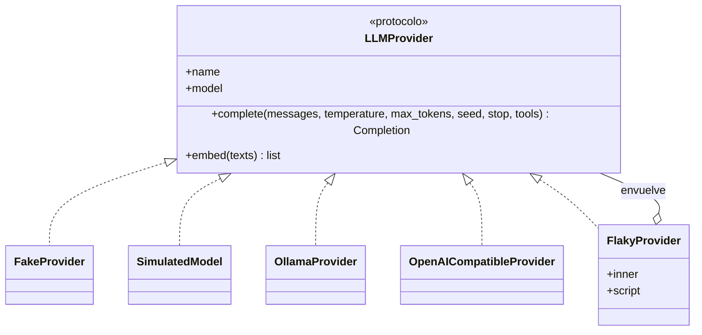
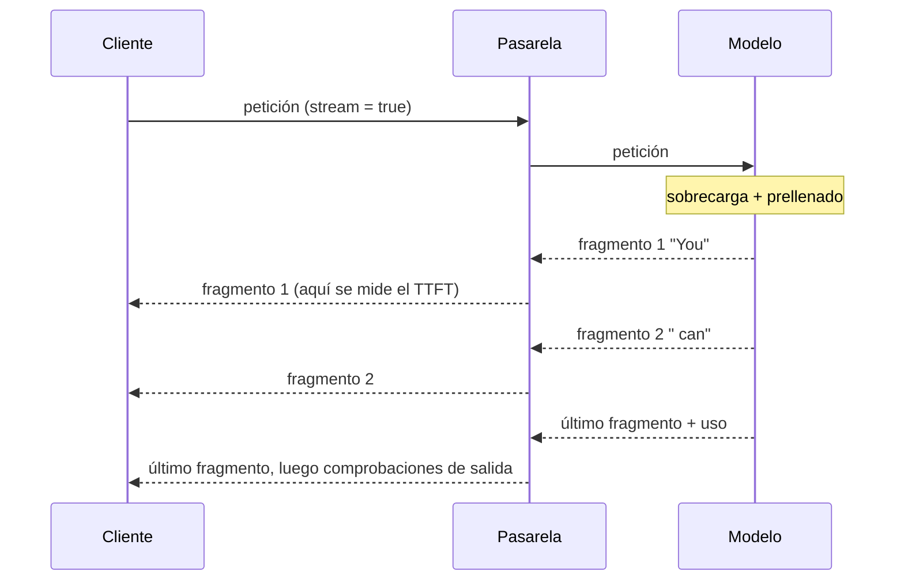
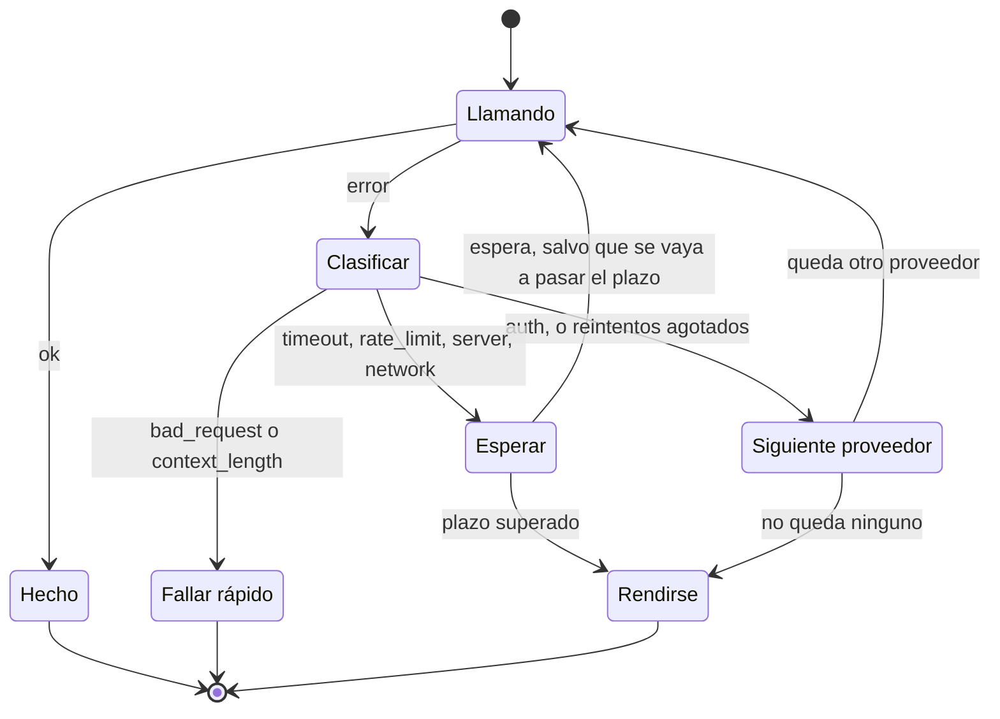

🌐 [English](02-one-interface-many-models.md) · Español

# Lección 3.2 — Una interfaz, muchos modelos

> **Módulo 03 · Lección 2 de 4** · ⏱️ unos 55 min · 🧪 Lab: [paso 3](lab/README.es.md#paso-3--sobrevive-a-los-proveedores-que-fallan)

## 📨 Situación

> **De:** Sam Adeyemi · Ingeniería de fiabilidad (SRE, *Site Reliability Engineering*)
> **Canal:** #playground-ops
>
> Primero, los números. Durante la prueba de la semana pasada, el *endpoint* externo devolvió errores
> durante unos minutos. El prototipo esperó 120 segundos por petición, porque nadie cambió el tiempo de
> espera máximo (*timeout*) por defecto, y después mostró una traza de pila (*stack trace*). Mientras
> tanto, sus tests fallaban cada vez que fallaba el wifi de la oficina. Lo que quiero de la versión de
> verdad: una interfaz para todos los modelos, para que cambiar de proveedor sea un cambio de
> configuración; tests que nunca toquen la red; reintentos que no conviertan una caída pequeña en una
> grande; un plan B cuando el proveedor esté caído; y registros que digan *por qué* falló una petición.
> Me gustan las guardias tranquilas.

## 🎯 Objetivos

Al terminar esta lección puedes:

- Explicar la interfaz de proveedor y por qué un modelo falso determinista hace que los tests sean rápidos, gratuitos y repetibles.
- Construir mensajes de chat con los roles adecuados y leer la carga útil (*payload*) que recibe realmente cada proveedor.
- Elegir los parámetros de generación (temperatura, `max_tokens`, semilla, *stop*) y predecir su efecto.
- Calcular el tiempo hasta el primer *token* a partir de un *stream* y explicar por qué el *streaming* complica las comprobaciones de salida.
- Clasificar los errores de los proveedores y configurar reintentos con espera exponencial (*exponential backoff*) y variación aleatoria (*jitter*), *timeouts*, un plazo total (*deadline*) y un respaldo (*fallback*).

## 🤔 Predice primero

Apunta tus respuestas antes de seguir leyendo. Las comprobarás en la autoevaluación.

1. Un proveedor falla en el 30 % de las llamadas, al azar. Con hasta 3 reintentos, ¿qué proporción de peticiones sale bien, más o menos?
2. Mil clientes reciben un error en el mismo instante, y cada uno reintenta exactamente un segundo después. ¿Qué pasa un segundo más tarde?
3. ¿Debería la pasarela reintentar una petición que falló con "context length exceeded"?

## 1. Una interfaz, muchos back-ends

Cada proveedor de modelos ofrece su propia interfaz de programación de aplicaciones (API, *application
programming interface*) sobre el Hypertext Transfer Protocol (HTTP), y cada uno habla su propio
dialecto. Uno quiere `max_tokens`; otro, `num_predict`. Uno devuelve el uso como `prompt_tokens`;
otro, como `prompt_eval_count`. Si esos detalles se filtran al orquestador, cada proveedor nuevo obliga
a tocar todo el *playground*. La solución es una **interfaz**: un contrato pequeño que implementan
todos los *back-ends*. En el lab es el protocolo `LLMProvider` de `providers.py`: un `name`, un
`model`, un método `complete()` que recibe mensajes y parámetros y devuelve un `Completion`, y un
método `embed()`. Todo lo que hay por encima de la pasarela de modelos (*model gateway*) programa
contra ese contrato y nunca contra un proveedor concreto.

| *Back-end* | Qué es | Cuándo lo usas |
|---|---|---|
| `FakeProvider` | Respuestas enlatadas deterministas, en el `providers.py` compartido | Tests unitarios de la lógica que rodea al modelo |
| `SimulatedModel` | `FakeProvider` + una fórmula de latencia + muestreo con temperatura | El modelo por defecto del *playground* (`fake-small`, `fake-large`) |
| `OllamaProvider` | Un modelo local detrás de la API HTTP de Ollama | Experimentos privados en tu propia máquina |
| `OpenAICompatibleProvider` | Cualquier servidor que hable el formato de chat de OpenAI | API alojadas, o servidores locales que copian el formato |
| `FlakyProvider` | Envuelve cualquier proveedor y falla según un guion | Probar reintentos y respaldos |

Cambias de uno a otro con una variable de entorno o una opción: `LLM_PROVIDER=ollama` o
`--provider ollama`.

¿Por qué el modelo por defecto tiene que ser falso? Porque los tests deben ser rápidos, gratuitos, sin
conexión y repetibles. Un modelo real no cumple ninguna de esas condiciones. Incluso a temperatura 0,
su redacción exacta puede cambiar cuando el proveedor actualiza el modelo, así que un test que compara
texto se rompe por motivos que no tienen nada que ver con tu código. El `tests/conftest.py` del lab va
más allá: bloquea los *sockets* de red, de modo que un test que intenta llamar a un modelo real falla
de forma ruidosa, en lugar de pasar en tu portátil y fallar en la integración continua (CI,
*continuous integration*).

**Analogía:** un simulador de vuelo. Las tripulaciones practican fallos de motor en un simulador
porque allí puedes programar el fallo para el minuto 12, siempre, sin ningún riesgo. `FlakyProvider` es
ese simulador para tu pasarela: "falla con un error de servidor, luego con un límite de tasa y después
responde bien" ocurre exactamente igual en cada ejecución.



Un test contra el modelo simulado es corto y nunca es inestable (*flaky*). Este está en
`tests/test_models.py`:

```python
Q = [Message("system", "Be brief."), Message("user", "How long is the warranty?")]

def test_satisfies_the_provider_protocol() -> None:
    assert isinstance(SimulatedModel(), LLMProvider)

def test_same_input_same_output() -> None:
    a = SimulatedModel().complete(Q, temperature=1.2, seed=4)
    b = SimulatedModel().complete(Q, temperature=1.2, seed=4)
    assert a == b
```

> ⚠️ **Error común:** tests unitarios que llaman a un modelo real. Son lentos, cuestan dinero, fallan
> cuando falla la red y pasan o fallan según la última actualización del modelo del proveedor. Testea tu
> lógica contra un modelo falso; deja pocos tests en vivo, marcados y opcionales (`RUN_LIVE_TESTS=1` en
> este curso).

> 💡 **Consejo de producción:** testea cada adaptador con *tests de contrato* (*contract tests*) que
> construyan la carga útil de la petición sin conexión y la comparen con lo que espera la documentación
> del proveedor. `test_payloads_are_built_offline` en `tests/test_providers.py` hace exactamente eso
> para los dos adaptadores reales.

## 2. Mensajes y roles

Una petición de chat es una lista de mensajes, cada uno con un **rol**:

| Rol | Quién lo escribe | Ejemplo en el *playground* |
|---|---|---|
| `system` | Tú, que desarrollas el sistema: quién es el asistente y qué reglas sigue | "You are the Hearthwise support assistant..." |
| `user` | La persona que escribe | "How many sensors can one Hearth Hub take?" |
| `assistant` | El modelo, en turnos anteriores: esto es el historial | "One hub connects up to 64 HomeMesh devices." |
| `tool` | Tu código, que devuelve el resultado de una herramienta que pidió el modelo | Módulo 07 |

El proveedor convierte esta lista en una larga secuencia de *tokens* usando la *plantilla de chat*
(*chat template*) del modelo, que marca dónde empieza y dónde termina cada rol. El modelo aprendió a
respetar esas marcas durante el post-entrenamiento (módulo 02). Los mismos dos mensajes se convierten
en dos cargas útiles distintas, una por proveedor. Esta es la carga útil para un servidor compatible
con OpenAI, construida sin conexión por `build_chat_payload`:

```json
{
  "model": "any-model",
  "messages": [
    {"role": "system", "content": "You are the Hearthwise support assistant."},
    {"role": "user", "content": "How many sensors can one Hearth Hub take?"}
  ],
  "temperature": 0.2,
  "max_tokens": 256,
  "seed": 7
}
```

Y la misma petición para Ollama. Los mensajes son idénticos, pero los parámetros pasan a `options` y
`max_tokens` se convierte en `num_predict`:

```json
{
  "model": "llama3.2:1b",
  "messages": [
    {"role": "system", "content": "You are the Hearthwise support assistant."},
    {"role": "user", "content": "How many sensors can one Hearth Hub take?"}
  ],
  "stream": false,
  "options": {"temperature": 0.2, "num_predict": 256, "seed": 7}
}
```

**Analogía:** un guion de teatro. Las acotaciones (system) dan forma a la representación, pero nunca se
dicen en voz alta. Los diálogos pertenecen a los personajes (user y assistant), y el atrezo se saca a
escena cuando una escena lo necesita (resultados de herramientas). Cada teatro (proveedor) imprime el
guion con su propia maquetación; la obra es la misma.

> ⚠️ **Error común:** pegar texto no confiable, como un correo de la clientela o una página web, en el
> mensaje de sistema "para que el modelo se lo tome en serio". El rol de sistema es el que tiene más
> autoridad, así que es exactamente donde las instrucciones inyectadas hacen más daño. El contenido
> pegado va en un mensaje con rol `user`, bien delimitado. La lección 3.4 explica por qué ni siquiera
> eso es una frontera de seguridad.

## 3. Parámetros de generación

El módulo 02 explicó cómo funciona la decodificación. En el *playground*, estos son los mandos que la
gente toca:

| Parámetro | Qué controla | Valor por defecto en el *playground* | Cuándo cambiarlo |
|---|---|---|---|
| `temperature` | Lo aleatorio que es el muestreo; 0 elige siempre la continuación más probable | 0.0 | Súbela para generar ideas; déjala en 0 para hechos y extracción |
| `max_tokens` | Límite superior de la respuesta; también, espacio reservado en la ventana de contexto | 256 | Bájalo para limitar el coste y la latencia; si es demasiado bajo, corta las respuestas |
| `seed` | Hace repetible el muestreo cuando el *back-end* lo admite | 0 | Fíjala siempre que compares ejecuciones |
| `stop` | Cadenas que terminan la respuesta antes de tiempo | ninguna | Salida estructurada que termina en una marca conocida |

El modelo simulado reacciona a estos mandos como un modelo real pequeño. Tiene unas pocas respuestas
candidatas por tema, con puntuaciones, y muestrea entre ellas; una de las candidatas para la pregunta
sobre devoluciones repite la política *obsoleta* de 2023, de 14 días. A temperatura 0 siempre da la
respuesta mejor puntuada. A 1,5, diez semillas dan tres respuestas distintas:

```python
from m03_playground.models import SimulatedModel
from m03_playground.providers import Message

q = [Message("user", "How many days do I have to return a Glow A19?")]
for t in (0.0, 1.5):
    texts = {SimulatedModel().complete(q, temperature=t, seed=s).text for s in range(10)}
    print(t, len(texts))    # 0.0 1  then  1.5 3
```

Si lo ejecutas en el *playground* completo con `--temperature 1.5 --seed 0`, aparece la respuesta
obsoleta; las comprobaciones de salida la detectan (`outdated_returns_policy`, lección 3.4). Con
`--max-tokens 12`, la respuesta se corta a los 12 *tokens*, en mitad de una frase, el `finish_reason`
de la respuesta pasa a ser `length` y las comprobaciones de salida informan de `truncated`.

**Analogía:** los ajustes de una cámara. La escena (tu *prompt*) es la misma; la exposición y el
enfoque deciden si sale una foto nítida o un desenfoque creativo. Siempre apuntas los ajustes junto a
la foto, o no podrás repetirla.

> ⚠️ **Error común:** suponer que una semilla hace que un modelo alojado sea perfectamente
> reproducible. En muchos modelos alojados, una semilla fija hace que los resultados sean *más*
> repetibles, pero no garantiza que sean idénticos, porque el proveedor puede cambiar el *hardware* o
> las versiones del modelo. Consulta la documentación de tu proveedor y no escribas nunca un test que
> dependa de ello.

> 💡 **Consejo de producción:** registra cada parámetro en la traza. El lab escribe `temperature`,
> `max_tokens`, `seed` y la política de truncado en el campo `params` de cada línea. La pregunta "¿por
> qué ha cambiado esta respuesta?" suele responderse con un parámetro que alguien cambió.

## 4. Streaming

Sin *streaming*, el servidor envía la respuesta completa cuando el último *token* está listo. Con
*streaming*, envía pequeños fragmentos (*chunks*) en cuanto se generan los *tokens*, a través de una
única respuesta HTTP de larga duración. Los servidores compatibles con OpenAI usan **eventos enviados
por el servidor** (SSE, *server-sent events*): una línea `data:` por fragmento. Ollama envía un objeto
JSON (JavaScript Object Notation) por línea. En ambos casos, el cliente imprime el texto a medida que
llega, y la llegada del primer fragmento es el momento que define el **tiempo hasta el primer *token***
(TTFT, *time to first token*) de la lección 3.1.

El `providers.py` copiado no hace *streaming* (envía `"stream": false`). En su lugar, el lab lo simula:
`SimulatedModel.stream()` produce fragmentos con tiempos de llegada *simulados*, para que puedas
calcular métricas de *streaming* sin red.

**Analogía:** subtítulos en directo frente a la transcripción completa. Los subtítulos empiezan casi al
instante y llegan palabra a palabra; la transcripción está completa y revisada, pero tienes que
esperarla.



```python
from m03_playground.models import SimulatedModel
from m03_playground.providers import Message

chunks = list(SimulatedModel("fake-small").stream([Message("user", "How long is the warranty?")]))
ttft = chunks[0].t_ms
decode = (len(chunks) - 1) / ((chunks[-1].t_ms - ttft) / 1000)
print(len(chunks), ttft, round(decode, 1))   # 25 122.5 50.0
```

El *streaming* tiene un coste fácil de pasar por alto: **muestras el texto antes de haberlo visto
entero**. Una comprobación que necesita la respuesta completa, como "¿repite la política de
devoluciones obsoleta?" o "¿contiene un número de teléfono?", solo puede ejecutarse cuando la persona
ya ha leído el problema.

> 💡 **Consejo de producción:** decide según el caso de uso. Para respuestas internas de bajo riesgo,
> haz *streaming* y ejecuta las comprobaciones al final, marcando después la respuesta que falle. Para
> salidas de alto riesgo, acumula el texto frase a frase y compruébalo antes de mostrarlo, o no hagas
> *streaming*. Un pequeño retraso sale más barato que una fuga.

## 5. Los fallos necesitan una taxonomía

Los proveedores fallan con sus propias palabras: códigos de estado HTTP, errores de *socket*, clases de
excepción. La pasarela solo necesita responder a tres preguntas: ¿reintento con el mismo proveedor?,
¿pruebo con otro proveedor?, ¿o paro porque la propia petición está mal? Así que el primer paso es
asignar cada fallo a un tipo (`classify_error` en `errors.py`):

| Tipo | Señal típica | ¿Reintentar? | ¿Recurrir al respaldo? |
|---|---|---|---|
| `timeout` | Sin respuesta dentro del *timeout* | sí | sí |
| `rate_limit` | HTTP 429, a menudo con una cabecera `Retry-After` | sí, tras la espera que pida el servidor | sí |
| `server` | HTTP 5xx | sí | sí |
| `network` | Conexión rechazada, fallo al resolver el nombre | sí | sí |
| `auth` | HTTP 401 o 403 | no | sí |
| `bad_request` | HTTP 400, 404 o 422 | no | no |
| `context_length` | HTTP 400 que menciona la longitud del contexto | no: acorta el *prompt* (lección 3.3) | no |

Los reintentos necesitan una pausa, y la pausa necesita dos propiedades. **Espera exponencial**
(*exponential backoff*): el techo de la espera se duplica en cada reintento (0,5 s, 1 s, 2 s, 4 s, con
un máximo de 8 s), así que un proveedor en apuros consigue cada vez más margen para respirar.
**Variación aleatoria** (*jitter*): la espera real es un número aleatorio entre 0 y ese techo, de modo
que mil clientes que fallaron en el mismo instante no vuelven todos en el mismo instante.

**Analogía:** la puerta de una tienda que se atasca cuando todo el mundo empuja a la vez. Si toda la
multitud vuelve a intentarlo exactamente a las 9:00:01, se atasca otra vez. Si cada persona vuelve en
un momento aleatorio del minuto siguiente, la cola avanza. La duplicación es la persona que atiende la
tienda diciendo "dame más tiempo cada vez".



La espera en sí son tres líneas (`resilience.py`):

```python
def backoff_delay(retry: int, policy: RetryPolicy, rng: random.Random) -> float:
    """Seconds to wait before retry number ``retry`` (1, 2, 3...)."""
    ceiling = min(policy.max_delay_s, policy.base_delay_s * 2 ** (retry - 1))
    return rng.uniform(0, ceiling) if policy.jitter else ceiling
```

`uv run lab retry` muestra una petición cuyo modelo principal falla cuatro veces. Las esperas fueron de
0,16 s (variación aleatoria bajo un techo de 0,5 s), luego de 1,00 s (el límite de tasa pedía 1 s, que
gana a la espera aleatoria) y luego de 1,30 s. Entre medias hay dos *timeouts* de 10 s cada uno. Tras
el cuarto fallo, los reintentos se agotan y responde `fake-large`; toda la petición tardó 23,85 s de
tiempo simulado.

> ⚠️ **Error común:** reintentarlo todo. Un `bad_request` repetido tres veces es la misma petición
> incorrecta tres veces. Peor aún son los reintentos apilados: una biblioteca cliente que reintenta 3
> veces dentro de una pasarela que también reintenta 3 veces hace hasta 16 intentos por petición,
> durante una caída, justo cuando el proveedor necesita menos tráfico.

> 💡 **Consejo de producción:** respeta `Retry-After` cuando el servidor lo envíe, y cuenta los
> reintentos como parte de tu tráfico. Si los reintentos pasan a ser una parte grande de las
> peticiones, deja de reintentar y falla rápido: el proveedor está caído, no ocupado.

## 6. Timeouts, plazos y respaldos

Un ***timeout*** limita un intento. Un **plazo total** (*deadline*) limita la petición completa, esperas
incluidas. Interactúan de una forma que sorprende. Toma cuatro *timeouts* seguidos con el *timeout* por
defecto de 10 s y un plazo de 30 s: tres *timeouts* consumen el plazo entero, así que la petición falla
*antes de que el respaldo tenga una oportunidad*. Acorta el *timeout* a 2 s y los mismos cuatro fallos
cuestan unos 10 s, lo que deja margen para que responda `fake-large`:

```python
gateway = ModelGateway(
    [FlakyProvider(SimulatedModel("fake-small"), script=[ErrorKind.TIMEOUT] * 4),
     SimulatedModel("fake-large")],
    RetryPolicy(max_retries=3, timeout_s=2.0, deadline_s=30.0),
)
result = gateway.complete([Message("user", "How long is the warranty?")])
print([a.outcome for a in result.attempts], result.completion.model)
# ['timeout', 'timeout', 'timeout', 'timeout', 'ok'] fake-large
```

Ahora a escala. `uv run lab retry` también envía 1.000 peticiones simuladas a un modelo principal que
falla en el 30 % de las llamadas, con un modelo de respaldo que falla en el 5 %:

| Estrategia | Éxito | Intentos medios | p50 | p95 |
|---|---|---|---|---|
| sin reintentos | 67.4% | 1.00 | 0.60 s | 10.00 s |
| 3 reintentos | 98.8% | 1.45 | 0.60 s | 11.22 s |
| 3 reintentos + respaldo | 99.9% | 1.46 | 0.60 s | 11.29 s |
| caída: 3 reintentos | 0.0% | 3.97 | 12.71 s | 30.00 s |
| caída: 3 reintentos + respaldo | 90.5% | 4.92 | 14.07 s | 30.00 s |

Léela como lo haría Sam. Con fallos independientes, la teoría dice que un intento sale bien el 70 % de
las veces y cuatro intentos, el 1 − 0,3⁴ ≈ 99,2 % de las veces. El 67,4 % y el 98,8 % de la simulación
están cerca; diferencias de unos pocos puntos porcentuales o menos son ruido normal con 1.000 peticiones,
y además a algunas peticiones se les agota el plazo. La mediana (p50) no se mueve, pero el percentil
95 (p95) ronda los 10 s en todas las filas: las peticiones que
se topan con un *timeout* marcan la cola. En una **caída** (*outage*), los reintentos no sirven de nada
(0,0 % de éxito) y casi cuadruplican el tráfico hacia un proveedor que ya está caído. Un respaldo
rescata la mayoría de las peticiones, pero cada una gasta primero sus reintentos en el proveedor
muerto, y a algunas se les agota el plazo. El remedio habitual es un **disyuntor** (*circuit
breaker*): tras suficientes fallos consecutivos, se salta ese proveedor durante un rato y se va
directamente al respaldo. Construirás uno en la sección Amplíalo del lab.

**Analogía:** un generador de emergencia. Mantiene las luces encendidas cuando falla la red eléctrica,
pero alimenta menos cosas, cuesta más por hora y lo pruebas antes de la tormenta, no durante.

Los respaldos no son gratis. El modelo de respaldo responde de otra forma, tiene otros precios y otra
ventana de contexto, y puede estar al otro lado de la frontera de datos. En el *playground*, el
orquestador anonimiza *antes* de la pasarela, así que todos los proveedores de la cadena reciben texto
anonimizado. La traza registra `fallback_used`, para que Sam pueda contar cuántas veces entra en juego
el plan B.

> ⚠️ **Error común:** un *timeout* más largo de lo que permite el plazo. Con *timeouts* de 10 s, 3
> reintentos y un plazo de 30 s, tres fallos lentos terminan la petición y el respaldo que configuraste
> no llega a ejecutarse. Dimensiona los *timeouts* para que quepan todos los intentos más las esperas,
> con margen para el respaldo.

> 💡 **Consejo de producción:** evalúa el modelo de respaldo con el mismo conjunto de test que el
> principal antes de confiar en él. Un respaldo que responde al 99,9 % de las peticiones pero se
> equivoca con la política de devoluciones no es un plan B; es un segundo incidente.

## 🧪 Pruébalo

1. Observa dos fallos transitorios y los reintentos que los absorben:

   ```bash
   uv run lab ask "How long is the warranty?" --flaky server,rate_limit
   ```

   ```text
   Request lifecycle
     1 input guardrails  redactions: none | injection flags: none
     2 prompt assembly   2 messages, 28 prompt tokens (policy pin_system, budget 768)
     3 model gateway     fake/fake-small #1 server; fake/fake-small #2 rate_limit after 0.42 s; fake/fake-small #3 ok after 1.00 s
     4 output checks     passed
     5 trace             outputs/traces.jsonl (trace_id c95c391e79d1)
   ```

2. Cuatro *timeouts* con un respaldo configurado. Predice el resultado antes de ejecutarlo:

   ```bash
   uv run lab ask "How long is the warranty?" --flaky timeout,timeout,timeout,timeout --fallback fake-large
   ```

   ```text
   Request failed: timeout: deadline exceeded after 3 attempt(s). Trace: outputs/traces.jsonl
   ```

3. Los mismos fallos, con un *timeout* más corto. Ahora responde el respaldo:

   ```bash
   uv run lab ask "How long is the warranty?" --flaky timeout,timeout,timeout,timeout --fallback fake-large --timeout 2
   ```

   ```text
     3 model gateway     fake/fake-small #1 timeout; fake/fake-small #2 timeout after 0.42 s; fake/fake-small #3 timeout after 0.76 s; fake/fake-small #4 timeout after 0.84 s; fake/fake-large #1 ok
   ```

4. Una petición que está mal, no que ha tenido mala suerte. Falla al instante, sin reintentos:

   ```bash
   uv run lab ask "How long is the warranty?" --max-tokens 1000
   ```

   ```text
   Request failed: context_length: 28 prompt tokens + max_tokens 1000 > context window 1024 of fake-small after 1 attempt(s). Trace: outputs/traces.jsonl
   ```

5. Ejecuta el experimento de fiabilidad y compara la tabla con la de la sección 6:

   ```bash
   uv run lab retry
   ```

6. Toca los mandos: `--temperature 1.5 --seed 0` da la respuesta obsoleta de 14 días (marcada con
   `outdated_returns_policy`), y `--max-tokens 12` corta la respuesta (marcada con `truncated`):

   ```bash
   uv run lab ask "How many days do I have to return a Glow A19?" --temperature 1.5 --seed 0
   uv run lab ask "How many days do I have to return a Glow A19?" --max-tokens 12
   ```

## 🏭 En el mundo real

- **Las bibliotecas cliente también reintentan.** Los kits de desarrollo de software (SDK, *software
  development kits*) oficiales suelen reintentar por su cuenta. Conoce sus valores por defecto antes de
  añadir tu propio bucle, o acabarás con los reintentos apilados de la sección 5.
- **Los disyuntores y los presupuestos de reintentos** evitan que se machaque a un proveedor en apuros.
  Muchos equipos limitan además los reintentos a una pequeña parte del tráfico total.
- **Las cadenas de respaldo se prueban, no se dan por supuestas.** Los equipos ejecutan el conjunto de
  evaluación contra cada modelo de la cadena y lanzan una alerta cuando sube la tasa de respaldo,
  porque un respaldo silencioso esconde un modelo principal degradado.
- **Vigila por tipo de error.** Un pico de `rate_limit` significa que necesitas más cuota o suavizar el
  tráfico; un pico de `auth`, que ha caducado una clave; un pico de `context_length`, que ha crecido un
  *prompt* (lección 3.3).
- **Respuestas largas y *streaming*:** muchas pasarelas hacen *streaming* hacia el cliente mientras
  registran el uso a partir del último fragmento, así que los recuentos de *tokens* y el coste se
  siguen registrando por petición.

## ✅ Autoevaluación

**1. Un proveedor falla en el 30 % de las llamadas, al azar. Con hasta 3 reintentos, ¿qué proporción de peticiones sale bien, más o menos?**

<details><summary>Respuesta</summary>

Alrededor de 1 − 0,3⁴ ≈ 99,2 %, porque una petición solo falla si fallan los cuatro intentos. La
simulación del lab midió un 98,8 % sobre 1.000 peticiones, cerca de la teoría. La respuesta tentadora,
"70 % + 3 × 30 %", trata los reintentos como si sumaran éxito de forma lineal; en realidad multiplican
la probabilidad de fallo.

</details>

**2. Mil clientes fallan en el mismo instante y cada uno reintenta exactamente un segundo después. ¿Qué pasa?**

<details><summary>Respuesta</summary>

Una ola sincronizada: mil peticiones llegan juntas un segundo después, el proveedor vuelve a saturarse
y el ciclo se repite. La variación aleatoria reparte los reintentos por la ventana de espera, para que
la carga llegue poco a poco. El crecimiento exponencial de la ventana le da al proveedor más tiempo en
cada ronda.

</details>

**3. ¿Debería la pasarela reintentar "context length exceeded"?**

<details><summary>Respuesta</summary>

No. Es una propiedad de la petición, no un fallo transitorio: el mismo *prompt* falla igual cada vez.
La pasarela falla rápido (en el lab, `context_length` no se reintenta ni es motivo de respaldo), y la
solución corresponde al ensamblado del *prompt*: truncar o resumir el historial (lección 3.3). Un
modelo con una ventana más grande podría ayudar, pero eso es una decisión de enrutamiento deliberada,
no un reintento.

</details>

**4. Cuatro *timeouts* seguidos: ¿por qué la petición falla con un *timeout* de 10 s pero sale bien con uno de 2 s, si en los dos casos hay un respaldo configurado?**

<details><summary>Respuesta</summary>

El plazo es de 30 s para toda la petición. Con *timeouts* de 10 s, tres *timeouts* más sus esperas
consumen el plazo entero, así que la pasarela se rinde antes de que se ejecute el respaldo. Con
*timeouts* de 2 s, los cuatro fallos cuestan unos 10 s y el respaldo responde dentro del plazo.

</details>

**5. ¿Por qué testear el *playground* con un modelo falso determinista en lugar de con un modelo real a temperatura 0?**

<details><summary>Respuesta</summary>

La temperatura 0 elimina la aleatoriedad del muestreo, pero no la red, el coste, la latencia ni las
actualizaciones de modelo del proveedor. Un modelo falso determinista da siempre la misma salida para
la misma entrada, se ejecuta en microsegundos sin conexión y se puede programar para que falle a
propósito. Los modelos reales siguen teniendo unos pocos tests en vivo opcionales.

</details>

## 💬 Explícalo con tus palabras

- Sam pregunta por qué la fila de la caída muestra casi cuatro intentos por petición y si eso es un
  problema. Explica qué les hacen esos intentos a un proveedor que ya está caído y qué cambia con un
  disyuntor.
- Alguien de tu equipo quiere poner el correo completo de un cliente en el mensaje de sistema "para que
  el modelo le haga caso". Explícale, como lo haría Noor, en qué rol debe ir y por qué.

## 🔑 Ideas clave

- Programa contra una única interfaz de proveedor; los adaptadores esconden el formato de carga útil de
  cada proveedor.
- Un modelo falso determinista, más un envoltorio inestable con guion, hace que los tests sean rápidos,
  gratuitos y repetibles.
- Roles: `system` para tus reglas, `user` para la entrada, `assistant` para el historial, `tool` para
  los resultados de herramientas.
- Registra cada parámetro de generación; una semilla en un modelo alojado no garantiza la
  reproducibilidad.
- El *streaming* mejora el TTFT, pero muestra el texto antes de que las comprobaciones de salida puedan
  ver la respuesta completa.
- Clasifica primero los errores: reintenta los transitorios con espera exponencial y variación
  aleatoria, y falla rápido ante las peticiones incorrectas.
- Dimensiona los *timeouts* para que quepan en el plazo, y usa respaldos y disyuntores para las caídas.

## 📚 Profundiza

- ⭐ [Exponential Backoff And Jitter (AWS Architecture Blog)](https://aws.amazon.com/blogs/architecture/exponential-backoff-and-jitter/) — de Amazon Web Services (AWS): simulaciones que muestran por qué la variación aleatoria completa (*full jitter*) gana a las esperas fijas.
- [Libro de SRE de Google: Handling Overload](https://sre.google/sre-book/handling-overload/) — limitación del lado del cliente y presupuestos de reintentos.
- [Libro de SRE de Google: Addressing Cascading Failures](https://sre.google/sre-book/addressing-cascading-failures/) — cómo los reintentos convierten fallos pequeños en caídas, y cómo ayudan los plazos.
- [Server-sent events (MDN Web Docs)](https://developer.mozilla.org/en-US/docs/Web/API/Server-sent_events) — el formato de *streaming* que usan los servidores compatibles con OpenAI.
- [Ollama](https://ollama.com) — el servidor de modelos locales que hay detrás de `OllamaProvider`.

---

[← Anterior: 3.1 Diseño de un sistema de chatbot](01-chatbot-system-design.es.md) · [🏠 Módulo 03](README.es.md) · [Siguiente: 3.3 Estado de la conversación y ventanas de contexto →](03-conversation-state-and-context-windows.es.md)
