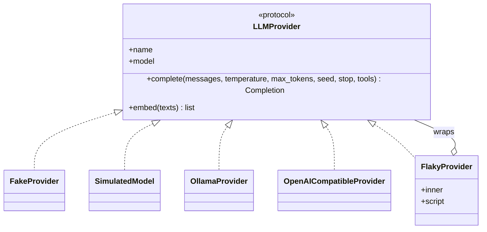
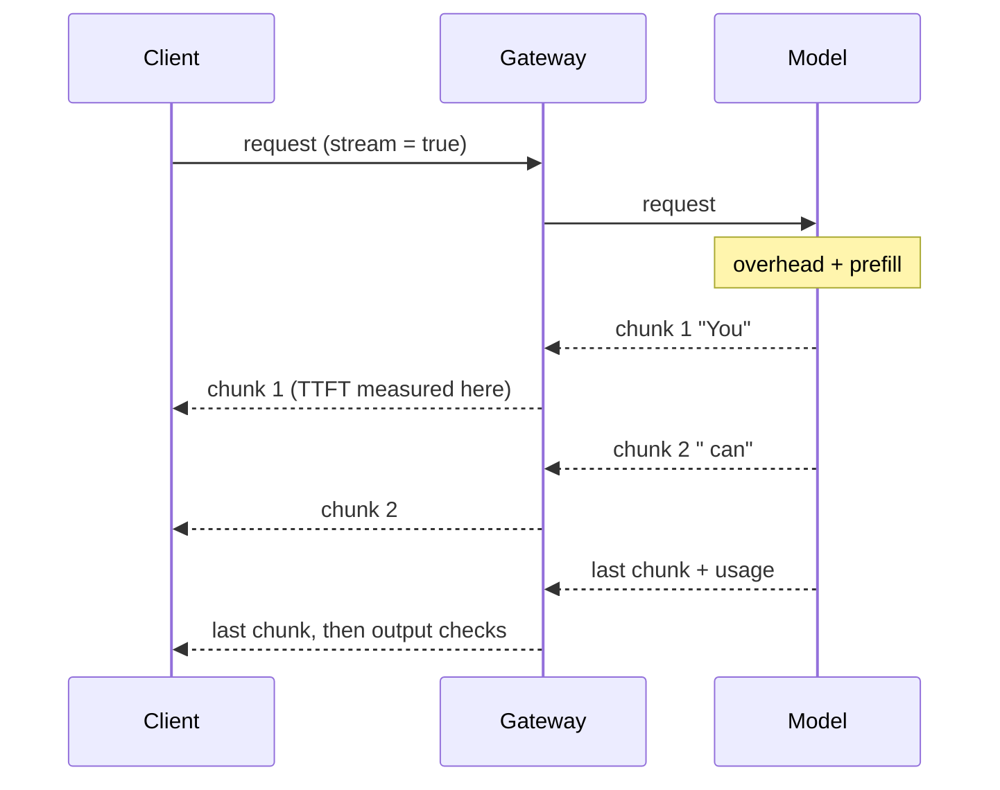
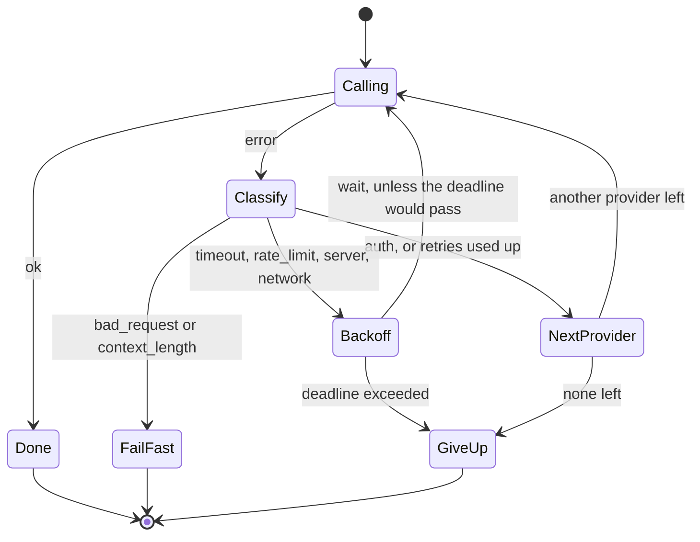

🌐 English · [Español](02-one-interface-many-models.es.md)

# Lesson 3.2 — One interface, many models

> **Module 03 · Lesson 2 of 4** · ⏱️ about 55 min · 🧪 Lab: [step 3](lab/README.md#step-3--survive-failing-providers)

## 📨 Situation

> **From:** Sam Adeyemi · Site Reliability Engineer (SRE)
> **Channel:** #playground-ops
>
> Numbers first. During last week's trial the external endpoint returned errors for a few minutes. The
> prototype waited 120 seconds per request, because nobody changed the default timeout, and then
> showed a stack trace. Meanwhile its tests failed every time the office Wi-Fi did. What I want from
> the real version: one interface for every model, so switching provider is a configuration change;
> tests that never touch the network; retries that do not turn a small outage into a big one; a plan B
> when the provider is down; and logs that say *why* a request failed. I like my pager quiet.

## 🎯 Objectives

By the end of this lesson you can:

- Explain the provider interface and why a deterministic fake makes tests fast, free and repeatable.
- Build chat messages with the right roles and read the payload each provider actually receives.
- Choose generation parameters (temperature, `max_tokens`, seed, stop) and predict their effect.
- Compute the time to first token from a stream and explain why streaming complicates output checks.
- Classify provider errors and configure retries with exponential backoff and jitter, timeouts, a deadline and a fallback.

## 🤔 Predict first

Write your answers down before reading on. You will check them in the self-check.

1. A provider fails 30% of calls at random. With up to 3 retries, about what share of requests succeed?
2. A thousand clients get an error at the same moment, and each one retries after exactly one second. What happens one second later?
3. Should the gateway retry a request that failed with "context length exceeded"?

## 1. One interface, many back-ends

Every model provider offers its own application programming interface (API) over the Hypertext
Transfer Protocol (HTTP), and each speaks its own dialect. One wants `max_tokens`, another `num_predict`. One
returns usage as `prompt_tokens`, another as `prompt_eval_count`. If those details leak into the
orchestrator, every new provider means touching the whole playground. The fix is an **interface**:
one small contract that every back-end implements. In the lab it is the `LLMProvider` protocol in
`providers.py`: a `name`, a `model`, a `complete()` method that takes messages and parameters and
returns a `Completion`, and an `embed()` method. Everything above the gateway programs against that
contract and never against a vendor.

| Back-end | What it is | When you use it |
|---|---|---|
| `FakeProvider` | Deterministic canned replies, in the shared `providers.py` | Unit tests of logic around the model |
| `SimulatedModel` | `FakeProvider` + a latency formula + temperature sampling | The playground's default (`fake-small`, `fake-large`) |
| `OllamaProvider` | A local model behind Ollama's HTTP API | Private experiments on your own machine |
| `OpenAICompatibleProvider` | Any server that speaks the OpenAI chat format | Hosted APIs, or local servers that copy the format |
| `FlakyProvider` | Wraps any provider and fails on a schedule | Testing retries and fallbacks |

You switch with an environment variable or a flag: `LLM_PROVIDER=ollama` or `--provider ollama`.

Why does the default have to be a fake? Because tests must be fast, free, offline and repeatable. A
real model is none of those. Even at temperature 0 its exact wording can change when the provider
updates the model, so a test that compares text breaks for reasons that have nothing to do with your
code. The lab's `tests/conftest.py` goes further: it blocks network sockets, so a test that tries to
call a real model fails loudly instead of passing on your laptop and failing in continuous
integration (CI).

**Analogy:** a flight simulator. Pilots practise engine failures in a simulator because there you can
schedule the failure for minute 12, every time, at no risk. `FlakyProvider` is that simulator for your
gateway: "fail with a server error, then a rate limit, then succeed" happens identically on every run.



A test against the simulated model is short and never flaky. This one is in `tests/test_models.py`:

```python
Q = [Message("system", "Be brief."), Message("user", "How long is the warranty?")]

def test_satisfies_the_provider_protocol() -> None:
    assert isinstance(SimulatedModel(), LLMProvider)

def test_same_input_same_output() -> None:
    a = SimulatedModel().complete(Q, temperature=1.2, seed=4)
    b = SimulatedModel().complete(Q, temperature=1.2, seed=4)
    assert a == b
```

> ⚠️ **Common mistake:** unit tests that call a real model. They are slow, they cost money, they fail
> when the network fails, and they pass or fail depending on the provider's latest model update. Test
> your logic against a fake; keep live tests few, marked and opt-in (`RUN_LIVE_TESTS=1` in this course).

> 💡 **Production tip:** test each adapter with *contract tests* that build the request payload
> offline and compare it with what the provider's documentation expects. `test_payloads_are_built_offline`
> in `tests/test_providers.py` does exactly that for both real adapters.

## 2. Messages and roles

A chat request is a list of messages, each with a **role**:

| Role | Who writes it | Example in the playground |
|---|---|---|
| `system` | You, the developer: who the assistant is and what rules it follows | "You are the Hearthwise support assistant..." |
| `user` | The person typing | "How many sensors can one Hearth Hub take?" |
| `assistant` | The model, in earlier turns: this is the history | "One hub connects up to 64 HomeMesh devices." |
| `tool` | Your code, returning the result of a tool the model asked for | Module 07 |

The provider turns this list into one long token sequence using the model's *chat template*, which
marks where each role starts and ends. The model learned to respect those markers during
post-training (module 02). The same two messages become two different payloads, one per provider.
This is the payload for an OpenAI-compatible server, built offline by `build_chat_payload`:

```json
{
  "model": "any-model",
  "messages": [
    {"role": "system", "content": "You are the Hearthwise support assistant."},
    {"role": "user", "content": "How many sensors can one Hearth Hub take?"}
  ],
  "temperature": 0.2,
  "max_tokens": 256,
  "seed": 7
}
```

And the same request for Ollama. The messages are identical, but the parameters move into `options`
and `max_tokens` becomes `num_predict`:

```json
{
  "model": "llama3.2:1b",
  "messages": [
    {"role": "system", "content": "You are the Hearthwise support assistant."},
    {"role": "user", "content": "How many sensors can one Hearth Hub take?"}
  ],
  "stream": false,
  "options": {"temperature": 0.2, "num_predict": 256, "seed": 7}
}
```

**Analogy:** a theatre script. Stage directions (system) shape the performance but are never spoken.
The lines belong to characters (user and assistant), and props are carried on stage when a scene needs
them (tool results). Each theatre (provider) prints the script in its own layout; the play is the same.

> ⚠️ **Common mistake:** pasting untrusted text, such as a customer email or a web page, into the
> system message "so the model takes it seriously". The system role carries the most authority, so
> that is exactly where injected instructions do the most damage. Pasted content belongs in a user
> message, clearly delimited. Lesson 3.4 explains why even that is not a security boundary.

## 3. Generation parameters

Module 02 explained how decoding works. In the playground, these are the knobs people turn:

| Parameter | What it controls | Playground default | When to change it |
|---|---|---|---|
| `temperature` | How random sampling is; 0 always picks the most likely continuation | 0.0 | Raise it for brainstorming; keep 0 for facts and extraction |
| `max_tokens` | Upper limit on the answer; also space reserved in the context window | 256 | Lower it to cap cost and latency; too low cuts answers |
| `seed` | Makes sampling repeatable where the back-end supports it | 0 | Fix it whenever you compare runs |
| `stop` | Strings that end the answer early | none | Structured output that ends at a known marker |

The simulated model reacts to these knobs like a small real model. It has a few candidate answers per
topic, with scores, and samples between them; one candidate for the returns question repeats the
*outdated* 2023 policy of 14 days. At temperature 0 it always gives the top answer. At 1.5, ten seeds
give three different answers:

```python
from m03_playground.models import SimulatedModel
from m03_playground.providers import Message

q = [Message("user", "How many days do I have to return a Glow A19?")]
for t in (0.0, 1.5):
    texts = {SimulatedModel().complete(q, temperature=t, seed=s).text for s in range(10)}
    print(t, len(texts))    # 0.0 1  then  1.5 3
```

Run it through the full playground with `--temperature 1.5 --seed 0` and the outdated answer appears;
the output checks catch it (`outdated_returns_policy`, lesson 3.4). With `--max-tokens 12` the answer
stops after 12 tokens mid-sentence, the completion's `finish_reason` becomes `length`, and the output
checks report `truncated`.

**Analogy:** the settings of a camera. The scene (your prompt) is the same; exposure and focus decide
whether you get one sharp photo or a creative blur. You always write down the settings next to the
photo, or you cannot take it again.

> ⚠️ **Common mistake:** assuming a seed makes a hosted model perfectly reproducible. On many hosted
> models a fixed seed makes results *more* repeatable, not guaranteed identical, because the provider
> may change hardware or model versions. Check your provider's documentation and never write a test
> that depends on it.

> 💡 **Production tip:** record every parameter in the trace. The lab writes `temperature`,
> `max_tokens`, `seed` and the truncation policy in the `params` field of every line. "Why did this
> answer change?" is usually answered by a parameter someone changed.

## 4. Streaming

Without streaming the server sends the whole answer when the last token is ready. With streaming it
sends small chunks as soon as tokens are generated, over one long-lived HTTP response.
OpenAI-compatible servers use **server-sent events** (SSE): one `data:` line per chunk. Ollama sends
one JSON (JavaScript Object Notation) object per line. Either way, the client prints text as it
arrives, and the arrival of the first chunk is the moment that defines the **time to first token**
(TTFT) from lesson 3.1.

The copied `providers.py` does not stream (it sends `"stream": false`). The lab simulates it instead:
`SimulatedModel.stream()` yields chunks with *simulated* arrival times, so you can compute streaming
metrics without a network.

**Analogy:** live subtitles versus the full transcript. The subtitles start almost at once and arrive
word by word; the transcript is complete and checked, but you wait for it.



```python
from m03_playground.models import SimulatedModel
from m03_playground.providers import Message

chunks = list(SimulatedModel("fake-small").stream([Message("user", "How long is the warranty?")]))
ttft = chunks[0].t_ms
decode = (len(chunks) - 1) / ((chunks[-1].t_ms - ttft) / 1000)
print(len(chunks), ttft, round(decode, 1))   # 25 122.5 50.0
```

Streaming has a cost that is easy to miss: **you show text before you have seen all of it**. A check
that needs the whole answer, such as "does it repeat the outdated returns policy?" or "does it contain
a phone number?", can only run after the user has already read the problem.

> 💡 **Production tip:** decide per use case. For low-risk internal answers, stream and run the checks
> at the end, marking a failed answer afterwards. For high-risk output, buffer a sentence at a time and
> check before showing it, or do not stream at all. A short delay is cheaper than a leak.

## 5. Failures need a taxonomy

Providers fail in their own words: HTTP status codes, socket errors, exception classes. The gateway
only needs to answer three questions: retry the same provider? try another provider? or stop because
the request itself is wrong? So the first step is to map every failure to one kind
(`classify_error` in `errors.py`):

| Kind | Typical signal | Retry? | Fall back? |
|---|---|---|---|
| `timeout` | No answer within the timeout | yes | yes |
| `rate_limit` | HTTP 429, often with a `Retry-After` header | yes, after the server's wait | yes |
| `server` | HTTP 5xx | yes | yes |
| `network` | Connection refused, name lookup failed | yes | yes |
| `auth` | HTTP 401 or 403 | no | yes |
| `bad_request` | HTTP 400, 404 or 422 | no | no |
| `context_length` | HTTP 400 that mentions the context length | no: shorten the prompt (lesson 3.3) | no |

Retries need a pause, and the pause needs two properties. **Exponential backoff**: the ceiling of the
wait doubles on each retry (0.5 s, 1 s, 2 s, 4 s, capped at 8 s), so a struggling provider gets more
and more breathing room. **Jitter**: the actual wait is a random number between 0 and that ceiling,
so a thousand clients that failed at the same moment do not all come back at the same moment.

**Analogy:** a shop door that jams when everybody pushes at once. If the whole crowd retries at exactly
9:00:01, it jams again. If each person comes back at a random moment in the next minute, the queue
flows. The doubling is the shopkeeper saying "give me longer each time".



The backoff itself is three lines (`resilience.py`):

```python
def backoff_delay(retry: int, policy: RetryPolicy, rng: random.Random) -> float:
    """Seconds to wait before retry number ``retry`` (1, 2, 3...)."""
    ceiling = min(policy.max_delay_s, policy.base_delay_s * 2 ** (retry - 1))
    return rng.uniform(0, ceiling) if policy.jitter else ceiling
```

`uv run lab retry` shows one request whose primary model fails four times. The waits were 0.16 s
(jitter under a 0.5 s ceiling), then 1.00 s (the rate limit asked for 1 s, which beats the random
wait), then 1.30 s. Two timeouts of 10 s each sit in between. After the fourth failure the retries are
used up and `fake-large` answers; the whole request took 23.85 s of simulated time.

> ⚠️ **Common mistake:** retrying everything. A `bad_request` repeated three times is the same bad
> request three times. Worse are stacked retries: a client library that retries 3 times inside a
> gateway that also retries 3 times makes up to 16 attempts per request, during an outage, exactly
> when the provider needs less traffic.

> 💡 **Production tip:** honour `Retry-After` when the server sends it, and count retries as part of
> your traffic. If retries become a large share of requests, stop retrying and fail fast: the provider
> is down, not busy.

## 6. Timeouts, deadlines and fallbacks

A **timeout** limits one attempt. A **deadline** limits the whole request, waits included. They
interact in a way that surprises people. Take four timeouts in a row with the default 10 s timeout and
a 30 s deadline: three timeouts use up the entire deadline, so the request fails *before the fallback
gets a chance*. Shorten the timeout to 2 s and the same four failures cost about 10 s, leaving room for
`fake-large` to answer:

```python
gateway = ModelGateway(
    [FlakyProvider(SimulatedModel("fake-small"), script=[ErrorKind.TIMEOUT] * 4),
     SimulatedModel("fake-large")],
    RetryPolicy(max_retries=3, timeout_s=2.0, deadline_s=30.0),
)
result = gateway.complete([Message("user", "How long is the warranty?")])
print([a.outcome for a in result.attempts], result.completion.model)
# ['timeout', 'timeout', 'timeout', 'timeout', 'ok'] fake-large
```

Now scale up. `uv run lab retry` also sends 1,000 simulated requests to a primary model that fails 30%
of calls, with a fallback model that fails 5%:

| Strategy | Success | Mean attempts | p50 | p95 |
|---|---|---|---|---|
| no retries | 67.4% | 1.00 | 0.60 s | 10.00 s |
| 3 retries | 98.8% | 1.45 | 0.60 s | 11.22 s |
| 3 retries + fallback | 99.9% | 1.46 | 0.60 s | 11.29 s |
| outage: 3 retries | 0.0% | 3.97 | 12.71 s | 30.00 s |
| outage: 3 retries + fallback | 90.5% | 4.92 | 14.07 s | 30.00 s |

Read it like Sam would. With independent failures, theory says one attempt succeeds 70% of the time
and four attempts succeed 1 − 0.3⁴ ≈ 99.2% of the time. The simulation's 67.4% and 98.8% are close; gaps
of a few percentage points or less are normal noise for 1,000 requests, and a few requests also run out
of deadline. The median (p50) does not move, but the 95th percentile (p95) is about 10 s in every
row: the requests that
hit a timeout set the tail. In an **outage** retries are useless (0.0% success) and they almost
quadruple the traffic to a provider that is already down. A fallback rescues most requests, but each
one first burns its retries on the dead provider, and some run out of deadline. The usual cure is a
**circuit breaker**: after enough consecutive failures, skip that provider for a while and go straight
to the fallback. You will build one in the lab's Extend it section.

**Analogy:** a backup generator. It keeps the lights on when the mains fail, but it powers fewer
things, costs more per hour, and you test it before the storm, not during it.

Fallbacks are not free. The fallback model answers differently, has different prices and a different
context window, and may sit on the other side of the data boundary. In the playground the orchestrator
redacts *before* the gateway, so every provider in the chain receives redacted text. The trace records
`fallback_used`, so Sam can count how often plan B runs.

> ⚠️ **Common mistake:** a timeout longer than the deadline allows for. With 10 s timeouts, 3 retries
> and a 30 s deadline, three slow failures end the request, and the fallback you configured never
> runs. Size timeouts so that all attempts plus waits fit, with room for the fallback.

> 💡 **Production tip:** evaluate the fallback model on the same test set as the primary before you
> rely on it. A fallback that answers 99.9% of requests but gets the returns policy wrong is not a
> plan B; it is a second incident.

## 🧪 Try it

1. Watch two transient failures and the retries that absorb them:

   ```bash
   uv run lab ask "How long is the warranty?" --flaky server,rate_limit
   ```

   ```text
   Request lifecycle
     1 input guardrails  redactions: none | injection flags: none
     2 prompt assembly   2 messages, 28 prompt tokens (policy pin_system, budget 768)
     3 model gateway     fake/fake-small #1 server; fake/fake-small #2 rate_limit after 0.42 s; fake/fake-small #3 ok after 1.00 s
     4 output checks     passed
     5 trace             outputs/traces.jsonl (trace_id c95c391e79d1)
   ```

2. Four timeouts with a fallback configured. Predict the result before you run it:

   ```bash
   uv run lab ask "How long is the warranty?" --flaky timeout,timeout,timeout,timeout --fallback fake-large
   ```

   ```text
   Request failed: timeout: deadline exceeded after 3 attempt(s). Trace: outputs/traces.jsonl
   ```

3. Same failures, shorter timeout. Now the fallback answers:

   ```bash
   uv run lab ask "How long is the warranty?" --flaky timeout,timeout,timeout,timeout --fallback fake-large --timeout 2
   ```

   ```text
     3 model gateway     fake/fake-small #1 timeout; fake/fake-small #2 timeout after 0.42 s; fake/fake-small #3 timeout after 0.76 s; fake/fake-small #4 timeout after 0.84 s; fake/fake-large #1 ok
   ```

4. A request that is wrong, not unlucky. It fails at once, without retries:

   ```bash
   uv run lab ask "How long is the warranty?" --max-tokens 1000
   ```

   ```text
   Request failed: context_length: 28 prompt tokens + max_tokens 1000 > context window 1024 of fake-small after 1 attempt(s). Trace: outputs/traces.jsonl
   ```

5. Run the reliability experiment and compare the table with the one in section 6:

   ```bash
   uv run lab retry
   ```

6. Turn the knobs: `--temperature 1.5 --seed 0` gives the outdated 14-day answer (flagged
   `outdated_returns_policy`), and `--max-tokens 12` cuts the answer (flagged `truncated`):

   ```bash
   uv run lab ask "How many days do I have to return a Glow A19?" --temperature 1.5 --seed 0
   uv run lab ask "How many days do I have to return a Glow A19?" --max-tokens 12
   ```

## 🏭 In the real world

- **Client libraries retry too.** Official software development kits (SDKs) often retry on their own.
  Know their defaults before you add your own loop, or you get the stacked retries of section 5.
- **Circuit breakers and retry budgets** keep a struggling provider from being hammered. Many teams also
  cap retries to a small share of total traffic.
- **Fallback chains are tested, not assumed.** Teams run the evaluation set against every model in the
  chain and alert when the fallback rate rises, because a silent fallback hides a degraded primary.
- **Monitor by error kind.** A spike of `rate_limit` means you need a higher quota or smoothing; a spike
  of `auth` means a key expired; a spike of `context_length` means a prompt grew (lesson 3.3).
- **Long answers and streaming:** many gateways stream to the client while recording usage from the
  final chunk, so token counts and cost are still logged per request.

## ✅ Self-check

**1. A provider fails 30% of calls at random. With up to 3 retries, about what share of requests succeed?**

<details><summary>Answer</summary>

About 1 − 0.3⁴ ≈ 99.2%, because a request fails only if all four attempts fail. The lab's simulation
measured 98.8% over 1,000 requests, close to the theory. The tempting answer, "70% + 3 × 30%", treats
the retries as adding success linearly; they multiply the failure probability instead.

</details>

**2. A thousand clients fail at the same moment and each retries after exactly one second. What happens?**

<details><summary>Answer</summary>

A synchronised wave: a thousand requests arrive together one second later, the provider is overloaded
again, and the cycle repeats. Jitter spreads the retries over the backoff window so the load arrives
gradually. Exponential growth of the window gives the provider more time on each round.

</details>

**3. Should the gateway retry "context length exceeded"?**

<details><summary>Answer</summary>

No. It is a property of the request, not a transient fault: the same prompt fails the same way every
time. The gateway fails fast (`context_length` is neither retryable nor a fallback reason in the lab),
and the fix belongs in prompt assembly: truncate or summarise the history (lesson 3.3). A model with a
bigger window could help, but that is a deliberate routing decision, not a retry.

</details>

**4. Four timeouts in a row: why does the request fail with a 10 s timeout but succeed with a 2 s timeout, even though a fallback is configured in both cases?**

<details><summary>Answer</summary>

The deadline is 30 s for the whole request. With 10 s timeouts, three timeouts plus their waits spend
the entire deadline, so the gateway gives up before the fallback runs. With 2 s timeouts the four
failures cost about 10 s, and the fallback answers within the deadline.

</details>

**5. Why test the playground with a deterministic fake instead of a real model at temperature 0?**

<details><summary>Answer</summary>

Temperature 0 removes sampling randomness, but not the network, the cost, the latency or the
provider's model updates. A deterministic fake gives the same output for the same input forever, runs
in microseconds offline, and can be scripted to fail on purpose. Real models still get a few opt-in
live tests.

</details>

## 💬 Explain it in your own words

- Sam asks why the outage row shows almost four attempts per request and whether that is a problem.
  Explain what those attempts do to a provider that is already down, and what a circuit breaker changes.
- A colleague wants to put the whole customer email into the system message "so the model obeys it".
  Explain to them, as Noor would, which role it belongs in and why.

## 🔑 Key ideas

- Program against one provider interface; adapters hide each vendor's payload format.
- A deterministic fake, plus a scripted flaky wrapper, makes tests fast, free and repeatable.
- Roles: `system` for your rules, `user` for input, `assistant` for history, `tool` for tool results.
- Record every generation parameter; a seed on a hosted model is not a reproducibility guarantee.
- Streaming improves TTFT but shows text before output checks can see the whole answer.
- Classify errors first: retry transient ones with exponential backoff and jitter, fail fast on bad requests.
- Size timeouts to fit the deadline, and use fallbacks and circuit breakers for outages.

## 📚 Go deeper

- ⭐ [Exponential Backoff And Jitter (AWS Architecture Blog)](https://aws.amazon.com/blogs/architecture/exponential-backoff-and-jitter/) — from Amazon Web Services (AWS): simulations that show why full jitter beats fixed waits.
- [Google SRE book: Handling Overload](https://sre.google/sre-book/handling-overload/) — client-side throttling and retry budgets.
- [Google SRE book: Addressing Cascading Failures](https://sre.google/sre-book/addressing-cascading-failures/) — how retries turn small failures into outages, and how deadlines help.
- [Server-sent events (MDN Web Docs)](https://developer.mozilla.org/en-US/docs/Web/API/Server-sent_events) — the streaming format used by OpenAI-compatible servers.
- [Ollama](https://ollama.com) — the local model server behind `OllamaProvider`.

---

[← Previous: 3.1 Chatbot system design](01-chatbot-system-design.md) · [🏠 Module 03](README.md) · [Next: 3.3 Conversation state and context windows →](03-conversation-state-and-context-windows.md)
