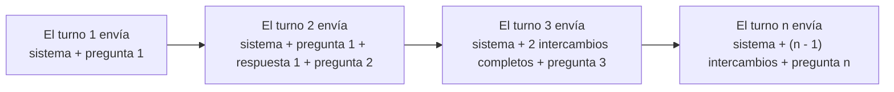
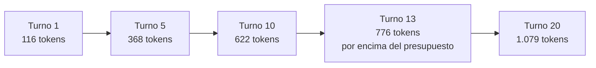
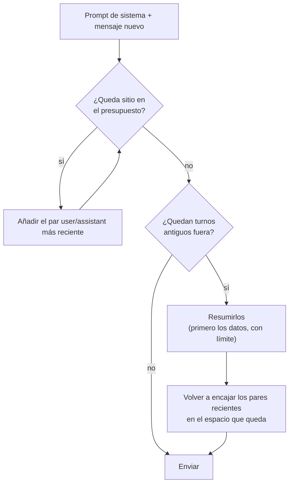

🌐 [English](03-conversation-state-and-context-windows.md) · Español

# Lección 3.3 — Estado de la conversación y ventanas de contexto

> **Módulo 03 · Lección 3 de 4** · ⏱️ unos 50 min · 🧪 Lab: [paso 4](lab/README.es.md#paso-4--presupuesta-la-conversación) y [paso 8](lab/README.es.md#paso-8--conversa-en-el-playground)

## 📨 Situación

> **De:** Alex Moreau · Responsable de Operaciones de Atención al Cliente
> **Canal:** #support-ai
>
> Mi equipo ha pasado la mañana probando el *prompt* del asistente de soporte en tu *playground*, y le
> encanta. Aun así, hubo dos cosas que nos preocuparon. Un chat de prueba largo empezó con el pedido
> del ticket T00003 ("Order #HW-640183. Where is it?"). Veinte preguntas después, la persona de soporte
> le pidió al bot que revisara otra vez "mi primer pedido", y no tenía ni idea de qué pedido era. Otro
> chat largo falló sin más en el turno 13, con un error sobre una ventana de contexto. Sam dice además
> que los chats largos cuestan mucho más que los cortos. La clientela ya se repite bastante. ¿Puede el
> *playground* recordar lo que importa sin recordarlo todo?

## 🎯 Objetivos

Al terminar esta lección puedes:

- Explicar por qué los modelos de chat no tienen estado y qué guarda el *playground* entre turnos.
- Calcular un presupuesto de entrada (*input budget*) a partir de una ventana de contexto y de `max_tokens`, y detectar una petición que no puede caber.
- Calcular cómo crecen los *tokens* del *prompt* por turno y en total, y explicar por qué el total crece de forma cuadrática.
- Comparar una ventana deslizante (*sliding window*), un *prompt* de sistema fijado (*pinned*) y el resumen (*summarisation*) por los *tokens* enviados y por lo que olvida cada uno.
- Elegir una política de truncado para un caso de uso y defender la elección.

## 🤔 Predice primero

Apunta tus respuestas antes de seguir leyendo. Las comprobarás en la autoevaluación.

1. Una conversación tiene 20 turnos y cada intercambio añade más o menos el mismo número de *tokens*. Si reenvías el historial completo en cada turno, ¿el total enviado se acerca más a 20 veces un intercambio o a 200 veces?
2. Conservas solo los seis últimos mensajes de la conversación. ¿Qué es lo primero importante que pierde el modelo?
3. ¿Resumir los turnos antiguos envía siempre menos *tokens* que conservar tantos turnos recientes como quepan?

## 1. El modelo olvida; tu sistema recuerda

La lección 3.1 mostró que un modelo de lenguaje grande (LLM, *large language model*) no tiene estado
(*stateless*). Cada petición es independiente: el modelo ve exactamente los mensajes de esa petición y
nada más. Una "conversación" es una ilusión que crea tu sistema guardando los turnos y enviándolos de
nuevo cada vez. En el *playground*, ese almacén es la clase `Conversation`: un *prompt* de sistema más
una lista de mensajes de la persona usuaria y del asistente.

Puedes ver la ilusión en el bucle de lectura, evaluación e impresión (REPL, *read–eval–print loop*)
del chat. Cada corchete muestra los *tokens* del *prompt* y los *tokens* de la respuesta de una
petición:

```text
you> Hi, my order #HW-640183 has not arrived yet.
bot> Standard delivery in Spain and Portugal takes 2 to 4 business days and costs €4.95; it is free for orders over €49.
     [34+28 tokens | TTFT 128 ms | €0.0000146 | redacted ORDER x1]
you> How much is Hearthwise Plus?
bot> Hearthwise Plus costs €4.99 per month or €49 per year.
     [76+15 tokens | TTFT 139 ms | €0.0000136]
you> How long is the warranty?
bot> Every Hearthwise device has a 2-year warranty from the delivery date. With an active Hearthwise Plus subscription it is 3 years.
     [105+25 tokens | TTFT 146 ms | €0.0000205]
```

La tercera pregunta solo tiene cinco palabras, pero su *prompt* tiene 105 *tokens*: los dos primeros
intercambios viajan con ella. Después de `/reset`, la misma pregunta vuelve a costar 28 *tokens* de
*prompt*. Fíjate también en el número de pedido: el almacén guarda `<ORDER_1>`, no el valor real,
porque la anonimización (lección 3.4) se ejecuta antes de guardar nada. El TTFT, el tiempo hasta el
primer *token*, también crece un poco, porque el modelo tiene que leer el historial.

**Analogía:** una línea de atención telefónica en la que quien responde no tiene memoria entre
llamadas. Para que pueda ayudarte, le lees las notas del caso al principio de cada llamada. Las notas
se alargan con cada llamada, y en algún momento tienes que decidir qué dejar fuera.



El almacén tiene dos operaciones: `record` después de cada respuesta y `build` antes de cada petición.
Todas las decisiones de esta lección viven dentro de `build`, en la `policy` que aplica:

```python
@dataclass
class Conversation:
    system: str = SUPPORT_SYSTEM
    history: list[Message] = field(default_factory=list)

    def build(self, user_text: str, *, policy: str = "pin_system", budget: int = 768) -> list[Message]:
        return POLICIES[policy](
            Message("system", self.system), self.history, Message("user", user_text), budget
        )

    def record(self, user_text: str, assistant_text: str) -> None:
        self.history += [Message("user", user_text), Message("assistant", assistant_text)]
```

> ⚠️ **Error común:** guardar el estado de la conversación en la memoria del servidor web. Funciona en
> tu portátil y se rompe en producción: un reinicio olvida todas las sesiones y, con dos servidores
> detrás de un balanceador de carga (*load balancer*), la mitad de las peticiones llegan a un servidor
> que nunca vio el historial. Guarda las sesiones en un almacén que puedan leer todos los servidores.

## 2. Los tokens y la ventana de contexto

Todo se mide en *tokens*. El lab los cuenta con `count_tokens` de `providers.py` (palabras y signos de
puntuación) y suma 4 *tokens* por mensaje por las marcas de rol que inserta una plantilla de chat. Los
tokenizadores (*tokenizers*) reales, que viste en el módulo 01, dan números distintos: cuando el límite
importa, cuenta siempre con el tokenizador del modelo al que llamas. La *forma* de todo lo que sigue no
cambia.

La **ventana de contexto** (*context window*) es el máximo de *tokens* que cabe en una petición: el
*prompt* *más* la respuesta. Así que, antes de empaquetar el *prompt*, reservas espacio para la
respuesta. El presupuesto de entrada es:

> presupuesto de entrada = ventana de contexto − `max_tokens`

El modelo simulado `fake-small` tiene una ventana de 1.024 *tokens*. Con el `max_tokens` por defecto
del *playground*, 256, el presupuesto de entrada es de 768 *tokens*. Solo el *prompt* de sistema de
soporte ocupa 77 de ellos. Cuando un *prompt* no cabe, el modelo rechaza la petición, como viste en la
lección 3.2: 28 *tokens* de *prompt* + `max_tokens` 1000 > 1024. Ese error no se puede reintentar; la
solución es un *prompt* más pequeño.

**Analogía:** una maleta en un viaje de ida y vuelta. Su tamaño es fijo, y sabes que traerás regalos a
la vuelta. Si la llenas del todo a la ida, los regalos no caben. Reserva el espacio antes de hacer la
maleta.

```python
from m03_playground.conversation import SUPPORT_SYSTEM, message_tokens
from m03_playground.providers import Message

system = Message("system", SUPPORT_SYSTEM)
print(message_tokens(system))              # 77
budget = 1024 - 256                        # context window - max_tokens
print(budget)                              # 768
```

> ⚠️ **Error común:** comprobar solo que el *prompt* cabe en la ventana. Un *prompt* de 1.000 *tokens*
> "cabe" en una ventana de 1.024, y entonces a la respuesta le quedan 24 *tokens*: la petición falla, o
> la respuesta se corta a mitad de frase con `finish_reason` igual a `length`. Calcula el presupuesto
> del *prompt* contra la ventana menos `max_tokens`.

## 3. Cómo crece el prompt

El equipo de Alex compartió uno de sus chats de prueba largos: 20 turnos que empiezan con el pedido
#HW-640183 y pasan por termostatos, sensores, cámaras, devoluciones y enchufes antes de volver al
pedido en el último turno. El lab reproduce esa grabación (`SCRIPT` en `conversation.py`). Reproducir
una grabación significa que todas las políticas ven exactamente los mismos turnos, así que lo único
que cambia es el *prompt* que construyes.

Si lo reenvías todo, el *prompt* del turno *n* contiene el *prompt* de sistema S, todos los
intercambios anteriores y el mensaje nuevo. Con intercambios de unos k *tokens*:

> *prompt* en el turno n ≈ S + (n − 1) × k + mensaje nuevo
>
> total en N turnos ≈ N × (S + mensaje nuevo) + k × N × (N − 1) ÷ 2

El último término es el problema. Crece con el *cuadrado* del número de turnos. En el chat grabado, un
intercambio tiene de media unos 52 *tokens*, y los números medidos siguen la fórmula:

| Turno | *Tokens* del *prompt* (conservándolo todo) | *Tokens* enviados acumulados | Sin ninguna memoria |
|---|---|---|---|
| 1 | 116 | 116 | 116 |
| 5 | 368 | 1.256 | 92 |
| 10 | 622 | 3.800 | 97 |
| 13 | 776 (por encima del presupuesto de 768) | 5.981 | 88 |
| 20 | 1.079 | 12.657 | 99 |

El turno 13 es la primera petición que ya no cabe, que es justo donde falló el chat de Alex. A lo
largo de toda la conversación, el *playground* envía 12.657 *tokens* de *prompt*, frente a 1.898 si
enviara solo el *prompt* de sistema y el mensaje nuevo cada vez: 6,7 veces más. Es la observación de
Sam sobre el coste, medida.

**Analogía:** un taxímetro que vuelve a empezar desde tu casa en cada parada. La tercera parada te
cobra otra vez el trayecto hasta las paradas uno y dos, más el tramo nuevo. La décima parada te cobra
todo el día hasta ese momento.



```python
from m03_playground.conversation import growth

rows = growth()                      # replays SCRIPT, resending the full history
print(rows[12].turn, rows[12].prompt_tokens, rows[-1].cumulative)   # 13 776 12657
```

> 💡 **Consejo de producción:** grafica los *tokens* del *prompt* por turno, no solo por petición. Un
> percentil 95 de *tokens* del *prompt* que sube es la alerta temprana tanto del aumento de coste como
> de los errores `context_length`, semanas antes de que cualquiera de los dos aparezca en un incidente.

## 4. Tres formas de hacerlo caber

Cuando el historial ya no cabe, tienes que elegir qué descartar. Cada **política de truncado**
(*truncation policy*) lo resuelve de una forma distinta. Todas viven en `conversation.py` y comparten
una firma: reciben el mensaje de sistema, el historial, el nuevo mensaje de la persona usuaria y el
presupuesto de entrada, y devuelven los mensajes que hay que enviar.

| Política | Qué envía |
|---|---|
| `keep_all` | Todo. La referencia, y la que falla en el turno 13 |
| `sliding_window` | Los 6 últimos mensajes de toda la lista, *prompt* de sistema incluido |
| `pin_system` | Siempre el *prompt* de sistema y el mensaje nuevo; después, los pares `user`/`assistant` más recientes que quepan |
| `summarise` | Como `pin_system`, más un breve resumen de los turnos que tuvo que descartar |

Esto es lo que hizo cada política con el chat grabado de 20 turnos y el presupuesto de 768 *tokens*:

| Política | Total enviado | Pico del *prompt* | Por encima del presupuesto | Turnos sin *prompt* de sistema | Recuerda #HW-640183 en el turno 20 |
|---|---|---|---|---|---|
| `keep_all` | 12.657 | 1.079 | 8 | 0 | sí |
| `sliding_window` | 3.110 | 266 | 0 | 17 | no |
| `pin_system` | 11.046 | 766 | 0 | 0 | no |
| `summarise` | 11.128 | 757 | 0 | 0 | sí |

Lee cada fila como un compromiso. La ventana deslizante ingenua es, de lejos, la más barata, pero a
partir del turno 4 el *prompt* de sistema se ha salido de la ventana: durante 17 de los 20 turnos, el
modelo funciona sin sus reglas ("no pidas nunca contraseñas" incluida). Fijar el *prompt* de sistema
lo arregla y mantiene todas las peticiones dentro del presupuesto, pero en el turno 20 el primer turno
ya queda muy atrás, así que se olvida el número de pedido: el fallo de Alex. La política de resumen
conserva el número de pedido a cambio de 82 *tokens* más en toda la conversación. Este es el resumen
que envió en el turno 20:

```text
Summary of earlier turns: order #HW-640183; products Ember T3, Watcher S1, Hearth Hub. Customer asked: How long does the battery in the Watcher S1 last? | Can the Hearth Hub run automations if my internet goes | Should I plug the hub into the router with a
```

El resumidor del lab es un sustituto extractivo: conserva primero los datos concretos (números de
pedido, nombres de producto) y después tantas preguntas de quien escribe como quepan en 60 *tokens*,
descartando las más antiguas. En producción, el resumen suele escribirlo un modelo más barato.

**Analogía:** una mudanza con una furgoneta pequeña. Puedes llevarte solo las últimas cajas que
empaquetaste (ventana deslizante). Puedes llevarte siempre primero la carpeta de documentos y luego
llenar la furgoneta con las cajas más nuevas (*prompt* de sistema fijado). O te llevas la carpeta, un
inventario de lo que se queda en el trastero y luego las cajas más nuevas (resumen). El inventario
ocupa un poco de sitio, pero sabes dónde está tu pasaporte.



Las dos políticas que fijan el *prompt* de sistema, de `conversation.py`:

```python
def pin_system(system: Message, history: Sequence[Message], user: Message, budget: int) -> list[Message]:
    """Always keep the system prompt and the new message; fill the rest with the newest turns."""
    room = budget - message_tokens(system) - message_tokens(user)
    return [system, *_recent_that_fit(history, room), user]


def summarise_older(system: Message, history: Sequence[Message], user: Message, budget: int) -> list[Message]:
    """Pin the system prompt, keep recent turns verbatim and replace older ones with a summary."""
    room = budget - message_tokens(system) - message_tokens(user)
    recent = _recent_that_fit(history, room)
    older = list(history[: len(history) - len(recent)])
    if not older:
        return [system, *recent, user]
    summary = Message("system", summarise_turns(older))
    recent = _recent_that_fit(history, room - message_tokens(summary))
    older = list(history[: len(history) - len(recent)])
    summary = Message("system", summarise_turns(older))
    return [system, summary, *recent, user]
```

`_recent_that_fit` recorre el historial hacia atrás en **pares** de mensajes `user`/`assistant`, para
que el modelo nunca vea una respuesta sin la pregunta a la que respondía.

> ⚠️ **Error común:** recortar la lista de mensajes sin fijar el *prompt* de sistema, o descartar
> mensajes sueltos. Lo primero elimina tus reglas en silencio; lo segundo deja una respuesta del
> asistente cuya pregunta ha desaparecido, lo que confunde al modelo sobre quién dijo qué.

> 💡 **Consejo de producción:** en producción, el resumen es otra llamada al modelo, con su propio
> coste, su latencia y sus modos de fallo. Puede perder o inventarse datos, y puede copiar datos
> personales en un sitio nuevo. Ejecútalo sobre texto anonimizado, actualízalo de forma incremental en
> lugar de reescribirlo en cada turno, y guarda los datos que no se pueden perder nunca, como los
> números de pedido, en campos estructurados en lugar de en prosa.

## 5. Elegir una política

No hay una política mejor, solo una política mejor para cada caso de uso. Empieza por lo que el modelo
no debe perder nunca y elige la política más barata que lo conserve:

| Caso de uso | Política | Por qué |
|---|---|---|
| Sesiones cortas del *playground* | `pin_system` | Reglas siempre presentes, sencilla, bastante barata |
| Chats de soporte largos en los que los identificadores importan más adelante | `summarise`, más datos estructurados | Conserva los datos concretos con un coste de *tokens* pequeño |
| Lluvia de ideas en la que solo importan los últimos turnos | Ventana deslizante con el *prompt* de sistema fijado | La más barata que sigue conservando las reglas |
| Auditorías o revisión legal de una conversación | Conservarlo todo en una ventana grande, o empezar una sesión nueva | No se puede descartar nada en silencio |

Una ventana de contexto más grande tampoco es un arreglo gratuito. Cada *token* extra se paga en cada
turno, y la investigación sobre contextos largos encontró que los modelos usan la información del
principio y del final de un *prompt* largo de forma más fiable que la que queda enterrada en el medio
([Lost in the Middle](https://arxiv.org/abs/2307.03172)). Para historiales muy largos, la mejor
herramienta es *recuperar* solo los turnos anteriores relevantes, que es lo que construye el módulo 05
para documentos.

**Analogía:** quien levanta bien el acta de una reunión. No lee en voz alta la transcripción completa
de cada reunión anterior; lee las decisiones y las tareas pendientes, y luego los últimos puntos de la
discusión.

> 💡 **Consejo de producción:** convierte la política en un ajuste por caso de uso, como hace la opción
> `--policy` del *playground*, y regístrala en cada traza. Cuando un modelo "olvida" algo, la primera
> pregunta es qué política estaba activa y qué había realmente en el *prompt*.

## 🧪 Pruébalo

1. Reproduce la conversación grabada con todas las políticas e imprime el resumen final:

   ```bash
   uv run lab budget --show-summary
   ```

   ```text
   Recorded conversation: 20 turns; system prompt 77 tokens (overhead included).
   Input budget 768 tokens (fake-small window 1,024 minus 256 reserved for the answer).

   Growth when the full history is resent (keep_all):
     turn  prompt  cumulative  stateless
        1     116         116        116
        2     193         309         97
        3     266         575        100
        5     368        1256         92
       10     622        3800         97
       13     776        5981         88  <- over budget
       15     875        7679         95  <- over budget
       20    1079       12657         99  <- over budget
     total sent: 12,657 tokens vs 1,898 with no memory at all (6.7x)

   Policies replayed on the same conversation:
     policy          total sent   peak  over budget  no system  remembers #HW-640183
     keep_all            12,657   1079            8          0                   yes
     sliding_window       3,110    266            0         17                    no
     pin_system          11,046    766            0          0                    no
     summarise           11,128    757            0          0                   yes

   Summary message sent at turn 20:
     Summary of earlier turns: order #HW-640183; products Ember T3, Watcher S1, Hearth Hub. Customer asked: How long does the battery in the Watcher S1 last? | Can the Hearth Hub run automations if my internet goes | Should I plug the hub into the router with a
   ```

2. Reduce el presupuesto a 400 *tokens*. Predice qué números cambian antes de ejecutarlo:

   ```bash
   uv run lab budget --budget 400
   ```

   ```text
   Policies replayed on the same conversation:
     policy          total sent   peak  over budget  no system  remembers #HW-640183
     keep_all            12,657   1079           15          0                   yes
     sliding_window       3,110    266            0         17                    no
     pin_system           6,729    400            0          0                    no
     summarise            6,833    393            0          0                   yes
   ```

   La ventana deslizante no cambia en absoluto: cuenta mensajes, no *tokens*. Es una segunda
   debilidad, porque seis mensajes largos pueden desbordar igualmente una ventana pequeña.

3. Observa cómo crece el *prompt* en el chat y luego reinícialo. Pasar la entrada por una tubería
   (*pipe*) hace que la ejecución sea repetible:

   ```bash
   printf 'Hi, my order #HW-640183 has not arrived yet.\nHow much is Hearthwise Plus?\nHow long is the warranty?\n/history\n/reset\nHow long is the warranty?\n/quit\n' | uv run lab chat
   ```

   Los *tokens* del *prompt* pasan por 34, 76 y 105, y `/history` muestra `<ORDER_1>` en lugar del
   número de pedido. Después de `/reset`, la misma pregunta cuesta 28 *tokens* de *prompt*.

4. Prueba la política de resumen en el chat: `uv run lab chat --policy summarise`. Se comporta como
   `pin_system` hasta que el historial deja de caber.

## 🏭 En el mundo real

- **Cuenta con el tokenizador real.** Los presupuestos calculados con un contador aproximado se desvían
  de lo que factura el proveedor. Usa el tokenizador del propio modelo, o el uso que devuelve el
  proveedor, para los límites y el coste.
- **Los prefijos repetidos pueden salir más baratos.** Algunos proveedores guardan en caché un prefijo
  del *prompt* que se repite entre peticiones (el *prompt* de sistema y el historial antiguo) y lo
  cobran más barato o responden más rápido. Consulta la documentación de tu proveedor; un *prompt* de
  sistema fijado hace que esa caché sea más eficaz.
- **La memoria es una decisión de producto.** Los asistentes que "recuerdan" a las personas usuarias
  entre sesiones guardan datos seleccionados en una base de datos y los inyectan en el *prompt*, con
  las mismas reglas de privacidad que cualquier otro dato personal.
- **Límites de sesión.** Muchos productos de chat limitan la longitud de una sesión o sugieren empezar
  un chat nuevo, lo que acota el crecimiento cuadrático.
- **Qué vigilar:** los *tokens* del *prompt* por turno (mediana y percentil 95), la proporción de peticiones que llegan al límite del presupuesto,
  los errores `context_length` y con qué frecuencia se activa la política de resumen.

## ✅ Autoevaluación

**1. Una conversación de 20 turnos reenvía el historial completo en cada turno. ¿El total se acerca más a 20 o a 200 intercambios en *tokens*?**

<details><summary>Respuesta</summary>

Más a 200. El turno n lleva n − 1 intercambios anteriores, así que la parte del historial suma
1 + 2 + ... + 19 = 190 intercambios, además del *prompt* de sistema y el mensaje nuevo de cada turno.
En el chat grabado, el total fue de 12.657 *tokens* frente a 1.898 sin historial (6,7 veces más). "20
veces" es la intuición lineal; el crecimiento real es cuadrático.

</details>

**2. Conservas solo los seis últimos mensajes de toda la lista. ¿Qué pierde primero el modelo?**

<details><summary>Respuesta</summary>

El *prompt* de sistema, porque es el mensaje más antiguo. En la reproducción faltó en 17 de los 20
turnos, a partir del turno 4. La respuesta tentadora, "la pregunta más antigua de la persona usuaria",
también es cierta, pero las reglas se van primero, y eso es peor. Fija el *prompt* de sistema y desliza
solo el historial.

</details>

**3. ¿Resumir los turnos antiguos envía siempre menos *tokens* que conservar tantos turnos recientes como quepan?**

<details><summary>Respuesta</summary>

No. Las dos políticas llenan el mismo presupuesto, y el resumen ocupa parte de él. En la reproducción,
`summarise` envió 11.128 *tokens* frente a los 11.046 de `pin_system`: 82 más. Lo que compra el
resumen no es ahorro, sino memoria: en el turno 20 todavía conocía el pedido #HW-640183. En producción,
además, añade una llamada al modelo por cada actualización.

</details>

**4. Un modelo tiene una ventana de contexto de 8.192 *tokens* y pones `max_tokens` a 1.024. ¿Cuál es el presupuesto de entrada, y qué pasa si el *prompt* tiene 7.500 *tokens*?**

<details><summary>Respuesta</summary>

El presupuesto es 8.192 − 1.024 = 7.168 *tokens*. Un *prompt* de 7.500 *tokens* no deja sitio para
una respuesta de 1.024, así que la petición falla con un error de longitud de contexto. Reintentar no
sirve de nada; trunca o resume el historial, o baja `max_tokens` si las respuestas son cortas.

</details>

**5. ¿Por qué el número de pedido sobrevive con `summarise` pero no con `pin_system`?**

<details><summary>Respuesta</summary>

Las dos conservan los turnos más recientes que caben, y el número de pedido solo aparece en el turno
1, que deja de caber a partir del turno 13. `pin_system` simplemente lo descarta. `summarise` convierte
los turnos descartados en un resumen que extrae los datos concretos, como números de pedido y nombres
de producto, antes que cualquier otra cosa.

</details>

## 💬 Explícalo con tus palabras

- Explícale a Alex, sin usar la palabra "*token*", por qué el bot olvidó el pedido y por qué el error
  apareció en el turno 13.
- Sam pregunta por qué el coste de un chat crece más deprisa que su longitud. Dale la explicación con
  el taxímetro y luego con la fórmula.

## 🔑 Ideas clave

- Los modelos de chat no tienen estado; el almacén de conversaciones y la política de truncado deciden lo que "recuerdan".
- Presupuesto de entrada = ventana de contexto − `max_tokens`; reserva el espacio de la respuesta antes de empaquetar el *prompt*.
- Reenviar el historial completo hace que el total de *tokens* del *prompt* crezca con el cuadrado del número de turnos.
- Una ventana deslizante ingenua descarta primero el *prompt* de sistema; fíjalo siempre.
- Fijar mantiene las reglas, pero olvida los datos antiguos; un resumen conserva los datos concretos con un coste de *tokens* pequeño.
- Elige la política según el caso de uso, regístrala en cada traza y cuenta los *tokens* con el tokenizador del propio modelo.

## 📚 Profundiza

- ⭐ [Lost in the Middle: How Language Models Use Long Contexts](https://arxiv.org/abs/2307.03172) — por qué una ventana más grande no significa que el modelo use por igual todo lo que contiene.
- [tiktoken](https://github.com/openai/tiktoken) — una biblioteca de tokenización rápida; úsala para ver cuánto difieren los recuentos reales de *tokens* de la aproximación del lab.
- [El artículo original de generación aumentada por recuperación (RAG, *retrieval-augmented generation*)](https://arxiv.org/abs/2005.11401) — la idea de recuperación que el módulo 05 aplica a documentos y que también funciona con historiales largos.

---

[← Anterior: 3.2 Una interfaz, muchos modelos](02-one-interface-many-models.es.md) · [🏠 Módulo 03](README.es.md) · [Siguiente: 3.4 Lanzar el playground →](04-shipping-the-playground.es.md)
