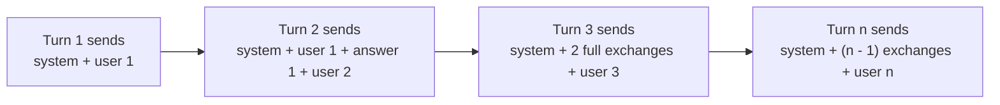
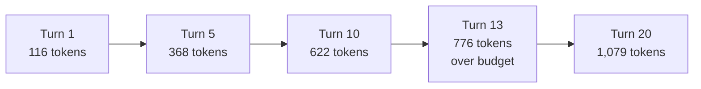
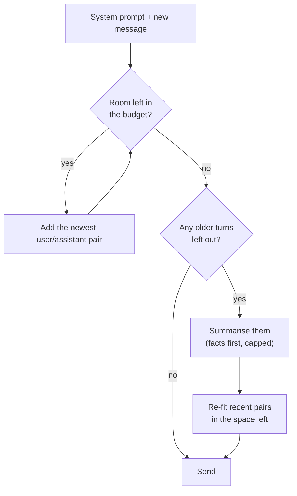

🌐 English · [Español](03-conversation-state-and-context-windows.es.md)

# Lesson 3.3 — Conversation state and context windows

> **Module 03 · Lesson 3 of 4** · ⏱️ about 50 min · 🧪 Lab: [step 4](lab/README.md#step-4--budget-the-conversation) and [step 8](lab/README.md#step-8--chat-in-the-playground)

## 📨 Situation

> **From:** Alex Moreau · Customer Support Operations Lead
> **Channel:** #support-ai
>
> My team spent the morning testing the support-assistant prompt in your playground, and they love it.
> Two things worried us, though. One long test chat started from the order in ticket T00003 ("Order
> #HW-640183. Where is it?"). Twenty questions later the agent asked the bot to check "my first order"
> again, and it had no idea which order that was. Another long chat simply failed at turn 13 with an
> error about a context window. Sam also says long chats cost much more than short ones. Customers
> repeat themselves enough already. Can the playground remember what matters without remembering
> everything?

## 🎯 Objectives

By the end of this lesson you can:

- Explain why chat models are stateless and what the playground stores between turns.
- Compute an input budget from a context window and `max_tokens`, and spot a request that cannot fit.
- Calculate how prompt tokens grow per turn and in total, and explain why the total grows quadratically.
- Compare a sliding window, a pinned system prompt and summarisation on tokens sent and on what each one forgets.
- Choose a truncation policy for a use case and defend the choice.

## 🤔 Predict first

Write your answers down before reading on. You will check them in the self-check.

1. A conversation has 20 turns and every exchange adds about the same number of tokens. If you resend the full history on every turn, is the total sent closer to 20 times one exchange or to 200 times?
2. You keep only the last six messages of the conversation. What is the first important thing the model loses?
3. Does summarising older turns always send fewer tokens than keeping as many recent turns as fit?

## 1. The model forgets; your system remembers

Lesson 3.1 showed that a large language model (LLM) is stateless. Each request is independent: the
model sees exactly the messages in that request and nothing else. A "conversation" is an illusion your
system creates by storing the turns and sending them again every time. In the playground that store is
the `Conversation` class: a system prompt plus a list of user and assistant messages.

You can watch the illusion in the chat read–eval–print loop (REPL). Each bracket shows the prompt
tokens and completion tokens of one request:

```text
you> Hi, my order #HW-640183 has not arrived yet.
bot> Standard delivery in Spain and Portugal takes 2 to 4 business days and costs €4.95; it is free for orders over €49.
     [34+28 tokens | TTFT 128 ms | €0.0000146 | redacted ORDER x1]
you> How much is Hearthwise Plus?
bot> Hearthwise Plus costs €4.99 per month or €49 per year.
     [76+15 tokens | TTFT 139 ms | €0.0000136]
you> How long is the warranty?
bot> Every Hearthwise device has a 2-year warranty from the delivery date. With an active Hearthwise Plus subscription it is 3 years.
     [105+25 tokens | TTFT 146 ms | €0.0000205]
```

The third question is only five words long, yet its prompt is 105 tokens: the first two exchanges ride
along. After `/reset`, the same question costs 28 prompt tokens again. Notice also the order number:
the store keeps `<ORDER_1>`, not the real value, because redaction (lesson 3.4) runs before anything is
stored. TTFT, the time to first token, grows a little too, because the model must read the history.

**Analogy:** a support hotline where the person who answers has no memory between calls. To make them
useful, you read them the case notes at the start of every call. The notes get longer with every call,
and at some point you have to decide what to leave out.



The store has two operations: `record` after each answer and `build` before each request. All the
decisions of this lesson live inside `build`, in the `policy` it applies:

```python
@dataclass
class Conversation:
    system: str = SUPPORT_SYSTEM
    history: list[Message] = field(default_factory=list)

    def build(self, user_text: str, *, policy: str = "pin_system", budget: int = 768) -> list[Message]:
        return POLICIES[policy](
            Message("system", self.system), self.history, Message("user", user_text), budget
        )

    def record(self, user_text: str, assistant_text: str) -> None:
        self.history += [Message("user", user_text), Message("assistant", assistant_text)]
```

> ⚠️ **Common mistake:** keeping conversation state inside the web server's memory. It works on your
> laptop and breaks in production: a restart forgets every session, and with two servers behind a load
> balancer, half the requests land on a server that never saw the history. Keep sessions in a store
> that every server can read.

## 2. Tokens and the context window

Everything is measured in tokens. The lab counts them with `count_tokens` from `providers.py` (words
and punctuation marks) and adds 4 tokens per message for the role markers that a chat template inserts.
Real tokenizers, which you met in module 01, give different numbers: always count with the tokenizer
of the model you call when the limit matters. The *shape* of everything below stays the same.

The **context window** is the most tokens one request can hold: the prompt *plus* the answer. So
before you pack the prompt, you reserve room for the answer. The input budget is:

> input budget = context window − `max_tokens`

The simulated `fake-small` model has a window of 1,024 tokens. With the playground's default
`max_tokens` of 256, the input budget is 768 tokens. The support system prompt alone takes 77 of them.
When a prompt does not fit, the model refuses the request, as you saw in lesson 3.2:
28 prompt tokens + `max_tokens` 1000 > 1024. That error is not retryable; the fix is a smaller prompt.

**Analogy:** a suitcase on a round trip. Its size is fixed, and you know you will bring presents back.
If you fill it completely on the way out, the presents do not fit. Reserve the space before you pack.

```python
from m03_playground.conversation import SUPPORT_SYSTEM, message_tokens
from m03_playground.providers import Message

system = Message("system", SUPPORT_SYSTEM)
print(message_tokens(system))              # 77
budget = 1024 - 256                        # context window - max_tokens
print(budget)                              # 768
```

> ⚠️ **Common mistake:** checking only that the prompt fits the window. A 1,000-token prompt "fits" a
> 1,024-token window, and then the answer has room for 24 tokens: the request fails, or the answer
> stops mid-sentence with `finish_reason` set to `length`. Budget the prompt against the window minus
> `max_tokens`.

## 3. How the prompt grows

Alex's team shared one of their long test chats: 20 turns that start with order #HW-640183 and wander
through thermostats, sensors, cameras, returns and plugs before coming back to the order in the last
turn. The lab replays that recording (`SCRIPT` in `conversation.py`). Replaying a recording means
every policy sees exactly the same turns, so the only thing that changes is the prompt you build.

If you resend everything, the prompt at turn *n* holds the system prompt S, all earlier exchanges and
the new message. With exchanges of roughly k tokens:

> prompt at turn n ≈ S + (n − 1) × k + new message
>
> total over N turns ≈ N × (S + new message) + k × N × (N − 1) ÷ 2

The last term is the problem. It grows with the *square* of the number of turns. In the recorded chat
an exchange averages about 52 tokens, and the measured numbers follow the formula:

| Turn | Prompt tokens (keep everything) | Cumulative tokens sent | No memory at all |
|---|---|---|---|
| 1 | 116 | 116 | 116 |
| 5 | 368 | 1,256 | 92 |
| 10 | 622 | 3,800 | 97 |
| 13 | 776 (over the 768 budget) | 5,981 | 88 |
| 20 | 1,079 | 12,657 | 99 |

Turn 13 is the first request that no longer fits, which is exactly where Alex's chat failed. Over the
whole conversation the playground sends 12,657 prompt tokens, against 1,898 if it sent only the
system prompt and the new message each time: 6.7 times more. That is Sam's cost observation, measured.

**Analogy:** a taxi meter that restarts from your home at every stop. The third stop costs the trip to
stops one and two again, plus the new bit. The tenth stop costs the whole day so far.



```python
from m03_playground.conversation import growth

rows = growth()                      # replays SCRIPT, resending the full history
print(rows[12].turn, rows[12].prompt_tokens, rows[-1].cumulative)   # 13 776 12657
```

> 💡 **Production tip:** chart prompt tokens per turn, not only per request. A rising 95th percentile of
> prompt tokens is the early warning for both cost growth and `context_length` errors, weeks before either
> shows up in an incident.

## 4. Three ways to make it fit

When the history no longer fits, you must choose what to drop. Each **truncation policy** answers that
differently. All of them live in `conversation.py` and share one signature: they receive the system
message, the history, the new user message and the input budget, and return the messages to send.

| Policy | What it sends |
|---|---|
| `keep_all` | Everything. The baseline, and the one that fails at turn 13 |
| `sliding_window` | The last 6 messages of the whole list, system prompt included |
| `pin_system` | The system prompt and the new message always, then the newest user/assistant pairs that fit |
| `summarise` | Like `pin_system`, plus a short summary of the turns it had to drop |

Here is what each policy did on the recorded 20-turn chat with the 768-token budget:

| Policy | Total sent | Peak prompt | Over budget | Turns without system prompt | Remembers #HW-640183 at turn 20 |
|---|---|---|---|---|---|
| `keep_all` | 12,657 | 1,079 | 8 | 0 | yes |
| `sliding_window` | 3,110 | 266 | 0 | 17 | no |
| `pin_system` | 11,046 | 766 | 0 | 0 | no |
| `summarise` | 11,128 | 757 | 0 | 0 | yes |

Read each row as a trade-off. The naive sliding window is by far the cheapest, but from turn 4 onwards
the system prompt has slid out of the window: for 17 of 20 turns the model runs without its rules
("never ask for passwords" included). Pinning the system prompt fixes that and keeps every request
under budget, but by turn 20 the first turn is long gone, so the order number is forgotten: Alex's bug.
The summary policy keeps the order number for 82 more tokens over the whole conversation. This is the
summary it sent at turn 20:

```text
Summary of earlier turns: order #HW-640183; products Ember T3, Watcher S1, Hearth Hub. Customer asked: How long does the battery in the Watcher S1 last? | Can the Hearth Hub run automations if my internet goes | Should I plug the hub into the router with a
```

The lab's summariser is an extractive stand-in: it keeps hard facts (order numbers, product names)
first and then as many of the customer's questions as fit in 60 tokens, dropping the oldest. In
production a cheaper model usually writes the summary.

**Analogy:** moving house with a small van. You can take only the boxes packed last (sliding window).
You can always take the folder of documents first and then fill the van with the newest boxes (pinned
system prompt). Or you take the folder, an inventory list of what stays in storage, and then the newest
boxes (summary). The inventory takes a little space, but you know where your passport is.



The two policies that pin the system prompt, from `conversation.py`:

```python
def pin_system(system: Message, history: Sequence[Message], user: Message, budget: int) -> list[Message]:
    """Always keep the system prompt and the new message; fill the rest with the newest turns."""
    room = budget - message_tokens(system) - message_tokens(user)
    return [system, *_recent_that_fit(history, room), user]


def summarise_older(system: Message, history: Sequence[Message], user: Message, budget: int) -> list[Message]:
    """Pin the system prompt, keep recent turns verbatim and replace older ones with a summary."""
    room = budget - message_tokens(system) - message_tokens(user)
    recent = _recent_that_fit(history, room)
    older = list(history[: len(history) - len(recent)])
    if not older:
        return [system, *recent, user]
    summary = Message("system", summarise_turns(older))
    recent = _recent_that_fit(history, room - message_tokens(summary))
    older = list(history[: len(history) - len(recent)])
    summary = Message("system", summarise_turns(older))
    return [system, summary, *recent, user]
```

`_recent_that_fit` walks backwards through the history in user/assistant **pairs**, so the model
never sees an answer without the question it answered.

> ⚠️ **Common mistake:** slicing the message list without pinning the system prompt, or dropping single
> messages. The first silently removes your rules; the second leaves an assistant answer whose question
> is gone, which confuses the model about who said what.

> 💡 **Production tip:** in production the summary is another model call, with its own cost, latency
> and failure modes. It can drop or invent facts, and it can copy personal data into a new place. Run
> it on redacted text, update it incrementally instead of rewriting it every turn, and keep facts that
> must never be lost, such as order numbers, in structured fields rather than in prose.

## 5. Choosing a policy

There is no best policy, only a best policy for a use case. Start from what the model must never lose,
then pick the cheapest policy that keeps it:

| Use case | Policy | Why |
|---|---|---|
| Short playground sessions | `pin_system` | Rules always present, simple, cheap enough |
| Long support chats where identifiers matter later | `summarise`, plus structured facts | Keeps hard facts at a small token cost |
| Brainstorming where only the last few turns matter | Sliding window with the system prompt pinned | Cheapest that still keeps the rules |
| Audits or legal review of a conversation | Keep everything in a large window, or start a new session | Nothing may be silently dropped |

A bigger context window is not a free fix either. Every extra token is paid on every turn, and research
on long contexts found that models use information at the beginning and end of a long prompt more
reliably than information buried in the middle ([Lost in the Middle](https://arxiv.org/abs/2307.03172)).
For very long histories, the better tool is to *retrieve* only the relevant earlier turns, which is
what module 05 builds for documents.

**Analogy:** a good meeting secretary. They do not read the whole transcript of every past meeting
aloud; they read the decisions and open action items, then the last few points of discussion.

> 💡 **Production tip:** make the policy a per-use-case setting, as the playground's `--policy` flag
> does, and record it in every trace. When a model "forgets" something, the first question is which
> policy was active and what was actually in the prompt.

## 🧪 Try it

1. Replay the recorded conversation with every policy and print the final summary:

   ```bash
   uv run lab budget --show-summary
   ```

   ```text
   Recorded conversation: 20 turns; system prompt 77 tokens (overhead included).
   Input budget 768 tokens (fake-small window 1,024 minus 256 reserved for the answer).

   Growth when the full history is resent (keep_all):
     turn  prompt  cumulative  stateless
        1     116         116        116
        2     193         309         97
        3     266         575        100
        5     368        1256         92
       10     622        3800         97
       13     776        5981         88  <- over budget
       15     875        7679         95  <- over budget
       20    1079       12657         99  <- over budget
     total sent: 12,657 tokens vs 1,898 with no memory at all (6.7x)

   Policies replayed on the same conversation:
     policy          total sent   peak  over budget  no system  remembers #HW-640183
     keep_all            12,657   1079            8          0                   yes
     sliding_window       3,110    266            0         17                    no
     pin_system          11,046    766            0          0                    no
     summarise           11,128    757            0          0                   yes

   Summary message sent at turn 20:
     Summary of earlier turns: order #HW-640183; products Ember T3, Watcher S1, Hearth Hub. Customer asked: How long does the battery in the Watcher S1 last? | Can the Hearth Hub run automations if my internet goes | Should I plug the hub into the router with a
   ```

2. Shrink the budget to 400 tokens. Predict which numbers change before you run it:

   ```bash
   uv run lab budget --budget 400
   ```

   ```text
   Policies replayed on the same conversation:
     policy          total sent   peak  over budget  no system  remembers #HW-640183
     keep_all            12,657   1079           15          0                   yes
     sliding_window       3,110    266            0         17                    no
     pin_system           6,729    400            0          0                    no
     summarise            6,833    393            0          0                   yes
   ```

   The sliding window does not change at all: it counts messages, not tokens. That is a second
   weakness, because six long messages can still overflow a small window.

3. Watch the prompt grow in the chat, then reset it. Piping the input makes the run repeatable:

   ```bash
   printf 'Hi, my order #HW-640183 has not arrived yet.\nHow much is Hearthwise Plus?\nHow long is the warranty?\n/history\n/reset\nHow long is the warranty?\n/quit\n' | uv run lab chat
   ```

   The prompt tokens go 34, 76, 105, and `/history` shows `<ORDER_1>` instead of the order number.
   After `/reset` the same question costs 28 prompt tokens.

4. Try the summary policy in the chat: `uv run lab chat --policy summarise`. It behaves like
   `pin_system` until the history no longer fits.

## 🏭 In the real world

- **Count with the real tokenizer.** Budgets computed with an approximate counter drift from what the
  provider bills. Use the model's own tokenizer, or the usage the provider returns, for limits and cost.
- **Repeated prefixes may be cheaper.** Some providers cache a prompt prefix that repeats across
  requests (the system prompt and older history) and charge less for it or answer faster. Check your
  provider's documentation; a pinned system prompt makes such caching more effective.
- **Memory is a product decision.** Assistants that "remember" users across sessions store selected
  facts in a database and inject them into the prompt, with the same privacy rules as any other
  personal data.
- **Session limits.** Many chat products cap a session's length or suggest starting a new chat, which
  bounds the quadratic growth.
- **What to monitor:** prompt tokens per turn (median and 95th percentile), the share of requests that hit the budget,
  `context_length` errors, and how often the summary policy fires.

## ✅ Self-check

**1. A 20-turn conversation resends the full history each turn. Is the total closer to 20 or to 200 exchanges' worth of tokens?**

<details><summary>Answer</summary>

Closer to 200. Turn n carries n − 1 earlier exchanges, so the history part sums to
1 + 2 + ... + 19 = 190 exchanges, on top of the system prompt and the new message each turn. In the
recorded chat the total was 12,657 tokens against 1,898 without history (6.7 times). "20 times" is the
linear intuition; the real growth is quadratic.

</details>

**2. You keep only the last six messages of the whole list. What does the model lose first?**

<details><summary>Answer</summary>

The system prompt, because it is the oldest message. In the replay it was missing in 17 of 20 turns,
from turn 4 onwards. The tempting answer, "the oldest user question", is true too, but the rules go
first, which is worse. Pin the system prompt and slide only the history.

</details>

**3. Does summarising older turns always send fewer tokens than keeping as many recent turns as fit?**

<details><summary>Answer</summary>

No. Both policies fill the same budget, and the summary takes part of it. In the replay `summarise`
sent 11,128 tokens against 11,046 for `pin_system`, 82 more. What the summary buys is not savings but
memory: it still knew order #HW-640183 at turn 20. In production it also adds a model call per update.

</details>

**4. A model has a context window of 8,192 tokens and you set `max_tokens` to 1,024. What is the input budget, and what happens if the prompt is 7,500 tokens?**

<details><summary>Answer</summary>

The budget is 8,192 − 1,024 = 7,168 tokens. A 7,500-token prompt does not leave room for a 1,024-token
answer, so the request fails with a context-length error. Retrying cannot help; truncate or summarise
the history, or lower `max_tokens` if the answers are short.

</details>

**5. Why does the order number survive with `summarise` but not with `pin_system`?**

<details><summary>Answer</summary>

Both keep the newest turns that fit, and the order number appears only in turn 1, which no longer fits
from turn 13 onwards. `pin_system` simply drops it. `summarise` turns the dropped turns into a
summary that extracts hard facts, such as order numbers and product names, before anything else.

</details>

## 💬 Explain it in your own words

- Explain to Alex, without the word "token", why the bot forgot the order and why the error appeared
  at turn 13.
- Sam asks why the cost of a chat grows faster than its length. Give the explanation with the taxi
  meter, then with the formula.

## 🔑 Key ideas

- Chat models are stateless; the conversation store and the truncation policy decide what they "remember".
- Input budget = context window − `max_tokens`; reserve the answer's space before packing the prompt.
- Resending the full history makes total prompt tokens grow with the square of the number of turns.
- A naive sliding window drops the system prompt first; always pin it.
- Pinning keeps the rules but forgets old facts; a summary keeps hard facts at a small token cost.
- Choose the policy per use case, log it in every trace, and count tokens with the model's own tokenizer.

## 📚 Go deeper

- ⭐ [Lost in the Middle: How Language Models Use Long Contexts](https://arxiv.org/abs/2307.03172) — why a bigger window does not mean the model uses everything in it equally.
- [tiktoken](https://github.com/openai/tiktoken) — a fast tokenizer library; use it to see how real token counts differ from the lab's approximation.
- [The original retrieval-augmented generation (RAG) paper](https://arxiv.org/abs/2005.11401) — the retrieval idea that module 05 applies to documents, and that also works for long histories.

---

[← Previous: 3.2 One interface, many models](02-one-interface-many-models.md) · [🏠 Module 03](README.md) · [Next: 3.4 Shipping the playground →](04-shipping-the-playground.md)
