🌐 [English](README.md) · Español

# Módulo 03 — Construye un playground de LLM

> Construye un *playground* interno de modelos de lenguaje grandes (LLM, *large language models*) que mide la latencia y el coste, sobrevive a los proveedores que fallan, encaja las conversaciones largas en una ventana de contexto y mantiene los datos de la clientela dentro de Hearthwise.

## 🗺️ Mapa del curso

```mermaid
flowchart LR
    subgraph P1["Parte 1 · Fundamentos"]
        M01["01 · Cómo se construyen los LLM"] --> M02["02 · Del modelo base al asistente"] --> M03["03 · Playground de LLM"]
    end
    subgraph P2["Parte 2 · Adaptación y RAG"]
        M04["04 · Prompting y fine-tuning"] --> M05["05 · RAG I: recuperación"] --> M06["06 · RAG II: bot de soporte"]
    end
    subgraph P3["Parte 3 · Agentes"]
        M07["07 · Workflows y herramientas"] --> M08["08 · Agente Ask-the-Web"]
    end
    subgraph P4["Parte 4 · Razonamiento"]
        M09["09 · Modelos de razonamiento"] --> M10["10 · Deep research y local"]
    end
    M03 --> M04
    M06 --> M07
    M08 --> M09
    M10 --> CAP["🎓 Proyecto final"]
    classDef current fill:#ffb300,stroke:#e65100,stroke-width:3px,color:#000
    class M03 current
```



## 📖 La historia

Después de dos módulos de teoría, Hearthwise quiere algo que la gente pueda usar. Media empresa pega
*prompts* en la primera web de chat que encuentra, y nadie sabe qué datos de la clientela han salido
ya de la casa. Rio te pide construir un *playground* interno: un único sitio donde cualquier equipo
pueda probar un *prompt*, cambiar de modelo, ajustar los parámetros y comparar los resultados. Tres
personas te van a pedir cuentas. Sam, de ingeniería de fiabilidad (SRE, *Site Reliability
Engineering*), quiere ver y registrar la latencia, los *tokens* y el coste de cada petición, y un
*playground* que no se cuelgue cuando un proveedor tiene un mal día. Noor, responsable de Seguridad y
Privacidad, quiere pruebas de que los datos personales de la clientela nunca llegan por accidente a
una interfaz de programación de aplicaciones (API, *application programming interface*) externa, y
unas trazas que no se conviertan
en una segunda copia de esos datos. Rio quiere entregarlo pequeño y útil. Por el camino, el equipo de
soporte de Alex descubre por qué un chat largo olvida un número de pedido. Todo funciona sin conexión
con modelos simulados y un reloj calculado, así que cada número de este módulo es el mismo en tu
máquina.

## 🎯 Objetivos de aprendizaje

Al terminar este módulo puedes:

- Diseñar un sistema de chat con LLM: cliente, capa de API, orquestador, barreras de protección (*guardrails*), ensamblado del *prompt*, pasarela de modelos, almacén de conversaciones, trazas y bucle de evaluación.
- Medir el tiempo hasta el primer *token*, la velocidad de decodificación y el rendimiento de extremo a extremo, y estimar el coste con los precios como parámetros.
- Programar contra una única interfaz de proveedor, testear con un modelo falso determinista y usar *streaming*, reintentos con espera exponencial y variación aleatoria (*jitter*), *timeouts*, plazos totales y modelos de respaldo (*fallbacks*).
- Presupuestar los *tokens* de las conversaciones de varios turnos y comparar políticas de truncado por su coste y por lo que olvidan.
- Anonimizar los datos personales antes de las llamadas externas, evaluar el anonimizador por tipo de entidad, marcar la inyección de *prompts*, escribir trazas que respeten la privacidad y ejecutar barridos de comparación.
- Conectar el *playground* a un modelo local con Ollama.

## 🗂️ Lecciones

| # | Lección | Tiempo | Qué aprenderás |
|---|---|---|---|
| 3.1 | [Diseño de un sistema de chatbot](01-chatbot-system-design.es.md) | 50 min | Los componentes de un sistema de chat, el ciclo de vida de una petición, el TTFT y la velocidad de decodificación, un modelo de costes |
| 3.2 | [Una interfaz, muchos modelos](02-one-interface-many-models.es.md) | 55 min | Abstracción de proveedores, modelos falsos deterministas, roles, parámetros, *streaming*, reintentos, respaldos |
| 3.3 | [Estado de la conversación y ventanas de contexto](03-conversation-state-and-context-windows.es.md) | 50 min | Ausencia de estado, presupuestos de *tokens*, crecimiento cuadrático, ventana deslizante, fijación, resúmenes |
| 3.4 | [Lanzar el playground](04-shipping-the-playground.es.md) | 60 min | La anonimización y su evaluación, inyección de *prompts*, trazas, comprobaciones de salida, modo de comparación, Ollama |

## 🧪 Lab

Construyes `m03_playground`, un *playground* de LLM de línea de comandos con ocho comandos: `ask` (una
petición a través de todo el ciclo de vida), `chat` (un bucle de lectura, evaluación e impresión con
`/system`, `/temp`, `/model`, `/reset` y `/cost`), `retry` (un proveedor inestable, reintentos y
respaldo), `budget` (el crecimiento de los *tokens* y las políticas de truncado), `redact` (el
anonimizador de datos personales evaluado sobre 1.224 tickets), `guard` (alarmas de inyección y la
frontera de datos), `compare` (modelos × temperaturas × semillas) y `cost` (una proyección mensual).
Cada petición añade una línea a `lab/outputs/traces.jsonl`.

```bash
cd modules/03-llm-playground/lab
uv sync
uv run pytest
uv run lab --help
```

Instrucciones completas: [lab/README.es.md](lab/README.es.md). Definición de terminado (*Definition of
Done*):

- [ ] `uv run pytest` pasa, con los tests en vivo omitidos.
- [ ] Sabes explicar cada línea de la salida de `uv run lab ask` y de qué parte del código sale.
- [ ] Reconstruiste al menos tres de las funciones de "Constrúyelo" a partir de sus *docstrings* y los tests vuelven a pasar.
- [ ] `uv run lab retry`, `budget`, `redact`, `guard` y `compare` imprimen los números citados en las lecciones.
- [ ] Hiciste al menos dos experimentos de Rómpelo y una tarea de Amplíalo.
- [ ] Tus trazas no contienen texto de la clientela en bruto.

## 📏 Rúbrica de autoevaluación

| Criterio | 1 Inicial | 2 En desarrollo | 3 Competente | 4 Avanzado |
|---|---|---|---|---|
| Diseño del sistema | Enumera algunos componentes | Sigue el ciclo de vida del lab etapa por etapa | Asigna un requisito nuevo al componente adecuado y explica por qué | Diseña un sistema de chat para un caso de uso nuevo y defiende cada frontera |
| Latencia y coste | Define el TTFT | Ejecuta `ask` y `cost` y lee los números | Calcula a mano el TTFT, la velocidad de decodificación y el coste mensual de una carga de trabajo nueva | Fija objetivos de p95 y presupuestos por equipo, y explica los compromisos |
| Resiliencia ante proveedores | Sabe que existen los reintentos | Ejecuta `retry` y describe la tabla | Elige reintentar, recurrir al respaldo o fallar rápido según el tipo de error, y dimensiona los *timeouts* según el plazo total | Añade un disyuntor (*circuit breaker*) y muestra su efecto en el escenario de caída |
| Presupuestos de conversación | Sabe que los modelos tienen una ventana de contexto | Ejecuta `budget` y nombra las políticas | Calcula presupuestos de entrada y el crecimiento cuadrático; elige una política para cada caso de uso | Combina resúmenes, hechos estructurados y recuperación, y mide lo que se olvida |
| Privacidad y barreras de protección | Sabe que los datos personales no deben filtrarse | Ejecuta `redact` y `guard` | Explica cada omisión y cada falso positivo, y por qué las alarmas no son una defensa | Diseña una evaluación con etiquetas independientes y una lista de comprobación para el lanzamiento |
| Hábitos de evaluación | Compara respuestas sueltas | Ejecuta `compare` | Usa varias semillas y comprobaciones de salida para elegir modelo y temperatura | Convierte las trazas en un conjunto de regresión que bloquea los cambios de *prompt* y de modelo |

## 🎤 Rincón de entrevistas

**1. Explícame qué pasa desde que alguien pulsa Intro en una ventana de chat hasta que aparece la respuesta.**

<details><summary>Respuesta</summary>

El cliente envía el mensaje a una capa de API que autentica la petición y le aplica límites de tasa.
El orquestador ejecuta las barreras de entrada (anonimización, marcas de inyección), carga el historial
desde el almacén de conversaciones y ensambla un *prompt* dentro del presupuesto de *tokens*. La
pasarela de modelos llama a un proveedor con *timeouts*, reintentos y respaldo, normalmente devolviendo
los *tokens* en *streaming*. Se ejecutan las comprobaciones de salida sobre la respuesta, se restauran
los marcadores, se guarda el turno anonimizado y se escribe un registro de traza con los *tokens*, la
latencia y el coste. Las buenas respuestas mencionan que el modelo no tiene estado y que todas las
garantías viven en el servidor.

</details>

**2. La latencia p95 de tu chat se ha duplicado, pero la p50 no se ha movido. ¿Dónde miras?**

<details><summary>Respuesta</summary>

En la cola de la distribución: *timeouts* y reintentos, límites de tasa, un respaldo que salta más a
menudo o un subconjunto de *prompts* muy largos. En la tabla de fiabilidad del lab, la p95 ronda los
10 s mientras la p50 es de 0,60 s, solo porque algunas peticiones esperan a que venza un *timeout*.
Antes de culpar al modelo, revisa las tasas de error por tipo, las tasas de reintento y de respaldo, y
los *tokens* del *prompt* en el p95.

</details>

**3. ¿Cómo evitarías que los datos personales de la clientela lleguen a la API de un LLM de terceros, y cómo demostrarías que funciona?**

<details><summary>Respuesta</summary>

Clasifica cada proveedor como local o externo y falla en cerrado con los desconocidos; anonimiza
(seudonimiza) en un único punto de control del orquestador, antes del ensamblado del *prompt*, el
almacenamiento y el registro; y niégate a funcionar con la anonimización desactivada si hay
proveedores externos. Demuéstralo con una evaluación por entidad sobre datos reales, usando etiquetas
independientes del anonimizador; informa de las omisiones de forma explícita (en el lab son nombres
escritos en mayúsculas) y vigila en producción una marca `pii_in_output`.

</details>

**4. El coste del chat se ha multiplicado por cuatro mientras que el número de personas usuarias se ha multiplicado por uno y medio. ¿Qué hipótesis tienes?**

<details><summary>Respuesta</summary>

Conversaciones más largas (reenviar el historial hace crecer los *tokens* del *prompt* de forma
cuadrática), un *prompt* de sistema más grande, un cambio a un modelo más caro o un respaldo que salta
a menudo, reintentos que multiplican las llamadas, o un `max_tokens` más alto. Mira en las trazas los
*tokens* del *prompt* por turno y por petición, las tasas de respaldo y de reintento, y la mezcla de
modelos. Las soluciones incluyen una política de truncado o de resumen y presupuestos por equipo.

</details>

**5. ¿Cuándo debe una pasarela de modelos reintentar, cuándo recurrir al respaldo y cuándo fallar rápido?**

<details><summary>Respuesta</summary>

Reintenta los errores transitorios (*timeouts*, 429, 5xx, red) con espera exponencial y variación
aleatoria, respetando `Retry-After`, dentro de un plazo total. Recurre a otro proveedor cuando se
agotan los reintentos o se rechaza la clave. Falla rápido ante peticiones incorrectas y errores de
longitud de contexto, porque el problema está en la propia petición. Añade un disyuntor para que una
caída no consuma el plazo de todas las peticiones en un proveedor muerto.

</details>

## ✅ Antes de seguir

- Haz el [quiz](quiz.es.md): 13 preguntas, dos de ellas repasan los módulos 01 y 02.
- Ten la [chuleta](cheatsheet.es.md) abierta mientras trabajas en el módulo 04.

---

[← Módulo 02](../02-decoding-post-training-evaluation/README.es.md) · [🏠 Inicio del curso](../../README.es.md) · [Empieza: Lección 3.1 →](01-chatbot-system-design.es.md)
