🌐 English · [Español](README.es.md)

# Module 03 — Build an LLM Playground

> Build an internal large language model (LLM) playground that measures latency and cost, survives failing providers, fits long conversations into a context window and keeps customer data inside Hearthwise.

## 🗺️ Course map

```mermaid
flowchart LR
    subgraph P1["Part 1 · Foundations"]
        M01["01 · How LLMs are built"] --> M02["02 · Base model to assistant"] --> M03["03 · LLM playground"]
    end
    subgraph P2["Part 2 · Adapting and RAG"]
        M04["04 · Prompting and fine-tuning"] --> M05["05 · RAG I: retrieval"] --> M06["06 · RAG II: support bot"]
    end
    subgraph P3["Part 3 · Agents"]
        M07["07 · Workflows and tools"] --> M08["08 · Ask-the-Web agent"]
    end
    subgraph P4["Part 4 · Reasoning"]
        M09["09 · Reasoning models"] --> M10["10 · Deep research and local"]
    end
    M03 --> M04
    M06 --> M07
    M08 --> M09
    M10 --> CAP["🎓 Capstone"]
    classDef current fill:#ffb300,stroke:#e65100,stroke-width:3px,color:#000
    class M03 current
```



## 📖 The story

After two modules of theory, Hearthwise wants something people can use. Half the company pastes
prompts into whatever chat website they find, and nobody knows what customer data has left the
building. Rio asks you to build an internal playground: one place where every team can try a prompt,
switch models, change the settings and compare the results. Three people hold you to account. Sam, the
site reliability engineer, wants latency, tokens and cost visible and logged for every request, and a
playground that does not hang when a provider has a bad day. Noor, who leads security and privacy,
wants proof that customer personal data never reaches an external application programming
interface (API) by accident, and traces that do
not become a second copy of it. Rio wants it shipped small and useful. Along the way Alex's support
team finds out why a long chat forgets an order number. Everything runs offline on simulated models
with a computed clock, so every number in this module is the same on your machine.

## 🎯 Learning objectives

By the end of this module you can:

- Design an LLM chat system: client, API layer, orchestrator, guardrails, prompt assembly, model gateway, conversation store, tracing and evaluation loop.
- Measure time to first token, decode speed and end-to-end throughput, and estimate cost with prices as parameters.
- Program against one provider interface, test with a deterministic fake, and use streaming, retries with backoff and jitter, timeouts, deadlines and fallbacks.
- Budget tokens for multi-turn conversations and compare truncation policies on cost and on what they forget.
- Redact personal data before external calls, evaluate the redactor per entity type, flag prompt injection, write privacy-safe traces and run compare sweeps.
- Point the playground at a local model with Ollama.

## 🗂️ Lessons

| # | Lesson | Time | You will learn |
|---|---|---|---|
| 3.1 | [Chatbot system design](01-chatbot-system-design.md) | 50 min | The components of a chat system, the request lifecycle, TTFT and decode speed, a cost model |
| 3.2 | [One interface, many models](02-one-interface-many-models.md) | 55 min | Provider abstraction, deterministic fakes, roles, parameters, streaming, retries, fallbacks |
| 3.3 | [Conversation state and context windows](03-conversation-state-and-context-windows.md) | 50 min | Statelessness, token budgets, quadratic growth, sliding window, pinning, summaries |
| 3.4 | [Shipping the playground](04-shipping-the-playground.md) | 60 min | Redaction and its evaluation, prompt injection, traces, output checks, compare mode, Ollama |

## 🧪 Lab

You build `m03_playground`, a command-line LLM playground with eight commands: `ask` (one request
through the full lifecycle), `chat` (a read–eval–print loop with `/system`, `/temp`, `/model`, `/reset`
and `/cost`), `retry` (a flaky provider, retries and fallback), `budget` (token growth and truncation
policies), `redact` (the PII redactor evaluated on 1,224 tickets), `guard` (injection tripwires and the
data boundary), `compare` (models × temperatures × seeds) and `cost` (a monthly projection). Every
request appends one line to `lab/outputs/traces.jsonl`.

```bash
cd modules/03-llm-playground/lab
uv sync
uv run pytest
uv run lab --help
```

Full instructions: [lab/README.md](lab/README.md). Definition of Done:

- [ ] `uv run pytest` passes, with the live tests skipped.
- [ ] You can explain each line of `uv run lab ask` output and where it comes from in the code.
- [ ] You rebuilt at least three of the "Build it" functions from their docstrings and the tests pass again.
- [ ] `uv run lab retry`, `budget`, `redact`, `guard` and `compare` print the numbers quoted in the lessons.
- [ ] You did at least two Break it experiments and one Extend it task.
- [ ] Your traces contain no raw customer text.

## 📏 Self-assessment rubric

| Criterion | 1 Beginning | 2 Developing | 3 Proficient | 4 Advanced |
|---|---|---|---|---|
| System design | Lists some components | Follows the lab's lifecycle stage by stage | Maps a new requirement to the right component and explains why | Designs a chat system for a new use case and defends each boundary |
| Latency and cost | Defines TTFT | Runs `ask` and `cost` and reads the numbers | Computes TTFT, decode speed and monthly cost by hand for a new workload | Sets p95 targets and per-team budgets and explains the trade-offs |
| Provider resilience | Knows retries exist | Runs `retry` and describes the table | Chooses retry, fallback or fail-fast per error kind and sizes timeouts to a deadline | Adds a circuit breaker and shows its effect on the outage scenario |
| Conversation budgets | Knows models have a context window | Runs `budget` and names the policies | Computes input budgets and quadratic growth; picks a policy per use case | Combines summaries, structured facts and retrieval, and measures what is forgotten |
| Privacy and guardrails | Knows PII must not leak | Runs `redact` and `guard` | Explains each miss and false positive, and why tripwires are not a defence | Designs an evaluation with independent labels and a launch checklist |
| Evaluation habits | Compares single answers | Runs `compare` | Uses several seeds and output checks to choose model and temperature | Turns traces into a regression set that gates prompt and model changes |

## 🎤 Interview corner

**1. Walk me through what happens between a user pressing Enter in a chat window and the answer appearing.**

<details><summary>Answer</summary>

The client sends the message to an API layer that authenticates and rate-limits it. The orchestrator
runs input guardrails (redaction, injection flags), loads the history from the conversation store and
assembles a prompt within the token budget. The model gateway calls a provider with timeouts, retries
and fallback, usually streaming tokens back. Output checks run on the answer, placeholders are
restored, the redacted turn is stored and one trace record is written with tokens, latency and cost.
Strong answers mention that the model is stateless and that every guarantee lives server-side.

</details>

**2. Your chat's p95 latency doubled, but p50 did not move. Where do you look?**

<details><summary>Answer</summary>

At the tail: timeouts and retries, rate limits, a fallback firing more often, or a subset of very long
prompts. In the lab's reliability table the p95 sits at about 10 s while p50 is 0.60 s, purely because
some requests wait for a timeout. Check error rates by kind, retry and fallback rates, and prompt
tokens at p95 before blaming the model.

</details>

**3. How would you stop customer personal data from reaching a third-party LLM API, and how would you prove it works?**

<details><summary>Answer</summary>

Classify every provider as local or external, failing closed for unknown ones; redact (pseudonymise)
at one choke point in the orchestrator before prompt assembly, storage and logging; refuse to run with
redaction off for external providers. Prove it with a per-entity evaluation on real data using labels
that are independent of the redactor, report misses explicitly (the lab's misses are names in capital
letters), and monitor a `pii_in_output` flag in production.

</details>

**4. Chat costs grew four times while the number of users grew one and a half times. What are your hypotheses?**

<details><summary>Answer</summary>

Longer conversations (resending history makes prompt tokens grow quadratically), a larger system
prompt, a switch to a pricier model or a fallback firing often, retries multiplying calls, or
`max_tokens` raised. Look at prompt tokens per turn and per request in the traces, fallback and retry
rates, and the model mix. Fixes include a truncation or summary policy and per-team budgets.

</details>

**5. When should a model gateway retry, when should it fall back, and when should it fail fast?**

<details><summary>Answer</summary>

Retry transient errors (timeouts, 429, 5xx, network) with exponential backoff and jitter, honouring
`Retry-After`, within a deadline. Fall back to another provider when retries are exhausted or the key
is rejected. Fail fast on bad requests and context-length errors, because the request itself is wrong.
Add a circuit breaker so an outage does not burn every request's deadline on a dead provider.

</details>

## ✅ Before you move on

- Take the [quiz](quiz.md): 13 questions, two of them review modules 01 and 02.
- Keep the [cheatsheet](cheatsheet.md) open while you work on module 04.

---

[← Module 02](../02-decoding-post-training-evaluation/README.md) · [🏠 Course home](../../README.md) · [Start: Lesson 3.1 →](01-chatbot-system-design.md)
