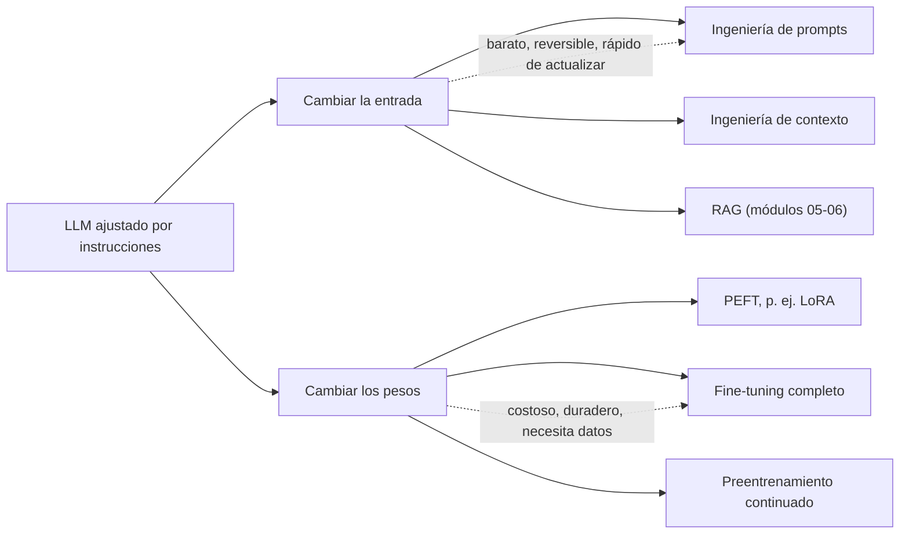
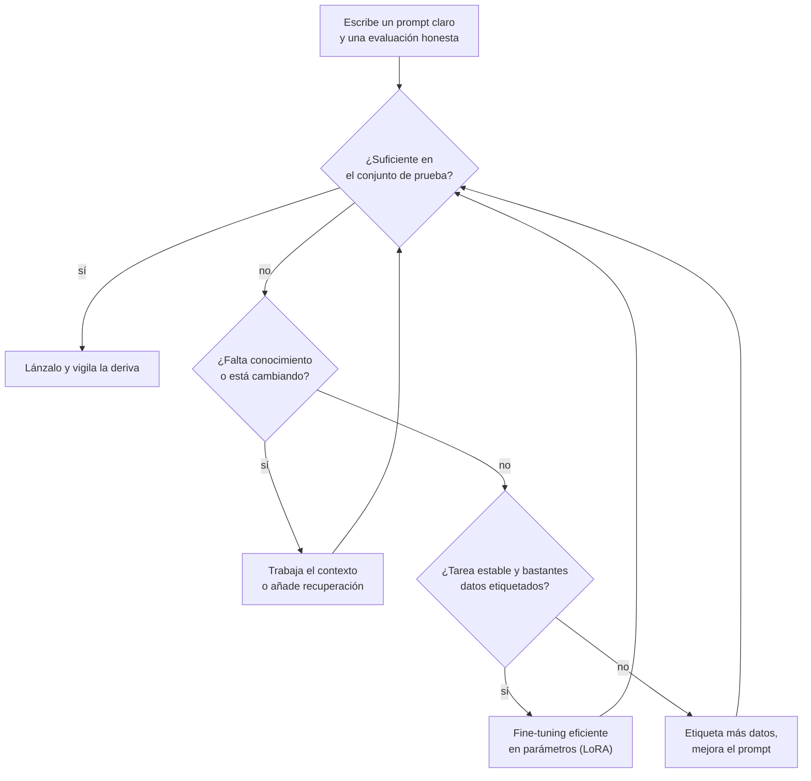
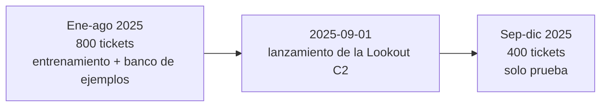
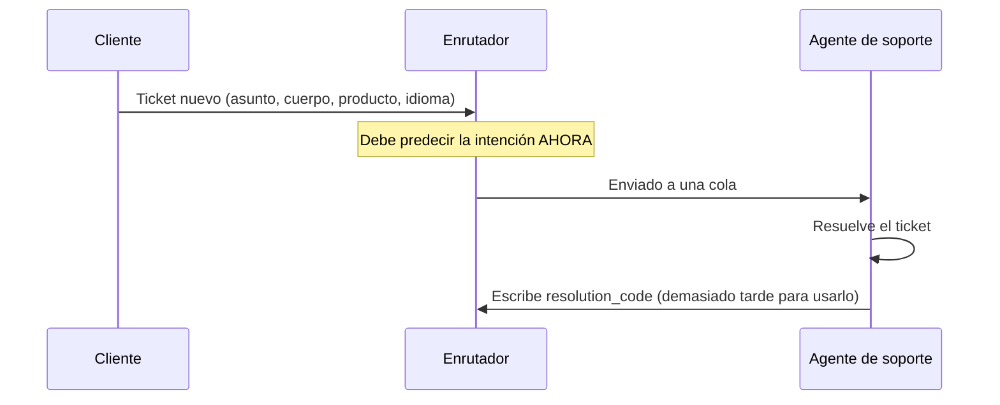
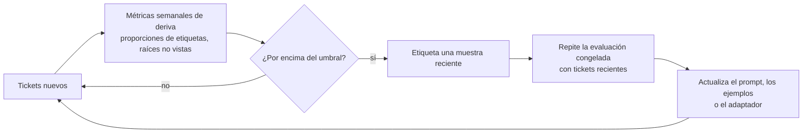

🌐 [English](01-adaptation-techniques.md) · Español

# Lección 4.1 — Elegir cómo adaptar un LLM y medirlo con honestidad

> **Módulo 04 · Lección 1 de 4** · ⏱️ unos 50 min · 🧪 Lab: [pasos 1–2](lab/README.es.md#paso-1--audita-los-tickets)

## 📨 Situación

> **De:** Alex Moreau · Responsable de Operaciones de Atención al Cliente
> **Canal:** #support-ai
>
> ¡Buenos días! Todos los tickets siguen cayendo en una única cola compartida, y alguien del equipo
> pasa el primer minuto de cada uno decidiendo adónde debe ir. La semana pasada mandamos "La cámara se
> queda en 'conectando' desde que la pasé a 5 GHz" al equipo de preguntas de producto, y esa persona
> esperó dos días a que alguien le arreglara el wifi. Tengo 1.224 tickets etiquetados de 2025 con ocho
> intenciones. ¿Puede el modelo que hay detrás del *playground* enrutarlos? Dani ya ha dicho "no antes
> de ver la evaluación", y me recordó que la mitad de las ideas del año pasado parecían brillantes
> hasta que alguien revisó la partición de los datos. ¿Qué probarías primero y cómo sabremos que
> funciona?

## 🎯 Objetivos

Al terminar esta lección puedes:

- Comparar cinco formas de adaptar un modelo de lenguaje grande (LLM, *large language model*) según
  lo que cambian, lo que necesitan y lo rápido que reaccionan a los cambios.
- Elegir una técnica de partida con un marco de decisión basado en los datos, el coste, la latencia,
  la frescura y el control.
- Construir una partición temporal de entrenamiento y prueba, y explicar por qué una partición
  aleatoria sobrestima la exactitud con los tickets de Hearthwise.
- Detectar una fuga del objetivo con una auditoría columna a columna y explicar por qué
  `resolution_code` no debe llegar nunca a un modelo ni a un *prompt*.
- Medir la deriva de concepto tras el lanzamiento de la Lookout C2 con las proporciones de etiquetas y
  el vocabulario no visto.

## 🤔 Predice primero

Apunta tus respuestas antes de seguir leyendo. Las comprobarás en la autoevaluación.

1. El mismo *prompt* se puntúa con una partición aleatoria 80/20 y con una partición por fecha.
   ¿Esperas una diferencia de menos de 2 puntos, de unos 5 puntos o de más de 10 puntos?
2. Una columna de la tabla de tickets predice la intención con un 100 % de exactitud. ¿Es una buena
   noticia?
3. Ayer se lanzó un producto. ¿Qué se adapta antes a su vocabulario nuevo: un modelo con *fine-tuning*
   o un *prompt*?

## 1. Cinco formas de adaptar un modelo

El modelo que conociste en los módulos 01 y 02 se preentrenó con una cantidad enorme de texto y
después se ajustó para seguir instrucciones. Sabe inglés y español, sabe qué es un router wifi y
puede clasificar texto si se lo pides con buenas maneras. Lo que no conoce es *tu* tarea: que
Hearthwise tiene exactamente ocho intenciones, que cuando un ticket menciona dos problemas la etiqueta
la decide "la acción que quiere el cliente", o que la cámara Lookout C2 existe. **Adaptar** un modelo
significa cerrar esa brecha.

Hay dos familias de técnicas. La primera cambia **lo que entra en el modelo** y no toca los pesos. La
segunda cambia **los propios pesos**.

| Técnica | Qué cambia | Qué necesitas | Tiempo para actualizar | Dónde se ve en el curso |
|---|---|---|---|---|
| Ingeniería de *prompts* (*prompt engineering*) | Instrucciones, definiciones de etiquetas, ejemplos, formato de salida | Una tarea clara y unos pocos ejemplos buenos | Minutos | Lección 4.2 |
| Ingeniería de contexto (*context engineering*) | Qué piezas de información entran en la ventana, en qué orden y con qué tamaño | Un proceso de ensamblado y un presupuesto de *tokens* | De minutos a horas | Lección 4.3 |
| Generación aumentada por recuperación (RAG, *retrieval-augmented generation*) | Documentos que se buscan al recibir la pregunta y se pegan en el contexto | Un índice de tus documentos | Lo que tardes en reindexar | Módulos 05–06 |
| Ajuste fino (*fine-tuning*), completo o eficiente en parámetros | Algunos pesos o todos | Ejemplos etiquetados y un trabajo de entrenamiento | De horas a días | Lección 4.4 |
| Preentrenamiento continuado (*continued pre-training*) | Todos los pesos, entrenados con texto en bruto del dominio | Un corpus grande y mucho cómputo | De días a semanas | Solo una visión general |

El ajuste fino eficiente en parámetros (PEFT, *parameter-efficient fine-tuning*) es el punto
intermedio de la familia que toca los pesos: congelas los pesos originales y entrenas un pequeño
complemento. La adaptación de bajo rango (LoRA, *low-rank adaptation*) es uno de los métodos PEFT más
usados, y la construirás desde cero en la lección 4.4.

**Analogía:** piensa en una persona muy capaz que acaba de incorporarse al equipo de soporte. El
*prompting* es la tarjeta plastificada de su mesa ("estas son nuestras ocho colas; aquí tienes tres
tickets resueltos"). La ingeniería de contexto es decidir qué carpeta le das para cada llamada. RAG es
darle acceso al buscador del centro de ayuda. El *fine-tuning* es enviarla a un curso de dos días. El
preentrenamiento continuado es pedirle que estudie electrónica durante un año.



En el lab, la adaptación por el lado de la entrada es literalmente un objeto de configuración.
Ninguna de estas líneas toca un peso:

```python
from m04_adaptation.prompts import PromptConfig

zero_shot = PromptConfig(descriptions="bilingual", k=0)        # label definitions only
few_shot = zero_shot.with_(k=8, selection="similar")          # plus 8 similar solved tickets
with_profile = few_shot.with_(user_context=True)              # plus language, product, channel
```

> ⚠️ **Error común:** empezar por el *fine-tuning* porque suena más serio. Hacer *fine-tuning* sin una
> línea base sólida de *prompt* significa que no puedes saber si el entrenamiento ayudó, y cada cambio
> de etiqueta o de producto exige un entrenamiento nuevo.

## 2. Un marco de decisión: datos, coste, latencia, frescura y control

Ninguna técnica gana en todos los casos. Cinco preguntas deciden cuál probar primero, y conviene
hacerlas en este orden, porque cada una descarta o habilita opciones.

| Pregunta | Favorece el *prompting* y el contexto | Favorece el *fine-tuning* |
|---|---|---|
| **Datos:** ¿cuántos ejemplos limpios y etiquetados tienes? | Unos pocos, o ninguno | Cientos o más, y te fías de las etiquetas |
| **Coste:** ¿dónde prefieres pagar? | Por petición (los *prompts* largos cuestan *tokens* cada vez) | Por adelantado (entrenas una vez y después los *prompts* son más cortos) |
| **Latencia:** ¿qué rapidez necesita cada respuesta? | Presupuestos moderados; los *prompts* largos añaden tiempo antes del primer *token* | Presupuestos ajustados; un modelo ajustado necesita menos instrucciones y ejemplos |
| **Frescura:** ¿cada cuánto cambian las etiquetas, los productos o los hechos? | A menudo: editas el *prompt* o el índice hoy mismo | Rara vez: la tarea es estable durante meses |
| **Control:** ¿qué tienes que garantizar? | Un comportamiento que puedes leer y auditar en texto plano | Un formato, un tono o una habilidad que el *prompt* no consigue de forma fiable |

Aplícalo al enrutador de Alex. *Datos:* 1.224 tickets etiquetados bastan para evaluar cualquier cosa
y para hacer *fine-tuning* de algo pequeño. *Coste y latencia:* los tickets llegan todo el día, así
que los *tokens* por ticket le importan a Sam, que ya vigila el coste en el *playground*. *Frescura:*
Hearthwise lanza productos, y el lanzamiento de la cámara el 2025-09-01 está a punto de enseñarte lo
que eso provoca. *Control:* los tickets contienen números de teléfono y nombres, así que Noor querrá
saber exactamente qué texto sale de la empresa.

El marco no da una respuesta única; da un orden. Empieza por la técnica más barata que podría
funcionar, mídela con honestidad y avanza hacia la derecha de la tabla solo cuando la medición muestre
una brecha que la técnica más barata no puede cerrar. Ese es exactamente el camino que sigue este
módulo.

**Analogía:** no mandarías a alguien que acaba de llegar a un curso de formación antes de haber escrito
siquiera cómo funcionan tus colas. Primero escribes la tarjeta, observas cómo la usa y solo entonces
decides qué debe cubrir el curso.



> 💡 **Consejo de producción:** deja la decisión por escrito en un registro de decisión de arquitectura
> (ADR, *architecture decision record*), con los números que la justificaron. Cuando llegue una
> versión nueva del modelo, podrás volver a ejecutar la misma evaluación y ver si la decisión sigue en
> pie, en lugar de discutir de memoria.

## 3. Primero la evaluación: una partición honesta

Antes de escribir un solo *prompt*, decide cómo lo vas a puntuar. El enrutador funcionará con tickets
que llegan *después* de construirlo, así que el conjunto de prueba tiene que venir de un momento
posterior a todo lo que miraste mientras construías. Una **partición temporal** (*temporal split*)
hace exactamente eso: entrenas (y montas el banco de ejemplos, y usas tus propios ojos) con los tickets
creados antes del 2025-09-01, y pruebas con los tickets de esa fecha en adelante.

Una nota sobre el modelo que vas a medir. El "LLM" por defecto del lab es un **aprendiz en contexto de
juguete** (*toy in-context learner*) conectado al `FakeProvider` del curso. Lee las descripciones de
las etiquetas y los ejemplos resueltos que hay dentro del *prompt* y vota según las palabras que
coinciden. Es transparente, determinista y funciona sin conexión, así que puedes explicar cada
respuesta que da. Un LLM real trae mucho más conocimiento previo, así que sus puntuaciones absolutas
serán distintas. Lo que se traslada sin cambios a un modelo real es el arnés de evaluación que
construyes a su alrededor.

Aquí tienes el mismo *prompt*, descripciones bilingües de las etiquetas más ocho tickets resueltos
parecidos, puntuado de cuatro formas:

| Partición | Entrenamiento | Prueba | Tickets de prueba con una copia exacta en entrenamiento | Exactitud |
|---|---|---|---|---|
| Aleatoria 80/20, filas en bruto | 979 | 245 | 16 | 0.959 |
| Aleatoria 80/20, sin reenvíos | 960 | 240 | 6 | 0.921 |
| Temporal, filas en bruto | 814 | 410 | 13 | 0.820 |
| Temporal, sin reenvíos | 800 | 400 | 11 | 0.828 |

Dos cosas inflan la partición aleatoria. La primera son los **duplicados**: 24 tickets se reenviaron
al día siguiente desde la misma cuenta y con el mismo texto, y una partición aleatoria pone sin
problema el original en entrenamiento y la copia en prueba. Contando todas las cuentas, 51 cuerpos de
ticket repiten uno anterior (mensajes cortos, casi de plantilla, como una simple petición de baja). La
segunda: un conjunto de prueba aleatorio está formado sobre todo por tickets anteriores al lanzamiento
que se parecen mucho a los datos de entrenamiento, mientras que el futuro real está lleno de tickets de
la cámara. Las líneas base compartidas de [`datasets/README.es.md`](../../datasets/README.es.md)
muestran el mismo patrón con un modelo completamente distinto: Naive Bayes obtiene 0.947 con una
partición aleatoria y 0.837 con la temporal.

A partir de aquí, todos los números de este módulo usan los 1.200 tickets que quedan tras quitar las
24 copias reenviadas, y la partición temporal con 800 tickets de entrenamiento y 400 de prueba.

**Analogía:** evaluar a alguien que hace previsiones meteorológicas con días que ya ha visto no es una
previsión. La única prueba justa es mañana.



```python
def temporal_split(tickets: list[Ticket], cutoff: str = LAUNCH_DATE) -> tuple[list[Ticket], list[Ticket]]:
    """Train on the past, test on the future: everything before ``cutoff`` vs the rest."""
    train = [t for t in tickets if t.created_at < cutoff]
    test = [t for t in tickets if t.created_at >= cutoff]
    return train, test
```

> ⚠️ **Error común:** mejorar el *prompt* leyendo los tickets de prueba en los que falla. Tras unas
> cuantas rondas, el conjunto de prueba se ha convertido en un conjunto de entrenamiento y la
> puntuación no significa nada. Guarda un segmento de desarrollo aparte para trabajar el *prompt* o, al
> menos, congela el conjunto de prueba y míralo muy de vez en cuando.

> 💡 **Consejo de producción:** limpia antes de evaluar. En los tickets en bruto, 82 cuerpos contienen
> un número de teléfono, 205 terminan con una firma y 142 arrastran un correo anterior citado. La
> función `clean_text` del lab quita las citas y las firmas y sustituye los teléfonos y las direcciones
> de correo por marcadores, lo que de paso responde a la pregunta de Noor del módulo 03 sobre qué sale
> de la empresa.

## 4. Fuga del objetivo: la columna que sabe la respuesta

Cada ticket tiene un `resolution_code`, como `RC-NET` o `RC-RMA`. Parece un metadato inofensivo, pero
alguien del equipo de soporte lo escribe *después* de resolver el ticket, y corresponde uno a uno con
la intención. Un modelo que lo ve no enruta tickets; lee la hoja de respuestas. Esto es una **fuga del
objetivo** (*target leakage*): información en los datos de entrenamiento o de prueba que no existiría
en el momento de predecir.

Una forma rápida de encontrar fugas es una **auditoría columna a columna** (*single-column audit*):
para cada columna, aprende en el conjunto de entrenamiento la regla "este valor suele significar esta
intención" y puntúala en el conjunto de prueba.

| Columna | Valores distintos en entrenamiento | Exactitud por sí sola | ¿Se conoce cuando llega el ticket? |
|---|---|---|---|
| `channel` | 3 | 0.120 | sí |
| `language` | 2 | 0.125 | sí |
| `product` | 5 | 0.125 | sí |
| `customer_email` | 763 | 0.113 | sí |
| `resolution_code` | 8 | 1.000 | **no** |

Como referencia, predecir siempre la intención más común del entrenamiento da 0.120. Cuatro columnas
no mejoran eso; una es perfecta. Una sola columna perfecta nunca es una buena noticia. Es una pregunta:
*¿cuándo* se escribe ese valor, y quién lo escribe?

Las fugas también viajan a través de los *prompts*. Si pegas el código en la línea de "contexto del
cliente" del *prompt*, la exactitud del aprendiz de juguete en la prueba temporal salta de 0.828 a
0.920, porque los ejemplos con el mismo código de repente se parecen muchísimo a la consulta. Un LLM
real lo aprovecharía con el mismo entusiasmo. La métrica parecería maravillosa justo hasta el día en
que el enrutador se ejecuta con un ticket recién llegado, cuando el código todavía no existe.

**Analogía:** juzgar la capacidad de diagnóstico de un equipo médico dejándole leer antes el informe
de alta.



```python
def single_column_accuracy(train: list[Ticket], test: list[Ticket], column: str) -> float:
    """Learn 'value -> most common label' on train; unseen values get the overall majority."""
    by_value: dict[str, Counter[str]] = defaultdict(Counter)
    for t in train:
        by_value[getattr(t, column)][t.intent] += 1
    fallback = Counter(t.intent for t in train).most_common(1)[0][0]
    rule = {value: counts.most_common(1)[0][0] for value, counts in by_value.items()}
    hits = sum(rule.get(getattr(t, column), fallback) == t.intent for t in test)
    return round(hits / len(test), 3)
```

> ⚠️ **Error común:** quitar la columna con fuga del modelo pero dejarla en el banco de ejemplos, en el
> índice de recuperación o en el "contexto del cliente" del *prompt*. Audita cada camino que llega a la
> ventana de contexto, no solo la lista de variables.

> 💡 **Consejo de producción:** mantén por escrito la lista de campos que existen en el momento de
> predecir (un pequeño contrato de datos) y haz que el constructor del *prompt* acepte solo esos
> campos. El diccionario `KNOWN_AT_PREDICTION_TIME` del lab es una versión mínima de esa idea.

## 5. Deriva de concepto: el mundo se mueve después de medir

El 2025-09-01 Hearthwise empezó a vender la cámara Lookout C2. Nada en los tickets de enero a agosto
habla de la vista en directo, de luces de estado naranjas ni de visión nocturna. Cambian dos cosas a
la vez:

| Señal | Antes del lanzamiento | Después del lanzamiento |
|---|---|---|
| Proporción de tickets `connectivity_issue` | 0.139 | 0.278 |
| Proporción de tickets `order_status` | 0.181 | 0.120 |
| Proporción de tickets `return_request` | 0.155 | 0.095 |
| Tickets de prueba sobre la Lookout C2 | ninguno | 0.395 de todos los tickets de prueba |

El vocabulario también se mueve. Toma como referencia todas las raíces de palabras (*word stems*)
vistas en los tickets de enero a julio. En agosto, el mes justo antes del lanzamiento, la proporción de
raíces no vistas es 0.000. Después del lanzamiento es 0.186, y solo en los tickets de la cámara es
0.465: casi la mitad de lo que escribe esa clientela es nuevo.

El primer cambio es un desplazamiento en la **mezcla de etiquetas** (los problemas de conectividad se
duplicaron). El segundo es un desplazamiento en las **entradas** (palabras nuevas para problemas
nuevos). A todo esto junto se le llama **deriva de concepto** (*concept drift*): la relación entre lo
que escribe la clientela y la cola correcta ya no es la que mediste. El ticket de la cámara mal
enrutado de Alex es un síntoma. La expresión "5 GHz" antes aparecía en preguntas de producto ("¿El
Glow A19 es compatible con el wifi de 5 GHz?"); ahora aparece en fallos de conexión, y cualquier
sistema que aprendió de los tickets antiguos se ve arrastrado en la dirección equivocada.
Reproducirás exactamente ese error en la siguiente lección.

La deriva es el argumento más fuerte de la fila de frescura del marco de decisión. Un *prompt* puede
aprender el vocabulario nuevo de la cámara esa misma tarde; un modelo con *fine-tuning* necesita
tickets etiquetados posteriores al lanzamiento y un entrenamiento. La lección 4.4 mide las dos cosas.

**Analogía:** un mapa de carreteras impreso antes de que abrieran una autopista nueva. Todas las
carreteras que aparecen siguen siendo correctas, y aun así te manda por el camino largo.



```python
def oov_rate(reference: list[Ticket], rows: list[Ticket]) -> float:
    """Share of word stems in ``rows`` that never appear in ``reference``."""
    vocab: set[str] = set()
    for t in reference:
        vocab |= stems(clean_text(t.body))
    total = unseen = 0
    for t in rows:
        s = stems(clean_text(t.body))
        total += len(s)
        unseen += len(s - vocab)
    return round(unseen / total, 3) if total else 0.0
```

> 💡 **Consejo de producción:** la tasa de vocabulario no visto no necesita etiquetas, así que puedes
> calcularla en tiempo real con los tickets del día. Un salto repentino suele ser la primera señal de
> un lanzamiento, una caída del servicio o una estafa nueva, días antes de que lo reflejen los informes
> de exactitud.

## 🧪 Pruébalo

1. Prepara el lab y ejecuta los tests (el tiempo es un ejemplo y varía según la máquina):

   ```bash
   cd modules/04-prompting-context-and-fine-tuning/lab
   uv sync
   uv run pytest
   ```

   ```text
   81 passed, 5 skipped in 16.18s
   ```

   Los cinco tests omitidos son cuatro ejercicios que todavía no has escrito y un test con un modelo
   real.

2. Audita los tickets: duplicados, datos personales, columnas con fugas y deriva.

   ```bash
   uv run lab audit
   ```

   ```text
   Ticket audit
   ------------
   rows: 1224 · resubmitted copies: 24 · repeated bodies (any customer): 51
   after removing resubmissions: 1200 · temporal split: train 800 (before 2025-09-01) / test 400
   personal data and noise in bodies: phone_number 82, email_address 0, signature 205, quoted_reply 142, html_entity 23

   Can one column predict the intent? (rule learned on train, scored on test)
   --------------------------------------------------------------------------
   column           values  accuracy  known when the ticket arrives?
   channel               3     0.120  yes
   language              2     0.125  yes
   product               5     0.125  yes
   customer_email      763     0.113  yes
   resolution_code       8     1.000  NO  <- leak: filled in after the ticket is solved
   majority-class baseline on test: 0.120

   Drift after the Lookout C2 launch
   ---------------------------------
   intent                before   after
   order_status           0.181   0.120
   return_request         0.155   0.095
   warranty_claim         0.081   0.087
   connectivity_issue     0.139   0.278
   billing_question       0.133   0.120
   account_access         0.111   0.110
   product_question       0.138   0.125
   cancel_subscription    0.062   0.065
   Lookout C2 share of test tickets: 0.395
   unseen word stems vs Jan-Jul vocabulary: August 0.000 · after launch 0.186 · camera tickets 0.465
   ```

3. Compara diseños de evaluación con el mismo *prompt*.

   ```bash
   uv run lab splits
   ```

   ```text
   Same prompt (bilingual descriptions + 8 similar examples), different evaluation designs
   ---------------------------------------------------------------------------------------
   split                          train  test overlap accuracy
   random 80/20, raw rows           979   245      16    0.959
   random 80/20, deduplicated       960   240       6    0.921
   temporal, raw rows               814   410      13    0.820
   temporal, deduplicated           800   400      11    0.828
   temporal + resolution_code       800   400      11    0.920
   overlap = test tickets whose exact text also appears in train
   ```

4. Implementa `flag_leaky_columns` en `src/m04_adaptation/exercises.py` y después ejecuta
   `uv run pytest tests/test_exercises.py -k leaky`. El test pasa cuando tu función marca tanto una
   columna que no se conoce en el momento de predecir como una columna demasiado buena para ser verdad.

## 🏭 En el mundo real

- **Conjuntos de prueba congelados más una ventana móvil.** Los equipos mantienen un conjunto de
  prueba versionado que nunca cambia (para que los resultados sigan siendo comparables durante meses) y
  un segundo conjunto pequeño de tickets recientes etiquetados que se renueva cada pocas semanas (para
  que la deriva salga a la luz). Un *prompt* o un adaptador tiene que superar los dos.
- **Comprobaciones de fugas en el proceso.** La auditoría columna a columna es lo bastante barata como
  para ejecutarla en integración continua. Cualquier columna por encima de un umbral bloquea la
  compilación hasta que alguien confirme que se conoce en el momento de predecir.
- **Los duplicados entre particiones** son la razón más común de que una puntuación obtenida sin
  conexión no se mantenga en producción. Deduplica primero por texto exacto, después por similitud de
  casi duplicados, y parte siempre por cliente o por tiempo, no por fila.
- **El coste de evaluar.** Con un modelo de pago, cada ejecución de la evaluación cuesta *tokens*. Los
  equipos toman una submuestra fija para las iteraciones rápidas y ejecutan el conjunto completo antes
  de cada versión.
- **Una persona de respaldo.** Incluso un enrutador fuerte envía las respuestas dudosas o no válidas a
  una cola de triaje humano. Vigila con qué frecuencia ocurre; una tasa creciente es otra señal de
  deriva.

## ✅ Autoevaluación

**1. Volvamos a la predicción 1: ¿qué diferencia hubo entre la partición aleatoria y la temporal, y
qué la causó?**

<details><summary>Respuesta</summary>

Con las filas en bruto, el mismo *prompt* obtuvo 0.959 con una partición aleatoria y 0.820 con la
temporal: más de 10 puntos. Una parte se debe a los duplicados (16 tickets de prueba tenían una copia
exacta en entrenamiento) y otra a la deriva: el conjunto de prueba aleatorio son sobre todo tickets
anteriores al lanzamiento, mientras que en el futuro real 0.395 de los tickets son de la cámara. Quitar
los 24 reenvíos baja la puntuación aleatoria a 0.921, pero sigue muy por encima del 0.828 temporal, así
que la deduplicación por sí sola no hace honesta una partición aleatoria.

</details>

**2. Volvamos a la predicción 2: una columna predice la intención a la perfección. ¿Qué haces?**

<details><summary>Respuesta</summary>

La tratas como una posible fuga y preguntas cuándo se escribe el valor. `resolution_code` llegó a
1.000 porque el equipo de soporte lo rellena después de resolver el ticket. No lo puede usar un
enrutador que debe decidir antes de que nadie haya trabajado en el ticket, así que lo quitas de las
variables, de los bancos de ejemplos, de los índices de recuperación y de los *prompts*. "Perfecto" es
una señal de alarma, no un resultado.

</details>

**3. Alguien del equipo quita `resolution_code` de la tabla de entrenamiento pero lo añade al contexto
del cliente del *prompt* "porque al modelo le puede ser útil". ¿Qué le pasa a la puntuación y por qué
sigue estando mal?**

<details><summary>Respuesta</summary>

La exactitud del aprendiz de juguete sube de 0.828 a 0.920 en la prueba temporal, porque los ejemplos
con el mismo código se parecen más a la consulta. La puntuación sigue sin significar nada: en
producción el código no existe cuando llega el ticket, así que el enrutador perdería esa ayuda el
primer día. Una fuga depende de lo que existe en el momento de predecir, entre por donde entre el
valor.

</details>

**4. ¿Qué señales de la auditoría muestran deriva y cuáles puedes calcular sin etiquetas?**

<details><summary>Respuesta</summary>

La mezcla de etiquetas se movió (`connectivity_issue` pasó de 0.139 a 0.278) y el vocabulario también
(las raíces no vistas pasaron de 0.000 en agosto a 0.186 tras el lanzamiento, y a 0.465 en los tickets
de la cámara). Las proporciones de etiquetas necesitan etiquetas, así que llegan tarde. La tasa de
raíces no vistas solo necesita el texto en bruto, así que puedes vigilarla a diario.

</details>

**5. Volvamos a la predicción 3: con un producto lanzado ayer, ¿por qué el marco de decisión favorece
el *prompting* frente al *fine-tuning*?**

<details><summary>Respuesta</summary>

Por la frescura. Un *prompt* puede describir los síntomas del producto nuevo en menos de una hora. El
*fine-tuning* necesita tickets etiquetados sobre el producto nuevo, que todavía no existen, además de
un entrenamiento y una evaluación nueva. Más adelante el *fine-tuning* aún puede ganar, cuando la
tarea sea estable y se hayan acumulado datos, y eso es lo que mide la lección 4.4.

</details>

## 💬 Explícalo con tus palabras

- Alex quiere poner "95,9 % de exactitud" en una diapositiva para la reunión de dirección de soporte.
  En tres o cuatro frases, explícale qué número debería ir en la diapositiva y por qué.
- Explícale a Dani cómo detectarías una columna con fuga en un dataset nuevo que nunca has visto, sin
  saber nada de cómo se recogió.

## 🔑 Ideas clave

- La adaptación se hace por el lado de la entrada (*prompts*, contexto, recuperación) o por el lado de
  los pesos (PEFT, *fine-tuning* completo, preentrenamiento continuado); el lado de la entrada es más
  barato y más rápido de actualizar.
- Pregunta por los datos, el coste, la latencia, la frescura y el control, empieza por la técnica más
  barata que podría funcionar y avanza solo cuando una evaluación honesta muestre una brecha.
- Construye primero la evaluación. Para cualquier cosa que vaya a funcionar con datos futuros, parte
  por tiempo y quita los duplicados antes de partir.
- Una columna que predice la etiqueta a la perfección es una fuga mientras no se demuestre lo
  contrario; las fugas pueden entrar por los *prompts* y los bancos de ejemplos, no solo por las
  variables.
- La deriva aparece como una mezcla de etiquetas distinta y vocabulario nuevo; la tasa de palabras no
  vistas no necesita etiquetas.

## 📚 Profundiza

- ⭐ [Language Models are Few-Shot Learners (GPT-3)](https://arxiv.org/abs/2005.14165) — el artículo
  que mostró el aprendizaje en contexto a gran escala y lo comparó directamente con el *fine-tuning*;
  lee la introducción y la discusión de las limitaciones.
- [LoRA: Low-Rank Adaptation of Large Language Models](https://arxiv.org/abs/2106.09685) — la técnica
  del lado de los pesos que construirás en la lección 4.4.
- [Retrieval-Augmented Generation for Knowledge-Intensive NLP Tasks](https://arxiv.org/abs/2005.11401)
  — el artículo original de RAG, un adelanto de los módulos 05 y 06.
- [Holistic Evaluation of Language Models (HELM)](https://arxiv.org/abs/2211.09110) — por qué un único
  número de exactitud nunca cuenta toda la historia y cómo informar de varios.
- [Documentación de Hugging Face PEFT](https://huggingface.co/docs/peft) — la biblioteca de código
  abierto que usan la mayoría de los equipos para el ajuste fino eficiente en parámetros.

---

[← Anterior: Presentación del módulo 04](README.es.md) · [🏠 Módulo 04](README.es.md) · [Siguiente: 4.2 Ingeniería de *prompts* →](02-prompt-engineering.es.md)
