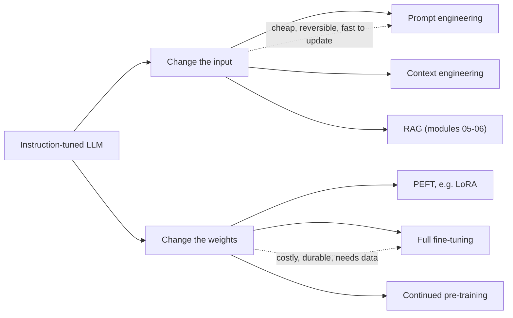
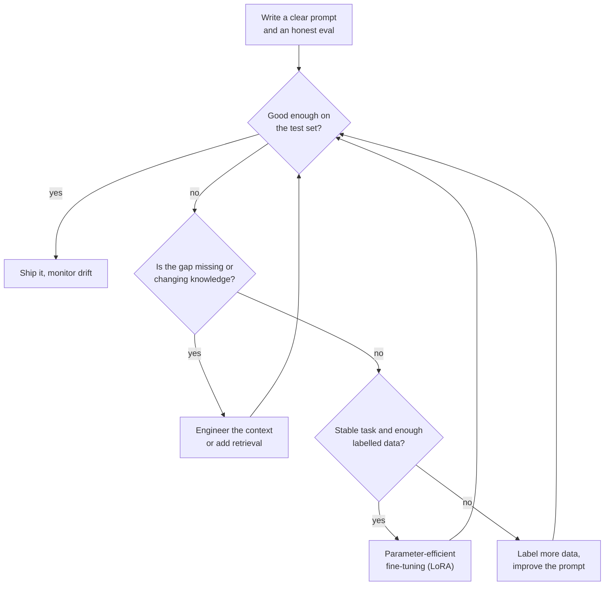
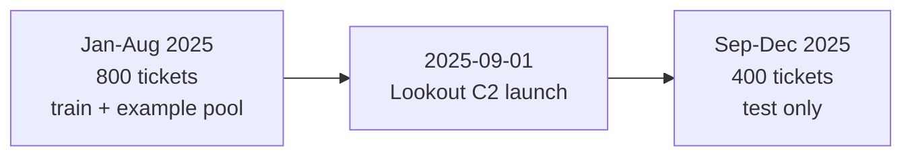
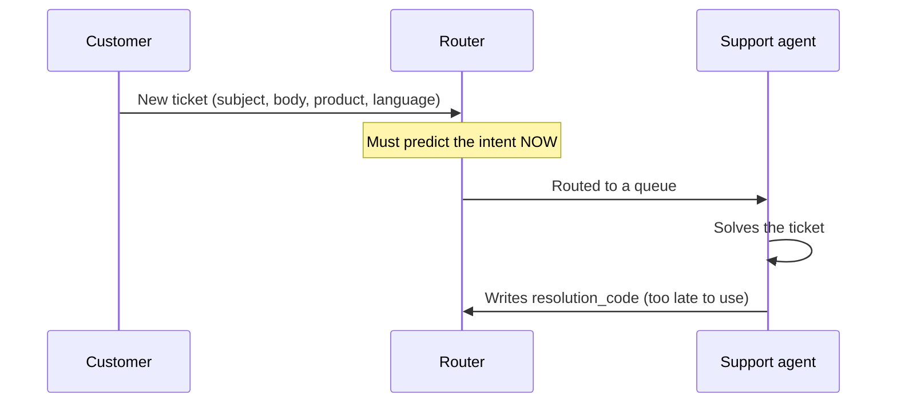
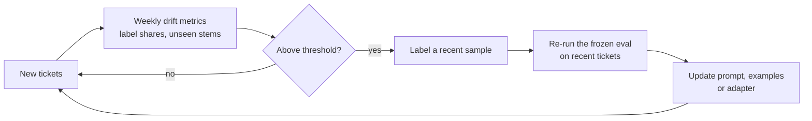

🌐 English · [Español](01-adaptation-techniques.es.md)

# Lesson 4.1 — Choosing how to adapt an LLM, and measuring it honestly

> **Module 04 · Lesson 1 of 4** · ⏱️ about 50 min · 🧪 Lab: [steps 1–2](lab/README.md#step-1--audit-the-tickets)

## 📨 Situation

> **From:** Alex Moreau · Customer Support Operations Lead
> **Channel:** #support-ai
>
> Morning! Every ticket still lands in one shared queue, and an agent spends the first minute of each
> one deciding where it should go. Last week we sent "La cámara se queda en 'conectando' desde que la
> pasé a 5 GHz" to the product-questions team, and the customer waited two days for a Wi-Fi fix. I
> have 1,224 labelled tickets from 2025 with eight intents. Can the model behind the playground route
> them for us? Dani already said "not before I see the eval", and reminded me that half of last
> year's ideas looked brilliant until someone checked the split. What would you try first, and how
> will we know it works?

## 🎯 Objectives

By the end of this lesson you can:

- Compare five ways to adapt a large language model (LLM) by what they change, what they need and how
  fast they react to change.
- Choose a starting technique with a decision framework built on data, cost, latency, freshness and
  control.
- Build a temporal train/test split and explain why a random split overstates accuracy on the
  Hearthwise tickets.
- Detect a target leak with a single-column audit and explain why `resolution_code` must never reach
  a model or a prompt.
- Measure concept drift after the Lookout C2 launch with label shares and unseen vocabulary.

## 🤔 Predict first

Write your answers down before reading on. You will check them in the self-check.

1. The same prompt is scored on a random 80/20 split and on a split by date. Do you expect the gap to
   be under 2 points, about 5 points, or more than 10 points?
2. One column of the ticket table predicts the intent with 100% accuracy. Is that good news?
3. A product launched yesterday. Which adapts faster to its new vocabulary: a fine-tuned model or a
   prompt?

## 1. Five ways to adapt a model

The model you met in modules 01 and 02 was pre-trained on a huge amount of text and then tuned to
follow instructions. It knows English and Spanish, it knows what a Wi-Fi router is, and it can
classify text if you ask nicely. What it does not know is *your* task: that Hearthwise has exactly
eight intents, that "the action the customer wants" decides the label when a ticket mentions two
problems, or that the Lookout C2 camera exists at all. **Adapting** a model means closing that gap.

There are two families of techniques. The first changes **what goes into the model** and leaves the
weights alone. The second changes **the weights themselves**.

| Technique | What changes | What you need | Time to update | Where in the course |
|---|---|---|---|---|
| Prompt engineering | Instructions, label definitions, examples, output format | A clear task and a few good examples | Minutes | Lesson 4.2 |
| Context engineering | Which pieces of information enter the window, in what order and size | An assembly pipeline and a token budget | Minutes to hours | Lesson 4.3 |
| Retrieval-augmented generation (RAG) | Documents fetched at question time and pasted into the context | An index of your documents | As fast as you re-index | Modules 05–06 |
| Fine-tuning (full or parameter-efficient) | Some or all of the weights | Labelled examples and a training job | Hours to days | Lesson 4.4 |
| Continued pre-training | All the weights, trained on raw domain text | A large corpus and a lot of compute | Days to weeks | Overview only |

Parameter-efficient fine-tuning (PEFT) is the middle ground of the weight-side family: you freeze the
original weights and train a small add-on. Low-rank adaptation (LoRA) is one of the most widely used
PEFT methods, and you will build it from scratch in lesson 4.4.

**Analogy:** think of a capable new hire on the support team. Prompting is the laminated card on
their desk ("these are our eight queues; here are three solved tickets"). Context engineering is
deciding which folder you hand them for each call. RAG is giving them search access to the help
centre. Fine-tuning is sending them on a two-day course. Continued pre-training is asking them to
study electronics for a year.



In the lab, input-side adaptation is literally a configuration object. None of these lines touches
a weight:

```python
from m04_adaptation.prompts import PromptConfig

zero_shot = PromptConfig(descriptions="bilingual", k=0)        # label definitions only
few_shot = zero_shot.with_(k=8, selection="similar")          # plus 8 similar solved tickets
with_profile = few_shot.with_(user_context=True)              # plus language, product, channel
```

> ⚠️ **Common mistake:** starting with fine-tuning because it sounds more serious. Fine-tuning
> without a strong prompt baseline means you cannot tell whether the training helped, and every
> change of label or product now needs a new training run.

## 2. A decision framework: data, cost, latency, freshness, control

No technique wins everywhere. Five questions decide which one to try first, and they are worth
asking in this order because each one rules options in or out.

| Question | Favours prompting and context | Favours fine-tuning |
|---|---|---|
| **Data:** how many clean, labelled examples do you have? | A handful, or none | Hundreds or more, and you trust the labels |
| **Cost:** where do you want to pay? | Per request (longer prompts cost tokens every time) | Up front (training once, shorter prompts afterwards) |
| **Latency:** how fast must each answer be? | Moderate budgets; long prompts add time before the first token | Tight budgets; a tuned model needs fewer instructions and examples |
| **Freshness:** how often do labels, products or facts change? | Often: edit the prompt or the index today | Rarely: the task is stable for months |
| **Control:** what must you guarantee? | Behaviour you can read and audit in plain text | A format, tone or skill the prompt cannot reliably produce |

Apply it to Alex's router. *Data:* 1,224 labelled tickets is enough to evaluate anything and to
fine-tune something small. *Cost and latency:* tickets arrive all day, so the tokens per ticket
matter to Sam, who already watches cost in the playground. *Freshness:* Hearthwise launches products,
and the camera launch on 2025-09-01 is about to show you what that does. *Control:* tickets contain
phone numbers and names, so Noor will want to know exactly what text leaves the building.

The framework does not give one answer; it gives an order. Start with the cheapest technique that
could work, measure it honestly, and move right in the table only when the measurement shows a gap
that the cheaper technique cannot close. That is exactly the path this module follows.

**Analogy:** you would not send a new colleague on a training course before you have even written
down how your queues work. You write the card first, watch them use it, and only then decide what
the course should cover.



> 💡 **Production tip:** write the decision down in an architecture decision record (ADR), with the
> numbers that justified it. When a new model version arrives, you can rerun the same eval and see
> whether the decision still holds instead of arguing from memory.

## 3. Evaluation first: an honest split

Before you write a single prompt, decide how you will score it. The router will run on tickets that
arrive *after* you build it, so the test set must come from later in time than everything you looked
at while building. A **temporal split** does exactly that: train (and example pool, and your own
eyes) on tickets created before 2025-09-01, test on tickets from that date onwards.

A note on the model you will measure. The lab's default "LLM" is a **toy in-context learner** plugged
into the course's `FakeProvider`. It reads the label descriptions and the solved examples inside the
prompt and votes by word overlap. It is transparent, deterministic and offline, so you can explain
every answer it gives. A real LLM brings far more prior knowledge, so its absolute scores will differ.
The evaluation harness you build around it is what carries over unchanged to a real model.

Here is the same prompt, bilingual label descriptions plus eight similar solved tickets, scored four
ways:

| Split | Train | Test | Test tickets with an exact copy in train | Accuracy |
|---|---|---|---|---|
| Random 80/20, raw rows | 979 | 245 | 16 | 0.959 |
| Random 80/20, resubmissions removed | 960 | 240 | 6 | 0.921 |
| Temporal, raw rows | 814 | 410 | 13 | 0.820 |
| Temporal, resubmissions removed | 800 | 400 | 11 | 0.828 |

Two things inflate the random split. First, **duplicates**: 24 tickets were resubmitted the next day
by the same customer with the same text, and a random split happily puts the original in train and
the copy in test. Across all customers, 51 ticket bodies repeat an earlier one (short template-like
messages such as a plain cancellation request). Second, a random test set is mostly pre-launch
tickets that look just like the training data, while the real future is full of camera tickets. The
shared baselines in [`datasets/README.md`](../../datasets/README.md) show the same pattern with a
completely different model: Naive Bayes scores 0.947 on a random split and 0.837 on the temporal one.

From now on every number in this module uses the 1,200 tickets that remain after removing the 24
resubmitted copies, and the temporal split with 800 training and 400 test tickets.

**Analogy:** grading a weather forecaster on days they have already seen is not a forecast. The only
fair test is tomorrow.



```python
def temporal_split(tickets: list[Ticket], cutoff: str = LAUNCH_DATE) -> tuple[list[Ticket], list[Ticket]]:
    """Train on the past, test on the future: everything before ``cutoff`` vs the rest."""
    train = [t for t in tickets if t.created_at < cutoff]
    test = [t for t in tickets if t.created_at >= cutoff]
    return train, test
```

> ⚠️ **Common mistake:** improving the prompt by reading the test tickets it gets wrong. After a few
> rounds the test set has become a training set and the score means nothing. Keep a separate
> development slice for prompt work, or at least freeze the test set and look at it rarely.

> 💡 **Production tip:** clean before you evaluate. In the raw tickets, 82 bodies contain a phone
> number, 205 end in a signature and 142 carry a quoted earlier e-mail. The lab's `clean_text` strips
> quotes and signatures and replaces phone numbers and e-mail addresses with placeholders, which
> also answers Noor's question from module 03 about what leaves the building.

## 4. Target leakage: the column that knows the answer

Every ticket has a `resolution_code` such as `RC-NET` or `RC-RMA`. It looks like harmless metadata,
but an agent types it in *after* solving the ticket, and it maps one-to-one onto the intent. A model
that sees it does not route tickets; it reads the answer key. This is **target leakage**: information
in the training or test data that would not exist at the moment of prediction.

A quick way to find leaks is a **single-column audit**: for each column, learn the rule "this value
usually means this intent" on the training set and score it on the test set.

| Column | Distinct values in train | Accuracy alone | Known when the ticket arrives? |
|---|---|---|---|
| `channel` | 3 | 0.120 | yes |
| `language` | 2 | 0.125 | yes |
| `product` | 5 | 0.125 | yes |
| `customer_email` | 763 | 0.113 | yes |
| `resolution_code` | 8 | 1.000 | **no** |

For comparison, always predicting the most common training intent scores 0.120. Four columns are no
better than that; one is perfect. A perfect single column is never good news. It is a question:
*when* is this value written, and by whom?

Leaks also travel through prompts. If you paste the code into the prompt's "customer context" line,
the toy learner's accuracy on the temporal test jumps from 0.828 to 0.920, because examples with the
same code suddenly look very similar to the query. A real LLM would exploit it just as happily. The
metric would look wonderful right up to the day the router runs on a brand-new ticket, where the code
does not exist yet.

**Analogy:** judging a doctor's diagnostic skill by letting them read the discharge letter first.



```python
def single_column_accuracy(train: list[Ticket], test: list[Ticket], column: str) -> float:
    """Learn 'value -> most common label' on train; unseen values get the overall majority."""
    by_value: dict[str, Counter[str]] = defaultdict(Counter)
    for t in train:
        by_value[getattr(t, column)][t.intent] += 1
    fallback = Counter(t.intent for t in train).most_common(1)[0][0]
    rule = {value: counts.most_common(1)[0][0] for value, counts in by_value.items()}
    hits = sum(rule.get(getattr(t, column), fallback) == t.intent for t in test)
    return round(hits / len(test), 3)
```

> ⚠️ **Common mistake:** dropping the leaky column from the model but keeping it in the example
> pool, the retrieval index or the "customer context" of the prompt. Audit every path into the
> context window, not just the feature list.

> 💡 **Production tip:** keep a written list of the fields that exist at prediction time (a small
> data contract) and make the prompt builder accept only those fields. The lab's
> `KNOWN_AT_PREDICTION_TIME` dictionary is a minimal version of that idea.

## 5. Concept drift: the world moves after you measure

On 2025-09-01 Hearthwise started selling the Lookout C2 camera. Nothing in the January–August
tickets talks about live view, orange status lights or night vision. Two things change at once:

| Signal | Before the launch | After the launch |
|---|---|---|
| Share of `connectivity_issue` tickets | 0.139 | 0.278 |
| Share of `order_status` tickets | 0.181 | 0.120 |
| Share of `return_request` tickets | 0.155 | 0.095 |
| Test tickets about the Lookout C2 | none | 0.395 of all test tickets |

The vocabulary moves too. Take every word stem seen in January–July tickets as the reference. In
August, the month just before the launch, the share of unseen stems is 0.000. After the launch it is
0.186, and in camera tickets alone it is 0.465: almost half of what those customers write is new.

The first change is a shift in the **label mix** (connectivity problems doubled). The second is a
shift in the **inputs** (new words for new problems). Together people call this **concept drift**:
the relationship between what customers write and the right queue is no longer the one you measured.
Alex's misrouted camera ticket is a symptom. The phrase "5 GHz" used to appear in product questions
("¿El Glow A19 es compatible con el wifi de 5 GHz?"); now it shows up in connection failures, and any system that
learned from the old tickets is pulled the wrong way. You will reproduce that exact mistake in the
next lesson.

Drift is the strongest argument in the freshness row of the decision framework. A prompt can learn
the new camera vocabulary the same afternoon; a fine-tuned model needs labelled post-launch tickets
and a training run. Lesson 4.4 measures both.

**Analogy:** a road map printed before a new motorway opened. Every road on it is still correct, and
it still sends you the long way round.



```python
def oov_rate(reference: list[Ticket], rows: list[Ticket]) -> float:
    """Share of word stems in ``rows`` that never appear in ``reference``."""
    vocab: set[str] = set()
    for t in reference:
        vocab |= stems(clean_text(t.body))
    total = unseen = 0
    for t in rows:
        s = stems(clean_text(t.body))
        total += len(s)
        unseen += len(s - vocab)
    return round(unseen / total, 3) if total else 0.0
```

> 💡 **Production tip:** the unseen-vocabulary rate needs no labels, so you can compute it on the
> day's tickets in real time. A sudden jump is often the first sign of a launch, an outage or a new
> scam, days before accuracy reports catch up.

## 🧪 Try it

1. Set up the lab and run the tests (the time is an example and varies by machine):

   ```bash
   cd modules/04-prompting-context-and-fine-tuning/lab
   uv sync
   uv run pytest
   ```

   ```text
   81 passed, 5 skipped in 16.18s
   ```

   The five skipped tests are four exercises you have not written yet and one live-model test.

2. Audit the tickets: duplicates, personal data, leaky columns and drift.

   ```bash
   uv run lab audit
   ```

   ```text
   Ticket audit
   ------------
   rows: 1224 · resubmitted copies: 24 · repeated bodies (any customer): 51
   after removing resubmissions: 1200 · temporal split: train 800 (before 2025-09-01) / test 400
   personal data and noise in bodies: phone_number 82, email_address 0, signature 205, quoted_reply 142, html_entity 23

   Can one column predict the intent? (rule learned on train, scored on test)
   --------------------------------------------------------------------------
   column           values  accuracy  known when the ticket arrives?
   channel               3     0.120  yes
   language              2     0.125  yes
   product               5     0.125  yes
   customer_email      763     0.113  yes
   resolution_code       8     1.000  NO  <- leak: filled in after the ticket is solved
   majority-class baseline on test: 0.120

   Drift after the Lookout C2 launch
   ---------------------------------
   intent                before   after
   order_status           0.181   0.120
   return_request         0.155   0.095
   warranty_claim         0.081   0.087
   connectivity_issue     0.139   0.278
   billing_question       0.133   0.120
   account_access         0.111   0.110
   product_question       0.138   0.125
   cancel_subscription    0.062   0.065
   Lookout C2 share of test tickets: 0.395
   unseen word stems vs Jan-Jul vocabulary: August 0.000 · after launch 0.186 · camera tickets 0.465
   ```

3. Compare evaluation designs with the same prompt.

   ```bash
   uv run lab splits
   ```

   ```text
   Same prompt (bilingual descriptions + 8 similar examples), different evaluation designs
   ---------------------------------------------------------------------------------------
   split                          train  test overlap accuracy
   random 80/20, raw rows           979   245      16    0.959
   random 80/20, deduplicated       960   240       6    0.921
   temporal, raw rows               814   410      13    0.820
   temporal, deduplicated           800   400      11    0.828
   temporal + resolution_code       800   400      11    0.920
   overlap = test tickets whose exact text also appears in train
   ```

4. Implement `flag_leaky_columns` in `src/m04_adaptation/exercises.py`, then run
   `uv run pytest tests/test_exercises.py -k leaky`. The test passes once your function flags both
   a column that is unknown at prediction time and a column that is too good to be true.

## 🏭 In the real world

- **Frozen test sets plus a rolling window.** Teams keep one versioned test set that never changes
  (so results stay comparable over months) and a second, small set of recent labelled tickets that
  is refreshed every few weeks (so drift shows up). A prompt or adapter must pass both.
- **Leak checks in the pipeline.** The single-column audit is cheap enough to run in continuous
  integration. Any column above a threshold blocks the build until someone confirms it is known at
  prediction time.
- **Duplicates across splits** are the most common reason an offline score fails to hold in
  production. Deduplicate by exact text first, then by near-duplicate similarity, and always split by
  customer or by time rather than by row.
- **Cost of evaluation.** With a paid model, every evaluation run costs tokens. Teams sample a fixed
  subset for quick iterations and run the full set before a release.
- **A human fallback.** Even a strong router sends uncertain or invalid answers to a human triage
  queue. Track how often that happens; a rising rate is another drift signal.

## ✅ Self-check

**1. Back to prediction 1: how large was the gap between the random and the temporal split, and
what caused it?**

<details><summary>Answer</summary>

With raw rows the same prompt scored 0.959 on a random split and 0.820 on the temporal split: more
than 10 points. Part of it is duplicates (16 test tickets had an exact copy in train), and part is
drift: the random test set is mostly pre-launch tickets, while the real future is 0.395 camera
tickets. Removing the 24 resubmissions lowers the random score to 0.921, but it stays far above the
temporal 0.828, so deduplication alone does not make a random split honest.

</details>

**2. Back to prediction 2: a column predicts the intent perfectly. What do you do?**

<details><summary>Answer</summary>

You treat it as a suspected leak and ask when the value is written. `resolution_code` reached 1.000
because agents fill it in after solving the ticket. It cannot be used by a router that must decide
before anyone has worked on the ticket, so you remove it from features, example pools, retrieval
indexes and prompts. "Perfect" is a warning sign, not a result.

</details>

**3. A colleague removes `resolution_code` from the training table but adds it to the prompt's
customer context "because the model might find it useful". What happens to the score and why is it
still wrong?**

<details><summary>Answer</summary>

The toy learner's accuracy rises from 0.828 to 0.920 on the temporal test, because examples with the
same code look more similar to the query. The score is still meaningless: in production the code does
not exist when the ticket arrives, so the router would lose that help on day one. A leak is about
what exists at prediction time, wherever the value enters.

</details>

**4. Which signals in the audit show drift, and which of them can you compute without labels?**

<details><summary>Answer</summary>

The label mix moved (`connectivity_issue` from 0.139 to 0.278) and the vocabulary moved (unseen stems
from 0.000 in August to 0.186 after the launch, 0.465 in camera tickets). Label shares need labels,
so they arrive late. The unseen-stem rate needs only the raw text, so you can monitor it daily.

</details>

**5. Back to prediction 3: for a product launched yesterday, why does the decision framework favour
prompting over fine-tuning?**

<details><summary>Answer</summary>

Freshness. A prompt can describe the new product's symptoms within the hour. Fine-tuning needs
labelled tickets about the new product, which do not exist yet, plus a training run and a new
evaluation. Fine-tuning may still win later, once the task is stable and data has accumulated, which
is what lesson 4.4 measures.

</details>

## 💬 Explain it in your own words

- Alex wants to put "95.9% accuracy" on a slide for the support leadership meeting. In three or four
  sentences, explain to Alex which number belongs on the slide instead and why.
- Explain to Dani how you would detect a leaky column in a new dataset you have never seen, without
  knowing anything about how it was collected.

## 🔑 Key ideas

- Adaptation happens on the input side (prompts, context, retrieval) or on the weight side (PEFT,
  full fine-tuning, continued pre-training); the input side is cheaper and faster to update.
- Ask about data, cost, latency, freshness and control, start with the cheapest technique that could
  work, and move on only when an honest eval shows a gap.
- Build the evaluation first. For anything that runs on future data, split by time and remove
  duplicates before you split.
- A column that predicts the label perfectly is a leak until proven otherwise; leaks can enter
  through prompts and example pools, not only through features.
- Drift shows up as a changed label mix and new vocabulary; the unseen-word rate needs no labels.

## 📚 Go deeper

- ⭐ [Language Models are Few-Shot Learners (GPT-3)](https://arxiv.org/abs/2005.14165) — the paper
  that showed in-context learning at scale and compared it directly with fine-tuning; read the
  introduction and the discussion of limitations.
- [LoRA: Low-Rank Adaptation of Large Language Models](https://arxiv.org/abs/2106.09685) — the
  weight-side technique you will build in lesson 4.4.
- [Retrieval-Augmented Generation for Knowledge-Intensive NLP Tasks](https://arxiv.org/abs/2005.11401)
  — the original RAG paper, a preview of modules 05 and 06.
- [Holistic Evaluation of Language Models (HELM)](https://arxiv.org/abs/2211.09110) — why one
  accuracy number is never the whole story, and how to report several.
- [Hugging Face PEFT documentation](https://huggingface.co/docs/peft) — the open-source library most
  teams use for parameter-efficient fine-tuning.

---

[← Previous: Module 04 overview](README.md) · [🏠 Module 04](README.md) · [Next: 4.2 Prompt engineering →](02-prompt-engineering.md)
