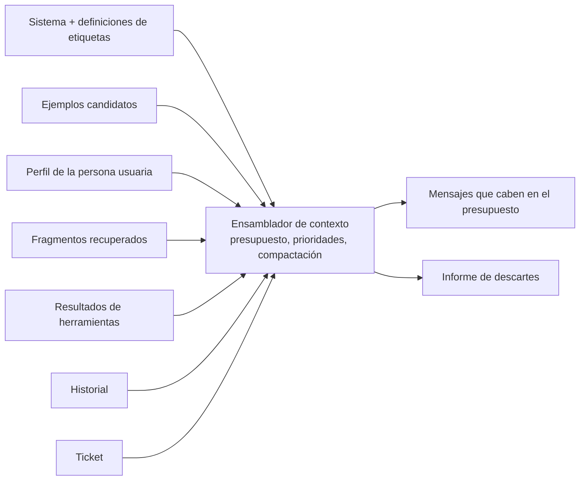
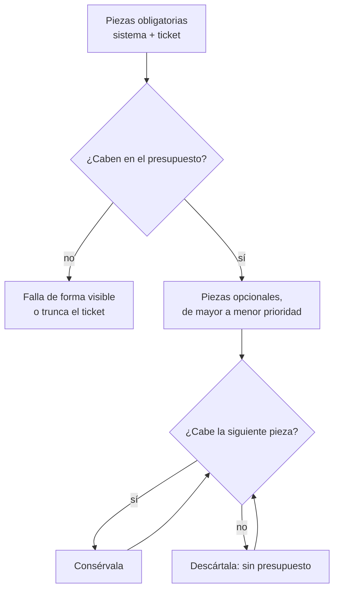
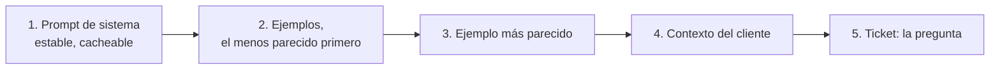
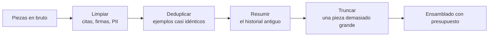
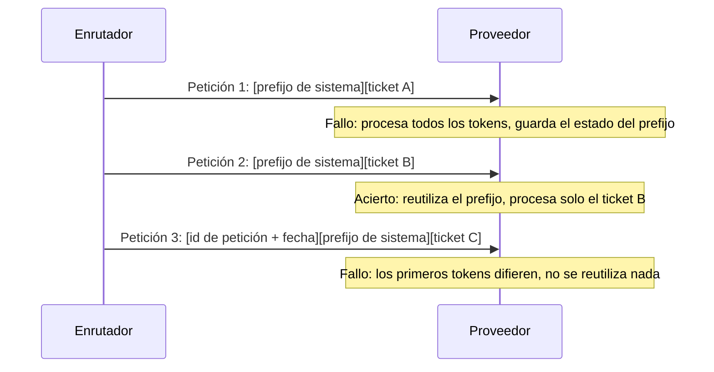

🌐 [English](03-context-engineering.md) · Español

# Lección 4.3 — Ingeniería de contexto: ensamblar, presupuestar y compactar

> **Módulo 04 · Lección 3 de 4** · ⏱️ unos 50 min · 🧪 Lab: [pasos 6–7](lab/README.es.md#paso-6--ensambla-el-contexto-con-un-presupuesto)

## 📨 Situación

> **De:** Alex Moreau · Responsable de Operaciones de Atención al Cliente
> **Canal:** #support-ai
>
> Mira el T00974: "How do I change the email address on my account?". Debajo va una respuesta antigua
> nuestra que pide un número de pedido. Con el texto en bruto y ocho ejemplos parecidos, el enrutador
> lo mandó a preguntas de producto. La mitad de lo que pega la clientela son hilos citados y firmas con
> nombres y teléfonos. Y Sam acaba de fijar un límite estricto de 500 *tokens* de *prompt* por ticket
> para el enrutamiento, porque cada *token* se paga en cada ticket, todo el día. Así que: ¿qué entra en
> esos 500 *tokens*, qué se tira y puedo ver una lista de lo que descartaste y por qué?

## 🎯 Objetivos

Al terminar esta lección puedes:

- Enumerar las piezas que compiten por una ventana de contexto y asignar a cada una una prioridad y una
  clase de estabilidad.
- Implementar un ensamblador que encaja en un presupuesto de *tokens*, nunca descarta una pieza
  obligatoria e informa de cada pieza descartada con un motivo.
- Ordenar un contexto para que el prefijo estable vaya primero y el material más relevante quede junto
  a la pregunta, y explicar el efecto "perdido en el medio" (*lost in the middle*).
- Compactar el contexto limpiando, deduplicando, resumiendo y truncando, y medir qué aporta y qué
  cuesta cada paso.
- Explicar la caché de prefijo (*prefix caching*) y la degradación del contexto (*context rot*), y
  diseñar *prompts* que aprovechen la primera y eviten la segunda.

## 🤔 Predice primero

Apunta tus respuestas antes de seguir leyendo. Las comprobarás en la autoevaluación.

1. Con un presupuesto de 500 *tokens*, quitar los correos citados y las firmas, ¿cambia sobre todo la
   exactitud o sobre todo cuántos ejemplos caben?
2. Deduplicar ejemplos casi idénticos ahorra *tokens*. ¿Puede también bajar la exactitud?
3. Añades "Request T01234 received on 2025-10-02" como primera línea del *prompt* de sistema, por
   trazabilidad. ¿Qué le pasa a la caché del *prompt*?

## 1. El contexto se ensambla, no se escribe

En la lección 4.2 el *prompt* era una plantilla fija: mensaje de sistema, k ejemplos, ticket. Los
sistemas reales construyen el contexto de cada petición a partir de varias fuentes, y esas fuentes
compiten por la misma ventana. La **ingeniería de contexto** (*context engineering*) es la disciplina
de decidir qué piezas entran, qué tamaño tiene cada una y en qué orden aparecen. La ingeniería de
*prompts* escribe las piezas; la ingeniería de contexto las ensambla.

| Pieza | En Hearthwise | Cambia | Prioridad | ¿Se puede descartar? |
|---|---|---|---|---|
| Instrucciones de sistema y definiciones de etiquetas | Rol, 8 intenciones, reglas, formato de notación de objetos de JavaScript (JSON, *JavaScript Object Notation*) | Rara vez (estable) | Obligatoria | Nunca |
| Ejemplos *few-shot* | Hasta 16 tickets resueltos parecidos | En cada petición | Por similitud | Sí |
| Perfil de la persona usuaria | Idioma, producto, canal | Por cliente | Alta, y barata | Sí |
| Fragmentos recuperados | Pasajes del centro de ayuda (módulo 05) | En cada petición | Por relevancia | Sí |
| Resultados de herramientas | Una consulta del estado de un pedido (módulo 07) | En cada llamada | Alta cuando se usa | A veces |
| Historial de la conversación | Turnos anteriores o correos citados | Crece con el tiempo | Lo reciente primero | Compáctalo |
| La consulta | El propio ticket | En cada petición | Obligatoria | Nunca |

El enrutador de este módulo usa cuatro de ellas (sistema, ejemplos, perfil, consulta). El mismo
ensamblador gestiona las demás cuando el chatbot de soporte del módulo 06 añade recuperación y los
agentes del módulo 07 añaden herramientas. Si construiste el *playground* del módulo 03, ya conoces
una pieza: el historial de la conversación recortado para caber en la ventana.

**Analogía:** hacer una maleta de mano con un límite de peso estricto. El pasaporte y los billetes
entran primero, pase lo que pase. Después añades las cosas más útiles por orden de utilidad, enrollas
la ropa para que ocupe menos, dejas en casa el tercer par de zapatos y apuntas lo que te has dejado.



Cada pieza es un pequeño registro con su texto, una prioridad y dos indicadores:

```python
@dataclass(frozen=True)
class ContextItem:
    """One candidate piece of context. Higher ``priority`` is kept first; ``required`` is never dropped."""

    kind: Kind  # "system", "example", "profile" or "query"
    text: str
    priority: float
    required: bool = False
    stable: bool = False  # identical for every request: belongs to the cacheable prefix
    answer: str = ""  # examples only: the assistant reply that follows the example ticket
```

> ⚠️ **Error común:** concatenar todo lo que tienes y dejar que el proveedor trunque lo que se
> desborde. El truncado suele cortar por un extremo, así que pierdes piezas por su posición, no por su
> importancia, y nunca sabes qué se perdió.

## 2. Presupuestos de *tokens* y prioridades

Un **presupuesto de *tokens*** (*token budget*) es el número máximo de *tokens* de *prompt* que
permites por petición. Lo fijan el dinero y el tiempo, no la ventana máxima del modelo: los 500
*tokens* de Sam están muy por debajo de lo que puede leer cualquier modelo actual, y de eso se trata.
El ensamblador llena el presupuesto de forma voraz:

1. Añade todas las piezas obligatorias (el mensaje de sistema y el ticket). Si por sí solas superan el
   presupuesto, falla de forma visible o acorta el ticket.
2. Ordena las piezas opcionales por prioridad, de mayor a menor.
3. Añade cada pieza si todavía cabe; si no, regístrala como descartada, "over budget".

Así trabaja el ensamblador con el ticket T00822 ("How do I stop my Plus plan from renewing?", seguido
de una respuesta citada y una firma con un nombre y un teléfono), con 16 ejemplos candidatos y un
presupuesto de 500 *tokens*:

| Política | *Tokens* ofrecidos | *Tokens* enviados | Ejemplos conservados |
|---|---|---|---|
| Texto en bruto | 1.351 | 447 | 1 |
| Texto limpio, sin casi duplicados | 884 | 487 | 4 |

El mensaje de sistema por sí solo ocupa 316 de los 500 *tokens*, así que cada *token* que ahorras en
otra parte es un ejemplo que cabe. Con los 400 tickets de prueba:

| Presupuesto | En bruto: exactitud (ejemplos) | Limpio: exactitud (ejemplos) | Limpio + deduplicado: exactitud (ejemplos) |
|---|---|---|---|
| 400 | 0.790 (0.71) | 0.797 (0.89) | 0.797 (0.86) |
| 500 | 0.820 (3.21) | 0.828 (3.50) | 0.830 (3.26) |
| 700 | 0.815 (8.17) | 0.843 (8.96) | 0.830 (6.07) |
| 1000 | 0.807 (14.64) | 0.843 (15.67) | 0.830 (6.28) |

Fíjate en la columna en bruto: a partir de 500 *tokens*, un presupuesto mayor la *empeora*, porque el
espacio extra se llena de ejemplos elegidos por compartir texto de plantilla, no intención. Más
contexto no es automáticamente mejor contexto.

Lo mismo ocurre sin presupuesto. Con texto limpio y k ejemplos parecidos:

| Ejemplos | Exactitud | *Tokens* del *prompt* |
|---|---|---|
| 4 | 0.828 | 502.6 |
| 8 | 0.828 | 654.0 |
| 16 | 0.840 | 955.0 |
| 32 | 0.825 | 1555.6 |

Pasar de 16 a 32 ejemplos cuesta 600,6 *tokens* más y *baja* la exactitud, porque los ejemplos extra
se parecen menos y diluyen el voto. Quienes trabajan en esto llaman a la versión general del fenómeno
**degradación del contexto** (*context rot*): la calidad de las respuestas va bajando a medida que la
ventana se llena de material desfasado, redundante o apenas relevante. Una ventana de contexto grande
es capacidad, no una recomendación.

**Analogía:** el dosier de preparación de una reunión. Diez páginas relevantes se leen; doscientas
páginas se hojean, y la página importante está en algún lugar del medio.



```python
used = sum(item.tokens for item in items if item.required)
kept: list[ContextItem] = [item for item in items if item.required]
for item in sorted((it for it in items if not it.required), key=lambda it: -it.priority):
    if used + item.tokens <= self.budget:
        kept.append(item)
        used += item.tokens
    else:
        dropped.append((item, "over budget"))
```

> 💡 **Consejo de producción:** registra el informe de descartes con cada petición (tipos, recuentos y
> *tokens*, no el texto de la clientela). Cuando la calidad baje, "los ejemplos dejaron de caber cuando
> el *prompt* de sistema creció 80 *tokens*" será un diagnóstico de cinco minutos en lugar de una
> semana de conjeturas.

## 3. El orden: dónde va cada pieza

Una vez sabes *qué* entra, decide *dónde*. El ensamblador usa tres reglas:

1. **Lo estable, primero.** El mensaje de sistema, idéntico en todas las peticiones, abre el
   contexto. La sección 5 explica por qué esto ahorra dinero.
2. **Lo más relevante, lo más cerca de la pregunta.** Los ejemplos van del menos al más parecido, así
   que el mejor ejemplo queda justo antes del ticket.
3. **La pregunta, al final.** El perfil y el ticket cierran el contexto, así que lo último que lee el
   modelo es lo que tiene que responder.

¿Por qué importa la posición? El estudio "Lost in the Middle" probó modelos con preguntas cuya
respuesta estaba en uno de muchos pasajes recuperados, y vio que usaban la información del principio
o del final de un contexto largo de forma más fiable que la del medio. La forma exacta depende del
modelo y de la tarea, así que trátalo como un riesgo que hay que comprobar, no como una ley. Es un
motivo más para mantener los contextos cortos: hay menos medio en el que perderse.

El aprendiz de juguete no tiene en cuenta el orden por defecto, así que el lab no puede mostrar este
efecto por sí solo. Tiene un ajuste `position_bias` que le hace dar menos peso a los ejemplos del
medio, lo que te permite construir y probar una **sonda de posición** (*position probe*, una de las
ampliaciones del lab): coloca el ejemplo más útil en cada posición por turnos y mide la exactitud.
Ejecuta la misma sonda con un modelo real para ver su sensibilidad de verdad.

**Analogía:** una buena presentación plantea la pregunta al principio y repite la idea clave al
final. El público recuerda las dos; la diapositiva 14 de 30 es un borrón.



```python
def arrange(items: list[ContextItem]) -> list[ContextItem]:
    """Stable system prefix first, examples from least to most relevant, then profile and query last."""
    rank = {"system": 0, "example": 1, "profile": 2, "query": 3}
    return sorted(items, key=lambda it: (rank[it.kind], it.priority if it.kind == "example" else 0))
```

> ⚠️ **Error común:** ordenar los fragmentos recuperados o los ejemplos por relevancia *descendente* y
> después añadir la pregunta, lo que deja el elemento más relevante lo más lejos posible de la
> pregunta. Si quieres el mejor elemento junto a la pregunta, ordena de forma ascendente.

## 4. Compactación: limpiar, deduplicar, resumir, truncar

La **compactación** (*compaction*) consiste en hacer el contexto más pequeño conservando lo que
importa. Cuatro técnicas cubren la mayoría de los casos, de la más barata a la más cara:

| Técnica | Qué hace | Ejemplo en Hearthwise |
|---|---|---|
| Limpiar | Quita el texto que no aporta señal | Respuestas citadas, firmas, entidades del lenguaje de marcado de hipertexto (HTML, *HyperText Markup Language*); anonimiza los datos personales (PII, *personally identifiable information*), como teléfonos y correos |
| Deduplicar | Descarta las piezas que repiten otra pieza | Varios ejemplos que dicen todos "How do I stop my Plus plan from renewing?" |
| Resumir | Sustituye un historial largo por un resumen breve | "La persona escribió dos veces por el mismo pedido retrasado" |
| Truncar | Conserva el principio y el final de una pieza demasiado larga | Un log pegado de 2.000 palabras, cortado por el medio |

**Limpiar** fue la mayor ganancia. Con los 47 tickets de prueba que arrastran un correo anterior
citado:

| *Prompt* | Texto en bruto | Texto limpio |
|---|---|---|
| *Zero-shot* | 0.681 | 0.809 |
| 8 ejemplos parecidos | 0.596 | 0.830 |

Con el texto en bruto, el *prompt* *few-shot* es incluso peor que el *zero-shot*. La respuesta citada
"Could you share your order number?" hace que el ticket se parezca a todos los demás tickets que
llevan la misma cita, así que el selector recupera ejemplos por el texto de plantilla compartido, y sus
etiquetas no tienen nada que ver con lo que pide esa persona. El T00974 de Alex es uno de ellos:
product_question con el texto en bruto, account_access una vez limpio. El ruido no solo malgasta
*tokens*; dirige la recuperación.

**Deduplicar** es un compromiso que debes medir, no suponer. Con un presupuesto de 700 *tokens*,
quitar los ejemplos casi duplicados envió 102,1 *tokens* menos por ticket (583.0 frente a 685.1), y la
exactitud bajó de 0.843 a 0.830. Los duplicados no eran puro desperdicio: para un sistema que vota,
como el juguete, tres copias del mismo ticket resuelto son tres votos. Un modelo de lenguaje grande
(LLM, *large language model*) real puede reaccionar de otra forma, así que haz la comparación con tu
propio modelo antes de elegir.

**Resumir** encaja con el historial de la conversación. Conserva literalmente los últimos turnos y
sustituye los anteriores por un resumen, ya sea extractivo (eliges frases) o escrito por un modelo
(cuesta una llamada, así que guárdalo en caché). **Truncar** es el último recurso para una única pieza
demasiado grande; el ejercicio del lab te pide cortar por el medio, porque los tickets suelen plantear
el problema al principio y la petición al final.

**Analogía:** editar un hilo de correo largo antes de reenviárselo a alguien del equipo: borras las
firmas y las respuestas de "¡gracias!", conservas una copia del mensaje de error y escribes una línea
que resume los diez primeros mensajes.



```python
def clean_text(text: str) -> str:
    """Unescape HTML entities, remove quoted replies and signatures, redact PII, squash spaces."""
    text = html.unescape(text)
    text = strip_signature(strip_quoted_reply(text))
    text = redact_pii(text)
    return " ".join(text.split())
```

> ⚠️ **Error común:** resumir antes de limpiar. Un modelo al que le pides resumir un hilo lleno de
> firmas y texto de plantilla citado resumirá también, muy obediente, el texto de plantilla, y tú
> pagarás la llamada.

> 💡 **Consejo de producción:** guarda en tus logs el texto en bruto y el texto compactado uno junto a
> otro (con los datos personales anonimizados en los dos). Cuando una regla de compactación falla, por
> ejemplo un detector de firmas que se come la última línea de un mensaje real, lo ves al momento.

## 5. Guardar en caché el prefijo estable

Para responder, un modelo procesa primero todos los *tokens* del *prompt* y guarda sus resultados
intermedios en una caché de claves y valores (caché KV, *key-value cache*). Si muchas peticiones
empiezan exactamente con los mismos *tokens*, un proveedor puede conservar esos resultados y
reutilizarlos en la siguiente petición con el mismo prefijo. Esto es la **caché de prefijo**
(*prefix caching*). Varios proveedores de interfaces de programación de aplicaciones (API,
*application programming interface*) cobran los *tokens* de *prompt* en caché a un precio reducido y
devuelven antes el primer *token*; consulta la documentación de tu proveedor para conocer sus reglas,
como una longitud mínima del prefijo.

La caché solo ayuda cuando el prefijo es *idéntico byte a byte*. El lab simula una caché indexada por
el texto exacto del mensaje de sistema y vuelve a reproducir las 400 peticiones de prueba:

| Mensaje de sistema | Aciertos | Fallos | Proporción de *tokens* del *prompt* servidos desde la caché |
|---|---|---|---|
| Estable (el mismo texto para todos los tickets) | 399 | 1 | 0.496 |
| Empieza con "Request <id> received on <date>" | 0 | 400 | 0.000 |

La mitad de cada *prompt* de enrutamiento es el mensaje de sistema estable, así que un prefijo estable
se podría servir desde la caché en todas las peticiones después de la primera. Una inocente línea de
trazabilidad al principio lo destruye todo. Pon los ID de petición, las fechas y todo lo que varíe al
*final* del contexto, o en metadatos de la petición que el modelo nunca ve.

**Analogía:** una imprenta que mantiene montada la plancha del membrete. Todas las cartas con el mismo
membrete se imprimen rápido; cambia un carácter del membrete y hay que hacer la plancha de nuevo.



```python
def observe(self, messages: list[Message]) -> None:
    prefix = messages[0].content
    key = hashlib.sha256(prefix.encode("utf-8")).hexdigest()
    self.total_tokens += sum(count_tokens(m.content) + MESSAGE_OVERHEAD for m in messages)
    if key in self.seen:
        self.hits += 1
        self.cached_tokens += count_tokens(prefix) + MESSAGE_OVERHEAD
    else:
        self.misses += 1
        self.seen.add(key)
```

> 💡 **Consejo de producción:** trata el *prompt* de sistema como un artefacto que se publica con un
> número de versión. Cada edición vacía la caché y puede cambiar el comportamiento, así que agrupa las
> ediciones pequeñas en versiones planificadas en lugar de retocarlo en caliente.

## 🧪 Pruébalo

1. Ensambla el T00822 con el presupuesto de Sam y lee el informe de descartes.

   ```bash
   uv run lab context
   ```

   ```text
   Context for T00822 · budget 500 tokens · policy clean+dedupe
   ------------------------------------------------------------
   offered 884 tokens · sent 487 tokens · examples kept 4
     KEEP system    316 tok  priority 100     'You are the ticket router for Hearthwise, an onl'
     KEEP example    32 tok  priority 0.25    'Ticket: I was charged €149 for Plus again, pleas'
     KEEP example    33 tok  priority 0.375   'Ticket: HEY, ¿CÓMO EVITO QUE SE RENUEVE EL PLAN '
     KEEP example    34 tok  priority 0.8333  'Ticket: Hey, How do I stop my Plus plan from ren'
     KEEP example    35 tok  priority 1.0     'Ticket: Good morning, How do I stop my Plus plan'
     KEEP profile    19 tok  priority 50      'Customer context: language=en; product=Watcher S'
     KEEP query      18 tok  priority 1000    'Ticket: Buenas, How do I stop my Plus plan from '
     DROP example    31 tok  priority 1.0     (near-duplicate) 'Ticket: How do I stop my Plus '
     DROP example    31 tok  priority 1.0     (near-duplicate) 'Ticket: How do I stop my Plus '
     DROP example    34 tok  priority 1.0     (near-duplicate) 'Ticket: HOLA, HOW DO I STOP MY'
     DROP example    33 tok  priority 1.0     (near-duplicate) 'Ticket: Hello, How do I stop m'
     DROP example    32 tok  priority 0.375   (near-duplicate) 'Ticket: Good morning, ¿Cómo ev'
     DROP example    33 tok  priority 0.375   (near-duplicate) 'Ticket: Buenas, ¿Cómo evito qu'
     DROP example    31 tok  priority 0.375   (near-duplicate) 'Ticket: ¿Cómo evito que se ren'
     DROP example    31 tok  priority 0.375   (near-duplicate) 'Ticket: Hey, ¿Cómo evito que s'
     DROP example    33 tok  priority 0.375   (near-duplicate) 'Ticket: Hey, ¿Cómo evito que s'
     DROP example    34 tok  priority 0.25    (near-duplicate) 'Ticket: I was charged €4.99 fo'
     DROP example    37 tok  priority 0.25    (near-duplicate) 'Ticket: Good morning, I was ch'
     DROP example    37 tok  priority 0.25    (near-duplicate) 'Ticket: I was charged €4.99 fo'
   ```

   Después ejecuta `uv run lab context --policy raw`. Sus primeras líneas muestran cuánto cuesta el
   ruido:

   ```text
   Context for T00822 · budget 500 tokens · policy raw
   ---------------------------------------------------
   offered 1351 tokens · sent 447 tokens · examples kept 1
   ```

2. Barre presupuestos y políticas, y mira qué pasa con demasiados ejemplos.

   ```bash
   uv run lab budget
   ```

   ```text
   Token budget sweep (16 candidate examples, profile, query; 400 test tickets)
   ----------------------------------------------------------------------------
   budget policy        accuracy examples  tokens
      400 raw              0.790     0.71   388.4
      400 clean            0.797     0.89   390.5
      400 clean+dedupe     0.797     0.86   389.6
      500 raw              0.820     3.21   485.9
      500 clean            0.828     3.50   486.0
      500 clean+dedupe     0.830     3.26   478.3
      700 raw              0.815     8.17   684.4
      700 clean            0.843     8.96   685.1
      700 clean+dedupe     0.830     6.07   583.0
     1000 raw              0.807    14.64   957.4
     1000 clean            0.843    15.67   933.2
     1000 clean+dedupe     0.830     6.28   592.0

   More examples are not always better
   -----------------------------------
   prompt                                acc  camera spanish   tokens
   4 similar examples                  0.828   0.633   0.775    502.6
   8 similar examples                  0.828   0.633   0.775    654.0
   16 similar examples                 0.840   0.665   0.792    955.0
   32 similar examples                 0.825   0.639   0.783   1555.6

   Tickets with a quoted earlier e-mail (n = 47)
   ---------------------------------------------
   0-shot: raw 0.681 -> cleaned 0.809
   8-shot: raw 0.596 -> cleaned 0.830
   ```

3. Vuelve a reproducir las peticiones de prueba a través de la caché de prefijo.

   ```bash
   uv run lab cache
   ```

   ```text
   Prefix cache simulation over the 400 test requests
   --------------------------------------------------
   stable system prompt     hits 399 · misses   1 · hit rate 0.998 · cached share of prompt tokens 0.496
   request id + date first  hits   0 · misses 400 · hit rate 0.000 · cached share of prompt tokens 0.000
   ```

4. Implementa `truncate_middle` en `src/m04_adaptation/exercises.py` y compruébalo con
   `uv run pytest tests/test_exercises.py -k truncate`.

## 🏭 En el mundo real

- **Presupuestos por pieza, no solo en total.** Los ensambladores de producción suelen reservar una
  parte del presupuesto para cada tipo (por ejemplo, "los ejemplos pueden usar como mucho el 40 %"),
  para que una fuente voraz no deje sin espacio a las demás. Las prioridades deciden después dentro de
  cada parte.
- **El recuento de *tokens* debe coincidir con el modelo.** El lab aproxima los *tokens* con palabras
  y signos de puntuación. Los sistemas reales cuentan con el tokenizador del propio modelo, porque
  tokenizadores distintos pueden discrepar mucho, sobre todo con texto en español y con números.
- **Las reglas de compactación son código.** Los detectores de firmas, los eliminadores de citas y los
  anonimizadores de datos personales necesitan tests unitarios con ejemplos reales (anonimizados). Una
  regla que falla el 1 % de las veces elimina en silencio la petición del 1 % de los tickets.
- **Qué vigilar:** los *tokens* por petición (media y percentil 95), la proporción de peticiones que
  llegan al límite del presupuesto, el informe de descartes por tipo y la tasa de aciertos de la
  caché. Una tasa de aciertos que baja tras un despliegue casi siempre significa que alguien cambió el
  prefijo.
- **El historial crece sin límite** en los productos de chat. Resume con una periodicidad fija (cada N
  turnos) en lugar de hacerlo en el momento en que la ventana se desborda, para que el resumen nunca se
  escriba con prisas.

## ✅ Autoevaluación

**1. Volvamos a la predicción 1: con un presupuesto de 500 *tokens*, ¿qué cambió la limpieza en el
T00822?**

<details><summary>Respuesta</summary>

Sobre todo cuántos ejemplos cabían. Los candidatos en bruto ofrecían 1.351 *tokens* y solo cupo 1
ejemplo; los candidatos limpios ofrecían 884 y cupieron 4. El propio T00822 se enrutó bien en los dos
casos. En todo el conjunto de prueba, el efecto en la exactitud es mayor donde el ruido dirige la
selección de ejemplos: en los tickets con correos citados, la exactitud con ocho ejemplos pasó de
0.596 (en bruto) a 0.830 (limpio).

</details>

**2. Volvamos a la predicción 2: ¿puede la deduplicación bajar la exactitud?**

<details><summary>Respuesta</summary>

Sí. Con 700 *tokens* ahorró 102,1 *tokens* por ticket, pero la exactitud bajó de 0.843 a 0.830,
porque los ejemplos casi idénticos actuaban como votos extra para la etiqueta correcta. Deduplicar
suele compensar con los documentos recuperados (donde las repeticiones no aportan nada nuevo), pero
con los ejemplos *few-shot* conviene medirlo.

</details>

**3. Volvamos a la predicción 3: ¿qué le hace a la caché un ID de petición al principio del *prompt*
de sistema?**

<details><summary>Respuesta</summary>

Hace que cada prefijo sea único, así que la caché nunca acierta: 0 aciertos de 400 en lugar de 399, y
la proporción de *tokens* del *prompt* en caché cae de 0.496 a 0.000. Los datos variables van al final
del contexto o en los metadatos de la petición.

</details>

**4. ¿Por qué bajó la exactitud de 0.840 a 0.825 al pasar de 16 a 32 ejemplos parecidos?**

<details><summary>Respuesta</summary>

Los 16 ejemplos extra se parecen menos al ticket, así que añaden votos para otras etiquetas y diluyen
la evidencia de las coincidencias cercanas, y además cuestan 600,6 *tokens* más. Es un caso pequeño y
medible de degradación del contexto: a partir de cierto punto, más material en la ventana baja la
calidad.

</details>

**5. Tu ensamblador ordena los ejemplos por similitud, de mayor a menor, y después añade el ticket.
¿Qué falla y cómo lo arreglas?**

<details><summary>Respuesta</summary>

El ejemplo más parecido acaba lo más lejos posible del ticket, donde los modelos con un patrón de
"perdido en el medio" pueden usarlo menos. Ordena de forma ascendente para que el mejor ejemplo quede
justo antes del ticket y después compruébalo con una sonda de posición, porque el orden correcto es una
propiedad del modelo que usas.

</details>

## 💬 Explícalo con tus palabras

- Sam pregunta para qué necesitas un presupuesto si "el modelo puede leerse un libro entero de una
  vez". Explica los tres motivos (coste, latencia, calidad) en un mensaje de cuatro o cinco frases.
- Explícale a Alex qué es el informe de descartes y cómo podría usarlo una persona responsable de
  soporte para detectar un problema.

## 🔑 Ideas clave

- El contexto se ensambla en cada petición a partir de piezas con prioridades; las piezas obligatorias
  nunca se descartan y cada pieza descartada se informa con un motivo.
- Los presupuestos salen del coste y la latencia, no del tamaño de la ventana, y más contexto puede
  bajar la calidad (degradación del contexto).
- Pon el prefijo estable primero, el material más relevante junto a la pregunta y la pregunta al
  final.
- Limpia antes que nada: el ruido malgasta *tokens* y lleva la selección de ejemplos en la dirección
  equivocada. Mide la deduplicación, el resumen y el truncado en lugar de suponer que ayudan.
- La caché de prefijo solo funciona con prefijos idénticos byte a byte; saca los datos variables de la
  parte de arriba del *prompt*.

## 📚 Profundiza

- ⭐ [Lost in the Middle: How Language Models Use Long Contexts](https://arxiv.org/abs/2307.03172) —
  el estudio que respalda los consejos sobre el orden, con experimentos claros que puedes reproducir
  con tu propio modelo.
- [vLLM: Efficient Memory Management for LLM Serving with PagedAttention](https://arxiv.org/abs/2309.06180)
  — cómo gestiona un motor de servicio la caché de claves y valores que hace posible la caché de
  prefijo.
- [Documentación de vLLM](https://docs.vllm.ai) — incluye la caché de prefijo automática para modelos
  autoalojados; un buen contexto para el módulo 10.
- [Not what you've signed up for: indirect prompt injection](https://arxiv.org/abs/2302.12173) — cada
  fragmento recuperado y cada resultado de herramienta que ensamblas es texto no confiable; este
  artículo muestra por qué.

---

[← Anterior: 4.2 Ingeniería de *prompts*](02-prompt-engineering.es.md) · [🏠 Módulo 04](README.es.md) · [Siguiente: 4.4 *Fine-tuning*, PEFT y LoRA →](04-fine-tuning-peft-and-lora.es.md)
