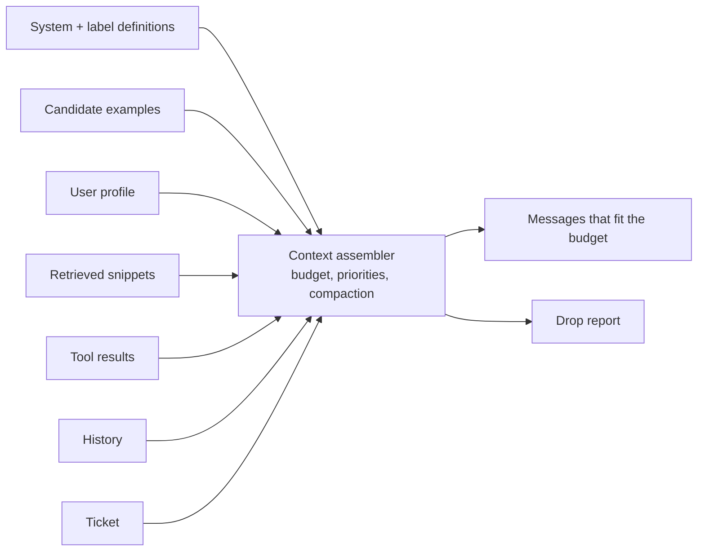
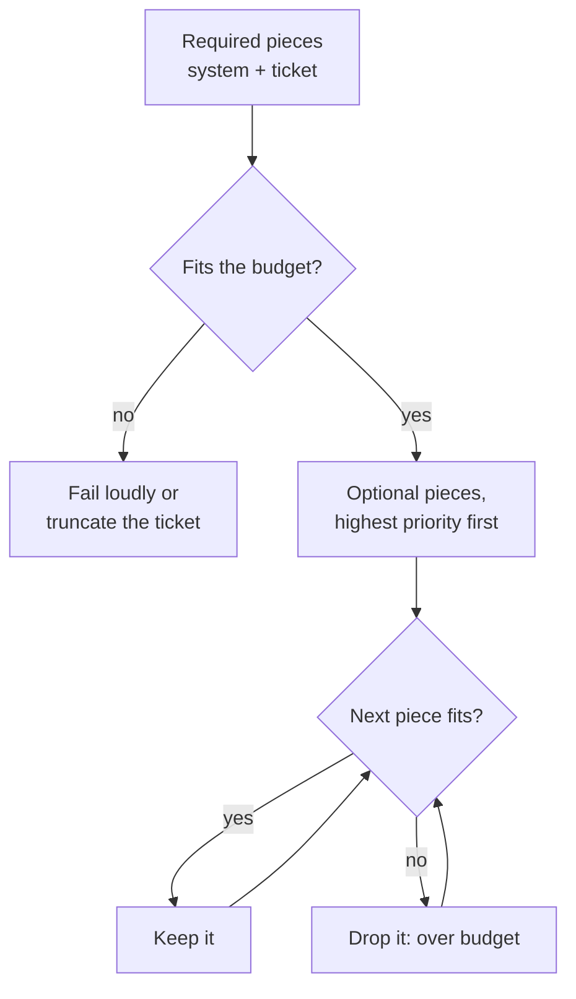
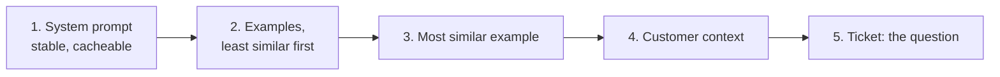
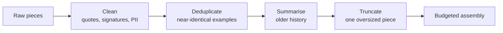
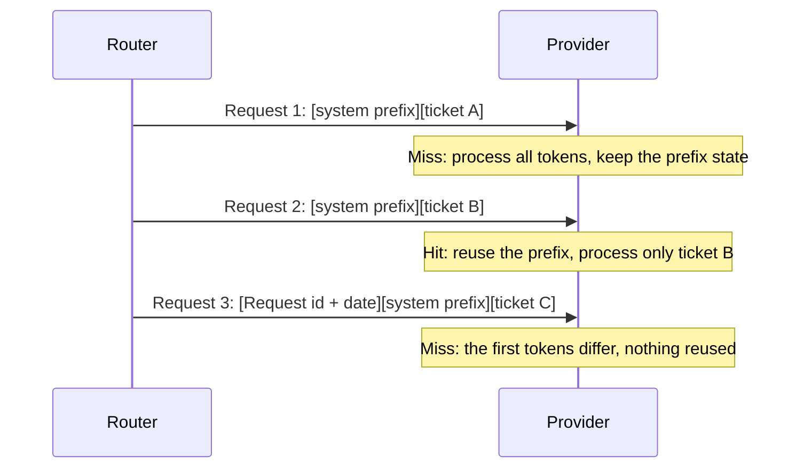

🌐 English · [Español](03-context-engineering.es.md)

# Lesson 4.3 — Context engineering: assembling, budgeting and compacting

> **Module 04 · Lesson 3 of 4** · ⏱️ about 50 min · 🧪 Lab: [steps 6–7](lab/README.md#step-6--assemble-context-under-a-budget)

## 📨 Situation

> **From:** Alex Moreau · Customer Support Operations Lead
> **Channel:** #support-ai
>
> Look at T00974: "How do I change the email address on my account?" Underneath it sits our own old
> reply asking for an order number. With the raw text and eight similar examples, the router sent it
> to product questions. Half of what customers paste is quoted threads and signatures with names and
> phone numbers. And Sam has just set a hard limit of 500 prompt tokens per ticket for routing,
> because every token is paid on every ticket, all day long. So: what goes into those 500 tokens,
> what gets thrown out, and can I see a list of what you dropped and why?

## 🎯 Objectives

By the end of this lesson you can:

- List the pieces that compete for a context window and give each one a priority and a stability
  class.
- Implement an assembler that fits a token budget, never drops a required piece and reports every
  dropped piece with a reason.
- Order a context so the stable prefix comes first and the most relevant material sits next to the
  question, and explain the "lost in the middle" effect.
- Compact context by cleaning, deduplicating, summarising and truncating, and measure what each step
  buys and costs.
- Explain prefix caching and context rot, and design prompts that benefit from the first and avoid
  the second.

## 🤔 Predict first

Write your answers down before reading on. You will check them in the self-check.

1. Under a 500-token budget, does removing quoted e-mails and signatures mostly change accuracy, or
   mostly change how many examples fit?
2. Deduplicating near-identical examples saves tokens. Can it also lower accuracy?
3. You add "Request T01234 received on 2025-10-02" as the first line of the system prompt, for
   traceability. What happens to the prompt cache?

## 1. Context is assembled, not written

In lesson 4.2 the prompt was a fixed template: system message, k examples, ticket. Real systems build
the context for every request from several sources, and the sources compete for the same window.
**Context engineering** is the discipline of deciding which pieces enter, how big each one is, and in
what order they appear. Prompt engineering writes the pieces; context engineering assembles them.

| Piece | At Hearthwise | Changes | Priority | Droppable? |
|---|---|---|---|---|
| System instructions and label definitions | Role, 8 intents, rules, JavaScript Object Notation (JSON) format | Rarely (stable) | Required | Never |
| Few-shot examples | Up to 16 similar solved tickets | Every request | By similarity | Yes |
| User profile | Language, product, channel | Per customer | High, and cheap | Yes |
| Retrieved snippets | Help-centre passages (module 05) | Every request | By relevance | Yes |
| Tool results | An order-status lookup (module 07) | Every call | High when used | Sometimes |
| Conversation history | Earlier turns or quoted e-mails | Grows over time | Recent first | Compact it |
| The query | The ticket itself | Every request | Required | Never |

The router in this module uses four of these (system, examples, profile, query). The same assembler
handles the others when the support chatbot in module 06 adds retrieval and the agents in module 07
add tools. If you built the playground in module 03, you already met one piece: conversation history
trimmed to fit the window.

**Analogy:** packing a carry-on bag with a strict weight limit. Passport and tickets go in first, no
matter what. Then you add the most useful things in order of usefulness, roll the clothes to make
them smaller, leave the third pair of shoes at home, and keep a list of what you left behind.



Each piece is a small record with its text, a priority and two flags:

```python
@dataclass(frozen=True)
class ContextItem:
    """One candidate piece of context. Higher ``priority`` is kept first; ``required`` is never dropped."""

    kind: Kind  # "system", "example", "profile" or "query"
    text: str
    priority: float
    required: bool = False
    stable: bool = False  # identical for every request: belongs to the cacheable prefix
    answer: str = ""  # examples only: the assistant reply that follows the example ticket
```

> ⚠️ **Common mistake:** concatenating everything you have and letting the provider truncate
> whatever overflows. Truncation usually cuts from one end, so you lose pieces by position, not by
> importance, and you never learn what was lost.

## 2. Token budgets and priorities

A **token budget** is the maximum number of prompt tokens you allow per request. It is set by money
and time, not by the model's maximum window: Sam's 500 tokens is far below what any current model can
read, and that is the point. The assembler fills the budget greedily:

1. Add every required piece (system message and ticket). If they alone exceed the budget, fail
   loudly or shorten the ticket.
2. Sort the optional pieces by priority, highest first.
3. Add each piece if it still fits; otherwise record it as dropped, "over budget".

Here is the assembler at work on ticket T00822 ("How do I stop my Plus plan from renewing?", followed
by a quoted reply and a signature with a name and a phone number), with 16 candidate examples and a
500-token budget:

| Policy | Tokens offered | Tokens sent | Examples kept |
|---|---|---|---|
| Raw text | 1,351 | 447 | 1 |
| Cleaned text, near-duplicates removed | 884 | 487 | 4 |

The system message alone takes 316 of the 500 tokens, so every token saved elsewhere is an example
that fits. Across all 400 test tickets:

| Budget | Raw: accuracy (examples) | Cleaned: accuracy (examples) | Cleaned + dedupe: accuracy (examples) |
|---|---|---|---|
| 400 | 0.790 (0.71) | 0.797 (0.89) | 0.797 (0.86) |
| 500 | 0.820 (3.21) | 0.828 (3.50) | 0.830 (3.26) |
| 700 | 0.815 (8.17) | 0.843 (8.96) | 0.830 (6.07) |
| 1000 | 0.807 (14.64) | 0.843 (15.67) | 0.830 (6.28) |

Notice the raw column: from 500 tokens upwards, a bigger budget makes it *worse*, because the extra
room fills with examples that were chosen for sharing boilerplate, not intent. More context is not
automatically better context.

The same thing happens without a budget. With cleaned text and k similar examples:

| Examples | Accuracy | Prompt tokens |
|---|---|---|
| 4 | 0.828 | 502.6 |
| 8 | 0.828 | 654.0 |
| 16 | 0.840 | 955.0 |
| 32 | 0.825 | 1,555.6 |

Doubling from 16 to 32 examples costs 600.6 more tokens and *lowers* accuracy, because the extra
examples are less similar and dilute the vote. Practitioners call the general version of this
**context rot**: answer quality drifts down as the window fills with stale, redundant or barely
relevant material. A large context window is capacity, not a recommendation.

**Analogy:** a briefing pack for a meeting. Ten relevant pages get read; two hundred pages get
skimmed, and the important page is somewhere in the middle.



```python
used = sum(item.tokens for item in items if item.required)
kept: list[ContextItem] = [item for item in items if item.required]
for item in sorted((it for it in items if not it.required), key=lambda it: -it.priority):
    if used + item.tokens <= self.budget:
        kept.append(item)
        used += item.tokens
    else:
        dropped.append((item, "over budget"))
```

> 💡 **Production tip:** log the drop report with every request (kinds, counts and tokens, not the
> customer text). When quality falls, "the examples stopped fitting after the system prompt grew by
> 80 tokens" is a five-minute diagnosis instead of a week of guessing.

## 3. Ordering: where each piece goes

Once you know *what* goes in, decide *where*. The assembler uses three rules:

1. **Stable first.** The system message, identical for every request, opens the context. Section 5
   explains why this saves money.
2. **Most relevant closest to the question.** Examples go from least to most similar, so the best
   example sits right before the ticket.
3. **The question last.** The profile and the ticket close the context, so the last thing the model
   reads is the thing it must answer.

Why does position matter at all? The "Lost in the Middle" study tested models on questions whose
answer sat in one of many retrieved passages, and found that they used information at the beginning
or the end of a long context more reliably than information in the middle. The exact shape depends
on the model and the task, so treat it as a risk to test for, not a law. It is one more reason to
keep contexts short: there is less middle to get lost in.

The toy learner is order-blind by default, so the lab cannot show this effect on its own. It has a
`position_bias` setting that makes it weigh middle examples less, which lets you build and test a
**position probe** (one of the lab's extensions): place the most useful example at each position in
turn and measure accuracy. Run the same probe against a real model to see its actual sensitivity.

**Analogy:** a good presentation states the question at the start and repeats the key point at the
end. The audience remembers both; slide 14 of 30 is a blur.



```python
def arrange(items: list[ContextItem]) -> list[ContextItem]:
    """Stable system prefix first, examples from least to most relevant, then profile and query last."""
    rank = {"system": 0, "example": 1, "profile": 2, "query": 3}
    return sorted(items, key=lambda it: (rank[it.kind], it.priority if it.kind == "example" else 0))
```

> ⚠️ **Common mistake:** sorting retrieved snippets or examples by relevance *descending* and then
> appending the question, which puts the most relevant item as far from the question as possible.
> If you want the best item next to the question, sort ascending.

## 4. Compaction: clean, deduplicate, summarise, truncate

**Compaction** means making context smaller while keeping what matters. Four techniques cover most
cases, from cheapest to most expensive:

| Technique | What it does | Hearthwise example |
|---|---|---|
| Clean | Remove text that carries no signal | Quoted replies, signatures, HyperText Markup Language (HTML) entities; redact personally identifiable information (PII) such as phone numbers and e-mails |
| Deduplicate | Drop pieces that repeat another piece | Several examples that all say "How do I stop my Plus plan from renewing?" |
| Summarise | Replace long history with a short summary | "Customer wrote twice about the same delayed order" |
| Truncate | Keep the beginning and end of an over-long piece | A pasted log of 2,000 words, cut in the middle |

**Cleaning** gave the biggest win. On the 47 test tickets that carry a quoted earlier e-mail:

| Prompt | Raw text | Cleaned text |
|---|---|---|
| Zero-shot | 0.681 | 0.809 |
| 8 similar examples | 0.596 | 0.830 |

With raw text, the few-shot prompt is even worse than zero-shot. The quoted reply "Could you share
your order number?" makes the ticket look like every other ticket that carries the same quote, so the
selector retrieves examples by shared boilerplate, and their labels have nothing to do with this
customer. Alex's T00974 is one of them: product_question with raw text, account_access once cleaned.
Noise does not only waste tokens; it steers retrieval.

**Deduplicating** is a trade-off you should measure, not assume. At a 700-token budget, removing
near-duplicate examples sent 102.1 fewer tokens per ticket (583.0 against 685.1), and accuracy fell from
0.843 to 0.830. The duplicates were not pure waste: for a voter like the toy, three copies of the same
solved ticket are three votes. A real large language model (LLM) may react differently, so run the
comparison on your own model before choosing.

**Summarising** fits conversation history. Keep the last turns verbatim and replace older ones with a
summary, either extractive (pick sentences) or written by a model (costs a call, so cache it).
**Truncating** is the last resort for one oversized piece; the lab's exercise asks you to cut from the
middle, because tickets usually state the problem at the start and the request at the end.

**Analogy:** editing a long e-mail thread before forwarding it to a colleague: delete the signatures
and the "thanks!" replies, keep one copy of the error message, and write one line summarising the
first ten messages.



```python
def clean_text(text: str) -> str:
    """Unescape HTML entities, remove quoted replies and signatures, redact PII, squash spaces."""
    text = html.unescape(text)
    text = strip_signature(strip_quoted_reply(text))
    text = redact_pii(text)
    return " ".join(text.split())
```

> ⚠️ **Common mistake:** summarising before cleaning. A model asked to summarise a thread full of
> signatures and quoted boilerplate will dutifully summarise the boilerplate too, and you pay for the
> call.

> 💡 **Production tip:** keep the raw text and the compacted text side by side in your logs (with
> PII redacted in both). When a compaction rule misfires, for example a signature detector that eats
> the last line of a real message, you can see it immediately.

## 5. Caching the stable prefix

To answer, a model first processes every prompt token and keeps intermediate results for them in a
key-value (KV) cache. If many requests start with exactly the same tokens, a provider can keep those
results and reuse them for the next request with the same prefix. This is **prefix caching**.
Several application programming interface (API) providers bill cached prompt tokens at a reduced
rate and return the first token sooner; check your provider's documentation for its rules, such as a
minimum prefix length.

The cache only helps when the prefix is *byte-for-byte identical*. The lab simulates a cache keyed by
the exact text of the system message and replays the 400 test requests:

| System message | Hits | Misses | Share of prompt tokens served from cache |
|---|---|---|---|
| Stable (same text for every ticket) | 399 | 1 | 0.496 |
| Starts with "Request <id> received on <date>" | 0 | 400 | 0.000 |

Half of every routing prompt is the stable system message, so a stable prefix could be served from
cache for every request after the first. One innocent line of traceability at the top destroys all
of it. Put request IDs, dates and anything else that varies at the *end* of the context, or in
request metadata that the model never sees.

**Analogy:** a printer that keeps the letterhead plate loaded. Every letter with the same letterhead
prints fast; change one character in the letterhead and the plate must be made again.



```python
def observe(self, messages: list[Message]) -> None:
    prefix = messages[0].content
    key = hashlib.sha256(prefix.encode("utf-8")).hexdigest()
    self.total_tokens += sum(count_tokens(m.content) + MESSAGE_OVERHEAD for m in messages)
    if key in self.seen:
        self.hits += 1
        self.cached_tokens += count_tokens(prefix) + MESSAGE_OVERHEAD
    else:
        self.misses += 1
        self.seen.add(key)
```

> 💡 **Production tip:** treat the system prompt as a release artifact with a version number. Every
> edit resets the cache and can change behaviour, so batch small edits into planned releases instead
> of tweaking it live.

## 🧪 Try it

1. Assemble T00822 under Sam's budget and read the drop report.

   ```bash
   uv run lab context
   ```

   ```text
   Context for T00822 · budget 500 tokens · policy clean+dedupe
   ------------------------------------------------------------
   offered 884 tokens · sent 487 tokens · examples kept 4
     KEEP system    316 tok  priority 100     'You are the ticket router for Hearthwise, an onl'
     KEEP example    32 tok  priority 0.25    'Ticket: I was charged €149 for Plus again, pleas'
     KEEP example    33 tok  priority 0.375   'Ticket: HEY, ¿CÓMO EVITO QUE SE RENUEVE EL PLAN '
     KEEP example    34 tok  priority 0.8333  'Ticket: Hey, How do I stop my Plus plan from ren'
     KEEP example    35 tok  priority 1.0     'Ticket: Good morning, How do I stop my Plus plan'
     KEEP profile    19 tok  priority 50      'Customer context: language=en; product=Watcher S'
     KEEP query      18 tok  priority 1000    'Ticket: Buenas, How do I stop my Plus plan from '
     DROP example    31 tok  priority 1.0     (near-duplicate) 'Ticket: How do I stop my Plus '
     DROP example    31 tok  priority 1.0     (near-duplicate) 'Ticket: How do I stop my Plus '
     DROP example    34 tok  priority 1.0     (near-duplicate) 'Ticket: HOLA, HOW DO I STOP MY'
     DROP example    33 tok  priority 1.0     (near-duplicate) 'Ticket: Hello, How do I stop m'
     DROP example    32 tok  priority 0.375   (near-duplicate) 'Ticket: Good morning, ¿Cómo ev'
     DROP example    33 tok  priority 0.375   (near-duplicate) 'Ticket: Buenas, ¿Cómo evito qu'
     DROP example    31 tok  priority 0.375   (near-duplicate) 'Ticket: ¿Cómo evito que se ren'
     DROP example    31 tok  priority 0.375   (near-duplicate) 'Ticket: Hey, ¿Cómo evito que s'
     DROP example    33 tok  priority 0.375   (near-duplicate) 'Ticket: Hey, ¿Cómo evito que s'
     DROP example    34 tok  priority 0.25    (near-duplicate) 'Ticket: I was charged €4.99 fo'
     DROP example    37 tok  priority 0.25    (near-duplicate) 'Ticket: Good morning, I was ch'
     DROP example    37 tok  priority 0.25    (near-duplicate) 'Ticket: I was charged €4.99 fo'
   ```

   Then run `uv run lab context --policy raw`. Its first lines show how much the noise costs:

   ```text
   Context for T00822 · budget 500 tokens · policy raw
   ---------------------------------------------------
   offered 1351 tokens · sent 447 tokens · examples kept 1
   ```

2. Sweep budgets and policies, and see what happens with too many examples.

   ```bash
   uv run lab budget
   ```

   ```text
   Token budget sweep (16 candidate examples, profile, query; 400 test tickets)
   ----------------------------------------------------------------------------
   budget policy        accuracy examples  tokens
      400 raw              0.790     0.71   388.4
      400 clean            0.797     0.89   390.5
      400 clean+dedupe     0.797     0.86   389.6
      500 raw              0.820     3.21   485.9
      500 clean            0.828     3.50   486.0
      500 clean+dedupe     0.830     3.26   478.3
      700 raw              0.815     8.17   684.4
      700 clean            0.843     8.96   685.1
      700 clean+dedupe     0.830     6.07   583.0
     1000 raw              0.807    14.64   957.4
     1000 clean            0.843    15.67   933.2
     1000 clean+dedupe     0.830     6.28   592.0

   More examples are not always better
   -----------------------------------
   prompt                                acc  camera spanish   tokens
   4 similar examples                  0.828   0.633   0.775    502.6
   8 similar examples                  0.828   0.633   0.775    654.0
   16 similar examples                 0.840   0.665   0.792    955.0
   32 similar examples                 0.825   0.639   0.783   1555.6

   Tickets with a quoted earlier e-mail (n = 47)
   ---------------------------------------------
   0-shot: raw 0.681 -> cleaned 0.809
   8-shot: raw 0.596 -> cleaned 0.830
   ```

3. Replay the test requests through the prefix cache.

   ```bash
   uv run lab cache
   ```

   ```text
   Prefix cache simulation over the 400 test requests
   --------------------------------------------------
   stable system prompt     hits 399 · misses   1 · hit rate 0.998 · cached share of prompt tokens 0.496
   request id + date first  hits   0 · misses 400 · hit rate 0.000 · cached share of prompt tokens 0.000
   ```

4. Implement `truncate_middle` in `src/m04_adaptation/exercises.py` and check it with
   `uv run pytest tests/test_exercises.py -k truncate`.

## 🏭 In the real world

- **Budgets per piece, not only in total.** Production assemblers often reserve a share of the budget
  for each kind (for example "examples may use at most 40%"), so that one greedy source cannot starve
  the others. Priorities then decide within each share.
- **Token counting must match the model.** The lab approximates tokens with words and punctuation.
  Real systems count with the model's own tokenizer, because different tokenizers can disagree a lot,
  especially on Spanish text and on numbers.
- **Compaction rules are code.** Signature detectors, quote strippers and PII redactors need unit
  tests with real (redacted) examples. A rule that is wrong 1% of the time silently removes the
  request from 1% of tickets.
- **What to monitor:** tokens per request (mean and 95th percentile), the share of requests that hit
  the budget, the drop report by kind, and the cache hit rate. A falling hit rate after a deploy
  almost always means someone changed the prefix.
- **History grows without limit** in chat products. Summarise on a schedule (every N turns) rather
  than at the moment the window overflows, so the summary is never written in a hurry.

## ✅ Self-check

**1. Back to prediction 1: under a 500-token budget, what did cleaning change on T00822?**

<details><summary>Answer</summary>

Mostly how many examples fit. The raw candidates offered 1,351 tokens and only 1 example fitted; the
cleaned candidates offered 884 and 4 examples fitted. T00822 itself was routed correctly either way.
Across the whole test set the accuracy effect is larger where noise steers example selection: on
tickets with quoted e-mails, eight-shot accuracy went from 0.596 (raw) to 0.830 (cleaned).

</details>

**2. Back to prediction 2: can deduplication lower accuracy?**

<details><summary>Answer</summary>

Yes. At 700 tokens it saved 102.1 tokens per ticket but accuracy dropped from 0.843 to 0.830, because
near-identical examples acted as extra votes for the right label. Deduplication is usually worth it
for retrieved documents (where repeats add nothing new) but should be measured for few-shot examples.

</details>

**3. Back to prediction 3: what does a request ID at the top of the system prompt do to caching?**

<details><summary>Answer</summary>

It makes every prefix unique, so the cache never hits: 0 hits out of 400 instead of 399, and the
cached share of prompt tokens falls from 0.496 to 0.000. Variable data belongs at the end of the
context or in request metadata.

</details>

**4. Why did accuracy fall from 0.840 to 0.825 when you went from 16 to 32 similar examples?**

<details><summary>Answer</summary>

The extra 16 examples are less similar to the ticket, so they add votes for other labels and dilute
the evidence from the close matches, while costing 600.6 more tokens. It is a small, measurable case
of context rot: past some point, more material in the window lowers quality.

</details>

**5. Your assembler sorts examples by similarity, highest first, then appends the ticket. What is
wrong, and how do you fix it?**

<details><summary>Answer</summary>

The most similar example ends up farthest from the ticket, where models with a "lost in the middle"
pattern may use it less. Sort ascending so the best example sits right before the ticket, then test
it with a position probe, because the right order is a property of the model you use.

</details>

## 💬 Explain it in your own words

- Sam asks why you need a budget at all when "the model can read a whole book in one go". Explain the three
  reasons (cost, latency, quality) in a message of four or five sentences.
- Explain to Alex what the drop report is and how a support lead could use it to spot a problem.

## 🔑 Key ideas

- Context is assembled per request from pieces with priorities; required pieces are never dropped and
  every dropped piece is reported with a reason.
- Budgets come from cost and latency, not from the window size, and more context can lower quality
  (context rot).
- Put the stable prefix first, the most relevant material next to the question, and the question last.
- Clean before anything else: noise wastes tokens and steers example selection the wrong way.
  Measure deduplication, summarisation and truncation instead of assuming they help.
- Prefix caching only works for byte-identical prefixes; keep variable data out of the top of the
  prompt.

## 📚 Go deeper

- ⭐ [Lost in the Middle: How Language Models Use Long Contexts](https://arxiv.org/abs/2307.03172) —
  the study behind the ordering advice, with clear experiments you can replicate on your own model.
- [vLLM: Efficient Memory Management for LLM Serving with PagedAttention](https://arxiv.org/abs/2309.06180)
  — how a serving engine manages the key-value cache that makes prefix caching possible.
- [vLLM documentation](https://docs.vllm.ai) — includes automatic prefix caching for self-hosted
  models; useful background for module 10.
- [Not what you've signed up for: indirect prompt injection](https://arxiv.org/abs/2302.12173) — every
  retrieved snippet and tool result you assemble is untrusted text; this paper shows why.

---

[← Previous: 4.2 Prompt engineering](02-prompt-engineering.md) · [🏠 Module 04](README.md) · [Next: 4.4 Fine-tuning, PEFT and LoRA →](04-fine-tuning-peft-and-lora.md)
