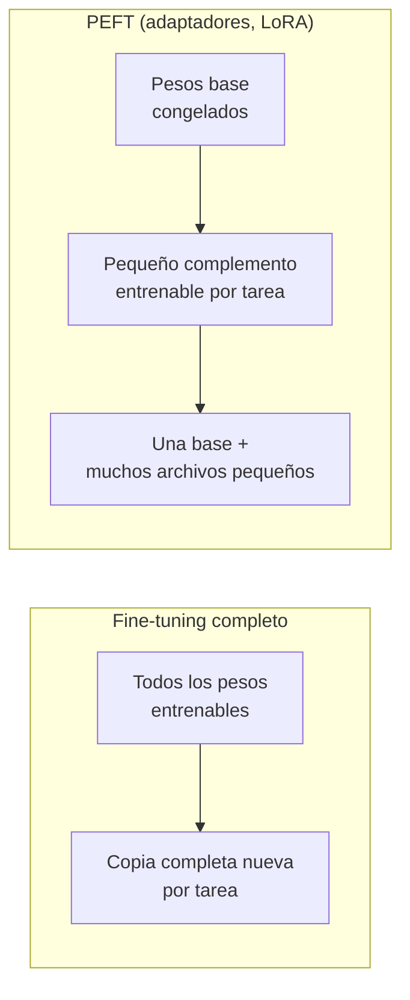
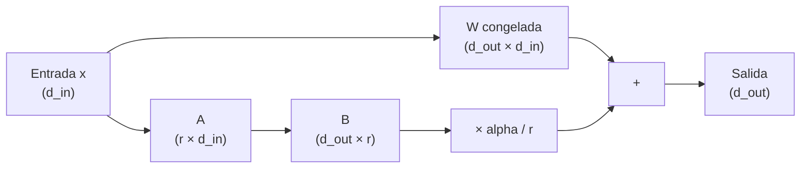
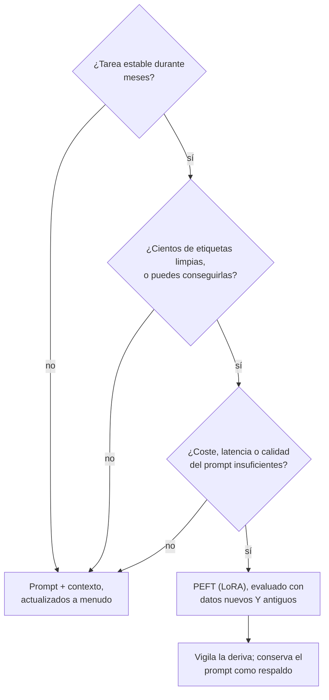
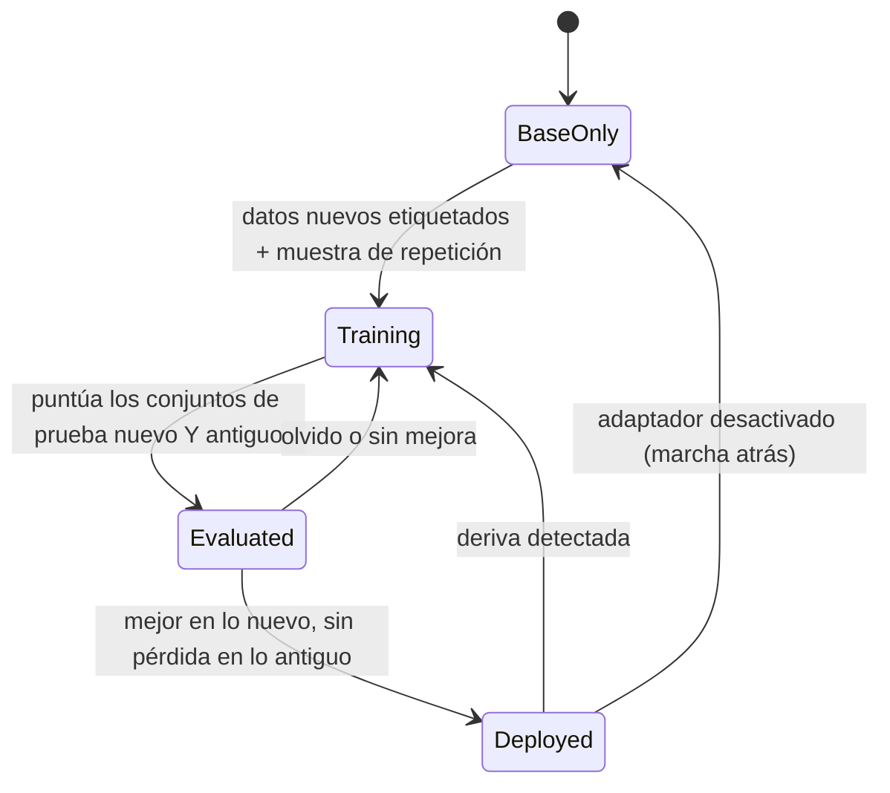

🌐 [English](04-fine-tuning-peft-and-lora.md) · Español

# Lección 4.4 — *Fine-tuning*, PEFT y LoRA: cuándo compensa cambiar los pesos

> **Módulo 04 · Lección 4 de 4** · ⏱️ unos 60 min · 🧪 Lab: [pasos 8–10](lab/README.es.md#paso-8--adapta-el-enrutador-a-la-deriva-sin-entrenar)

## 📨 Situación

> **De:** Dani Ruiz · Ciencia de datos
> **Canal:** #support-ai
>
> En la reunión de dirección alguien preguntó por qué no hacemos "simplemente un *fine-tuning*" del
> enrutador. Vale, pero con mis condiciones. Adapta con los tickets etiquetados de septiembre y
> puntúa con los de octubre a diciembre, que nadie ha mirado todavía. Compáralo con el mejor *prompt*
> que tenemos, actualizado con los mismos datos de septiembre. Quiero los parámetros entrenables, la
> exactitud en los tickets nuevos, en los de la cámara y en los de agosto, porque si el *fine-tuning*
> nos hace olvidar cómo enrutar un reembolso normal, quiero saberlo antes que la clientela. Y ejecuta
> varias semillas. Una semilla con suerte es una anécdota, no un resultado.

## 🎯 Objetivos

Al terminar esta lección puedes:

- Comparar el *fine-tuning* completo con el ajuste fino eficiente en parámetros (PEFT,
  *parameter-efficient fine-tuning*), incluidos los adaptadores y la adaptación de bajo rango (LoRA,
  *low-rank adaptation*), en parámetros entrenables, memoria y coste operativo.
- Calcular la actualización de LoRA `W + (alpha/r)·B·A`, su número de parámetros `r·(d_in + d_out)` y
  su proporción respecto a la matriz completa para un rango dado.
- Explicar cómo LoRA cuantizado (QLoRA) combina una base congelada de 4 bits con adaptadores LoRA, y
  calcular la memoria de los pesos con distintas precisiones.
- Decidir cuándo el *fine-tuning* gana al *prompting* a partir de la exactitud, los datos necesarios
  y el coste por petición medidos con la misma evaluación.
- Detectar el olvido catastrófico con un conjunto de prueba de datos antiguos y reducirlo con
  repetición (*replay*).

## 🤔 Predice primero

Apunta tus respuestas antes de seguir leyendo. Las comprobarás en la autoevaluación.

1. LoRA con rango 8 sobre una matriz de pesos de 8 filas y 1.024 columnas: ¿menos o más números
   entrenables que actualizar la matriz entera?
2. Sigues entrenando con los tickets de septiembre durante 40 veces más pasos. ¿La exactitud en los
   tickets de agosto sube, se queda igual o baja?
3. Con los tickets de la cámara de octubre a diciembre, ¿quién gana: el mejor *prompt* con un banco de
   ejemplos actualizado o un clasificador ajustado con los mismos tickets de septiembre?

## 1. *Fine-tuning* completo frente a ajuste fino eficiente en parámetros

El ajuste fino (*fine-tuning*) continúa el entrenamiento de un modelo preentrenado con tus ejemplos
etiquetados, para que el conocimiento acabe en los pesos en lugar de en el *prompt*. En el módulo 02
conociste la forma más común, el ajuste fino supervisado (SFT, *supervised fine-tuning*). El
***fine-tuning* completo** (*full fine-tuning*) actualiza todos los pesos. Es fácil de describir y caro
de hacer: durante el entrenamiento guardas los pesos, un gradiente por cada peso y el estado propio
del optimizador (el optimizador Adam, muy usado, guarda dos medias móviles por peso). Después guardas
una copia completa del modelo por cada tarea que ajustas.

Los pesos por sí solos ya deciden si un modelo cabe en tu hardware. Para un modelo hipotético de
7.000 millones de parámetros:

| Precisión | Bytes por parámetro | Memoria solo de los pesos |
|---|---|---|
| Coma flotante de 32 bits | 4 | 28.0 GB |
| Coma flotante de 16 bits | 2 | 14.0 GB |
| Enteros de 8 bits | 1 | 7.0 GB |
| 4 bits | 0.5 | 3.5 GB |

La memoria del entrenamiento va encima de esto: gradientes, estado del optimizador y las activaciones
que se guardan para el paso hacia atrás.

El **ajuste fino eficiente en parámetros (PEFT)** congela los pesos preentrenados y entrena un número
pequeño de pesos nuevos. Importan tres familias:

| Método | Qué entrena | Coste en inferencia |
|---|---|---|
| Adaptadores (*adapters*) | Pequeñas capas de cuello de botella insertadas entre las capas existentes del modelo | Unas pocas capas extra en cada pasada hacia delante |
| LoRA | Una actualización de bajo rango sumada a matrices de pesos existentes | Ninguno una vez fusionada con los pesos |
| Ajuste de *prompt* o de prefijo (*prompt or prefix tuning*) | Vectores aprendidos que se colocan delante de la entrada | Unas pocas posiciones extra en el contexto |

El artículo de los adaptadores (Houlsby y su equipo) mostró que ajustar pequeños módulos insertados
puede acercarse al *fine-tuning* completo en muchas tareas de clasificación de texto entrenando solo
una pequeña fracción de los parámetros. LoRA, que construirás a continuación, logra un efecto parecido
sin añadir capas.

La ventaja operativa es tan importante como el ahorro de memoria. Un único modelo base congelado
puede servir muchas tareas, cada una con su pequeño archivo de adaptador, y al desactivar un
adaptador vuelves exactamente al modelo original.

**Analogía:** el *fine-tuning* completo vuelve a pulir la lente de la cámara para un tipo de foto. PEFT
coloca un pequeño filtro sobre la lente: barato de fabricar, fácil de cambiar, y la lente de debajo
queda intacta.



```python
def weight_memory_gb(n_params: float, bits: int) -> float:
    """Memory to hold the weights alone, in gigabytes (10**9 bytes)."""
    return round(n_params * bits / 8 / 1e9, 2)

weight_memory_gb(7e9, 16)  # 14.0
```

> ⚠️ **Error común:** estimar la memoria de entrenamiento solo a partir de los pesos. Un modelo cuyos
> pesos de 16 bits caben en tu unidad de procesamiento gráfico (GPU, *graphics processing unit*)
> normalmente no se podrá entrenar en ella con *fine-tuning* completo, porque los gradientes y el
> estado del optimizador necesitan varias veces más memoria.

## 2. LoRA: una actualización de bajo rango que puedes fusionar

Toma una matriz de pesos `W` con `d_out` filas y `d_in` columnas. El *fine-tuning* aprendería una
actualización `ΔW` de la misma forma. La hipótesis detrás de LoRA, respaldada por los experimentos del
artículo, es que las actualizaciones útiles para una tarea nueva suelen tener **bajo rango**: se
pueden escribir como el producto de dos matrices estrechas. Así que, en lugar de aprender `ΔW`
directamente, LoRA aprende

`W' = W + (alpha / r) · B · A`, con `B` de forma `(d_out, r)` y `A` de forma `(r, d_in)`.

| Símbolo | Significado | En el lab |
|---|---|---|
| `W` | Peso preentrenado, congelado | Pesos del clasificador de 8 × 1.024 entrenado con enero–julio |
| `r` | Rango: la anchura del cuello de botella | 1, 2, 4 u 8 |
| `A` | Proyecta la entrada hacia abajo, a r números | Aleatoria al principio |
| `B` | Proyecta esos r números hacia arriba, a la salida | Ceros al principio, así que `W'` empieza igual a `W` |
| `alpha / r` | Escala de la actualización | `alpha = r`, así que la escala es 1 en todos los rangos |

El número de valores entrenables es `r · (d_in + d_out)` en lugar de `d_in · d_out`. Para una matriz
de 4.096 × 4.096, como las que hay dentro de un modelo de lenguaje grande (LLM, *large language model*)
de tamaño medio:

| Rango | Números de LoRA | Proporción de la matriz completa |
|---|---|---|
| 1 | 8,192 | 0.00049 |
| 8 | 65,536 | 0.00391 |
| 64 | 524,288 | 0.03125 |

El rango 8 entrena el 0,39 % de la matriz. Aplicado a un modelo grande, el artículo de LoRA informa de
que reduce los parámetros entrenables de GPT-3 175B hasta 10.000 veces. Pero el ahorro depende de la
forma. El clasificador del lab solo tiene 8 filas (una por intención), así que una actualización de
rango 8 ya es de rango completo:

| Modelo | Números entrenables | Proporción respecto al *fine-tuning* completo |
|---|---|---|
| *Fine-tuning* completo (pesos y sesgos) | 8,200 | 1.000 |
| LoRA r=1 | 1,032 | 0.126 |
| LoRA r=4 | 4,128 | 0.503 |
| LoRA r=8 | 8,256 | 1.007 |

LoRA compensa cuando `r` es mucho menor que *las dos* dimensiones. Con una matriz estrecha, puede
costar más que actualizar la matriz directamente.

Dos propiedades más hacen práctico a LoRA. Tras el entrenamiento puedes **fusionar** (*merge*) la
actualización con `W`, así que el modelo desplegado tiene exactamente la forma original y ningún coste
de inferencia extra. Y como `B` empieza en cero, el entrenamiento parte exactamente del comportamiento
preentrenado.

El lab no puede hacer *fine-tuning* de un LLM en la unidad central de procesamiento (CPU, *central
processing unit*) de un portátil en segundos, así que aplica exactamente estas ecuaciones a un pequeño
clasificador lineal de intenciones (variables de bolsa de palabras con *hashing*, 1.024 entradas, 8
salidas). El álgebra, la inicialización y los gradientes son los mismos que una biblioteca PEFT aplica
a cada matriz de un Transformer.

**Analogía:** en lugar de reimprimir un manual de 1.000 páginas para un producto nuevo, añades un
breve encarte de notas al margen. El encarte es diminuto, el manual queda intacto y siempre puedes
sacar el encarte.



Los gradientes salen de la regla de la cadena. El lab calcula primero `grad_W`, el gradiente que el
*fine-tuning* completo aplicaría a `W` (a partir de la señal de error `G` y de las entradas `X`), y
LoRA lo convierte en gradientes para `A` y `B`:

```python
# Inside train_lora(), once per training step
G = error_signal(model.logits(X), y)
grad_W = G.T @ X  # (C, D): what full fine-tuning would apply to W
grad_B = model.scale * grad_W @ model.A.T  # chain rule through W' = W + s * B @ A
grad_A = model.scale * model.B.T @ grad_W
model.B -= lr * grad_B
model.A -= lr * grad_A  # model.base.W is never touched
```

> 💡 **Consejo de producción:** empieza con un rango pequeño (8 o 16 es un primer intento habitual),
> adapta primero las proyecciones de la atención y sube el rango solo si la evaluación muestra que a la
> actualización le falta capacidad. La tabla del lab muestra el patrón típico: grandes mejoras de rango
> 1 a 4 y poco después.

## 3. QLoRA: una base de 4 bits con LoRA encima

LoRA reduce lo que entrenas; la base congelada sigue siendo grande. La **cuantización**
(*quantization*) guarda cada peso con menos bits (el módulo 10 la trata para servir modelos).
**QLoRA** combina las dos cosas: guarda la base congelada en un formato de 4 bits, calcula con ella en
16 bits sobre la marcha y entrena encima adaptadores LoRA en 16 bits. Los gradientes fluyen *a través*
de la base cuantizada hasta los adaptadores, pero la base nunca cambia.

Con la tabla de memoria de los pesos de arriba, el modelo hipotético de 7.000 millones de parámetros
baja de 14.0 GB en 16 bits a 3.5 GB en 4 bits. Según el artículo de QLoRA, el método permitió hacer
*fine-tuning* de un modelo de 65.000 millones de parámetros en una sola GPU de 48 GB, conservando el
rendimiento en la tarea del *fine-tuning* en 16 bits.

Lo que QLoRA cambia es *dónde* puedes hacer *fine-tuning*, no *si* deberías hacerlo. Todas las
preguntas del resto de esta lección se le aplican sin cambios.

**Analogía:** tener en pantalla una foto de referencia comprimida mientras dibujas sobre una hoja
transparente con toda la calidad. La referencia ocupa poco espacio y tu dibujo conserva todo su
detalle.

```python
from m04_adaptation import reports

reports.memory_table(7e9)  # {32: 28.0, 16: 14.0, 8: 7.0, 4: 3.5}  (gigabytes, weights only)
```

> ⚠️ **Error común:** fusionar un adaptador LoRA entrenado sobre una base de 4 bits con una copia de
> 16 bits y dar por hecho que el comportamiento es idéntico. El adaptador aprendió a corregir los pesos
> *cuantizados*. Si lo fusionas con otra precisión, vuelve a ejecutar la evaluación antes de lanzarlo.

## 4. Cuándo el *fine-tuning* gana al *prompting*

Ahora, la comparación de Dani. Todo lo que sigue usa los mismos meses: la base o el banco de ejemplos
sale de enero–julio (704 tickets), la adaptación usa los 97 tickets etiquetados de septiembre y las
puntuaciones salen de agosto (96 tickets, "antiguos") y de octubre–diciembre (303 tickets, "nuevos").
Cada ticket de agosto vale aproximadamente un punto, así que ahí las diferencias de 0.01 son un solo
ticket.

| Enfoque | Tickets etiquetados | Números entrenables | Agosto | Oct–dic | Cámara | *Tokens* del *prompt* |
|---|---|---|---|---|---|---|
| 0 ejemplos, definiciones originales | 0 | 0 | 0.760 | 0.710 | 0.496 | 352.7 |
| 0 ejemplos, definiciones reescritas tras leer septiembre | 0 | 0 | 0.760 | 0.851 | 0.851 | 430.9 |
| 8 ejemplos parecidos, banco de enero–julio | 704 | 0 | 0.917 | 0.825 | 0.620 | 656.0 |
| 8 ejemplos parecidos, banco de enero–julio + septiembre | 801 | 0 | 0.917 | 0.901 | 0.810 | 658.7 |
| Clasificador entrenado con enero–julio (base congelada) | 704 | — | 0.917 | 0.828 | 0.628 | — |
| + *fine-tuning* completo con septiembre | 801 | 8,200 | 0.906 | 0.927 | 0.893 | — |
| + LoRA r=4 con septiembre (media de 5 semillas) | 801 | 4,128 | 0.904 | 0.905 | 0.868 | — |

Léela de arriba abajo:

- **El arreglo más barato es sorprendentemente fuerte.** Reescribir las definiciones de las etiquetas
  tras leer los tickets de septiembre no necesitó etiquetas ni entrenamiento, y subió la exactitud en
  la cámara de 0.496 a 0.851. Pero conviene matizarlo en favor de las otras filas: los tickets de octubre reutilizan las
  expresiones de septiembre, lo que favorece la coincidencia por palabras clave. Una paráfrasis que
  las definiciones no mencionan no se detectaría.
- **Actualizar el banco de ejemplos** con 97 tickets etiquetados de septiembre subió el *prompt*
  *few-shot* de 0.825 a 0.901 en los tickets nuevos.
- **El *fine-tuning* gana en los tickets nuevos.** El *fine-tuning* completo llegó a 0.927 (cámara
  0.893), y LoRA r=4 llegó a 0.905 entrenando la mitad de números. El clasificador, además, envía cero
  ejemplos por petición, frente a unos 659 *tokens* de *prompt* del *prompt* *few-shot* actualizado.

La tabla de rangos muestra el compromiso de capacidad y por qué Dani pidió semillas:

| Rango de LoRA | Oct–dic (media de 5 semillas) | Cámara | Dispersión entre semillas |
|---|---|---|---|
| 1 | 0.870 | 0.770 | 0.042 |
| 2 | 0.893 | 0.825 | 0.046 |
| 4 | 0.905 | 0.868 | 0.020 |
| 8 | 0.906 | 0.874 | 0.013 |

Con rango 1, el resultado depende mucho del arranque aleatorio de `A` (una dispersión de 0.042 entre
la mejor y la peor semilla); a partir del rango 4, las ejecuciones coinciden más y las mejoras se
aplanan.

**¿Cuántos datos?** Adaptar solo con los 12 primeros tickets de septiembre ya subió la exactitud de
octubre–diciembre de 0.828 a 0.865 (completo) y 0.867 (LoRA r=4); con 50 tickets se obtuvo 0.911 y
0.908. En una tarea acotada con una buena base, unas decenas de ejemplos limpios, recientes y bien
etiquetados llegan muy lejos. La calidad gana a la cantidad: alrededor del 4 % de estas etiquetas
están mal, y cada etiqueta errónea es una lección que el modelo aprende fielmente.

Entonces, ¿cuándo gana el *fine-tuning* al *prompting*? Cuando la tarea es **estable**, tienes
**suficientes etiquetas limpias**, el volumen encarece los ***tokens* por petición**, la latencia es
ajustada o necesitas un comportamiento que un *prompt* no consigue de forma fiable. El *prompting*
gana cuando las etiquetas, los productos o los hechos cambian más deprisa de lo que puedes reentrenar,
cuando tienes pocas etiquetas o cuando necesitas leer y auditar la lógica. Muchos equipos acaban con
las dos cosas: un modelo ajustado para el núcleo estable y un *prompt* para los bordes que cambian.

**Analogía:** una ficha de receta frente a alguien con oficio en la cocina. La ficha puede cambiar
esta misma noche; quien cocina trabaja con más rapidez y constancia, pero aprender un plato nuevo le exige
práctica.



```python
from m04_adaptation.lora import train_full, train_lora
from m04_adaptation.reports import base_model, lora_data

d, base = lora_data(), base_model()
full = train_full(d.X_adapt, d.y_adapt, start=base, steps=100, lr=2.0)
runs = [train_lora(base, d.X_adapt, d.y_adapt, rank=4, steps=100, lr=2.0, seed=s) for s in range(5)]
print(full.accuracy(d.X_new, d.y_new), [m.accuracy(d.X_new, d.y_new) for m in runs])
```

> ⚠️ **Error común:** comparar un modelo ajustado con un *prompt* desfasado. El rival justo es el
> mejor *prompt* que puedes construir con los *mismos* datos nuevos: ejemplos actualizados y
> definiciones reescritas. Aquí ese rival llegó a 0.901, no a 0.825.

## 5. Olvido catastrófico

Un modelo que se sigue entrenando con datos nuevos puede perder habilidades que tenía antes. Cuando la
pérdida es repentina y grande, se llama **olvido catastrófico** (*catastrophic forgetting*). Los
tickets de agosto de Dani son la alarma: son tickets anteriores al lanzamiento que la base ya
gestionaba bien (0.917), así que cualquier caída ahí es olvido.

Entrena solo con septiembre, cada vez durante más tiempo:

| Pasos | Completo: agosto | Completo: oct–dic | LoRA r=4 (semilla 0): agosto | LoRA r=4: oct–dic | Completo + repetición: agosto | Completo + repetición: oct–dic |
|---|---|---|---|---|---|---|
| 100 | 0.906 | 0.927 | 0.906 | 0.901 | 0.906 | 0.927 |
| 1,000 | 0.875 | 0.904 | 0.885 | 0.881 | 0.906 | 0.914 |
| 4,000 | 0.792 | 0.855 | 0.812 | 0.848 | 0.865 | 0.888 |

De esta tabla salen tres lecciones:

1. **El olvido crece al entrenar con datos acotados.** La exactitud en agosto cayó de 0.906 a 0.792
   con *fine-tuning* completo. La exactitud en los tickets nuevos también cayó (de 0.927 a 0.855): con
   solo 97 ejemplos, entrenar mucho tiempo los memoriza en lugar de aprender de ellos.
2. **Un rango bajo no es un escudo.** LoRA r=4 olvidó aquí más o menos lo mismo que el *fine-tuning*
   completo (0.812). Una actualización pequeña puede apuntar igualmente en una dirección dañina. Mide
   el olvido con todos los métodos; no lo descartes por suposición.
3. **La repetición funciona.** Mezclar 100 tickets aleatorios de enero–julio con los datos de
   entrenamiento de septiembre mantuvo agosto en 0.906 tras 1.000 pasos y en 0.865 tras 4.000, lo
   mejor de las tres columnas.

PEFT añade otra defensa que no tiene nada que ver con la exactitud: los pesos base nunca cambian. Si
un adaptador se porta mal en producción, desactivarlo restaura al instante el modelo original, y cada
tarea puede tener su propio adaptador para que el ajuste de un equipo no pueda dañar a otro.

**Analogía:** quien toca un instrumento y durante un mes solo ensaya la pieza nueva la toca de
maravilla y tropieza con el repertorio antiguo. Repasar cada día unas cuantas piezas antiguas
(repetición) lo evita.



```python
# Excerpt of forgetting_table() in reports.py
idx = np.random.default_rng(0).choice(len(d.y_train), 100, replace=False)
X_mix = np.vstack([d.X_adapt, d.X_train[idx]])  # September + 100 old tickets (replay)
y_mix = np.concatenate([d.y_adapt, d.y_train[idx]])
replay = train_full(X_mix, y_mix, start=base, steps=steps, lr=2.0)
```

> 💡 **Consejo de producción:** convierte el conjunto de prueba de datos antiguos en una compuerta de
> lanzamiento. Un adaptador solo se lanza si mejora el segmento nuevo *y* se mantiene dentro de una
> tolerancia acordada en el antiguo (por ejemplo, "como mucho un ticket peor en agosto"), y la decisión
> se registra con los dos números.

## 🧪 Pruébalo

1. Adapta sin entrenar: reescribe las definiciones o actualiza el banco de ejemplos.

   ```bash
   uv run lab drift
   ```

   ```text
   Prompt-side adaptation (old = August, new = October-December)
   -------------------------------------------------------------
   approach                         labelled    old    new  camera  tokens
   0-shot, original descriptions           0  0.760  0.710   0.496   352.7
   0-shot, descriptions updated            0  0.760  0.851   0.851   430.9
   8 similar, pool Jan-Jul               704  0.917  0.825   0.620   656.0
   8 similar, pool Jan-Jul + Sep         801  0.917  0.901   0.810   658.7
   ```

2. Haz *fine-tuning*: completo frente a rangos de LoRA, olvido y datos necesarios. Los resultados de
   numpy pueden diferir en un ticket en otra máquina.

   ```bash
   uv run lab lora
   ```

   ```text
   Adapting the frozen classifier with 97 September tickets (LoRA: mean of 5 seeds)
   --------------------------------------------------------------------------------
   model                      trainable  share    old    new  camera  spread
   base (frozen, no update)           0  0.000  0.917  0.828   0.628   0.000
   full fine-tuning                8200  1.000  0.906  0.927   0.893   0.000
   LoRA r=1                        1032  0.126  0.906  0.870   0.770   0.042
   LoRA r=2                        2064  0.252  0.904  0.893   0.825   0.046
   LoRA r=4                        4128  0.503  0.904  0.905   0.868   0.020
   LoRA r=8                        8256  1.007  0.904  0.906   0.874   0.013

   Forgetting: train longer on September only (old = August accuracy)
   ------------------------------------------------------------------
   steps  full old  full new  r=4 old  r=4 new replay old replay new
     100     0.906     0.927    0.906    0.901      0.906      0.927
    1000     0.875     0.904    0.885    0.881      0.906      0.914
    4000     0.792     0.855    0.812    0.848      0.865      0.888

   How many labelled September tickets? (accuracy on October-December)
   -------------------------------------------------------------------
   labelled   full  LoRA r=4
         12  0.865     0.867
         25  0.871     0.881
         50  0.911     0.908
         97  0.927     0.905
   ```

3. Dimensiona LoRA para una matriz del tamaño de las de un LLM y para la matriz estrecha del lab.

   ```bash
   uv run lab lora-params
   uv run lab lora-params --d-in 1024 --d-out 8
   ```

   ```text
   LoRA size for one 4096 x 4096 weight matrix (full: 16,777,216 numbers)
   ----------------------------------------------------------------------
   rank  LoRA numbers  share of full
      1         8,192        0.00049
      2        16,384        0.00098
      4        32,768        0.00195
      8        65,536        0.00391
     16       131,072        0.00781
     64       524,288        0.03125

   weights-only memory for 7,000,000,000 parameters: 32-bit 28.0 GB · 16-bit 14.0 GB · 8-bit 7.0 GB · 4-bit 3.5 GB
   ```

   El segundo comando imprime la misma tabla para el clasificador de 8 × 1.024, donde el rango 8
   necesita 8.256 números, más que los 8.192 pesos de la propia matriz.

4. Implementa `lora_logits` en `src/m04_adaptation/exercises.py`: la pasada hacia delante de LoRA sin
   construir nunca la matriz de actualización completa. Compruébalo con
   `uv run pytest tests/test_exercises.py -k lora`.

## 🏭 En el mundo real

- **Las bibliotecas hacen la fontanería.** Los equipos rara vez escriben LoRA a mano; la biblioteca
  PEFT de Hugging Face envuelve un modelo, inyecta los adaptadores en las capas elegidas y guarda solo
  los pesos de los adaptadores. Conocer las matemáticas te dice qué mandos importan (rango, alpha,
  capas objetivo, tasa de aprendizaje).
- **Servir muchos adaptadores.** Algunos motores de servicio pueden mantener un único modelo base en
  memoria y aplicar un adaptador LoRA distinto en cada petición, lo que hace asequible el ajuste por
  cliente o por equipo. Consulta la documentación de tu motor antes de diseñar en torno a ello.
- **El proceso de datos es el verdadero proyecto.** Deduplica, corrige o descarta las etiquetas
  ruidosas, parte por tiempo, mantén una compuerta de datos antiguos y versiona el dataset junto con el
  adaptador. La mayoría de los proyectos de *fine-tuning* que fracasan lo hacen por los datos, no por
  los hiperparámetros.
- **Reentrenar tiene un calendario.** La deriva no se detiene. Decide de antemano qué dispara un
  adaptador nuevo (una alarma de vocabulario no visto, una cadencia mensual, un lanzamiento de
  producto) y cuál es el respaldo mientras se entrena: normalmente, el *prompt* que ya tienes.
- **Licencias y privacidad.** Los datos de *fine-tuning* suelen contener texto de la clientela.
  Anonimiza primero los datos personales, comprueba que la licencia del modelo base permite el
  *fine-tuning* para tu uso y recuerda que un modelo puede memorizar cadenas poco frecuentes de sus
  datos de entrenamiento.

## ✅ Autoevaluación

**1. Volvamos a la predicción 1: rango 8 sobre una matriz de 8 × 1.024. ¿Menos o más números
entrenables?**

<details><summary>Respuesta</summary>

Más: `8 · (1,024 + 8) = 8,256` frente a los 8.192 pesos de la matriz (8.200 con los sesgos). Una
matriz de 8 filas tiene como mucho rango 8, así que una actualización de rango 8 ya es una
actualización completa disfrazada. LoRA ahorra parámetros solo cuando el rango es mucho menor que las
dos dimensiones, como con una matriz de 4.096 × 4.096, donde el rango 8 es el 0,39 % del tamaño
completo.

</details>

**2. Volvamos a la predicción 2: ¿qué le pasó a la exactitud en agosto al entrenar 40 veces más?**

<details><summary>Respuesta</summary>

Bajó: de 0.906 con 100 pasos a 0.792 con 4.000 pasos con *fine-tuning* completo, y a 0.812 con LoRA
r=4. Entrenar más tiempo con un conjunto acotado de tickets nuevos sobrescribió lo que el modelo sabía
de los antiguos (olvido catastrófico) y además sobreajustó los nuevos (oct–dic cayó a 0.855). La
repetición de 100 tickets antiguos mantuvo agosto en 0.865 incluso con 4.000 pasos.

</details>

**3. Volvamos a la predicción 3: ¿*prompt* actualizado o clasificador ajustado en los tickets de la
cámara?**

<details><summary>Respuesta</summary>

En esta tarea acotada ganó el clasificador ajustado: 0.893 con *fine-tuning* completo y 0.868 con LoRA
r=4, frente a 0.810 del *prompt* *few-shot* con el banco actualizado. Reescribir las definiciones llegó
a 0.851 sin ninguna etiqueta, algo notable para el trabajo de una tarde, aunque en parte favorecido
porque los tickets de octubre reutilizan las expresiones de septiembre.

</details>

**4. Escribe la actualización de LoRA y di para qué sirve cada parte. ¿Por qué B empieza en cero?**

<details><summary>Respuesta</summary>

`W' = W + (alpha/r)·B·A`. `W` es el peso preentrenado congelado, `A` (r × d_in) comprime la entrada a
r números, `B` (d_out × r) los vuelve a expandir y `alpha/r` escala la actualización para que cambiar r
no obligue a reajustar la tasa de aprendizaje. Con `B = 0` la actualización es cero al principio, así
que el entrenamiento parte exactamente del comportamiento del modelo preentrenado y no de una
perturbación aleatoria de él.

</details>

**5. Alguien del equipo dice: "usamos LoRA, así que el olvido no es un problema". ¿Qué le respondes?**

<details><summary>Respuesta</summary>

El rango limita cuánto puede cambiar el modelo, no dónde cambia. En el lab, LoRA r=4 olvidó más o
menos lo mismo que el *fine-tuning* completo (agosto 0.812 frente a 0.792 tras 4.000 pasos). Lo que
LoRA sí garantiza es que los pesos base quedan intactos, así que puedes desactivar el adaptador.
Sigues necesitando una compuerta de datos antiguos, repetición o parada temprana, y una medición.

</details>

## 💬 Explícalo con tus palabras

- Explícale a Dani por qué la tabla de LoRA informa de la media de cinco semillas y de una dispersión,
  y qué significaría la dispersión de 0.042 con rango 1 para una decisión basada en una sola ejecución.
- Explícale a Alex, con palabras sencillas, por qué "hazle *fine-tuning*" no es una tarea de una sola
  vez y qué tiene que pasar cada vez que Hearthwise lanza un producto.

## 🔑 Ideas clave

- El *fine-tuning* completo actualiza todos los pesos y necesita memoria para los gradientes y el
  estado del optimizador; PEFT congela la base y entrena un pequeño complemento por tarea.
- LoRA aprende `W + (alpha/r)·B·A` con `r·(d_in + d_out)` números entrenables, parte de la base
  (B = 0) y desaparece al fusionarse en inferencia. Solo compensa cuando r es mucho menor que las dos
  dimensiones.
- QLoRA guarda la base congelada en 4 bits y entrena encima adaptadores de 16 bits, lo que cambia
  dónde puedes hacer *fine-tuning*, no si deberías hacerlo.
- El *fine-tuning* ganó al mejor *prompt* actualizado en esta tarea estable y etiquetada, y eliminó los
  ejemplos de cada petición, pero el arreglo de *prompt* más barato cerró buena parte de la brecha sin
  ninguna etiqueta.
- Puntúa siempre los datos antiguos además de los nuevos: el olvido crece con el entrenamiento
  acotado, un rango bajo no lo evita y la repetición sí ayuda.

## 📚 Profundiza

- ⭐ [LoRA: Low-Rank Adaptation of Large Language Models](https://arxiv.org/abs/2106.09685) — breve,
  legible, y su sección 4 explica el método exactamente con la notación que se usa aquí.
- [QLoRA: Efficient Finetuning of Quantized LLMs](https://arxiv.org/abs/2305.14314) — modelos base de
  4 bits con adaptadores LoRA, y los trucos de memoria que lo hacen posible.
- [Parameter-Efficient Transfer Learning for NLP (adapters)](https://arxiv.org/abs/1902.00751) — el
  artículo de los adaptadores con el que empezó la familia PEFT.
- [Documentación de Hugging Face PEFT](https://huggingface.co/docs/peft) — cómo se aplican LoRA y otros
  métodos a modelos reales, con las opciones de configuración explicadas.
- [Documentación de Hugging Face TRL](https://huggingface.co/docs/trl) — bucles de entrenamiento para
  el ajuste fino supervisado y la optimización de preferencias que funcionan junto con PEFT.

---

[← Anterior: 4.3 Ingeniería de contexto](03-context-engineering.es.md) · [🏠 Módulo 04](README.es.md) · [Siguiente: Lab 04 →](lab/README.es.md)
