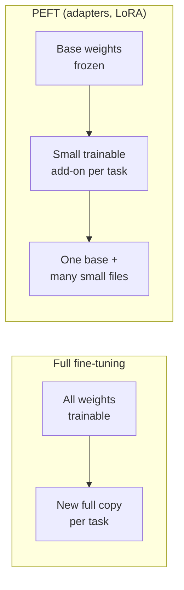
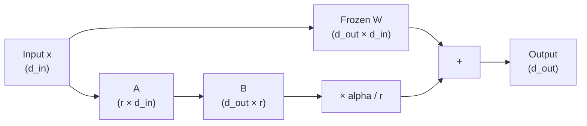
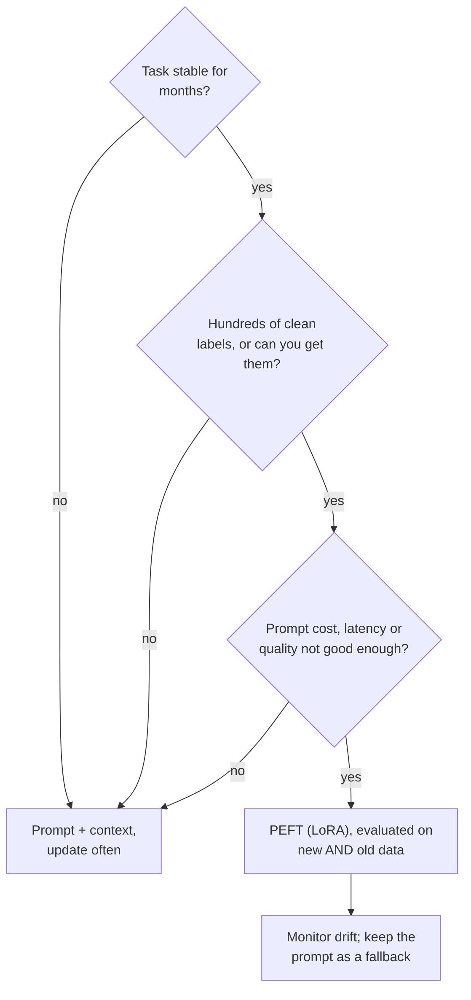
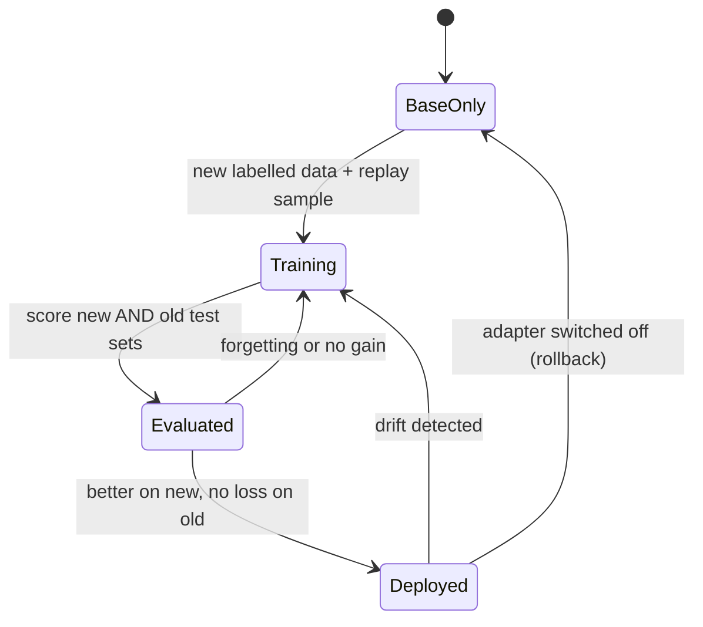

🌐 English · [Español](04-fine-tuning-peft-and-lora.es.md)

# Lesson 4.4 — Fine-tuning, PEFT and LoRA: when changing the weights pays off

> **Module 04 · Lesson 4 of 4** · ⏱️ about 60 min · 🧪 Lab: [steps 8–10](lab/README.md#step-8--adapt-to-drift-without-training)

## 📨 Situation

> **From:** Dani Ruiz · Data Scientist
> **Channel:** #support-ai
>
> In the leadership meeting someone asked why we don't "just fine-tune" the router. Fine, but on my
> terms. Adapt on the labelled September tickets, then score on October to December, which nobody has
> looked at yet. Compare it with the best prompt we have, refreshed with the same September data. I
> want trainable parameters, accuracy on new tickets, accuracy on camera tickets, and accuracy on
> August tickets, because if fine-tuning makes us forget how to route a plain refund, I want to know
> before the customers do. And run several seeds. One lucky seed is an anecdote, not a result.

## 🎯 Objectives

By the end of this lesson you can:

- Compare full fine-tuning with parameter-efficient fine-tuning (PEFT), including adapters and
  low-rank adaptation (LoRA), in trainable parameters, memory and operational cost.
- Compute LoRA's update `W + (alpha/r)·B·A`, its parameter count `r·(d_in + d_out)` and its share of
  the full matrix for a given rank.
- Explain how quantized LoRA (QLoRA) combines a 4-bit frozen base with LoRA adapters, and compute
  weights-only memory at different precisions.
- Decide when fine-tuning beats prompting from accuracy, data needs and per-request cost measured on
  the same evaluation.
- Detect catastrophic forgetting with an old-data test set and reduce it with replay.

## 🤔 Predict first

Write your answers down before reading on. You will check them in the self-check.

1. LoRA with rank 8 on a weight matrix with 8 rows and 1,024 columns: fewer or more trainable numbers
   than updating the whole matrix?
2. You keep training on the September tickets for 40 times as many steps. Does accuracy on August
   tickets go up, stay the same or go down?
3. On October–December camera tickets, which wins: the best prompt with a refreshed example pool, or
   a classifier fine-tuned on the same September tickets?

## 1. Full fine-tuning versus parameter-efficient fine-tuning

Fine-tuning continues training a pre-trained model on your labelled examples, so the knowledge ends
up in the weights instead of in the prompt. You met the most common form, supervised fine-tuning
(SFT), in module 02. **Full fine-tuning** updates every weight. That is simple to describe and
expensive to do: during training you hold the weights, a gradient for every weight, and the
optimizer's own state (the widely used Adam optimizer keeps two running averages per weight). Then
you store a complete copy of the model for every task you tune.

The weights alone already decide whether a model fits on your hardware. For a hypothetical model
with 7 billion parameters:

| Precision | Bytes per parameter | Weights-only memory |
|---|---|---|
| 32-bit floats | 4 | 28.0 GB |
| 16-bit floats | 2 | 14.0 GB |
| 8-bit integers | 1 | 7.0 GB |
| 4-bit | 0.5 | 3.5 GB |

Training memory comes on top of this: gradients, optimizer state and the activations kept for the
backward pass.

**Parameter-efficient fine-tuning (PEFT)** freezes the pre-trained weights and trains a small number
of new ones. Three families matter:

| Method | What it trains | Inference cost |
|---|---|---|
| Adapters | Small bottleneck layers inserted between the model's existing layers | A few extra layers per forward pass |
| LoRA | A low-rank update added to existing weight matrices | None once merged into the weights |
| Prompt or prefix tuning | Learned vectors placed in front of the input | A few extra positions in the context |

The adapter paper (Houlsby and colleagues) showed that tuning small inserted modules can come close
to full fine-tuning on many text classification tasks while training only a small fraction of the
parameters. LoRA, which you will build next, achieves a similar effect without adding layers.

The operational win is as important as the memory win. One frozen base model can serve many tasks,
each with its own small adapter file, and switching off an adapter returns you exactly to the
original model.

**Analogy:** full fine-tuning regrinds the camera's lens for one kind of photo. PEFT clips a small
filter onto the lens: cheap to make, easy to swap, and the lens underneath is untouched.



```python
def weight_memory_gb(n_params: float, bits: int) -> float:
    """Memory to hold the weights alone, in gigabytes (10**9 bytes)."""
    return round(n_params * bits / 8 / 1e9, 2)

weight_memory_gb(7e9, 16)  # 14.0
```

> ⚠️ **Common mistake:** estimating training memory from the weights alone. A model whose 16-bit
> weights fit on your graphics processing unit (GPU) will usually not train there with full
> fine-tuning, because gradients and optimizer state need several times more memory.

## 2. LoRA: a low-rank update you can merge

Take one weight matrix `W` with `d_out` rows and `d_in` columns. Fine-tuning would learn an update
`ΔW` of the same shape. The hypothesis behind LoRA, backed by the paper's experiments, is that
useful updates for a new task tend to have **low rank**: they can be written as the product of two
thin matrices. So instead of learning `ΔW` directly, LoRA learns

`W' = W + (alpha / r) · B · A`, with `B` of shape `(d_out, r)` and `A` of shape `(r, d_in)`.

| Symbol | Meaning | In the lab |
|---|---|---|
| `W` | Pre-trained weight, frozen | 8 × 1,024 classifier weights trained on January–July |
| `r` | Rank: the width of the bottleneck | 1, 2, 4 or 8 |
| `A` | Projects the input down to r numbers | Random at the start |
| `B` | Projects those r numbers up to the output | Zeros at the start, so `W'` starts equal to `W` |
| `alpha / r` | Scale of the update | `alpha = r`, so the scale is 1 at every rank |

The trainable count is `r · (d_in + d_out)` instead of `d_in · d_out`. For a 4,096 × 4,096 matrix,
the kind found inside a mid-size large language model (LLM):

| Rank | LoRA numbers | Share of the full matrix |
|---|---|---|
| 1 | 8,192 | 0.00049 |
| 8 | 65,536 | 0.00391 |
| 64 | 524,288 | 0.03125 |

Rank 8 trains 0.39% of the matrix. Applied to a large model, the LoRA paper reports reducing the
trainable parameters of GPT-3 175B by up to 10,000 times. The saving depends on the shape, though.
The lab's classifier has only 8 rows (one per intent), so a rank-8 update is already full rank:

| Model | Trainable numbers | Share of full fine-tuning |
|---|---|---|
| Full fine-tuning (weights and biases) | 8,200 | 1.000 |
| LoRA r=1 | 1,032 | 0.126 |
| LoRA r=4 | 4,128 | 0.503 |
| LoRA r=8 | 8,256 | 1.007 |

LoRA pays off when `r` is much smaller than *both* dimensions. On a thin matrix, it can cost more
than updating the matrix directly.

Two more properties make LoRA practical. After training you can **merge** the update into `W`, so the
deployed model has exactly the original shape and no extra inference cost. And because `B` starts at
zero, training begins from precisely the pre-trained behaviour.

The lab can't fine-tune an LLM on a laptop's central processing unit (CPU) in seconds, so it applies
these exact equations to a small linear intent classifier (hashed bag-of-words features, 1,024 inputs, 8
outputs). The algebra, the initialisation and the gradients are the same ones a PEFT library applies to
each matrix of a transformer.

**Analogy:** instead of reprinting a 1,000-page manual for a new product, you add a short insert of
margin notes. The insert is tiny, the manual is untouched, and you can always pull the insert out.



The gradients follow from the chain rule. The lab first computes `grad_W`, the gradient that full
fine-tuning would apply to `W` (built from the error signal `G` and the inputs `X`), and LoRA turns it
into gradients for `A` and `B`:

```python
# Inside train_lora(), once per training step
G = error_signal(model.logits(X), y)
grad_W = G.T @ X  # (C, D): what full fine-tuning would apply to W
grad_B = model.scale * grad_W @ model.A.T  # chain rule through W' = W + s * B @ A
grad_A = model.scale * model.B.T @ grad_W
model.B -= lr * grad_B
model.A -= lr * grad_A  # model.base.W is never touched
```

> 💡 **Production tip:** start with a small rank (8 or 16 is a common first try), adapt the attention
> projections first, and raise the rank only if the evaluation shows the update lacks capacity. The
> lab's table shows the typical pattern: big gains from rank 1 to 4, little after.

## 3. QLoRA: a 4-bit base with LoRA on top

LoRA shrinks what you train; the frozen base is still big. **Quantization** stores each weight with
fewer bits (module 10 covers it for serving). **QLoRA** combines the two: keep the frozen base in a
4-bit format, compute with it in 16-bit on the fly, and train LoRA adapters in 16-bit on top.
Gradients flow *through* the quantized base into the adapters, but the base never changes.

Using the weights-only table above, the hypothetical 7-billion-parameter model drops from 14.0 GB
in 16-bit to 3.5 GB in 4-bit. According to the QLoRA paper, the method made it possible to
fine-tune a 65-billion-parameter model on a single 48 GB GPU while preserving the task performance of
16-bit fine-tuning.

What QLoRA changes is *where* you can fine-tune, not *whether* you should. Every question in the
rest of this lesson applies to it unchanged.

**Analogy:** keeping a compressed reference photo on screen while you draw on a transparent sheet
at full quality. The reference costs little space, and your drawing keeps all its detail.

```python
from m04_adaptation import reports

reports.memory_table(7e9)  # {32: 28.0, 16: 14.0, 8: 7.0, 4: 3.5}  (gigabytes, weights only)
```

> ⚠️ **Common mistake:** merging a LoRA adapter trained on a 4-bit base into a 16-bit copy and
> assuming the behaviour is identical. The adapter learned to correct the *quantized* weights. If you
> merge into a different precision, re-run the evaluation before you ship.

## 4. When fine-tuning beats prompting

Now Dani's comparison. Everything below uses the same months: the base or the example pool comes
from January–July (704 tickets), adaptation uses the 97 labelled September tickets, and the scores
come from August (96 tickets, "old") and October–December (303 tickets, "new"). Each August ticket
is worth about one point, so differences of 0.01 there are a single ticket.

| Approach | Labelled tickets | Trainable numbers | August | Oct–Dec | Camera | Prompt tokens |
|---|---|---|---|---|---|---|
| 0-shot, original definitions | 0 | 0 | 0.760 | 0.710 | 0.496 | 352.7 |
| 0-shot, definitions rewritten after reading September | 0 | 0 | 0.760 | 0.851 | 0.851 | 430.9 |
| 8 similar examples, pool January–July | 704 | 0 | 0.917 | 0.825 | 0.620 | 656.0 |
| 8 similar examples, pool January–July + September | 801 | 0 | 0.917 | 0.901 | 0.810 | 658.7 |
| Classifier trained on January–July (frozen base) | 704 | — | 0.917 | 0.828 | 0.628 | — |
| + full fine-tuning on September | 801 | 8,200 | 0.906 | 0.927 | 0.893 | — |
| + LoRA r=4 on September (mean of 5 seeds) | 801 | 4,128 | 0.904 | 0.905 | 0.868 | — |

Read it from top to bottom:

- **The cheapest fix is surprisingly strong.** Rewriting the label definitions after reading the
  September tickets took no labels and no training and lifted camera accuracy from 0.496 to 0.851. Be
  fair to the other rows, though: October tickets reuse September's phrasing, which flatters keyword
  matching. A paraphrase the definitions do not mention would not be caught.
- **Refreshing the example pool** with 97 labelled September tickets lifted the few-shot prompt from
  0.825 to 0.901 on new tickets.
- **Fine-tuning wins on new tickets.** Full fine-tuning reached 0.927 (camera 0.893), and LoRA r=4
  reached 0.905 while training half as many numbers. The classifier also sends zero examples per
  request, against about 659 prompt tokens for the refreshed few-shot prompt.

The rank table shows the capacity trade-off and why Dani asked for seeds:

| LoRA rank | Oct–Dec (mean of 5 seeds) | Camera | Spread across seeds |
|---|---|---|---|
| 1 | 0.870 | 0.770 | 0.042 |
| 2 | 0.893 | 0.825 | 0.046 |
| 4 | 0.905 | 0.868 | 0.020 |
| 8 | 0.906 | 0.874 | 0.013 |

With rank 1 the result depends heavily on the random start of `A` (a spread of 0.042 between the
best and worst seed); from rank 4 the runs agree more and the gains flatten.

**How much data?** Adapting on only the first 12 September tickets already lifted October–December
accuracy from 0.828 to 0.865 (full) and 0.867 (LoRA r=4); 50 tickets gave 0.911 and 0.908. For a
narrow task with a good base, dozens of clean, recent, correctly labelled examples go a long way.
Quality beats quantity: about 4% of these labels are wrong, and every wrong label is a lesson the
model learns faithfully.

So when does fine-tuning beat prompting? When the task is **stable**, you have **enough clean
labels**, the volume makes **per-request tokens** expensive, latency is tight, or you need a
behaviour a prompt cannot reliably produce. Prompting wins when labels, products or facts change
faster than you can retrain, when you have few labels, or when you need to read and audit the logic.
Many teams end up with both: a tuned model for the stable core and a prompt for the fresh edges.

**Analogy:** a recipe card versus a trained cook. The card can change tonight; the cook is faster and
more consistent, but learning a new dish takes practice.



```python
from m04_adaptation.lora import train_full, train_lora
from m04_adaptation.reports import base_model, lora_data

d, base = lora_data(), base_model()
full = train_full(d.X_adapt, d.y_adapt, start=base, steps=100, lr=2.0)
runs = [train_lora(base, d.X_adapt, d.y_adapt, rank=4, steps=100, lr=2.0, seed=s) for s in range(5)]
print(full.accuracy(d.X_new, d.y_new), [m.accuracy(d.X_new, d.y_new) for m in runs])
```

> ⚠️ **Common mistake:** comparing a fine-tuned model against a stale prompt. The fair opponent is
> the best prompt you can build with the *same* new data: refreshed examples and rewritten
> definitions. Here that opponent reached 0.901, not 0.825.

## 5. Catastrophic forgetting

A model trained further on new data can lose skills it had before. When the loss is sudden and
large, it is called **catastrophic forgetting**. Dani's August tickets are the alarm: they are
pre-launch tickets the base already handled well (0.917), so any drop there is forgetting.

Train on September only, for longer and longer:

| Steps | Full: August | Full: Oct–Dec | LoRA r=4 (seed 0): August | LoRA r=4: Oct–Dec | Full + replay: August | Full + replay: Oct–Dec |
|---|---|---|---|---|---|---|
| 100 | 0.906 | 0.927 | 0.906 | 0.901 | 0.906 | 0.927 |
| 1,000 | 0.875 | 0.904 | 0.885 | 0.881 | 0.906 | 0.914 |
| 4,000 | 0.792 | 0.855 | 0.812 | 0.848 | 0.865 | 0.888 |

Three lessons come out of this table:

1. **Forgetting grows with training on narrow data.** August accuracy fell from 0.906 to 0.792 with
   full fine-tuning. New-ticket accuracy fell too (0.927 to 0.855): with only 97 examples, long
   training memorises them instead of learning from them.
2. **A low rank is not a shield.** LoRA r=4 forgot about as much as full fine-tuning here (0.812). A
   small update can still point in a harmful direction. Measure forgetting for every method; do not
   assume it away.
3. **Replay works.** Mixing 100 random January–July tickets into the September training data kept
   August at 0.906 after 1,000 steps and at 0.865 after 4,000, the best of the three columns.

PEFT adds one more defence that has nothing to do with accuracy: the base weights never change. If an
adapter misbehaves in production, switching it off restores the original model instantly, and each
task can have its own adapter so that tuning for one team cannot damage another.

**Analogy:** a musician who practises only the new piece for a month plays it beautifully and
stumbles over the old repertoire. Practising a few old pieces every day (replay) prevents it.



```python
# Excerpt of forgetting_table() in reports.py
idx = np.random.default_rng(0).choice(len(d.y_train), 100, replace=False)
X_mix = np.vstack([d.X_adapt, d.X_train[idx]])  # September + 100 old tickets (replay)
y_mix = np.concatenate([d.y_adapt, d.y_train[idx]])
replay = train_full(X_mix, y_mix, start=base, steps=steps, lr=2.0)
```

> 💡 **Production tip:** make the old-data test set a release gate. An adapter ships only if it
> improves the new slice *and* stays within an agreed tolerance on the old one (for example "no more
> than one ticket worse on August"), and the decision is recorded with both numbers.

## 🧪 Try it

1. Adapt without training: rewrite the definitions or refresh the example pool.

   ```bash
   uv run lab drift
   ```

   ```text
   Prompt-side adaptation (old = August, new = October-December)
   -------------------------------------------------------------
   approach                         labelled    old    new  camera  tokens
   0-shot, original descriptions           0  0.760  0.710   0.496   352.7
   0-shot, descriptions updated            0  0.760  0.851   0.851   430.9
   8 similar, pool Jan-Jul               704  0.917  0.825   0.620   656.0
   8 similar, pool Jan-Jul + Sep         801  0.917  0.901   0.810   658.7
   ```

2. Fine-tune: full versus LoRA ranks, forgetting and data needs. The numpy results may differ by one
   ticket on another machine.

   ```bash
   uv run lab lora
   ```

   ```text
   Adapting the frozen classifier with 97 September tickets (LoRA: mean of 5 seeds)
   --------------------------------------------------------------------------------
   model                      trainable  share    old    new  camera  spread
   base (frozen, no update)           0  0.000  0.917  0.828   0.628   0.000
   full fine-tuning                8200  1.000  0.906  0.927   0.893   0.000
   LoRA r=1                        1032  0.126  0.906  0.870   0.770   0.042
   LoRA r=2                        2064  0.252  0.904  0.893   0.825   0.046
   LoRA r=4                        4128  0.503  0.904  0.905   0.868   0.020
   LoRA r=8                        8256  1.007  0.904  0.906   0.874   0.013

   Forgetting: train longer on September only (old = August accuracy)
   ------------------------------------------------------------------
   steps  full old  full new  r=4 old  r=4 new replay old replay new
     100     0.906     0.927    0.906    0.901      0.906      0.927
    1000     0.875     0.904    0.885    0.881      0.906      0.914
    4000     0.792     0.855    0.812    0.848      0.865      0.888

   How many labelled September tickets? (accuracy on October-December)
   -------------------------------------------------------------------
   labelled   full  LoRA r=4
         12  0.865     0.867
         25  0.871     0.881
         50  0.911     0.908
         97  0.927     0.905
   ```

3. Size LoRA for an LLM-sized matrix, and for the lab's thin one.

   ```bash
   uv run lab lora-params
   uv run lab lora-params --d-in 1024 --d-out 8
   ```

   ```text
   LoRA size for one 4096 x 4096 weight matrix (full: 16,777,216 numbers)
   ----------------------------------------------------------------------
   rank  LoRA numbers  share of full
      1         8,192        0.00049
      2        16,384        0.00098
      4        32,768        0.00195
      8        65,536        0.00391
     16       131,072        0.00781
     64       524,288        0.03125

   weights-only memory for 7,000,000,000 parameters: 32-bit 28.0 GB · 16-bit 14.0 GB · 8-bit 7.0 GB · 4-bit 3.5 GB
   ```

   The second command prints the same table for the 8 × 1,024 classifier, where rank 8 needs 8,256
   numbers, more than the 8,192 weights of the matrix itself.

4. Implement `lora_logits` in `src/m04_adaptation/exercises.py`: the LoRA forward pass without ever
   building the full update matrix. Check it with `uv run pytest tests/test_exercises.py -k lora`.

## 🏭 In the real world

- **Libraries do the plumbing.** Teams rarely write LoRA by hand; the Hugging Face PEFT library wraps
  a model, injects the adapters into chosen layers and saves only the adapter weights. Knowing the
  maths tells you which knobs matter (rank, alpha, target layers, learning rate).
- **Serving many adapters.** Some serving engines can keep one base model in memory and apply a
  different LoRA adapter per request, which makes per-customer or per-team tuning affordable. Check
  your engine's documentation before you design around it.
- **The data pipeline is the real project.** Deduplicate, fix or drop noisy labels, split by time,
  keep an old-data gate, and version the dataset together with the adapter. Most failed fine-tuning
  projects fail on data, not on hyperparameters.
- **Retraining has a schedule.** Drift does not stop. Decide in advance what triggers a new adapter
  (an unseen-vocabulary alarm, a monthly cadence, a product launch) and what the fallback is while it
  trains: usually the prompt you already have.
- **Licences and privacy.** Fine-tuning data often contains customer text. Redact personal data first,
  check that the base model's licence allows fine-tuning for your use, and remember that a model can
  memorise rare strings from its training data.

## ✅ Self-check

**1. Back to prediction 1: rank 8 on an 8 × 1,024 matrix. Fewer or more trainable numbers?**

<details><summary>Answer</summary>

More: `8 · (1,024 + 8) = 8,256` against 8,192 weights in the matrix (8,200 with the biases). A matrix
with 8 rows has rank at most 8, so a rank-8 update is already a full update in disguise. LoRA saves
parameters only when the rank is much smaller than both dimensions, as with a 4,096 × 4,096 matrix,
where rank 8 is 0.39% of the full size.

</details>

**2. Back to prediction 2: what happened to August accuracy when you trained 40 times longer?**

<details><summary>Answer</summary>

It went down: from 0.906 at 100 steps to 0.792 at 4,000 steps with full fine-tuning, and to 0.812
with LoRA r=4. Training longer on a narrow set of new tickets overwrote what the model knew about the
old ones (catastrophic forgetting) and also over-fitted the new ones (Oct–Dec fell to 0.855). Replay of
100 old tickets kept August at 0.865 even at 4,000 steps.

</details>

**3. Back to prediction 3: refreshed prompt or fine-tuned classifier on camera tickets?**

<details><summary>Answer</summary>

On this narrow task the fine-tuned classifier won: 0.893 with full fine-tuning and 0.868 with LoRA
r=4, against 0.810 for the few-shot prompt with a refreshed pool. Rewriting the definitions reached
0.851 without any labels, which is remarkable for an afternoon's work, though partly flattered by
October tickets reusing September's phrasing.

</details>

**4. Write the LoRA update and say what each part is for. Why does B start at zero?**

<details><summary>Answer</summary>

`W' = W + (alpha/r)·B·A`. `W` is the frozen pre-trained weight, `A` (r × d_in) compresses the input to
r numbers, `B` (d_out × r) expands them back, and `alpha/r` scales the update so that changing r does
not require retuning the learning rate. With `B = 0` the update is zero at the start, so training
begins exactly from the pre-trained model's behaviour instead of from a random perturbation of it.

</details>

**5. A colleague says "we used LoRA, so forgetting is not a concern". What do you reply?**

<details><summary>Answer</summary>

The rank limits how much the model can change, not where it changes. In the lab LoRA r=4 forgot about
as much as full fine-tuning (August 0.812 against 0.792 after 4,000 steps). What LoRA does guarantee
is that the base weights are untouched, so you can switch the adapter off. You still need an old-data
gate, replay or early stopping, and a measurement.

</details>

## 💬 Explain it in your own words

- Explain to Dani why the LoRA table reports a mean of five seeds and a spread, and what the spread of
  0.042 at rank 1 would mean for a decision based on one run.
- Explain to Alex, in plain words, why "fine-tune it" is not a one-off task, and what has to happen
  every time Hearthwise launches a product.

## 🔑 Key ideas

- Full fine-tuning updates every weight and needs memory for gradients and optimizer state; PEFT
  freezes the base and trains a small add-on per task.
- LoRA learns `W + (alpha/r)·B·A` with `r·(d_in + d_out)` trainable numbers, starts from the base
  (B = 0) and merges away at inference time. It pays off only when r is much smaller than both
  dimensions.
- QLoRA keeps the frozen base in 4 bits and trains 16-bit adapters on top, which changes where you
  can fine-tune, not whether you should.
- Fine-tuning beat the best refreshed prompt on this stable, labelled task and removed per-request
  examples, but the cheapest prompt fix closed much of the gap with no labels at all.
- Always score old data as well as new: forgetting grows with narrow training, low rank does not
  prevent it, and replay does help.

## 📚 Go deeper

- ⭐ [LoRA: Low-Rank Adaptation of Large Language Models](https://arxiv.org/abs/2106.09685) — short,
  readable, and section 4 explains the method in exactly the notation used here.
- [QLoRA: Efficient Finetuning of Quantized LLMs](https://arxiv.org/abs/2305.14314) — 4-bit base
  models with LoRA adapters, and the memory tricks that make it work.
- [Parameter-Efficient Transfer Learning for NLP (adapters)](https://arxiv.org/abs/1902.00751) — the
  adapter paper that started the PEFT family.
- [Hugging Face PEFT documentation](https://huggingface.co/docs/peft) — how LoRA and other methods are
  applied to real models, with configuration options explained.
- [Hugging Face TRL documentation](https://huggingface.co/docs/trl) — training loops for supervised
  fine-tuning and preference optimization that work together with PEFT.

---

[← Previous: 4.3 Context engineering](03-context-engineering.md) · [🏠 Module 04](README.md) · [Next: Lab 04 →](lab/README.md)
