🌐 English · [Español](README.es.md)

# Module 04 — Adapting LLMs: Prompting, Context Engineering and Fine-Tuning

> Make a general-purpose LLM good at one specific job, routing support tickets, by changing its
> prompt, its context or its weights, and prove every step with an evaluation that cannot fool itself.

## 🗺️ Course map

```mermaid
flowchart LR
    subgraph P1["Part 1 · Foundations"]
        M01["01 · How LLMs are built"] --> M02["02 · Base model to assistant"] --> M03["03 · LLM playground"]
    end
    subgraph P2["Part 2 · Adapting and RAG"]
        M04["04 · Prompting and fine-tuning"] --> M05["05 · RAG I: retrieval"] --> M06["06 · RAG II: support bot"]
    end
    subgraph P3["Part 3 · Agents"]
        M07["07 · Workflows and tools"] --> M08["08 · Ask-the-Web agent"]
    end
    subgraph P4["Part 4 · Reasoning"]
        M09["09 · Reasoning models"] --> M10["10 · Deep research and local"]
    end
    M03 --> M04
    M06 --> M07
    M08 --> M09
    M10 --> CAP["🎓 Capstone"]
    classDef current fill:#ffb300,stroke:#e65100,stroke-width:3px,color:#000
    class M04 current
```



## 📖 The story

The playground you built in module 03 is live, and every team at Hearthwise is trying prompts in it.
Alex Moreau, who runs customer support, has a concrete request: every new ticket should land in the
right queue automatically, among eight intents, in English and in Spanish. Today an agent spends the
first minute of every ticket just deciding where it goes.

Dani Ruiz, who owns evaluation, agrees on one condition: no claim without an honest eval. Dani knows
the ticket data hides traps: a column that gives the answer away, customers who submit the same
ticket twice, about 4% wrong labels, and phone numbers in signatures. And on 2025-09-01 Hearthwise
launched the Lookout C2 camera, so the tickets after that date talk about things the earlier ones
never mention.

In this module you take the router from a bare prompt to a budgeted, compacted context, and then
decide with numbers whether fine-tuning a LoRA adapter is worth it. Rio's question for the week is
the one that runs through every lesson: what would you measure before you trust it?

## 🎯 Learning objectives

By the end of this module you can:

- Choose between prompting, context engineering, retrieval and fine-tuning with a framework based on
  data, cost, latency, freshness and control.
- Build an honest evaluation for an LLM feature: temporal split, deduplication, leak audit, drift
  metrics and per-slice accuracy.
- Write and compare zero-shot and few-shot prompts (example selection, balance, order),
  chain-of-thought, role and user-context prompts, with validated JSON output.
- Assemble context under a token budget, order it deliberately, compact it, cache its stable prefix
  and report what was dropped.
- Explain and implement LoRA (`W + (alpha/r)·B·A`), compute its parameter counts, compare it with
  full fine-tuning and QLoRA, and detect catastrophic forgetting.

## 🗂️ Lessons

| # | Lesson | Time | You will learn |
|---|---|---|---|
| 4.1 | [Choosing how to adapt an LLM, and measuring it honestly](01-adaptation-techniques.md) | 50 min | The adaptation landscape, a decision framework, temporal splits, target leakage and drift |
| 4.2 | [Prompt engineering for the intent router](02-prompt-engineering.md) | 55 min | Zero- and few-shot prompts, example selection, chain-of-thought, role and user context, JSON validation and retries |
| 4.3 | [Context engineering: assembling, budgeting and compacting](03-context-engineering.md) | 50 min | Context pieces and priorities, token budgets, ordering, compaction, prefix caching and context rot |
| 4.4 | [Fine-tuning, PEFT and LoRA](04-fine-tuning-peft-and-lora.md) | 60 min | Full fine-tuning versus PEFT, LoRA maths, QLoRA, when fine-tuning beats prompting, forgetting |
| Lab | [An intent router, adapted three ways](lab/README.md) | 2.5 h | Build the audit, the harness, the prompt builder, the context assembler and LoRA in numpy |

## 🧪 Lab

You build an intent router for 1,224 Hearthwise support tickets and adapt it three ways: by prompting,
by engineering its context, and by fine-tuning a frozen classifier with LoRA written from scratch in
numpy. A transparent toy in-context learner stands in for the LLM, so everything runs offline,
deterministically and in seconds; the same harness can call a local model through Ollama or any
OpenAI-compatible endpoint.

```bash
cd modules/04-prompting-context-and-fine-tuning/lab
uv sync
uv run pytest
uv run lab --help
```

Full instructions: [lab/README.md](lab/README.md).

Definition of Done:

- [ ] All tests pass, including the four exercises you implement (`exercises.py`).
- [ ] You can explain why the same prompt scores 0.959 on a random split and 0.828 on a temporal one.
- [ ] You found the leaky column and can list every path by which it could enter a prompt.
- [ ] You reproduced the prompt comparison table and chose a variant with its token cost.
- [ ] You explained a drop report from the context assembler.
- [ ] You compared prompt-side adaptation with LoRA on new and old tickets and wrote a recommendation.

## 📏 Self-assessment rubric

| Criterion | 1 Beginning | 2 Developing | 3 Proficient | 4 Advanced |
|---|---|---|---|---|
| Choosing an adaptation technique | Names prompting and fine-tuning | Describes all five techniques and what each changes | Applies the data/cost/latency/freshness/control framework to a new task and justifies the order of attempts | Designs a staged plan with measurable gates and a fallback, and defends it to a sceptical reviewer |
| Honest evaluation | Knows a test set should be separate | Runs the temporal split from the lab | Finds duplicates, leaks and drift in an unfamiliar dataset and explains their effect on the score | Builds an evaluation that includes old-data gates, slices and monitoring, and catches a flawed result before release |
| Prompt engineering | Can write a zero-shot prompt | Compares the lab's prompt variants | Chooses examples, definitions and context for a new task and validates structured output | Runs controlled prompt experiments on a real model, with cost, and turns them into a versioned prompt release |
| Context engineering | Knows the context window is finite | Uses the assembler with a budget | Sets priorities, ordering and compaction for a new mix of pieces and explains the drop report | Designs per-piece budgets, cache-friendly prefixes and monitoring for a production system |
| Fine-tuning and LoRA | Knows fine-tuning changes weights | Computes LoRA parameter counts | Explains the LoRA update and its gradients, and compares LoRA with full fine-tuning on new and old data | Decides when an adapter is worth it, plans data, replay and rollback, and sizes memory for QLoRA |

## 🎤 Interview corner

**1. When would you fine-tune instead of improving the prompt?**

<details><summary>Answer</summary>

When the task is stable, you have enough clean labelled examples, and the prompt has hit a measured
ceiling on quality, cost or latency. Typical signals: long few-shot prompts paid on every request at
high volume, a format or style the prompt cannot reliably produce, or tight latency budgets. I would
not fine-tune when labels or facts change weekly, when there are few labels, or before a strong prompt
baseline exists, because then I could not tell whether training helped. In this module's lab,
fine-tuning beat the best refreshed prompt on new tickets (0.927 against 0.901), but rewriting the
label definitions alone already lifted camera tickets from 0.496 to 0.851 with no labels.

</details>

**2. Explain LoRA in two minutes, including the parameter count.**

<details><summary>Answer</summary>

LoRA freezes a pre-trained weight matrix `W` (`d_out × d_in`) and learns a low-rank update
`(alpha/r)·B·A`, with `B` of shape `d_out × r` and `A` of shape `r × d_in`. Only A and B are trained:
`r·(d_in + d_out)` numbers instead of `d_in·d_out`. B starts at zero, so training starts exactly from
the base model. After training the update can be merged into W, so inference costs nothing extra. For
a 4,096 × 4,096 matrix, rank 8 trains 65,536 numbers, 0.39% of the matrix. It only saves parameters
when r is much smaller than both dimensions.

</details>

**3. Your offline accuracy is 96% but users complain. What do you check first?**

<details><summary>Answer</summary>

How the test set was built. Random splits with duplicates and no time ordering inflate scores: in this
module the same prompt scored 0.959 on a random split and 0.828 on a temporal one. Then I check for
target leakage (a field that is only known after the fact), drift since the test set was collected,
and slices that the average hides, such as a new product or a second language.

</details>

**4. How do you keep a long-running prompt affordable?**

<details><summary>Answer</summary>

Set a token budget per request and assemble the context by priority, report what gets dropped, clean
and deduplicate the text, summarise old history, and keep the stable part of the prompt at the top
and byte-for-byte identical so that prefix caching works. Then monitor tokens per request, the share
of requests that hit the budget and the cache hit rate. Adding a request ID at the top of the system
prompt is enough to drop the hit rate to zero.

</details>

**5. What is catastrophic forgetting, and does LoRA prevent it?**

<details><summary>Answer</summary>

It is the loss of earlier skills when a model is trained further on new, narrow data. LoRA limits how
much the model can change but not the direction of the change, so it does not prevent forgetting by
itself: in the lab, LoRA rank 4 lost about as much accuracy on old tickets as full fine-tuning after
long training. What helps is an old-data evaluation gate, replay of old examples, early stopping, and
the PEFT property that the base weights are untouched, so the adapter can be switched off.

</details>

## ✅ Before you move on

- Take the [module quiz](quiz.md): 14 questions, including three that review modules 02 and 03.
- Keep the [cheatsheet](cheatsheet.md) at hand for the next modules; module 05 reuses the
  example-selection and context ideas at the scale of a whole help centre.
- Record your recommendation for Alex and Dani in your [progress journal](../../docs/progress-journal.md).

---

[← Module 03](../03-llm-playground/README.md) · [🏠 Course home](../../README.md) · [Start: Lesson 4.1 →](01-adaptation-techniques.md)
