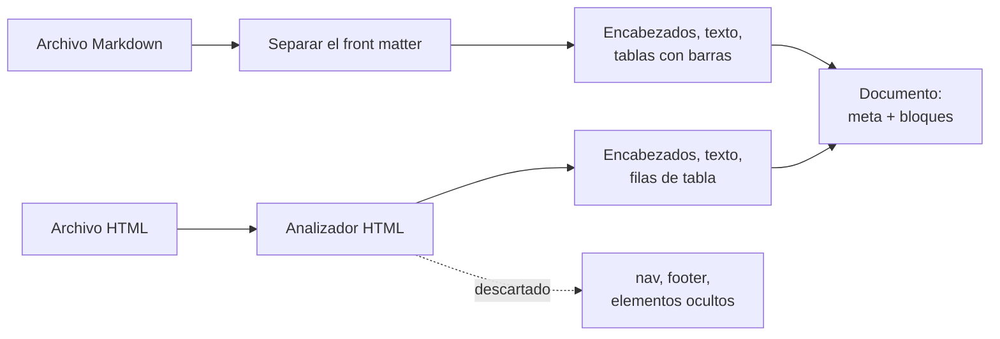
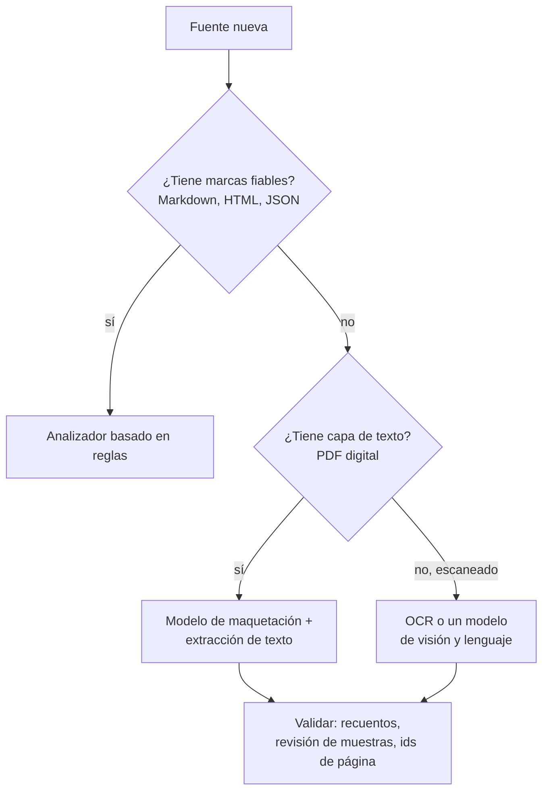
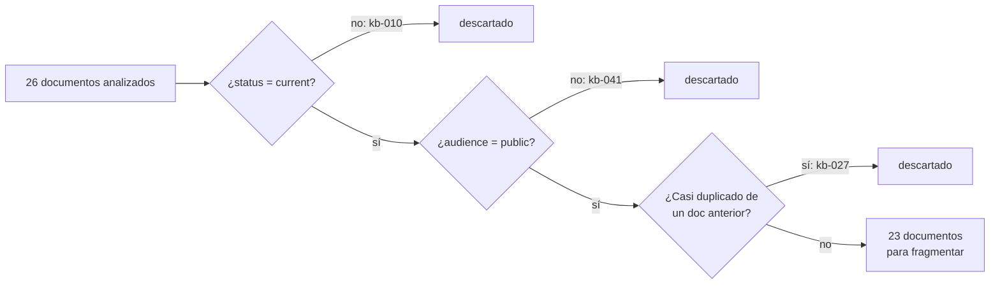
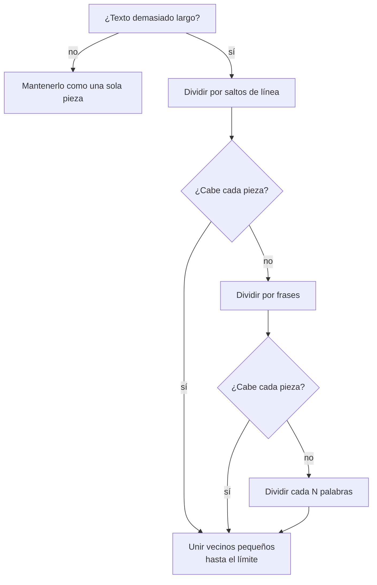

🌐 [English](02-parsing-and-chunking.md) · Español

# Lección 5.2 — Análisis y fragmentación del centro de ayuda

> **Módulo 05 · Lección 2 de 4** · ⏱️ unos 60 min · 🧪 Lab: [paso 2](lab/README.es.md#paso-2--filtra-y-fragmenta)

## 📨 Situación

> **De:** Dani Ruiz · Ciencia de datos, responsable de evaluación
> **Canal:** #support-ai
>
> Abrí la carpeta que piensas indexar. Contiene la política de devoluciones de 2023 marcada como
> `superseded`, un manual interno de escalado, la FAQ de la cuenta dos veces (en Markdown y en una
> exportación HTML), una página de envíos que solo existe en español y una tabla comparativa que es el
> único sitio donde aparecen los pesos de los productos. Si metes eso en un índice como un bloque por
> archivo, cada número que reportes después mide el desorden, no tu recuperador. Antes de que nadie
> elija un modelo de *embeddings*: enséñame cómo analizas y cortas estos documentos, y enséñame la
> evaluación de cada decisión. No una configuración. Todas.

## 🎯 Objetivos

Al terminar esta lección puedes:

- Analizar (*parse*) con reglas el *front matter* de Markdown y las páginas HTML (*HyperText Markup
  Language*) (metadatos, encabezados, tablas,
  elementos ocultos), y explicar cuándo merece la pena el coste de un analizador basado en IA
  (inteligencia artificial).
- Filtrar documentos por `status` y `audience` y eliminar casi duplicados antes de indexar, y después
  medir qué cambió.
- Implementar y comparar cinco estrategias de fragmentación (*chunking*): de tamaño fijo con
  solapamiento, recursiva, por encabezados, semántica y por filas de tabla.
- Explicar una diferencia entre dos fragmentadores (*chunkers*) en una tabla de evaluación leyendo los
  propios fragmentos.

## 🤔 Predice primero

Apunta tus respuestas antes de seguir leyendo. Las comprobarás en la autoevaluación.

1. Quitar tres documentos (la política antigua, el manual interno y la FAQ duplicada) antes de
   indexar: ¿el *recall@5* subirá, bajará o se quedará igual?
2. Los pesos de los productos solo aparecen en una tabla HTML. Si toda la tabla se convierte en un solo
   fragmento, ¿encontrará la búsqueda por palabras clave "How much does the Watcher S1 weigh?"?
3. ¿Fragmentos más pequeños o más grandes: cuáles recuperan mejor?

## 1. Análisis basado en reglas: de archivos a documentos estructurados

El **análisis** (*parsing*) convierte un archivo en bruto en algo sobre lo que un programa puede
razonar: metadatos (quién, cuándo, para quién) y estructura (encabezados, párrafos, tablas). La mayoría
de los fallos de recuperación que más adelante parecen misteriosos empiezan aquí, cuando un analizador
aplana una tabla sin avisar o se queda con una barra de navegación.

El centro de ayuda de Hearthwise llega en dos formatos, y los dos se prestan al **análisis basado en
reglas** (*rule-based parsing*), es decir, reglas escritas a mano que se apoyan en las propias marcas
del formato:

| Formato | Metadatos | Estructura | Ruido que hay que descartar |
|---|---|---|---|
| Markdown | *Front matter* entre líneas `---` (`id`, `status`, `audience`, `lang`, `effective_date`...) | Encabezados `#`, párrafos, listas `-`, tablas con barras `|` | Casi ninguno |
| HTML | Etiquetas `<meta name=... content=...>` y `<title>` | `<h1>`–`<h6>`, `<p>`, `<li>`, filas y celdas de `<table>` | `<nav>`, `<footer>`, scripts, estilos, elementos ocultos |

El analizador del lab conserva esa estructura como una lista de **bloques**. Un bloque es un encabezado
(con su nivel), un párrafo de texto o una tabla (con sus filas, empezando por la cabecera). Guardar las
tablas como filas en lugar de como una ristra de palabras es lo que hace posible la fragmentación que
entiende las tablas de la sección 4.

**Analogía:** una oficina de correo interno. Antes de que nadie lea una carta, alguien de la oficina
lee el sobre (remitente, fecha, "confidencial") y la clasifica. El *front matter* y las etiquetas
`<meta>` son el sobre; los bloques son la carta, ya separada en párrafos.



El *front matter* es la regla más sencilla de todas: todo lo que hay entre las dos primeras líneas
`---` es `key: value`.

```python
def split_front_matter(raw: str) -> tuple[dict[str, str], str]:
    """Split ``---``-delimited ``key: value`` front matter from the Markdown body."""
    if not raw.startswith("---\n"):
        return {}, raw
    end = raw.index("\n---\n", 4)
    meta: dict[str, str] = {}
    for line in raw[4:end].splitlines():
        key, sep, value = line.partition(":")
        if sep:
            meta[key.strip()] = value.strip()
    return meta, raw[end + len("\n---\n"):]
```

Aplicado a todo el centro de ayuda, el analizador encuentra 26 documentos y 13 tablas con 80 filas de
datos, y descarta 1 elemento HTML oculto. Ese elemento oculto es un párrafo con el estilo
`display:none` en una página de la comunidad (`kb-025`): invisible para la clientela, pero lleno de
instrucciones dirigidas a asistentes de IA. Un analizador que lo conserva le entrega un ataque a tu
chatbot. El módulo 06 trata la inyección a fondo; la defensa más barata empieza aquí, indexando solo lo
que vería una persona al leer la página.

> ⚠️ **Error común:** quitar el HTML con una expresión regular como `<[^>]+>`. Te quedas con los
> enlaces de navegación y el párrafo oculto, y conviertes una tabla en un chorro de números sin nombres
> de columna. Usa un analizador HTML de verdad y decide, elemento a elemento, qué conservar.

## 2. Análisis basado en IA: cuando el formato se resiste

Las reglas funcionan cuando la fuente tiene marcas fiables. Muchas empresas tienen también archivos
PDF (*portable document format*) exportados desde procesadores de texto, tarjetas de garantía
escaneadas y presentaciones con tablas dibujadas como imágenes. Ahí las
marcas han desaparecido: un PDF guarda caracteres en posiciones de una página, no "esto es un
encabezado". El **análisis basado en IA** (*AI-based parsing*) usa modelos para recuperar la
estructura:

| Enfoque | Qué hace | Bueno para | Cuidado con |
|---|---|---|---|
| OCR (reconocimiento óptico de caracteres, *optical character recognition*) | Convierte píxeles en caracteres | Páginas escaneadas | El orden de lectura, las columnas, las tablas |
| Modelos de maquetación (*layout models*) | Detectan las regiones de una página (título, párrafo, tabla, figura) y su orden | PDF de varias columnas, formularios | Necesitan un paso aparte para leer cada tabla |
| Modelos de visión y lenguaje (VLM, *vision-language models*) | Leen la imagen de una página y escriben Markdown o JSON (*JavaScript Object Notation*) | Tablas desordenadas, contenido mixto | Coste por página, velocidad, y celdas inventadas o fusionadas |

Los analizadores basados en IA son más lentos y más caros que las reglas, y pueden equivocarse con
mucha fluidez: un VLM puede "ordenar" una tabla fusionando dos filas, y nada en la salida te lo indica.
Trata su salida como cualquier salida de un modelo. Guarda el número de página como metadato para que
una cita pueda remitir al original, comprueba los recuentos (filas, páginas) frente a la fuente y
revisa a mano una muestra.

**Analogía:** un escáner de formularios frente a una persona que transcribe. El escáner es rápido y
exacto con el formulario para el que se diseñó, e inútil con cualquier otra cosa. La persona que
transcribe se apaña con todo, cuesta más y, de vez en cuando, "corrige" lo que lee.



Hearthwise tiene suerte: su centro de ayuda está en Markdown y HTML, así que el lab usa solo reglas. La
decisión no va de modas; va de lo que te da la fuente.

> 💡 **Consejo de producción:** ejecuta el analizador caro una sola vez, fuera de línea, y guarda en
> caché su salida junto a un *hash* del archivo fuente. Vuelve a analizar solo cuando cambie el *hash*.
> Así, el coste del análisis escala con las ediciones, no con el tamaño de la biblioteca.

## 3. Metadatos: filtra y deduplica antes de indexar

Cada documento de Hearthwise lleva metadatos que un recuperador (*retriever*) debería respetar:

| Campo | Valores en el centro de ayuda | Qué hacer con él |
|---|---|---|
| `status` | `current`, `superseded` | Indexar solo `current` |
| `audience` | `public`, `internal` | Un bot para la clientela indexa solo `public` |
| `lang` | `en`, `es` | Conservar los dos; usarlo para enrutar o para elegir el idioma de la respuesta |
| `effective_date` | fechas como 2025-03-01 | Desempatar entre documentos vigentes que se contradicen |
| `source` | `official`, `community` | Confiar primero en las fuentes oficiales y mostrarlas antes |

Dos documentos incumplen las dos primeras reglas: `kb-010` (la política de devoluciones de 2023,
`superseded`) y `kb-041` (el manual de escalado, `internal`). Un tercer problema no tiene ninguna marca
en los metadatos: la FAQ de la cuenta existe dos veces. Para detectar copias de esta página de
preguntas frecuentes (FAQ, *frequently asked questions*), el lab compara cada par de documentos con la
**similitud de Jaccard** de sus 5-gramas de palabras (la proporción de secuencias de cinco palabras que
tienen en común). La FAQ en Markdown (`kb-026`) y
su exportación HTML (`kb-027`) puntúan 0.884, muy por encima de cualquier otro par, así que se descarta
la exportación.

**Analogía:** limpiar la nevera antes de cocinar. Tirar la leche caducada no hace que la sopa sepa
mejor por sí solo, y alguna vez la sopa dependía de ella. Aun así, la tiras.



```python
from m05_retrieval.chunking import is_servable, prepare_corpus
from m05_retrieval.parsing import load_kb

docs = load_kb()
print([d.doc_id for d in docs if not is_servable(d)])  # ['kb-010', 'kb-041']
kept, report = prepare_corpus(docs)  # metadata filters + near-duplicate removal
print(len(kept))  # 23
for doc_id, reason in sorted(report.dropped.items()):
    print(doc_id, reason)
# kb-010 status=superseded
# kb-027 near-duplicate of kb-026 (Jaccard 0.884)
# kb-041 audience=internal
```

¿Sirvió de algo? Mide dos cosas, no una. La **exposición** cuenta las preguntas (las 40) cuyos 5
primeros documentos incluyen uno sustituido o interno. Con fragmentos por encabezado y sin filtros, son
15 preguntas: la política antigua aparece en 11 y el manual interno en 4. Con los filtros, son 0. El
***recall@5*** (¿hay un documento relevante entre los 5 primeros?) se mueve en sentido contrario, de
0.917 a 0.889.

Esa caída es real y merece la pena entenderla. Quitar documentos cambia las estadísticas que usa un
índice por palabras clave para ponderar las palabras (lección 5.3), y una pregunta en el límite, q004,
sobre la garantía estándar, bajó del quinto al sexto puesto. Con 36 preguntas con respuesta, una
pregunta vale unos 0.028 de *recall*. Los filtros son una decisión de corrección: no volverías a meter
el manual interno para ganar una pregunta, igual que no reabrirías un agujero de seguridad porque un
*benchmark* fue más rápido.

> 💡 **Consejo de producción:** copia los metadatos del documento en cada fragmento y vuelve a filtrar
> al consultar. El filtro al indexar te protege de errores en el corpus; el filtro al consultar permite
> que un mismo índice sirva a la clientela y al equipo de soporte con permisos distintos.

## 4. Estrategias de fragmentación

Un **fragmento** (*chunk*) es la unidad que indexas, recuperas y citas. Los documentos enteros son
demasiado gruesos: el manual de instalación, con 13 encabezados, competiría como un solo bloque, y el
*prompt* cargaría páginas que la pregunta no necesita. Las frases sueltas son demasiado finas: "Then
release." ("Después, suelta.") no significa nada sin el paso anterior. Fragmentar es elegir dónde
cortar.

| Estrategia | Dónde corta | Punto fuerte | Punto débil |
|---|---|---|---|
| De tamaño fijo con solapamiento | Cada N palabras; los fragmentos consecutivos comparten M palabras | Sencilla, tamaño predecible | Corta a mitad de frase y a mitad de tabla; ignora la estructura |
| Recursiva | Por párrafos, luego por frases, luego por palabras, hasta que cada trozo cabe; los vecinos pequeños se vuelven a unir | Respeta los límites naturales | El tamaño varía; sigue sin ver los encabezados |
| Por encabezados (estructura) | En cada encabezado, así que una sección es un fragmento | Secciones coherentes y citables | Una sección larga o una tabla grande se convierte en un fragmento enorme |
| Semántica | Donde las frases consecutivas dejan de parecerse (según un *embedding*) | Sigue los cambios de tema en la prosa larga | Solo es tan buena como el *embedding*; cuesta un *embedding* por frase |
| Por filas de tabla | Cada fila de una tabla ancha se convierte en su propio fragmento, precedida por las cabeceras de la tabla | Cada valor conserva el nombre de su columna | Muchos fragmentos diminutos de un mismo documento |

El **solapamiento** (*overlap*) merece un comentario: con ventanas de 80 palabras y 20 palabras de
solapamiento, las últimas 20 palabras de un fragmento son las 20 primeras del siguiente. Un dato que
queda a caballo de un corte sobrevive entero en al menos un fragmento. El precio es texto duplicado en
el índice.

**Analogía:** cortar un libro de recetas en fichas. Puedes cortar cada 10 centímetros (fijo), al final
de cada párrafo (recursivo), en cada título de receta (por encabezados), donde el tema pasa de la masa
a la salsa (semántico), o dar a cada fila de la tabla de conversiones su propia ficha con los nombres
de las columnas escritos arriba (por filas de tabla).



El fragmentador por filas de tabla es el que se diseñó para la tabla comparativa de Dani. Cada fila se
escribe con sus cabeceras, así que el fragmento se lee como una frase que un modelo puede citar:

```python
def row_to_text(title: str, header: tuple[str, ...], row: tuple[str, ...]) -> str:
    """Serialise one table row so that every value keeps its column name."""
    pairs = "; ".join(f"{h}: {v}" for h, v in zip(header[1:], row[1:]))
    return f"{title} | {row[0]} | {pairs}"
```

Las tablas clave/valor de dos columnas (la lista `Spec | Value` de un producto) se leen bien aplanadas,
así que el lab solo divide las tablas de tres o más columnas. Esto es lo que produce cada estrategia con
los 23 documentos filtrados:

| Fragmentador | Fragmentos | Media de palabras por fragmento | Fragmento más grande (palabras) |
|---|---|---|---|
| fijo (80 palabras, 20 de solapamiento) | 65 | 72.1 | 94 |
| recursivo (100 palabras como máximo) | 52 | 73.5 | 100 |
| por encabezados | 111 | 34.4 | 153 |
| semántico (*embeddings* por *hashing*) | 98 | 39.0 | 120 |
| por filas de tabla (encabezados + filas de tablas anchas) | 128 | 31.1 | 96 |

> ⚠️ **Error común:** elegir un tamaño de fragmento porque lo usaba una entrada de blog. El tamaño
> adecuado depende de tus documentos, tus preguntas y el límite de entrada de tu modelo de
> *embeddings*. Trata el tamaño de fragmento como un parámetro que se mide, como todo lo demás en esta
> lección.

## 5. Medir los fragmentadores con el conjunto de evaluación

El conjunto de evaluación indica, para cada pregunta con respuesta, los documentos que contienen la
respuesta. El lab ordena los fragmentos, los agrupa en una lista ordenada de documentos y calcula:

- ***Recall@k*** (exhaustividad en k): la proporción de preguntas con un documento relevante entre los
  k primeros documentos. (Algunos textos lo llaman tasa de acierto, *hit rate*, y reservan "recall"
  para la proporción de todos los documentos relevantes encontrados; con uno o dos documentos
  relevantes por pregunta, las dos medidas casi coinciden.)
- **MRR (rango recíproco medio, *mean reciprocal rank*)**: la media de 1 / (posición del primer
  documento relevante). Un acierto en primer lugar puntúa 1, en segundo lugar 0.5, y un fallo 0.
- **ctx@5**: la proporción de preguntas con un documento relevante entre los 5 primeros *fragmentos*,
  que es lo que contendría de verdad un *prompt*.

Todas las filas de abajo usan el mismo recuperador por palabras clave (BM25, *Best Matching 25*, que se
explica en la lección 5.3) y los mismos filtros; solo cambia el fragmentador:

| Fragmentador | Recall@1 | Recall@5 | MRR | ctx@5 | `table` recall@5 |
|---|---|---|---|---|---|
| por encabezados | 0.667 | 0.889 | 0.770 | 0.861 | 0.00 |
| fijo | 0.750 | 0.972 | 0.840 | 0.944 | 1.00 |
| recursivo | 0.778 | 0.972 | 0.863 | 0.972 | 1.00 |
| semántico | 0.639 | 0.917 | 0.768 | 0.917 | 0.00 |
| por filas de tabla | 0.667 | 0.944 | 0.786 | 0.917 | 1.00 |

Lee primero la columna `table`. Con fragmentos por encabezado, toda la tabla comparativa es un único
fragmento de 153 palabras en el que "Watcher S1" aparece una vez, y pierde frente a fragmentos cortos
que mencionan el nombre del producto varias veces. Los fragmentos por filas de tabla resuelven las dos
preguntas de tabla. La lección 5.3 muestra la aritmética que hay detrás.

Ahora, la sorpresa: los fragmentos de tamaño fijo y los recursivos también puntúan 1.00 en tablas, y
encabezan la tabla en *recall*. No te quedes en el número; mira el fragmento. Este es el fragmento de
tamaño fijo que contiene la fila del Watcher S1:

```text
2022-03-14 Spark Mini 19 2.4 GHz 0.3 no 85 0 to 35 2022-03-14 Watcher S1 29 none (HomeMesh radio) 0.0 yes 34 -10 to 45 2023-04-03 Lookout C2 89 ...
```

La búsqueda encontró el documento correcto porque la ventana es corta, pero la fila de cabecera está en
otro fragmento. Un modelo que lea esto tiene que adivinar que "34" son gramos y no, por ejemplo, el
precio. El fragmento por filas de tabla lo dice claramente:

```text
Compare Hearthwise devices | Watcher S1 | Price (EUR): 29; Wi-Fi: none (HomeMesh radio); Standby (W): 0.0; Needs hub: yes; Weight (g): 34; Operating temperature (°C): -10 to 45; Launched: 2023-04-03
```

Dos observaciones honestas más. El fragmentador semántico queda cerca del de encabezados (MRR de 0.768
frente a 0.770, y 0.00 en tablas), porque su única noción de "parecido" es el *embedding* léxico por
*hashing* (lección 5.3). Y un divisor recursivo sencillo es una línea base (*baseline*) sólida en este
centro de ayuda pequeño y ordenado: prueba lo simple antes que lo ingenioso. Aun así, el resto del
módulo usa fragmentos por filas de tabla, y sacrifica algo de *recall@1* (0.667 frente al 0.778 del
fragmentador recursivo) a cambio de fragmentos que el generador puede leer sin adivinar. Ese es el tipo
de compromiso que Dani pidió ver: por escrito, con números y
con el texto de los fragmentos al lado.

**Analogía:** calificar una traducción solo por si aparecen las palabras correctas. Una ensalada de
palabras puede aprobar. También tienes que leerla.

> 💡 **Consejo de producción:** después de cada cambio de fragmentador, imprime los fragmentos de tus
> tres documentos más difíciles (`uv run lab chunk --show kb-007`). Las métricas te dicen que algo
> cambió; el texto de los fragmentos te dice si es un cambio que agradecería quien lo lee.

## 🧪 Pruébalo

Ejecuta estos comandos desde `modules/05-rag-retrieval/lab`.

1. Analiza el centro de ayuda. La tabla tiene una fila por documento; las últimas líneas la resumen.

   ```bash
   uv run lab parse
   ```

   ```text
   kb-040  markdown en   current    public         13    34      2      0
   kb-041  markdown en   current    internal        4     3      1      0

   26 documents, 13 tables (80 data rows), 1 hidden HTML element(s) dropped
   about 5,070 tokens of parsed text (rough count: words and punctuation)
   ```

2. Filtra, deduplica y fragmenta con el fragmentador por filas de tabla, mostrando los fragmentos de la
   tabla comparativa.

   ```bash
   uv run lab chunk --chunker table --show kb-007
   ```

   ```text
   near-duplicate: kb-027 ~ kb-026 (Jaccard 0.884)
   dropped kb-010: status=superseded
   dropped kb-027: near-duplicate of kb-026 (Jaccard 0.884)
   dropped kb-041: audience=internal

   chunker=table: 23 documents -> 128 chunks (words per chunk: mean 31.1, max 96)
   wrote outputs/chunks-table.jsonl

   --- kb-007#0 [Compare Hearthwise devices]
   Compare Hearthwise devices
   Use this table to compare the main specifications of every device we sell. Prices include VAT for Spain and Portugal.
   Standby power is measured with the device connected to Wi-Fi and idle.

   --- kb-007#1 [Compare Hearthwise devices]
   Compare Hearthwise devices | Ember T3 | Price (EUR): 149; Wi-Fi: 2.4 GHz; Standby (W): 0.6; Needs hub: no; Weight (g): 210; Operating temperature (°C): 5 to 35; Launched: 2023-10-02
   ```

   La salida continúa con un fragmento por dispositivo. Ejecútalo de nuevo con `--chunker heading` y
   `--chunker fixed` y compara el mismo documento.

3. Evalúa una configuración en detalle y lee los fallos.

   ```bash
   uv run lab eval --chunker heading
   ```

   ```text
   config                       chunks   R@1   R@5   MRR ctx@5 table x-ling exposed
   bm25/heading                    111 0.667 0.889 0.770 0.861  0.00   0.50       0

   recall@5 by category:
     cross_lingual      0.50
     fact               1.00
     injection_exposed  1.00
     long_doc           1.00
     multi_doc          1.00
     policy             0.90
     procedure          1.00
     spanish            1.00
     table              0.00
     version_trap       1.00
   misses at 5: q004, q017, q018, q022
   ```

   Después ejecuta `uv run lab eval --chunker table`: q017 y q018 (las preguntas de tabla) desaparecen
   de los fallos, y q004 y q022 se quedan.

## 🏭 En el mundo real

- **Los analizadores se versionan y se vuelven a ejecutar.** Cuando un analizador mejora, los equipos
  vuelven a analizar y fragmentar todo el corpus, y después repiten la evaluación antes de cambiar de
  índice. Los ids de fragmento que codifican el id del documento y la posición (`kb-007#4`) mantienen
  estables las citas entre reconstrucciones.
- **Los metadatos se aplican dos veces.** Una al construir el índice (no entra nada sustituido ni
  interno) y otra en cada consulta (los permisos de la persona usuaria filtran lo que puede coincidir).
- **Los duplicados salen de todas partes.** Exportaciones, traducciones, respuestas de FAQ copiadas en
  varias páginas de producto. La detección de casi duplicados con *shingles* o MinHash se ejecuta como
  parte de la ingesta.
- **Las tablas y los PDF reciben un trato especial.** Los equipos mantienen una ruta que entiende las
  tablas y a menudo guardan tanto una serialización legible de cada fila para la búsqueda como la tabla
  original para mostrarla.
- **El tamaño de fragmento depende del modelo de *embeddings*.** Los modelos de *embeddings* tienen un
  límite de entrada; el texto que lo supera se corta sin avisar. Los tamaños de fragmento se eligen para
  que quepan, con margen.

## ✅ Autoevaluación

**1. (Retoma la predicción 1.) ¿Qué le hizo al *recall@5* quitar la política antigua, el manual
interno y la FAQ duplicada, y por qué sigue siendo la decisión correcta?**

<details><summary>Respuesta</summary>

El *recall@5* pasó de 0.917 a 0.889, porque una pregunta en el límite (q004) bajó del quinto al sexto
puesto cuando cambiaron las estadísticas de las palabras. La exposición pasó de 15 preguntas a 0. La
conclusión tentadora, "los filtros perjudican la recuperación", mezcla dos objetivos: los filtros
existen por corrección y por control de acceso, y una oscilación de una pregunta en un conjunto de 36
es ruido comparada con filtrar un código de vale interno.

</details>

**2. (Retoma la predicción 2.) ¿Por qué la búsqueda por palabras clave no encuentra el peso del
Watcher S1 cuando la tabla comparativa es un solo fragmento?**

<details><summary>Respuesta</summary>

El fragmento de la tabla es largo (153 palabras) y menciona "Watcher S1" una vez, mientras que otros
fragmentos son cortos y lo mencionan varias veces. La puntuación por palabras clave premia eso, así que
la tabla queda abajo. Dividir la tabla en filas crea un fragmento corto sobre exactamente un
dispositivo, con "Weight (g)" escrito junto al valor.

</details>

**3. (Retoma la predicción 3.) ¿Los fragmentos más pequeños son siempre mejores?**

<details><summary>Respuesta</summary>

No. El fragmentador por filas de tabla tiene los fragmentos más pequeños (31.1 palabras de media), pero
no el mejor *recall@1*; el fragmentador recursivo, con fragmentos de más del doble de longitud, puntúa
aquí más alto en *recall* y MRR. Los fragmentos pequeños afinan la coincidencia, pero pierden contexto
y pueden llenar el top 5 con trozos de un mismo documento. Mide con tus propias preguntas, y lee los
fragmentos.

</details>

**4. Un manual en PDF tiene dos columnas por página y tablas dibujadas como imágenes. ¿Qué enfoque de
análisis eliges y qué compruebas después?**

<details><summary>Respuesta</summary>

Las reglas no funcionarán: no hay marcas fiables. Usa un modelo de maquetación con extracción de texto,
o un modelo de visión y lenguaje para las tablas en imagen. Después valida: compara los recuentos de
páginas y filas con la fuente, revisa páginas a mano y guarda el número de página en los metadatos de
cada fragmento para que las respuestas puedan citar el original.

</details>

**5. Encuentra el fallo: `chunk_fixed(doc, size=50, overlap=50)`.**

<details><summary>Respuesta</summary>

Con un solapamiento igual al tamaño, la ventana nunca avanzaría. El `chunk_fixed` del lab lanza un
`ValueError` en este caso. El solapamiento tiene que ser menor que el tamaño del fragmento; una cuarta
parte de él es un punto de partida habitual.

</details>

## 💬 Explícalo con tus palabras

1. Dani pidió "la evaluación de cada decisión". Explícale, en cuatro frases, por qué la puntuación
   perfecta en `table` del fragmentador de tamaño fijo no lo cuenta todo.
2. Noor pregunta por qué descartas los elementos HTML ocultos al analizar en lugar de "decirle al modelo
   que los ignore". Responde en dos frases.

## 🔑 Ideas clave

- Analiza para obtener estructura (metadatos + encabezados, texto, tablas), no una cadena por archivo.
- Usa reglas cuando la fuente tiene marcas; usa modelos de maquetación o de visión y lenguaje cuando no
  las tiene, y valida su salida.
- Filtra por `status` y `audience` y elimina los casi duplicados antes de indexar; mide la exposición,
  no solo el *recall*.
- La fragmentación decide dónde cortar: fija, recursiva, por encabezados, semántica o por filas de
  tabla, cada una con su coste.
- Evalúa los fragmentadores con tus preguntas, por categoría, y lee los fragmentos que hay detrás de los
  números.
- Con 36 preguntas, una pregunta mueve el *recall* unos 0.028: trata las diferencias pequeñas como
  ruido.

## 📚 Profundiza

- ⭐ [Dense passage retrieval for open-domain question answering](https://arxiv.org/abs/2004.04906) —
  muestra cómo las unidades del tamaño de un pasaje (unas 100 palabras) se convirtieron en la
  granularidad estándar de la recuperación.
- [Retrieval-augmented generation for knowledge-intensive NLP tasks](https://arxiv.org/abs/2005.11401)
  — el planteamiento original de RAG, construido sobre pasajes de una enciclopedia fragmentada.
- [Documentación de Sentence Transformers](https://www.sbert.net) — consulta la longitud de entrada del
  modelo de *embeddings* que piensas usar antes de elegir un tamaño de fragmento.

---

[← Anterior: 5.1 Por qué la generación aumentada por recuperación](01-rag-overview.es.md) · [🏠 Módulo 05](README.es.md) · [Siguiente: 5.3 Indexación: palabras clave, conocimiento y vectores →](03-indexing-and-embeddings.es.md)
